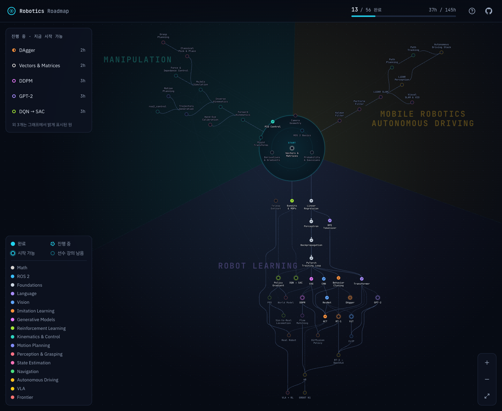

<div align="center">

# Robotics Roadmap · gawbi

**Robot Learning · Manipulation 직무를 준비하며 공부한 기록**

[](#커리큘럼)
[](#커리큘럼)
[](lessons/LICENSE.md)
[](LICENSE)

**[공부 기록 보기](https://gawbi.github.io/robotics-roadmap/#/me)** · [커리큘럼 지도](https://gawbi.github.io/robotics-roadmap/) ·
[기록 방식](#공부한-것을-남기는-방식) · [웹·앱으로 공부하기](#웹앱으로-공부하기) · [원본에 더한 것](#원본에-더한-것) · [라이선스](#라이선스)



</div>

## 소개

[woolimi/robotics-roadmap](https://github.com/woolimi/robotics-roadmap) 의 강의 지도를 따라 로보틱스를 공부하면서, 공부한 흔적을 지도
위에 남기는 리포입니다. 원 하나가 강의 하나이고 선은 먼저 읽어 두면 좋은 강의를 잇습니다. Robot Learning·Manipulation 쪽에는
최근 연구와 현업 도구를 다루는 강의를 더했습니다.

[공부 기록 페이지](https://gawbi.github.io/robotics-roadmap/#/me)에서 퀴즈를 통과한 강의, 직접 쓴 노트, 직접 구현한 코드, 공부한 날을
한 번에 볼 수 있습니다.

## 공부한 것을 남기는 방식

강의 하나를 이렇게 공부하고, 그 결과를 리포에 커밋합니다.

1. **강의를 읽는다**: 그림과 숫자 예시로 원리를 따라가고, 유도는 접힌 "심화" 블록에서 확인합니다
2. **퀴즈를 푼다**: 강의의 원리마다 한 문항씩 묻는 면접형 퀴즈입니다. 틀린 원리는 다른 문항으로 다시 묻고, 틀린 문항이 남지 않으면
   통과입니다
3. **노트를 쓴다**: 강의를 덮고 내 말로 요약, 직접 해 본 계산, 헷갈렸던 점, 면접 질문에 대한 답을 씁니다
4. **구현한다**: 강의 하나를 코드 하나로 옮기거나, 여러 강의를 잇는 프로젝트를 만들고 결과를 그래프·숫자로 남깁니다
5. **커밋한다**: 사이트에서 푼 퀴즈와 쓴 노트는 바로 커밋되고, 구현 코드는 직접 push 합니다. GitHub Pages 가 다시 배포되어 공개 지도에
   반영됩니다

| 기록 | 리포의 위치 | 사이트에서 보이는 곳 |
| --- | --- | --- |
| 퀴즈 결과 | `progress/<강의>.json`: 응시 날짜와 문항별 정답 여부 | 지도의 원이 칠해지고, 강의 창에 응시 날짜와 점수 |
| 노트 | `notes/<강의>.md` | 원 오른쪽 위의 점, 강의 창의 **내 노트** 탭 |
| 구현 | `labs/<이름>/`: 코드와 결과를 담은 README | 원 왼쪽 위의 마름모, **구현** 탭, 공부 기록 페이지의 프로젝트 카드 |
| 공부한 날 | 위 세 폴더를 바꾼 커밋 날짜와 퀴즈 응시 날짜 | 공부 기록 페이지의 heatmap |

노트와 구현 탭에는 각 파일의 GitHub 커밋 이력 링크가 있어서 언제 썼는지 확인할 수 있습니다. 형식은
[docs/templates/](docs/templates/) 의 `note.md`, `lab.md` 를 복사해서 씁니다.

## 원본에 더한 것

**강의 6개**: 원본과 같은 형식(논문 원문으로 확인한 숫자, 그림, 접힌 심화 블록, 면접형 퀴즈)으로 Claude Code 와 함께 썼습니다.

| 강의 | 영역 | 다루는 것 |
| --- | --- | --- |
| [Humanoid Whole-Body Control](lessons/humanoid-wbc/README.md) | Reinforcement Learning · 3h | motion capture retargeting, tracking reward, privileged teacher → student, H2O·OmniH2O·ExBody2·GMT·SONIC, ASAP 의 delta action, VLA 아래의 whole-body controller |
| [Robot Data Scaling](lessons/data-scaling/README.md) | Imitation Learning · 2h | Open X-Embodiment·DROID, 로봇 없이 모으는 UMI, 환경·물체 다양성의 data scaling law, MimicGen·DemoGen 합성 시연, CUPID curation, π0.5 의 data mixture |
| [Reasoning VLA](lessons/vla-reasoning/README.md) | Frontier · 2h | π0.5 의 high-level 추론, Hi Robot, embodied chain-of-thought, 추론 token 의 비용과 제어 주기, knowledge insulation, Gemini Robotics-ER·1.5 |
| [GPU Motion Generation](lessons/gpu-motion-generation/README.md) | Motion Planning · 3h | CHOMP·TrajOpt, 구 근사와 ESDF(nvblox), GPU 에서 seed 여러 개를 함께 푸는 cuRobo, 벤치마크 숫자 읽기, MPC, Isaac ROS cuMotion |
| [6D Object Pose](lessons/object-pose/README.md) | Perception & Grasping · 2h | PnP·RANSAC·ICP, 대칭 물체와 ADD·BOP 지표, PoseCNN·DOPE, render-and-compare(MegaPose), FoundationPose, pose 에서 grasp 까지 |
| [Tactile Sensing](lessons/tactile-sensing/README.md) | Perception & Grasping · 2h | GelSight 의 photometric stereo 와 marker, 미끄러짐 감지, TACTO·Taxim simulation, visuo-tactile policy·Sparsh, gel 마모와 센서마다 다른 신호 |

**사이트**

- 강의 창의 **강의 · 내 노트 · 구현** 탭, 강의마다의 퀴즈 응시 이력
- 강의의 핵심 절을 애니메이션과 한국어 음성으로 줄인 **요약 영상**(`video/`, Remotion + MeloTTS). 절마다 "멈추고 적어 보기" 화면이 있다
- 지도에서 노트(점)와 구현(마름모)이 있는 강의 표시
- 공부 기록 페이지 `#/me`: 퀴즈 통과 강의 수, 공부한 날 heatmap, 영역별 진행, 구현 프로젝트, 노트 목록
- `progress/`·`notes/`·`labs/` 가 바뀌어도 GitHub Pages 를 다시 배포

## 웹·앱으로 공부하기

설치 없이 [사이트](https://gawbi.github.io/robotics-roadmap/)에서 공부하고, 기록은 내 GitHub 리포에 남깁니다. 서버는 없고, 브라우저가
GitHub API 로 바로 커밋합니다.

1. 사이트 오른쪽 위의 **내 공부 시작** 을 누릅니다
2. 기록을 둘 리포를 만듭니다. 이 리포의 주인은 `gawbi/robotics-roadmap` 을 그대로 쓰고, 다른 사람은 자기 계정에 `robotics-study`
   같은 public 리포를 만듭니다
3. [Fine-grained token](https://github.com/settings/personal-access-tokens/new) 을 만듭니다. Repository access 는 2 의 리포 하나만,
   Permissions 의 **Contents** 는 **Read and write** 로 줍니다
4. 토큰을 붙여넣고 연결합니다. 이제 퀴즈를 제출하면 `progress/<강의>.json` 이, 강의 창의 **내 노트** 탭에서 저장하면
   `notes/<강의>.md` 가 그 리포에 커밋되고, 그 커밋이 내 잔디가 됩니다

토큰은 그 브라우저에만 저장되고 GitHub 말고는 어디로도 보내지 않습니다. 다른 기기에서는 한 번 더 연결합니다.

**앱처럼 쓰기**: 휴대폰 브라우저의 "홈 화면에 추가"(iPhone Safari 는 공유 → 홈 화면에 추가, Android Chrome 은 메뉴 → 앱 설치)로 앱처럼
설치됩니다. 한 번 연 강의는 오프라인에서도 읽을 수 있습니다. 홈 화면 앱은 브라우저와 저장 공간이 따로라서 앱 안에서 한 번 더
연결합니다.

**기록 보여 주기**: 연결한 뒤 **공부 기록** 페이지에 나오는 링크(`?u=<아이디>/<리포>#/me`)를 보내면, 받은 사람이 같은 지도 위에서 내
기록을 봅니다. 연결하지 않은 방문자에게는 이 리포 주인(gawbi)의 기록이 보입니다.

## 로컬에서 실행

[Node.js](https://nodejs.org/) 20.19 이상(또는 22.12 이상)과 git 이 필요합니다.

```bash
git clone https://github.com/gawbi/robotics-roadmap.git
cd robotics-roadmap/site
npm install
npm run dev     # http://localhost:5173
```

로컬 지도에서는 dev server 가 퀴즈 답안을 채점해 이 폴더의 `progress/<강의>.json` 에 저장합니다. 사이트에서 커밋한 기록이 있으니
시작하기 전에 `git pull` 로 받아 두고, 마치면 커밋합니다.

```bash
git pull
git add progress notes labs
git commit -m "Study kalman-filter: quiz, note, 1D filter lab"
git push
```

### 원본 강의 업데이트

`npm run dev` 로 지도를 띄우면 dev server 가 원본 리포(woolimi/robotics-roadmap)를 `upstream` remote 로 확인해서, 이 리포에 없는 강의
변경이 있으면 화면 위쪽에 업데이트할지 묻습니다. 원본은 `progress/`·`notes/`·`labs/` 를 건드리지 않으므로 기록과 충돌하지 않습니다.

## 커리큘럼

| 영역 | 다루는 것 |
| --- | --- |
| 공통 기초 | vector·행렬, 미분·gradient, 확률·Gaussian, ROS 2(node·topic·tf2), 좌표 변환, PID 제어, 카메라 geometry |
| Robot Learning | linear regression 에서 PyTorch 까지의 신경망 기초, CNN·ViT·CLIP, Transformer·GPT-2, VAE·diffusion·flow matching, 강화학습(DQN·SAC·PPO·sim-to-real), humanoid whole-body control, imitation learning(behavior cloning·DAgger·ACT·Diffusion Policy), 로봇 데이터의 규모, VLA(RT-2·OpenVLA·π0·GR00T N1), 추론하는 VLA, world model |
| Manipulation | forward·inverse kinematics, MuJoCo simulation, force·impedance control, ros2_control, trajectory generation, motion planning(RRT·OMPL·MoveIt 2), GPU motion generation(cuRobo), hand-eye calibration, 6D object pose, pick-and-place, grasp planning, tactile sensing |
| Mobile Autonomy(이동 로봇·자율주행) | Kalman filter, particle filter, LiDAR·visual SLAM, path planning(A*·Nav2), path tracking(pure pursuit·MPC), LiDAR perception, 자율주행 stack(Autoware) |

가운데의 Vectors & Matrices 에서 시작해 공통 기초를 읽고, 직무 영역을 따라 바깥으로 나아갑니다. 선수 관계는 권장 순서일 뿐이라 어떤
강의든 바로 열 수 있습니다.

## 프로젝트 구조

```text
robotics-roadmap/
├── lessons/              # 강의 (원본 56개 + 추가 6개)
│   ├── branches.yaml     # 지도의 동심원·영역·branch 설정
│   └── <강의>/           # README.md(본문), quiz.yaml(퀴즈), figures/(SVG 그림)
├── progress/             # 퀴즈 기록 (dev server 가 씀)
├── notes/                # 강의마다 내 말로 쓴 노트
├── labs/                 # 직접 구현한 코드와 결과
├── docs/templates/       # 노트·구현 README 템플릿
├── site/                 # 지도·강의·공부 기록 페이지를 보여 주는 Vite + React 앱
├── video/                # 요약 영상의 대본·애니메이션(Remotion)과 음성 생성(tts/), 공개본은 video/published/
├── CONTRIBUTING.md       # 강의·퀴즈·지도 규칙
└── CLAUDE.md             # Claude Code 로 강의를 쓸 때의 규칙과, 기록을 대신 쓰지 않는다는 원칙
```

강의를 고치거나 더할 때는 [CONTRIBUTING.md](CONTRIBUTING.md) 의 형식을 따르고, `site/` 에서 `npm test` 로 형식과 지도 레이아웃
검사를 통과시킵니다.

## 라이선스

- 커리큘럼 원본: [woolimi/robotics-roadmap](https://github.com/woolimi/robotics-roadmap) (Woolim Park)
- 강의(`lessons/`)와 문서 이미지(`docs/`): [CC BY-NC-SA 4.0](lessons/LICENSE.md). 원본 강의와 이 리포에서 더하거나 고친 강의 모두 같은
  조건으로 공유합니다
- 지도 사이트(`site/`): [MIT](LICENSE)
- 지도의 트리 그림: 로봇팔("mechanical-arm", Lorc)과 주행 로봇("mars-curiosity", Delapouite)은 [game-icons.net](https://game-icons.net) 의
  그림으로 [CC BY 3.0](https://creativecommons.org/licenses/by/3.0/), 전자 두뇌("brain-circuit")는
  [Fluent UI System Icons](https://github.com/microsoft/fluentui-system-icons) 의 그림으로 MIT 입니다
- `notes/`·`labs/`·`progress/` 의 공부 기록: gawbi
