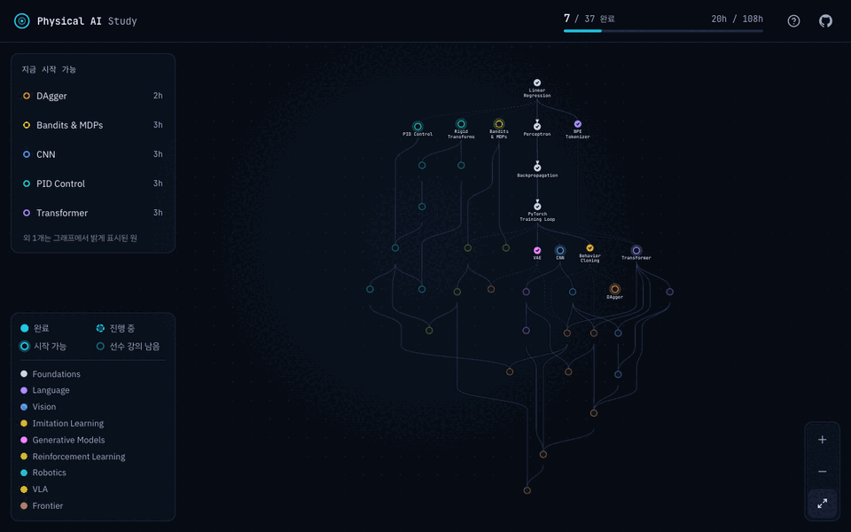
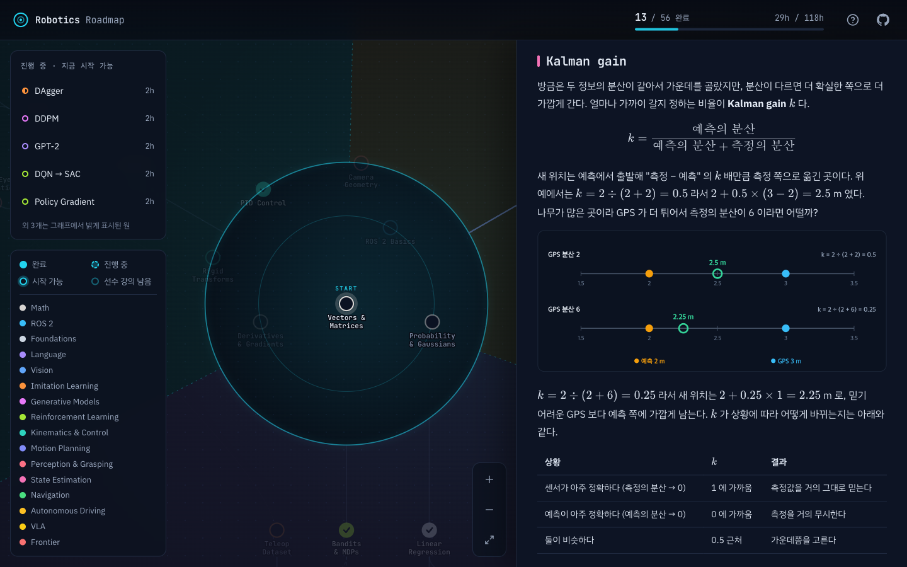
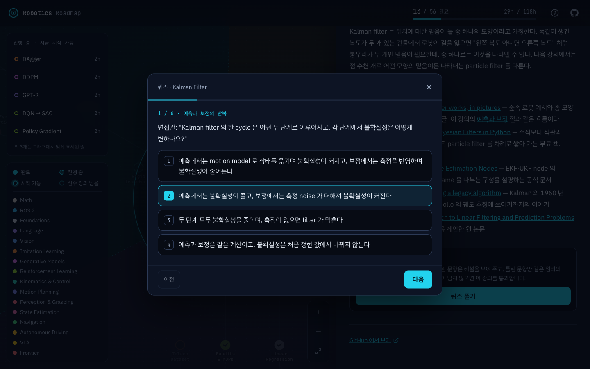

# Robotics Roadmap

<p align="center">
  
</p>

<p align="center">
  <b>강의 56개</b> · <b>branch 16개</b> · <b>약 145시간</b> · <b>코드 없이 숫자와 그림으로</b>
</p>

로보틱스 분야에 취업하려는 사람을 위한 독학 커리큘럼이다. vector·미분·확률과 ROS 2 같은 공통 기초에서 출발해 로봇 학습(VLA),
manipulation, mobile robot·자율주행 세 직무 방향으로 나아가며, 강의마다 개념을 실제 로봇에 쓰는 법과 면접에서 설명하는 법까지
다루고 면접 질문 형식의 퀴즈로 확인한다. 강의 56개가 선수 관계로 이어져 있고, 이 관계를 가운데에서 세 방향으로 뻗는 지도로 보여
준다. 코드를 짤 일은 없고, 강의는 처음 배우는 사람 기준으로 숫자 예시부터 한 단계씩 설명한다.

## 화면 구성

### 커리큘럼 지도


원 하나가 강의 하나이고, 색은 branch, 모양은 진행 상태(완료·진행 중·시작 가능·선수 강의 남음)를 나타낸다. 가운데 동심원에는
세 트리가 함께 쓰는 공통 기초가 부류별로 놓이고(안쪽부터 수학·ROS 2, 좌표 변환·PID·카메라), 가장 바깥 테두리에서 아래로는
로봇 학습, 왼쪽 위로는 manipulation, 오른쪽 위로는 mobile robot·자율주행 트리가 뻗고, 세 트리의 구역은 점선으로 나뉘어 구역마다
이름이 적혀 있다. 지도를 멀리서 볼 때는 이름표가 조금 커져 글씨가 읽힌다. 선은 선수
강의에서 이어지는 강의로 트리 바깥쪽을 향해 흐르고, 다른 트리의 강의를 선수로 둘 때는 흐린 선으로 잇는다. 왼쪽 위 목록은 선수 강의를 모두 마쳐 지금 시작할 수 있는 강의이고, 위쪽 막대는 완료한
강의 수와 시간이다.

### 강의 본문



강의를 열면 지도에서 그 강의의 선수 강의와 이어지는 강의만 밝게 남는다. 본문은 작은 숫자로 직접 계산하는 표, 어두운 배경에
맞춘 SVG 그림, KaTeX 수식, 절마다 답을 접어 둔 확인 문제로 이루어진다.

### 퀴즈



강의의 원리 하나마다 4지선다 한 문항을 묻는다. 제출하면 틀린 문항의 해설이 보이고, 다시 풀 때는 틀린 원리만 같은 원리의 다른
문항으로 다시 묻는다.

## 처음 준비

이 리포는 fork 해서 쓴다. 강의와 지도는 원본 리포에서 받고, 퀴즈 기록은 각자의 fork 에 커밋해 둔다.
[Node.js](https://nodejs.org/) 가 필요하다.

1. GitHub 에서 이 리포의 **Fork** 를 눌러 내 계정으로 복사한다
2. 내 fork 를 clone 하고 지도를 띄운다

   ```bash
   git clone git@github.com:<내 계정>/robotics-roadmap.git
   cd robotics-roadmap/site
   npm install
   npm run dev     # http://localhost:5173
   ```

3. 퀴즈를 풀면 dev server 가 답안을 채점해 리포의 `progress/<강의>.json` 에 쌓는다. 공부를 마칠 때 이 폴더를 커밋해 push 하면
   기록이 fork 에 남고, 다른 기기에서 clone 해도 진행 상태가 그대로 보인다

   ```bash
   git add progress
   git commit -m "Record quiz progress"
   git push
   ```

dev server 는 모든 network interface 에서 받으므로 같은 네트워크나 tailnet 의 다른 기기에서도 이 컴퓨터의 IP 로 지도를 열 수
있다. IP 대신 쓸 수 있는 host 이름은 [`site/vite.config.ts`](site/vite.config.ts) 의 `allowedHosts` 에 있다.

## 강의 하나의 진행

1. 지도에서 밝게 표시된 원을 눌러 강의를 연다. 가운데의 Vectors & Matrices 에서 시작해 공통 기초를 읽고, 지원하려는 직무의 트리를 따라 바깥으로 나아간다
2. "학습 목표" 부터 "정리" 까지 순서대로 읽는다. 표의 계산은 손이나 계산기로 한 줄씩 따라 해 본다
3. 강의 끝의 "퀴즈 풀기" 를 누른다. 원리마다 한 문항씩, 4지선다로 묻는다
4. 제출하면 틀린 문항의 해설이 보인다. "틀린 문제 다시 풀기" 를 누르면 틀린 문항만 같은 원리의 다른 문항으로 다시 묻는다
5. 틀린 문항이 남지 않으면 통과이고, 지도에서 그 강의가 완료로 칠해지며 이어지는 강의가 밝아진다

선수 관계는 권장 순서이고 잠금이 아니다. 진행 상태는 퀴즈 기록에서 정해진다. 응시 기록이 없으면 시작 전, 틀린 채로
남은 문항이 있으면 진행 중, 모든 문항의 마지막 답이 맞으면 완료다.

## 강의 업데이트 받기

원본 리포는 `progress/` 를 건드리지 않으므로 강의가 바뀌어도 내 기록과 충돌하지 않는다. GitHub 의 내 fork 화면에서
**Sync fork** 를 누르거나, 터미널에서 원본을 `upstream` 으로 더해 받아 온다.

```bash
git remote add upstream https://github.com/woolimi/robotics-roadmap.git   # 처음 한 번만
git fetch upstream
git merge upstream/main
git push
```

fork 에서는 `progress/` 만 커밋한다. `lessons/` 나 `site/` 를 직접 고치면 다음 업데이트에서 충돌할 수 있다. 원본 리포에서 직접
공부할 때는 `progress/` 를 `.git/info/exclude` 에 적어 기록이 원본에 올라가지 않게 한다.

## 강의 구성

| branch | 다루는 것 |
| --- | --- |
| Math | vector·행렬, 미분·gradient, 확률·Gaussian |
| ROS 2 | node·topic·QoS, tf2 |
| Foundations | linear regression, perceptron, backpropagation, PyTorch training loop |
| Language | BPE tokenizer, Transformer, GPT-2 |
| Vision | CNN, ResNet, ViT, CLIP |
| Imitation Learning | behavior cloning, DAgger, teleoperation 데이터, RT-1, Diffusion Policy, ACT, 실물 로봇 |
| Generative Models | VAE, DDPM, flow matching |
| Reinforcement Learning | bandit·MDP, DQN·SAC, policy gradient, PPO, sim-to-real 보행 |
| Kinematics & Control | 좌표 변환, forward·inverse kinematics, PID, MuJoCo, force·impedance control, ros2_control |
| Motion Planning | trajectory generation(사다리꼴·S-curve·TOTG), RRT·OMPL·MoveIt 2 motion planning |
| Perception & Grasping | 카메라 geometry, hand-eye calibration, pick-and-place, grasp planning(friction cone·Dex-Net) |
| State Estimation | Kalman filter, particle filter, LiDAR SLAM, visual SLAM·VIO |
| Navigation | costmap·A*·Nav2 path planning, pure pursuit·MPC path tracking |
| Autonomous Driving | LiDAR perception, 자율주행 stack(Autoware) |
| VLA | RT-2 → OpenVLA, π0, GR00T N1 |
| Frontier | world model, VLA 의 RL fine-tuning |

강의를 고치거나 새로 쓸 때의 규칙과 지도 사이트의 구조는 [CONTRIBUTING.md](CONTRIBUTING.md) 에 있다.
