# ACT

## 학습 목표

- 로봇 팔이 앞으로 할 동작 여러 개를 한 묶음으로 미리 받으면, 모델의 계산이 느려도 1초에 50 번 명령을 낼 수 있는 이유를 시간
  계산으로 보일 수 있다
- 동작을 묶어 내면 모델이 판단하는 횟수가 줄고, 그 덕분에 작은 실수가 쌓이는 문제도 줄어드는 이유를 숫자로 설명할 수 있다
- 서로 겹치는 동작 묶음들이 같은 순간에 대해 낸 예측을 비중을 달리해 평균하는 계산을 손으로 따라갈 수 있다
- 같은 장면에서 시연마다 다른 움직임 방식을 숫자 묶음 하나에 따로 담아 학습하면 여러 정답의 평균을 내는 문제를 피하는 이유와,
  로봇을 실제로 움직일 때 그 숫자를 0 으로 두는 이유를 설명할 수 있다
- 카메라 사진과 관절 각도가 ACT 모델 안에서 관절 목표값 묶음으로 바뀌기까지의 흐름과, 마지막에 관절값을 내는 부분의 계산을
  설명할 수 있다

## ALOHA 와 transfer-cube 과제

### 양팔 로봇 ALOHA

2023년 Tony Zhao, Vikash Kumar, Sergey Levine, Chelsea Finn 은 양팔 로봇으로 지퍼백 열기, 배터리 끼우기처럼 손끝이 정밀해야 하는
일을 사람의 시연만으로 가르쳤다. 이때 만든 로봇 장비가 ALOHA 이고, 이름은 "A Low-cost Open-source HArdware System for Bimanual
Teleoperation(양팔 원격 조종을 위한 저렴한 공개 하드웨어)" 에서 따왔다. 장비 전체를 2만 달러 안쪽으로 꾸몄고, 설계도와
소프트웨어를 모두 공개했다.

사람은 작은 조종용 팔(leader) 두 개를 손으로 움직이고, 큰 로봇 팔(follower) 두 개가 leader 의 관절 각도를 그대로 따라 움직인다.
사람이 로봇을 이렇게 원격으로 조종하는 것을 teleoperation 이라고
하고, 조종하는 동안 카메라 영상과 관절 각도를 기록해 시연(demonstration) 데이터를 모은다. 같은 논문에서 이 시연으로 학습한
policy 가 ACT(Action Chunking with Transformers)다. policy 는 "상황을 받아 행동을 내는 규칙" 이라는 뜻이고, ACT 에서는 그 규칙이
neural network(숫자를 곱하고 더하는 층을 여러 겹 쌓은 모델) 하나다. 이름의 Transformer 는 ACT 가 쓰는 neural network 구조의
이름이고, 뒤의 [ACT 의 구조](#act-의-구조) 절에서 다시 짚는다.

**확인 문제.** teleoperation 으로 시연을 모을 때 사람이 직접 손으로 움직이는 팔은 leader 와 follower 중 어느 쪽일까?

답 보기

leader 다. follower 는 leader 의 관절 각도를 따라 움직이는 로봇 팔이다.

### 50 Hz 제어와 step

ALOHA 는 1초에 50 번 로봇에게 명령을 내린다. 1초에 몇 번 일어나는지를 세는 단위가 Hz(헤르츠)라서 이것을 "50 Hz 로 제어한다"
고 말하고, 명령을 한 번 내리는 순간을 step 이라고 한다. 1초를 50 번으로 나누면 step 하나의 길이는 $1 \div 50 = 0.02$ 초다.
1000 분의 1초를 ms(밀리초)라고 하므로 0.02 초는 20 ms 다.

| step 번호 | 0 | 1 | 2 | 50 | 100 | 400 |
| --- | --- | --- | --- | --- | --- | --- |
| 시각 | 0 ms | 20 ms | 40 ms | 1 초 | 2 초 | 8 초 |

step 번호에 20 ms 를 곱하면 시각이 나온다. step 100 은 $100 \times 20 = 2000$ ms, 곧 2 초다.

50 Hz 는 팔이 움직이는 빠르기가 아니라 1초에 명령을 몇 번 새로 보내는지를 뜻한다. 5 Hz 라면 0.2 초마다 한 번만 명령이 바뀌어서,
그 사이에 사람이 손을 고쳐 움직여도 팔은 0.2 초 동안 앞 명령대로 움직인다. 논문은 사람 6 명에게 같은 ALOHA 로 케이블 타이를
구멍에 끼우는 일과 겹친 플라스틱 컵 두 개를 떼는 일을 시키고, 명령 횟수를 50 Hz 에서 5 Hz 로 줄였을 때의 작업 시간을 쟀다.

| 작업 | 50 Hz | 5 Hz |
| --- | --- | --- |
| 케이블 타이 끼우기 | 20 초 | 33 초 |
| 컵 떼기 | 10 초 | 16 초 |

두 작업 모두 밀리미터 단위로 맞춰야 해서, 명령이 드물게 바뀌면 사람이 어긋남을 늦게 고치고 그만큼 오래 걸렸다. 논문은 5 Hz 에서
작업 시간이 62% 늘었다고 보고했다. 손끝 작업일수록 명령을 자주 내려야 하고, ALOHA 가 50 Hz 로 조종하는 이유가 이것이다.

**확인 문제.** 25 Hz 로 제어하는 로봇에서 step 하나는 몇 ms 이고, 100 step 은 몇 초일까?

답 보기

$1 \div 25 = 0.04$ 초라서 40 ms 다. 100 step 은 $100 \times 40 = 4000$ ms, 곧 4 초다.

### 관측 14 개와 action 14 개

ALOHA 의 팔 하나는 관절 6 개와 물건을 쥐는 집게(gripper) 1 개로 움직이고, 집게의 벌림도 각도 하나로 적는다. 그래서 팔 하나의
자세는 숫자 7 개, 양팔은 $7 + 7 = 14$ 개다.

step 마다 기록하는 것은 Behavior Cloning 과 같은 두 가지다.

- **관측(observation)** — 그 순간 로봇이 센서로 받은 값이다. 카메라 사진과 follower 양팔의 지금 관절 각도 14 개다. 실물 ALOHA 는
  카메라가 4 대이고, 이 강의의 simulator 과제는 위에서 내려다보는 카메라 1 대만 쓴다. 사진 한 장은 세로 480 칸, 가로 640 칸의
  pixel(사진을 이루는 작은 칸)로 되어 있다
- **action** — 다음 step 에 양팔이 가야 할 목표 관절 각도 14 개다. 시연을 기록할 때는 그 순간 사람이 움직인 leader 팔의 관절
  각도를 action 으로 적는다

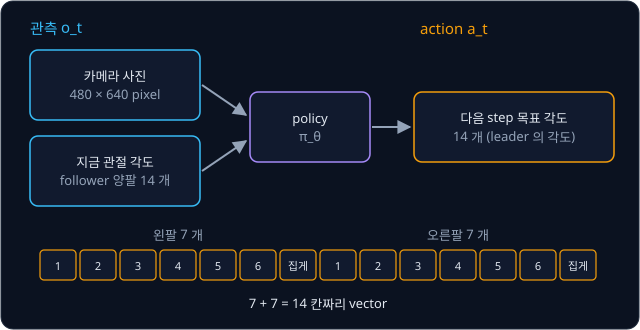

위 그림은 한 step 에 policy 가 받는 것과 내는 것을 보여 준다. 왼쪽 팔의 7 칸과 오른쪽 팔의 7 칸을 이어 붙여 14 칸짜리 숫자 묶음을
만든다. 순서를 정해 늘어놓은 숫자 묶음을 vector 라고 하므로, action 은 칸이 14 개인 vector 다.

시각 $t$ 의 관측을 $o_t$, action 을 $a_t$ 로 적는다. 아래첨자 $t$ 는 몇 번째 step 인지를 가리킨다. 한 step 에 action 하나를 내는
policy 는 Behavior Cloning 에서 본 대로 $\hat a_t = \pi_\theta(o_t)$ 로 쓰고, "관측 $o_t$ 를 policy $\pi_\theta$ 에 넣어 나온 값이
예측 action $\hat a_t$ 다" 로 읽는다. $\pi$ 는 pi(파이), $\theta$ 는 theta(세타)라고 읽고, $\theta$ 는 학습으로 정할 parameter
(모델 안에서 데이터를 보고 채우는 숫자)들을 한데 묶은 이름이다.

**확인 문제.** 팔 하나가 관절 5 개와 집게 1 개인 양팔 로봇이라면 action 은 숫자 몇 개일까?

답 보기

팔 하나가 $5 + 1 = 6$ 개이고 팔이 둘이라 $6 + 6 = 12$ 개다.

### transfer-cube 과제

ACT 논문은 실물 과제 6 개와 함께 simulator 과제 2 개로 ACT 를 시험했다. simulator 는 물체가 부딪히고 미끄러지는 모습을 물리
법칙대로 계산해 컴퓨터 안에서 재현하는 프로그램이고, ALOHA 의 simulator 는 [MuJoCo](../mujoco-sim/README.md) 로 만들었다.
그중 transfer-cube 는 오른팔이 테이블 위의 빨간 큐브를 집어 왼팔 집게에 건네는 과제다.

과제 한 번은 400 step, 곧 8 초 동안 이어진다. 이렇게 과제를 처음부터 끝까지 한 번 하는 것을 episode 라고 한다. simulator 는
진행 정도를 점수로 알려 주는데, 오른쪽 집게가 큐브에 닿으면 1, 큐브를 들어 올리면 2, 왼쪽 집게가 큐브에 닿으면 3, 왼쪽 집게가
큐브를 넘겨받아 테이블에서 떼어 쥐면 4 를 주고 4 를 성공으로 친다. 이 점수를 reward 라고 부른다.

사람이 이 과제를 50 번 시연한 데이터가 공개되어 있다. episode 마다 400 step 이라 기록된 순간은 $50 \times 400 = 20{,}000$ 개다.

**확인 문제.** 시연 episode 30 개가 각각 400 step 이면 기록된 순간은 모두 몇 개이고, 시연 시간은 모두 몇 초일까?

답 보기

$30 \times 400 = 12{,}000$ 개다. episode 하나가 8 초라서 시연 시간은 $30 \times 8 = 240$ 초, 곧 4 분이다.

**요약**

- ALOHA 는 사람이 leader 팔을 움직이면 follower 팔이 따라 움직이는 양팔 teleoperation 장비이고, 50 Hz 로 제어해 step 하나가 20 ms 다
- 관측은 카메라 사진과 지금 관절 각도 14 개, action 은 다음 step 의 목표 관절 각도 14 개다
- transfer-cube 는 오른팔이 큐브를 집어 왼팔에 건네는 400 step(8 초) 과제이고, reward 4 가 성공이다

## action chunking

### step 마다 결정하는 policy

Behavior Cloning 의 policy 는 step 마다 관측을 한 번 보고 action 을 하나 낸다. transfer-cube 라면 8 초 동안 관측을 400 번 보고,
"다음 20 ms 동안 어디로 갈지" 를 400 번 정한다. 관측을 보고 action 을 정하는 이 한 번 한 번을 이 강의에서는 결정이라고 부른다.

step 마다 결정하는 방식에는 문제가 둘 있다. 하나는 모델이 20 ms 안에 계산을 끝내야 한다는 것이고, 다른 하나는 결정이 400 번이라
작은 실수가 쌓일 기회도 400 번이라는 것이다.

### action chunk

ACT 는 한 번 결정할 때 다음 step 의 action 하나가 아니라 앞으로 $k$ step 동안의 action $k$ 개를 한꺼번에 낸다. 이렇게 묶은 action
덩어리를 action chunk 라고 하고, 덩어리로 묶어 내는 방식을 action chunking 이라고 한다. chunk 는 "덩어리" 라는 뜻이다.

$k = 4$ 로 작게 해 보자. 시각 $t = 0$ 에 관측을 한 번 보고 step 0, 1, 2, 3 의 목표 관절 각도 4 개를 한꺼번에 낸다. 로봇은 이 4 개를
20 ms 마다 하나씩 차례로 실행하고, step 4 가 되면 다시 관측을 보고 step 4 ~ 7 의 chunk 를 낸다.

$$
\hat a_{t:t+k} = (\hat a_t, \hat a_{t+1}, \ldots, \hat a_{t+k-1})
$$

$t:t+k$ 는 "$t$ 부터 $k$ 개" 라고 읽는다. 끝의 $t + k$ 번째는 들어가지 않아서, $t = 0$, $k = 4$ 이면 $\hat a_0, \hat a_1, \hat a_2,
\hat a_3$ 이다. 논문의 ACT 는 $k = 100$ 을 쓴다. action 하나가 숫자 14 개라서 chunk 하나는 100 줄 × 14 칸의 표, 숫자로는
$100 \times 14 = 1{,}400$ 개이고, 이 모양을 $(100, 14)$ 로 적는다. 시간으로는 $100 \times 20$ ms $= 2$ 초 분량이다.

| $k$ | chunk 하나의 길이 | 400 step 동안의 결정 횟수 |
| --- | --- | --- |
| 1 | 20 ms | $400 \div 1 = 400$ |
| 10 | 0.2 초 | $400 \div 10 = 40$ |
| 100 | 2 초 | $400 \div 100 = 4$ |

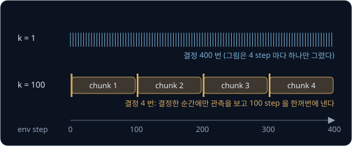

위 그림의 윗줄은 $k = 1$ 로 step 마다 결정하는 모습이고, 아랫줄은 $k = 100$ 으로 step 0, 100, 200, 300 에서만 관측을 보고 2 초짜리
chunk 를 내는 모습이다. 아랫줄에서도 로봇은 20 ms 마다 움직이고, 바뀐 것은 관측을 보고 결정하는 횟수뿐이다.

이름은 뇌과학에서 왔다. 뇌과학에서 chunking 은 자잘한 동작 여러 개를 하나로 묶어 기억하고 한 단위로 실행하는 것을 말하고, 논문은
사탕 포장지 모서리를 잡거나 배터리를 홈에 끼우는 동작 하나가 chunk 하나에 해당한다고 설명한다.

**확인 문제.** 50 Hz 로봇이 $k = 50$ 인 chunk 를 쓰면 chunk 하나는 몇 초 분량이고, 400 step episode 에서 결정은 몇 번일까?

답 보기

$50 \times 20$ ms $= 1000$ ms 라서 1 초 분량이다. 결정은 $400 \div 50 = 8$ 번이다.

### 추론 시간과 제어 주기

학습이 끝난 모델에 관측을 넣어 출력을 계산하는 일을 추론(inference)이라고 한다. 추론에도 시간이 걸리고, 모델이 클수록
곱하고 더할 숫자가 많아서 오래 걸린다. 어떤 모델이 관측 하나를 받아 출력을 내는 데 100 ms 가 걸린다고 하자.

$k = 1$ 이면 로봇은 20 ms 마다 새 action 이 필요한데 모델은 100 ms 에 하나밖에 만들지 못한다. 1초 동안 모델이 만드는 action 은
$1000 \div 100 = 10$ 개뿐이라서, 로봇은 명령 하나를 실행한 뒤 다음 명령이 올 때까지 80 ms 를 기다린다. 50 Hz 로 움직여야 할 로봇이
사실상 10 Hz 로 움직이게 된다.

$k = 100$ 이면 같은 100 ms 의 추론 한 번으로 2 초 분량의 action 100 개가 나온다. 로봇은 그 100 개를 20 ms 마다 하나씩 2 초 동안
실행하고, 모델은 그 2 초 안에 다음 chunk 를 계산해 두면 된다. 100 ms 는 2 초의 $100 \div 2000 = 0.05$, 곧 5% 라서 시간이 넉넉하다.

| | $k = 1$ | $k = 100$ |
| --- | --- | --- |
| 추론 한 번에 나오는 action | 1 개 (20 ms 분량) | 100 개 (2 초 분량) |
| 추론 한 번에 걸리는 시간 | 100 ms | 100 ms |
| 1 초에 로봇이 받는 명령 | $1000 \div 100 = 10$ 개 | 50 개 |
| 추론이 끝나야 하는 시한 | 20 ms | 2000 ms |

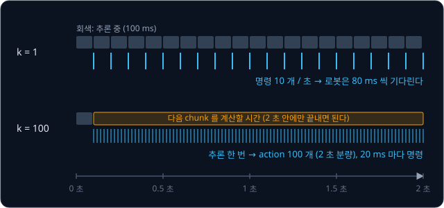

위 그림은 0 초부터 2 초까지의 시간축이다. 윗줄($k = 1$)의 회색 막대는 추론하는 동안이고, 막대 하나가 끝날 때마다 파란 눈금, 곧
명령이 하나씩 나온다. 아랫줄($k = 100$)은 처음 추론 한 번 뒤로 파란 눈금이 20 ms 간격으로 촘촘히 이어진다.

규칙을 식으로 쓰면 "추론 시간 ≤ $k$ × step 길이" 다. 추론이 이 시한 안에 끝나야 로봇이 명령을 기다리지 않는다. $k = 1$ 의 시한은
20 ms 뿐이지만 $k = 100$ 이면 2 초로 100 배 늘어서, 모델의 추론 주기(몇 ms 마다 출력을 내는지)가 로봇의 제어 주기(20 ms)보다
훨씬 느려도 된다. 논문의 ACT 는 추론 한 번에 약 0.01 초(10 ms)가 걸려서 20 ms 안에도 들어오지만, 뒤의 [π0](../pi0/README.md) 처럼
훨씬 큰 모델은 추론이 더 오래 걸려서 이 시한이 중요해진다.

**흔한 오해.** chunk 를 쓰면 로봇이 2 초에 한 번만 움직인다고 생각하기 쉽다. 로봇은 $k$ 와 상관없이 20 ms 마다 새 목표 각도를 받아
움직이고, 2 초에 한 번으로 줄어드는 것은 모델이 관측을 보고 결정하는 횟수다.

**확인 문제.** 50 Hz 로봇에서 추론 한 번에 300 ms 가 걸리는 모델을 쓴다. 로봇이 명령을 기다리지 않으려면 $k$ 가 최소 얼마여야 할까?

답 보기

chunk 하나의 길이 $k \times 20$ ms 가 300 ms 이상이어야 하므로 $k \ge 300 \div 20 = 15$ 다. 최소 15 다.

### 결정 횟수와 compounding error

[Behavior Cloning](../behavior-cloning/README.md) 에서 본 compounding error 는 policy 의 작은 오차가 로봇을 시연에 없던 상황으로
옮기고, 그 낯선 상황에서 오차가 더 커지며 step 마다 쌓이는 현상이다. 결정 한 번이 틀릴 확률을 $\epsilon$ (epsilon, 엡실론),
episode 의 결정 횟수를 $T$ 라고 하면, 실수가 서로 영향을 주지 않을 때 틀리는 횟수는 평균 $T\epsilon$ 번이다. 하지만 한 번의 실수가
그 뒤를 줄줄이 망치는 가장 나쁜 경우에는 $T^2\epsilon$ 번까지 늘어난다. 그 강의에서 $T = 100$, $\epsilon = 0.01$ 이면 $T\epsilon = 1$
번이지만 $T^2\epsilon = 100 \times 100 \times 0.01 = 100$ 번이었다.

action chunking 은 이 식의 $T$ 를 줄인다. 결정 한 번이 $k$ step 을 맡으므로, 길이 $T$ step 인 episode 의 결정 횟수는
$H = T \div k$ 가 된다. $H$ 는 결정 횟수를 나타내려고 새로 붙인 기호이고, 논문은 이것을 "과제의 실질 길이(effective horizon)가 $k$
분의 1 로 준다" 고 표현한다. 결정 한 번이 틀릴 확률을 $k$ 와 상관없이 $\epsilon = 0.01$ 로 두고 transfer-cube 의 $T = 400$ 에
넣어 보자.

| $k$ | 결정 횟수 $H = 400 \div k$ | 실수가 이어지지 않을 때 $H\epsilon$ | 가장 나쁜 경우 $H^2\epsilon$ |
| --- | --- | --- | --- |
| 1 | 400 | $400 \times 0.01 = 4$ | $400 \times 400 \times 0.01 = 1600$ |
| 10 | 40 | $40 \times 0.01 = 0.4$ | $40 \times 40 \times 0.01 = 16$ |
| 100 | 4 | $4 \times 0.01 = 0.04$ | $4 \times 4 \times 0.01 = 0.16$ |

$k = 1$ 의 1600 은 결정 횟수 400 보다 커서, 가장 나쁜 경우 400 번 모두 틀릴 수 있다는 뜻이다. $k$ 를 10 배 키우면 결정 횟수는 10 분의
1 이 되지만 $H^2\epsilon$ 은 제곱이라 $10 \times 10 = 100$ 분의 1 로 준다. 1600 에서 16 으로, 16 에서 0.16 으로 줄어든 것이 그렇다.

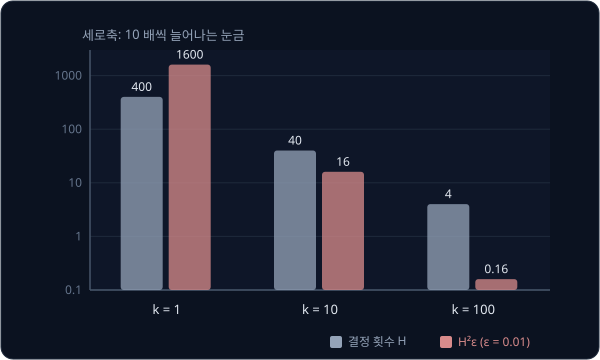

위 그림은 표의 두 열을 막대로 그린 것이다. 막대의 높이 차이가 너무 커서 세로축 눈금을 0.1, 1, 10, 100, 1000 처럼 10 배씩 늘어나게
잡았다. 회색 막대(결정 횟수)는 한 칸씩, 빨간 막대($H^2\epsilon$)는 두 칸씩 내려간다.

논문은 실제로 $k$ 만 바꿔 가며 ACT 를 따로 학습해 이 효과를 쟀다. simulator 과제 2 개를 사람 시연과 프로그램 시연(사람 대신 미리 짠
프로그램이 로봇을 움직여 만든 시연)으로 각각 학습한 네 경우의 평균 성공률이 $k = 1$ 에서 1%, $k = 100$ 에서 44% 였다.

### chunk 가 길 때의 대가

$k$ 를 끝없이 키우면 좋기만 할까. 위 표는 "결정 한 번이 틀릴 확률이 $k$ 와 상관없이 같다" 고 가정했는데, 실제로는 2 초 뒤까지
내다보는 예측이 20 ms 뒤만 내다보는 예측보다 어렵다.

더 큰 문제는 chunk 를 실행하는 동안 새 관측을 보지 않는다는 점이다. 미리 정한 명령만 따르고 실행 중에 바뀐 상황을 반영하지 않는
제어를 open-loop 제어라고 하고, 매 순간 관측을 보고 고치는 제어를 closed-loop 제어라고 한다. $k = 400$ 이면 첫 관측 하나만 보고
8 초 전체를 정하는 완전한 open-loop 다.

오른쪽 집게가 $x = 0$ cm 에서 출발해 $x = 10$ cm 에 놓인 큐브 쪽으로 step 마다 0.2 cm 씩 다가간다고 하자. 그런데 step 30 에
왼팔이 큐브를 살짝 건드려 큐브가 $x = 14$ cm 로 밀려났다.

- $k = 100$ 이면 step 0 에 정한 chunk 가 step 99 까지 이어진다. 집게는 step 50 에 큐브가 없는 10 cm 자리에 닿아 그대로 머물고, step
  100 에 새 관측을 본 뒤에야 14 cm 쪽으로 움직인다. 큐브가 밀린 뒤 70 step(1.4 초)을 허비한다
- $k = 20$ 이면 step 40 에 새 관측을 보고 다음 chunk 부터 14 cm 쪽으로 방향을 바꿔 step 70 에 큐브에 닿는다. 늦은 시간은 10 step
  (0.2 초)뿐이다

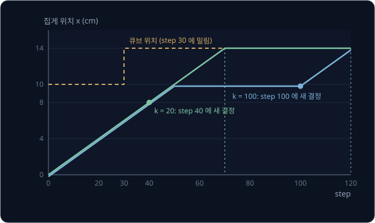

위 그림의 주황 점선이 큐브의 위치, 초록 선이 $k = 20$, 파란 선이 $k = 100$ 일 때 집게의 위치다. 논문에서도 성공률은 $k = 100$ 에서
가장 높았고 $k = 200$, $400$ 에서는 조금 떨어졌다. 논문은 그 원인으로 바뀐 상황에 대응하지 못하는 것과 긴 sequence(차례로 늘어선 action 들의 열)를
예측하기 어려운 것을 들었다. 그래서 $k$ 는 결정 횟수를 줄이는 이득과 반응이 늦어지는 손해 사이에서 고르는 값이다.

**확인 문제.** $T = 200$, $\epsilon = 0.01$ 일 때 $k = 1$ 과 $k = 20$ 의 결정 횟수와 $H^2\epsilon$ 은 각각 얼마일까?

답 보기

$k = 1$ 이면 $H = 200$ 이고 $200 \times 200 \times 0.01 = 400$ 이다. $k = 20$ 이면 $H = 200 \div 20 = 10$ 이고
$10 \times 10 \times 0.01 = 1$ 이다. 결정 횟수는 20 분의 1, $H^2\epsilon$ 은 $20 \times 20 = 400$ 분의 1 로 줄었다.

**요약**

- action chunking 은 관측 한 번에 앞으로 $k$ step 의 action 을 $(k, 14)$ 묶음으로 내고, 로봇은 그 묶음을 20 ms 마다 하나씩 실행한다.
  $k = 100$ 이면 2 초 분량이다
- 추론은 chunk 하나가 끝나기 전, 곧 $k \times 20$ ms 안에만 끝나면 되므로 모델의 추론 주기가 로봇의 제어 주기보다 느려도 된다
- 결정 횟수가 $T$ 에서 $T/k$ 로 줄어 가장 나쁜 경우의 실수 $H^2\epsilon$ 은 $k^2$ 분의 1 로 준다. 대신 chunk 가 길수록 실행 중의 변화에
  늦게 반응한다

## temporal ensembling

### chunk 경계의 끊김

$k = 100$ 으로 chunk 를 끝까지 실행하면 100 step 마다 한 번씩 움직임이 툭 끊긴다. 오른팔 어깨 관절 하나만 보자. step 0 에 낸 첫
chunk 는 관절을 step 마다 0.4° 씩 돌려 step 99 에 40.0° 에 닿게 했다. step 100 에 새 관측을 보고 낸 둘째 chunk 는 큐브의 위치를
조금 다르게 읽어 첫 값을 44.0° 로 냈다.

| step | 96 | 97 | 98 | 99 | 100 | 101 | 102 |
| --- | --- | --- | --- | --- | --- | --- | --- |
| 목표 각도 (°) | 38.8 | 39.2 | 39.6 | 40.0 | 44.0 | 44.4 | 44.8 |
| 한 step 사이의 변화 (°) | | 0.4 | 0.4 | 0.4 | **4.0** | 0.4 | 0.4 |

평소에는 20 ms 에 0.4° 씩 돌던 관절이 step 99 에서 100 으로 넘어가는 20 ms 동안에는 4.0°, 곧 10 배를 돌아야 한다. 모터가 갑자기
세게 움직이면 팔이 떨리고, 큐브를 쥔 집게라면 큐브를 놓칠 수도 있다. 논문은 이것을 "새 관측이 $k$ step 마다 갑자기 반영되어
움직임이 덜컥거린다" 고 설명한다.

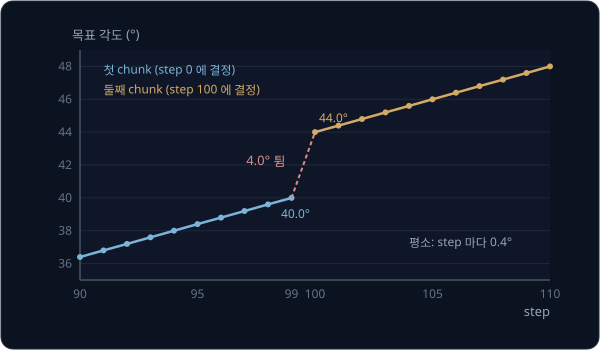

위 그림의 파란 선이 첫 chunk, 주황 선이 둘째 chunk 의 목표 각도다. 두 선 모두 기울기는 같지만 step 99 와 100 사이에 세로로 4.0° 의
계단이 생긴다.

**확인 문제.** 어떤 chunk 가 step 199 에 25.0° 로 끝나고, 다음 chunk 가 step 200 에 22.0° 로 시작한다. chunk 안에서는 step 마다
0.5° 씩 움직인다면 경계의 변화는 평소의 몇 배일까?

답 보기

경계에서 $22.0 - 25.0 = -3.0°$ 로 크기가 3.0° 다. $3.0 \div 0.5 = 6$ 이라 평소의 6 배다.

### 매 step 추론과 겹치는 예측

끊김을 없애려고 ACT 는 chunk 를 끝까지 실행하는 대신 step 마다 추론한다. step 마다 관측을 보고 $k$ step 짜리 chunk 를 새로 내므로
chunk 들이 서로 겹치고, 같은 순간에 대한 예측이 여러 개 생긴다.

$k = 3$ 으로 줄여 보자. 시각 $t - 2$ 에 낸 chunk 는 $t - 2$, $t - 1$, $t$ 를, 시각 $t - 1$ 에 낸 chunk 는 $t - 1$, $t$, $t + 1$ 을,
시각 $t$ 에 낸 chunk 는 $t$, $t + 1$, $t + 2$ 를 덮는다. 세 chunk 가 모두 시각 $t$ 를 덮으므로 시각 $t$ 의 목표 각도는 예측이 3 개다.

| chunk 를 낸 시각 | $t - 2$ 의 예측 | $t - 1$ 의 예측 | $t$ 의 예측 | $t + 1$ 의 예측 | $t + 2$ 의 예측 |
| --- | --- | --- | --- | --- | --- |
| $t - 2$ | ✓ | ✓ | **30°** | | |
| $t - 1$ | | ✓ | **32°** | ✓ | |
| $t$ | | | **35°** | ✓ | ✓ |

한 열에 표시된 칸 수가 그 시각의 예측 수다. $k = 100$ 이면 시각 $t$ 를 덮는 chunk 는 $t - 99$ 부터 $t$ 까지 낸 100 개라서, episode
처음 100 step 을 지나면 매 시각 예측이 100 개씩 쌓인다. 이 예측들을 하나로 합쳐 실제로 실행할 각도를 정하는 방법이 temporal
ensembling 이다. temporal 은 "시간의", ensembling 은 "여러 예측을 모아 하나로 합친다" 는 뜻이다.

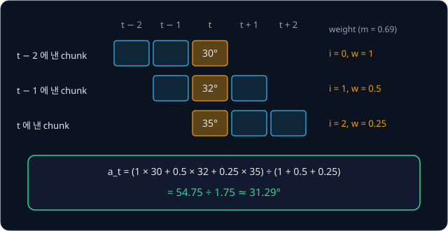

위 그림의 세 줄이 세 chunk 이고, 가운데 세로로 칠한 칸이 시각 $t$ 에 대한 예측이다. 오른쪽은 다음 두 절에서 계산할 weight 와 결과다.

**확인 문제.** $k = 5$ 이고 step 마다 추론하면, 충분히 시간이 지난 뒤 한 시각을 덮는 예측은 몇 개일까?

답 보기

시각 $t$ 를 덮는 chunk 는 $t - 4$, $t - 3$, $t - 2$, $t - 1$, $t$ 에 낸 5 개라서 예측도 5 개다. 언제나 $k$ 개다.

### 가중 평균

예측 여러 개를 하나로 합치는 가장 쉬운 방법은 평균이다. 30, 32, 35 의 평균은 $(30 + 32 + 35) \div 3 = 97 \div 3 \approx 32.33$ 이다.
평균은 모든 값을 똑같이 1 번씩 센다.

값마다 반영하는 비중을 다르게 줄 수도 있다. 이 비중을 weight 라고 하고, weight 를 곱해 더한 뒤 weight 의 합으로 나눈 값을 가중
평균(weighted average)이라고 한다. 30 에 weight 2, 36 에 weight 1 을 주면 아래와 같다.

$$
\frac{2 \times 30 + 1 \times 36}{2 + 1} = \frac{60 + 36}{3} = \frac{96}{3} = 32
$$

보통 평균이라면 $(30 + 36) \div 2 = 33$ 이지만, 30 이 두 번 센 것처럼 비중이 커서 결과가 30 쪽으로 끌려 32 가 됐다. weight 의 합으로
나누는 것은 weight 를 모두 1 로 주었을 때 보통 평균과 같아지게 하려는 것이다. [Transformer](../transformer/README.md) 의 attention 도
입력 조각마다 관련도 점수로 weight 를 매긴 뒤 그 조각들의 내용을 가중 평균하는 계산이었다.

**확인 문제.** 10 에 weight 3, 20 에 weight 1 을 주면 가중 평균은?

답 보기

$(3 \times 10 + 1 \times 20) \div (3 + 1) = 50 \div 4 = 12.5$ 다.

### 지수로 정하는 weight

ACT 는 weight 를 아래 식으로 정한다.

$$
w_i = \exp(-m \cdot i)
$$

식을 읽으려면 $\exp$ 부터 알아야 한다. $e$ 는 약 2.718 인 정해진 수이고, $\exp(x)$ 는 $e^x$, 곧 $e$ 의 $x$ 제곱을 뜻한다. $x$ 가 2 처럼 자연수면
$e$ 를 $x$ 번 곱한 값이고, 0.69 처럼 소수인 지수도 계산기로 구할 수 있다. 지수가
0 이면 $e^0 = 1$ 이고, 지수가 음수면 $e^{-x} = 1 \div e^x$ 라서 1 보다 작아진다. 예를 들어 $e^{-1} = 1 \div 2.718 \approx 0.368$ 이다.

| $x$ | 0 | 0.01 | 0.02 | 0.69 | 1 | 1.38 |
| --- | --- | --- | --- | --- | --- | --- |
| $\exp(-x)$ | 1 | 0.990 | 0.980 | 약 0.5 | 0.368 | 약 0.25 |

$x$ 가 커질수록 $\exp(-x)$ 는 1 에서 0 쪽으로 작아지고, $x$ 가 0.69 늘 때마다 값이 약 절반이 된다.

식의 기호는 아래와 같다.

- $i$ 는 예측의 번호다. 시각 $t$ 를 덮는 예측 가운데 가장 오래전에 낸 것이 $i = 0$ 이고, 최근에 낸 것일수록 번호가 크다
- $m$ 은 weight 가 번호에 따라 얼마나 빨리 작아질지를 정하는 숫자다
- $w_i$ 는 $i$ 번 예측의 weight 다. $w_0 = e^0 = 1$ 이라서 가장 오래된 예측이 언제나 가장 큰 weight 1 을 받는다

앞 절의 세 예측에 $m = 0.69$ 를 넣어 손으로 계산한다.

| chunk 를 낸 시각 | 시각 $t$ 의 예측 | $i$ | $w_i = \exp(-0.69 \times i)$ | $w_i \times$ 예측 |
| --- | --- | --- | --- | --- |
| $t - 2$ | 30 | 0 | 1 | 30 |
| $t - 1$ | 32 | 1 | 0.5 | 16 |
| $t$ | 35 | 2 | 0.25 | 8.75 |
| 합 | | | 1.75 | 54.75 |

실행할 각도는 $54.75 \div 1.75 \approx 31.29°$ 다. 식으로 쓰면 아래와 같다.

$$
a_t = \frac{\sum_i w_i \, A_t[i]}{\sum_i w_i}
$$

$A_t[i]$ 는 시각 $t$ 를 덮는 예측 가운데 $i$ 번째 것이고, $a_t$ 는 시각 $t$ 에 실제로 실행할 action 이다. $\Sigma$ (sigma, 시그마)는
"모두 더하라" 는 기호라서, 이 식은 "예측마다 weight 를 곱해 모두 더하고, weight 의 합으로 나눈다" 로 읽는다. 표와 맞추면 $A_t[0]$,
$A_t[1]$, $A_t[2]$ 는 30, 32, 35, 분자는 54.75, 분모는 1.75 다. 실제로는 관절 14 개마다 이 계산을 따로 한다.

숫자만 바꿔 한 번 더 한다. 세 예측이 20, 20, 26 이면 분자는 $1 \times 20 + 0.5 \times 20 + 0.25 \times 26 = 20 + 10 + 6.5 = 36.5$ 이고,
$36.5 \div 1.75 \approx 20.86°$ 다. 최근 예측 26 이 혼자 6° 나 크지만 결과는 20 에서 0.86° 만 움직였다. chunk 하나가 갑자기 다른 값을 내도
실행하는 각도는 조금씩만 바뀌므로, 앞 절의 4.0° 같은 계단이 생기지 않는다.

**확인 문제.** $m = 0.69$ 이고 시각 $t$ 에 대한 세 예측이 오래된 것부터 40, 44, 44 다. 실행할 각도는?

답 보기

weight 는 1, 0.5, 0.25 이다. 분자는 $40 + 22 + 11 = 73$, 분모는 1.75 라서 $73 \div 1.75 \approx 41.71°$ 다.

### m 과 새 관측의 반영 속도

논문은 $m = 0.01$ 을 쓴다. 같은 세 예측 30, 32, 35 에 넣으면 weight 는 1, 0.990, 0.980 이고, 합은 2.970 이다.

| $m$ | weight ($i = 0, 1, 2$) | 계산 | 결과 |
| --- | --- | --- | --- |
| 0.69 | 1, 0.5, 0.25 | $54.75 \div 1.75$ | 31.29 |
| 0.01 | 1, 0.990, 0.980 | $(30 + 31.68 + 34.30) \div 2.970$ | 32.32 |
| 0 | 1, 1, 1 | $97 \div 3$ | 32.33 |

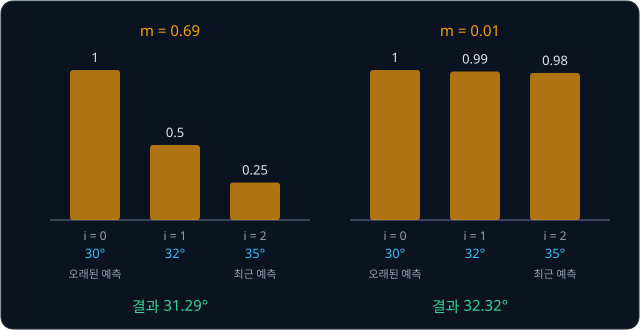

$m$ 이 크면 오래된 예측이 결과를 거의 정하고, 최근 예측은 조금만 반영된다. 최근 예측은 가장 최근의 관측을 보고 낸 것이므로, $m$ 이
클수록 새 관측이 실행에 늦게 반영되는 대신 움직임이 더 매끄럽다. $m$ 이 작을수록 weight 가 고르게 되어 새 관측이 빨리 반영된다.
논문도 "$m$ 이 작을수록 새 관측을 빨리 반영한다" 고 적었다. $m = 0.01$ 이면 예측 100 개 가운데 가장 최근 것의 weight 가
$\exp(-0.01 \times 99) \approx 0.37$ 로, 가장 오래된 것의 약 3 분의 1 이다.

**흔한 오해.** 가장 최근의 관측을 보고 낸 예측이 가장 정확할 테니 가장 큰 weight 를 받을 것이라고 생각하기 쉽다. ACT 의 식에서는
$w_0 = 1$ 인 가장 오래된 예측이 가장 큰 weight 를 받는다. $m = 0.01$ 에서는 차이가 작아서 거의 고른 평균이 된다.

temporal ensembling 은 흔히 쓰는 smoothing 과 다르다. smoothing 은 바로 옆 시각의 action 과 섞어 움직임을 매끄럽게 만드는데, 옆 시각의 값을 섞으면 그 시각에 가야 할
각도에서 벗어나지만, temporal ensembling 은 **같은 시각** 을 두고 서로 다른 chunk 가 낸 예측만 섞는다. 학습은 그대로 두고 추론 때
계산만 더하는 방법이고, 논문의 실험에서 ACT 의 가장 높은 성공률을 3.3% 높였다. 대가는 추론 횟수다. step 마다 추론하므로 추론 한 번이 20 ms 안에
끝나야 하고, 앞 절에서 본 "추론 시한이 $k$ 배 늘어나는" 이득은 포기한다. ACT 는 추론이 약 10 ms 라서 둘 다 쓸 수 있었다.

**확인 문제.** $m$ 을 0 으로 두면 temporal ensembling 은 어떤 계산이 될까? 세 예측 20, 20, 26 으로 결과를 구해 보자.

답 보기

모든 weight 가 $e^0 = 1$ 이 되어 보통 평균이다. $(20 + 20 + 26) \div 3 = 66 \div 3 = 22°$ 다.

**요약**

- chunk 를 끝까지 실행하면 새 chunk 로 바뀌는 순간 목표 각도가 튄다. ACT 는 step 마다 추론해 시각 하나에 예측을 최대 $k$ 개 모은다
- temporal ensembling 은 그 예측들을 $w_i = \exp(-m \cdot i)$ 로 가중 평균한다. $i = 0$ 이 가장 오래된 예측이고, $m = 0.69$ 일 때
  30, 32, 35 는 $54.75 \div 1.75 \approx 31.29$ 가 된다
- $m$ 이 작을수록 weight 가 고르고 새 관측이 빨리 반영된다. 논문의 $m = 0.01$ 은 거의 고른 평균이다

## 시연의 style 과 CVAE

### 같은 장면의 서로 다른 style

사람이 같은 일을 여러 번 하면 매번 조금씩 다르게 한다. 오른쪽 집게가 큐브 바로 위 12 cm 높이에 있고, 이제 큐브를 잡으러 내려가는
장면을 사람이 세 번 시연했다고 하자. 내려갈 때는 한 step 에 6 cm 씩 내려가고, 큐브 높이(0 cm)에 닿으면 멈춘다. 다른 점은 내려가기
전에 잠깐 멈췄느냐다.

| 시연 | step 1 | step 2 | step 3 | step 4 |
| --- | --- | --- | --- | --- |
| 바로 내려감 | 6 | 0 | 0 | 0 |
| 1 step 멈춤 | 12 | 6 | 0 | 0 |
| 2 step 멈춤 | 12 | 12 | 6 | 0 |

표의 숫자는 step 마다 집게의 목표 높이(cm)이고, 한 줄이 길이 4 인 action chunk 하나다. 세 시연 모두 큐브를 잘 잡았으니 셋 다 옳은
chunk 다. 관측은 세 번 모두 거의 같아서, 사진과 관절 각도만 봐서는 사람이 이번에 멈출지 말지 알 수 없다.

이렇게 같은 관측에서 시연마다 달라지는 움직임의 방식을 ACT 논문은 style 이라고 부른다. Behavior Cloning 에서는 같은 관측에 옳은
action 이 여럿인 시연을 multimodal 시연이라고 했는데, 위 표가 바로 그 경우다. 관측은 하나인데 옳은 chunk 는 세 개다.

multimodal 이라는 단어는 다른 뜻으로도 쓰인다. 사진과 글 지시를 함께 받는 VLA 같은 모델을 multimodal 모델이라고 부를 때는 받는
입력의 종류가 사진과 글 두 가지라는 뜻이고, 옳은 답이 여럿이라는 뜻이 아니다.

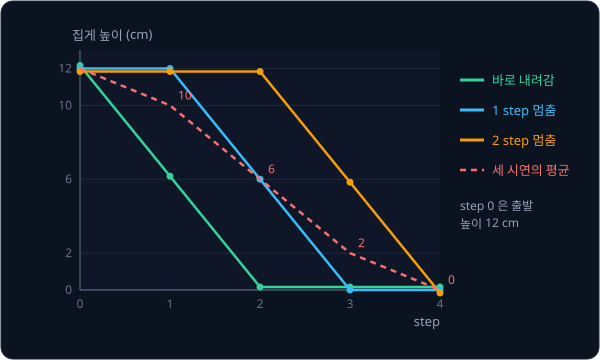

위 그림의 초록·파랑·주황 선이 세 시연이고, 빨간 점선은 다음 절에서 계산할 세 시연의 평균이다.

**확인 문제.** 큐브 위 12 cm 에서 3 step 을 멈춘 뒤 한 step 에 6 cm 씩 내려가는 시연을 길이 5 인 chunk 로 적으면?

답 보기

step 1, 2, 3 은 멈춰서 12, 12, 12 이고 step 4 에 6, step 5 에 0 이다. $(12, 12, 12, 6, 0)$ 이다.

### 평균의 함정

같은 관측에서 policy 가 낼 수 있는 chunk 는 하나뿐이다. 모델이 얼마나 틀렸는지를 숫자 하나로 나타낸 값을 loss 라고 하는데, 이 chunk 를
MSE(오차를 제곱해 평균한 값)라는 loss 로 학습하면 무엇을 낼까. chunk 의
네 칸 오차를 제곱해 더하고, 시연 셋에 대해 평균한 값을 loss 로 두고 후보 chunk 마다 계산한다.

세 시연의 칸별 평균은 step 1 이 $(6 + 12 + 12) \div 3 = 10$, step 2 가 $(0 + 6 + 12) \div 3 = 6$, step 3 이 $(0 + 0 + 6) \div 3 = 2$,
step 4 가 0 이라서 $(10, 6, 2, 0)$ 이다. 이 평균 chunk 를 바로 내려감 $(6, 0, 0, 0)$ 과 비교하면 오차가 $(4, 6, 2, 0)$, 제곱의 합이
$16 + 36 + 4 + 0 = 56$ 이다.

| 후보 chunk | 바로 내려감과 | 1 step 멈춤과 | 2 step 멈춤과 | 세 시연의 평균 |
| --- | --- | --- | --- | --- |
| 평균 $(10, 6, 2, 0)$ | 56 | 8 | 56 | $120 \div 3 = 40$ |
| 1 step 멈춤 $(12, 6, 0, 0)$ | 72 | 0 | 72 | $144 \div 3 = 48$ |
| 바로 내려감 $(6, 0, 0, 0)$ | 0 | 72 | 216 | $288 \div 3 = 96$ |

loss 가 가장 작은 것은 실제 시연이 아니라 평균 chunk $(10, 6, 2, 0)$ 이다. 이 chunk 는 step 1 에 10 cm 로, 멈추지도 않고 6 cm 씩
내려가지도 않는다. 높이가 2, 4, 4, 2 cm 씩 줄어드는 어정쩡하게 느린 하강이라서 세 시연 가운데 어느 것과도 같지 않다.
[Behavior Cloning](../behavior-cloning/README.md) 에서 MSE 를 가장 작게 만드는 출력이 정답들의 평균이라는 것을 gradient(parameter
를 조금 바꿀 때 loss 가 변하는 비율)로 보였는데, chunk 에서는 칸마다 그 일이 일어난다. 이것이 평균의 함정이다.

**확인 문제.** 같은 관측에서 시연 chunk 가 $(4, 4)$ 와 $(0, 8)$ 두 개다. MSE 로 학습한 policy 는 어떤 chunk 를 낼까?

답 보기

칸마다 평균을 내서 $\big((4 + 0) \div 2, (4 + 8) \div 2\big) = (2, 6)$ 이다. 두 시연 어느 것과도 다르다.

### L1 loss

ACT 는 MSE 대신 L1 loss 를 쓴다. 어떤 수의 부호를 떼어 크기만 남긴 값을 절댓값이라고 하고 $|-3| = 3$, $|3| = 3$ 처럼 세로 막대로
감싸 적는다. L1 loss 는 오차를 제곱하지 않고 절댓값으로 더한 값이다. 논문은 L1 이 action sequence 를 더 정밀하게 맞췄다고 보고했다.

앞의 세 시연에 L1 을 계산하면 평균 chunk 는 $|4| + |6| + |2| + 0 = 12$, $|{-2}| + 0 + |2| + 0 = 4$, $12$ 로 평균 $28 \div 3 \approx 9.33$
이고, 1 step 멈춤 chunk 는 12, 0, 12 로 평균 $24 \div 3 = 8$ 이다. 이번에는 실제 시연인 1 step 멈춤이 이긴다. L1 은 칸마다 평균
대신 값들의 한가운데 값(6, 12, 12 라면 12)을 고르기 때문이다.

하지만 시연이 둘로 갈리면 사정이 다르다. 바로 내려감 $(6, 0, 0, 0)$ 과 2 step 멈춤 $(12, 12, 6, 0)$ 만 있다고 하자.

| 후보 chunk | 바로 내려감과의 L1 | 2 step 멈춤과의 L1 | 평균 |
| --- | --- | --- | --- |
| 바로 내려감 $(6, 0, 0, 0)$ | 0 | 24 | 12 |
| 2 step 멈춤 $(12, 12, 6, 0)$ | 24 | 0 | 12 |
| 칸별 평균 $(9, 6, 3, 0)$ | 12 | 12 | 12 |
| 섞인 chunk $(12, 0, 0, 0)$ | 6 | 18 | 12 |

네 후보의 L1 이 모두 12 로 같다. 칸마다 두 시연 사이의 어떤 값을 골라도 한쪽 오차가 느는 만큼 다른 쪽 오차가 줄어서 합이 변하지
않기 때문이다. 그래서 L1 로 학습한 policy 는 평균 chunk 를 낼 수도 있고, step 1 은 멈춤 시연에서, step 2 는 바로 내려감 시연에서
가져와 한 step 에 12 cm 를 뚝 떨어지는 섞인 chunk 를 낼 수도 있다. loss 로는 둘 중 어느 것도 막을 수 없다.

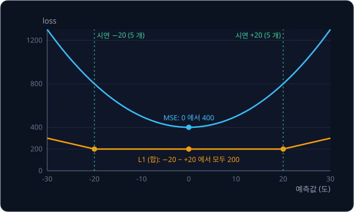

위 그림은 Behavior Cloning 의 장애물 예로 같은 일을 보인다. 시연 5 개는 −20°, 5 개는 +20° 다. MSE 는 평균 0° 에서 400 으로 가장
낮다. L1 은 0° 에서 $5 \times 20 + 5 \times 20 = 200$, −20° 에서 $5 \times 0 + 5 \times 40 = 200$ 으로 같아서, 그 사이 어디든 바닥이
평평하다.

**흔한 오해.** L1 은 평균이 아니라 한가운데 값을 고르니 평균의 함정이 없다고 생각하기 쉽다. 시연이 정확히 둘로 갈리면 L1 의 바닥이
평평해져서 평균이나 섞인 chunk 도 똑같이 좋은 답이 된다. 논문에서 CVAE 없이 L1 로만 학습한 ACT 는 사람 시연으로 학습한 simulator
과제의 성공률이 35.3% 에서 2% 로 떨어졌다. 프로그램으로 만든 시연은 매번 똑같아서 CVAE 가 있든 없든 거의 차이가 없었다.

**확인 문제.** 시연이 $-10$ 으로 2 개, $+10$ 으로 2 개다. 예측 0 과 예측 $-10$ 의 L1 합은 각각 얼마일까?

답 보기

예측 0 은 $2 \times 10 + 2 \times 10 = 40$ 이고, 예측 $-10$ 은 $2 \times 0 + 2 \times 20 = 40$ 이다. 둘이 같아서 L1 은 둘을 가리지 못한다.

### style 변수 z

평균의 함정은 관측만으로는 사람이 이번에 멈출지 알 수 없는데 정답이 셋이라서 생긴다. 그렇다면 "이번 시연은 몇 step 멈췄다" 는
정보를 policy 에 함께 알려 주면 된다. 그러면 입력이 달라지므로 시연마다 다른 chunk 를 내도 된다.

[VAE](../vae/README.md) 의 CVAE(conditional VAE)가 이 일을 한다. VAE 는 데이터를 숫자 몇 개로 줄였다가 되살리도록
학습해 새 데이터를 만들어 내는 모델이고, CVAE 는 여기에 조건을 붙인 것이다. CVAE 는 데이터 $x$ 를 숫자 몇 개로 줄인 latent $z$ 를 만드는 encoder 와,
$z$ 를 받아 데이터를 되살리는 decoder 로 되어 있고, 양쪽에 조건 $c$ 를 함께 넣는다. ACT 에서 되살릴 데이터는 시연의 action chunk,
조건은 관측이다. 학습할 때 CVAE encoder 는 시연의 chunk(정답)와 관절 각도를 보고 그 chunk 의 style 을 $z$ 에 담고, decoder 이자
policy 는 관측과 $z$ 를 함께 받아 chunk 를 낸다. 논문은 이 $z$ 를 style 변수(style variable)라고 부른다.

$z$ 를 숫자 하나로 줄인 작은 예를 보자. 학습을 마친 encoder 가 세 시연을 보고 아래처럼 $z$ 를 냈다고 하자.

| 시연 | encoder 가 낸 $z$ | policy 의 입력 | policy 가 맞혀야 할 chunk |
| --- | --- | --- | --- |
| 바로 내려감 | $-1$ | (관측, $z = -1$) | $(6, 0, 0, 0)$ |
| 1 step 멈춤 | 0 | (관측, $z = 0$) | $(12, 6, 0, 0)$ |
| 2 step 멈춤 | $+1$ | (관측, $z = +1$) | $(12, 12, 6, 0)$ |

이제 policy 의 입력이 세 줄 모두 다르다. 같은 입력에 정답이 둘 이상인 줄이 없으므로, policy 가 줄마다 정답을 그대로 내면 L1 과 MSE 가
모두 0 이 된다. 정답들 사이에서 타협할 이유가 사라졌으니 평균 chunk 도 섞인 chunk 도 나오지 않는다. $z$ 가 커질수록 오래 멈추게
되어, $z$ 는 "멈추는 길이" 라는 style 을 숫자로 적은 것이 된다.

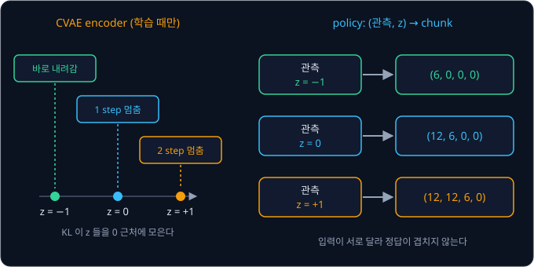

위 그림의 왼쪽은 encoder 가 세 시연을 $z$ 축의 세 자리에 놓는 모습이고, 오른쪽은 policy 가 같은 관측에 $z$ 만 바꿔 받아 서로 다른
chunk 를 내는 모습이다. 실제 ACT 의 $z$ 는 숫자 32 개짜리 vector 이고, 학습 때는 encoder 가 낸 평균 $\mu$ (mu, 뮤)와 퍼진 정도
$\sigma$ (sigma, 시그마)로 [VAE](../vae/README.md) 의 reparameterization trick $z = \mu + \sigma \odot \epsilon$ 을 써서 $z$ 를 뽑는다. reparameterization trick 은
무작위로 뽑는 부분을 $\epsilon$ 에 맡겨서 gradient 가 encoder 까지 전해지게 하는 방법이다.
$\epsilon$ 은 평균 0, 퍼진 정도 1 인 종 모양 분포(표준 정규분포)에서 뽑은 무작위 숫자이고, $\odot$ 는 칸끼리 곱하라는 기호다.

encoder 는 정답 chunk 를 보고 $z$ 를 정하니, $z$ 에 chunk 전체를 그대로 적어 policy 에게 넘기면 policy 는 관측을 보지 않고 베끼기만 하면
된다. 그렇게 되지 않게 막는 것이 다음 절의 KL 항이다.

**확인 문제.** 위 예에서 encoder 가 세 시연 모두에 $z = 0$ 을 냈다면 policy 는 어떤 문제를 다시 만날까?

답 보기

세 줄의 입력이 모두 (관측, $z = 0$) 으로 같아져서 같은 입력에 정답 chunk 가 셋인 상황으로 돌아간다. 그러면 MSE 는 평균 chunk 를,
L1 은 한가운데 값 chunk 를 내는 평균의 함정이 다시 생긴다.

### KL 과 β

VAE 의 loss 에는 encoder 가 낸 분포 $\mathcal N(\mu, \sigma^2)$ 이 표준 정규분포 $\mathcal N(0, 1)$ 에서 얼마나 먼지를 재는 KL
divergence 가 있었다. 학습 전에 $z$ 가 따를 것으로 정해 둔 이 표준 정규분포를 prior 라고 한다. 한 칸의 KL 은 아래 식이다.

$$
D_{\mathrm{KL}} = \frac{1}{2}\left(\mu^2 + \sigma^2 - \log\sigma^2 - 1\right)
$$

$\log$ 는 "$e$ 를 몇 번 곱해야 그 수가 되는가" 를 돌려주는 계산이라 $\log 1 = 0$ 이다. 그래서 $\sigma = 1$ 이면 $\sigma^2 = 1$,
$\log\sigma^2 = 0$ 이 되어 식이 $\frac12(\mu^2 + 1 - 0 - 1) = \frac12\mu^2$ 로 줄어든다.

ACT 는 KL 에 $\beta$ (beta, 베타) $= 10$ 을 곱해 L1 과 더한 값을 loss 로 쓴다.

$$
\mathcal{L} = \big\lVert \hat a_{t:t+k} - a_{t:t+k} \big\rVert_1 + \beta \, D_{\mathrm{KL}}\big(q_\phi(z \mid a_{t:t+k}, \bar o_t) \,\big\Vert\, \mathcal{N}(0, I)\big)
$$

- $\lVert \cdot \rVert_1$ 은 L1, 곧 칸마다 차이의 절댓값을 모두 더한 값이다. $\hat a_{t:t+k}$ 는 policy 가 낸 chunk, $a_{t:t+k}$ 는
  시연의 chunk 다
- $q_\phi(z \mid a_{t:t+k}, \bar o_t)$ 는 CVAE encoder 가 낸 $z$ 의 분포다. $\phi$ (phi, 파이)는 encoder 의 parameter 이고,
  $\bar o_t$ 는 관측에서 사진을 뺀 관절 각도 14 개다. 세로 막대 $\mid$ 뒤의 것은 "이것을 보고" 라는 조건이다
- $\mathcal N(0, I)$ 는 32 칸 모두가 따로 표준 정규분포를 따르는 prior 다

작은 예의 $z$ 를 $\sigma = 1$ 로 보고 KL 을 계산한다.

| encoder 가 낸 $\mu$ | KL $= \frac12\mu^2$ | $\beta \times$ KL |
| --- | --- | --- |
| $-1$ | $0.5$ | 5 |
| 0 | 0 | 0 |
| $+1$ | $0.5$ | 5 |
| $\pm 3$ | $4.5$ | 45 |

encoder 가 세 style 을 $-1$, 0, $+1$ 에 두면 KL 값은 크지 않다. 하지만 $z$ 에 chunk 의 세세한 숫자까지 담으려고 $\mu$ 를 $\pm 3$ 처럼
멀리 벌리면 그 시연 하나에서만 loss 가 45 씩 늘어난다. 그래서 encoder 는 꼭 필요한 정보, 곧 관측으로는 알 수 없는 style 만 $z$ 에
담고 $z$ 들을 0 근처에 모아 둔다. 논문도 $\beta$ 가 클수록 $z$ 로 전해지는 정보가 적어진다고 설명한다. 32 칸이면 칸마다의 KL 을
모두 더한다.

**확인 문제.** encoder 가 한 칸에서 $\mu = 2$, $\sigma = 1$ 을 냈다. 이 칸의 KL 과 $\beta = 10$ 을 곱한 값은?

답 보기

$\sigma = 1$ 이라 KL $= \frac12 \times 2^2 = 2$ 이고, $\beta$ 를 곱하면 $10 \times 2 = 20$ 이다.

### 추론 때의 z = 0

로봇을 실제로 움직일 때는 CVAE encoder 를 쓰지 않고 $z = 0$ 으로 고정한다. 이유는 셋이다.

1. **encoder 입력의 부재** — encoder 는 시연의 정답 chunk 를 봐야 $z$ 를 내는데, 로봇을 움직이는 순간에는 앞으로 할 정답 chunk 가
   없다. 그래서 encoder 는 학습 때만 쓰고 버린다
2. **policy 에게 가장 익숙한 자리** — KL 이 학습 내내 $z$ 들을 prior 의 평균인 0 근처로 모았으므로, policy 는 0 근처의 $z$ 를
   가장 많이 보고 배웠다. 작은 예에서 $z = 0$ 을 넣으면 1 step 멈춤 chunk $(12, 6, 0, 0)$ 이 나오고, 이것은 사람이 실제로 한 움직임이다.
   반대로 학습 때 한 번도 나오지 않은 $z = 5$ 를 넣으면 policy 가 무엇을 낼지 알 수 없다
3. **같은 관측에 같은 chunk** — $z$ 를 고정하면 같은 관측에 언제나 같은 chunk 가 나온다. temporal ensembling 은 겹치는 chunk 들이 같은 시각에 낸 예측을 평균한다. step 마다
   $z$ 를 무작위로 뽑으면 시각 $t - 1$ 의 chunk 는 바로 내려감 style, 시각 $t$ 의 chunk 는 2 step 멈춤 style 이 될 수 있다. 그러면
   같은 순간을 두고 6 cm 와 12 cm 가 나오고, 둘을 평균한 9 cm 는 어느 시연에도 없는 높이라서 평균의 함정이 다시 생긴다. $z$ 를 0 으로 고정하면 연달아 낸
   chunk 들이 한 style 을 유지한다

$z = 0$ 으로 고정하면 포기하는 것도 있다. policy 는 언제나 0 자리에 놓인 style 하나만 내고, 시연에 있던 다른 style 은 쓰지 않는다.
시연이 큐브를 왼쪽에서 잡는 것과 오른쪽에서 잡는 것처럼 정반대인 두 무리로 반반 갈리고 학습이 0 을 두 무리의 경계에 두었다면,
$z = 0$ 이 어느 한쪽을 고른다는 보장도 없다. 무작위로 고른 출발점에 따라 두 무리 중 하나에 도착하게 만드는 방법은
[Diffusion Policy](../diffusion-policy/README.md) 에서 다룬다.

**확인 문제.** step 마다 $z$ 를 무작위로 뽑는 policy 에서, 같은 시각에 대한 두 예측이 바로 내려감 style 의 6 cm 와 2 step 멈춤
style 의 12 cm 였다. $m = 0$ 인 temporal ensembling 의 결과는 몇 cm 이고, 이것은 어느 시연과 같을까?

답 보기

$(6 + 12) \div 2 = 9$ cm 다. 이 시각(step 1)에 세 시연의 높이는 6, 12, 12 cm 라서 9 cm 인 시연은 하나도 없다. 서로 다른 style 의
예측을 섞어 평균의 함정이 다시 생겼다.

**요약**

- 같은 관측에서 시연의 style 이 갈리면 MSE 는 칸별 평균 chunk 를 내고, L1 도 시연이 둘로 갈리면 바닥이 평평해져 평균이나 섞인
  chunk 를 막지 못한다
- CVAE encoder 는 학습 때 정답 chunk 를 보고 style 을 $z$ 에 담아 policy 에 넘긴다. 입력이 달라지니 policy 는 style 마다 제 chunk 를
  낼 수 있고, $\beta = 10$ 을 곱한 KL 은 $z$ 를 0 근처에 모아 style 말고는 담지 못하게 한다
- 추론 때는 encoder 의 입력인 정답 chunk 가 없고, 0 이 가장 익숙한 자리이며, 연달아 낸 chunk 들이 한 style 을 유지해야 해서 $z = 0$
  으로 고정한다. 대신 언제나 style 하나만 쓴다

## ACT 의 구조

### 전체 흐름

ACT 는 세 부분으로 되어 있다.

- **CVAE encoder** — 학습 때만 쓴다. 관절 각도와 시연 chunk 를 받아 $z$ 의 $\mu$ 와 $\log\sigma^2$ 을 낸다
- **image encoder 와 Transformer encoder** — image encoder 는 사진을 요약한 숫자로 바꾸는 부분이다. 이 둘이 카메라 사진, 관절
  각도, $z$ 를 받아 지금 상황을 요약한 vector 들을 만든다
- **Transformer decoder 와 마지막 linear layer** — 그 요약을 받아 $(100, 14)$ action chunk 를 낸다. linear layer 는 입력에 weight 를
  곱해 더하는 층이다

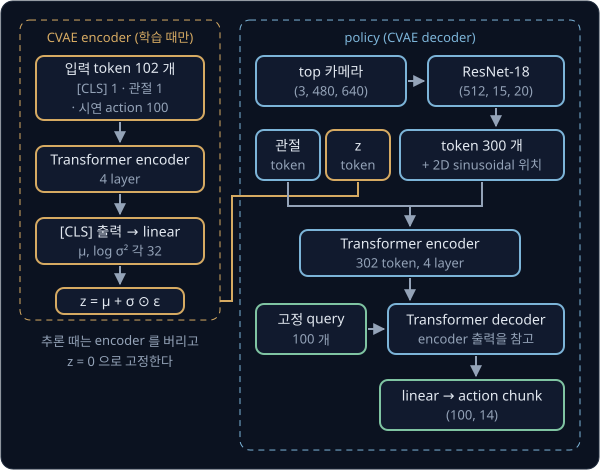

위 그림의 왼쪽 주황 점선 상자가 CVAE encoder, 오른쪽 파란 점선 상자가 policy 다. 이름의 Transformer 는 [Transformer](../transformer/README.md)
에서 본 구조, 곧 입력 조각들이 attention(서로 관련도 점수를 매겨 정보를 가져오는 계산)으로 서로를 참고하는 층을 쌓은 구조다.

### 카메라 사진의 token 300 개

[ResNet](../resnet/README.md) 에서 본 대로 ACT 는 ImageNet(사물 이름이 붙은 사진 약 128만 장 모음)으로 미리 학습한 ResNet-18 을 image
encoder 로 쓰고, 칸마다의 값을 평균해 숫자 512 개 하나로 줄이는 마지막 단계(global average pooling) 직전의 feature map 을 꺼낸다. feature map 은 사진을 구역별로 요약한 숫자 판이다. 480×640 사진을 넣으면
가로세로가 32 분의 1 로 줄어 $480 \div 32 = 15$ 줄, $640 \div 32 = 20$ 칸이 되고, 칸마다 숫자가 512 개씩 있어 모양이 $512 \times 15 \times 20$ 이다.

ACT 는 이 $15 \times 20 = 300$ 칸을 Transformer 에 넣는 조각 300 개로 쓴다. Transformer 에 넣는 조각 하나를 token 이라고 하는데,
여기서 token 은 글자 조각이 아니라 사진 한 구역을 요약한 숫자 512 개다. 칸을 왼쪽 위부터 한 줄씩 늘어놓으므로 $r$ 번째 줄, $c$ 번째
칸(둘 다 0 부터 센다)은 $20r + c$ 번째 token 이 된다. 2 번째 줄 5 번째 칸이라면 $20 \times 2 + 5 = 45$ 번째다.

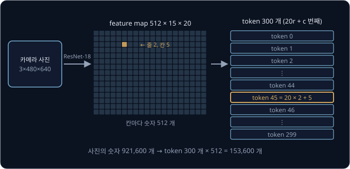

위 그림의 가운데 판이 feature map 이고, 칠한 칸이 줄 2, 칸 5 다. 오른쪽은 300 칸을 한 줄로 늘어놓은 token 열이다. 사진의 숫자
$3 \times 480 \times 640 = 921{,}600$ 개가 $300 \times 512 = 153{,}600$ 개로 줄어든다.

**확인 문제.** 256×320 사진을 넣으면 token 은 몇 개이고, 줄 3, 칸 7 은 몇 번째 token 일까?

답 보기

가로세로가 32 분의 1 이 되어 $256 \div 32 = 8$ 줄, $320 \div 32 = 10$ 칸이라 token 은 $8 \times 10 = 80$ 개다. 한 줄이 10 칸이므로
줄 3, 칸 7 은 $10 \times 3 + 7 = 37$ 번째다.

### 2D positional embedding

[Transformer](../transformer/README.md) 에서 attention 은 token 의 순서를 모른다는 것을 "dog bites man" 과 "man bites dog" 로
확인했다. 사진 token 도 마찬가지라서, 아무 표시 없이 300 개를 넣으면 Transformer 는 큐브가 사진의 왼쪽에 있는지 오른쪽에 있는지 알 수
없다. 그래서 token 마다 그 칸의 위치를 나타내는 vector 를 더한다. 이 위치 vector 를 positional embedding 이라고 한다.

글은 한 줄로 늘어선 위치 번호 하나만 있지만 사진 칸은 줄 번호 $r$ 과 칸 번호 $c$ 두 개가 있다. ACT 는 vector 의 앞 절반을 줄 번호로,
뒤 절반을 칸 번호로 만들고, 둘 다 Transformer 강의의 sin·cos 식을 쓴다. sin 과 cos 은 넣는 수가 커짐에 따라 값이 $-1$ 과 1 사이를
오르내리는 함수다. 칸이 4 개인 vector 로 줄이면 위치 $(r, c)$ 의 vector 는 $[\sin r, \cos r, \sin c, \cos c]$ 다.

| 칸 | $\sin r$ | $\cos r$ | $\sin c$ | $\cos c$ |
| --- | --- | --- | --- | --- |
| 줄 0, 칸 0 | 0.000 | 1.000 | 0.000 | 1.000 |
| 줄 2, 칸 5 | 0.909 | $-0.416$ | $-0.959$ | 0.284 |
| 줄 5, 칸 2 | $-0.959$ | 0.284 | 0.909 | $-0.416$ |

줄 2, 칸 5 와 줄 5, 칸 2 는 같은 숫자 네 개를 쓰지만 앞뒤 절반이 바뀌어 있어서 서로 다른 vector 다. 실제로는 512 칸 가운데 256 칸이
줄 번호를, 256 칸이 칸 번호를 담당하고, 학습해서 정하는 값이 아니라 식으로 정해진 값이다. 이 방식은 물체 검출 모델 DETR(2020)
에서 가져왔다. 물체 검출은 사진 속 물체마다 테두리 상자를 찾는 일이다.

**확인 문제.** 칸 4 개짜리 2D positional embedding 에서 줄 0, 칸 2 의 vector 는? (sin 2 = 0.909, cos 2 = $-0.416$)

답 보기

줄 번호가 0 이라 앞 절반은 $[\sin 0, \cos 0] = [0, 1]$, 칸 번호가 2 라 뒤 절반은 $[0.909, -0.416]$ 이다. 합치면
$[0, 1, 0.909, -0.416]$ 이다.

### 관절 token 과 z token

관절 각도 14 개와 $z$ 32 개도 token 으로 만든다. 사진 token 이 숫자 512 개짜리라서 이 둘도 512 개로 맞춰야 하는데, 이때 linear layer
를 쓴다. linear layer 는 출력 칸마다 입력에 weight 를 곱해 모두 더하고 bias(입력과 상관없이 더하는 숫자)를 더하는 층이다.
여기서 weight 는 temporal ensembling 의 비중처럼 곱하는 숫자이지만, 사람이 정하지 않고 학습으로 정하는 parameter 다. 출력 칸 하나가 입력 14 개에 대한 weight
14 개와 bias 1 개를 가지므로, 14 개를 512 개로 바꾸는 linear layer 의 parameter 는 $512 \times (14 + 1) = 7{,}680$ 개다. 같은 계산으로
$z$ 를 바꾸는 층은 $512 \times (32 + 1) = 16{,}896$ 개다.

그래서 Transformer encoder 에 들어가는 token 은 사진 300 개, 관절 1 개, $z$ 1 개로 모두 302 개다. 실물 ALOHA 처럼 카메라가 4 대면
사진 token 이 $4 \times 300 = 1{,}200$ 개라 모두 1,202 개가 된다.

**확인 문제.** 카메라가 2 대이고 사진이 모두 480×640 이면 Transformer encoder 에 들어가는 token 은 몇 개일까?

답 보기

사진 token 이 $2 \times 300 = 600$ 개이고, 관절 token 1 개와 $z$ token 1 개를 더해 602 개다.

### Transformer encoder

302 개 token 은 Transformer encoder 의 층 4 개를 지난다. 층마다 self-attention, 곧 같은 묶음 안의 token 끼리 서로 점수를 매겨 참고하는 attention 으로 모든 token 이
다른 모든 token 을 참고해 자기 vector 를 고친다. 예를 들어 큐브가 찍힌 칸의 token 은 오른팔 집게가 찍힌 칸의 token 과 관절 token 을 참고해 "큐브와 집게가 얼마나
떨어져 있는가" 를 자기 vector 에 섞을 수 있고, $z$ token 의 style 정보도 모든 token 에 퍼진다. 출력은 입력과 같은 모양인 512 개짜리 vector 302 개다.

논문은 이 encoder 의 역할을 "여러 카메라 시점과 관절 각도와 style 변수의 정보를 합친다" 고 설명한다. 302 개 token 이 서로 점수를
매기므로 점수 표는 $302 \times 302 = 91{,}204$ 칸이다.

**확인 문제.** 카메라 4 대인 실물 ALOHA 에서 Transformer encoder 의 점수 표는 몇 칸일까?

답 보기

token 이 $4 \times 300 + 2 = 1{,}202$ 개라서 $1202 \times 1202 = 1{,}444{,}804$ 칸이다. 카메라 1 대일 때의 약 16 배다.

### action head 인 Transformer decoder

network 는 입력을 요약한 숫자(feature)로 바꾸는 앞부분 backbone(몸통)과, 그 요약을 원하는 출력으로 바꾸는 뒷부분
head 로 나눠 볼 수 있다. 로봇 policy 에서 몸통이 만든 요약 숫자를 관절값으로 바꾸는 부분을 action head 라고 한다. Behavior Cloning
의 action head 는 사진 feature 512 개와 관절 각도 7 개를 받아 목표 각도 7 개를 내는 작은 MLP(층 두어 개짜리 neural network)였다. ACT 에서는 Transformer encoder
까지가 몸통이고, Transformer decoder 와 마지막 linear layer 가 action head 다. encoder 가 만든 vector 302 개를 받아 관절 목표값
$100 \times 14$ 개를 내기 때문이다.

decoder 의 입력은 고정 query 100 개다. query 는 [Transformer](../transformer/README.md) 에서 본 대로 "무엇을 찾는가" 를 나타내는
vector 이고, ACT 의 query 100 개는 각각 "1 번째 step 의 action", …, "100 번째 step 의 action" 을 찾는 자리다. query 의 숫자는 입력과
상관없이 학습으로 정해지고, 추론할 때는 언제나 같은 100 개를 넣는다. 그래서 "고정" query 라고 부른다.

query 는 cross-attention 으로 encoder 출력을 읽는다. cross-attention 은 query 를 decoder 쪽에서, key 와 value 를 encoder 의 출력에서
만드는 attention 이다. 1 번째 step 의 query 하나가 encoder 출력 token 3 개를 보는 작은 예를 계산한다. key 는 각 token 이 "나는 이런 내용이다" 를 나타내는 vector, value 는
실제로 가져갈 내용이다. 점수는 query 와 key 의 dot product(두 vector 의 칸끼리 곱해 모두 더한 값)를 $\sqrt d$ ($d$ 는 vector 의 칸 수)로 나누는 단계까지 마친 값이고, value 는 칸이 2 개인 vector 로 줄였다. softmax 는 점수를
$e^{\text{점수}}$ 로 바꾼 뒤 그 합으로 나눠 합이 1 인 weight 를 만드는 계산이다.

| encoder 출력 token | 점수 | $e^{\text{점수}}$ | softmax weight | value |
| --- | --- | --- | --- | --- |
| 큐브가 찍힌 칸 | 2 | 7.389 | $7.389 \div 11.107 \approx 0.665$ | $(4, 2)$ |
| 빈 테이블 칸 | 0 | 1.000 | $1.000 \div 11.107 \approx 0.090$ | $(0, 0)$ |
| 관절 token | 1 | 2.718 | $2.718 \div 11.107 \approx 0.245$ | $(2, 6)$ |
| 합 | | 11.107 | 1 | |

출력은 weight 로 value 를 가중 평균한 값이다.

$$
0.665 \times (4, 2) + 0.090 \times (0, 0) + 0.245 \times (2, 6) = (2.66 + 0.49,\ 1.33 + 1.47) = (3.15,\ 2.80)
$$

마지막 linear layer 가 이 vector 를 관절값으로 바꾼다. weight 가 $(2, -1)$, bias 가 0.5 라면 $2 \times 3.15 - 1 \times 2.80 + 0.5
= 6.30 - 2.80 + 0.5 = 4.0$ 이 이 관절의 1 번째 step 목표값이다. 실제로는 512 칸 vector 를 14 개 관절값으로 바꾸는 linear layer 이고,
parameter 는 $14 \times (512 + 1) = 7{,}182$ 개다. 100 개 query 의 출력에 같은 linear layer 를 쓰므로 결과가 $(100, 14)$ chunk 가 된다.

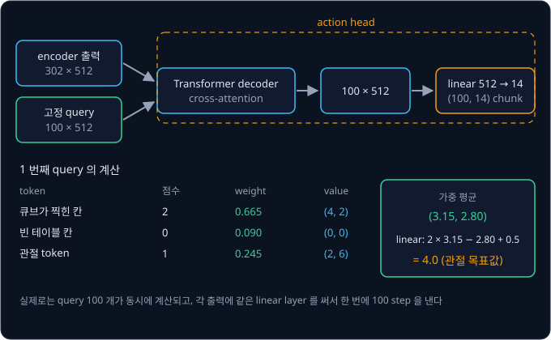

위 그림의 윗부분이 decoder 전체의 흐름이고, 아랫부분이 표의 계산이다. Transformer 강의의 번역 decoder 는 `<bos>` 다음에 4, 그다음에
1 처럼 앞에서 만든 출력을 다시 입력으로 넣어 한 token 씩 만들었다. ACT 의 decoder 는 query 100 개를 한꺼번에 넣어 100 개 action 을
동시에 낸다. 앞 출력을 기다리지 않으니 추론 한 번에 decoder 를 한 번만 계산하면 된다. 고정 query 로 출력 묶음을 한 번에 내는
방식도 DETR 에서 왔는데, DETR 은 query 마다 물체 하나의 상자를 낸다.

논문은 decoder 층을 7 개로 적었지만, 저자가 공개한 코드에서 action 이 되는 것은 첫째 층의 출력이다. 코드는 7 개 층을 차례로
계산하면서 층마다의 출력을 목록에 모아 두는데, 이 목록은 DETR 이 층마다 따로 loss 를 매기려고 만든 것을 그대로 물려받았다.
DETR 의 Transformer 는 이 목록과 encoder 출력을 한 쌍으로 돌려줘서 `[0]` 으로 목록을 꺼내고, 최종 출력에는 목록의 마지막 층을
쓴다. ACT 는 Transformer 가 목록만 돌려주도록 바꾸고도 `[0]` 을 그대로 남겨서, `[0]` 이 목록 안의 첫째 층을 꺼내게 됐다. 그래서
2 ~ 7 층은 계산만 되고 그 결과가 action 에 쓰이지 않는다. 결과가 loss 에 닿지 않으니 학습으로 고쳐지지도 않아서, 논문의 성공률은 사실상 decoder 층 1 개로 얻은 값이다.
Hugging Face 의 로봇 학습 라이브러리 LeRobot 은 이를 bug 로 보고, 같은 동작을 헛계산 없이 내도록 decoder 층 1 개를 기본값으로 둔다.

**확인 문제.** action chunk 를 $k = 50$ 으로 줄이고 관절이 14 개라면, 고정 query 는 몇 개이고 마지막 linear layer 의 parameter 는 몇
개일까?

답 보기

query 는 step 마다 하나라서 50 개다. linear layer 는 query 수와 상관없이 512 칸을 14 개로 바꾸므로 $14 \times (512 + 1) = 7{,}182$ 개
그대로다.

### CVAE encoder 의 [CLS] token

CVAE encoder 도 Transformer encoder 로 만든다. 입력 맨 앞에 [CLS] 라는 token 을 하나 붙이는데, [CLS] 는 2018년 Google 이 발표한 언어 모델 BERT 에서 온 방법으로
특정 내용 없이 학습으로 정해지는 vector 다. 이 token 은 attention 으로 다른 token 을 모두 참고하므로, 층을 지난 뒤 [CLS] 자리의 출력은
sequence 전체의 요약이 된다. CLS 는 classification(분류)의 앞 글자로, BERT 가 문장 전체를 분류할 때 이 자리를 썼다.

입력은 [CLS] 1 개, 관절 각도 token 1 개, 시연 action token 100 개로 모두 $1 + 1 + 100 = 102$ 개다. 사진은 넣지 않는데, 논문은
학습을 빠르게 하려고 뺐다고 밝힌다. 102 개가 층 4 개를 지난 뒤 [CLS] 자리의 512 개 숫자를 linear layer 로 64 개로 바꾸고, 앞 32 개를
$\mu$, 뒤 32 개를 $\log\sigma^2$ 로 쓴다. $\sigma$ 를 바로 내지 않고 $\log\sigma^2$ 을 내는 것은 VAE 에서처럼 $\sigma$ 가 음수가 되는
일을 막기 위해서다.

**확인 문제.** $k = 50$ 인 ACT 의 CVAE encoder 에는 token 이 몇 개 들어갈까?

답 보기

[CLS] 1 개, 관절 1 개, 시연 action 50 개로 $1 + 1 + 50 = 52$ 개다.

### 학습과 추론의 흐름

학습할 때는 시연에서 한 순간 $t$ 를 골라 관측 $o_t$ 와 그 뒤 100 step 의 시연 action $a_{t:t+100}$ 을 한 샘플로 쓴다.

1. CVAE encoder 가 관절 각도와 $a_{t:t+100}$ 을 보고 $\mu$, $\log\sigma^2$ 을 낸다
2. $z = \mu + \sigma \odot \epsilon$ 으로 $z$ 를 뽑는다
3. policy 가 사진, 관절 각도, $z$ 로 $\hat a_{t:t+100}$ 을 낸다
4. L1 과 $\beta = 10$ 을 곱한 KL 을 더해 loss 를 구하고, gradient(parameter 를 조금 바꿀 때 loss 가 변하는 비율)를 따라 encoder 와
   policy 의 parameter 를 함께 고친다

episode 끝 근처에서는 시연 action 이 100 개가 안 된다. 400 step episode 에서 $t = 350$ 을 고르면 남은 시연은 step 350 ~ 399 의 50 개뿐이고,
나머지 50 자리는 길이를 맞추려고 아무 값으로나 채운다. 이렇게 길이를 맞추려고 채우는 것을 padding 이라고 한다. padding 자리는
정답이 아니므로 L1 을 계산할 때 빼고, CVAE encoder 의 attention 에서도 padding mask, 곧 그 자리의 점수를 $-\infty$ 로 바꿔 weight 를 0 으로
만드는 방법으로 가린다.

추론할 때는 CVAE encoder 를 쓰지 않고 $z = 0$ 을 넣는다. step 마다 추론해 temporal ensembling 을 하거나, $k$ step 마다 한 번 추론해
chunk 를 끝까지 실행한다.

논문의 ACT 는 parameter 가 약 8 천만 개이고, 과제마다 시연 50 개 정도로 처음부터 학습했다. 메모리 11 GB 인 RTX 2080 Ti GPU(계산을 동시에 많이 하는 그래픽 카드) 한 장으로
과제 하나를 약 5 시간 학습했고, 추론 한 번은 약 0.01 초였다. LeRobot 이 같은 transfer-cube 시연 50 개로 학습해 공개한 ACT 는 이 과제를
500 번 시도해 83.0% 성공했다.

**확인 문제.** 400 step episode 에서 $t = 320$ 을 골랐고 $k = 100$ 이다. 시연 action 이 있는 자리와 padding 자리는 각각 몇 개일까?

답 보기

시연은 step 320 ~ 399 의 $400 - 320 = 80$ 개이고, padding 은 $100 - 80 = 20$ 개다. L1 은 80 자리에서만 계산한다.

**요약**

- 480×640 사진은 ResNet-18 을 지나 $512 \times 15 \times 20$ 이 되고, 칸 300 개가 2D positional embedding 을 더한 token 300 개가 된다.
  관절 token 과 $z$ token 을 더한 302 개가 Transformer encoder 층 4 개를 지난다
- Transformer decoder 와 마지막 linear layer 가 action head 다. 고정 query 100 개가 cross-attention 으로 encoder 출력을 읽고, 같은
  linear layer(512 → 14)가 $(100, 14)$ chunk 를 한꺼번에 낸다
- CVAE encoder 는 [CLS], 관절, 시연 action 100 개의 102 개 token 으로 $\mu$ 와 $\log\sigma^2$ 을 내고, 학습 때만 쓴다. padding 자리는
  L1 과 attention 에서 뺀다

## 정리

- ACT 는 관측 한 번에 앞으로 $k = 100$ step(2 초)의 action 을 $(100, 14)$ chunk 로 낸다. 추론은 chunk 하나가 끝나기 전에만 마치면
  되므로 추론 주기가 50 Hz 제어 주기보다 느려도 되고, 400 step 의 결정 횟수가 400 번에서 4 번으로 줄어 가장 나쁜 경우의 실수
  $H^2\epsilon$ 이 1600 에서 0.16 으로 준다. 논문의 평균 성공률은 $k = 1$ 에서 1%, $k = 100$ 에서 44% 였다
- chunk 가 길수록 실행 중의 변화에 늦게 반응하고 chunk 경계에서 목표 각도가 튄다. temporal ensembling 은 step 마다 추론해 같은 시각에
  대한 예측들을 $w_i = \exp(-m \cdot i)$ 로 가중 평균한다. $m = 0.69$ 이면 30, 32, 35 가 $54.75 \div 1.75 \approx 31.29$ 가 되고, 논문의
  $m = 0.01$ 은 거의 고른 평균이다
- 같은 관측에서 시연의 style 이 갈리면 MSE 는 평균 chunk $(10, 6, 2, 0)$ 을 내고, L1 도 시연이 둘로 갈리면 바닥이 평평해 평균을 막지
  못한다. CVAE encoder 가 정답 chunk 의 style 을 $z$ 에 담아 넘기면 policy 의 입력이 style 마다 달라져 타협할 필요가 없어지고, KL 은
  $z$ 를 0 근처에 모은다
- 추론 때는 정답 chunk 가 없고, 0 이 가장 익숙하며, 연달아 낸 chunk 가 한 style 을 유지해야 하므로 $z = 0$ 으로 고정한다
- 사진은 ResNet-18 로 token 300 개가 되고, 관절·$z$ token 과 함께 Transformer encoder 를 지난다. action head 인 Transformer decoder 는
  고정 query 100 개로 encoder 출력을 읽어 100 step 의 action 을 한꺼번에 낸다

ACT 는 과제마다 시연 수십 개로 처음부터 학습하고, 글로 된 지시도 일반 상식도 없어서 시연에 없던 물체나 지시를 다루지 못한다. $z = 0$
하나로 style 하나만 내므로, 정반대인 두 방식으로 반반 갈린 시연에서 하나를 확실히 고르지도 못한다. 직접 모은 시연으로 ACT 를 실물
팔에 올리는 과정은 [Real Robot](../real-robot/README.md), 무작위 출발점에서 잡음을 걷어 내며 봉우리 하나에 도착하는 policy 는
[Diffusion Policy](../diffusion-policy/README.md), action chunk 생성을 인터넷 규모로 사전학습한 사진·언어 모델 위에 붙인 policy 는
[π0](../pi0/README.md) 에서 다룬다.

## 참고 자료

- Tony Z. Zhao et al., [Learning Fine-Grained Bimanual Manipulation with Low-Cost Hardware](https://arxiv.org/abs/2304.13705) (2023) —
  ACT 논문. Section IV 에 action chunking, temporal ensembling, CVAE, 구조가 있고, Section VI 에 $k$ 를 바꾼 실험과 CVAE 를 뺀 실험이 있다
- [ALOHA project page](https://tonyzhaozh.github.io/aloha/) — 실물 ALOHA 의 시연 영상과 하드웨어 구성. ACT 가 실제로 어떻게 움직이는지
  눈으로 보고 싶을 때 연다
- Nicolas Carion et al., [End-to-End Object Detection with Transformers](https://arxiv.org/abs/2005.12872) (2020) — 고정 query 로 출력
  묶음을 한 번에 내는 DETR. ACT 의 encoder-decoder 와 2D sinusoidal positional embedding 이 여기서 왔다
- Kihyuk Sohn et al., [Learning Structured Output Representation using Deep Conditional Generative Models](https://papers.nips.cc/paper_files/paper/2015/hash/8d55a249e6baa5c06772297520da2051-Abstract.html) (2015) —
  조건을 encoder 와 decoder 양쪽에 넣는 CVAE 의 원 논문
- Diederik P. Kingma, Max Welling, [Auto-Encoding Variational Bayes](https://arxiv.org/abs/1312.6114) (2013) — reparameterization trick 과
  정규분포 사이 KL 식의 출처
- LeRobot [ACT 문서](https://huggingface.co/docs/lerobot/act) — ACT 를 학습하고 평가하는 방법과 주요 설정값
- [lerobot/act_aloha_sim_transfer_cube_human](https://huggingface.co/lerobot/act_aloha_sim_transfer_cube_human) model card — transfer-cube
  시연 50 개로 학습한 ACT 의 학습 설정과 성공률
- [gym-aloha](https://github.com/huggingface/gym-aloha) — transfer-cube simulator 의 관측·action 정의와 reward 단계
- 원 구현 [tonyzhaozh/act](https://github.com/tonyzhaozh/act) 의 [`detr_vae.py`](https://github.com/tonyzhaozh/act/blob/main/detr/models/detr_vae.py) —
  CVAE encoder, 고정 query, 2D positional embedding 이 실제로 어떻게 연결되는지 확인할 때 읽는다
