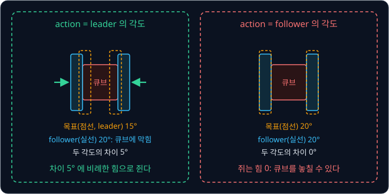

# ACT

사람이 양팔 로봇을 조종해 모은 시연 수십 개로 policy 를 학습하면, 로봇은 처음에는 시연처럼 움직이다가 episode 끝으로 갈수록 어긋나고,
어떤 자세에서는 멈춘 채 더 움직이지 않기도 한다. ACT 논문은 step 마다 action 하나를 내는 기존 방법들이 이렇게 실패했다고 보고했다. 시연
데이터는 그대로 두고 policy 가 내는 출력의 모양만 바꿔서 이 실패를 줄일 수 있을까?

ACT(Action Chunking with Transformers)는 관측 한 번에 action 하나 대신 앞으로 2 초 동안의 action 100 개를 한꺼번에 낸다. 2023 년
Tony Zhao 등이 시연 50 개로 이 방법을 학습한 양팔 로봇 ALOHA 는 리모컨에 배터리를 끼우는 과제를 25 번 중 24 번(96%) 성공했다. 로봇
학습 라이브러리 LeRobot 도 처음 시작하는 사용자에게 ACT 를 첫 모델로 권한다.

## 학습 목표

- action chunking 이 결정 횟수를 줄여 compounding error 를 줄이고, 추론이 제어 주기보다 느려도 되게 하는 이유를 숫자로 설명할 수 있다
- temporal ensembling 이 겹치는 chunk 의 예측을 $w_i = \exp(-m \cdot i)$ 로 가중 평균하는 계산과 그 대가를 설명할 수 있다
- 시연의 style 이 갈릴 때 MSE·L1 이 평균이나 섞인 chunk 를 내는 이유와, CVAE 의 $z$ 가 학습 때 이를 막고 추론 때는 0 으로 고정되는
  이유를 설명할 수 있다
- 사진과 관절 각도가 ResNet-18, Transformer encoder, 고정 query 를 쓰는 decoder 를 지나 $(100, 14)$ chunk 가 되는 흐름과 LeRobot 의
  기본 설정을 설명할 수 있다

## ALOHA 와 시연 데이터

ALOHA(A Low-cost Open-source HArdware System for Bimanual Teleoperation)는 ACT 논문의 저자들이 만든 양팔 원격 조종 장비다. 사람이
작은 조종용 팔(leader, WidowX) 두 개를 손으로 움직이면 큰 로봇 팔(follower, 6 자유도 ViperX) 두 개가 leader 의 관절 각도를 그대로
따라 움직인다. 사람이 로봇을 이렇게 조종하는 것을 teleoperation 이라고 하고, 조종하는 동안 카메라 영상과 관절 각도를 기록해 시연
(demonstration)을 모은다. 저자들은 장비 전체를 2 만 달러 안쪽으로 꾸리고 설계도와 소프트웨어를 공개했다.

팔 하나는 관절 6 개와 집게(gripper) 1 개라서 자세가 숫자 7 개이고, 양팔은 $7 + 7 = 14$ 개다. ALOHA 는 1초에 50 번(50 Hz) 기록하고
명령을 내린다. 이 한 번을 **step** 이라고 하는데, step 하나의 길이는 $1 \div 50 = 0.02$ 초(20 ms)다. step 마다 아래 두 가지를 적는다.

- 관측(observation): 카메라 4 대(손목 2 대, 정면 1 대, 위 1 대)의 480×640 사진과 follower 양팔의 지금 관절 각도 14 개
- action: 다음 step 에 양팔이 갈 목표 관절 각도 14 개. 시연에서는 사람이 움직인 leader 의 관절 각도를 적는다

follower 의 motor 안에서는 PID controller 가 목표 각도와 지금 각도의 차이로 힘을 정한다. 집게가 큐브를 쥐면 follower 는 큐브에 막혀 더
닫히지 못하고 사람이 쥔 leader 는 더 닫혀 있어서, motor 가 그 차이에 비례한 힘으로 큐브를 쥔다. follower 의 각도를 action 으로 적으면 목표와
지금 각도가 같아져 쥐는 힘이 0 이 되므로, 논문은 leader 의 각도를 action 으로 쓴다.

50 Hz 는 팔이 움직이는 빠르기가 아니라 1초에 명령을 몇 번 새로 보내는지를 센 값이다. 저자들은 ALOHA 를 처음 쓰는 사람 6 명에게 케이블
타이를 구멍에 끼우는 일과 겹친 플라스틱 컵 두 개를 떼는 일을 시켰다. 한 번은 평소대로 조종하게 하고, 한 번은 leader 를 0.2 초마다 한
번만 읽어(5 Hz) 그 사이를 보간한 각도를 1초에 50 번 보내게 바꿔 작업 시간을 쟀다.

| 작업 | 50 Hz | 5 Hz |
| --- | --- | --- |
| 케이블 타이 끼우기 | 20 초 | 33 초 |
| 컵 떼기 | 10 초 | 16 초 |

5 Hz 에서는 사람이 손을 고쳐 움직여도 그 변화가 최대 0.2 초 늦게 팔에 전해져서, 밀리미터 단위로 맞춰야 하는 두 작업이 모두 오래
걸렸다. 논문에 따르면 작업 시간은 모두 합쳐 62% 늘었다.

저자들은 실물 과제 6 개와 [MuJoCo](../mujoco-sim/README.md) simulator 과제 2 개로 ACT 를 시험했다. 그중 transfer-cube 는 오른팔이
테이블 위의 빨간 큐브를 집어 왼팔 집게에 건네는 과제로, 사람이 시연한 episode 50 개가 공개되어 있고 episode 하나는 400 step(8 초)이다.

## action chunking

[Behavior Cloning](../behavior-cloning/README.md) 에서 본 policy 는 step 마다 관측을 한 번 보고 action 을 하나 낸다. ACT 는 관측을 한 번
볼 때 앞으로 $k$ step 동안의 action $k$ 개를 한꺼번에 낸다. 이 묶음을 **action chunk** 라고 하고, 묶어 내는 방식을 **action chunking**
이라고 한다. 로봇은 chunk 안의 action 을 20 ms 마다 하나씩 차례로 실행하고, 다 쓰면 다시 관측을 보고 다음 chunk 를 낸다.

$$
\hat a_{t:t+k} = (\hat a_t, \hat a_{t+1}, \ldots, \hat a_{t+k-1})
$$

$\hat a_t$ 는 시각 $t$ 의 예측 action 이고, $t:t+k$ 는 $t$ 부터 $k$ 개를 뜻한다. 논문의 $k$ 는 100 이다. action 하나가 숫자 14 개라
chunk 하나는 100 줄 × 14 칸의 표가 되고, 이 모양을 $(100, 14)$ 로 적는다. 시간으로는 $100 \times 20$ ms $= 2$ 초 분량이다.

**흔한 오해.** chunk 를 쓰면 로봇이 2 초에 한 번만 움직인다고 생각하기 쉽다. 위 그림의 아랫줄에서도 로봇은 20 ms 마다 새 목표 각도를
받아 움직이고, 줄어든 것은 관측을 보고 결정하는 횟수뿐이다.

chunking 이라는 이름은 뇌과학에서 왔다. 자잘한 동작 여러 개를 하나로 묶어 기억하고 한 단위로 실행하는 것을 뇌과학에서 chunking 이라고
부르는데, 논문은 사탕 포장지의 모서리를 잡는 동작이나 배터리를 홈에 끼우는 동작 하나가 chunk 하나에 해당한다고 설명한다.

action chunking 은 시연 중간의 멈춤도 잘 다룬다. 사람이 어떤 자세에서 잠깐 멈췄다면, 지금 관측만 보고 action 하나를 내는 policy 는 그
자세에서 멈춤을 배우고 다음 step 에도 같은 관측을 받아 계속 멈춰 있을 수 있다. 멈춤과 그 뒤의 움직임이 한 chunk 에 함께 들어 있으면
policy 가 멈췄다가 다시 움직이는 묶음을 통째로 내므로, 서론에서 본 것처럼 한 자세에서 멈춰 버리는 일이 줄어든다.

## 결정 횟수와 compounding error

Behavior Cloning 에서 본 compounding error 는 작은 오차가 로봇을 시연에 없던 상황으로 옮겨 오차가 점점 쌓이는 현상이다. 결정 한 번이
틀릴 확률을 $\epsilon$ (epsilon) 이라 하고 결정 횟수를 $H$ 라고 하면, 가장 나쁜 경우 틀리는 결정은 $H^2\epsilon$ 번까지 늘어난다.
action chunking 은 결정 횟수를 episode 의 step 수 $T$ 를 $k$ 로 나눈 $H = T \div k$ 로 줄이는데, 논문은 이를 과제의 실질 길이(effective
horizon)가 $k$ 분의 1 로 준다고 표현한다. 예로 $\epsilon$ 을 $k$ 와 상관없이 0.01 로 두고 transfer-cube 의 $T = 400$ 을 넣으면 아래 표가 된다.

| $k$ | 결정 횟수 $H = 400 \div k$ | 가장 나쁜 경우 $H^2\epsilon$ |
| --- | --- | --- |
| 1 | 400 | $400 \times 400 \times 0.01 = 1600$ |
| 10 | 40 | $40 \times 40 \times 0.01 = 16$ |
| 100 | 4 | $4 \times 4 \times 0.01 = 0.16$ |

$k$ 를 10 배 키우면 결정 횟수는 10 분의 1 이 되지만 $H^2\epsilon$ 은 제곱이라 $10 \times 10 = 100$ 분의 1 로 준다.

저자들은 $k$ 만 바꿔 가며 ACT 를 따로 학습해 이 효과를 쟀다. simulator 과제 2 개를 사람 시연과 프로그램 시연(미리 짠 프로그램이 로봇을
움직여 만든 시연)으로 각각 학습한 네 경우의 평균 성공률은 $k = 1$ 에서 1%, $k = 100$ 에서 44% 였다. action 하나를 내던 다른 방법
두 개도 출력을 chunk 로 바꾸자 성공률이 올랐다.

<b>심화: T 번과 T² 번의 차이</b>

실수가 서로 영향을 주지 않으면 $H$ 번의 결정에서 평균 $H\epsilon$ 번 틀린다. 실수 하나가 남은 결정을 모두 망치는 가장 나쁜 경우의
한계 $H^2\epsilon$ 은 Behavior Cloning 에서 본 Ross 와 Bagnell(2010)의 식이다. 두 경우를 나란히 놓으면 아래와 같다.

| $k$ | $H$ | 실수가 이어지지 않을 때 $H\epsilon$ | 가장 나쁜 경우 $H^2\epsilon$ |
| --- | --- | --- | --- |
| 1 | 400 | 4 | 1600 |
| 10 | 40 | 0.4 | 16 |
| 100 | 4 | 0.04 | 0.16 |

두 열 모두 "결정 한 번이 틀릴 확률이 $k$ 와 상관없이 같다" 고 가정했다. 실제로는 2 초 뒤까지 내다보는 예측이 20 ms 뒤만 내다보는
예측보다 어려워서 $\epsilon$ 이 $k$ 와 함께 커지고, 그래서 $k$ 를 끝없이 키우면 성공률이 다시 떨어진다.

**확인 문제.** $T = 200$, $\epsilon = 0.01$ 일 때 $k = 1$ 과 $k = 20$ 의 결정 횟수와 $H^2\epsilon$ 은 각각 얼마일까?

답 보기

| $k$ | $H = 200 \div k$ | $H^2\epsilon$ |
| --- | --- | --- |
| 1 | 200 | $200 \times 200 \times 0.01 = 400$ |
| 20 | 10 | $10 \times 10 \times 0.01 = 1$ |

결정 횟수는 20 분의 1, $H^2\epsilon$ 은 $20 \times 20 = 400$ 분의 1 로 줄었다.

## 추론 시한과 chunk 길이

학습이 끝난 모델에 관측을 넣어 출력을 계산하는 일을 추론(inference)이라고 한다. 추론 한 번에 100 ms 가 걸리는 모델이 있다고 하자.
$k = 1$ 이면 로봇은 20 ms 마다 새 action 이 필요한데 모델은 100 ms 에 하나밖에 만들지 못한다. 그래서 1초에 명령이 $1000 \div 100 = 10$
개뿐이고, 로봇은 명령마다 80 ms 를 기다린다. $k = 100$ 이면 같은 100 ms 의 추론 한 번으로 2 초 분량의 action 100 개가 나온다.

모델은 로봇이 그 100 개를 실행하는 동안 다음 chunk 를 계산해 두면 된다. 추론 시간이 $k$ × step 길이 이하이기만 하면 되므로, $k = 100$
이면 추론이 끝나야 하는 시한이 20 ms 에서 2 초로 100 배 늘어난다. 논문의
ACT 는 RTX 2080 Ti 에서 추론 한 번에 약 0.01 초가 걸려 20 ms 시한에도 들어오지만, [π0](../pi0/README.md) 처럼 parameter 가 수십억 개인
모델은 이렇게 늘어난 시한이 있어야 50 Hz 로봇을 움직일 수 있다.

chunk 를 실행하는 동안에는 새 관측을 보지 않는데, 이렇게 실행 중의 변화를 반영하지 않는 제어를 **open-loop** 제어라고 한다. $k$ 가
클수록 open-loop 인 구간도 길어진다. 예를 들어 오른 집게가 10 cm 위치의 큐브 쪽으로 step 마다 0.2 cm 씩 다가가는데 step 30 에 큐브가
14 cm 로 밀려났다고 하자. $k = 20$ 이면 step 40 에 새 관측을 보고 10 step 늦게 반응하지만, $k = 100$ 이면 step 100 에야 반응해
70 step(1.4 초)이 늦는다.

논문의 실험에서도 성공률은 $k = 100$ 에서 가장 높았고 $k = 200$, $400$ 에서는 조금 떨어졌다. 저자들은 그 원인으로 바뀐 상황에 반응하지
못하는 것과 긴 action 열을 예측하기 어려운 것을 들었다.

**확인 문제.** 50 Hz 로봇에서 추론 한 번에 300 ms 가 걸리는 모델을 쓴다. 로봇이 명령을 기다리지 않으려면 $k$ 가 최소 얼마여야 할까?

답 보기

1. 조건: chunk 하나의 길이 $k \times 20$ ms 가 추론 시간 300 ms 이상이어야 한다
2. 계산: $k \ge 300 \div 20 = 15$

답: 최소 15 다.

## temporal ensembling

$k = 100$ 으로 chunk 를 끝까지 실행하면 100 step 마다 움직임이 끊긴다. 예를 들어 첫 chunk 가 어깨 관절을 step 마다 0.4° 씩 돌려
step 99 에 40.0° 에 닿게 했다고 하자. step 100 에 낸 둘째 chunk 가 큐브의 위치를 조금 다르게 읽어 44.0° 에서 시작하면, 관절은 20 ms
동안 평소의 10 배인 4.0° 를 돌아야 해서 팔이 갑자기 튄다.

ACT 는 이 끊김을 없애려고 step 마다 추론해 $k$ step 짜리 chunk 를 새로 낸다. 그러면 chunk 들이 서로 겹쳐서 같은 시각에 대한 예측이
여러 개 생긴다. $k = 3$ 이면 시각 $t - 2$, $t - 1$, $t$ 에 낸 세 chunk 가 모두 시각 $t$ 를 덮어 예측이 3 개이고, $k = 100$ 이면 episode
처음 100 step 이 지난 뒤로는 매 시각 예측이 100 개다. 이 예측들을 하나로 합쳐 실제로 실행할 각도를 정하는 방법이 **temporal
ensembling** 이다.

ACT 는 예측마다 weight 를 곱해 더한 뒤 weight 의 합으로 나누는 가중 평균을 쓰고, weight 는 아래 식으로 정한다.

$$
w_i = \exp(-m \cdot i)
$$

$i$ 는 예측의 번호인데, 시각 $t$ 를 덮는 예측 가운데 가장 오래전에 낸 것이 $i = 0$ 이고 최근에 낸 것일수록 번호가 크다. $\exp(x)$ 는
약 2.718 인 수 $e$ 의 $x$ 제곱이라서 $w_0 = e^0 = 1$ 이고, $i$ 가 커질수록 weight 는 1 보다 작아진다. $m$ 은 weight 가 번호에 따라
얼마나 빨리 작아질지 정하는 숫자다. 예를 들어 세 예측이 오래된 것부터 30°, 32°, 35° 이고 $m = 0.69$ 이면 weight 는 반올림해서 1, 0.5,
0.25 라서, 실행할 각도는 $(1 \times 30 + 0.5 \times 32 + 0.25 \times 35) \div (1 + 0.5 + 0.25) = 54.75 \div 1.75 \approx 31.29°$ 다. 최근
chunk 하나가 다른 값을 내도 실행하는 각도는 조금씩만 바뀌므로 4.0° 같은 계단이 생기지 않는다.

논문은 $m$ 의 값을 적지 않았고, 저자가 공개한 코드에서는 $m = 0.01$ 을 쓴다. 같은 세 예측에 넣으면 weight 가 1, 0.990, 0.980 으로
거의 같아서 결과가 32.32° 로 보통 평균 32.33° 에 가깝다. 예측이 100 개일 때도 가장 최근 것의 weight 는 $\exp(-0.01 \times 99) \approx
0.37$ 이다. 논문은 $m$ 이 작을수록 새 관측을 빨리 반영한다고 적었는데, 가장 최근의 관측을 보고 낸 예측의 weight 가 덜 줄어들기 때문이다.

**흔한 오해.** 가장 최근의 관측을 보고 낸 예측이 가장 큰 weight 를 받을 것 같지만, ACT 의 식에서는 $w_0 = 1$ 인 가장 오래된 예측이
가장 큰 weight 를 받는다.

temporal ensembling 은 바로 옆 시각의 action 과 섞는 smoothing 과 달리 같은 시각을 두고 서로 다른 chunk 가 낸 예측만 섞어서, 그 시각에
가야 할 각도에서 벗어나지 않는다. 학습은 그대로 두고 추론 때 계산만 더하는 방법인데, 논문의 실험에서 ACT 의 성공률을 3.3% 높였다.
대신 step 마다 추론해야 하므로 추론 한 번이 20 ms 안에 끝나야 하고, 앞 절에서 늘린 추론 시한은 포기해야 한다. 그래서 LeRobot 은
temporal ensembling 을 기본값에서 끄고(`temporal_ensemble_coeff` = None), 켤 때는 `n_action_steps` 를 1 로 두게 한다.

<b>심화: 가중 평균의 일반 식과 손계산</b>

가중 평균은 값마다 weight 를 곱해 더한 뒤 weight 의 합으로 나눈 값이다. weight 를 모두 1 로 주면 보통 평균과 같아진다. 30 에 weight 2 를
주고 36 에 weight 1 을 주면 $(2 \times 30 + 1 \times 36) \div 3 = 32$ 로, 보통 평균 33 보다 30 쪽에 가깝다.

$\exp(-x)$ 는 $x$ 가 0.69 늘 때마다 약 절반이 된다.

| $x$ | 0 | 0.01 | 0.02 | 0.69 | 0.99 | 1.38 |
| --- | --- | --- | --- | --- | --- | --- |
| $\exp(-x)$ | 1 | 0.990 | 0.980 | 0.502 | 0.372 | 0.252 |

논문의 Algorithm 2 는 시각 $t$ 를 덮는 예측들을 $A_t[0], A_t[1], \ldots$ 로 모으고 아래 식으로 실행할 action $a_t$ 를 정한다.

$$
a_t = \frac{\sum_i w_i \, A_t[i]}{\sum_i w_i}
$$

$\Sigma$ 는 모두 더하라는 기호다. 본문의 예에서는 아래 표처럼 $A_t[0], A_t[1], A_t[2]$ 가 30, 32, 35 다. 분자는 54.75 이고 분모는
1.75 다. 관절 14 개마다 이 계산을 따로 한다.

| chunk 를 낸 시각 | 시각 $t$ 의 예측 $A_t[i]$ | $i$ | $w_i$ | $w_i \times$ 예측 |
| --- | --- | --- | --- | --- |
| $t - 2$ | 30 | 0 | 1 | 30 |
| $t - 1$ | 32 | 1 | 0.5 | 16 |
| $t$ | 35 | 2 | 0.25 | 8.75 |
| 합 | | | 1.75 | 54.75 |

| $m$ | weight ($i = 0, 1, 2$) | 계산 | 결과 |
| --- | --- | --- | --- |
| 0.69 | 1, 0.5, 0.25 | $54.75 \div 1.75$ | 31.29 |
| 0.01 | 1, 0.990, 0.980 | $(30 + 31.68 + 34.30) \div 2.970$ | 32.32 |
| 0 | 1, 1, 1 | $97 \div 3$ | 32.33 |

세 예측이 20, 20, 26 이고 $m = 0.69$ 이면 분자는 $1 \times 20 + 0.5 \times 20 + 0.25 \times 26 = 36.5$ 이고 결과는 $36.5 \div 1.75
\approx 20.86°$ 다. 최근 예측 26 이 6° 나 크지만 결과는 20 에서 0.86° 만 움직인다.

**확인 문제.** $m = 0.69$ 이고 시각 $t$ 에 대한 세 예측이 오래된 것부터 40, 44, 44 다. 실행할 각도는?

답 보기

1. weight: 오래된 것부터 1, 0.5, 0.25 이고 합은 1.75
2. 분자: $1 \times 40 + 0.5 \times 44 + 0.25 \times 44 = 40 + 22 + 11 = 73$
3. 가중 평균: $73 \div 1.75 \approx 41.71$

답: 약 41.71° 다.

## 시연의 style 과 평균의 함정

사람이 같은 일을 여러 번 하면 매번 조금씩 다르게 한다. 오른 집게가 큐브 바로 위 12 cm 에 있고, 큐브를 잡으러 내려가는 장면을 사람이
세 번 시연했다고 하자. 세 번 모두 step 마다 6 cm 씩 내려가 큐브 높이인 0 cm 에서 멈추지만, 내려가기 전에 몇 step 을 기다렸는지가 다르다.
아래 표의 숫자는 이 예를 위해 정한 목표 높이(cm)이고, 한 줄이 길이 4 인 chunk 하나다.

| 시연 | step 1 | step 2 | step 3 | step 4 |
| --- | --- | --- | --- | --- |
| 바로 내려감 | 6 | 0 | 0 | 0 |
| 1 step 멈춤 | 12 | 6 | 0 | 0 |
| 2 step 멈춤 | 12 | 12 | 6 | 0 |

세 시연 모두 큐브를 잘 잡았으니 셋 다 옳은 chunk 인데, 관측은 세 번 모두 거의 같아서 사진과 관절 각도만으로는 사람이 이번에 멈출지 알 수
없다. 같은 관측에서 시연마다 달라지는 이런 움직임의 방식을 ACT 논문은 **style** 이라고 부른다. 관측 하나에 옳은 chunk 가 셋이니,
이것도 Behavior Cloning 에서 본 multimodal 시연이다.

그런데 같은 관측에서 policy 가 낼 수 있는 chunk 는 하나뿐이다. MSE(오차를 제곱해 평균한 값)로 학습하면 칸마다 세 시연을 평균한
$(10, 6, 2, 0)$ 에서 loss 가 가장 작은데, 이 chunk 는 높이가 2, 4, 4, 2 cm 씩 줄어드는 어정쩡하게 느린 하강이라 어느 시연과도 같지
않다. 이 강의에서는 이 현상을 **평균의 함정**이라고 부른다.

ACT 는 MSE 대신 오차의 절댓값(부호를 뗀 크기)을 더하는 L1 loss 를 쓴다. 논문에 따르면 L1 이 action 열을 더 정밀하게 맞췄다. L1 은
칸마다 평균 대신 값들의 한가운데 값(6, 12, 12 라면 12)을 고르므로, 세 시연에서는 실제 시연인 1 step 멈춤 chunk 를 낸다. 그런데
시연이 정확히 둘로 갈리면 한가운데 값이 하나로 정해지지 않는다. 예를 들어 시연 5 개는 −20° 이고 나머지 5 개는 +20° 라면, −20° 와
+20° 사이의 어느 값을 예측해도 L1 합은 200 으로 같다. 그래서 평균 chunk 와, 칸마다 다른 시연에서 가져온 섞인 chunk 도 시연 chunk 만큼
좋은 답이 된다.

**흔한 오해.** L1 은 한가운데 값을 고르니 평균의 함정이 없다고 생각하기 쉽지만, 위 그림처럼 시연이 둘로 갈리면 L1 의 바닥이 평평해져
평균의 함정을 막지 못한다.

<b>심화: 세 시연과 두 시연의 MSE·L1 계산</b>

후보 chunk 마다 네 칸의 오차 제곱을 더하고 세 시연에 대해 평균하면 MSE 는 평균 chunk 가 가장 작다.

| 후보 chunk | 바로 내려감과 | 1 step 멈춤과 | 2 step 멈춤과 | 세 시연의 평균 |
| --- | --- | --- | --- | --- |
| 평균 $(10, 6, 2, 0)$ | 56 | 8 | 56 | $120 \div 3 = 40$ |
| 1 step 멈춤 $(12, 6, 0, 0)$ | 72 | 0 | 72 | $144 \div 3 = 48$ |
| 바로 내려감 $(6, 0, 0, 0)$ | 0 | 72 | 216 | $288 \div 3 = 96$ |

예를 들어 평균 chunk 와 바로 내려감 $(6, 0, 0, 0)$ 의 오차는 $(4, 6, 2, 0)$ 이라 제곱의 합이 $16 + 36 + 4 + 0 = 56$ 이다.

L1 로 바꾸면 평균 chunk $(10, 6, 2, 0)$ 과 세 시연(바로 내려감, 1 step 멈춤, 2 step 멈춤)의 절댓값 오차 합은 차례로
$4 + 6 + 2 + 0 = 12$, $2 + 0 + 2 + 0 = 4$, 12 라서 평균이 $28 \div 3 \approx 9.33$ 이다. 1 step 멈춤 chunk 로 같은 계산을 하면 12, 0, 12
로 평균이 $24 \div 3 = 8$ 이라 더 작다.

바로 내려감 $(6, 0, 0, 0)$ 과 2 step 멈춤 $(12, 12, 6, 0)$ 두 시연만 있으면 아래 네 후보의 L1 평균이 모두 12 다.

| 후보 chunk | 바로 내려감과의 L1 | 2 step 멈춤과의 L1 | 평균 |
| --- | --- | --- | --- |
| 바로 내려감 $(6, 0, 0, 0)$ | 0 | 24 | 12 |
| 2 step 멈춤 $(12, 12, 6, 0)$ | 24 | 0 | 12 |
| 칸별 평균 $(9, 6, 3, 0)$ | 12 | 12 | 12 |
| 섞인 chunk $(12, 0, 0, 0)$ | 6 | 18 | 12 |

칸마다 두 시연 사이의 어떤 값을 골라도 한쪽 오차가 느는 만큼 다른 쪽 오차가 줄어서 합이 변하지 않는다. 섞인 chunk 는 step 1 을 멈춤
시연에서 가져오고 step 2 를 바로 내려감 시연에서 가져와서, 한 step 사이에 12 cm 를 떨어진다. 그림의 −20° 와 +20° 예도 같아서, 예측
0° 의 L1 합은 $5 \times 20 + 5 \times 20 = 200$ 이고 예측 −20° 의 L1 합도 $5 \times 0 + 5 \times 40 = 200$ 이다.

**확인 문제.** 같은 관측에서 시연 chunk 가 $(4, 4)$ 와 $(0, 8)$ 두 개다. MSE 로 학습한 policy 는 어떤 chunk 를 낼까?

답 보기

MSE 는 칸마다 평균을 고르므로 $\big((4 + 0) \div 2,\ (4 + 8) \div 2\big) = (2, 6)$ 이다. 두 시연 어느 것과도 다르다.

## CVAE 와 style 변수 z

학습할 때 "이번 시연은 몇 step 멈췄다" 는 정보를 policy 에 함께 넣어 주면, 관측이 같아도 입력이 달라지므로 시연마다 다른 chunk 를
내도 된다. ACT 는 이 일을 [VAE](../vae/README.md) 에서 본
CVAE(conditional VAE)로 한다. ACT 에서 CVAE 가 되살릴 데이터는 시연의 action chunk 이고, 조건은 관측이다.

- CVAE encoder: 학습 때만 쓴다. 시연의 정답 chunk 와 관절 각도를 보고 그 chunk 의 style 을 숫자 32 개짜리 $z$ 에 담는다. 저자들은
  학습을 빠르게 하려고 encoder 에 사진을 넣지 않았다
- CVAE decoder: policy 자체다. 관측(사진과 관절 각도)과 $z$ 를 함께 받아 chunk 를 낸다. 논문은 이 $z$ 를 style 변수(style
  variable)라고 부른다

$z$ 를 숫자 하나로 줄인 예로, 학습을 마친 encoder 가 세 시연에 아래처럼 $z$ 를 냈다고 하자.

| 시연 | encoder 가 낸 $z$ | policy 의 입력 | policy 가 맞혀야 할 chunk |
| --- | --- | --- | --- |
| 바로 내려감 | $-1$ | (관측, $z = -1$) | $(6, 0, 0, 0)$ |
| 1 step 멈춤 | 0 | (관측, $z = 0$) | $(12, 6, 0, 0)$ |
| 2 step 멈춤 | $+1$ | (관측, $z = +1$) | $(12, 12, 6, 0)$ |

policy 의 입력이 세 줄 모두 다르니, 줄마다 정답을 그대로 내면 L1 이 0 이 되어 정답들 사이에서 타협할 이유가 없다. 이 예에서는 $z$ 가
클수록 오래 멈추므로, $z$ 가 멈추는 길이라는 style 을 숫자로 적은 값이 된다.

encoder 는 정답 chunk 를 보고 $z$ 를 정하니, $z$ 에 chunk 전체를 그대로 적어 넘기면 policy 는 관측을 보지 않고 베끼기만 해도 된다. 이를
막는 것이 VAE 에서 본 KL divergence 항이다. 학습 전에 $z$ 가 따를 것으로 정해 둔 표준 정규분포 $\mathcal N(0, 1)$ 을 prior 라고 하는데,
KL 은 encoder 가 낸 $z$ 의 분포가 prior 에서 얼마나 먼지를 잰다. ACT 는 KL 에 $\beta = 10$ 을 곱해 L1 과 더한 값을 loss 로 쓴다.
encoder 가 낸 평균 $\mu$ 가 0 에서 멀수록 KL 이 커지므로, $z$ 에 chunk 의 세세한 숫자까지 담으려고 $\mu$ 를 멀리 벌리면 loss 가 크게
늘어난다. 그래서 encoder 는 관측으로는 알 수 없는 style 만 $z$ 에 담고 $z$ 들을 0 근처에 모아 둔다. 논문도 $\beta$ 가 클수록 $z$ 로
전해지는 정보가 적어진다고 설명한다.

저자들은 CVAE 를 빼고 L1 로만 학습한 ACT 와도 비교했다. 사람 시연으로 학습하면 simulator 과제 2 개를 합친 성공률이 35.3% 에서 2% 로
떨어졌다. 프로그램 시연은 매번 똑같이 움직여 style 이 갈리지 않으므로 CVAE 가 있든 없든 거의 차이가 없었다.

<b>심화: KL 식과 loss 의 기호</b>

encoder 가 $z$ 의 숫자 하나에 대해 평균이 $\mu$ 이고 퍼진 정도가 $\sigma$ 인 정규분포를 내면, $\mathcal N(0, 1)$ 과의 KL 은 아래와 같다.

$$
D_{\mathrm{KL}} = \frac{1}{2}\left(\mu^2 + \sigma^2 - \log\sigma^2 - 1\right)
$$

$\sigma = 1$ 이면 $\log\sigma^2 = \log 1 = 0$ 이라 $\frac12\mu^2$ 만 남는다. 아래 표처럼 $\mu = \pm 1$ 이면 $\beta \times$ KL 이 5 이고,
$\mu = \pm 3$ 이면 45 로 늘어난다.

| encoder 가 낸 $\mu$ ($\sigma = 1$) | KL $= \frac12\mu^2$ | $\beta \times$ KL |
| --- | --- | --- |
| 0 | 0 | 0 |
| $\pm 1$ | 0.5 | 5 |
| $\pm 3$ | 4.5 | 45 |

loss 를 식으로 쓰면 아래와 같다.

$$
\mathcal{L} = \big\lVert \hat a_{t:t+k} - a_{t:t+k} \big\rVert_1 + \beta \, D_{\mathrm{KL}}\big(q_\phi(z \mid a_{t:t+k}, \bar o_t) \,\big\Vert\, \mathcal{N}(0, I)\big)
$$

- $\hat a_{t:t+k}$, $a_{t:t+k}$: policy 가 낸 chunk 와 시연의 chunk
- $\lVert \cdot \rVert_1$: 칸마다 차이의 절댓값을 모두 더한 L1
- $q_\phi(z \mid a_{t:t+k}, \bar o_t)$: CVAE encoder 가 낸 $z$ 의 분포. $\phi$ 는 encoder 의 parameter 이고, $\bar o_t$ 는 관측에서 사진을
  뺀 관절 각도 14 개다. 세로 막대 뒤에는 encoder 가 보고 판단하는 값을 적는다
- $\mathcal N(0, I)$: $z$ 의 숫자 32 개가 저마다 표준 정규분포를 따르는 prior. KL 은 숫자마다 따로 구해 32 개를 모두 더한다

학습 때 $z$ 는 VAE 의 reparameterization trick 으로 $z = \mu + \sigma \odot \epsilon$ 처럼 뽑는다. $\epsilon$ 은 표준 정규분포에서 뽑은
무작위 숫자이고 $\odot$ 는 같은 자리의 숫자끼리 곱하라는 기호다. 무작위인 부분을 $\epsilon$ 으로 따로 떼어 놓아서 gradient 가
encoder 까지 전해진다. 논문의 Algorithm 1 에는 reconstruction loss 가 MSE 로 적혀 있지만, 논문 본문과 공개 코드는 L1 을 쓴다.

**확인 문제.** encoder 가 $z$ 의 숫자 하나에 대해 $\mu = 2$, $\sigma = 1$ 을 냈다. 이 숫자의 KL 과, 거기에 $\beta = 10$ 을 곱한 값은?

답 보기

1. $\sigma = 1$ 이라 KL $= \frac12\mu^2 = \frac12 \times 2^2 = 2$
2. $\beta$ 를 곱하면 $10 \times 2 = 20$

답: KL 은 2, $\beta$ 를 곱한 값은 20 이다.

## 추론 때의 z = 0

로봇을 실제로 움직일 때는 CVAE encoder 를 쓰지 않고, 논문에 적힌 대로 $z$ 를 prior 의 평균인 0 으로 고정한다. 이유는 셋이다.

1. encoder 입력의 부재. encoder 는 시연의 정답 chunk 를 봐야 $z$ 를 내는데, 로봇을 움직이는 순간에는 앞으로 할 정답 chunk 가 없다
2. policy 에게 가장 익숙한 값. KL 이 학습 내내 $z$ 들을 prior 의 평균인 0 근처로 모았으므로 policy 는 0 근처의 $z$ 를 가장 많이 보고
   배웠다. 앞 절의 예에서 $z = 0$ 을 넣으면 사람이 실제로 한 1 step 멈춤 chunk $(12, 6, 0, 0)$ 이 나오지만, 학습 때 한 번도 나오지 않은
   $z = 5$ 를 넣으면 policy 가 무엇을 낼지 알 수 없다
3. 같은 관측에 같은 chunk. temporal ensembling 은 겹치는 chunk 들이 같은 시각에 대해 낸 예측을 평균한다. step 마다 $z$ 를 무작위로
   뽑으면 연달아 낸 chunk 들이 서로 다른 style 을 따를 수 있어서, 그 예측들을 평균하면 어느 시연에도 없는 움직임이 다시 나온다. $z$ 를
   0 으로 고정하면 연달아 낸 chunk 들이 한 style 을 유지한다

대신 $z$ 를 0 으로 고정한 policy 는 언제나 $z = 0$ 에 해당하는 style 하나만 내고, 시연에 있던 다른 style 은 쓰지 않는다. 시연이
큐브를 왼쪽에서 잡는 것과 오른쪽에서 잡는 것처럼 정반대인 두 무리로 반반 갈리고 학습 결과 $z = 0$ 이 두 무리의 경계에 놓였다면,
$z = 0$ 이 어느 한쪽을 고른다는 보장도 없다. 무작위로 고른 출발점에 따라 두 무리 가운데 하나를 골라 내는 방법은
[Diffusion Policy](../diffusion-policy/README.md) 에서 다룬다.

**확인 문제.** step 마다 $z$ 를 무작위로 뽑는 policy 에서, 같은 시각에 대한 두 예측이 바로 내려감 style 의 6 cm 와 2 step 멈춤 style 의
12 cm 였다. $m = 0$ 인 temporal ensembling 의 결과는 몇 cm 이고, 이것은 어느 시연과 같을까?

답 보기

1. $m = 0$ 이면 weight 가 모두 $e^0 = 1$ 이라 보통 평균이다: $(6 + 12) \div 2 = 9$ cm
2. 이 시각(step 1)에 세 시연의 높이는 6, 12, 12 cm 다

답: 9 cm 인데, 9 cm 인 시연은 하나도 없다. 서로 다른 style 의 예측을 섞어 평균의 함정이 다시 생겼다.

## policy 의 입력 token

ACT 의 policy 는 [Transformer](../transformer/README.md) 에서 본 encoder-decoder 구조를 쓴다. 사진과 관절 각도와 $z$ 를 token 으로 만들어
Transformer encoder 에 넣고, decoder 가 그 결과를 읽어 $(100, 14)$ chunk 를 낸다.

사진은 [ResNet](../resnet/README.md) 에서 본 ResNet-18 이 받는데, weight 는 ImageNet 으로 pretraining 한 값에서 출발한다. ACT 는 global
average pooling 직전의 feature map 을 꺼낸다. 480×640 사진을 넣으면 가로세로가 32 분의 1 로 줄어 $480 \div 32 = 15$ 줄,
$640 \div 32 = 20$ 칸이 되고, 칸마다 숫자가 512 개씩 있다. ACT 는 이 $15 \times 20 = 300$ 칸을 왼쪽 위부터 한 줄씩 늘어놓아
Transformer 에 넣는 token 300 개로 쓴다. 평균을 내 숫자 512 개짜리 vector 하나로 줄이면 큐브가 사진의 어느 구역에 있는지가 사라지지만,
칸마다 token 을 두면 위치가 남는다.

attention 은 token 의 순서를 모르므로, 아무 표시 없이 300 개를 넣으면 Transformer 는 큐브가 사진의 왼쪽에 있는지 오른쪽에 있는지 알 수
없다. 그래서 ACT 는 token 마다 위치 vector 를 더한다. 이 vector 의 숫자 512 개 가운데 앞 256 개는 줄 번호를 sin·cos 식으로 담고, 뒤
256 개는 칸 번호를 같은 식으로 담는다. 학습하지 않고 식으로 정하는 이 2D sinusoidal positional embedding 은 물체 검출 모델 DETR(2020)에서
가져왔다.

관절 각도 14 개와 $z$ 32 개는 각각 linear layer 로 숫자 512 개짜리 token 하나가 된다. 그래서 카메라 1 대인 simulator 과제에서
Transformer encoder 에 들어가는 token 은 사진 300 개, 관절 1 개, $z$ 1 개로 302 개이고, 카메라 4 대인 실물 ALOHA 는
$4 \times 300 + 2 = 1{,}202$ 개다. token 은 encoder 의 층 4 개를 지나며 self-attention 으로 서로를 참고하고, 그 과정에서 여러 카메라
시점과 관절 각도와 $z$ 의 정보가 합쳐진다.

<b>심화: 2D positional embedding 의 숫자와 parameter 수</b>

숫자 4 개짜리 vector 로 줄이면 위치 $(r, c)$ 의 vector 는 $[\sin r, \cos r, \sin c, \cos c]$ 다.

| 칸 | $\sin r$ | $\cos r$ | $\sin c$ | $\cos c$ |
| --- | --- | --- | --- | --- |
| 줄 0, 칸 0 | 0.000 | 1.000 | 0.000 | 1.000 |
| 줄 2, 칸 5 | 0.909 | $-0.416$ | $-0.959$ | 0.284 |
| 줄 5, 칸 2 | $-0.959$ | 0.284 | 0.909 | $-0.416$ |

줄 2, 칸 5 와 줄 5, 칸 2 는 같은 숫자 네 개를 쓰지만 앞뒤 절반이 바뀌어 있어서 서로 다른 vector 다. token 순서는 $r$ 번째 줄, $c$ 번째
칸(둘 다 0 부터 센다)이 $20r + c$ 번째라서, 줄 2, 칸 5 는 $20 \times 2 + 5 = 45$ 번째 token 이다.

linear layer 는 출력 숫자마다 입력에 weight 를 곱해 더하고 bias 하나를 더하므로, 14 개를 512 개로 바꾸는 층의 parameter 는
$512 \times (14 + 1) = 7{,}680$ 개이고, $z$ 32 개를 바꾸는 층은 $512 \times (32 + 1) = 16{,}896$ 개다. 공개 코드는 ResNet-18 의 512 channel
feature map 에도 kernel 이 1×1 인 conv 를 한 번 더 써서 Transformer 의 폭 512 에 맞춘다. LeRobot 도 같은 구조라서, backbone 을
ResNet-50 으로 바꾸면 이 1×1 conv 가 2048 channel 을 512 로 줄인다.

self-attention 은 모든 token 쌍에 점수를 매기므로, 점수 표는 token 이 302 개면 $302 \times 302 = 91{,}204$ 칸이고 1,202 개면
$1202 \times 1202 = 1{,}444{,}804$ 칸으로 약 16 배가 된다.

**확인 문제.** 카메라가 2 대이고 사진이 모두 480×640 이면 Transformer encoder 에 들어가는 token 은 몇 개일까?

답 보기

1. 카메라 한 대의 사진 token: $15 \times 20 = 300$
2. 사진 token 합: $2 \times 300 = 600$
3. 관절 token 1 개와 $z$ token 1 개를 더한다: $600 + 2 = 602$

답: 602 개다.

## Transformer decoder 와 action head

로봇 policy 에서 입력의 요약을 관절값으로 바꾸는 뒷부분을 action head 라고 하는데, ACT 에서는 Transformer decoder 와 마지막 linear
layer 가 action head 다. decoder 의 입력은 학습으로 정해지는 query vector 100 개이고, $i$ 번째 query 가 $i$ 번째 step 의 action 을
맡는다. 입력 사진이 무엇이든 언제나 같은 100 개를 넣으므로 이 query 를 **고정 query** 라고 부른다. query 는 **cross-attention** 으로
encoder 출력을 읽는다. cross-attention 은 query 를 decoder 쪽에서 만들고 key 와 value 를 encoder 출력에서 만드는 attention 이다. decoder
를 나온 숫자 512 개짜리 vector 100 개에 같은 linear layer(512 → 14)를 각각 적용하면 $(100, 14)$ chunk 가 된다.

번역 decoder 는 앞에서 만든 token 을 다시 입력으로 넣어 하나씩 만들지만, ACT 의 decoder 는 query 100 개를 한꺼번에 넣어 100 step 을
동시에 낸다. 앞 출력을 기다리지 않으니 추론 한 번에 decoder 를 한 번만 계산하면 되고, 공개 코드도 decoder 의 self-attention 에 causal
mask 를 쓰지 않는다. 고정 query 로 출력 묶음을 한 번에 내는 방식은 DETR 에서 왔는데, DETR 에서는 query 100 개가 각각 물체 하나의 상자를
낸다.

논문은 decoder 층을 7 개로 적었지만, 저자가 공개한 코드에서 action 이 되는 것은 첫째 층의 출력이다. 코드는 7 개 층을 차례로 계산하면서
각 층의 출력을 목록에 모으는데, 이 목록은 DETR 이 층마다 따로 loss 를 매기려고 만든 것을 물려받았다. DETR 의 Transformer 는 이 목록과
encoder 출력을 한 쌍으로 돌려줘서 `[0]` 으로 목록을 꺼내고, 최종 출력에는 목록의 마지막 층을 쓴다. ACT 는 Transformer 가 목록만
돌려주도록 바꾸고도 `[0]` 을 그대로 남겨서, `[0]` 이 목록 안의 첫째 층 출력을 꺼내게 됐다.

![decoder 7 개 층의 출력 h1 ~ h7 이 목록에 모인다. DETR 은 이 목록의 마지막 h7 을 쓰지만, ACT 는 [0] 으로 h1 을 꺼내서 2 ~ 7 층은 loss 에 영향을 주지 않는다](figures/decoder-layers.svg)

그래서 2 ~ 7 층은 계산만 될 뿐 결과가 loss 에 영향을 주지 않아 학습으로 고쳐지지도 않고, 논문의 성공률은 사실상 decoder 층 1 개로 얻은
값이다. 2024 년 원 저장소의 issue 에서 사용자들이 이 문제를 지적했다. LeRobot 은 쓸데없는 계산
없이 같은 동작을 내도록 decoder 층 1 개(`n_decoder_layers` = 1)를 기본값으로 둔다.

<b>심화: cross-attention 손계산과 parameter 수</b>

1 번째 step 의 query 하나가 encoder 출력 token 3 개를 보는 예다. 점수는 query 와 key 의 dot product 를 $\sqrt d$ 로 나눈 값이고, 이 예를
위해 2, 0, 1 로 정했다. value 는 숫자 2 개짜리 vector 로 줄였다. softmax 는 점수를 $e^{\text{점수}}$ 로 바꾼 뒤 그 합으로 나눠 합이 1 인
weight 를 만든다.

| encoder 출력 token | 점수 | $e^{\text{점수}}$ | softmax weight | value |
| --- | --- | --- | --- | --- |
| 큐브가 찍힌 칸 | 2 | 7.389 | $7.389 \div 11.107 \approx 0.665$ | $(4, 2)$ |
| 빈 테이블 칸 | 0 | 1.000 | $1.000 \div 11.107 \approx 0.090$ | $(0, 0)$ |
| 관절 token | 1 | 2.718 | $2.718 \div 11.107 \approx 0.245$ | $(2, 6)$ |

출력은 weight 로 value 를 가중 평균한 값이다.

$$
0.665 \times (4, 2) + 0.090 \times (0, 0) + 0.245 \times (2, 6) = (2.66 + 0.49,\ 1.33 + 1.47) = (3.15,\ 2.80)
$$

마지막 linear layer 의 weight 가 $(2, -1)$ 이고 bias 가 0.5 라면 $2 \times 3.15 - 1 \times 2.80 + 0.5 = 4.0$ 이 이 관절의 1 번째 step
목표값이다. 실제 linear layer 는 숫자 512 개를 관절값 14 개로 바꾸므로 parameter 가 $14 \times (512 + 1) = 7{,}182$ 개다.

decoder 층 하나의 parameter 를 세어 보면 self-attention 과 cross-attention 이 각각 $4 \times 512 \times 512 + 4 \times 512 = 1{,}050{,}624$
개이고, 512 → 3,200 → 512 로 넓혔다 줄이는 FFN 은 $512 \times 3200 + 3200 + 3200 \times 512 + 512 = 3{,}280{,}512$ 개다. LayerNorm 까지
합치면 약 538 만 개라서, 쓰이지 않는 6 개 층은 약 3,230 만 개다. 논문의 약 8 천만 개에서 이만큼 빼면 약 4,800 만 개가 되는데, LeRobot
의 transfer-cube model card 에 적힌 decoder 1 층 ACT 의 크기 51.7M 과 같은 규모다.

**확인 문제.** action chunk 를 $k = 50$ 으로 줄이고 관절이 14 개라면, 고정 query 는 몇 개이고 마지막 linear layer 의 parameter 는 몇
개일까?

답 보기

1. query 는 step 마다 하나라서 50 개
2. linear layer 는 query 수와 상관없이 숫자 512 개를 14 개로 바꾼다: $14 \times (512 + 1) = 7{,}182$

답: query 50 개이고, parameter 는 7,182 개 그대로다.

## 학습 과정과 LeRobot 설정

학습 때만 쓰는 CVAE encoder 도 층 4 개짜리 Transformer encoder 로, [CLS] token 1 개, 관절 각도 token 1 개, 시연 action token 100 개를
합친 102 개를 받아 $\mu$ 와 $\log\sigma^2$ 을 32 개씩 낸다. 학습 한 step 에서는 시연의 한 순간 $t$ 를 고른다. encoder 가 그 뒤 100 step
의 시연 action 으로 $z$ 를 뽑으면 policy 가 관측 $o_t$ 와 $z$ 로 chunk 를 내고, L1 에 $\beta = 10$ 을 곱한 KL 을 더한 loss 로 encoder
와 policy 를 함께 고친다.

episode 끝 근처에서는 남은 시연 action 이 100 개가 안 된다. 400 step episode 에서 $t = 350$ 을 고르면 남은 시연은 step 350 ~ 399 의
50 개뿐이라, 나머지 50 자리는 길이만 맞추려고 채운다. 이렇게 채운 자리를 **padding** 이라고 하는데, 정답이 아니므로 L1 을 계산할 때 뺀다.

<b>심화: [CLS] token 과 padding mask</b>

[CLS] 는 2018 년 Google 의 언어 모델 BERT 에서 쓴 token 으로, 특정 내용을 담지 않고 학습으로 값이 정해지는 vector 다. 이 token 은
attention 으로 다른 token 을 모두 참고하므로 층을 지난 뒤 [CLS] 자리의 512 개 숫자가 입력 전체의 요약이 된다. ACT 는 이 512 개를 linear
layer 로 64 개로 바꾼 뒤, 앞 32 개를 $\mu$ 로 쓰고 뒤 32 개를 $\log\sigma^2$ 로 쓴다. $\sigma$ 대신 $\log\sigma^2$ 을 내는 것은 VAE 에서처럼 $\sigma$ 가 음수가 되는 일을
막기 위해서다.

padding 자리는 CVAE encoder 의 attention 에서도 가린다. 그 자리의 점수를 $-\infty$ 로 바꾸면 softmax 를 지난 weight 가 $e^{-\infty} = 0$
이 되어, 다른 token 이 padding 자리의 value 를 가져가지 않는다. 이것을 padding mask 라고 한다.

논문의 ACT 는 parameter 가 약 8 천만 개이고, 저자들은 과제마다 처음부터 학습했다. 메모리 11 GB 인 RTX 2080 Ti 한 장으로 과제 하나를
약 5 시간 학습했고, 실물 과제마다 시연 50 개(Thread Velcro 는 100 개), 시간으로 10 ~ 20 분 분량을 썼다. 실물 과제마다 25 번 시도한
성공률은 아래와 같다.

| 과제 | Slot Battery | Put On Shoe | Slide Ziploc | Open Cup | Prep Tape | Thread Velcro |
| --- | --- | --- | --- | --- | --- | --- |
| 성공률 | 96% | 92% | 88% | 84% | 64% | 20% |

LeRobot 의 ACT 는 decoder 층 수와 temporal ensembling 말고는 논문의 설정을 기본값으로 따른다. 아래는 LeRobot `ACTConfig` 의 기본값이다.

| 설정 | 기본값 | 뜻 |
| --- | --- | --- |
| `chunk_size` | 100 | 한 번에 예측하는 action 수 $k$ |
| `n_action_steps` | 100 | 추론 한 번에 실행하는 action 수 |
| `temporal_ensemble_coeff` | None | temporal ensembling 의 $m$, None 이면 끈다 |
| `n_encoder_layers`, `n_decoder_layers` | 4, 1 | Transformer encoder·decoder 층 수 |
| `dim_model`, `n_heads`, `dim_feedforward` | 512, 8, 3200 | token 폭, head 수, FFN 폭 |
| `latent_dim`, `kl_weight` | 32, 10.0 | $z$ 의 숫자 개수와 $\beta$ |
| `vision_backbone` | resnet18 | ImageNet weight 에서 출발 |
| `optimizer_lr` | 1e-5 | 논문 표 III 의 learning rate 와 같다 |

LeRobot 이 공개한 transfer-cube ACT 는 같은 사람 시연 50 개로 80k step 학습한 모델이다. model card 에 따르면 500 번 시도한 성공률이
83.0% 로, 원 저장소 모델의 68.0% 보다 높았다.

**확인 문제.** 400 step episode 에서 $t = 320$ 을 골랐고 $k = 100$ 이다. 시연 action 이 있는 자리와 padding 자리는 각각 몇 개일까?

답 보기

1. 시연 action: step 320 ~ 399 라서 $400 - 320 = 80$ 개
2. padding: $100 - 80 = 20$ 개

답: 시연 80 개, padding 20 개이고, L1 은 시연이 있는 80 자리에서만 계산한다.

## 정리

- ACT 는 관측 한 번에 앞으로 $k = 100$ step(2 초)의 action 을 $(100, 14)$ chunk 로 낸다. 400 step 동안의 결정 횟수가 400 번에서 4 번으로
  줄어 논문의 평균 성공률이 $k = 1$ 의 1% 에서 $k = 100$ 의 44% 로 올랐고, 추론도 2 초 안에만 끝나면 된다
- temporal ensembling 은 step 마다 추론해 같은 시각의 예측들을 $w_i = \exp(-m \cdot i)$ 로 가중 평균해 chunk 경계의 끊김을 없앤다.
  $m = 0.69$ 면 30°, 32°, 35° 가 31.29° 가 되고, 원 코드의 $m = 0.01$ 은 거의 고른 평균이다
- 시연의 style 이 갈리면 MSE 는 평균 chunk $(10, 6, 2, 0)$ 을 내고, L1 도 둘로 갈린 시연 가운데 하나를 고르지 못한다. 학습 때는 CVAE
  encoder 가 정답 chunk 의 style 을 $z$ 에 담아 이를 막고, 추론 때는 $z = 0$ 으로 고정해 policy 가 style 하나만 낸다

ACT 는 과제마다 시연 수십 개로 처음부터 학습한다. 글로 된 지시를 받지 않고 인터넷 데이터로 배운 일반 지식도 없어서, 시연에 없던
물체나 지시는 다루지 못한다. 직접 모은 시연으로 ACT 를 실물 팔에 올리는 과정은 [Real Robot](../real-robot/README.md) 에서 다룬다. 무작위
출발점에서 잡음을 조금씩 걷어 내 시연의 여러 방식 가운데 하나를 골라 내는 policy 는 [Diffusion Policy](../diffusion-policy/README.md)
에서 다룬다. 인터넷 규모의 데이터로 pretraining 한 사진·언어 모델에 action chunk 를 내는 부분을 더한 policy 는 [π0](../pi0/README.md)
에서 다룬다.

## 참고 자료

- Tony Z. Zhao et al., [Learning Fine-Grained Bimanual Manipulation with Low-Cost Hardware](https://arxiv.org/abs/2304.13705) (2023) —
  ACT 논문. Section IV 에 action chunking, temporal ensembling, CVAE, 구조가 있고, Section VI 에 $k$ 를 바꾼 실험, CVAE 를 뺀 실험,
  50 Hz 와 5 Hz 를 비교한 user study 가 있다
- [ALOHA project page](https://tonyzhaozh.github.io/aloha/) — 실물 ALOHA 의 하드웨어 구성과 ACT 가 움직이는 영상
- Nicolas Carion et al., [End-to-End Object Detection with Transformers](https://arxiv.org/abs/2005.12872) (2020) — 학습한 query 100 개로
  출력 묶음을 한 번에 내는 DETR. ACT 의 encoder-decoder 와 2D sinusoidal positional embedding 이 여기서 왔다
- 원 구현 [tonyzhaozh/act](https://github.com/tonyzhaozh/act) — `detr/models/detr_vae.py` 의 CVAE encoder·고정 query 와
  `imitate_episodes.py` 의 $m = 0.01$ temporal ensembling. decoder 첫째 층만 쓰이는 문제는 [issue #25](https://github.com/tonyzhaozh/act/issues/25)
  에서 볼 수 있다
- LeRobot [`configuration_act.py`](https://github.com/huggingface/lerobot/blob/main/src/lerobot/policies/act/configuration_act.py) — 위
  표의 기본값과, decoder 층을 1 개로 둔 이유와 temporal ensembling 을 켤 때 원 구현이 쓴 값 0.01 을 적은 주석
- LeRobot [ACT 문서](https://huggingface.co/docs/lerobot/act) — ACT 를 학습하고 실물 팔로 평가하는 명령과 시작 설정
- [lerobot/act_aloha_sim_transfer_cube_human](https://huggingface.co/lerobot/act_aloha_sim_transfer_cube_human) model card —
  transfer-cube 시연 50 개로 학습한 ACT 의 학습 설정과 500 번 시도의 성공률
