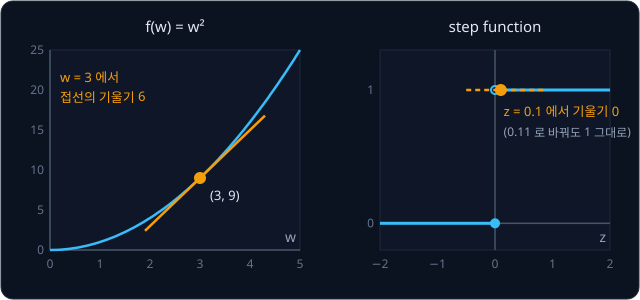
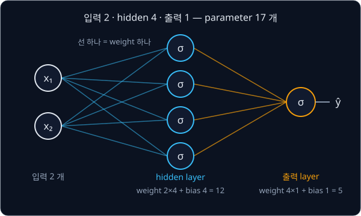

# Backpropagation

## 학습 목표

- 여러 층으로 쌓은 계산 기계에서 정답이 주어지지 않는 안쪽 숫자를 고치기 어려운 이유와, 계단처럼 뛰는 판정을 매끄러운 곡선으로
  바꾸면 그 숫자를 고칠 수 있게 되는 이유를 설명할 수 있다
- 계산을 덧셈·곱셈 같은 작은 칸으로 쪼개 그린 그림 위에서, 앞에서 뒤로 값을 계산하고 뒤에서 앞으로 "이 값을 조금 바꾸면 마지막
  결과가 얼마나 변하는가" 를 칸마다 채울 수 있다
- 칸마다의 변화 비율을 곱해 멀리 떨어진 값의 변화 비율을 구하는 규칙을 작은 숫자로 확인할 수 있다
- 한 값이 여러 곳에 쓰이면 비율을 더해야 하는 이유와, 마지막 결과에서부터 정해진 순서로 한 번만 거꾸로 훑으면 모든 숫자의 변화
  비율이 한꺼번에 나오는 이유를 설명할 수 있다
- "두 입력이 다를 때만 1" 인 규칙을 푸는 두 층짜리 계산 기계의 숫자 아홉 개를 한 번 고치는 계산을 처음부터 끝까지 손으로
  따라갈 수 있다
- 안쪽 숫자를 모두 같은 값에서 출발시키면 이 기계가 규칙을 끝내 배우지 못하는 이유를 숫자로 보일 수 있다

## hidden layer 의 숫자를 고치는 문제

[Perceptron](../perceptron/README.md) 강의에서는 입력 두 개 $x_1, x_2$ 에 weight(입력마다 곱하는 숫자)를 곱해 더하고 bias(입력과 상관없이
늘 더하는 숫자)를 더한 값인 weighted sum $z = w_1 x_1 + w_2 x_2 + b$ 가 0 보다 크면 1, 아니면 0 을 내는 perceptron 을 배웠다. perceptron 하나는 좌표평면에 직선 하나만
그을 수 있어서, 두 입력이 서로 다를 때만 1 인 규칙인 XOR 는 끝내 배우지 못했다. 로봇 집게로 말하면 "한쪽 손가락만 닿았나" 를
판단하지 못한 것이다.

perceptron 세 개를 두 층으로 쌓으면 XOR 를 계산할 수 있었다. 첫 층의 두 unit(perceptron 하나하나를 부르는 이름)이 OR(둘 중 하나라도 1 이면 1)와
NAND(두 입력이 모두 1 일 때만 0)를 계산하고, 둘째 층의 unit 이 두 결과의 AND(둘 다 1 일 때만 1)를 내면 XOR 가 된다. unit 을 이어 붙인 전체를 network 라고 하고, 입력과 출력 사이에
숨어 있는 첫 층을 hidden layer(은닉층)라고 불렀다. 하지만 그 숫자들은 사람이 논리식을 보고 직접 정한 것이었다.

숫자를 데이터에서 찾으려 하면 두 가지가 막는다. 첫째, perceptron 학습 규칙 $w_i \leftarrow w_i + \eta(y - \hat y)x_i$ 는 unit 의 예측 $\hat y$(와이 햇)가
정답 $y$ 와 다를 때 learning rate $\eta$("에타", 한 번에 고치는 크기)만큼 숫자를 고치는 규칙이다. 그래서 그 unit 의 정답 $y$ 를 알아야 쓸
수 있는데, 정답이 있는 것은 출력 unit 뿐이다. 출력이 틀렸을 때 그 책임을 안쪽 숫자들에 어떻게 나눠 줄지
정하는 이 문제를 credit assignment(책임 배분) 문제라고 했다. 둘째, step function(z 가 0 을 넘는 순간 0 에서 1 로 뛰는 판정)은
숫자를 조금 바꿔도 출력이 변하지 않아서, "어느 쪽으로 고치면 출력이 나아지는가" 를 알려 주지 않는다.

위 그림은 이 강의에서 학습시킬 network 를 보여 준다. 입력 두 개가 hidden unit 두 개로 가고, 두 hidden unit 의 출력이 출력 unit
하나로 간다. 숫자는 hidden unit 마다 weight 두 개와 bias 하나, 출력 unit 에 weight 두 개와 bias 하나라 모두 아홉 개다. 정답과
비교할 수 있는 것은 오른쪽 끝의 출력 하나뿐이다.

이 문제는 로봇에서도 그대로 나타난다. 카메라 사진을 받아 관절을 몇 도 돌릴지 내는 로봇의 network 에는 안쪽 숫자가 수백만 개 있지만,
사람이 보여 준 시연에서 얻는 정답은 마지막 관절 각도뿐이다. 안쪽 숫자 하나하나에 "너는 이 값이어야 한다" 는 정답은 없다.

1986년 Rumelhart, Hinton, Williams 는 두 가지를 바꿔 이 문제를 풀었다. step function 을 매끄럽게 변하는 함수로 바꾸고, 단계마다의 변화 비율을 곱해 이어 가는
chain rule 이라는 규칙으로 출력의 틀린 정도가 각 숫자에 얼마나 민감한지를 출력 쪽에서 입력 쪽으로 거꾸로 전해 가며 계산했다. 이 계산이
backpropagation(역전파)이고, 이름은 "거꾸로(back) 전한다(propagation)" 는 뜻이다. 이 강의는 그 계산을 작은 숫자로 한 칸씩 따라간다.

**요약**

- hidden layer 의 unit 에는 정답이 없어서 perceptron 학습 규칙을 쓸 수 없다(credit assignment 문제)
- step function 은 숫자를 조금 바꿔도 출력이 그대로라, 고칠 방향을 알려 주지 않는다
- backpropagation 은 매끄러운 함수와 chain rule 로 모든 숫자가 출력의 틀린 정도에 미치는 영향을 계산한다

**확인 문제**

1. 위 그림의 network 에서 hidden unit 하나에 들어 있는 숫자는 몇 개인가?
2. 출력 unit 이 정답 1 인 입력에 0 을 냈다. perceptron 학습 규칙으로 hidden unit $h_1$ 의 weight 를 고치려면 무엇이 더 필요한가?

답 보기

1. 세 개다. 입력이 두 개라 weight 두 개, 그리고 bias 하나다.
2. $h_1$ 의 정답이 필요하다. 학습 규칙의 $y - \hat y$ 를 계산하려면 그 unit 이 무엇을 냈어야 하는지 알아야 하는데, 데이터에는
   출력의 정답만 있다.

## derivative 와 step function 의 한계

[Linear Regression](../linear-regression/README.md) 에서 숫자를 고친 방법을 다시 떠올려 보자. 어떤 숫자를 아주 조금 바꿨을 때
결과가 변하는 비율을 derivative(미분값)라고 했다. $f(w) = w^2$ 에서 $w = 3$ 이면 $f = 9$ 이고, $w$ 를 0.01 늘려 3.01 로 하면
$f = 9.0601$ 이다. 결과는 0.0601 변했고 비율은 $0.0601 \div 0.01 = 6.01$ 인데, 늘리는 양을 더 줄이면 이 비율은 6 에 다가간다.
그래서 $w = 3$ 에서 $f$ 의 derivative 는 6 이다.

숫자가 여러 개일 때는 나머지를 고정하고 하나만 바꿔 잰 비율을 partial derivative(편미분값)라고 했다. 예측이 정답에서 벗어난 정도를
숫자 하나로 나타낸 loss $L$ 을 weight $w$ 로 잰 비율은 $\frac{\partial L}{\partial w}$ 로 적었다. "파셜 L 파셜 w" 라고 읽는다. 숫자마다 하나씩 나온 이 비율을 모은 것이
gradient 이고, gradient descent(경사 하강법)는 각 숫자를 gradient 의 반대 방향으로 조금씩 옮겨 loss 를 줄인다. 그래서 숫자 하나를
고치려면 그 숫자의 $\frac{\partial L}{\partial w}$ 만 알면 된다. 이 값을 이 강의에서는 그 숫자의 gradient 라고 부른다.

step function 에서 같은 실험을 하면 문제가 드러난다. perceptron 강의의 AND 학습 결과 $w = [0.2, 0.1]$, $b = -0.2$ 에서 입력
$[1, 1]$ 의 $z$ 는 0.1 이고 출력은 1 이다. $w_1$ 을 0.01 늘려도 $z = 0.11$ 이라 출력은 1 그대로라서 비율은 $0 \div 0.01 = 0$ 이다.

위 그림의 왼쪽은 $f(w) = w^2$ 의 곡선과 $w = 3$ 에서 곡선에 살짝 닿는 직선(접선)이다. derivative 는 이 접선의 기울기라 6 이다.
오른쪽은 step function 이다. $z = 0$ 을 뺀 모든 곳이 평평해서 기울기가 0 이고, $z = 0$ 에서는 값이 갑자기 뛰어 기울기를 정할 수
없다. 기울기가 0 이면 "숫자를 키우면 나아지는지, 줄이면 나아지는지" 를 알 수 없어서 gradient descent 가 움직이지 않는다.

**요약**

- derivative 는 숫자를 아주 조금 바꿨을 때 결과가 변하는 비율이고, 곡선 위 접선의 기울기다
- 숫자 하나를 고치려면 그 숫자의 gradient $\frac{\partial L}{\partial w}$ 만 알면 된다
- step function 은 거의 모든 곳에서 기울기가 0 이라 gradient 가 0 이 되어 숫자를 고칠 수 없다

**확인 문제**

1. $f(w) = w^2$ 에서 $w = 5$ 를 5.01 로 바꾸면 $f$ 는 얼마 변하고, 비율은 얼마인가?
2. step function 에서 $z$ 를 $-0.3$ 에서 $-0.2$ 로 바꾸면 출력은 얼마나 변하는가?

답 보기

1. $5.01^2 = 25.1001$ 이라 0.1001 변하고, 비율은 $0.1001 \div 0.01 = 10.01$ 이다. 늘리는 양을 더 줄이면 10 에 다가간다.
2. 둘 다 0 보다 크지 않아 출력은 0 그대로다. 변화는 0 이다.

## sigmoid

step function 을 대신할 함수로 가장 먼저 널리 쓰인 것이 sigmoid(시그모이드)다. weighted sum $z$ 를 받아 unit 의 출력으로 바꾸는
함수를 activation function(활성화 함수)이라고 하는데, step function 도 sigmoid 도 activation function 이다. sigmoid 는 아래처럼
계산한다.

$$
\sigma(z) = \frac{1}{1 + e^{-z}}
$$

$\sigma$ 는 그리스 문자 소문자로 "시그마" 라고 읽고, 여기서는 sigmoid 함수의 이름이다. perceptron 그림에서 "모두 더한다" 는 뜻으로
쓴 대문자 $\Sigma$ 와는 다른 기호다. $e$ 는 약 2.718 인 정해진 수다. 수의 오른쪽 위에 작게 쓴 숫자는 지수라고 하는데, 그 수를
몇 번 곱하는지를 나타낸다. $e^{2} = e \times e \approx 7.389$ 처럼 지수가 양수이면 그만큼 곱하고, $e^{-2} = 1 \div e^{2} \approx 0.1353$
처럼 지수에 마이너스가 붙으면 1 을 그만큼 곱한 수로 나눈다. $e^{0}$ 은 1 로 정한다. 그래서 $z = 2$ 이면 $e^{-z} = e^{-2} = 0.1353$
이고, $z = -1$ 이면 $e^{-z} = e^{1} = 2.7183$ 이다. $z$ 가 0.5 처럼 정수가 아니어도 계산기로 값을 구할 수 있다. 식 전체는
"$e^{-z}$ 에 1 을 더하고, 1 을 그 값으로 나눈다" 로 읽는다.

$z = 1$ 이면 아래처럼 계산한다.

| 단계 | 계산 | 값 |
| --- | --- | --- |
| $e^{-z}$ | $e^{-1} = 1 \div 2.7183$ | 0.3679 |
| 1 을 더함 | $1 + 0.3679$ | 1.3679 |
| 1 을 그 값으로 나눔 | $1 \div 1.3679$ | 0.7311 |

숫자만 바꿔 $z = -1$ 이면 $e^{1} = 2.7183$ 이고 $1 + 2.7183 = 3.7183$, $1 \div 3.7183 = 0.2689$ 이다. 몇 점의 값을 모으면 아래와 같다.

| $z$ | $-4$ | $-2$ | $-1$ | $0$ | $1$ | $2$ | $4$ |
| --- | --- | --- | --- | --- | --- | --- | --- |
| $e^{-z}$ | 54.5982 | 7.3891 | 2.7183 | 1 | 0.3679 | 0.1353 | 0.0183 |
| $\sigma(z)$ | 0.0180 | 0.1192 | 0.2689 | 0.5 | 0.7311 | 0.8808 | 0.9820 |

$z$ 가 아주 작으면 $e^{-z}$ 가 아주 커져서 $\sigma$ 는 0 에 가깝고, $z$ 가 아주 크면 $e^{-z}$ 가 0 에 가까워져서 $\sigma$ 는 1 에
가깝다. $z = 0$ 에서는 $1 \div (1 + 1) = 0.5$ 다. 표를 보면 $\sigma(1) = 0.7311$ 과 $\sigma(-1) = 0.2689$ 를 더하면 정확히 1 이
되는데, 어느 $z$ 에서든 $\sigma(-z) = 1 - \sigma(z)$ 가 성립해서 곡선이 $(0, 0.5)$ 를 중심으로 위아래가 대칭이다.

위 그림은 sigmoid 의 그래프다. 출력이 언제나 0 과 1 사이라서, perceptron 처럼 0.5 보다 크면 "예(1)" 로 읽을 수 있다. step function
과 다른 점은 0 과 1 사이의 값을 낸다는 것이고, $z$ 를 조금만 바꿔도 출력이 조금 변한다. 0.7311 같은 출력은 "1 에 꽤 가깝다" 는
정도를 나타낸다.

**요약**

- sigmoid $\sigma(z) = 1 / (1 + e^{-z})$ 는 $z$ 를 0 과 1 사이의 값으로 바꾸고, $z = 0$ 에서 0.5 다
- $z$ 를 조금 바꾸면 출력도 조금 변해서 step function 과 달리 기울기가 0 이 아니다
- weighted sum 을 출력으로 바꾸는 함수를 activation function 이라고 한다

**확인 문제**

1. $e^{-2} \approx 0.1353$ 을 써서 $\sigma(2)$ 를 계산하라.
2. $\sigma(2) = 0.8808$ 을 알 때 $\sigma(-2)$ 는?

답 보기

1. $1 + 0.1353 = 1.1353$ 이고 $1 \div 1.1353 \approx 0.8808$ 이다.
2. $\sigma(-z) = 1 - \sigma(z)$ 이므로 $1 - 0.8808 = 0.1192$ 다.

## sigmoid 의 derivative

sigmoid 의 기울기를 숫자로 재 보자. $z = 0$ 에서 $\sigma(0) = 0.5$ 이고, $z$ 를 0.01 늘리면 $\sigma(0.01) = 0.5025$ 다. 출력이
0.0025 변했으니 비율은 $0.0025 \div 0.01 = 0.25$ 다. $z = 1$ 에서는 $\sigma(1) = 0.731059$, $\sigma(1.01) = 0.733020$ 이라 비율이
$0.001961 \div 0.01 \approx 0.196$ 이다.

이 비율은 공식 하나로 바로 구할 수 있다.

$$
\sigma'(z) = \sigma(z) \times \big(1 - \sigma(z)\big)
$$

$\sigma'$ 는 "시그마 프라임" 이라고 읽고 sigmoid 의 derivative 를 뜻한다. 식은 "sigmoid 의 출력에, 1 에서 그 출력을 뺀 값을
곱한다" 로 읽는다. 공식이 나오는 과정은 미분 계산이 길어서 생략하고, 위에서 잰 값과 맞는지만 확인한다.

| $z$ | $\sigma(z)$ | $1 - \sigma(z)$ | 공식 $\sigma(z)(1 - \sigma(z))$ | 0.01 늘려 잰 비율 |
| --- | --- | --- | --- | --- |
| 0 | 0.5 | 0.5 | 0.25 | 0.25 |
| 1 | 0.7311 | 0.2689 | 0.1966 | 0.196 |
| 2 | 0.8808 | 0.1192 | 0.1050 | 0.105 |
| −2 | 0.1192 | 0.8808 | 0.1050 | 0.105 |

공식과 숫자로 잰 비율이 같다. 공식의 좋은 점은 forward 에서 이미 계산한 출력 $\sigma(z)$ 만 있으면 기울기가 곱셈 한 번으로
나온다는 것이다. 0.7311 을 알면 $0.7311 \times 0.2689 = 0.1966$ 이다.

위 그림은 $z$ 마다의 기울기 $\sigma'(z)$ 를 그린 것이다. $z = 0$ 에서 0.25 로 가장 크고, 양쪽으로 멀어질수록 작아진다. $z = 4$
에서도 0.0177 이라 아주 작지만 0 은 아니다. step function 의 기울기가 거의 모든 곳에서 정확히 0 인 것과 다르다.

**흔한 오해.** "sigmoid 로 바꾸면 기울기가 늘 넉넉하다" 고 생각하기 쉽다. 기울기는 아무리 커도 0.25 이고, $z$ 가 4 를 넘으면
0.02 보다 작다. 출력이 이미 0 이나 1 에 바짝 붙은 unit 은 숫자를 바꿔도 출력이 거의 변하지 않아 학습이 느려진다. 이 성질은 뒤에서
학습 초반의 속도를 볼 때 다시 나온다.

**요약**

- sigmoid 의 derivative 는 $\sigma'(z) = \sigma(z)(1 - \sigma(z))$ 이고, forward 에서 구한 출력만으로 계산한다
- 기울기는 $z = 0$ 에서 가장 큰 0.25 이고, $z$ 가 0 에서 멀수록 작아지지만 0 이 되지는 않는다

**확인 문제**

1. $\sigma(z) = 0.8$ 인 점에서 기울기 $\sigma'(z)$ 는?
2. $\sigma'(z)$ 가 0.25 보다 클 수 있는가? $\sigma(z) = 0.5$ 와 $\sigma(z) = 0.9$ 를 넣어 비교해 보라.

답 보기

1. $0.8 \times (1 - 0.8) = 0.8 \times 0.2 = 0.16$ 이다.
2. 없다. $0.5 \times 0.5 = 0.25$ 가 가장 크고, $0.9 \times 0.1 = 0.09$ 처럼 0.5 에서 멀어질수록 작아진다.

## tanh

sigmoid 와 모양이 같고 출력 범위만 다른 activation function 으로 tanh 가 있다. hyperbolic tangent(하이퍼볼릭 탄젠트)를 줄인 이름이고, 출력이 $-1$ 과 $1$ 사이다.

$$
\tanh(z) = \frac{e^{2z} - 1}{e^{2z} + 1}, \qquad \tanh'(z) = 1 - \tanh^2(z)
$$

첫 식은 "$e^{2z}$ 에서 1 을 뺀 값을, $e^{2z}$ 에 1 을 더한 값으로 나눈다" 이고, 둘째 식은 tanh 의 기울기가 "1 에서 tanh 출력의
제곱을 뺀 값" 이라는 뜻이다. $\tanh^2(z)$ 는 $\tanh(z) \times \tanh(z)$ 를 줄여 쓴 것이다. $z = 0.5$ 이면 $e^{1} = 2.7183$ 이라
$\tanh(0.5) = 1.7183 \div 3.7183 = 0.4621$ 이고, 기울기는 $1 - 0.4621^2 = 1 - 0.2135 = 0.7864$ 다.

| $z$ | $-2$ | $-0.5$ | $0$ | $0.5$ | $2$ |
| --- | --- | --- | --- | --- | --- |
| $\tanh(z)$ | $-0.9640$ | $-0.4621$ | 0 | 0.4621 | 0.9640 |
| 기울기 $1 - \tanh^2(z)$ | 0.0707 | 0.7864 | 1 | 0.7864 | 0.0707 |

위 그림처럼 tanh 는 sigmoid 를 가로로 절반으로 줄이고, 세로로 두 배 늘린 뒤 아래로 1 만큼 내린 모양이다. 실제로 $\tanh(z) = 2\sigma(2z) - 1$ 이 성립해서,
$z = 0.5$ 이면 $2 \times \sigma(1) - 1 = 2 \times 0.7311 - 1 = 0.4621$ 로 표의 값과 같다. tanh 는 $z = 0$ 에서 기울기가 1 이라
sigmoid 의 0.25 보다 커서 학습이 빠른 경우가 많다.

이 강의의 손 계산은 모두 sigmoid 로 한다. 출력이 0 과 1 사이라서 XOR 의 정답 0·1 과 바로 비교할 수 있기 때문이다. tanh 를
쓸 때는 출력 범위에 맞춰 정답을 0·1 대신 $-1$·$+1$ 로 바꿔 둔다.

**요약**

- tanh 는 출력이 $-1$ 과 1 사이인 activation function 이고, 기울기는 $1 - \tanh^2(z)$ 다
- tanh 를 쓰면 정답을 $-1$·$+1$ 로 둔다

**확인 문제**

1. $\tanh(z) = 0.6$ 인 점의 기울기는?

답 보기

1. $1 - 0.6^2 = 1 - 0.36 = 0.64$ 다.

## computational graph

network 의 계산은 곱셈·덧셈·sigmoid 같은 작은 계산을 수없이 이어 붙인 것이다. gradient 를 구하는 방법을 network 보다 작은 식으로 먼저
익혀 보자.

$$
L = (a \times b + c) \times f
$$

$a = 2$, $b = -3$, $c = 10$, $f = -2$ 를 넣는다. 이 식은 한 번에 계산하지 않고 연산 하나씩으로 쪼갤 수 있다. 중간 결과에 이름을
붙이면 아래와 같은데, 곱셈 결과는 곱(product)의 첫 글자를 따서 $p$, 덧셈 결과는 $d$ 라고 부른다.

| 순서 | 연산 | 계산 | 값 |
| --- | --- | --- | --- |
| 1 | $p = a \times b$ | $2 \times (-3)$ | $-6$ |
| 2 | $d = p + c$ | $-6 + 10$ | $4$ |
| 3 | $L = d \times f$ | $4 \times (-2)$ | $-8$ |

위 그림처럼 값 하나하나를 상자로, 연산을 원으로 그리고 값이 흘러가는 길을 화살표로 이은 그림을 computational graph(계산 그래프)라고
한다. 그림의 상자와 원을 node(노드, 마디)라고 부른다. 화살표를 따라 왼쪽에서 오른쪽으로 값을 하나씩 계산하는 것을 forward(순전파)라고
하는데, 위 표가 바로 forward 다.

graph 의 연산 하나는 자기 입력 두 개와 출력 하나만 본다. 곱셈 원은 $a$ 와 $b$ 를 받아 $p$ 를 낼 뿐,
뒤에서 $p$ 가 어디에 쓰이는지는 모른다. 이렇게 작게 나눠 두면 아무리 큰 식도 같은 몇 가지 연산의 반복이 된다.

**요약**

- 식을 연산 하나씩으로 쪼개 값과 연산을 node 로, 값이 흐르는 길을 화살표로 그린 것이 computational graph 다
- 입력에서 출력 쪽으로 값을 계산해 나가는 것이 forward 다

**확인 문제**

1. 같은 graph 에 $a = 1$, $b = 4$, $c = -1$, $f = 3$ 을 넣고 $p$, $d$, $L$ 을 차례로 구하라.

답 보기

1. $p = 1 \times 4 = 4$, $d = 4 + (-1) = 3$, $L = 3 \times 3 = 9$ 다.

## local derivative

이제 graph 의 값마다 gradient, 곧 "이 값을 조금 바꾸면 $L$ 이 얼마나 변하는가" 를 구한다. 그 전에 연산 하나만 떼어 보자. 연산
하나의 출력이 자기 입력에 대해 변하는 비율을 local derivative(지역 미분값)라고 한다. local 은 "그 자리의" 라는 뜻으로, graph 전체가
아니라 연산 하나 안에서만 잰 비율이라는 의미다.

덧셈 $d = p + c$ 에서 $p = -6$ 을 0.01 늘려 $-5.99$ 로 하면 $d = -5.99 + 10 = 4.01$ 이다. $d$ 도 0.01 늘었으니 비율은 1 이다. $c$ 를
0.01 늘려도 $d$ 는 0.01 늘어 비율이 1 이다. 덧셈은 어느 입력이 늘든 그만큼 출력이 는다.

곱셈 $L = d \times f$ 에서 $d = 4$ 를 4.01 로 늘리면 $L = 4.01 \times (-2) = -8.02$ 다. $L$ 이 $-0.02$ 변했으니 비율은
$-0.02 \div 0.01 = -2$ 인데, 이 값은 다른 입력 $f$ 와 같다. 반대로 $f = -2$ 를 $-1.99$ 로 늘리면 $L = 4 \times (-1.99) = -7.96$
이라 비율은 $0.04 \div 0.01 = 4$ 이고, 이번에는 다른 입력 $d$ 와 같다. 곱셈에서 한 입력이 1 늘면 출력은 다른 입력만큼 늘기 때문이다.

위 그림은 두 연산에서 입력 하나를 0.01 늘린 결과다. 지금까지 나온 연산의 local derivative 를 모으면 아래와 같다.

| 연산 | 출력 | 첫 입력에 대한 비율 | 둘째 입력에 대한 비율 |
| --- | --- | --- | --- |
| 덧셈 | $x + y$ | 1 | 1 |
| 곱셈 | $x \times y$ | $y$ (다른 입력) | $x$ (다른 입력) |
| 제곱 | $x^2$ | $2x$ | 없음 |
| sigmoid | $\sigma(x)$ | $\sigma(x)(1 - \sigma(x))$ | 없음 |

제곱의 비율 $2x$ 는 Linear Regression 에서 구한 "$w^2$ 의 derivative 는 $2w$" 이고, sigmoid 의 비율은 앞 절의 공식이다. 식으로는
$\frac{\partial (x + y)}{\partial x} = 1$, $\frac{\partial (x \times y)}{\partial x} = y$ 처럼 적는다. 첫 식은 "$x + y$ 를 $x$ 로 잰
비율은 1", 둘째 식은 "$x \times y$ 를 $x$ 로 잰 비율은 $y$" 라고 읽는다.

**요약**

- 연산 하나의 출력이 자기 입력에 대해 변하는 비율이 local derivative 다
- 덧셈은 두 입력 모두 1, 곱셈은 다른 입력의 값, 제곱은 $2x$, sigmoid 는 $\sigma(1 - \sigma)$ 다

**확인 문제**

1. $p = x \times y$ 이고 $x = 5$, $y = -4$ 일 때 $\frac{\partial p}{\partial x}$ 와 $\frac{\partial p}{\partial y}$ 는?
2. $q = x + y$ 이고 $x = 100$, $y = 0.5$ 일 때 $\frac{\partial q}{\partial x}$ 는?

답 보기

1. $\frac{\partial p}{\partial x}$ 는 다른 입력 $y$ 라 $-4$, $\frac{\partial p}{\partial y}$ 는 $x$ 라 5 다.
2. 1 이다. 덧셈의 local derivative 는 입력의 크기와 상관없이 1 이다.

## chain rule

$a$ 는 $L$ 에 바로 닿지 않고 $p$ 와 $d$ 를 거쳐서 닿는다. $a$ 를 2 에서 2.01 로 0.01 늘리고 그 영향이 어떻게 전해지는지 따라가 보자.

| 값 | 바뀌기 전 | 바뀐 뒤 | 변화 | 앞 칸 변화에 대한 비율 |
| --- | --- | --- | --- | --- |
| $a$ | 2 | 2.01 | $+0.01$ | |
| $p = a \times b$ | $-6$ | $-6.03$ | $-0.03$ | $-0.03 \div 0.01 = -3$ |
| $d = p + c$ | 4 | 3.97 | $-0.03$ | $-0.03 \div (-0.03) = 1$ |
| $L = d \times f$ | $-8$ | $-7.94$ | $+0.06$ | $0.06 \div (-0.03) = -2$ |

$a$ 를 0.01 늘렸더니 $L$ 이 0.06 늘었으니, 전체 비율은 $0.06 \div 0.01 = 6$ 이다. 표의 마지막 열에 있는 칸별 비율 $-3$, $1$,
$-2$ 를 곱해도 $(-3) \times 1 \times (-2) = 6$ 으로 같다. 칸별 비율은 모두 앞 절의 local derivative 다. $-3$ 은 곱셈 $a \times b$
의 다른 입력 $b$, 1 은 덧셈, $-2$ 는 곱셈 $d \times f$ 의 다른 입력 $f$ 다.

위 그림처럼 한 값이 중간 값 여러 개를 거쳐 다른 값에 영향을 줄 때, 전체 비율은 칸마다의 비율을 모두 곱한 값이다. 이 규칙을 chain
rule(연쇄 법칙)이라고 한다. chain 은 사슬이라는 뜻으로, 비율이 사슬처럼 이어져 곱해진다는 의미다.

$$
\frac{\partial L}{\partial a} = \frac{\partial L}{\partial d} \times \frac{\partial d}{\partial p} \times \frac{\partial p}{\partial a}
$$

이 식은 "$a$ 를 바꿨을 때 $L$ 이 변하는 비율은, $d$ 에 대한 $L$ 의 비율과 $p$ 에 대한 $d$ 의 비율과 $a$ 에 대한 $p$ 의 비율을 곱한
값" 이라고 읽는다. 위 예에서 $\frac{\partial L}{\partial d} = f = -2$, $\frac{\partial d}{\partial p} = 1$,
$\frac{\partial p}{\partial a} = b = -3$ 이었다.

숫자만 바꿔 $b$ 로 해 보자. $b$ 를 $-3$ 에서 $-2.99$ 로 늘리면 $p = 2 \times (-2.99) = -5.98$ 로 0.02 늘고(비율 $a = 2$), $d$ 도
0.02 늘어 4.02 가 되고(비율 1), $L = 4.02 \times (-2) = -8.04$ 로 0.04 준다(비율 $-2$). 전체 비율은 $-0.04 \div 0.01 = -4$ 이고,
칸별 비율의 곱 $2 \times 1 \times (-2) = -4$ 와 같다.

[Linear Regression](../linear-regression/README.md) 에서 점 하나의 오차 제곱을 $w$ 로 미분할 때 "오차 → 오차 제곱" 의 비율(오차의 2 배)과
"$w$ → 오차" 의 비율 $x$ 를 곱한 것도, [Perceptron](../perceptron/README.md) 의 마지막에서 "weight → hidden 출력" 의 비율 2 와
"hidden 출력 → 최종 출력" 의 비율 3 을 곱해 6 을 얻은 것도 모두 chain rule 이다.

**요약**

- chain rule: 값이 중간 값들을 거쳐 영향을 줄 때 전체 비율은 칸마다의 local derivative 를 곱한 값이다
- $\frac{\partial L}{\partial a} = \frac{\partial L}{\partial d} \cdot \frac{\partial d}{\partial p} \cdot \frac{\partial p}{\partial a} = (-2) \times 1 \times (-3) = 6$

**확인 문제**

1. $y = 3x$, $L = y \times 5$ 일 때 $\frac{\partial L}{\partial x}$ 는?
2. $c$ 를 10 에서 10.01 로 늘리면 $L$ 은 얼마가 되고, $\frac{\partial L}{\partial c}$ 는?

답 보기

1. $x$ → $y$ 의 비율은 3, $y$ → $L$ 의 비율은 다른 입력 5 라서 $3 \times 5 = 15$ 다.
2. $d = -6 + 10.01 = 4.01$, $L = 4.01 \times (-2) = -8.02$ 다. 비율은 $-0.02 \div 0.01 = -2$ 이고, 칸별 비율 $1 \times (-2)$ 와 같다.

## backward

chain rule 로 값마다 gradient 를 구할 수 있지만, 값마다 $L$ 까지 가는 길을 처음부터 따로 곱하면 같은 곱셈을 여러 번 한다.
$\frac{\partial L}{\partial a}$ 와 $\frac{\partial L}{\partial b}$ 는 둘 다 $\frac{\partial L}{\partial d} \times \frac{\partial d}{\partial p}$
를 쓰기 때문이다. 그래서 $L$ 에서 출발해 거꾸로 한 칸씩 오면서, 방금 구한 gradient 에 local derivative 를 한 번만 곱해 다음 값의
gradient 를 구한다.

출발점은 $L$ 자신이다. $L$ 을 0.01 늘리면 $L$ 은 당연히 0.01 늘어서 $\frac{\partial L}{\partial L} = 1$ 이다.

| 순서 | 값 | 그 값을 쓴 연산 | 계산 | gradient |
| --- | --- | --- | --- | --- |
| 1 | $L$ | (출발점) | | 1 |
| 2 | $d$ | $L = d \times f$ | $\frac{\partial L}{\partial L} \times f = 1 \times (-2)$ | $-2$ |
| 3 | $f$ | $L = d \times f$ | $\frac{\partial L}{\partial L} \times d = 1 \times 4$ | $4$ |
| 4 | $p$ | $d = p + c$ | $\frac{\partial L}{\partial d} \times 1 = -2 \times 1$ | $-2$ |
| 5 | $c$ | $d = p + c$ | $\frac{\partial L}{\partial d} \times 1 = -2 \times 1$ | $-2$ |
| 6 | $a$ | $p = a \times b$ | $\frac{\partial L}{\partial p} \times b = -2 \times (-3)$ | $6$ |
| 7 | $b$ | $p = a \times b$ | $\frac{\partial L}{\partial p} \times a = -2 \times 2$ | $-4$ |

위 그림은 forward 값과 gradient 를 한 graph 에 적은 것이다. 이렇게 출력에서 입력 쪽으로 gradient 를 채워 가는 것을 backward(역전파
단계)라고 한다. 각 줄은 "그 값을 쓴 연산의 출력 gradient × 그 연산의 local derivative" 하나뿐이라, 순서 4 에서 구한
$\frac{\partial L}{\partial p} = -2$ 를 순서 6 과 7 이 그대로 다시 쓴다.

gradient 의 뜻을 숫자로 확인해 보자. $\frac{\partial L}{\partial a} = 6$ 은 "$a$ 를 조금 늘리면 $L$ 이 그 6 배만큼 는다" 는 뜻이다.
$a$ 를 2 에서 2.001 로 늘리면 $L$ 은 $-8$ 에서 $-7.994$ 로 0.006 늘어 정말 6 배다. 부호에도 뜻이 있어서, $\frac{\partial L}{\partial b} = -4$
이면 $b$ 를 늘릴 때 $L$ 이 준다.

**흔한 오해.** gradient 를 "그 값 자체가 얼마나 큰가" 로 읽기 쉽다. $c = 10$ 은 가장 큰 값이지만 gradient 는 $-2$ 로 작고,
$a = 2$ 는 작은 값이지만 gradient 는 6 으로 가장 크다. gradient 는 값의 크기가 아니라, 값을 바꿨을 때 $L$ 이 얼마나 민감하게
반응하는지를 나타낸다.

**요약**

- backward 는 $\frac{\partial L}{\partial L} = 1$ 에서 출발해, 각 연산의 출력 gradient 에 local derivative 를 곱해 입력의 gradient
  를 구하며 거꾸로 간다
- 한 번 구한 gradient 를 다음 칸이 다시 쓰므로, 값마다 길을 처음부터 곱할 필요가 없다

**확인 문제**

1. computational graph 절의 확인 문제에서 쓴 graph($a = 1$, $b = 4$, $c = -1$, $f = 3$, $d = 3$, $L = 9$)에서 $f$, $d$, $p$, $a$, $b$ 의 gradient 를
   backward 순서대로 구하라.

답 보기

1. $\frac{\partial L}{\partial f} = d = 3$, $\frac{\partial L}{\partial d} = f = 3$, $\frac{\partial L}{\partial p} = 3 \times 1 = 3$,
   $\frac{\partial L}{\partial a} = 3 \times b = 3 \times 4 = 12$, $\frac{\partial L}{\partial b} = 3 \times a = 3 \times 1 = 3$ 이다.

## 여러 곳에 쓰인 값의 gradient

지금까지는 값 하나가 연산 하나에만 쓰였다. 한 값이 두 곳에 쓰이면 어떻게 될까? 아래 식에서 $a$ 는 곱셈에도 쓰이고 마지막 덧셈에도
쓰인다.

$$
q = a \times b, \qquad L = q + a
$$

$a = 3$, $b = 2$ 이면 $q = 6$, $L = 6 + 3 = 9$ 다. $a$ 가 $L$ 에 닿는 길은 두 개다.

| 길 | 칸별 비율 | 그 길의 비율 |
| --- | --- | --- |
| $a$ → $q$ → $L$ | $\frac{\partial q}{\partial a} = b = 2$, $\frac{\partial L}{\partial q} = 1$ | $2 \times 1 = 2$ |
| $a$ → $L$ (바로) | $\frac{\partial L}{\partial a}$ (덧셈) $= 1$ | $1$ |
| 합 | | $2 + 1 = 3$ |

$a$ 를 0.01 늘려 3.01 로 하면 $q = 6.02$, $L = 6.02 + 3.01 = 9.03$ 이라 비율은 $0.03 \div 0.01 = 3$ 으로, 두 길의 비율을 더한 값과
같다. $a$ 를 늘리면 두 길로 동시에 $L$ 이 늘기 때문이다.

위 그림은 두 길에서 들어온 gradient 가 $a$ 에서 합쳐지는 모습이다. 식으로는 아래처럼 쓴다.

$$
\frac{\partial L}{\partial x} = \sum_{j=1}^{k} \frac{\partial L}{\partial y_j} \times \frac{\partial y_j}{\partial x}
$$

$x$ 가 $y_1, \dots, y_k$ 라는 $k$ 개의 연산 출력에 쓰였다는 뜻이다. $\Sigma$ ("시그마", 대문자)는 "$j = 1$ 부터 $k$ 까지 바꿔
가며 모두 더한다" 는 기호다. 그래서 식은 "$x$ 가 쓰인 곳마다 그곳 출력의 gradient 에 local derivative 를 곱하고, 그것을 모두
더한다" 로 읽는다. 위 예에서 $x$ 는 $a$, $y_1$ 은 $q$, $y_2$ 는 $L$ 이고 $k = 2$ 다.

숫자를 바꿔 $L = a \times a$ 에서도 해 보자. 같은 $a$ 가 곱셈의 두 입력에 다 들어간 경우다. $a = 3$ 이면 첫째 입력으로서의 비율은
다른 입력 3, 둘째 입력으로서의 비율도 다른 입력 3 이라 합은 6 이다. $a$ 를 3.01 로 하면 $L = 9.0601$ 이라 비율은 $6.01$ 로, 늘리는
양을 줄이면 6 에 다가간다. Linear Regression 에서 구한 "$w^2$ 의 derivative 는 $2w$" 와 정확히 같은 결과다.

**흔한 오해.** backward 에서 두 번째 길의 gradient 로 첫 번째 길의 값을 덮어쓰면 틀린다. $L = q + a$ 에서 덮어쓰면 $a$ 의
gradient 가 2 나 1 하나만 남고, $L = a \times a$ 에서는 6 대신 3 이 나온다. gradient 는 늘 들어오는 대로 더해 쌓는다.

**요약**

- 한 값이 여러 곳에 쓰이면, 길마다 chain rule 로 구한 gradient 를 모두 더한다
- $L = a \times a$ 의 gradient 가 $3 + 3 = 6 = 2a$ 인 것도 이 규칙에서 나온다

**확인 문제**

1. $L = a + a$ 에서 $\frac{\partial L}{\partial a}$ 는?
2. $q = a \times b$, $L = q \times a$ 이고 $a = 2$, $b = 5$ 일 때 $\frac{\partial L}{\partial a}$ 는?

답 보기

1. 덧셈의 두 입력 모두 비율 1 이라 $1 + 1 = 2$ 다.
2. $q = 10$, $L = 20$ 이다. $q$ 를 거치는 길은 $\frac{\partial L}{\partial q} = a = 2$ 에 $\frac{\partial q}{\partial a} = b = 5$ 를
   곱해 10, 바로 가는 길은 $\frac{\partial L}{\partial a} = q = 10$ 이라 합은 20 이다. 실제로 $L = a^2 b$ 이고 $a = 2.01$ 이면
   $L = 20.2005$ 라 비율이 약 20 이다.

## backward 의 순서

backward 는 아무 순서로나 하면 안 된다. 어떤 값의 gradient 를 다음 칸에 넘기려면, 그 값이 쓰인 모든 곳에서 gradient 가 먼저 다
들어와 있어야 한다. 앞의 graph 에서 $p$ 의 gradient 는 $\frac{\partial L}{\partial d} \times 1$ 인데, $d$ 를 처리하기 전에 $p$ 를
먼저 계산하면 $\frac{\partial L}{\partial d}$ 가 아직 아무것도 채워지지 않은 0 이라 $p$ 의 gradient 도 0 이 된다. 그 0 이 다시 $a$ 와 $b$ 로
전해져 모두 틀린다.

순서는 forward 에서 얻는다. graph 의 node 를 "모든 node 가 자기를 만든 입력보다 뒤에 오도록" 한 줄로 세운 순서를 topological
order(위상 순서)라고 한다. 위 graph 라면 $a, b, p, c, d, f, L$ 이 그런 순서 중 하나다. $p$ 는 자기를 만든 $a, b$ 뒤에, $d$ 는
$p, c$ 뒤에 있다. forward 가 이 순서로 계산하고, backward 는 이 순서를 뒤집은 $L, f, d, c, p, b, a$ 로 처리한다.

어떤 값 $x$ 가 쓰인 곳은 모두 $x$ 를 입력으로 받으니 topological order 에서 $x$ 보다 뒤에 있다. 그래서 순서를 뒤집으면 그곳들이 모두 $x$ 보다 앞에 오므로, $x$ 차례가 되었을 때는 들어올 gradient 가 이미 다 더해져 있다.
앞 절의 $L = q + a$ 에서도 forward 순서 $a, b, q, L$ 을 뒤집은 $L, q, b, a$ 로 처리하면, $a$ 차례에는 $L$ 에서 온 1 과 $q$ 에서
온 2 가 이미 모여 3 이 되어 있다.

**요약**

- 모든 node 가 자기 입력보다 뒤에 오는 줄 세우기가 topological order 이고, forward 는 이 순서로 계산한다
- backward 는 이 순서를 뒤집어 처리해서, 값마다 들어올 gradient 가 다 모인 뒤에 그 값을 처리한다

**확인 문제**

1. $q = a \times b$, $r = q + c$, $L = r \times q$ 의 graph 에서 topological order 하나를 적고, backward 에서 $q$ 를 처리하기 전에
   어떤 값을 먼저 처리해야 하는지 답하라.

답 보기

1. 예를 들어 $a, b, q, c, r, L$ 이다. $q$ 는 $r$ 과 $L$ 두 곳에 쓰였으므로 backward 에서 $L$ 과 $r$ 을 모두 처리해 두 길의
   gradient 를 받은 뒤에 $q$ 를 처리한다. 뒤집은 순서 $L, r, c, q, b, a$ 가 그렇게 되어 있다.

## reverse-mode automatic differentiation

지금까지 한 일을 컴퓨터에 맡기는 방법이 automatic differentiation(자동 미분)이다. 컴퓨터는 forward 를 계산하면서 어떤 값이 어떤
연산으로 어떤 입력에서 만들어졌는지 graph 로 기록해 둔다. 그리고 backward 에서는 연산마다 정해진 local derivative 규칙만 적용한다.
사람이 식 전체를 미분하는 공식을 따로 만들 필요가 없고, 덧셈·곱셈·sigmoid 처럼 규칙을 아는 연산으로만 이루어져 있으면 아무리 큰
식이어도 gradient 가 나온다.

출력 $L$ 에서 출발해 거꾸로 가는 이 방식을 reverse-mode(역방향) automatic differentiation 이라고 한다. neural network(unit 을 이어
붙인 network 를 통틀어 부르는 말)에 쓰는 reverse-mode automatic differentiation 을 특별히 backpropagation 이라고 부른다. neural network 를
만들고 학습시키는 데 널리 쓰는 프로그램 도구인 PyTorch 의 backward 함수가 하는 일이 바로 이것이다.

거꾸로 가면 계산량이 크게 준다. 이 강의 뒤에서 학습시킬 network 는 숫자가 9 개인데, 이 숫자들의 gradient 를 구하는 방법
세 가지를 비교하면 아래와 같다.

| 방법 | 하는 일 | 숫자 9 개일 때 graph 를 훑는 횟수 |
| --- | --- | --- |
| 숫자마다 조금 바꿔 재기 | Linear Regression 의 central difference. 숫자 하나를 $+h$, $-h$ 로 바꿔 forward 를 두 번 | $9 \times 2 = 18$ 번 |
| forward-mode | 숫자 하나를 정해, forward 와 함께 "그 숫자에 대한 비율" 을 앞에서부터 실어 나름 | 숫자마다 한 번, 9 번 |
| reverse-mode | forward 한 번 뒤, $L$ 에서 backward 한 번 | forward 1 + backward 1 = 2 번 |

forward-mode(순방향)는 입력 쪽 숫자 하나에서 출발해 비율을 앞으로 전하는 방식이라, 숫자가 하나 늘 때마다 graph 를 한 번 더 훑어야
한다. reverse-mode 는 출력 하나에서 출발하므로 숫자가 몇 개든 backward 한 번에 모든 gradient 가 나온다. backward 한 번의 계산량은
forward 한 번과 비슷한 정도다.

위 그림처럼 숫자가 1억 개인 network 라면 차이가 1억 배 가까이 벌어진다. 학습에서는 숫자는 많고 loss 는 숫자 하나뿐이라 reverse-mode
가 압도적으로 유리하다. 반대로 입력이 하나이고 출력이 많은 계산에서는 forward-mode 가 유리하다.

**요약**

- automatic differentiation 은 forward 중에 graph 를 기록하고, 연산마다의 local derivative 규칙으로 gradient 를 자동으로 구한다
- reverse-mode 는 출력에서 거꾸로 가서, 숫자가 몇 개든 backward 한 번에 모든 gradient 를 얻는다
- neural network 에 쓰는 reverse-mode automatic differentiation 이 backpropagation 이다

**확인 문제**

1. 숫자가 100 개인 network 에서 central difference 로 모든 gradient 를 재려면 forward 를 몇 번 해야 하는가? reverse-mode 로는?

답 보기

1. 숫자마다 두 번이라 200 번이다. reverse-mode 는 forward 한 번과 backward 한 번이면 100 개가 다 나온다.

## sigmoid neuron 하나의 graph

이제 같은 방법을 학습에 쓴다. perceptron 의 step function 을 sigmoid 로 바꾼 unit 을 neuron(뉴런)이라고 부른다. neuron 하나와 정답
하나로 graph 를 그리면 아래와 같다.

$$
z = w_1 x_1 + w_2 x_2 + b, \qquad \hat y = \sigma(z), \qquad L = (\hat y - y)^2
$$

첫 식은 perceptron 의 weighted sum 이고, 둘째 식은 그 값을 sigmoid 에 넣은 출력 $\hat y$("와이 햇", 예측)다. 셋째 식의 $L$ 은
예측과 정답 $y$ 의 차이를 제곱한 loss 다. Linear Regression 의 오차 제곱과 같다.

입력 $x = [1, 1]$, 정답 $y = 1$ 이고 $w = [0.5, 0.5]$, $b = -1$ 에서 시작한다. forward 는 $z = 0.5 + 0.5 - 1 = 0$,
$\hat y = \sigma(0) = 0.5$, $L = (0.5 - 1)^2 = 0.25$ 다. backward 는 아래와 같다.

| 순서 | 값 | 계산 | gradient |
| --- | --- | --- | --- |
| 1 | $L$ | 출발점 | 1 |
| 2 | $\hat y$ | 제곱의 비율 $2(\hat y - y) = 2 \times (0.5 - 1)$ | $-1$ |
| 3 | $z$ | $-1 \times \sigma'(0) = -1 \times 0.5 \times 0.5$ | $-0.25$ |
| 4 | $w_1$ | $-0.25 \times x_1 = -0.25 \times 1$ | $-0.25$ |
| 5 | $w_2$ | $-0.25 \times x_2 = -0.25 \times 1$ | $-0.25$ |
| 6 | $b$ | $-0.25 \times 1$ | $-0.25$ |

순서 2 는 $L = (\hat y - y)^2$ 의 local derivative 다. $\hat y - y$ 를 한 값으로 보면 제곱의 비율은 그 값의 2 배이고, $\hat y$ 를
늘리면 $\hat y - y$ 도 그만큼 늘기 때문이다. 순서 4~6 은 덧셈과 곱셈의 규칙이다. $z$ 는 $w_1 x_1$, $w_2 x_2$, $b$ 를 더한 값이라
세 덧셈 입력 모두 비율이 1 이고, $w_1 x_1$ 에서 $w_1$ 의 비율은 다른 입력 $x_1$ 이다.

![neuron 하나의 computational graph. x = [1, 1], w = [0.5, 0.5], b = −1 에서 z = 0, ŷ = 0.5, L = 0.25 이고, backward 로 ŷ 의 gradient −1, z 의 gradient −0.25, w₁·w₂·b 의 gradient 가 모두 −0.25 다](figures/neuron-graph.svg)

위 그림은 이 계산을 graph 에 적은 것이다. 숫자로 확인하면 $w_1$ 을 0.51 로 늘렸을 때 $z = 0.01$, $\hat y = 0.5025$,
$L = 0.4975^2 = 0.247506$ 이라 비율은 $(0.247506 - 0.25) \div 0.01 \approx -0.249$ 로 $-0.25$ 와 거의 같다.

gradient descent 로 숫자를 고친다. 숫자를 이렇게 한 번 고치는 일을 update 라고 한다. learning rate $\eta$("에타", 한 번에 얼마나 고칠지 정하는 양수)를 1 로 두면 새 값은 "지금 값 $-$
$\eta \times$ gradient" 다.

| 숫자 | 지금 값 | gradient | 새 값 $= $ 지금 값 $- 1 \times$ gradient |
| --- | --- | --- | --- |
| $w_1$ | 0.5 | $-0.25$ | 0.75 |
| $w_2$ | 0.5 | $-0.25$ | 0.75 |
| $b$ | $-1$ | $-0.25$ | $-0.75$ |

새 숫자로 다시 forward 하면 $z = 0.75 + 0.75 - 0.75 = 0.75$, $\hat y = \sigma(0.75) = 0.6792$, $L = (0.6792 - 1)^2 = 0.1029$ 다.
loss 가 0.25 에서 0.1029 로 줄었다.

이 update 를 식으로 정리하면 perceptron 학습 규칙과 모양이 같다는 것이 보인다. $w_i$ 의 gradient 는 칸별 비율을 곱한
$2(\hat y - y) \times \sigma'(z) \times x_i$ 이므로

$$
w_i \leftarrow w_i - \eta \times 2(\hat y - y)\,\sigma'(z)\,x_i = w_i + \eta \times 2(y - \hat y)\,\sigma'(z)\,x_i
$$

다. 화살표 $\leftarrow$ 는 "오른쪽에서 계산한 값으로 왼쪽을 바꿔 넣는다" 는 뜻이다. perceptron 규칙 $w_i \leftarrow w_i + \eta(y - \hat y)x_i$
에 $2\sigma'(z)$ 가 더 곱해진 모양으로, 두 규칙 모두 "틀린 만큼, 입력의 크기만큼" 고친다. 다만 $\hat y$ 가 0 과 1 사이의 값이라,
예측이 맞는 쪽에 있어도 정답에서 멀면 조금씩 계속 고친다.

**요약**

- sigmoid 를 쓴 unit 을 neuron 이라고 하고, neuron 하나의 graph 는 곱셈·덧셈·sigmoid·제곱으로 이루어진다
- $w_i$ 의 gradient 는 $2(\hat y - y) \times \sigma'(z) \times x_i$ 이고, 이것으로 고친 update 는 perceptron 규칙과 같은 모양이다

**확인 문제**

1. 같은 neuron($w = [0.5, 0.5]$, $b = -1$)에 입력 $x = [1, 0]$, 정답 $y = 0$ 을 넣었다. $z = -0.5$, $\hat y = \sigma(-0.5) = 0.3775$
   일 때 $\frac{\partial L}{\partial \hat y}$, $\frac{\partial L}{\partial z}$, $\frac{\partial L}{\partial w_2}$ 를 구하라.
   ($\sigma'(-0.5) = 0.3775 \times 0.6225 = 0.2350$)

답 보기

1. $\frac{\partial L}{\partial \hat y} = 2 \times (0.3775 - 0) = 0.755$, $\frac{\partial L}{\partial z} = 0.755 \times 0.2350 \approx 0.1774$
   다. $x_2 = 0$ 이라 $\frac{\partial L}{\partial w_2} = 0.1774 \times 0 = 0$ 이고, 이 입력에서는 $w_2$ 를 고치지 않는다. gradient 가
   양수이므로 $w_1$ 과 $b$ 는 줄여서 $\hat y$ 를 정답 0 쪽으로 내린다.

## layer 와 MLP

neuron 을 여러 개 이어 붙이는 방식을 정리해 두자. 같은 입력을 받는 neuron 여러 개를 나란히 둔 것을 layer(층)라고 한다. layer 의
출력을 다음 layer 의 입력으로 이어 쌓은 network 를 MLP(multi-layer perceptron, 여러 층 perceptron)라고 한다. 이름에 perceptron 이
남아 있지만 실제 unit 은 step function 대신 sigmoid 나 tanh 를 쓴 neuron 이다. 입력과 출력 사이의 layer 가 hidden layer 다.

neuron 하나에 들어 있는 숫자는 "입력 개수만큼의 weight + bias 하나" 다. 입력이 2 개면 neuron 하나에 숫자가 3 개다. layer 의 숫자는
neuron 수에 이 값을 곱하면 나온다.

| network | hidden layer 의 숫자 | 출력 layer 의 숫자 | 합 |
| --- | --- | --- | --- |
| 입력 2, hidden 2, 출력 1 | $2 \times (2 + 1) = 6$ | $1 \times (2 + 1) = 3$ | 9 |
| 입력 2, hidden 4, 출력 1 | $4 \times (2 + 1) = 12$ | $1 \times (4 + 1) = 5$ | 17 |

출력 neuron 은 hidden neuron 의 출력을 입력으로 받으므로, hidden 이 4 개면 출력 neuron 의 weight 도 4 개다. 이렇게 학습으로 정하는
숫자를 parameter 라고 부른다.

위 그림은 hidden neuron 이 4 개인 MLP 다. 선 하나가 weight 하나이고, neuron 마다 bias 가 하나씩 더 있다. 이 강의에서 손으로
학습시킬 network 는 hidden 이 2 개인 첫째 줄로, parameter 가 9 개다.

**요약**

- 같은 입력을 받는 neuron 을 나란히 둔 것이 layer, layer 를 이어 쌓은 것이 MLP 다
- neuron 하나의 parameter 는 입력 개수 + 1 이다

**확인 문제**

1. 입력 3 개, hidden neuron 5 개, 출력 neuron 2 개인 MLP 의 parameter 는 모두 몇 개인가?

답 보기

1. hidden layer 는 $5 \times (3 + 1) = 20$, 출력 layer 는 $2 \times (5 + 1) = 12$ 라 모두 32 개다.

## XOR network 의 forward

이제 XOR 를 배울 network 의 숫자 아홉 개에 이름과 시작 값을 정한다. hidden neuron 은 $h_1$, $h_2$ 두 개다.

- $h_1$: $z_1 = w_{11} x_1 + w_{12} x_2 + b_1$, $h_1 = \sigma(z_1)$
- $h_2$: $z_2 = w_{21} x_1 + w_{22} x_2 + b_2$, $h_2 = \sigma(z_2)$
- 출력: $z_3 = v_1 h_1 + v_2 h_2 + b_3$, $\hat y = \sigma(z_3)$

$w_{12}$ 처럼 아래에 붙은 두 숫자는 앞이 hidden neuron 번호, 뒤가 입력 번호다. $w_{12}$ 는 "$h_1$ 으로 들어가는 둘째 입력의
weight" 이고 "더블유 일이" 라고 읽는다. $v_1, v_2$ 는 출력 neuron 의 weight, $b_3$ 는 출력 neuron 의 bias 다.

시작 값은 아래와 같다.

| neuron | weight | bias |
| --- | --- | --- |
| $h_1$ | $w_{11} = 1$, $w_{12} = 1$ | $b_1 = 0$ |
| $h_2$ | $w_{21} = 1$, $w_{22} = 1$ | $b_2 = -1$ |
| 출력 | $v_1 = 1$, $v_2 = -1$ | $b_3 = 0$ |

loss 는 네 sample(입력과 정답 한 쌍)의 오차 제곱을 평균한 값이다. Linear Regression 의 mean squared error 와 같다.

$$
L = \frac{1}{4} \sum_{k=1}^{4} (\hat y_k - y_k)^2
$$

$\hat y_k$ 와 $y_k$ 는 $k$ 번째 sample 의 예측과 정답이다. 식은 "네 sample 의 오차 제곱을 모두 더해 4 로 나눈다" 로 읽는다.

입력 $[1, 0]$ (정답 1) 부터 계산한다. 이 강의의 손 계산은 각 단계에서 소수 넷째 자리까지 반올림한 값으로 다음 단계를 이어 간다.

| 단계 | 계산 | 값 |
| --- | --- | --- |
| $z_1$ | $1 \times 1 + 1 \times 0 + 0$ | 1 |
| $h_1 = \sigma(z_1)$ | $\sigma(1)$ | 0.7311 |
| $z_2$ | $1 \times 1 + 1 \times 0 + (-1)$ | 0 |
| $h_2 = \sigma(z_2)$ | $\sigma(0)$ | 0.5 |
| $z_3$ | $1 \times 0.7311 + (-1) \times 0.5 + 0$ | 0.2311 |
| $\hat y = \sigma(z_3)$ | $\sigma(0.2311)$ | 0.5575 |
| 오차 제곱 | $(0.5575 - 1)^2 = (-0.4425)^2$ | 0.1958 |

![XOR network 에 입력 [1, 0] 을 넣은 forward. 화살표 위에 weight, neuron 안에 z 와 출력이 적혀 있고, h₁ = 0.7311, h₂ = 0.5, ŷ = 0.5575, 오차 제곱 0.1958 이다](figures/xor-net-forward.svg)

위 그림은 같은 계산을 network 위에 적은 것이다. 네 sample 을 모두 계산하면 아래와 같다.

| 입력 | 정답 | $z_1$ | $h_1$ | $z_2$ | $h_2$ | $z_3$ | $\hat y$ | 오차 제곱 |
| --- | --- | --- | --- | --- | --- | --- | --- | --- |
| $[0, 0]$ | 0 | 0 | 0.5 | $-1$ | 0.2689 | 0.2311 | 0.5575 | 0.3108 |
| $[0, 1]$ | 1 | 1 | 0.7311 | 0 | 0.5 | 0.2311 | 0.5575 | 0.1958 |
| $[1, 0]$ | 1 | 1 | 0.7311 | 0 | 0.5 | 0.2311 | 0.5575 | 0.1958 |
| $[1, 1]$ | 0 | 2 | 0.8808 | 1 | 0.7311 | 0.1497 | 0.5374 | 0.2888 |

오차 제곱의 합은 $0.3108 + 0.1958 + 0.1958 + 0.2888 = 0.9912$ 이고, 4 로 나눈 loss 는 $L = 0.2478$ 이다. 네 예측이 모두 0.54~0.56
근처라 정답이 0 인 입력과 1 인 입력을 전혀 구별하지 못한다. 아직 아무것도 배우지 않은 network 다.

**요약**

- XOR network 는 hidden neuron 두 개($h_1, h_2$)와 출력 neuron 하나, parameter 아홉 개로 이루어진다
- 시작 값에서 네 예측은 모두 0.55 근처이고 loss 는 0.2478 이다

**확인 문제**

1. 입력 $[0, 1]$ 의 $z_1$, $z_2$ 를 계산하고, 표에서 $[1, 0]$ 과 값이 같은 이유를 설명하라.

답 보기

1. $z_1 = 1 \times 0 + 1 \times 1 + 0 = 1$, $z_2 = 1 \times 0 + 1 \times 1 - 1 = 0$ 이다. $w_{11} = w_{12}$ 이고 $w_{21} = w_{22}$ 라서
   두 입력의 자리를 바꿔도 $z_1$, $z_2$ 가 같고, 그 뒤의 계산도 모두 같다.

## XOR network 의 backward

입력 $[1, 0]$ 한 sample 의 오차 제곱 $\ell = (\hat y - y)^2 = 0.1958$ 에 대해 아홉 parameter 의 gradient 를 구한다. $\ell$ 은
"엘" 이라고 읽고, 네 sample 을 평균한 $L$ 과 구별하려고 sample 하나의 오차 제곱에 쓰는 기호다. topological order 를 뒤집어 출력
쪽부터 간다.

| 순서 | 값 | 계산 | gradient |
| --- | --- | --- | --- |
| 1 | $\ell$ | 출발점 | 1 |
| 2 | $\hat y$ | $2(\hat y - y) = 2 \times (-0.4425)$ | $-0.8850$ |
| 3 | $z_3$ | $-0.8850 \times \sigma'(z_3) = -0.8850 \times 0.5575 \times 0.4425 = -0.8850 \times 0.2467$ | $-0.2183$ |
| 4 | $v_1$ | $-0.2183 \times h_1 = -0.2183 \times 0.7311$ | $-0.1596$ |
| 5 | $v_2$ | $-0.2183 \times h_2 = -0.2183 \times 0.5$ | $-0.1092$ |
| 6 | $b_3$ | $-0.2183 \times 1$ | $-0.2183$ |
| 7 | $h_1$ | $-0.2183 \times v_1 = -0.2183 \times 1$ | $-0.2183$ |
| 8 | $h_2$ | $-0.2183 \times v_2 = -0.2183 \times (-1)$ | $+0.2183$ |
| 9 | $z_1$ | $-0.2183 \times \sigma'(z_1) = -0.2183 \times 0.7311 \times 0.2689 = -0.2183 \times 0.1966$ | $-0.0429$ |
| 10 | $z_2$ | $0.2183 \times \sigma'(z_2) = 0.2183 \times 0.5 \times 0.5 = 0.2183 \times 0.25$ | $0.0546$ |
| 11 | $w_{11}$, $w_{12}$, $b_1$ | $-0.0429 \times x_1$, $-0.0429 \times x_2$, $-0.0429 \times 1$ | $-0.0429$, $0$, $-0.0429$ |
| 12 | $w_{21}$, $w_{22}$, $b_2$ | $0.0546 \times x_1$, $0.0546 \times x_2$, $0.0546 \times 1$ | $0.0546$, $0$, $0.0546$ |

순서 4~8 은 곱셈의 규칙이다. $z_3 = v_1 h_1 + v_2 h_2 + b_3$ 에서 $v_1$ 의 비율은 다른 입력 $h_1$ 이고, 거꾸로 $h_1$ 의 비율은
다른 입력 $v_1$ 이다. 순서 7 과 8 이 credit assignment 문제의 답이다. 정답이 없는 hidden neuron 에게도 "네 출력을 키우면 오차 제곱이
얼마나 변하는가" 가 gradient 로 전해졌다. $h_1$ 의 gradient 는 음수라 $h_1$ 을 키우면 오차가 줄고, $h_2$ 의 gradient 는 양수라
$h_2$ 를 키우면 오차가 커진다. $v_2 = -1$ 이라 $h_2$ 가 클수록 $\hat y$ 가 작아지는데, 지금 $\hat y$ 는 정답 1 보다 작으니 당연한
결과다.

![XOR network 의 backward. 입력 [1, 0] 에서 ŷ 의 gradient −0.8850, z₃ 의 gradient −0.2183 이 v₁, v₂ 를 거쳐 h₁ 에 −0.2183, h₂ 에 +0.2183 으로 전해지고, sigmoid 기울기를 곱해 z₁ 에 −0.0429, z₂ 에 0.0546 이 된다](figures/xor-net-backward.svg)

위 그림은 gradient 가 출력에서 입력 쪽으로 전해지는 모습이다. hidden layer 의 gradient(0.04~0.05)가 출력 쪽(0.2 근처)보다 훨씬
작은데, sigmoid 를 한 번 거칠 때마다 0.25 이하의 기울기가 곱해지기 때문이다.

$x_2 = 0$ 이라 $w_{12}$ 와 $w_{22}$ 의 gradient 는 0 이다. perceptron 에서처럼 0 인 입력은 $z$ 에 아무 영향을 주지 않았으니 그
weight 를 고칠 이유도 없다.

gradient 가 맞는지 Linear Regression 의 central difference 로 확인해 보자. $w_{11}$ 만 $1 \pm 0.01$ 로 바꾸고 나머지는 그대로 둔 채
이 sample 의 오차 제곱을 다시 계산하면 $w_{11} = 1.01$ 에서 0.195370, $w_{11} = 0.99$ 에서 0.196229 다.

$$
\frac{0.195370 - 0.196229}{0.02} = \frac{-0.000859}{0.02} \approx -0.04295
$$

backward 로 구한 $-0.0429$ 와 거의 같다. 남은 작은 차이는 오차 제곱을 소수 여섯째 자리에서, 중간 값을 넷째 자리에서 반올림한 데서
생긴다.

**요약**

- 출력 쪽 gradient 가 weight $v_1, v_2$ 를 곱하며 hidden neuron 으로 전해져, 정답이 없는 hidden neuron 에도 고칠 방향이 생긴다
- sigmoid 를 지날 때마다 0.25 이하의 기울기가 곱해져 gradient 가 작아진다
- 입력이 0 인 자리의 weight 는 gradient 가 0 이다

**확인 문제**

1. 만약 $v_1 = 2$ 였다면(나머지 값은 위와 같다고 하자) 순서 7 의 $h_1$ 의 gradient 와 순서 9 의 $z_1$ 의 gradient 는?

답 보기

1. $h_1$ 의 gradient 는 $-0.2183 \times 2 = -0.4366$, $z_1$ 의 gradient 는 $-0.4366 \times 0.1966 \approx -0.0858$ 이다. 출력에
   크게 곱해지는 hidden neuron 일수록 더 큰 책임을 받는다.

## 네 sample 의 gradient 와 한 번의 update

loss $L$ 은 네 오차 제곱의 평균이므로, 각 parameter 의 gradient 도 sample 마다 구한 gradient 를 평균한 값이다. 나머지 세 sample
도 앞 절과 똑같은 순서로 계산하는데, 먼저 중간 값을 모으면 아래와 같다.

| 입력 | 정답 | $\hat y$ | $\hat y$ 의 gradient $2(\hat y - y)$ | $z_3$ 의 gradient | $z_1$ 의 gradient | $z_2$ 의 gradient |
| --- | --- | --- | --- | --- | --- | --- |
| $[0, 0]$ | 0 | 0.5575 | 1.1150 | 0.2751 | 0.0688 | $-0.0541$ |
| $[0, 1]$ | 1 | 0.5575 | $-0.8850$ | $-0.2183$ | $-0.0429$ | 0.0546 |
| $[1, 0]$ | 1 | 0.5575 | $-0.8850$ | $-0.2183$ | $-0.0429$ | 0.0546 |
| $[1, 1]$ | 0 | 0.5374 | 1.0748 | 0.2672 | 0.0281 | $-0.0525$ |

$[1, 1]$ 의 $z_3$ 의 gradient 는 $1.0748 \times 0.5374 \times 0.4626 = 1.0748 \times 0.2486 = 0.2672$ 이고, $z_1$ 의 gradient 는
$0.2672 \times 1 \times \sigma'(2) = 0.2672 \times 0.1050 = 0.0281$ 이다. 이 중간 값에 입력이나 hidden 출력을 곱하면 sample 마다의
parameter gradient 가 나온다.

| 입력 | $w_{11}$ | $w_{12}$ | $b_1$ | $w_{21}$ | $w_{22}$ | $b_2$ | $v_1$ | $v_2$ | $b_3$ |
| --- | --- | --- | --- | --- | --- | --- | --- | --- | --- |
| $[0, 0]$ | 0 | 0 | 0.0688 | 0 | 0 | $-0.0541$ | 0.1376 | 0.0740 | 0.2751 |
| $[0, 1]$ | 0 | $-0.0429$ | $-0.0429$ | 0 | 0.0546 | 0.0546 | $-0.1596$ | $-0.1092$ | $-0.2183$ |
| $[1, 0]$ | $-0.0429$ | 0 | $-0.0429$ | 0.0546 | 0 | 0.0546 | $-0.1596$ | $-0.1092$ | $-0.2183$ |
| $[1, 1]$ | 0.0281 | 0.0281 | 0.0281 | $-0.0525$ | $-0.0525$ | $-0.0525$ | 0.2353 | 0.1953 | 0.2672 |
| 합 | $-0.0148$ | $-0.0148$ | 0.0111 | 0.0021 | 0.0021 | 0.0026 | 0.0537 | 0.0509 | 0.1057 |
| 평균 (합 $\div$ 4) | $-0.0037$ | $-0.0037$ | 0.002775 | 0.000525 | 0.000525 | 0.00065 | 0.013425 | 0.012725 | 0.026425 |

sample 마다 gradient 의 부호가 서로 엇갈린다. 예를 들어 $b_3$ 은 정답이 0 인 sample 에서는 양수(줄여야 함), 정답이 1 인 sample
에서는 음수(키워야 함)다. 평균을 내면 이 줄다리기의 결과가 남는다. $b_3$ 의 평균 gradient 가 0.026425 로 양수인 것은, 정답의
평균은 0.5 인데 네 예측의 평균이 0.55 가 넘어 조금 높기 때문이다.

learning rate $\eta = 1$ 로 update 한다. 이렇게 parameter 를 한 번 고치는 것을 step 이라고 한다. 새 값은 "지금 값 $-$ 평균 gradient" 이고, 소수 넷째 자리까지 반올림해 적는다.

| parameter | $w_{11}$ | $w_{12}$ | $b_1$ | $w_{21}$ | $w_{22}$ | $b_2$ | $v_1$ | $v_2$ | $b_3$ |
| --- | --- | --- | --- | --- | --- | --- | --- | --- | --- |
| 지금 값 | 1 | 1 | 0 | 1 | 1 | $-1$ | 1 | $-1$ | 0 |
| 새 값 | 1.0037 | 1.0037 | $-0.0028$ | 0.9995 | 0.9995 | $-1.0007$ | 0.9866 | $-1.0127$ | $-0.0264$ |

새 값으로 네 sample 의 forward 를 다시 하면 아래와 같다. $[1, 1]$ 을 예로 들면 $z_1 = 1.0037 + 1.0037 - 0.0028 = 2.0046$,
$h_1 = 0.8813$, $z_2 = 0.9995 + 0.9995 - 1.0007 = 0.9983$, $h_2 = 0.7307$,
$z_3 = 0.9866 \times 0.8813 - 1.0127 \times 0.7307 - 0.0264 = 0.1031$, $\hat y = 0.5258$ 이다.

| 입력 | 정답 | update 전 $\hat y$ | update 후 $\hat y$ | update 전 오차 제곱 | update 후 오차 제곱 |
| --- | --- | --- | --- | --- | --- |
| $[0, 0]$ | 0 | 0.5575 | 0.5483 | 0.3108 | 0.3006 |
| $[0, 1]$ | 1 | 0.5575 | 0.5471 | 0.1958 | 0.2051 |
| $[1, 0]$ | 1 | 0.5575 | 0.5471 | 0.1958 | 0.2051 |
| $[1, 1]$ | 0 | 0.5374 | 0.5258 | 0.2888 | 0.2765 |
| loss (평균) | | | | 0.2478 | 0.2468 |

![한 번의 update 전후 sample 별 오차 제곱. [0, 0] 은 0.3108 에서 0.3006, [0, 1]·[1, 0] 은 0.1958 에서 0.2051, [1, 1] 은 0.2888 에서 0.2765 가 되고, 평균 loss 는 0.2478 에서 0.2468 로 준다](figures/xor-step-loss.svg)

위 그림처럼 loss 는 0.2478 에서 0.2468 로 줄었다. 그런데 $[0, 1]$ 과 $[1, 0]$ 의 오차 제곱은 오히려 늘었다. gradient descent 는
네 sample 의 평균을 줄이는 방향으로 움직이므로, 한 step 에서 일부 sample 이 나빠지는 일은 흔하다. 지금은 네 예측을 모두 조금씩
내려 정답이 0 인 두 sample 을 더 많이 개선한 것이다.

**흔한 오해.** "backpropagation 은 각 hidden neuron 에 정답을 만들어 준다" 고 생각하기 쉽다. backward 가 hidden neuron 에 전하는
것은 정답이 아니라 "출력을 어느 쪽으로 얼마나 바꾸면 loss 가 줄어드는가" 라는 비율이다. $h_1$ 이 무엇을 계산하는 neuron 이
될지는 정해 주지 않고, 매 step 의 이 비율을 따라가다 보면 결과로 정해진다.

**요약**

- loss 가 sample 평균이므로 parameter 의 gradient 도 sample 별 gradient 의 평균이다
- $\eta = 1$ 로 한 번 update 하면 loss 가 0.2478 에서 0.2468 로 줄고, 이때 일부 sample 의 오차는 늘 수도 있다

**확인 문제**

1. learning rate 를 $\eta = 2$ 로 했다면 $b_3$ 과 $v_1$ 의 새 값은? (평균 gradient 는 위 표의 값)

답 보기

1. $b_3 = 0 - 2 \times 0.026425 = -0.05285$, $v_1 = 1 - 2 \times 0.013425 = 0.97315$ 다.

## 학습 결과

네 sample 로 forward 와 backward 를 하고 평균 gradient 로 아홉 parameter 를 고치는 step 을, $\eta = 1$ 로 2,000 번 되풀이한
결과는 아래와 같다.

| step | loss | $[0, 0]$ 의 $\hat y$ | $[0, 1]$ 의 $\hat y$ | $[1, 0]$ 의 $\hat y$ | $[1, 1]$ 의 $\hat y$ |
| --- | --- | --- | --- | --- | --- |
| 0 | 0.2478 | 0.558 | 0.558 | 0.558 | 0.537 |
| 1 | 0.2468 | 0.548 | 0.547 | 0.547 | 0.526 |
| 100 | 0.2270 | 0.475 | 0.534 | 0.534 | 0.497 |
| 200 | 0.1789 | 0.392 | 0.589 | 0.589 | 0.473 |
| 300 | 0.1008 | 0.287 | 0.691 | 0.691 | 0.361 |
| 500 | 0.0258 | 0.158 | 0.844 | 0.844 | 0.173 |
| 1000 | 0.0059 | 0.080 | 0.926 | 0.926 | 0.079 |
| 2000 | 0.0020 | 0.048 | 0.957 | 0.957 | 0.045 |

위 그림은 loss 가 step 마다 어떻게 변했는지 그린 것이다. 처음 100 step 동안은 loss 가 0.2478 에서 0.2270 으로 조금밖에 줄지 않는다.
hidden layer 의 gradient 가 0.004 이하로 작아서 hidden neuron 이 거의 움직이지 않기 때문이다. hidden neuron 이 입력을 구별하기
시작하면 200~500 step 사이에 loss 가 빠르게 떨어진다. 2,000 step 뒤에는 정답이 1 인 두 입력의 예측이 0.957, 정답이 0 인 두 입력의
예측이 0.05 아래라 0.5 를 기준으로 네 입력을 모두 맞힌다.

학습이 끝난 parameter 를 소수 둘째 자리까지 적으면 아래와 같다.

| neuron | weight | bias | 출력이 0.5 를 넘는 영역 |
| --- | --- | --- | --- |
| $h_1$ | $w_{11} = 5.64$, $w_{12} = 5.64$ | $b_1 = -2.40$ | $x_1 + x_2$ 가 약 0.43 보다 큼 |
| $h_2$ | $w_{21} = 4.12$, $w_{22} = 4.12$ | $b_2 = -6.33$ | $x_1 + x_2$ 가 약 1.54 보다 큼 |
| 출력 | $v_1 = 7.84$, $v_2 = -8.35$ | $b_3 = -3.61$ | $h_1$ 이 크고 $h_2$ 가 작을 때 |

$h_1$ 은 $z_1 = 5.64(x_1 + x_2) - 2.40$ 이 0 보다 클 때, 곧 $x_1 + x_2 > 2.40 \div 5.64 \approx 0.43$ 일 때 0.5 를 넘는다. 네 입력
중 하나라도 1 이면 켜지니 OR 에 가깝다. $h_2$ 는 $x_1 + x_2 > 6.33 \div 4.12 \approx 1.54$ 일 때 켜지니 둘 다 1 일 때만 켜지는
AND 에 가깝다. 출력은 $h_1$ 에 큰 양수, $h_2$ 에 큰 음수를 곱하므로 "OR 이면서 AND 는 아님", 곧 XOR 를 계산한다.

위 그림은 학습된 network 가 평면을 나누는 모습이다. [Perceptron](../perceptron/README.md) 에서 사람이 손으로 만든 두 층 network 는
$x_1 + x_2 = 0.5$ 와 $x_1 + x_2 = 1.5$ 사이의 띠를 1 로 냈는데, backpropagation 으로 찾은 network 도 거의 같은 띠를 만들었다.
"$h_1$ 은 OR, $h_2$ 는 AND 를 맡아라" 라고 알려 준 적이 없는데도, 출력의 오차를 줄이는 방향을 따라가다 hidden neuron 이 스스로 그
역할을 맡게 된 것이다.

**요약**

- 같은 step 을 2,000 번 되풀이하면 loss 가 0.0020 까지 줄고 네 입력을 모두 맞힌다
- 학습 초반에는 hidden layer 의 gradient 가 작아 loss 가 천천히 줄다가, hidden neuron 이 입력을 구별하기 시작하면 빠르게 준다
- 학습된 hidden neuron 은 OR 와 AND 에 가까운 역할을 스스로 맡는다

**확인 문제**

1. 학습된 network 에서 입력 $[1, 1]$ 의 $h_1 \approx 1.00$, $h_2 \approx 0.87$ 이다. $z_3 = 7.84 h_1 - 8.35 h_2 - 3.61$ 의 부호와
   예측(0.5 보다 큰지)을 답하라.

답 보기

1. $z_3 \approx 7.84 - 8.35 \times 0.87 - 3.61 = 7.84 - 7.26 - 3.61 = -3.03$ 으로 음수다. sigmoid 에 음수를 넣으면 0.5 보다 작으니
   0 으로 예측하고, XOR 의 정답 0 과 같다.

## 처음 숫자를 서로 다르게 두는 이유

perceptron 은 $w = [0, 0]$, $b = 0$ 에서 출발해도 잘 배웠다. 두 층 network 도 모든 parameter 를 0 에서 출발시키면 어떻게 될까?
모든 값이 0 이면 $h_1 = h_2 = \sigma(0) = 0.5$, $z_3 = 0$, $\hat y = 0.5$ 다. $z_3$ 의 gradient 는 정답이 0 인 sample 에서
$2 \times 0.5 \times 0.25 = 0.25$, 정답이 1 인 sample 에서 $-0.25$ 라 네 개를 평균하면 0 이다. $v_1$, $v_2$ 의 gradient 도 여기에
$h = 0.5$ 를 곱해 평균하니 0 이다. hidden 쪽은 $v_1 = v_2 = 0$ 을 곱해야 하니 처음부터 0 이다. 아홉 gradient 가 모두 정확히 0 이라
몇 step 을 돌려도 아무것도 움직이지 않는다.

0 이 아니어도 두 hidden neuron 이 똑같은 값에서 출발하면 문제가 생긴다. $h_1$ 과 $h_2$ 를 모두 weight $[1, 1]$, bias 0 으로 두고
$v_1 = v_2 = 1$, $b_3 = 0$ 으로 시작해 보자. 입력 $[1, 0]$ 에서는 $z_1 = z_2 = 1$, $h_1 = h_2 = 0.7311$, $z_3 = 1.4622$,
$\hat y = 0.8119$ 이고, backward 는 아래와 같다.

| 값 | $h_1$ 쪽 | $h_2$ 쪽 |
| --- | --- | --- |
| hidden 출력의 gradient ($z_3$ 의 gradient $\times v$) | $-0.0574 \times 1 = -0.0574$ | $-0.0574 \times 1 = -0.0574$ |
| $z$ 의 gradient ($\times \sigma'(1) = 0.1966$) | $-0.0113$ | $-0.0113$ |
| 첫째 입력의 weight 의 gradient | $-0.0113$ | $-0.0113$ |
| 출력 weight 의 gradient ($z_3$ 의 gradient $\times h$) | $-0.0420$ | $-0.0420$ |

두 neuron 이 같은 값에서 출발했으니 forward 값이 같고, 받는 gradient 도 같고, 고친 뒤의 값도 같다. 다음 step 에서도 같은 일이
되풀이되어 두 neuron 은 끝까지 같은 값을 가진다. 2,000 step 을 돌린 뒤에도 두 neuron 모두 weight 5.34, bias $-0.38$ 로 똑같고,
예측은 $[0, 0]$ 0.069, $[0, 1]$ 0.662, $[1, 0]$ 0.662, $[1, 1]$ 0.670 이다. $[1, 1]$ 을 1 로 예측하니 틀렸고, 이때 loss 는 0.1708 이다.
20,000 step 을 돌려도 loss 는 0.167 근처에서 멈추고 $[1, 1]$ 의 예측은 0.667 로 여전히 틀린다.

![두 hidden neuron 이 같은 weight [1, 1], bias 0 에서 출발하면 같은 gradient −0.0113 을 받아 같은 값으로 고쳐지고, 2,000 step 뒤에도 둘 다 weight 5.34, bias −0.38 이라 직선 하나밖에 긋지 못한다](figures/symmetry.svg)

위 그림처럼 똑같은 neuron 두 개는 neuron 하나와 다를 바 없어서 직선 하나밖에 긋지 못하고, perceptron 이 XOR 를 못 푼 것과 같은
이유로 막힌다. 그래서 실제로는 parameter 를 작은 random(무작위) 값으로 출발시킨다. 매번 다른 값을 뽑으니 hidden neuron 들이 서로
다른 곳에서 출발해 서로 다른 역할을 맡을 수 있다. 이 강의의 시작 값 $b_2 = -1$, $v_2 = -1$ 도 두 neuron 을 다르게 만들려고 고른 것이다.

**요약**

- 모든 parameter 가 0 이면 이 network 의 gradient 가 모두 0 이라 학습이 일어나지 않는다
- hidden neuron 들이 같은 값에서 출발하면 같은 gradient 를 받아 끝까지 같은 neuron 으로 남는다
- 그래서 parameter 는 서로 다른 작은 random 값으로 출발시킨다

**확인 문제**

1. hidden neuron 이 4 개인 network 의 hidden weight 를 모두 같은 값으로 출발시키면, 학습이 끝난 뒤 서로 다른 직선은 몇 개가 되는가?

답 보기

1. 한 개다. 네 neuron 이 늘 같은 gradient 를 받아 같은 값으로 남으므로, 네 neuron 이 모두 같은 직선 하나를 긋는다.

## 정리

- step function 은 기울기가 거의 모든 곳에서 0 이라 숫자를 고칠 방향을 주지 않는다. sigmoid $\sigma(z) = 1 / (1 + e^{-z})$ 는
  기울기 $\sigma(z)(1 - \sigma(z))$ 가 0 보다 커서 gradient 가 전해진다. 기울기는 $z = 0$ 에서 가장 큰 0.25 다
- computational graph 는 식을 연산 하나씩으로 쪼갠 그림이다. forward 로 값을 계산하고, backward 로 $\frac{\partial L}{\partial L} = 1$
  에서 출발해 각 연산의 local derivative(덧셈은 1, 곱셈은 다른 입력)를 곱하며 입력 쪽 gradient 를 채운다
- chain rule 은 칸마다의 비율을 곱하는 규칙이다. $L = (a \times b + c) \times f$ 에서
  $\frac{\partial L}{\partial a} = (-2) \times 1 \times (-3) = 6$ 이다
- 한 값이 여러 곳에 쓰이면 길마다의 gradient 를 더한다. $L = a \times a$ 의 gradient 가 $2a$ 인 이유다
- backward 는 topological order 를 뒤집은 순서로 처리하고, reverse-mode 라서 parameter 가 몇 개든 backward 한 번에 모든 gradient 가
  나온다. neural network 에 쓰는 이 계산이 backpropagation 이다
- XOR network 의 parameter 아홉 개를 $\eta = 1$ 로 한 번 고치면 loss 가 0.2478 에서 0.2468 이 되고, 2,000 step 뒤에는 0.0020 이
  되어 네 입력을 모두 맞힌다. hidden neuron 은 OR 와 AND 에 가까운 역할을 스스로 맡는다
- hidden neuron 들을 같은 값에서 출발시키면 끝까지 같은 neuron 으로 남아 XOR 를 풀지 못한다

sigmoid 의 기울기는 많아야 0.25 라서, sigmoid 를 지날 때마다 gradient 가 4 분의 1 이하로 준다. XOR network
에서도 hidden layer 의 gradient 가 출력 쪽의 4~5 분의 1 이었다. 층을 다섯 개 쌓으면 $0.25^5 \approx 0.001$ 배 이하로 줄어서 입력에
가까운 층은 거의 배우지 못한다. 이 문제는 기울기가 덜 줄어드는 다른 activation function 과, 층을 건너뛰는 연결을 쓴
[ResNet](../resnet/README.md) 에서 다룬다.

또 이 강의에서는 숫자 하나하나를 node 로 두고 계산했다. weight 가 수십만 개인 network 를 이렇게 계산하면 너무 느리다. 같은 계산을
숫자 묶음 단위로 한꺼번에 처리하고 학습 과정을 도구로 짜는 방법은 다음 강의
[PyTorch Training Loop](../pytorch-mlp/README.md) 에서 다룬다.

## 참고 자료

- David E. Rumelhart, Geoffrey E. Hinton, Ronald J. Williams, [Learning representations by back-propagating errors](https://www.nature.com/articles/323533a0)
  (1986) — hidden unit 의 weight 를 chain rule 로 학습시킨 원 논문. 네 쪽 분량이다
- Atılım Güneş Baydin et al., [Automatic Differentiation in Machine Learning: a Survey](https://jmlr.org/papers/v18/17-468.html)
  (2018) — forward-mode 와 reverse-mode 를 같은 예제로 나란히 보여 주는 3장을 읽으면 된다
- Andrej Karpathy, [The spelled-out intro to neural networks and backpropagation: building micrograd](https://www.youtube.com/watch?v=VMj-3S1tku0)
  — 이 강의의 $L = (a \times b + c) \times f$ 같은 작은 graph 에서 출발해 backward 를 손으로 채우고, 같은 계산을 컴퓨터로 옮기는 과정까지 보여 주는 영상
- 3Blue1Brown, [Backpropagation, intuitively](https://www.youtube.com/watch?v=Ilg3gGewQ5U)·[Backpropagation calculus](https://www.youtube.com/watch?v=tIeHLnjs5U8)
  — gradient 가 층을 거슬러 전해지는 모습을 그림으로 보여 주는 두 영상
- Stanford CS231n, [Backpropagation, Intuitions](https://cs231n.github.io/optimization-2/) — 덧셈·곱셈·max 연산이 gradient 를
  어떻게 나눠 주는지 정리한 강의 노트
- Christopher Olah, [Calculus on Computational Graphs: Backpropagation](https://colah.github.io/posts/2015-08-Backprop/) — 여러 길의
  gradient 를 더하는 규칙과 forward-mode·reverse-mode 의 차이를 graph 그림으로 설명한다
- Michael Nielsen, [Neural Networks and Deep Learning — Chapter 2](http://neuralnetworksanddeeplearning.com/chap2.html) —
  backpropagation 의 식을 행렬로 정리한다. 다음 강의로 넘어갈 때 다시 읽기 좋다
- PyTorch, [Autograd mechanics](https://docs.pytorch.org/docs/stable/notes/autograd.html) — PyTorch 가 forward 중에 graph 를
  기록하고 backward 하는 방식
