# Backpropagation

LeRobot 으로 로봇 팔 policy 인 ACT 를 학습시킬 때, 사람이 조종해서 모은 시연이 주는 정답은 매 순간 관절이 가야 할 목표 각도뿐이다. 그런데
ACT 안에는 학습으로 정하는 숫자가 약 8천만 개 있고, 그 숫자 하나하나에는 정답이 따로 없다. 출력 각도가 틀렸을 때 8천만 개를 각각 어느
쪽으로 얼마나 고쳐야 하는지 어떻게 알 수 있을까?

숫자마다 조금 늘리고 줄여 보며 출력이 얼마나 변하는지 재려면 network 를 8천만 × 2 = 1억 6천만 번 다시 계산해야 한다. backpropagation 은
계산 과정을 작은 연산의 graph 로 기록해 두고 출력에서 입력 쪽으로 한 번 거꾸로 훑어서, network 를 몇 번 계산하는 정도의 시간에 모든 숫자의
gradient 를 한꺼번에 구한다. ACT 논문에 따르면 이 숫자(parameter) 약 8천만 개를 GPU 한 장(11 GB RTX 2080 Ti)에서 학습하는 데 약 5 시간이
걸렸다. PyTorch 에서는 `loss.backward()` 한 줄이 이 계산을 맡는다.

## 학습 목표

- computational graph 위에서 forward 로 값을 계산하고, backward 로 local derivative 를 곱해 gradient 를 채울 수 있다
- 여러 곳에 쓰인 값의 gradient 를 더하는 이유와, reverse-mode 가 parameter 수와 상관없이 backward 한 번으로 끝나는 이유를 설명할 수 있다
- XOR network 의 hidden neuron 이 gradient 를 받는 과정을 숫자로 따라가고, vanishing gradient 와 같은 값으로 초기화할 때의 문제를 설명할 수 있다
- PyTorch autograd 가 graph 를 기록하고 `.grad` 에 더해 쌓는 방식과 `torch.no_grad()`, `requires_grad=False` 의 쓰임을 설명할 수 있다

## 정답이 없는 hidden layer

[Perceptron](../perceptron/README.md) 에서는 perceptron 세 개를 두 층으로 쌓아 XOR(두 입력이 다를 때만 1)를 계산했는데, 그때 weight 와
bias 는 사람이 논리식을 보고 정했다. 이 숫자를 데이터로 학습시키려 하면 문제가 두 가지 생긴다.

첫째, perceptron 학습 규칙 $w_i \leftarrow w_i + \eta(y - \hat y)x_i$ 는 그 unit 의 정답 $y$ 를 알아야 쓸 수 있는데, 정답이 있는 것은
출력 unit 뿐이다. 입력과 출력 사이에 숨은 첫 층(hidden layer)의 unit 에는 무엇을 냈어야 하는지 적힌 정답이 없다. 출력이 틀렸을 때 그
책임을 안쪽 숫자들에 어떻게 나눌지 정하는 이 문제를 **credit assignment** 문제라고 한다. 둘째, step function(z 가 0 을 넘는 순간 0 에서
1 로 뛰는 판정)은 숫자를 조금 바꿔도 출력이 그대로라서 기울기가 0 이고, gradient descent 가 고칠 방향을 얻지 못한다.

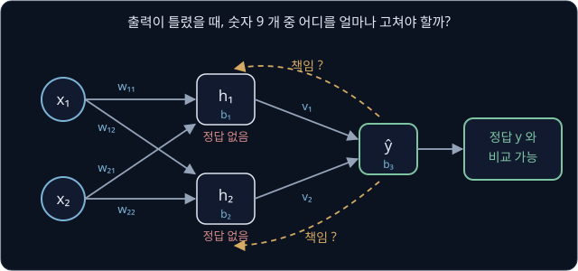

위 그림은 이 강의에서 학습시킬 network 다. 학습으로 정하는 숫자(parameter)는 unit 하나에 weight 두 개와 bias 하나가 있어서, unit 세 개를
합하면 3 × 3 = 9 개다.

step function 을 매끄럽게 변하는 함수로 바꾸면 기울기가 생기고, 출력의 틀린 정도가 각 숫자에 얼마나 민감한지는 단계별 변화율을 곱하며
출력 쪽에서 입력 쪽으로 거꾸로 전해 계산할 수 있다. 이 계산이 **backpropagation** 이고, 이름은 오차를 "거꾸로(back) 전한다(propagation)" 는
뜻이다. 1986 년 Rumelhart, Hinton, Williams 는 실제 출력과 원하는 출력의 차이를 줄이도록 이 방법으로 weight 를 되풀이해 고치면, hidden
unit 이 과제의 중요한 특징을 나타내게 된다고 보고했다.

## sigmoid 와 기울기

step function 대신 쓰는 매끄러운 함수가 sigmoid 다. weighted sum $z$ 를 받아 unit 의 출력으로 바꾸는 함수를 activation function 이라고 하는데,
sigmoid 는 아래처럼 계산한다.

$$
\sigma(z) = \frac{1}{1 + e^{-z}}
$$

$\sigma$("시그마")는 이 함수의 이름이고, $e$ 는 약 2.718 인 정해진 수다. 식은 "$e^{-z}$ 에 1 을 더하고, 1 을 그 값으로 나눈다" 로 읽는다.
$e^{-z}$ 는 $z$ 가 클수록 0 에 가깝고 $z$ 가 작을수록 커져서, 출력은 늘 0 과 1 사이다.

| $z$ | $-4$ | $-2$ | $-1$ | $0$ | $1$ | $2$ | $4$ |
| --- | --- | --- | --- | --- | --- | --- | --- |
| $e^{-z}$ | 54.5982 | 7.3891 | 2.7183 | 1 | 0.3679 | 0.1353 | 0.0183 |
| $\sigma(z)$ | 0.0180 | 0.1192 | 0.2689 | 0.5 | 0.7311 | 0.8808 | 0.9820 |

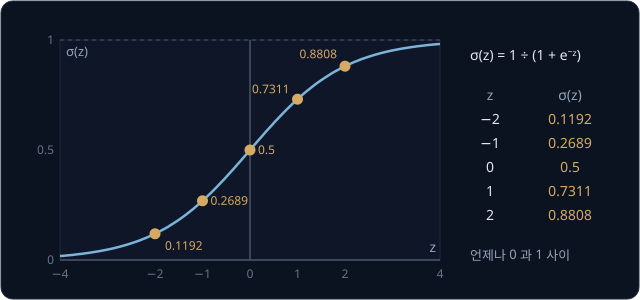

$z$ 를 조금 바꾸면 출력도 조금 변하므로 기울기가 0 이 아니다. $z = 0$ 에서 0.01 늘리면 $\sigma$ 는 0.5 에서 0.5025 로 0.0025 늘어 비율이
$0.0025 \div 0.01 = 0.25$ 인데, 이 비율은 공식 $\sigma'(z) = \sigma(z)\big(1 - \sigma(z)\big)$ 로 바로 나온다. $\sigma'$("시그마 프라임")은
sigmoid 의 derivative 다. 공식에 출력만 들어가서, $\sigma(1) = 0.7311$ 을 알면 기울기는 곱셈 한 번 $0.7311 \times (1 - 0.7311) = 0.7311
\times 0.2689 = 0.1966$ 으로 나온다.

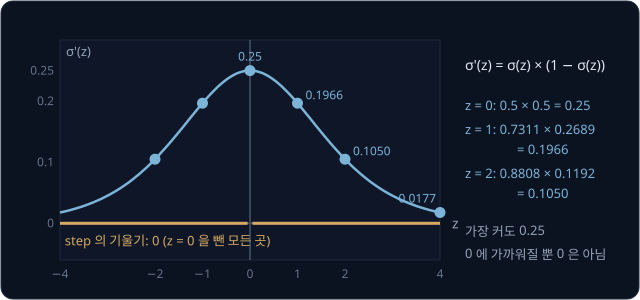

**흔한 오해.** "sigmoid 로 바꾸면 기울기가 늘 넉넉하다." 기울기는 $z = 0$ 에서 가장 큰 0.25 이고, $z = 4$ 에서는 $0.9820 \times 0.0180 =
0.0177$ 이다. 출력이 0 이나 1 에 붙은 unit 은 숫자를 바꿔도 출력이 거의 변하지 않아 느리게 배우는데, 이 성질 때문에 생기는 문제는
[vanishing gradient](#vanishing-gradient) 에서 다룬다.

<b>심화: e 의 지수 계산과 tanh</b>

수의 오른쪽 위에 작게 쓴 숫자(지수)는 그 수를 몇 번 곱하는지를 나타낸다. $e^{2} = e \times e \approx 7.389$ 이고, 지수에 마이너스가 붙으면
1 을 그 값으로 나눈다($e^{-2} = 1 \div 7.389 \approx 0.1353$). $e^{0}$ 은 1 로 정한다. $z = 1$ 이면 $e^{-1} = 1 \div 2.7183 = 0.3679$ 이고,
1 을 더한 1.3679 로 1 을 나누면 $\sigma(1) = 0.7311$ 이다. 표를 보면 $\sigma(1) + \sigma(-1) = 0.7311 + 0.2689 = 1$ 인데, 어느 $z$ 에서든
$\sigma(-z) = 1 - \sigma(z)$ 라서 곡선은 점 $(0, 0.5)$ 를 중심으로 대칭이다.

기울기 공식이 맞는지는 $z$ 를 0.01 늘려 잰 비율과 비교해 확인할 수 있다.

| $z$ | $\sigma(z)$ | 공식 $\sigma(z)(1 - \sigma(z))$ | 0.01 늘려 잰 비율 |
| --- | --- | --- | --- |
| 0 | 0.5 | $0.5 \times 0.5 = 0.25$ | 0.250 |
| 1 | 0.7311 | $0.7311 \times 0.2689 = 0.1966$ | 0.196 |
| 2 | 0.8808 | $0.8808 \times 0.1192 = 0.1050$ | 0.105 |

sigmoid 와 모양이 같고 출력이 $-1$ 과 1 사이인 activation function 으로 tanh(hyperbolic tangent)가 있다.

$$
\tanh(z) = \frac{e^{2z} - 1}{e^{2z} + 1} = 2\sigma(2z) - 1, \qquad \tanh'(z) = 1 - \tanh^2(z)
$$

$z = 0.5$ 이면 $\tanh(0.5) = 2 \times \sigma(1) - 1 = 2 \times 0.7311 - 1 = 0.4621$ 이고, 기울기는 $1 - 0.4621^2 = 0.7864$ 다.

| $z$ | $-2$ | $-0.5$ | $0$ | $0.5$ | $2$ |
| --- | --- | --- | --- | --- | --- |
| $\tanh(z)$ | $-0.9640$ | $-0.4621$ | 0 | 0.4621 | 0.9640 |
| 기울기 $1 - \tanh^2(z)$ | 0.0707 | 0.7864 | 1 | 0.7864 | 0.0707 |

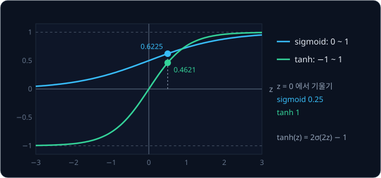

tanh 는 $z = 0$ 에서 기울기가 1 이라 sigmoid 의 0.25 보다 크다. 이 강의의 손계산은 출력을 XOR 의 정답 0·1 과 바로 비교할 수 있는 sigmoid 로
하고, tanh 를 쓸 때는 정답을 $-1$·$+1$ 로 둔다.

## computational graph

network 의 계산은 곱셈·덧셈·sigmoid 같은 작은 계산을 이어 붙인 것이라, gradient 를 구하는 방법도 아래 같은 작은 식으로 설명할 수 있다.

$$
L = (a \times b + c) \times f
$$

$a = 2$, $b = -3$, $c = 10$, $f = -2$ 를 넣고 연산을 하나씩 계산한다. 곱셈 결과는 곱(product)의 첫 글자를 따서 $p$ 라고 부르고, 덧셈 결과는
$d$ 라고 부른다.

| 순서 | 연산 | 계산 | 값 |
| --- | --- | --- | --- |
| 1 | $p = a \times b$ | $2 \times (-3)$ | $-6$ |
| 2 | $d = p + c$ | $-6 + 10$ | $4$ |
| 3 | $L = d \times f$ | $4 \times (-2)$ | $-8$ |

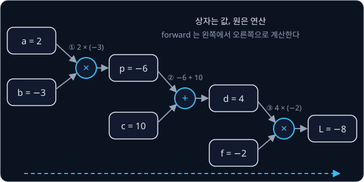

값을 상자로 그리고 연산을 원으로 그린 뒤 값이 흘러가는 길을 화살표로 이은 그림을 **computational graph** 라고 하고, 상자와 원은 모두 node
라고 부른다. 화살표를 따라 입력에서 출력 쪽으로 값을 계산하는 단계를 **forward** 라고 하는데, 위 표의 계산이 forward 다. 곱셈 원은 $a$ 와
$b$ 로 $p$ 를 계산할 뿐 $p$ 가 뒤에서 어디에 쓰이는지와는 관계가 없어서, 아무리 큰 식도 몇 가지 연산의 반복으로 다룰 수 있다.

## local derivative

입력을 조금 바꿨을 때 연산 하나의 출력이 변하는 비율을 **local derivative** 라고 한다. local 은 graph 전체가 아니라 그 연산 하나 안에서만 잰
비율이라는 뜻이다.

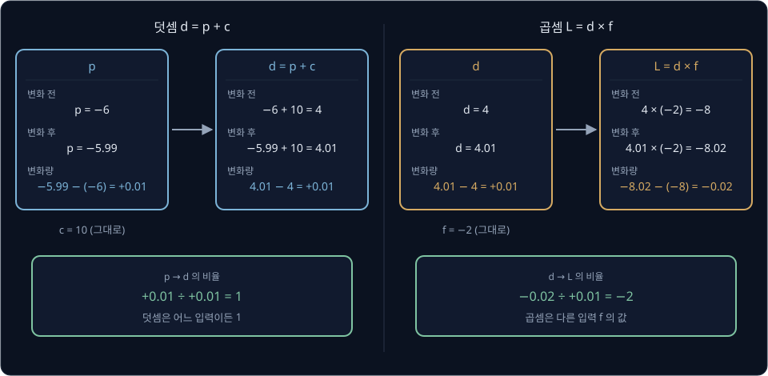

덧셈은 어느 입력을 늘려도 출력이 같은 만큼 늘어 비율이 1 이다. 곱셈은 한 입력이 1 늘면 출력이 다른 입력만큼 변해서, $d$ 쪽 비율 $-2$ 가
다른 입력 $f$ 와 같다. 이 강의에 나오는 연산의 local derivative 는 아래 표와 같다.

| 연산 | 출력 | 첫 입력 쪽 비율 | 둘째 입력 쪽 비율 |
| --- | --- | --- | --- |
| 덧셈 | $x + y$ | 1 | 1 |
| 곱셈 | $x \times y$ | $y$ (다른 입력) | $x$ (다른 입력) |
| 제곱 | $x^2$ | $2x$ | 없음 |
| sigmoid | $\sigma(x)$ | $\sigma(x)(1 - \sigma(x))$ | 없음 |

곱셈의 규칙에는 다른 입력의 값이 필요하고 sigmoid 의 규칙에는 출력 값이 필요해서, backward 를 하려면 forward 에서 계산한 값 일부를 남겨
둬야 한다.

## graph 위의 chain rule

$a$ 는 $L$ 에 바로 닿지 않고 $p$ 와 $d$ 를 거친다. 변화가 여러 단계를 거쳐 전해질 때 전체 비율이 단계별 비율을 곱한 값과 같다는 규칙이
chain rule 이고, 규칙 자체는 [Derivatives & Gradients](../derivatives/README.md) 에서 다룬다. computational graph 에서는 그 단계 하나하나가
연산 하나이고, 단계별 비율은 앞 절의 local derivative 다. $a$ 를 2 에서 2.01 로 늘렸을 때 변화가 전해지는 모습을 값마다 따라가면 아래와 같다.

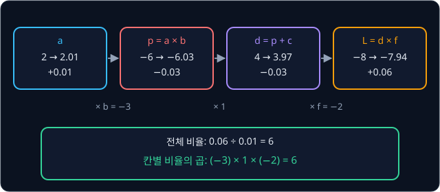

$a$ 가 0.01 늘자 $L$ 은 $-8$ 에서 $-7.94$ 로 0.06 늘어 전체 비율이 $0.06 \div 0.01 = 6$ 이고, 단계별 비율의 곱 $(-3) \times 1 \times (-2)$
도 6 이다. 세 비율은 곱셈 $a \times b$ 의 다른 입력 $b = -3$, 덧셈의 1, 곱셈 $d \times f$ 의 다른 입력 $f = -2$ 라서 모두 local derivative
표에서 바로 읽을 수 있다. 기호로는
$\frac{\partial L}{\partial a} = \frac{\partial L}{\partial d} \times \frac{\partial d}{\partial p} \times \frac{\partial p}{\partial a}$ 로
쓰는데, $\frac{\partial L}{\partial a}$ 는 $a$ 만 조금 바꿨을 때 $L$ 이 변하는 비율을 뜻한다.

## backward

값마다 $L$ 까지 가는 길을 처음부터 따로 곱하면, $\frac{\partial L}{\partial a}$ 와 $\frac{\partial L}{\partial b}$ 가 둘 다 거치는
$\frac{\partial L}{\partial d} \times \frac{\partial d}{\partial p}$ 같은 곱셈을 여러 번 하게 된다. 그래서 $L$ 에서 출발해 연산을 하나씩
거슬러 가면서, 방금 구한 gradient 에 local derivative 하나만 곱해 다음 값의 gradient 를 구한다. 출발점인 $L$ 의 gradient 는 $L$ 을 늘린
만큼 $L$ 이 늘어서 $\frac{\partial L}{\partial L} = 1$ 이다.

| 순서 | 값 | 그 값을 쓴 연산 | 계산 | gradient |
| --- | --- | --- | --- | --- |
| 1 | $L$ | (출발점) | | 1 |
| 2 | $d$ | $L = d \times f$ | $1 \times f = 1 \times (-2)$ | $-2$ |
| 3 | $f$ | $L = d \times f$ | $1 \times d = 1 \times 4$ | $4$ |
| 4 | $p$ | $d = p + c$ | $-2 \times 1$ | $-2$ |
| 5 | $c$ | $d = p + c$ | $-2 \times 1$ | $-2$ |
| 6 | $a$ | $p = a \times b$ | $-2 \times b = -2 \times (-3)$ | $6$ |
| 7 | $b$ | $p = a \times b$ | $-2 \times a = -2 \times 2$ | $-4$ |

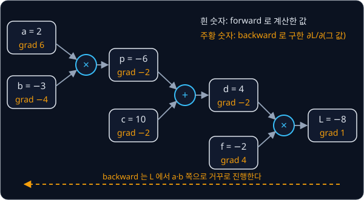

출력에서 입력 쪽으로 gradient 를 채워 가는 이 단계가 **backward** 다. 줄마다 계산은 "그 값을 쓴 연산의 출력 gradient × 그 연산의 local
derivative" 곱셈 하나뿐이고, 순서 6 과 7 은 순서 4 에서 구한 $\frac{\partial L}{\partial p} = -2$ 를 그대로 다시 쓴다. gradient 가 양수면
그 값을 늘릴 때 $L$ 이 늘고, $\frac{\partial L}{\partial b} = -4$ 처럼 음수면 $L$ 이 준다.

**흔한 오해.** "gradient 는 그 값이 얼마나 큰지를 나타낸다." $c = 10$ 은 가장 큰 값이지만 gradient 는 $-2$ 이고, $a = 2$ 는 작은 값이지만
gradient 는 6 으로 가장 크다. gradient 는 값을 바꿨을 때 $L$ 이 얼마나 민감하게 반응하는지를 나타낸다.

**확인 문제.** 같은 graph 에 $a = 1$, $b = 4$, $c = -1$, $f = 3$ 을 넣었다. forward 를 한 뒤 $f$, $d$, $p$, $a$, $b$ 의 gradient 를
backward 순서대로 구하라.

답 보기

forward 는 $p = 1 \times 4 = 4$, $d = 4 + (-1) = 3$, $L = 3 \times 3 = 9$ 다. backward 는 $L$ 의 gradient 1 에서 출발해, 곱셈이면 다른
입력을 곱하고 덧셈이면 1 을 곱한다.

| 값 | 계산 | gradient |
| --- | --- | --- |
| $f$ | $1 \times d = 1 \times 3$ | 3 |
| $d$ | $1 \times f = 1 \times 3$ | 3 |
| $p$ | $3 \times 1$ (덧셈) | 3 |
| $a$ | $3 \times b = 3 \times 4$ | 12 |
| $b$ | $3 \times a = 3 \times 1$ | 3 |

## 여러 곳에 쓰인 값과 backward 순서

지금까지는 값 하나가 연산 하나에만 쓰였다. 아래 식에서 $a$ 는 곱셈에도, 마지막 덧셈에도 쓰인다.

$$
q = a \times b, \qquad L = q + a
$$

$a = 3$, $b = 2$ 이면 $q = 6$, $L = 9$ 다. $a$ 가 $L$ 에 닿는 길은 두 개인데, $q$ 를 거치는 길의 비율은
$\frac{\partial q}{\partial a} = b = 2$ 에 $\frac{\partial L}{\partial q} = 1$ 을 곱한 2 이고, 덧셈으로 바로 가는 길의 비율은 1 이다.

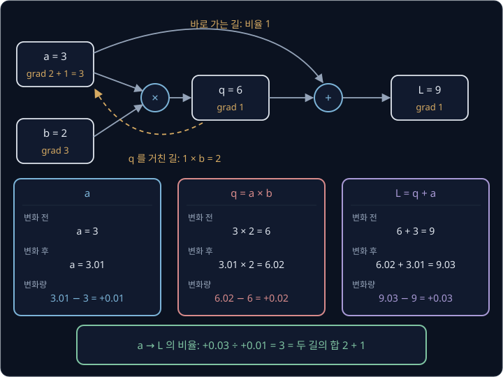

$a$ 를 3.01 로 늘리면 $q = 3.01 \times 2 = 6.02$, $L = 6.02 + 3.01 = 9.03$ 이라 비율은 $0.03 \div 0.01 = 3$ 으로, 두 길의 비율을 더한
$2 + 1$ 과 같다. $a$ 를 늘리면 두 길로 동시에 $L$ 이 늘기 때문에, backward 는 한 값으로 들어오는 gradient 를 길마다 더해 쌓는다.
$L = a \times a$ 도 같은 $a$ 가 곱셈의 두 입력에 다 들어간 경우다. $a = 3$ 이면 입력마다 다른 입력 3 이 local derivative 로 들어와
$3 + 3 = 6$ 이 되고, $a^2$ 의 derivative $2a$ 에 $a = 3$ 을 넣은 값과 같다.

**흔한 오해.** "두 번째 길의 gradient 가 오면 앞의 값을 바꿔 넣는다." 덮어쓰면 $L = q + a$ 에서 2 나 1 하나만 남고, $L = a \times a$ 에서는
6 대신 3 이 나온다. gradient 는 들어오는 대로 더한다.

<b>심화: 여러 곳에 쓰인 값의 식</b>

$x$ 가 $y_1, \dots, y_k$ 라는 $k$ 개 연산의 입력으로 쓰였으면 $x$ 의 gradient 는 아래와 같다.

$$
\frac{\partial L}{\partial x} = \sum_{j=1}^{k} \frac{\partial L}{\partial y_j} \times \frac{\partial y_j}{\partial x}
$$

$\Sigma$ 는 "$j = 1$ 부터 $k$ 까지 바꿔 가며 모두 더한다" 는 기호다. 위 예에 대입하면 $x = a$, $y_1 = q$, $y_2 = L$ 이라서
$1 \times 2 + 1 \times 1 = 3$ 이다. 한 값이 여러 곳에 쓰이는 일은 network 에서 흔하다. 두 층 network 의 입력 $x_1$ 은 hidden unit 두 개에
모두 들어가고, 이미지 처리에서 같은 filter weight 는 이미지의 모든 위치에 쓰인다.

backward 에서는 어떤 값의 gradient 를 입력 쪽으로 넘기기 전에 그 값이 쓰인 모든 곳에서 gradient 가 다 들어와 있어야 해서, 처리 순서도 지켜야
한다. $L = (a \times b + c) \times f$ 에서 $d$ 보다 $p$ 를 먼저 처리하면 아직 비어 있는 $\frac{\partial L}{\partial d} = 0$ 을 곱하게 되어
$p$, $a$, $b$ 의 gradient 가 모두 0 으로 틀린다. graph 의 node 를 모든 node 가 자기를 만든 입력보다 뒤에 오도록 한 줄로 세운 순서를
**topological order** 라고 하는데, forward 는 이 순서로 계산하고 backward 는 이를 뒤집은 순서로 처리한다.

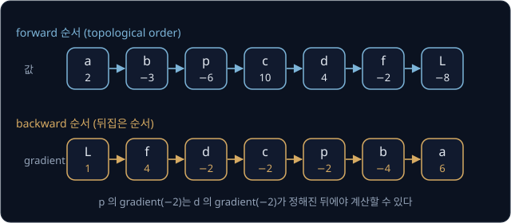

값 $x$ 를 쓴 연산은 모두 topological order 에서 $x$ 보다 뒤에 있으니, 순서를 뒤집으면 $x$ 차례에는 들어올 gradient 가 이미 다 더해져 있다.
$L = q + a$ 의 graph 를 $L, q, b, a$ 순서로 처리하면 $a$ 차례에 $L$ 에서 온 1 과 $q$ 에서 온 $1 \times b = 2$ 가 모여 3 이 되어 있다.

## reverse-mode automatic differentiation

지금까지 한 일을 컴퓨터에 맡기는 방법이 automatic differentiation 이다. forward 중에 어떤 값이 어떤 연산으로 어떤 입력에서 만들어졌는지
graph 로 기록하고, backward 에서 연산마다 정해진 local derivative 규칙만 적용하므로 식 전체를 미분한 공식이 필요 없다. 출력 $L$ 에서 출발해
거꾸로 가는 이 방식을 **reverse-mode** automatic differentiation 이라고 하고, neural network 에 쓰는 reverse-mode 를 backpropagation 이라고
부른다. gradient 를 구하는 세 방법이 graph 를 훑는 횟수는 아래 표와 같다.

| 방법 | 하는 일 | parameter 9 개 | parameter 약 8천만 개(ACT) |
| --- | --- | --- | --- |
| 하나씩 조금 바꿔 재기 | central difference. parameter 하나를 $+h$, $-h$ 로 바꿔 forward 두 번 | 9 × 2 = 18 번 | 8천만 × 2 = 1억 6천만 번 |
| forward-mode | parameter 하나를 골라, forward 를 하면서 각 값이 그 parameter 를 따라 변하는 비율도 함께 계산 | 9 번 | 8천만 번 |
| reverse-mode | forward 한 번 뒤 $L$ 에서 backward 한 번 | 1 + 1 = 2 번 | 1 + 1 = 2 번 |

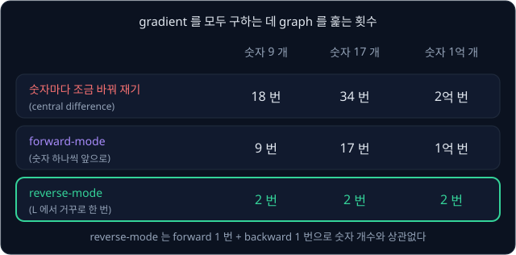

forward-mode 는 입력 쪽 숫자 하나에서 출발하므로 숫자가 늘 때마다 graph 를 한 번 더 훑어야 한다. 한편 reverse-mode 는 출력 하나에서 출발하므로
숫자가 몇 개든 backward 한 번에 모든 gradient 가 나온다. Baydin 등의 survey 에 따르면 출력이 하나일 때 reverse-mode 로 gradient 전체를 구하는
계산량은 함수를 한 번 계산하는 양의 6 배를 넘지 않고, 보통 2 ~ 3 배다. 학습은 parameter 가 많고 loss 는 숫자 하나라서 reverse-mode 가 맞는다.
그 대신 backward 에 쓸 중간 값을 forward 동안 저장해야 해서, 필요한 메모리가 많게는 연산 수에 비례해 늘어난다.

## sigmoid neuron 하나의 학습

perceptron 의 step function 을 sigmoid 로 바꾼 unit 을 neuron 이라고 부른다. neuron 하나와 정답 하나로 만든 graph 의 식은 아래와 같다.

$$
z = w_1 x_1 + w_2 x_2 + b, \qquad \hat y = \sigma(z), \qquad L = (\hat y - y)^2
$$

$\hat y$("와이 햇")는 예측이고 $y$ 는 정답이며, $L$ 은 둘의 차이를 제곱한 loss 다. 입력 $x = [1, 1]$, 정답 $y = 1$, 시작 값
$w = [0.5, 0.5]$, $b = -1$ 이면 forward 는 $z = 0.5 + 0.5 - 1 = 0$, $\hat y = \sigma(0) = 0.5$, $L = (0.5 - 1)^2 = 0.25$ 다.

backward 를 하면 $\hat y$ 의 gradient 는 제곱의 비율 $2(\hat y - y) = 2 \times (0.5 - 1) = -1$ 이고, $z$ 의 gradient 는
$-1 \times \sigma'(0) = -1 \times 0.5 \times 0.5 = -0.25$ 다. $w_1$, $w_2$, $b$ 의 gradient 는 여기에 곱셈의 다른 입력 $x_1 = 1$, $x_2 = 1$
과 덧셈의 1 을 곱해 모두 $-0.25$ 다.

![neuron 하나의 computational graph. x = [1, 1], w = [0.5, 0.5], b = −1 에서 z = 0, ŷ = 0.5, L = 0.25 다. backward 로 구한 gradient 는 ŷ 가 −1, z 가 −0.25 이고, w₁·w₂·b 는 모두 −0.25 다](figures/neuron-graph.svg)

gradient descent 로 "지금 값 $- \eta \times$ gradient" 를 계산해 고치면($\eta$ 는 learning rate) $\eta = 1$ 에서
$w_1 = w_2 = 0.5 - 1 \times (-0.25) = 0.75$, $b = -1 - 1 \times (-0.25) = -0.75$ 가 된다. 다시 forward 하면 $z = 0.75 + 0.75 - 0.75 = 0.75$,
$\hat y = \sigma(0.75) = 0.6792$ 라서 loss 가 0.25 에서 $(0.6792 - 1)^2 = 0.1029$ 로 준다. 숫자를 이렇게 한 번 고치는 일을 update 라고 한다.

<b>심화: perceptron 학습 규칙과의 비교</b>

$w_i$ 의 gradient 는 단계별 비율을 곱한 $2(\hat y - y) \times \sigma'(z) \times x_i$ 이므로 update 는 아래와 같다.

$$
w_i \leftarrow w_i - \eta \times 2(\hat y - y)\,\sigma'(z)\,x_i = w_i + \eta \times 2(y - \hat y)\,\sigma'(z)\,x_i
$$

perceptron 규칙 $w_i \leftarrow w_i + \eta(y - \hat y)x_i$ 에 $2\sigma'(z)$ 가 더 곱해진 모양이라, 두 규칙 모두 틀린 정도와 입력의 크기에
비례해 고친다. 다만 $\hat y$ 가 0 과 1 사이의 값이라 예측이 맞는 쪽에 있어도 정답에서 멀면 조금씩 계속 고친다. 입력이 0 이면 그 입력에
곱해지는 weight 의 gradient 는 0 이다. 같은 neuron 에 $x = [1, 0]$, $y = 0$ 을 넣으면 $z = -0.5$, $\hat y = 0.3775$ 이고 $\frac{\partial L}{\partial z} =
2 \times 0.3775 \times (0.3775 \times 0.6225) = 0.755 \times 0.2350 \approx 0.1774$ 인데, $x_2 = 0$ 이라 $w_2$ 의 gradient 는
$0.1774 \times 0 = 0$ 이다. $w_2$ 를 바꿔도 $z$ 가 변하지 않으니 고칠 이유가 없다.

## XOR network 의 forward 와 backward

같은 입력을 받는 neuron 여러 개를 나란히 둔 것을 layer 라고 한다. XOR 를 배울 network 는 hidden neuron $h_1$, $h_2$ 로 된 hidden layer 하나와
출력 neuron 하나로 되어 있다.

- $h_1$: $z_1 = w_{11} x_1 + w_{12} x_2 + b_1$, $h_1 = \sigma(z_1)$
- $h_2$: $z_2 = w_{21} x_1 + w_{22} x_2 + b_2$, $h_2 = \sigma(z_2)$
- 출력: $z_3 = v_1 h_1 + v_2 h_2 + b_3$, $\hat y = \sigma(z_3)$

$w_{12}$ 처럼 아래에 붙은 두 숫자 가운데 앞은 hidden neuron 번호이고 뒤는 입력 번호라서, $w_{12}$ 는 $h_1$ 으로 들어가는 둘째 입력의
weight 다. $v_1, v_2$ 는 출력 neuron 의 weight 다. 시작 값은 두 hidden neuron 이 서로 다르도록 아래처럼 골랐다.

| neuron | weight | bias |
| --- | --- | --- |
| $h_1$ | $w_{11} = 1$, $w_{12} = 1$ | $b_1 = 0$ |
| $h_2$ | $w_{21} = 1$, $w_{22} = 1$ | $b_2 = -1$ |
| 출력 | $v_1 = 1$, $v_2 = -1$ | $b_3 = 0$ |

loss 는 네 sample(입력과 정답 한 쌍)의 오차 제곱을 평균한 mean squared error(MSE)다. 손계산은 단계마다 소수 넷째 자리까지 반올림해 이어 간다.
입력 $[1, 0]$(정답 1)을 넣으면 $z_1 = 1 \times 1 + 1 \times 0 + 0 = 1$ 이라서 $h_1 = \sigma(1) = 0.7311$ 이고, $z_2 = 1 + 0 - 1 = 0$ 이라서
$h_2 = \sigma(0) = 0.5$ 다. 출력 쪽은 $z_3 = 1 \times 0.7311 + (-1) \times 0.5 + 0 = 0.2311$ 이라서 $\hat y = \sigma(0.2311) = 0.5575$ 가 되고,
오차 제곱은 $(0.5575 - 1)^2 = 0.1958$ 이다.

![XOR network 에 입력 [1, 0] 을 넣은 forward. 화살표 위에 weight 가 있고 neuron 안에 z 와 출력이 있다. h₁ = 0.7311, h₂ = 0.5, ŷ = 0.5575 이고 오차 제곱은 0.1958 이다](figures/xor-net-forward.svg)

같은 계산을 네 sample 에 하면 예측이 0.5374 ~ 0.5575 라서 정답이 0 인 입력과 1 인 입력을 전혀 구별하지 못한다. 네 오차 제곱을 평균한 loss 는
0.2478 이다.

<b>심화: 네 sample 의 forward</b>

| 입력 | 정답 | $z_1$ | $h_1$ | $z_2$ | $h_2$ | $z_3$ | $\hat y$ | 오차 제곱 |
| --- | --- | --- | --- | --- | --- | --- | --- | --- |
| $[0, 0]$ | 0 | 0 | 0.5 | $-1$ | 0.2689 | 0.2311 | 0.5575 | 0.3108 |
| $[0, 1]$ | 1 | 1 | 0.7311 | 0 | 0.5 | 0.2311 | 0.5575 | 0.1958 |
| $[1, 0]$ | 1 | 1 | 0.7311 | 0 | 0.5 | 0.2311 | 0.5575 | 0.1958 |
| $[1, 1]$ | 0 | 2 | 0.8808 | 1 | 0.7311 | 0.1497 | 0.5374 | 0.2888 |

loss 는 $L = \frac{1}{4}\sum_{k=1}^{4} (\hat y_k - y_k)^2 = (0.3108 + 0.1958 + 0.1958 + 0.2888) \div 4 = 0.9912 \div 4 = 0.2478$ 이다.
$w_{11} = w_{12}$ 이고 $w_{21} = w_{22}$ 라서 $[0, 1]$ 과 $[1, 0]$ 은 두 입력을 서로 바꿔도 $z_1$, $z_2$ 가 같고, 그 뒤의 계산도 모두 같다.

입력 $[1, 0]$ 한 sample 의 오차 제곱 $\ell = (\hat y - y)^2$ 에서 출발해 출력 쪽부터 gradient 를 구한다. $\ell$("엘")은 네 sample 의 평균 $L$
과 구별하려고 sample 하나의 오차 제곱에 쓰는 기호다.

| 값 | 계산 | gradient |
| --- | --- | --- |
| $\hat y$ | $2(\hat y - y) = 2 \times (0.5575 - 1)$ | $-0.8850$ |
| $z_3$ | $-0.8850 \times \hat y(1 - \hat y) = -0.8850 \times 0.5575 \times 0.4425$ | $-0.2183$ |
| $h_1$ | $-0.2183 \times v_1 = -0.2183 \times 1$ | $-0.2183$ |
| $h_2$ | $-0.2183 \times v_2 = -0.2183 \times (-1)$ | $+0.2183$ |
| $z_1$ | $-0.2183 \times h_1(1 - h_1) = -0.2183 \times 0.7311 \times 0.2689$ | $-0.0429$ |
| $z_2$ | $0.2183 \times h_2(1 - h_2) = 0.2183 \times 0.5 \times 0.5$ | $0.0546$ |

![XOR network 의 입력 [1, 0] 에 대한 backward. ŷ 의 gradient −0.8850 → z₃ 의 gradient −0.2183 → v₁ = 1 을 곱한 h₁ 의 gradient −0.2183 과 v₂ = −1 을 곱한 h₂ 의 gradient +0.2183 → sigmoid 기울기 0.1966, 0.25 를 곱한 z₁ 의 gradient −0.0429 와 z₂ 의 gradient 0.0546](figures/xor-net-backward.svg)

표의 $h_1$, $h_2$ 줄처럼 정답이 없는 hidden neuron 에도 출력을 키울 때 오차 제곱이 변하는 비율이 gradient 로 전해지는데, 이것이 credit
assignment 문제의 답이다. $h_1$ 의 gradient 는 음수라 $h_1$ 을 키우면 오차가 줄고, $h_2$ 의 gradient 는 양수라 $h_2$ 를 키우면 오차가 커진다.
$v_2 = -1$ 이라 $h_2$ 가 클수록 $\hat y$ 가 작아지는데, 지금 $\hat y = 0.5575$ 는 정답 1 보다 작으니 $h_2$ 를 줄이라는 이 신호가 맞다. 출력에
곱해지는 weight $v$ 의 크기가 클수록 그 hidden neuron 이 받는 gradient 도 커진다.

**흔한 오해.** "backpropagation 은 hidden neuron 마다 정답을 만들어 준다." backward 가 전하는 것은 정답이 아니라 출력을 바꿀 때 loss 가
변하는 비율이다. $h_1$ 이 무엇을 계산하는 neuron 이 될지는 매 step 이 비율을 따라 고친 결과로 정해진다.

<b>심화: 아홉 parameter 의 gradient</b>

위 표의 gradient 에 곱셈의 다른 입력(hidden 출력이나 입력 $x$)이나 덧셈의 1 을 곱하면 parameter 별 gradient 가 나온다.

| 순서 | 값 | 계산 | gradient |
| --- | --- | --- | --- |
| 1 | $\ell$ | 출발점 | 1 |
| 2 | $\hat y$ | $2(\hat y - y) = 2 \times (0.5575 - 1)$ | $-0.8850$ |
| 3 | $z_3$ | $-0.8850 \times \hat y(1 - \hat y) = -0.8850 \times 0.5575 \times 0.4425$ | $-0.2183$ |
| 4 | $v_1$, $v_2$, $b_3$ | $-0.2183 \times h_1$, $-0.2183 \times h_2$, $-0.2183 \times 1$ | $-0.1596$, $-0.1092$, $-0.2183$ |
| 5 | $h_1$ | $-0.2183 \times v_1 = -0.2183 \times 1$ | $-0.2183$ |
| 6 | $h_2$ | $-0.2183 \times v_2 = -0.2183 \times (-1)$ | $+0.2183$ |
| 7 | $z_1$ | $-0.2183 \times h_1(1 - h_1) = -0.2183 \times 0.7311 \times 0.2689$ | $-0.0429$ |
| 8 | $z_2$ | $0.2183 \times h_2(1 - h_2) = 0.2183 \times 0.5 \times 0.5$ | $0.0546$ |
| 9 | $w_{11}$, $w_{12}$, $b_1$ | $-0.0429 \times x_1$, $-0.0429 \times x_2$, $-0.0429 \times 1$ | $-0.0429$, $0$, $-0.0429$ |
| 10 | $w_{21}$, $w_{22}$, $b_2$ | $0.0546 \times x_1$, $0.0546 \times x_2$, $0.0546 \times 1$ | $0.0546$, $0$, $0.0546$ |

$x_2 = 0$ 이라 $w_{12}$ 와 $w_{22}$ 의 gradient 는 0 이다. 0 인 입력은 $z$ 에 아무 영향을 주지 않았으니 그 weight 를 고칠 이유도 없다.

**확인 문제.** $z_3$ 의 gradient 는 위와 같은 $-0.2183$ 이고 $v_1$ 만 2 라면 $h_1$ 과 $z_1$ 의 gradient 는?

답 보기

$h_1$ 의 gradient 는 $z_3$ 의 gradient 에 곱셈의 다른 입력 $v_1$ 을 곱한 값이다.

$$
\frac{\partial \ell}{\partial h_1} = -0.2183 \times v_1 = -0.2183 \times 2 = -0.4366
$$

$z_1$ 의 gradient 는 여기에 sigmoid 의 기울기 $h_1(1 - h_1) = 0.7311 \times 0.2689 = 0.1966$ 을 곱한 값이다.

$$
\frac{\partial \ell}{\partial z_1} = -0.4366 \times 0.1966 \approx -0.0858
$$

출력에 두 배로 곱해지는 hidden neuron 이라 gradient 도 두 배가 되었다.

<b>심화: central difference 로 확인한 gradient</b>

backward 로 구한 값이 맞는지는 central difference(숫자를 $+h$, $-h$ 로 바꿔 잰 두 결과의 차이를 $2h$ 로 나누는 방법)로 확인한다. $w_{11}$ 만
$1 \pm 0.01$ 로 바꾸고 나머지는 그대로 둔 채 이 sample 의 오차 제곱을 다시 계산하면, $w_{11} = 1.01$ 에서는 0.195370 이고 $w_{11} = 0.99$
에서는 0.196229 다.

$$
\frac{0.195370 - 0.196229}{0.02} = \frac{-0.000859}{0.02} \approx -0.0430
$$

backward 의 $-0.0429$ 와 거의 같고, 남은 차이는 중간 값을 넷째 자리에서 반올림한 데서 생긴다. 새 연산의 backward 규칙을 직접 짰을 때 이렇게
확인하는데, PyTorch 의 `torch.autograd.gradcheck` 도 같은 방식으로 작은 차이로 잰 비율과 backward 결과를 비교한다.

<b>심화: 네 sample 의 평균 gradient 와 한 번의 update</b>

$L$ 이 네 오차 제곱의 평균이므로 parameter 의 gradient 도 sample 마다 구한 gradient 의 평균이다. 나머지 세 sample 도 같은 순서로 계산하면
중간 값은 아래와 같다.

| 입력 | 정답 | $\hat y$ | $2(\hat y - y)$ | $z_3$ 의 gradient | $z_1$ 의 gradient | $z_2$ 의 gradient |
| --- | --- | --- | --- | --- | --- | --- |
| $[0, 0]$ | 0 | 0.5575 | 1.1150 | 0.2751 | 0.0688 | $-0.0541$ |
| $[0, 1]$ | 1 | 0.5575 | $-0.8850$ | $-0.2183$ | $-0.0429$ | 0.0546 |
| $[1, 0]$ | 1 | 0.5575 | $-0.8850$ | $-0.2183$ | $-0.0429$ | 0.0546 |
| $[1, 1]$ | 0 | 0.5374 | 1.0748 | 0.2672 | 0.0281 | $-0.0525$ |

$[1, 1]$ 에서 $z_3$ 의 gradient 는 $1.0748 \times 0.5374 \times 0.4626 = 0.2672$ 이고, $z_1$ 의 gradient 는 $0.2672 \times v_1 \times
h_1(1 - h_1) = 0.2672 \times 1 \times 0.8808 \times 0.1192 = 0.0281$ 이다. 여기에 입력이나 hidden 출력을 곱하면 sample 별 parameter gradient
가 나온다.

| 입력 | $w_{11}$ | $w_{12}$ | $b_1$ | $w_{21}$ | $w_{22}$ | $b_2$ | $v_1$ | $v_2$ | $b_3$ |
| --- | --- | --- | --- | --- | --- | --- | --- | --- | --- |
| $[0, 0]$ | 0 | 0 | 0.0688 | 0 | 0 | $-0.0541$ | 0.1376 | 0.0740 | 0.2751 |
| $[0, 1]$ | 0 | $-0.0429$ | $-0.0429$ | 0 | 0.0546 | 0.0546 | $-0.1596$ | $-0.1092$ | $-0.2183$ |
| $[1, 0]$ | $-0.0429$ | 0 | $-0.0429$ | 0.0546 | 0 | 0.0546 | $-0.1596$ | $-0.1092$ | $-0.2183$ |
| $[1, 1]$ | 0.0281 | 0.0281 | 0.0281 | $-0.0525$ | $-0.0525$ | $-0.0525$ | 0.2353 | 0.1953 | 0.2672 |
| 평균 | $-0.0037$ | $-0.0037$ | 0.0028 | 0.0005 | 0.0005 | 0.0007 | 0.0134 | 0.0127 | 0.0264 |

gradient 의 부호는 sample 마다 엇갈린다. $b_3$ 의 gradient 는 정답이 0 인 sample 에서 양수(줄여야 함)이고, 정답이 1 인 sample 에서 음수(키워야
함)다. 평균은 양수인데, 정답의 평균은 0.5 이고 네 예측의 평균은 $(0.5575 \times 3 + 0.5374) \div 4 = 0.5525$ 로 조금 높기 때문이다. $\eta = 1$
로 "지금 값 $-$ 평균 gradient" 를 계산해 고친 값은 아래와 같다.

| parameter | $w_{11}$ | $w_{12}$ | $b_1$ | $w_{21}$ | $w_{22}$ | $b_2$ | $v_1$ | $v_2$ | $b_3$ |
| --- | --- | --- | --- | --- | --- | --- | --- | --- | --- |
| 지금 값 | 1 | 1 | 0 | 1 | 1 | $-1$ | 1 | $-1$ | 0 |
| 새 값 | 1.0037 | 1.0037 | $-0.0028$ | 0.9995 | 0.9995 | $-1.0007$ | 0.9866 | $-1.0127$ | $-0.0264$ |

새 값으로 forward 를 다시 하면 $[1, 1]$ 은 $z_1 = 1.0037 + 1.0037 - 0.0028 = 2.0046$, $h_1 = 0.8813$, $z_2 = 0.9995 + 0.9995 - 1.0007 =
0.9983$, $h_2 = 0.7307$, $z_3 = 0.9866 \times 0.8813 - 1.0127 \times 0.7307 - 0.0264 = 0.1031$, $\hat y = 0.5258$ 이다.

| 입력 | 정답 | update 전 $\hat y$ | update 후 $\hat y$ | update 전 오차 제곱 | update 후 오차 제곱 |
| --- | --- | --- | --- | --- | --- |
| $[0, 0]$ | 0 | 0.5575 | 0.5483 | 0.3108 | 0.3006 |
| $[0, 1]$ | 1 | 0.5575 | 0.5471 | 0.1958 | 0.2051 |
| $[1, 0]$ | 1 | 0.5575 | 0.5471 | 0.1958 | 0.2051 |
| $[1, 1]$ | 0 | 0.5374 | 0.5258 | 0.2888 | 0.2765 |
| loss (평균) | | | | 0.2478 | 0.2468 |

![한 번의 update 전후 sample 별 오차 제곱. [0, 0] 0.3108 → 0.3006, [0, 1]·[1, 0] 0.1958 → 0.2051, [1, 1] 0.2888 → 0.2765, 평균 loss 0.2478 → 0.2468](figures/xor-step-loss.svg)

loss 는 0.2478 에서 0.2468 로 줄었지만 $[0, 1]$ 과 $[1, 0]$ 의 오차 제곱은 오히려 늘었다. gradient descent 는 네 sample 의 평균을 줄이는
방향으로 움직이므로, 한 step 에서 일부 sample 이 나빠지는 일은 흔하다.

## 학습 결과

네 sample 로 forward 와 backward 를 하고 평균 gradient 로 아홉 parameter 를 고치는 step 을 $\eta = 1$ 로 2,000 번 되풀이했다(직접 계산한
결과).

| step | loss | $[0, 0]$ 의 $\hat y$ | $[0, 1]$, $[1, 0]$ 의 $\hat y$ | $[1, 1]$ 의 $\hat y$ |
| --- | --- | --- | --- | --- |
| 0 | 0.2478 | 0.558 | 0.558 | 0.537 |
| 100 | 0.2270 | 0.475 | 0.534 | 0.497 |
| 500 | 0.0258 | 0.158 | 0.844 | 0.173 |
| 2000 | 0.0020 | 0.048 | 0.957 | 0.045 |

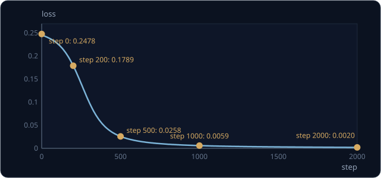

2,000 step 뒤에는 0.5 를 기준으로 네 입력을 모두 맞힌다. 학습이 끝난 parameter 를 소수 둘째 자리까지 적으면 아래와 같다.

| neuron | weight | bias | 출력이 0.5 를 넘는 영역 |
| --- | --- | --- | --- |
| $h_1$ | $w_{11} = w_{12} = 5.64$ | $b_1 = -2.40$ | $x_1 + x_2 > 2.40 \div 5.64 \approx 0.43$ |
| $h_2$ | $w_{21} = w_{22} = 4.12$ | $b_2 = -6.33$ | $x_1 + x_2 > 6.33 \div 4.12 \approx 1.54$ |
| 출력 | $v_1 = 7.84$, $v_2 = -8.35$ | $b_3 = -3.61$ | $h_1$ 이 크고 $h_2$ 가 작을 때 |

$h_1$ 은 $x_1 + x_2 > 0.43$ 에서 켜지니 입력 중 하나라도 1 이면 켜지는 OR 에 가깝고, $h_2$ 는 $x_1 + x_2 > 1.54$ 에서 켜지니 둘 다 1 일
때만 켜지는 AND 에 가깝다. 출력은 $h_1$ 에 큰 양수 7.84 를 곱하고 $h_2$ 에 큰 음수 $-8.35$ 를 곱하므로 OR 이면서 AND 는 아닐 때 켜지는데,
이 조건이 XOR 다.

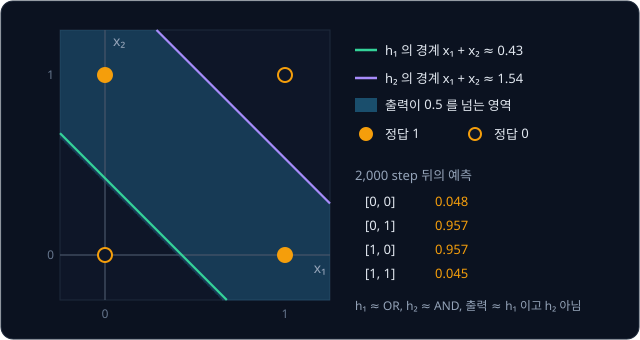

network 전체의 출력이 0.5 를 넘는 곳은 $x_1 + x_2$ 가 약 0.41 ~ 1.54 인 띠라서 두 hidden neuron 의 경계 0.43, 1.54 와 거의 겹친다.
$h_1$ 이 OR 를 맡고 $h_2$ 가 AND 를 맡도록 정해 준 사람은 없다. 두 hidden neuron 은 출력의 오차를 줄이는 gradient 를 따라 고쳐지다가 그
역할을 맡게 되었다.

<b>심화: 학습된 network 에 [1, 1] 을 넣은 계산</b>

$[1, 1]$ 을 넣으면 $h_1 = \sigma(5.64 \times 2 - 2.40) = \sigma(8.88) \approx 1.00$, $h_2 = \sigma(4.12 \times 2 - 6.33) = \sigma(1.91) \approx 0.87$ 이다.

$$
z_3 \approx 7.84 \times 1.00 - 8.35 \times 0.87 - 3.61 = 7.84 - 7.26 - 3.61 = -3.03
$$

$z_3$ 이 음수라 $\hat y$ 는 0.5 보다 작고, 0 으로 예측해 XOR 의 정답 0 과 맞는다. $h_2$ 가 켜진 만큼 큰 음수 $v_2$ 가 곱해져 출력을 끈다.

## vanishing gradient

backward 에서 sigmoid 를 하나 지날 때마다 그 기울기가 gradient 에 곱해지는데, 이 기울기는 많아야 0.25 라서 출력에서 멀어질수록 gradient 가
작아진다. XOR network 의 입력 $[1, 0]$ 에서도 $z_3$ 의 gradient 는 $-0.2183$ 이었다. sigmoid 를 한 번 더 지나면서 $z_1$ 은
$\sigma'(1) = 0.7311 \times 0.2689 = 0.1966$ 이 곱해져 $-0.0429$ 가 되었고, $z_2$ 는 $\sigma'(0) = 0.5 \times 0.5 = 0.25$ 가 곱해져 0.0546
이 되어 둘 다 4 ~ 5 분의 1 로 줄었다.

학습 곡선이 처음 100 step 동안 거의 평평했던 것도 이 때문이다. step 0 의 평균 gradient 를 보면, 출력 쪽에서 가장 큰 $b_3$ 은 네 sample 의
값을 평균한 $(0.2751 - 0.2183 - 0.2183 + 0.2672) \div 4 = 0.0264$ 다. 그런데 hidden 쪽에서 가장 큰 $w_{11}$ 은
$(0 + 0 - 0.0429 + 0.0281) \div 4 = -0.0037$ 로 크기가 7 분의 1 에 그쳐서, hidden neuron 이 거의 움직이지 않는다. hidden neuron 이 입력을
구별하기 시작한 200 ~ 500 step 사이에야 loss 가 빠르게 떨어졌다.

층이 많으면 이 곱이 거듭되어, sigmoid 층 $n$ 개를 거친 gradient 에는 0.25 이하의 수가 $n$ 번 곱해지므로 가장 커도 처음의 $0.25^n$ 배다.

| sigmoid 층 수 | 1 | 2 | 3 | 5 | 10 |
| --- | --- | --- | --- | --- | --- |
| 곱해지는 값의 최댓값 $0.25^n$ | 0.25 | 0.0625 | 0.0156 | 0.00098 | 0.00000095 |

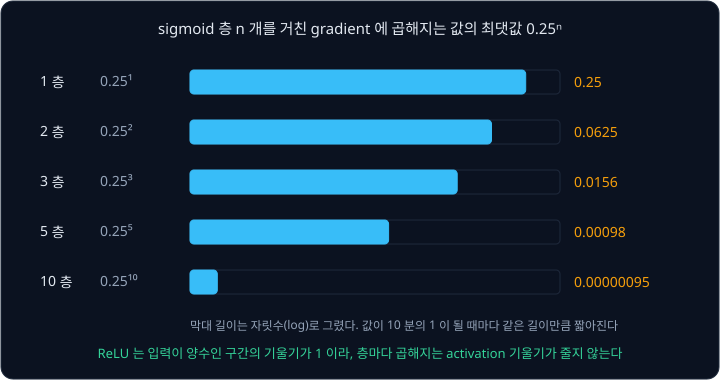

층이 다섯 개면 $0.25^5 = 0.00098$ 이라 입력에 가까운 층의 gradient 가 출력 쪽의 1000 분의 1 이하가 되고, 그 층은 거의 배우지 못한다. 이렇게
입력 쪽으로 갈수록 gradient 가 사라지는 현상을 **vanishing gradient** 라고 한다. 요즘 network 는 입력이 음수면 0 을 내고 양수면 입력을 그대로
내는 ReLU 를 activation function 으로 쓰는데, ReLU 는 입력이 양수일 때 기울기가 1 이다. 또 입력을 출력에 그대로 더하는 연결로 gradient 가
지나갈 길을 따로 만든다. ACT 가 카메라 이미지를 처리하는 데 쓰는 ResNet18 이 이 연결을 쓴 network 이고, 이 연결은 [ResNet](../resnet/README.md)
에서 다룬다.

**확인 문제.** sigmoid 층 세 개를 거친 gradient 는 sigmoid 기울기의 곱만 따졌을 때 가장 커도 처음의 몇 배인가? 세 층의 출력이 모두 0.9 라면?

답 보기

가장 클 때는 세 층 모두 기울기가 0.25 일 때라 $0.25 \times 0.25 \times 0.25 = 0.0156$ 배다. 출력이 0.9 이면 기울기는 $\sigma(1 - \sigma) =
0.9 \times 0.1 = 0.09$ 라서 $0.09 \times 0.09 \times 0.09 \approx 0.00073$ 배다. 출력이 1 에 붙을수록 gradient 가 더 빨리 사라진다.

## 처음 숫자를 서로 다르게 두는 이유

perceptron 은 $w = [0, 0]$, $b = 0$ 에서 출발해도 잘 배웠지만, 두 층 network 를 모든 parameter 0 에서 출발시키면 이 XOR 문제에서는 gradient
아홉 개가 모두 0 이 되어 아무것도 배우지 못한다. 0 이 아니어도 두 hidden neuron 이 똑같은 값에서 출발하면 문제가 생긴다. 두 neuron 의
weight 가 모두 $[1, 1]$ 이고 bias 가 0 이며 출력 weight 도 $v_1 = v_2 = 1$ 이면, forward 값이 같고 backward 에서 받는 gradient 도 같다. 입력
$[1, 0]$ 에서는 두 neuron 의 $z$ 가 모두 $z_3$ 의 gradient $-0.0574$ 에 $v = 1$ 과 $\sigma'(1) = 0.1966$ 을 곱한 $-0.0113$ 을 받는다. 같은
양만큼 고쳐지니 다음 step 에도 같은 일이 되풀이된다.

![두 hidden neuron 이 같은 weight [1, 1], bias 0 에서 출발하면 같은 gradient −0.0113 을 받아 같은 값으로 고쳐지고, 2,000 step 뒤에도 둘 다 weight 5.34, bias −0.38 이라 직선 하나밖에 긋지 못한다](figures/symmetry.svg)

2,000 step 뒤에도 두 neuron 은 모두 weight 5.34, bias $-0.38$ 로 똑같다. 예측은 $[0, 0]$ 이 0.069, $[0, 1]$·$[1, 0]$ 이 0.662, $[1, 1]$ 이
0.670 이라 $[1, 1]$ 을 틀리고(loss 0.1708), 20,000 step 을 학습해도 loss 는 0.167 근처에서 멈춘다. 똑같은 neuron 두 개는 neuron 하나와 같아서
직선 하나밖에 긋지 못하고, perceptron 이 XOR 를 못 푼 것과 같은 이유로 풀지 못한다.

그래서 parameter 는 서로 다른 작은 random 값으로 출발시킨다. PyTorch 의 `nn.Linear` 는 기본으로 weight 와 bias 를 $-1/\sqrt{\text{입력 수}}$
와 $+1/\sqrt{\text{입력 수}}$ 사이에서 고르게 뽑는다. 입력이 2 개면 $\pm 1/\sqrt 2 \approx \pm 0.71$ 사이다.

<b>심화: 모두 0 에서 출발한 network 와 같은 값에서 출발한 두 neuron 의 backward</b>

모든 parameter 가 0 이면 $h_1 = h_2 = \sigma(0) = 0.5$ 이고 $\hat y = 0.5$ 다. 그래서 $z_3$ 의 gradient 는 정답이 0 인 sample 에서
$2 \times (0.5 - 0) \times 0.25 = 0.25$ 이고, 정답이 1 인 sample 에서는 $2 \times (0.5 - 1) \times 0.25 = -0.25$ 라서 넷을 평균하면 0 이다.
출력 weight 의 gradient 도 여기에 $h = 0.5$ 를 곱해 평균하니 0 이고, hidden 쪽은 $v_1 = v_2 = 0$ 을 곱하니 처음부터 0 이다.

두 hidden neuron 이 같은 값(weight $[1, 1]$, bias 0, $v_1 = v_2 = 1$)에서 출발하면 입력 $[1, 0]$ 에서 $z_1 = z_2 = 1$, $h_1 = h_2 = 0.7311$, $z_3 = 0.7311 + 0.7311 = 1.4622$, $\hat y = 0.8119$ 다. $\hat y$ 의 gradient 는
$2 \times (0.8119 - 1) = -0.3763$ 이고 $z_3$ 의 gradient 는 $-0.3763 \times 0.8119 \times 0.1881 \approx -0.0574$ 다.

| 값 | $h_1$ 쪽 | $h_2$ 쪽 |
| --- | --- | --- |
| hidden 출력의 gradient ($z_3$ 의 gradient $\times v$) | $-0.0574 \times 1 = -0.0574$ | $-0.0574 \times 1 = -0.0574$ |
| $z$ 의 gradient ($\times \sigma'(1) = 0.1966$) | $-0.0113$ | $-0.0113$ |
| 첫째 입력의 weight 의 gradient ($\times x_1 = 1$) | $-0.0113$ | $-0.0113$ |
| 출력 weight 의 gradient ($z_3$ 의 gradient $\times h$) | $-0.0420$ | $-0.0420$ |

두 열이 모든 줄에서 같다. 네 sample 을 평균해도 같고, 고친 뒤의 값도 같으므로 이 대칭은 학습이 끝날 때까지 깨지지 않는다.

**확인 문제.** hidden neuron 이 4 개인 network 의 hidden weight 와 bias 를 모두 같은 값으로 출발시켰다. 학습이 끝난 뒤 hidden layer 가 긋는
서로 다른 직선은 몇 개일까?

답 보기

한 개다. 네 neuron 이 늘 같은 gradient 를 받아 같은 값으로 남으므로 모두 같은 직선 하나를 긋는다.

## PyTorch autograd

PyTorch 에서 이 강의의 계산을 맡는 부분이 autograd 다. `requires_grad=True` 로 만든 tensor(PyTorch 의 숫자 묶음)로 계산하면, PyTorch 는 연산마다
결과와 함께 그 연산의 backward 규칙을 담은 `grad_fn` 을 남긴다. `L = (a * b + c) * f` 를 계산하면 `L.grad_fn` 은 `MulBackward0` 이고, 그 앞은
`AddBackward0` 이며, 다시 그 앞은 `MulBackward0` 이다. 사용자가 직접 만든 tensor(leaf)에는 받은 gradient 를 `.grad` 에 더하는 `AccumulateGrad` 가
붙는다.

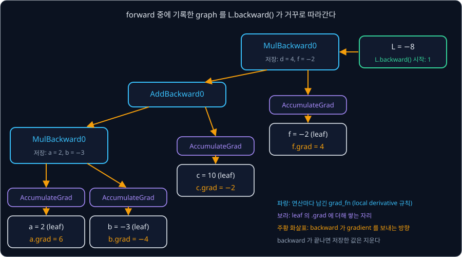

`L.backward()` 는 이 graph 를 거꾸로 따라가며 앞의 backward 표와 같은 계산을 해서, 실행하면 `a.grad`, `b.grad`, `c.grad`, `f.grad` 가 표와
같은 6, $-4$, $-2$, 4 로 나온다. 중간 값 $p$ 나 $d$ 의 `.grad` 는 따로 요청하지 않으면 남기지 않는다.

| 강의의 개념 | PyTorch 에서의 모습 |
| --- | --- |
| local derivative 에 필요한 forward 값 | `MulBackward0` 은 두 입력을 저장하고, `SigmoidBackward0` 은 출력을 저장한다 |
| 여러 곳에 쓰인 값의 gradient 더하기 | `.grad` 는 덮어쓰지 않고 더하므로 `L = q + a` 의 `a.grad` 는 2 + 1 = 3 이다 |
| forward 마다 새로 그리는 graph | 공식 문서에 따르면 graph 는 iteration 마다 처음부터 다시 만든다 |
| backward 뒤의 중간 값 | `backward()` 가 끝나면 저장한 값을 지워서, 같은 graph 로 다시 부르면 오류가 난다 |

로봇을 움직일 때는 backward 를 하지 않으니 graph 도 중간 값도 필요 없다. 그래서 LeRobot 의 ACT 구현은 행동을 고르는 `select_action` 함수를
`@torch.no_grad()` 로 감싸, 그 안의 계산을 graph 에 기록하지 않는다. 학습할 때 일부 parameter 를 고정하려면 그 parameter 에
`requires_grad_(False)` 를 적용하는데, 그러면 autograd 가 그 parameter 의 gradient 를 계산하지 않는다. LeRobot 의 SmolVLA 는 parameter 약
4억 5천만 개 가운데 action 을 내는 부분(약 1억 개)만 학습하는데, 기본으로 켜져 있는 설정 `freeze_vision_encoder` 와 `train_expert_only`
가 이미지와 글을 처리하는 VLM(vision-language model)의 parameter 에 `requires_grad = False` 를 적용한다.

**흔한 오해.** "`backward()` 를 부르면 `.grad` 가 새 gradient 로 바뀐다." `.grad` 는 backward 한 번 안에서 길별 gradient 를 더하려고 늘
더해 쌓는데, 이 규칙은 학습 step 사이에도 적용된다. `L = q + a` 를 forward 부터 다시 계산해 backward 를 한 번 더 부르면 `a.grad` 가 2 + 1 = 3
이 아니라 3 + 3 = 6 이 되기 때문에, 학습 loop 는 매 step gradient 를 0 으로 지우고 시작한다.

## 정리

- backward 는 $\frac{\partial L}{\partial L} = 1$ 에서 출발해 연산마다 local derivative(덧셈 1, 곱셈 다른 입력, sigmoid
  $\sigma(1 - \sigma)$)를 곱하며 topological order 의 반대로 간다. $L = (a \times b + c) \times f$ 에서는
  $\frac{\partial L}{\partial a} = (-2) \times 1 \times (-3) = 6$ 이다. 여러 곳에 쓰인 값은 길별 gradient 를 더해서, $L = q + a$ 의 $a$ 는
  2 + 1 = 3 을 받는다
- reverse-mode 는 parameter 가 9 개든 8천만 개든 backward 한 번에 모든 gradient 를 내고, 그 대가로 forward 의 중간 값을 저장한다. XOR
  network 에서는 정답이 없는 hidden neuron 도 gradient 를 받아 2,000 step 뒤 OR 와 AND 역할을 맡았다
- sigmoid 를 지날 때마다 0.25 이하가 곱해져 gradient 가 사라진다. 같은 값에서 출발한 hidden neuron 은 끝까지 같은 neuron 으로 남는다.
  PyTorch autograd 는 forward 중에 `grad_fn` graph 와 값을 기록하고, `backward()` 로 leaf 의 `.grad` 에 더해 쌓는다

이 강의에서는 숫자 하나하나를 node 로 두고 계산했다. weight 가 수십만 개인 network 가 같은 계산을 tensor 단위로 한꺼번에 하고 매 step
gradient 를 지운 뒤 update 하는 학습 loop 는 다음 강의 [PyTorch Training Loop](../pytorch-mlp/README.md) 에서 다룬다.

## 참고 자료

- Rumelhart, Hinton, Williams, [Learning representations by back-propagating errors](https://www.nature.com/articles/323533a0) (1986) — hidden
  unit 의 weight 를 오차를 거꾸로 전해 학습시킨 원 논문. 네 쪽 분량이다
- Baydin et al., [Automatic Differentiation in Machine Learning: a Survey](https://jmlr.org/papers/v18/17-468.html) (2018) — 3장에서 같은
  예제로 forward-mode 와 reverse-mode 를 나란히 계산하고, 3.2 절에서 두 방식의 계산량과 메모리를 비교한다
- Andrej Karpathy, [The spelled-out intro to neural networks and backpropagation: building micrograd](https://www.youtube.com/watch?v=VMj-3S1tku0)
  — $L = (a \times b + c) \times f$ 같은 작은 graph 의 backward 를 손으로 채우고, 같은 계산을 작은 autograd 로 짜는 과정까지 보여 주는 영상
- 3Blue1Brown, [Backpropagation, intuitively](https://www.youtube.com/watch?v=Ilg3gGewQ5U)·[Backpropagation calculus](https://www.youtube.com/watch?v=tIeHLnjs5U8)
  — gradient 가 층을 거슬러 전해지는 모습을 그림으로 보여 주는 두 영상
- Stanford CS231n, [Backpropagation, Intuitions](https://cs231n.github.io/optimization-2/) — 덧셈·곱셈·max 연산이 gradient 를 어떻게 나눠
  주는지 정리한 강의 노트
- Christopher Olah, [Calculus on Computational Graphs: Backpropagation](https://colah.github.io/posts/2015-08-Backprop/) — 여러 길의 gradient
  를 더하는 규칙과 forward-mode·reverse-mode 의 차이를 graph 그림으로 설명한다
- PyTorch, [Autograd mechanics](https://docs.pytorch.org/docs/stable/notes/autograd.html) — forward 중에 graph 를 기록하는 방식, 저장하는
  중간 값, no-grad mode, `requires_grad` 로 parameter 를 고정하는 방법
- PyTorch, [A Gentle Introduction to torch.autograd](https://docs.pytorch.org/tutorials/beginner/blitz/autograd_tutorial.html) — `grad_fn` 으로
  이어진 graph 와 `backward()` 를 짧은 코드로 보여 주는 tutorial
