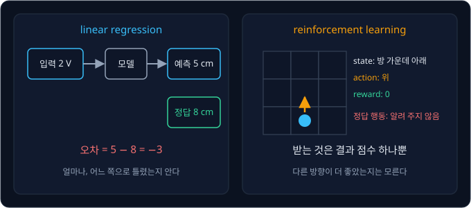
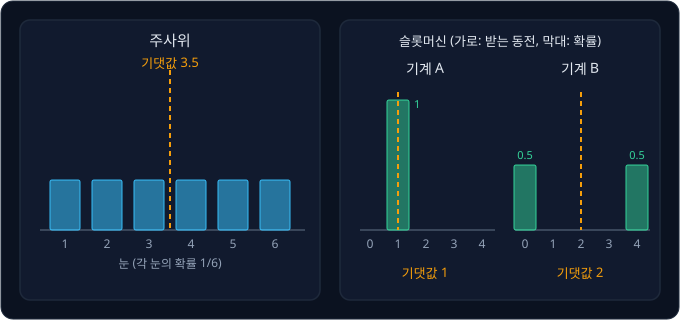

# Bandits & MDPs

## 학습 목표

- 정답 없이 행동한 뒤에 받는 점수만으로 배우는 문제가 무엇이고, 입력마다 정답이 주어지던 직선 맞추기와 무엇이 다른지 설명할 수 있다
- 주사위와 슬롯머신으로 "어떤 결과가 나올 가능성" 과 "여러 번 했을 때 평균적으로 얻는 값" 을 계산할 수 있다
- 슬롯머신 여러 대 가운데 가장 좋은 기계를 찾을 때 지금까지 가장 좋았던 기계만 고르면 왜 실패하는지 보이고, 가끔 무작위로
  다른 기계를 당기는 방법과 덜 당겨 본 기계에 가산점을 주는 방법을 숫자로 따라갈 수 있다
- 행동이 다음 상황을 바꾸는 문제를 상황·행동·점수·이동 확률·미래 점수를 깎는 비율의 다섯 가지로 적을 수 있다
- 3×3 격자의 칸마다 "여기서 출발하면 앞으로 얻을 점수" 를 이웃 칸의 값으로 되풀이 계산해 채우고, 그 값으로 칸마다 갈 방향을
  고를 수 있다
- 이동 규칙을 모를 때 직접 겪은 이동 한 번으로 표의 값을 조금씩 고쳐 같은 답에 이르는 과정을 손으로 계산할 수 있다

## 정답 없이 배우는 문제

### 정답과 reward

[Linear Regression](../linear-regression/README.md) 에서는 데이터가 입력 $x$ 와 정답 $y$ 의 쌍이었다. 모터에 2 V 를 넣으면
8 cm 움직인다는 정답이 있었기 때문에, 모델이 5 cm 라고 예측하면 오차 $5 - 8 = -3$ 을 바로 계산하고 parameter(모델 안에서
학습으로 고치는 숫자)를 고칠 수 있었다.

로봇이 마주하는 문제에는 이런 정답이 없는 경우가 많다. 로봇 청소기가 방 한가운데에서 충전기로 돌아가는 장면을 생각해 보면,
지금 자리에서 위로 가야 할지 오른쪽으로 가야 할지 알려 주는 사람이 없다. 로봇이 알 수 있는 것은 움직인 뒤의 결과뿐이라서,
충전기에 닿으면 성공했다는 것을, 계단에서 떨어지면 실패했다는 것을 그제야 안다. 이렇게 행동한 뒤에 받는 점수를 reward(보상)라고
하고 숫자 하나로 적는다. 예를 들어 충전기에 닿으면 +1, 계단에서 떨어지면 −1, 그 밖의 이동은 0 으로 정한다.

위 그림은 두 학습의 차이를 보여 준다. 왼쪽 linear regression 에서는 정답 8 이 함께 주어져 예측이 얼마나, 어느 쪽으로 틀렸는지(−3)를
안다. 오른쪽 로봇은 위로 움직인 뒤 reward 0 을 받는데, 이 0 은 "아직 충전기에 닿지 않았다" 는 뜻일 뿐 다른 방향이 더 좋았는지는
알려 주지 않는다.

reward 의 합이 가장 커지도록 행동하는 법을 시행착오로 배우는 문제를 reinforcement learning(강화학습), 줄여서 RL 이라고 한다.
reinforcement 는 "강화" 라는 뜻의 심리학 용어로, 좋은 결과가 뒤따른 행동은 점점 더 자주 하게 된다는 관찰에서 왔다. RL 은 정답이
없으니 여러 행동을 직접 해 보고, 받은 reward 를 서로 비교하며 배운다.

**확인 문제.** 로봇 팔이 컵을 집으면 +1, 놓치면 0 을 받는다. 컵을 놓친 뒤 받은 reward 0 만 보고 "팔을 2 cm 더 내렸어야 했다" 는
것을 알 수 있을까?

답 보기

알 수 없다. reward 0 은 실패했다는 결과만 알려 줄 뿐 어떻게 했어야 했는지는 알려 주지 않는다. 팔을 더 내려 보기도 하고 덜
내려 보기도 하면서 어느 쪽에서 +1 이 나오는지 비교해야 한다.

### agent 와 environment

RL 에서는 행동을 고르는 쪽과 그 행동의 결과를 정하는 쪽을 나눠 부른다. 행동을 고르는 쪽을 agent, agent 가 행동하는 대상 세계를
environment 라고 한다. 로봇 청소기 예에서는 청소기 안에서 방향을 고르는 프로그램이 agent 이고, 방·가구·충전기·계단이 environment
다. 둘은 아래 세 단계를 되풀이한다.

1. agent 가 지금 상황을 본다. 이 상황을 state(상태)라고 하며, 청소기라면 "지금 서 있는 위치" 다
2. agent 가 할 일을 하나 고른다. 이것을 action(행동)이라고 하며, "위로 한 칸" 같은 것이다
3. environment 가 그 action 의 결과로 다음 state 와 reward 를 돌려준다

위 그림은 이 되풀이를 보여 준다. 세 단계를 한 번 도는 것을 step 이라 하고, 시작부터 충전기에 닿거나 계단에서 떨어져 끝날
때까지의 step 들을 묶어 episode 라고 한다. 칸 세 개짜리 복도의 1 번 칸에서 출발해 3 번 칸의 충전기로 가는 episode 는 아래처럼
두 step 으로 끝난다.

| step | state | action | 다음 state | reward |
| --- | --- | --- | --- | --- |
| 1 | 1 번 칸 | 오른쪽 | 2 번 칸 | 0 |
| 2 | 2 번 칸 | 오른쪽 | 3 번 칸(충전기) | +1, episode 끝 |

**흔한 오해.** step 이라는 말은 gradient descent 에서는 "parameter 를 한 번 고치는 것" 을 뜻한다.
RL 에서 step 은 "agent 가 action 을 한 번 하고 결과를 받는 것" 이다. 둘은 다른 뜻이라서, 이 강의에서 step 은 모두 action 한 번을
가리킨다.

**확인 문제.** 체스를 두는 프로그램에서 agent, environment, state, action, reward 는 각각 무엇일까?

답 보기

agent 는 수를 고르는 프로그램, environment 는 체스판과 상대방이다. state 는 지금 판 위의 말 배치, action 은 이번에 둘 수 하나다.
reward 는 이기면 +1, 지면 −1, 게임이 끝나기 전의 수에는 0 처럼 정할 수 있다.

**요약**

- reward 는 행동한 뒤에 받는 점수이고, 어떤 행동이 정답이었는지는 알려 주지 않는다
- RL 은 reward 의 합이 가장 커지는 행동을 시행착오로 배우는 문제다
- agent 가 state 를 보고 action 을 고르면 environment 가 다음 state 와 reward 를 돌려주며, 이 한 번이 step, 시작부터 끝까지가 episode 다

## 확률과 기댓값

### 확률

슬롯머신은 같은 레버를 당겨도 결과가 매번 다르다. 결과가 이렇게 운에 따라 달라지면 "얼마나 자주 나오는가" 를 숫자로 나타내야
비교할 수 있는데, 이 숫자를 확률이라고 한다.

주사위로 보면 쉽다. 주사위의 여섯 면 1, 2, 3, 4, 5, 6 은 모두 똑같이 잘 나오므로 3 이 나올 확률은 여섯 가지 중 하나, 곧
$\frac{1}{6} \approx 0.167$ 이다. 짝수가 나올 확률은 2, 4, 6 의 세 가지라서 $\frac{3}{6} = 0.5$ 다. 확률에는 아래 성질이 있다.

- 0 과 1 사이의 숫자다. 0 은 절대 일어나지 않는다는 뜻이고 1 은 반드시 일어난다는 뜻이다. 주사위에서 7 이 나올 확률은 0 이다
- 일어날 수 있는 모든 결과의 확률을 더하면 1 이다. 주사위는 $\frac{1}{6} \times 6 = 1$ 이다
- 많이 되풀이하면 실제로 일어난 비율이 확률에 가까워진다. 주사위를 600 번 던지면 3 은 대략 100 번 나온다

이 강의에서는 슬롯머신 두 대를 계속 쓰는데, 기계 A 는 레버를 당길 때마다 항상 동전 1 개를 준다. 한편 기계 B 는 절반의 확률로 동전 4 개를,
나머지 절반의 확률로 0 개를 준다. 동전을 던져 앞면이면 4 개, 뒷면이면 0 개를 주는 기계라고 생각하면 된다. 확률을 기호로 쓸 때는
$P(\cdot)$ 를 쓰는데, P 는 probability(확률)의 첫 글자다. 기계 B 의 확률은 $P(4\text{ 개}) = 0.5$, $P(0\text{ 개}) = 0.5$ 로 적고,
더하면 1 이다.

**확인 문제.** 주사위를 한 번 던져 5 이상이 나올 확률은?

답 보기

5 와 6 의 두 가지라서 $\frac{2}{6} = \frac{1}{3} \approx 0.333$ 이다.

### 기댓값

평균은 숫자들을 모두 더한 뒤 개수로 나눈 값이다. 3, 5, 4
의 평균은 $(3 + 5 + 4) \div 3 = 4$ 다.

주사위를 600 번 던져 1 부터 6 까지가 정확히 100 번씩 나왔다고 하자. 나온 눈을 모두 더하면
$1 \times 100 + 2 \times 100 + \cdots + 6 \times 100 = 2100$ 이고, 600 으로 나눈 평균은 3.5 다. 같은 계산을 600 으로 먼저 나눠서
하면, 눈마다 "그 눈 × 그 눈이 나온 비율" 을 더하는 식이 된다.

$$
1 \times \tfrac{1}{6} + 2 \times \tfrac{1}{6} + 3 \times \tfrac{1}{6} + 4 \times \tfrac{1}{6} + 5 \times \tfrac{1}{6} + 6 \times \tfrac{1}{6} = \tfrac{21}{6} = 3.5
$$

이렇게 결과마다 "그 값 × 그 값의 확률" 을 구해 모두 더한 것을 기댓값(expected value)이라고 한다. 아주 많이 되풀이했을 때 한 번에
평균적으로 얻는 값이다. 주사위에 3.5 라는 눈은 없으므로, 기댓값은 실제로 한 번에 나올 수 없는 값일 수도 있다.

숫자만 바꿔 두 기계의 기댓값을 구하면 아래와 같다.

| 기계 | 결과와 확률 | 기댓값 계산 | 기댓값 |
| --- | --- | --- | --- |
| A | 1 개 (확률 1) | $1 \times 1$ | 1 |
| B | 4 개 (확률 0.5), 0 개 (확률 0.5) | $4 \times 0.5 + 0 \times 0.5$ | 2 |

위 그림은 결과마다 확률을 막대 높이로 그린 것이다. 막대마다 "값 × 높이" 를 구해 더하면 기댓값이 나오고, 점선이 그 위치다. 기계 B 는
한 번 당길 때는 4 개 아니면 0 개라서 2 개가 나오는 일이 없지만, 오래 당기면 한 번에 평균 2 개씩 받는다. 그래서 오래 당길수록
A 보다 B 가 낫다.

기댓값은 기호로 $\mathbb E[\cdot]$ 라고 쓰며, E 는 expectation(기댓값)의 첫 글자다. 기계 B 가 주는 동전 수를 $r$ 이라고 하면
$\mathbb E[r] = 2$ 로 적고 "r 의 기댓값은 2" 라고 읽는다. 결과마다 값 × 확률을 더한다는 정의를
$\Sigma$(sigma, 시그마, "모두 더하라" 는 기호)로 쓰면 아래와 같다.

$$
\mathbb E[r] = \sum_{\text{결과 } x} x \times P(x)
$$

이 식은 "일어날 수 있는 결과 $x$ 마다 $x$ 와 그 확률 $P(x)$ 를 곱하고, 모두 더한다" 로 읽는다. 기계 B 라면 결과 $x$ 는 4 와 0,
$P(x)$ 는 둘 다 0.5 이고 결과는 2 다.

**확인 문제.** 기계 C 는 0.2 의 확률로 동전 10 개, 0.8 의 확률로 0 개를 준다. 기댓값은? 기계 B 와 비교하면 어떤가?

답 보기

$10 \times 0.2 + 0 \times 0.8 = 2$ 로 기계 B 와 기댓값이 같다. 한 번 한 번의 결과는 C 쪽이 훨씬 들쭉날쭉하지만, 오래 당기면 둘 다
한 번에 평균 2 개씩 준다.

### 몇 번만 해 본 평균

기댓값은 확률을 알아야 계산할 수 있다. 그런데 슬롯머신 앞에 선 사람은 기계 B 가 0.5 의 확률로 4 개를 준다는 것을 모른다. 알 수
있는 것은 직접 당겨서 받은 결과뿐이다. 이렇게 실제로 해 보고 얻은 결과 하나하나를 sample 이라고 한다.

기계 B 를 10 번 당겨 아래처럼 받았다고 하자. 매번 그때까지 받은 동전의 평균을 함께 적었다.

| 당긴 횟수 | 1 | 2 | 3 | 4 | 5 | 6 | 7 | 8 | 9 | 10 |
| --- | --- | --- | --- | --- | --- | --- | --- | --- | --- | --- |
| 받은 동전 | 0 | 0 | 4 | 4 | 0 | 4 | 4 | 0 | 4 | 4 |
| 그때까지의 평균 | 0 | 0 | 1.33 | 2 | 1.6 | 2 | 2.29 | 2 | 2.22 | 2.4 |

위 그림은 표의 마지막 줄을 점으로 이은 것이다. 처음 두 번만 보면 평균이 0 이라 "B 는 동전을 안 주는 기계" 처럼 보이지만, 당긴
횟수가 늘수록 평균은 기댓값 2 근처로 모인다. 10 번째의 2.4 도 아직 2 와 딱 맞지는 않는데, sample 이 적으면 운이 섞이기 때문이다.

이 차이 때문에 슬롯머신 고르기가 어려워진다. 몇 번 당겨 본 평균만 믿고 기계를 고르면, 운이 나빴던 좋은 기계를 나쁜 기계로 오해할 수 있다.

**확인 문제.** 기계 B 를 4 번 당겨 4, 4, 4, 0 을 받았다. 지금까지의 평균은 얼마이고, 이 값이 기댓값 2 와 다른 이유는?

답 보기

$(4 + 4 + 4 + 0) \div 4 = 3$ 이다. 기계는 그대로인데 네 번 중 세 번이나 4 개가 나오는 운이 따랐다. sample 이 적으면 평균이
기댓값에서 크게 벗어날 수 있다.

**요약**

- 확률은 어떤 결과가 얼마나 자주 나오는지를 0 과 1 사이 숫자로 나타낸 것이고, 모든 결과의 확률을 더하면 1 이다
- 기댓값은 결과마다 값 × 확률을 더한 것으로, 아주 많이 되풀이했을 때 한 번에 평균적으로 얻는 값이다
- 직접 해 본 결과(sample)의 평균은 횟수가 늘수록 기댓값에 가까워지지만, 몇 번뿐이면 운 때문에 크게 다를 수 있다

## multi-armed bandit

### 슬롯머신 여러 대

기계 A 와 B 앞에서 레버를 100 번 당길 수 있고, 받은 동전을 모두 가질 수 있다고 하자. 기댓값을 알면 답은 간단하다. B 의 기댓값이
2 로 A 의 1 보다 크므로 100 번 모두 B 를 당기면 평균 200 개를 받는다. 하지만 실제로는 두 기댓값을 모른 채 시작하기 때문에, 당기면서
어느 기계가 좋은지 알아내는 동시에 동전도 많이 받아야 한다.

이 문제를 multi-armed bandit 이라고 한다. 영어권에서는 손잡이(arm) 하나 달린 슬롯머신을 "one-armed bandit(외팔이 강도)" 이라고
부르는데, 손님의 돈을 털어 간다는 농담이다. 손잡이가 여러 개(multi-armed)인 기계, 곧 여러 대 가운데 하나를 고르는 문제라서 이런
이름이 붙었다. 선택지 하나를 arm 이라 하고, arm 의 개수를 $k$ 로 적는다. 기계 A, B 의 문제는 $k = 2$ 다.

arm $a$ 의 진짜 기댓값을 $q_*(a)$ 라고 쓴다. "큐 스타 에이" 라고 읽고, 별표(star)는 "진짜 값" 이라는 표시다. 이 값은 agent 에게
숨겨져 있다. 기계 A, B 에서는 $q_*(A) = 1$, $q_*(B) = 2$ 다.

로봇에도 같은 문제가 있다. 로봇 팔이 물건을 위에서, 옆에서, 비스듬히 집는 세 가지 방법을 쓸 수 있는데 어느 방법의 성공률이 가장
높은지 모른다면, 시도하면서 성공률을 알아내는 동시에 성공도 많이 해야 한다. bandit 에서는 매번 같은 상황에서 고르기만 하므로
state 가 하나뿐인 가장 단순한 RL 문제다.

**확인 문제.** arm 이 세 개이고 $q_*$ 가 각각 1, 3, 2 다. 이 값을 알고 10 번 당긴다면 어느 arm 을 당기고, 기댓값으로 동전 몇 개를
받을까?

답 보기

기댓값이 가장 큰 3 짜리 arm 을 10 번 모두 당기고, $3 \times 10 = 30$ 개를 받는다.

### 추정값과 incremental 평균

agent 는 $q_*(a)$ 를 모르므로 지금까지 그 arm 에서 받은 reward 의 평균으로 대신한다. 이 평균을 추정값 $Q(a)$ 라 하고, arm 을
당긴 횟수를 $N(a)$ 로 적는다. 추정값은 "아마 이 정도일 것" 이라고 어림한 값이라는 뜻이다.

평균은 reward 를 모두 적어 두지 않아도 새 reward 가 들어올 때마다 고쳐 쓸 수 있다. 어떤 기계를 네 번 당겨 6, 2, 4, 0 을 받았을 때
평균이 바뀌는 과정을 한 줄씩 적는다. $n$ 은 몇 번째로 당겼는지, $r$ 은 그때 받은 reward 다.

| $n$ | 받은 $r$ | 고치기 전 $Q$ | 차이 $r - Q$ | $\frac{1}{n} \times$ 차이 | 고친 $Q$ |
| --- | --- | --- | --- | --- | --- |
| 1 | 6 | 0 | 6 | $\frac{1}{1} \times 6 = 6$ | 6 |
| 2 | 2 | 6 | $-4$ | $\frac{1}{2} \times (-4) = -2$ | 4 |
| 3 | 4 | 4 | 0 | $\frac{1}{3} \times 0 = 0$ | 4 |
| 4 | 0 | 4 | $-4$ | $\frac{1}{4} \times (-4) = -1$ | 3 |

마지막 $Q = 3$ 은 네 값의 평균 $(6 + 2 + 4 + 0) \div 4 = 3$ 과 같다. 한 줄의 계산을 식으로 쓰면 아래와 같고, 이를 incremental 평균
이라고 한다. incremental 은 "조금씩 늘려 가는" 이라는 뜻이다.

$$
Q(a) \leftarrow Q(a) + \frac{1}{n}\big(r - Q(a)\big)
$$

화살표 $\leftarrow$ 는 "왼쪽의 값을 오른쪽에서 계산한 값으로 바꿔 적는다" 는 뜻이다. 식은 "새 reward $r$ 이 지금 추정값 $Q(a)$ 보다
얼마나 큰지 구해, 그 차이의 $\frac{1}{n}$ 만큼만 추정값을 옮긴다" 로 읽는다. 표의 넷째 줄에 대응하면 $Q(a)$ 는 4, $r$ 은 0,
$n$ 은 4 이고, 4 를 $\frac{1}{4} \times (0 - 4) = -1$ 만큼 옮겨 3 이 됐다.

이 식이 정확히 평균이 되는 이유를 넷째 줄의 숫자로 한 단계씩 확인한다.

1. 세 번째까지의 평균이 4 이므로 세 값의 합은 $4 \times 3 = 12$ 다
2. 네 번째 reward 0 을 더한 합은 $12 + 0 = 12$ 이고, 네 값의 평균은 $12 \div 4 = 3$ 이다
3. 같은 값을 식으로 쓰면 $\frac{4 \times 3 + 0}{4}$ 이다
4. $4 \times 3$ 은 $4 \times 4 - 4$ 와 같으므로 $\frac{4 \times 4 - 4 + 0}{4}$ 로 바꿔 쓴다
5. 분자를 둘로 나누면 $\frac{4 \times 4}{4} + \frac{0 - 4}{4} = 4 + \frac{0 - 4}{4}$ 이다
6. 계산하면 $4 + (-1) = 3$ 이다

다섯째 줄의 $4$ 는 "옛 평균", $\frac{0 - 4}{4}$ 는 "차이 $(0 - 4)$ 의 $\frac{1}{4}$" 이다. 어느 $n$ 에서나
같은 변형이 되므로 incremental 평균은 언제나 진짜 평균과 같다.

위 그림은 표를 수직선 위에 옮긴 것이다. 회색 점이 지금 $Q$, 주황 점이 새 reward 이고, 초록 화살표가 차이의 $\frac{1}{n}$ 만큼
옮겨 가는 거리다. $n$ 이 커질수록 같은 차이에도 조금만 옮기는데, 이미 많은 sample 이 쌓인 평균은 새 sample 하나로 크게 흔들리지
않아야 하기 때문이다.

숫자만 바꿔 reward 가 1.2, 0.4, 0.8, 1.6 으로 들어오면 $Q$ 는 $1.2$, $1.2 + \frac{1}{2}(0.4 - 1.2) = 0.8$,
$0.8 + \frac{1}{3}(0.8 - 0.8) = 0.8$, $0.8 + \frac{1}{4}(1.6 - 0.8) = 1.0$ 이 되고, 마지막 값은 네 값의 평균
$(1.2 + 0.4 + 0.8 + 1.6) \div 4 = 1.0$ 과 같다.

"새 값 = 옛 값 + 크기 × (목표 − 옛 값)" 이라는 모양은 이 강의 내내 다시 나온다.
gradient descent(loss 가 줄어드는 쪽으로 parameter 를 조금씩 고치는 방법)도 parameter 를 learning rate(한 번에 고치는 크기)
만큼씩 옮기는데, 여기서는 $\frac{1}{n}$ 이 그 크기 역할을 하고
당길수록 작아진다.

**확인 문제.** 두 번 당겨 $Q = 3$ 이 된 기계를 세 번째로 당겨 reward 6 을 받았다. 새 $Q$ 는?

답 보기

$3 + \frac{1}{3}(6 - 3) = 3 + 1 = 4$ 다. 앞의 두 값의 합 6 에 6 을 더하면 12, 3 으로 나누면 4 로 같다.

### greedy 와 exploitation

추정값이 있으면 가장 단순한 전략은 추정값이 가장 큰 arm 을 고르는 것이다. 이렇게 지금 아는 것 중 가장 좋은 쪽을 고르는 것을
exploitation(이용)이라 하고, exploitation 만 하는 전략을 greedy(욕심쟁이)라고 한다.

기계 A, B 에 greedy 를 써 본다. 처음에는 두 추정값이 모두 0 이라 우열이 없으므로 둘을 한 번씩 당긴다. A 는 항상 1 개를 주고,
B 는 운이 나빠 첫 번째에 0 개를 줬다고 하자.

| step | 고른 기계 | 이유 | 받은 reward | $Q(A)$ | $Q(B)$ |
| --- | --- | --- | --- | --- | --- |
| 1 | A | 처음 한 번씩 | 1 | 1 | 0 |
| 2 | B | 처음 한 번씩 | 0 | 1 | 0 |
| 3 | A | $1 > 0$ | 1 | 1 | 0 |
| 4 | A | $1 > 0$ | 1 | 1 | 0 |
| 5 | A | $1 > 0$ | 1 | 1 | 0 |
| ⋯ | A | $1 > 0$ | 1 | 1 | 0 |

위 그림처럼 step 2 이후 $Q(B)$ 는 0 에서 영영 바뀌지 않는다. 추정값을 고치려면 B 를 다시 당겨야 하는데, greedy 는 $Q(A) = 1$ 이
더 크다는 이유로 B 를 다시 당기지 않기 때문이다. 결국 한 번에 평균 1 개를 받으며 100 번에 약 100 개를 받는데, B 만 당겼다면
200 개였다.

**흔한 오해.** "지금까지 평균이 가장 높은 것을 고르는 게 가장 똑똑하다" 고 생각하기 쉽다. 하지만 기계 B 의 첫 결과가 0 개일
확률은 0.5 이므로, 이 greedy 는 절반의 확률로 더 좋은 기계를 영원히 버린다. 평균은 당겨 본 arm 에 대해서만 믿을 만하다.

**확인 문제.** 이번에는 B 가 첫 번째에 4 개를 줬다($Q(A) = 1$, $Q(B) = 4$). greedy 는 다음에 무엇을 당길까? 그 뒤 B 에서 0, 0 을
연달아 받으면 $Q(B)$ 는 얼마이고, 그다음에는 무엇을 당길까?

답 보기

$4 > 1$ 이므로 B 를 당긴다. B 의 reward 가 4, 0, 0 이 되면 $Q(B) = (4 + 0 + 0) \div 3 \approx 1.33$ 이다. 여전히 1 보다 크므로
그다음에도 B 를 당긴다.

### exploration 과 ε-greedy

greedy 의 문제를 고치려면 추정값이 작아 보여도 가끔은 덜 확실한 arm 을 일부러 당겨 봐야 한다. 이렇게 정보를 더 얻으려고 당겨 보는
것을 exploration(탐색)이라고 한다. exploration 을 하는 동안에는 더 나빠 보이는 arm 을 당기므로 당장 받는 reward 가 줄어들 수
있지만, 그 대가로 추정값이 정확해진다.

ε-greedy 는 exploration 을 가장 단순하게 넣는 방법이다. $\varepsilon$ 은 그리스 문자 epsilon(엡실론)이고 0 과 1 사이의 작은 확률이다.
step 마다 확률 $\varepsilon$ 으로는 $k$ 개 arm 가운데 하나를 무작위로 고르고, 나머지 확률 $1 - \varepsilon$ 으로는 greedy 처럼 추정값이
가장 큰 arm 을 고른다. $\varepsilon = 0.1$ 이면 1 부터 10 까지 적힌 10 면 주사위를 굴려 1 이 나올 때만 무작위로 고르는 것과 같다.

앞의 불운한 출발($Q(A) = 1$, $Q(B) = 0$)에서 $\varepsilon = 0.1$ 로 이어 가 본다. 무작위로 고를 때는 동전을 던져 앞면이면 A,
뒷면이면 B 를 고른다.

| step | 10 면 주사위 | 고르는 방식 | 고른 기계 | reward | $N(B)$ | $Q(A)$ | $Q(B)$ |
| --- | --- | --- | --- | --- | --- | --- | --- |
| 3 | 7 | greedy | A | 1 | 1 | 1 | 0 |
| 4 | 1 | 무작위, 동전 뒷면 | B | 4 | 2 | 1 | $0 + \frac{1}{2}(4 - 0) = 2$ |
| 5 | 4 | greedy ($2 > 1$) | B | 0 | 3 | 1 | $2 + \frac{1}{3}(0 - 2) = \frac{4}{3} \approx 1.33$ |
| 6 | 9 | greedy ($1.33 > 1$) | B | 4 | 4 | 1 | $\frac{4}{3} + \frac{1}{4}(4 - \frac{4}{3}) = \frac{4}{3} + \frac{2}{3} = 2$ |

step 4 의 무작위 선택 한 번으로 B 를 다시 당겼고, 그 뒤로는 greedy 선택만으로도 B 를 고른다. 마지막 $Q(B) = 2$ 는 B 에서 받은
0, 4, 0, 4 의 평균과 같다.

위 그림은 추정값이 제대로 잡힌 뒤($Q(B) > Q(A)$) 한 step 에서 각 기계가 골라질 확률을 따라간 것이다. 무작위로 고를 때도 B 가 반은
나오므로 B 의 확률은 $0.9 + 0.1 \times \frac{1}{2} = 0.95$, A 는 $0.1 \times \frac{1}{2} = 0.05$ 다. 그래서 한 step 의 reward
기댓값은 $0.95 \times 2 + 0.05 \times 1 = 1.95$ 다.

**흔한 오해.** "exploration 을 많이 할수록 잘 배운다" 고 생각하기 쉽다. 추정값이 이미 정확해진 뒤에는 exploration 이 손해만 낸다.
같은 계산을 $\varepsilon$ 만 바꿔 해 보면 아래와 같다.

| $\varepsilon$ | B 를 고를 확률 | A 를 고를 확률 | step 당 reward 기댓값 |
| --- | --- | --- | --- |
| 0 | 1 | 0 | 2 (단, 처음에 B 를 버리면 1) |
| 0.1 | $0.9 + 0.05 = 0.95$ | 0.05 | $0.95 \times 2 + 0.05 \times 1 = 1.95$ |
| 0.5 | $0.5 + 0.25 = 0.75$ | 0.25 | $0.75 \times 2 + 0.25 \times 1 = 1.75$ |
| 1 | 0.5 | 0.5 | $0.5 \times 2 + 0.5 \times 1 = 1.5$ |

$\varepsilon = 1$ 은 매번 무작위라 아무것도 배우지 않은 것과 같다. 그래서 $\varepsilon$ 은 0.1 이나 0.01 처럼 작게 잡는다. 대신 작은
$\varepsilon$ 에도 한계가 있다. arm 이 10 개이고 $\varepsilon = 0.1$ 이면, 가장 좋은 arm 을 정확히 알아낸 뒤에도 그 arm 을 고를
확률은 $0.9 + 0.1 \times \frac{1}{10} = 0.91$ 에서 더 오르지 않는다. 열 번에 한 번꼴로 계속 무작위로 고르기 때문이다.

**확인 문제.** arm 이 4 개이고 $\varepsilon = 0.2$ 다. 추정값이 가장 큰 arm 이 골라질 확률과, 나머지 arm 하나가 골라질 확률은?

답 보기

추정값이 가장 큰 arm 은 $0.8 + 0.2 \times \frac{1}{4} = 0.85$, 나머지 arm 하나는 무작위로 고를 때만 나오므로
$0.2 \times \frac{1}{4} = 0.05$ 다. 확인하면 $0.85 + 0.05 \times 3 = 1$ 이다.

### UCB

ε-greedy 의 무작위 선택은 어느 arm 을 덜 당겨 봤는지 따지지 않는다. 1000 번 당겨 확실히 나쁘다고 밝혀진 arm 과 두 번밖에 안 당겨 본
arm 을 똑같은 확률로 고른다. UCB 는 덜 당겨 본 arm 일수록 추정값에 가산점(bonus)을 크게 더해, 더한 값이 가장 큰 arm 을 고른다. UCB
는 upper confidence bound 의 줄임말로 "믿을 만한 범위의 위쪽 끝" 이라는 뜻이다. 두 번만 당긴 arm 의 평균은 운에 따라 크게 틀릴 수
있으므로, 진짜 값이 그 평균보다 꽤 높을 가능성까지 열어 두고 "잘 풀리면 이만큼일 수도 있다" 는 값으로 비교한다.

bonus 계산에는 두 기호가 필요하다.

- **$\sqrt{\phantom{x}}$ (square root, 제곱근)** — 제곱해서 그 수가 되는 양수다. $3 \times 3 = 9$ 이므로 $\sqrt 9 = 3$,
  $0.5 \times 0.5 = 0.25$ 이므로 $\sqrt{0.25} = 0.5$ 다. 안의 수가 4 배가 되면 제곱근은 2 배가 된다($\sqrt 4 = 2$, $\sqrt{16} = 4$)
- **$\ln$ (natural log, 자연로그)** — $e \approx 2.718$ 이라는 수를 몇 번 곱해야 그 수가 되는지 나타낸다. $e$ 를 한 번 곱하면
  2.718 이므로 $\ln 2.718 \approx 1$ 이다. 이 강의에서는 아래 표의 값만 쓰며, $t$ 가 10 배가 될 때마다 $\ln t$ 가 2.3 정도씩만 는다는
  점, 곧 아주 천천히 커진다는 점만 기억하면 된다

| $t$ | 1 | 10 | 100 | 1000 |
| --- | --- | --- | --- | --- |
| $\ln t$ | 0 | 2.303 | 4.605 | 6.908 |

UCB 가 고르는 arm 은 아래 식으로 정한다.

$$
\text{고를 arm} = \arg\max_a \Big[\, Q(a) + c\sqrt{\frac{\ln t}{N(a)}} \,\Big]
$$

$t$ 는 지금까지 모든 arm 을 당긴 전체 횟수, $N(a)$ 는 arm $a$ 를 당긴 횟수, $c$ 는 bonus 를 얼마나 크게 줄지 정하는 숫자다.
대괄호 안의 둘째 항이 bonus 다. $\max_a$ 는 "arm $a$ 를 모두 넣어 보고 가장 큰 값" 이고, $\arg\max_a$ 는 그 가장 큰 값을 만든
"arm 이 무엇인지" 다. 점수가 A 2, B 5 이면 $\max$ 는 5, $\arg\max$ 는 B 다. 그래서 식 전체는 "arm 마다 추정값에 bonus 를 더하고,
더한 값이 가장 큰 arm 을 고른다" 로 읽는다.

$t = 100$, $c = 2$ 에서 arm 세 개가 아래 상태라고 하자. bonus 는 안쪽부터 한 단계씩 계산한다.

| arm | $Q(a)$ | $N(a)$ | $\ln t \div N(a)$ | 제곱근 | bonus ($\times c$) | $Q + $ bonus |
| --- | --- | --- | --- | --- | --- | --- |
| A | 1.5 | 80 | $4.605 \div 80 = 0.058$ | 0.240 | 0.480 | 1.98 |
| B | 1.2 | 15 | $4.605 \div 15 = 0.307$ | 0.554 | 1.108 | 2.31 |
| C | 0.5 | 5 | $4.605 \div 5 = 0.921$ | 0.960 | 1.919 | 2.42 |

위 그림은 추정값(파랑) 위에 bonus(주황)를 쌓은 것이다. greedy 라면 추정값이 가장 큰 A 를 고르지만, UCB 는 다섯 번밖에 당기지 않은
C 의 bonus 가 커서 C 를 고른다. C 를 몇 번 더 당겨 정말 나쁘다고 확인되면 $N(C)$ 가 늘어 bonus 가 줄고, 다시 A 나 B 를 고르게 된다.

bonus 가 변하는 규칙은 숫자를 바꿔 보면 보인다.

| 상황 | $t$ | $N(a)$ | bonus ($c = 2$) |
| --- | --- | --- | --- |
| 기준 | 100 | 5 | 1.919 |
| 그 arm 을 더 당겨 $N$ 이 4 배 | 100 | 20 | 0.960 |
| 그 arm 을 안 당긴 채 다른 arm 만 900 번 | 1000 | 5 | 2.351 |

당긴 횟수 $N$ 이 4 배가 되면 제곱근 때문에 bonus 는 정확히 절반이 된다. 반대로 어떤 arm 을 오래 안 당기면 $t$ 만 늘어 bonus 가
천천히 커지므로, 버려 둔 arm 도 언젠가 다시 확인하게 된다. 한 번도 안 당긴 arm 은 $N(a) = 0$ 이라 0 으로 나눌 수 없는데, 이때는
bonus 를 무한히 크다고 보고 모든 arm 을 먼저 한 번씩 당긴다. 이 식은 2002년 Auer, Cesa-Bianchi, Fischer 의 논문에서 UCB1 이라는
이름으로 나왔다.

**확인 문제.** $c = 1$ 이고 $\ln t = 4$ 라고 하자. arm X 는 $Q = 2$, $N = 16$, arm Y 는 $Q = 1$, $N = 1$ 이다. UCB 는 어느 arm 을
고를까?

답 보기

X 는 $2 + 1 \times \sqrt{4 \div 16} = 2 + \sqrt{0.25} = 2.5$, Y 는 $1 + 1 \times \sqrt{4 \div 1} = 1 + 2 = 3$ 이다. Y 가 더 크므로
추정값은 작아도 한 번밖에 안 당긴 Y 를 고른다.

### 세 전략의 비교

세 전략을 오래 돌리면 차이가 분명해진다. arm 이 10 개인 문제를 하나 만들 때 arm 마다 기댓값을 무작위로 정하고, reward 는 그 기댓값
근처에서 매번 조금씩 다르게 나오게 한다. 이런 문제 2000 개를 각각 1000 step 동안 풀고, step 마다 받은 reward 를 2000 개 문제에
걸쳐 평균하면 아래 그림이 나온다. 모든 전략은 추정값 0 에서 시작했고 UCB 의 $c$ 는 2 다.

위 그림의 위쪽은 step 별 평균 reward, 아래쪽은 가장 좋은 arm 을 고른 비율이다. 마지막 100 step 의 평균은 아래와 같다.

| 전략 | 평균 reward | 가장 좋은 arm 을 고른 비율 |
| --- | --- | --- |
| greedy ($\varepsilon = 0$) | 1.04 | 37% |
| ε-greedy ($\varepsilon = 0.1$) | 1.39 | 80% |
| UCB ($c = 2$) | 1.50 | 86% |

greedy 는 초반 몇 step 만에 한 arm 에 붙잡혀 더 오르지 못한다. ε-greedy 는 천천히 계속 좋아지지만, 끝까지 열 번에 한 번꼴로
무작위 선택이 섞여 앞에서 계산한 91% 를 넘지 못한다. UCB 는 덜 당긴 arm 을 골라 확인하므로 가장 빨리, 가장 높이 오른다. 맨 처음 11 번째 step 쯤 UCB 의 곡선이
잠깐 튀어 오르는데, 처음 10 step 동안 모든 arm 을 한 번씩 당긴 뒤 처음으로 추정값과 bonus 를 비교해 고르는 순간이라 생기는 모양이다.
Sutton & Barto 교과서의 그림 2.2·2.4 와 같은 결과다.

**확인 문제.** 위 표에서 ε-greedy 가 1000 step 을 넘어 아무리 오래 돌아도 가장 좋은 arm 을 고르는 비율이 91% 를 넘지 못하는 이유는?

답 보기

가장 좋은 arm 을 정확히 알아내도 0.1 의 확률로 10 개 가운데 무작위로 고르기 때문이다. 그 arm 을 고를 확률은
$0.9 + 0.1 \times \frac{1}{10} = 0.91$ 이 최대다. UCB 에는 이런 고정된 무작위 선택이 없어서, 오래 돌면 bonus 가 작아지고 가장 좋은
arm 을 거의 항상 고른다.

**요약**

- multi-armed bandit 은 기댓값을 모르는 arm 여러 개 가운데 하나를 계속 골라 reward 합을 키우는 문제이고, 추정값 $Q(a)$ 는
  incremental 평균 $Q \leftarrow Q + \frac{1}{n}(r - Q)$ 로 고친다
- 추정값이 가장 큰 arm 만 고르는 greedy 는 운 나쁜 첫 sample 때문에 좋은 arm 을 버릴 수 있어서, exploration 이 필요하다
- ε-greedy 는 확률 $\varepsilon$ 으로 무작위로 고르고, UCB 는 덜 당긴 arm 에 $c\sqrt{\ln t / N(a)}$ 의 bonus 를 더해 고른다

## MDP

### 행동이 상황을 바꾸는 문제

bandit 에서는 기계 A 를 당겼다고 기계 B 가 사라지지 않듯 무엇을 당기든 다음 step 의 상황이 똑같았지만, 로봇이 움직이는 문제는
다르다. 청소기가 위로 한 칸 가면 서 있는 자리가 바뀌고, 그 자리에서 고를 수 있는 길과 받을 reward 도 바뀐다. 그래서 지금
action 이 몇 step 뒤의 reward 까지 좌우한다.

이 강의에서는 아래의 3×3 격자를 쓴다. 칸에는 왼쪽 위부터 1 부터 9 까지 번호를 붙였고, 칸 3 은 충전기(목표), 칸 5 는 계단(함정),
칸 7 은 출발 칸이다. 이렇게 격자 위를 움직이는 문제를 gridworld(격자 세계)라고 한다.

규칙은 아래와 같다.

- 청소기는 칸마다 위·아래·왼쪽·오른쪽 가운데 하나로 한 칸 움직인다
- 칸 3 에 들어가면 reward +1, 칸 5 에 들어가면 reward −1 을 받고 episode 가 끝난다
- 그 밖의 이동은 reward 0 이다. 격자 밖으로 나가려 하면 벽에 막혀 제자리에 머물고 reward 는 0 이다

칸 7 에서 위로 가든 오른쪽으로 가든 바로 받는 reward 는 0 으로 같다. 둘의 차이는 몇 step 뒤 충전기에 닿을 때에야 드러나므로, 바로
받는 reward 만 비교하는 bandit 의 방법으로는 어느 쪽이 나은지 알 수 없다.

**확인 문제.** 칸 6 에서 위로, 칸 4 에서 오른쪽으로, 칸 1 에서 위로 가면 각각 어디에 도착하고 reward 는 얼마일까?

답 보기

칸 6 에서 위는 칸 3 이라 +1 을 받고 끝나고, 칸 4 에서 오른쪽은 칸 5 라 −1 을 받고 끝난다. 칸 1 에서 위는 벽이라 칸 1 에 그대로
머물고 reward 는 0 이다.

### state 와 action

gridworld 의 state 는 청소기가 서 있는 칸이다. 가능한 state 를 모두 모은 것을 state 집합이라 하고 $\mathcal S$ 로 쓰는데, 집합은
여러 개를 중괄호 $\{\ \}$ 로 묶은 모음이다. 여기서는 $\mathcal S = \{1, 2, \ldots, 9\}$ 다. 같은 식으로 action 집합은
$\mathcal A = \{\text{위}, \text{아래}, \text{왼쪽}, \text{오른쪽}\}$ 이다.

state 하나는 소문자 $s$, action 하나는 소문자 $a$ 로 쓴다. 몇 번째 step 인지 밝힐 때는 아래첨자 $t$ 를 붙여 $s_t$, $a_t$ 로 쓰고,
$s_0 = 7$ 은 "처음(0 번째) state 는 칸 7" 이라는 뜻이다. 칸 3 과 5 처럼 들어가면 episode 가 끝나는 state 를 terminal state 라고 한다.
terminal state 에서는 더 고를 action 이 없다.

**확인 문제.** terminal state 가 아닌 칸마다 action 이 네 개씩 있다. (state, action) 짝은 모두 몇 개일까?

답 보기

terminal state 가 아닌 칸은 1, 2, 4, 6, 7, 8, 9 의 일곱 개다. 칸마다 action 이 네 개이므로 $7 \times 4 = 28$ 개다.

### transition

state 에서 action 을 해 다음 state 로 옮겨 가는 것을 transition 이라고 한다. 지금까지는 바닥이 미끄럽지 않아서, 칸 2 에서
오른쪽으로 가면 언제나 칸 3 에 도착했다.

실제 바닥은 미끄러울 수 있다. 바닥이 미끄러워서 고른 방향으로는 0.8 의 확률로 가고, 나머지 0.2 는 고른 방향과 직각인 두 방향으로
0.1 씩 미끄러진다고 하자. 칸 2 에서 오른쪽을 고르면 직각 방향은 위와 아래라서 아래처럼 된다.

| 실제로 간 방향 | 확률 | 도착 칸 | reward |
| --- | --- | --- | --- |
| 오른쪽 (고른 방향) | 0.8 | 3 (충전기) | +1 |
| 위 (미끄러짐) | 0.1 | 2 (벽에 막혀 제자리) | 0 |
| 아래 (미끄러짐) | 0.1 | 5 (계단) | −1 |

이 확률을 기호로 $P(s' \mid s, a)$ 라고 쓰고 "state $s$ 에서 action $a$ 를 했을 때 다음 state 가 $s'$ 일 확률" 이라고 읽는다.
$s'$ 은 "에스 프라임" 이라고 읽으며 다음 state 를 가리킨다. 세로 막대 $\mid$ 는 "~했을 때" 라는 조건이다. 위 표는
$P(3 \mid 2, \text{오른쪽}) = 0.8$, $P(2 \mid 2, \text{오른쪽}) = 0.1$, $P(5 \mid 2, \text{오른쪽}) = 0.1$ 이고, 셋을 더하면 1 이다.
미끄럽지 않은 바닥은 $P(3 \mid 2, \text{오른쪽}) = 1$ 이고 나머지가 모두 0 인 특별한 경우다.

이 확률은 지금 서 있는 칸과 고른 action 만으로 정해진다. 칸 2 에 칸 1 에서 왔든 칸 6 을 돌아서 왔든, 칸 2 에서 오른쪽을 고르면
확률은 똑같이 0.8, 0.1, 0.1 이다. 다음 state 가 지금 state 와 action 에만 달려 있고 그 전에 거쳐 온 길과는 상관없다는 이 가정을
Markov 성질이라고 하며, 러시아 수학자 Andrey Markov 의 이름에서 왔다.

**확인 문제.** 같은 미끄러운 바닥에서 칸 6 에서 위를 고르면 어디로 몇의 확률로 갈까?

답 보기

위(고른 방향)는 0.8 의 확률로 칸 3 이다. 직각 방향은 왼쪽과 오른쪽이라 왼쪽은 0.1 의 확률로 칸 5, 오른쪽은 벽이라 0.1 의 확률로
칸 6 에 그대로 머문다.

### reward 와 그 기댓값

reward 도 transition 에 따라 정해지므로 $r(s, a, s')$ 로 쓴다. "$s$ 에서 $a$ 를 해 $s'$ 에 도착했을 때 받는 reward" 라는 뜻이다.
이 gridworld 에서는 $s'$ 이 3 이면 +1, 5 이면 −1, 나머지는 0 이다.

미끄러운 바닥에서는 같은 action 에도 받는 reward 가 운에 따라 달라지므로, 기댓값으로 비교한다. 칸 2 에서 오른쪽을 고를 때 바로
받는 reward 의 기댓값은 앞 표의 "reward × 확률" 을 더해 구한다.

$$
1 \times 0.8 + 0 \times 0.1 + (-1) \times 0.1 = 0.8 + 0 - 0.1 = 0.7
$$

미끄럽지 않은 바닥에서는 1 이었는데, 계단에 빠질 가능성 0.1 때문에 0.7 로 줄었다. 함정 바로 옆을 지나는 길이 위험하다는 것이 숫자로
드러난다.

**확인 문제.** 미끄러운 바닥의 칸 6 에서 위를 고를 때 바로 받는 reward 의 기댓값은?

답 보기

칸 3 이 0.8, 칸 5 가 0.1, 칸 6 이 0.1 이므로 $1 \times 0.8 + (-1) \times 0.1 + 0 \times 0.1 = 0.7$ 이다.

### return 과 discount

이제 agent 가 키우려는 값을 정한다. 칸 7 에서 출발해 충전기까지 4 step 에 가든 6 step 에 가든 받는 reward 의 합은 1 로 같다.
하지만 청소기는 충전기에 빨리 닿을수록 좋고, 미끄러운 바닥에서는 오래 돌아다닐수록 계단에 빠질 기회도 늘어난다. 그래서 늦게 받는
reward 일수록 조금씩 깎아서 더한다.

깎는 비율을 discount factor 라 하고 그리스 문자 $\gamma$(gamma, 감마)로 쓴다. $\gamma$ 는 0 이상 1 미만의 숫자이고, 이 강의에서는
주로 0.9 를 쓴다. 바로 다음 reward 는 그대로, 한 step 뒤의 reward 는 $\gamma$ 를 한 번, 두 step 뒤의 reward 는 $\gamma$ 를 두 번
곱해 더한다. 같은 수를 여러 번 곱한 것은 오른쪽 위에 횟수를 적어 $\gamma^2 = \gamma \times \gamma$, $\gamma^3 = \gamma \times \gamma \times \gamma$
로 쓴다. $\gamma = 0.9$ 이면 $0.9^2 = 0.81$, $0.9^3 = 0.729$ 다.

칸 7 에서 위, 위, 오른쪽, 오른쪽으로 가는 경로 $7 \to 4 \to 1 \to 2 \to 3$ 의 계산은 아래와 같다.

| step | 이동 | reward | 곱하는 수 | reward × 곱하는 수 |
| --- | --- | --- | --- | --- |
| 1 | 7 → 4 | 0 | 1 | 0 |
| 2 | 4 → 1 | 0 | $0.9$ | 0 |
| 3 | 1 → 2 | 0 | $0.9^2 = 0.81$ | 0 |
| 4 | 2 → 3 | 1 | $0.9^3 = 0.729$ | 0.729 |

마지막 열을 더한 0.729 가 이 경로의 return 이다. return 은 지금부터 앞으로 받을 reward 를 discount 해서 모두 더한 값이고, 식으로는
아래와 같다.

$$
G_t = r_{t+1} + \gamma\, r_{t+2} + \gamma^2 r_{t+3} + \cdots
$$

$G_t$ 는 step $t$ 에서 본 return 이고, $r_{t+1}$ 은 그 step 의 action 을 한 직후 받는 reward 다. 아래첨자가 $t$ 가 아니라 $t + 1$
인 것은 reward 가 action 을 한 다음 순간에 들어오기 때문이다. 점 세 개 $\cdots$ 는 episode 가 끝날 때까지 같은 규칙으로 계속 더한다는
뜻이다. 위 표에 대응하면 $r_{t+1}, r_{t+2}, r_{t+3}, r_{t+4}$ 는 0, 0, 0, 1 이고 $G_t = 0.729$ 다.

숫자만 바꿔 다른 경로도 계산해 본다.

| 경로 | reward 순서 | return ($\gamma = 0.9$) |
| --- | --- | --- |
| $7 \to 4 \to 1 \to 2 \to 3$ (4 step) | 0, 0, 0, 1 | $0.9^3 = 0.729$ |
| $7 \to 4 \to 7 \to 4 \to 1 \to 2 \to 3$ (6 step) | 0, 0, 0, 0, 0, 1 | $0.9^5 \approx 0.590$ |
| $7 \to 8 \to 5$ (계단) | 0, −1 | $0 + 0.9 \times (-1) = -0.9$ |

위 그림처럼 같은 충전기라도 돌아서 가면 return 이 작아지므로, return 을 키우려는 agent 는 가장 짧은 길을 찾게 된다.

**흔한 오해.** "$\gamma$ 는 작을수록 계산이 쉬우니 좋다" 고 생각할 수 있지만, $\gamma$ 가 너무 작으면 먼 미래를 거의 보지 못한다.
$\gamma = 0.5$ 이면 4 step 경로의 return 은 $0.5^3 = 0.125$ 로 줄고, $\gamma = 0$ 이면 바로 다음 reward 만 남아 칸 7 에서는 어느
방향이든 return 이 0 이라 길을 고를 수 없다.

**확인 문제.** $\gamma = 0.9$ 에서 reward 가 0, 0, 1 순서로 들어오는 경로의 return 은?

답 보기

$0 + 0.9 \times 0 + 0.81 \times 1 = 0.81$ 이다.

### policy

agent 가 state 마다 어떤 action 을 할지 정한 규칙을 policy 라고 하고 그리스 문자 $\pi$(pi, 파이)로 쓴다. gridworld 에서는 칸마다
화살표 하나를 그려 둔 것이 policy 다. $\pi(7) = \text{위}$ 는 "칸 7 에서는 위로 간다" 는 뜻이다.

policy 가 action 을 확률로 고를 수도 있다. 이때는 $\pi(a \mid s)$ 로 쓰고 "state $s$ 에서 action $a$ 를 고를 확률" 이라고 읽는다. 앞의
ε-greedy 도 policy 의 하나로, 추정값이 가장 큰 action 에 $1 - \varepsilon + \varepsilon / k$, 나머지에 $\varepsilon / k$ 의 확률을
준다.

policy 는 일상에서 쓰는 "정책" 이라는 뜻이 아니라 "상황을 받아 행동을 내는 규칙" 이라는 뜻이다. 이 강의의 policy 는 칸마다 화살표를
적은 표이고, 뒤의 [Policy Gradient](../policy-gradient/README.md) 나 로봇 강의에서는 카메라 영상 같은 관측을 받아 모터 명령을 내는
neural network(숫자를 곱하고 더하는 층을 여러 겹 쌓은 큰 모델)가 policy 다. 크기와 생김새는 달라도 상황을 넣으면 행동이 나온다는
역할은 같다.

**확인 문제.** 모든 칸에서 위로 가는 policy 를 따를 때, 칸 9 에서 출발한 return 은($\gamma = 0.9$, 미끄럽지 않은 바닥)?

답 보기

$9 \to 6 \to 3$ 으로 두 번째 step 에 +1 을 받으므로 $0 + 0.9 \times 1 = 0.9$ 다.

### MDP 의 다섯 요소

지금까지 정한 것을 모으면 행동이 상황을 바꾸는 문제를 적는 틀이 된다. 이 틀을 Markov decision process, 줄여서 MDP 라고 한다.
decision 은 "결정", process 는 "시간을 따라 이어지는 과정" 이라는 뜻이고, Markov 는 앞의 Markov 성질에서 왔다.

| 요소 | 기호 | 뜻 | gridworld 의 값 |
| --- | --- | --- | --- |
| state 집합 | $\mathcal S$ | agent 가 있을 수 있는 상황 | 칸 1 ~ 9 |
| action 집합 | $\mathcal A$ | 고를 수 있는 행동 | 위·아래·왼쪽·오른쪽 |
| transition 확률 | $P(s' \mid s, a)$ | $s$ 에서 $a$ 를 했을 때 $s'$ 으로 갈 확률 | 미끄럽지 않으면 1, 미끄러우면 0.8 / 0.1 / 0.1 |
| reward | $r(s, a, s')$ | 그 transition 에서 받는 점수 | 칸 3 에 들어가면 +1, 칸 5 는 −1, 나머지 0 |
| discount factor | $\gamma$ | 늦게 받는 reward 를 깎는 비율 | 0.9 |

bandit 은 state 가 하나이고 episode 가 한 step 으로 끝나는 가장 작은 MDP 다. 앞으로 MDP 를 푼다는 것은 return 의 기댓값이 가장 큰
policy 를 찾는다는 뜻이다.

**확인 문제.** 기계 A, B 의 bandit 을 MDP 로 적으면 state 집합과 action 집합은 무엇일까?

답 보기

state 는 "슬롯머신 앞" 하나뿐이고, action 집합은 $\{A, B\}$ 다. 무엇을 당겨도 다음 state 는 다시 "슬롯머신 앞" 이다.

**요약**

- MDP 는 state·action·transition 확률·reward·discount factor 의 다섯 가지로 문제를 적고, 다음 state 는 지금 state 와 action 에만 달려 있다
- return 은 앞으로 받을 reward 를 늦을수록 $\gamma$ 를 더 곱해 깎아 더한 값이고, 짧은 경로일수록 크다
- policy 는 state 마다 action 을 정한 규칙이며, MDP 를 푼다는 것은 return 의 기댓값이 가장 큰 policy 를 찾는 것이다

## value 와 Bellman 식

### value

policy 가 얼마나 좋은지는 칸마다 "여기서 출발해 이 policy 를 따르면 return 이 얼마인가" 로 잰다. 이 값을 그 칸의 value 라 하고
$V^\pi(s)$ 로 쓴다. "policy $\pi$ 를 따를 때 state $s$ 의 value" 라고 읽는다. 미끄러운 바닥에서는 같은 칸에서 출발해도 episode 마다
return 이 달라지므로, value 는 return 의 기댓값으로 정한다. 미끄럽지 않은 바닥에서는 매번 같은 경로를 가므로 return 그대로다.

두 policy 의 value 를 비교해 본다. 하나는 칸마다 충전기로 가는 가장 짧은 길의 방향을 고르는 policy 이고, 다른 하나는 모든 칸에서
오른쪽으로 가는 policy 다. $\gamma = 0.9$, 미끄럽지 않은 바닥이다.

| 칸 | 가장 짧은 길 policy 의 경로 | $V$ | "항상 오른쪽" policy 의 경로 | $V$ |
| --- | --- | --- | --- | --- |
| 1 | $1 \to 2 \to 3$ | 0.9 | $1 \to 2 \to 3$ | 0.9 |
| 2 | $2 \to 3$ | 1 | $2 \to 3$ | 1 |
| 4 | $4 \to 1 \to 2 \to 3$ | 0.81 | $4 \to 5$ (계단) | −1 |
| 6 | $6 \to 3$ | 1 | $6 \to 6 \to 6 \to \cdots$ (벽) | 0 |
| 7 | $7 \to 4 \to 1 \to 2 \to 3$ | 0.729 | $7 \to 8 \to 9 \to 9 \to \cdots$ | 0 |
| 8 | $8 \to 9 \to 6 \to 3$ | 0.81 | $8 \to 9 \to 9 \to \cdots$ | 0 |
| 9 | $9 \to 6 \to 3$ | 0.9 | $9 \to 9 \to \cdots$ (벽) | 0 |

위 그림의 "항상 오른쪽" policy 는 칸 6 과 9 에서 벽에 계속 부딪혀 reward 0 만 받고, 칸 4 에서는 계단에 빠진다. 모든 칸에서 가장 짧은 길
policy 의 value 가 "항상 오른쪽" policy 의 value 보다 크거나 같으므로 가장 짧은 길 policy 가 더 좋다. value 는 이렇게 policy 를 칸마다 비교하는 잣대가 된다.

**흔한 오해.** value 를 그 칸에서 받는 reward 로 읽기 쉽지만, 칸 2 에 서 있는 것만으로 받는 reward 는 없다. $V(2) = 1$ 은 칸 2 에서
출발해 앞으로 받을 return 이 1 이라는 뜻이다. reward 는 한 step 의 점수이고, value 는 앞으로의 합이다.

**확인 문제.** 모든 칸에서 위로 가는 policy 의 $V(8)$ 과 $V(7)$ 은? ($\gamma = 0.9$, 미끄럽지 않은 바닥)

답 보기

칸 8 에서 위는 계단(칸 5)이라 $V(8) = -1$ 이다. 칸 7 에서는 $7 \to 4 \to 1$ 로 간 뒤 칸 1 에서 위쪽 벽에 계속 막혀 reward 0 만
받으므로 $V(7) = 0$ 이다.

### Bellman 식

가장 짧은 길 policy 의 value 를 다시 보면 이웃한 칸끼리 일정한 관계가 있다. 칸 4 에서 위로 가면 칸 1 에 도착하고, 칸 1 부터의
return 은 0.9 다. 칸 4 의 return 은 "첫 step 의 reward 0" 에 "칸 1 부터의 return 0.9 를 한 step 늦었으니 $\gamma$ 로 한 번 깎은 값"
을 더한 것이다.

$$
V(4) = 0 + 0.9 \times V(1) = 0 + 0.9 \times 0.9 = 0.81
$$

다른 칸도 같다. $V(7) = 0 + 0.9 \times V(4) = 0.729$ 이고, $V(2)$ 는 충전기에 들어가며 +1 을 받고 끝나므로 terminal state 의 value 를
0 으로 두어 $V(2) = 1 + 0.9 \times 0 = 1$ 이다.

위 그림처럼 한 칸의 value 는 "한 step 의 reward + $\gamma$ × 다음 칸의 value" 로, 충전기에서 멀어질 때마다 0.9 배씩 줄어든다.
미끄러운 바닥처럼 다음 칸이 확률로 정해지면 다음 칸마다 이 값을 구해 확률로 평균, 곧 기댓값을 낸다.

$$
V^\pi(s) = \sum_{s'} P(s' \mid s, \pi(s))\,\big[\, r(s, \pi(s), s') + \gamma\, V^\pi(s') \,\big]
$$

이 식은 "policy 가 정한 action $\pi(s)$ 를 했을 때 도착할 수 있는 칸 $s'$ 마다, 받는 reward 와 $\gamma \times$ 그 칸의 value 를 더하고,
도착 확률을 곱해 모두 더한다" 로 읽는다. 이 관계를 Bellman 식이라고 하며 1957년 Richard Bellman 이 정리했다. 미끄럽지 않은 바닥에서는
도착 칸이 하나이고 확률이 1 이라 위의 $V(4) = 0 + 0.9 \times V(1)$ 이 된다.

미끄러운 바닥에서도 한 칸을 확인해 본다. 미끄러운 바닥에서 가장 짧은 길 policy 를 따를 때 $V(2) \approx 0.7692$ 다(이 값을 구하는
방법은 value iteration 절에서 다룬다). 칸 2 의 action 은 오른쪽이고 도착 칸은 transition 절의 표와 같다.

| 도착 칸 $s'$ | 확률 | reward + $\gamma V(s')$ | 확률 × 앞 열 |
| --- | --- | --- | --- |
| 3 | 0.8 | $1 + 0.9 \times 0 = 1$ | 0.8 |
| 2 | 0.1 | $0 + 0.9 \times 0.7692 = 0.6923$ | 0.0692 |
| 5 | 0.1 | $-1 + 0.9 \times 0 = -1$ | −0.1 |

마지막 열을 더하면 $0.8 + 0.0692 - 0.1 = 0.7692$ 로 왼쪽의 $V(2)$ 와 같다. Bellman 식은 value 가 맞으면 식의 양쪽이 같아진다는 검산
기준이기도 하다.

**확인 문제.** $\gamma = 0.5$ 이고 미끄럽지 않은 바닥에서 가장 짧은 길 policy 를 따르면 $V(2)$, $V(1)$, $V(4)$ 는?

답 보기

$V(2) = 1 + 0.5 \times 0 = 1$, $V(1) = 0 + 0.5 \times 1 = 0.5$, $V(4) = 0 + 0.5 \times 0.5 = 0.25$ 다.

### Q 값과 최적 value

value $V(s)$ 는 칸마다 숫자 하나라서, 그 칸에서 action 별로 무엇이 더 나은지는 따로 계산해야 한다. 그래서 "칸 $s$ 에서 먼저 action
$a$ 를 하고, 그다음부터는 가장 좋게 행동할 때의 return 기댓값" 을 $Q(s, a)$ 로 따로 쓴다. bandit 의 $Q(a)$ 가 "arm $a$ 를 당길 때의
기댓값" 이었으니, 여기에 state 를 하나 더 붙인 것이다.

모든 policy 가운데 가장 좋은 policy 를 따를 때의 value 를 최적 value 라 하고 $V^*(s)$ 로 쓴다. 미끄럽지 않은 바닥에서는 가장 짧은
길의 value(1, 0.9, 0.81, 0.729)가 $V^*$ 다. 이 $V^*$ 로 칸 1 의 action 네 개를 비교하면 아래와 같다.

| 칸 1 의 action | 도착 칸 | $r + 0.9 \times V^*(\text{도착 칸})$ | $Q(1, a)$ |
| --- | --- | --- | --- |
| 위 | 1 (벽) | $0 + 0.9 \times 0.9$ | 0.81 |
| 아래 | 4 | $0 + 0.9 \times 0.81$ | 0.729 |
| 왼쪽 | 1 (벽) | $0 + 0.9 \times 0.9$ | 0.81 |
| 오른쪽 | 2 | $0 + 0.9 \times 1$ | 0.9 |

네 값 가운데 가장 큰 0.9 가 $V^*(1)$ 이고, 그 값을 내는 오른쪽이 칸 1 에서 가장 좋은 action 이다. 이 관계를 식으로 쓰면 아래와 같다.

$$
V^*(s) = \max_a \sum_{s'} P(s' \mid s, a)\,\big[\, r(s, a, s') + \gamma\, V^*(s') \,\big]
$$

$\max_a$ 는 UCB 에서처럼 "action $a$ 를 모두 넣어 보고 가장 큰 값" 이다. 식 전체는 "action 마다 Bellman 식의 오른쪽을 계산해
$Q(s, a)$ 를 구하고, 그 가운데 가장 큰 값이 $V^*(s)$ 다" 로 읽으며 Bellman optimality equation(최적 Bellman 식)이라고 한다.
optimality 는 "가장 좋음" 이라는 뜻이다. 위 표에 대응하면 $\sum$ 안의 계산이 셋째 열, $\max$ 의 결과가 0.9 다.

그런데 $V^*$ 를 구하려는 식의 오른쪽에 $V^*$ 가 이미 들어 있어서, 위 표도 $V^*$ 를 미리 알고 있었기에 계산할 수 있었다. $V^*$ 를 모를 때 이 식을 푸는 방법이 다음 절의 value iteration 이다.

**확인 문제.** 미끄럽지 않은 바닥의 $V^*$ 로 칸 9 의 네 action 의 $Q(9, a)$ 를 구하고 가장 좋은 action 을 고르자.

답 보기

위는 칸 6 이라 $0.9 \times 1 = 0.9$, 아래는 벽이라 칸 9 에 머물러 $0.9 \times 0.9 = 0.81$, 왼쪽은 칸 8 이라 $0.9 \times 0.81 = 0.729$,
오른쪽은 벽이라 0.81 이다. 가장 큰 0.9 를 내는 위가 가장 좋다.

**요약**

- value $V^\pi(s)$ 는 칸 $s$ 에서 출발해 policy $\pi$ 를 따를 때의 return 기댓값이고, 칸마다 비교해 policy 의 좋고 나쁨을 잰다
- Bellman 식은 "한 칸의 value = reward + $\gamma$ × 다음 칸의 value" 를 도착 확률로 평균한 관계다
- $Q(s, a)$ 는 칸에서 action $a$ 를 먼저 할 때의 기댓값이고, 최적 value 는 $V^*(s) = \max_a Q(s, a)$ 다

## value iteration

### sweep 계산

value iteration 은 모든 칸의 value 를 0 으로 놓고 시작해, Bellman optimality equation 의 오른쪽을 계산한 값으로 value 를 거듭
덮어쓴다. 모든 칸을 한 번씩 새로 계산하는 것을 sweep 이라 하고, sweep 을 $k$ 번 한 뒤의 value 를 $V_k$ 로 쓴다.

$$
V_{k+1}(s) = \max_a \sum_{s'} P(s' \mid s, a)\,\big[\, r(s, a, s') + \gamma\, V_k(s') \,\big]
$$

앞 절의 식에서 오른쪽의 $V^*$ 를 지금 가진 $V_k$ 로, 왼쪽을 새 값 $V_{k+1}$ 로 바꾼 것이다. 한 sweep 안에서는 모든 칸이 직전 sweep 의
값 $V_k$ 만 보고 계산한다. 미끄럽지 않은 바닥, $\gamma = 0.9$ 에서 손으로 돌려 본다. terminal state 3 과 5 의 value 는 언제나 0 이다.

**sweep 1.** 모든 $V_0$ 이 0 이라 $\gamma \times V_0$ 은 모두 0 이고, 바로 받는 reward 만 남는다. 칸 2 를 계산하면 아래와 같다.

| 칸 2 의 action | 도착 칸 | $r + 0.9 \times V_0(\text{도착 칸})$ |
| --- | --- | --- |
| 위 | 2 (벽) | $0 + 0.9 \times 0 = 0$ |
| 아래 | 5 | $-1 + 0 = -1$ |
| 왼쪽 | 1 | $0 + 0.9 \times 0 = 0$ |
| 오른쪽 | 3 | $1 + 0 = 1$ |

가장 큰 값 1 이 $V_1(2)$ 이고, 칸 6 도 위가 칸 3 이라 $V_1(6) = 1$ 이다. 칸 4 와 8 은 계단 쪽이 −1, 나머지가 0 이라 가장 큰 값이
0 이고, 나머지 칸도 0 이다.

**sweep 2.** 이제 $V_1(2) = V_1(6) = 1$ 이 있다. 칸 2 의 계산을 그림으로 보면 아래와 같다.

위 그림에서 위쪽 벽에 막혀 칸 2 에 머무는 action 도 $0.9 \times V_1(2) = 0.9$ 를 얻지만, 오른쪽의 1 이 더 커서 $V_2(2) = 1$ 은
그대로다. 칸 1 은 오른쪽이 $0 + 0.9 \times V_1(2) = 0.9$ 로 가장 커서 $V_2(1) = 0.9$ 가 되고, 같은 이유로 칸 9 는 위를 골라
$V_2(9) = 0.9 \times V_1(6) = 0.9$ 가 된다. 칸 4 의 위는 $0.9 \times V_1(1) = 0$ 이라 아직 0 이다. $V_2(1)$ 은 이번 sweep 에서 막
생긴 값이라 칸 4 는 다음 sweep 에야 볼 수 있다.

**sweep 3.** 칸 4 의 위가 $0.9 \times V_2(1) = 0.81$, 칸 8 의 오른쪽이 $0.9 \times V_2(9) = 0.81$ 이 된다.

**sweep 4.** 칸 7 의 위가 $0.9 \times V_3(4) = 0.729$, 오른쪽도 $0.9 \times V_3(8) = 0.729$ 라서 $V_4(7) = 0.729$ 다.

**sweep 5.** 모든 칸을 다시 계산해도 바뀌는 값이 없다.

| sweep $k$ | $V(1)$ | $V(2)$ | $V(4)$ | $V(6)$ | $V(7)$ | $V(8)$ | $V(9)$ |
| --- | --- | --- | --- | --- | --- | --- | --- |
| 0 | 0 | 0 | 0 | 0 | 0 | 0 | 0 |
| 1 | 0 | 1 | 0 | 1 | 0 | 0 | 0 |
| 2 | 0.9 | 1 | 0 | 1 | 0 | 0 | 0.9 |
| 3 | 0.9 | 1 | 0.81 | 1 | 0 | 0.81 | 0.9 |
| 4 | 0.9 | 1 | 0.81 | 1 | 0.729 | 0.81 | 0.9 |
| 5 | 0.9 | 1 | 0.81 | 1 | 0.729 | 0.81 | 0.9 |

위 그림처럼 value 는 충전기 옆에서 시작해 sweep 마다 한 칸씩 멀리 퍼진다. sweep $k$ 가 끝나면 $k$ step 안에 충전기에 닿는 칸까지
값이 채워지고, 마지막 값은 앞 절에서 경로를 따라 직접 계산한 $V^*$ 와 같다.

**확인 문제.** sweep 3 에서 칸 7 의 값이 아직 0 인 이유는?

답 보기

sweep 3 은 $V_2$ 만 본다. 칸 7 의 이웃은 칸 4 와 8 인데 $V_2(4) = V_2(8) = 0$ 이라 위와 오른쪽 모두 $0.9 \times 0 = 0$ 이다. 칸 4 와
8 의 0.81 은 sweep 3 에서 막 생긴 값이라 sweep 4 에서야 칸 7 에 전해진다.

### 멈추는 시점

value iteration 은 sweep 을 할수록 값이 바뀌는 양이 줄어든다. 한 sweep 동안 가장 크게 바뀐 칸의 변화량을 Bellman residual 이라고 한다.
위 계산에서는 sweep 마다 아래와 같다.

| sweep | 1 | 2 | 3 | 4 | 5 |
| --- | --- | --- | --- | --- | --- |
| 가장 크게 바뀐 칸 | 2, 6 | 1, 9 | 4, 8 | 7 | 없음 |
| Bellman residual | 1 | 0.9 | 0.81 | 0.729 | 0 |

미끄럽지 않은 바닥에서는 sweep 5 에 residual 이 정확히 0 이 되어 멈춘다. 미끄러운 바닥에서는 칸 2 의 값이 자기 자신(벽에 막혀
머무는 경우)에도 기대므로 값이 조금씩 계속 바뀌고, residual 이 0.7, 0.504, 0.263, 0.213, ⋯ 처럼 줄기만 할 뿐 0 이 되지는 않는다.
그래서 0.0001 같은 작은 기준을 정해 두고 residual 이 그보다 작아지면 멈춘다. 이 gridworld 에서는 sweep 12 에서 0.0001 아래로
내려간다. 계산을 되풀이할수록 값이 한 곳에 다가가 거의 변하지 않게 되는 것을 수렴이라고 한다.

**확인 문제.** 어떤 sweep 에서 칸들의 변화량이 0.02, 0.005, 0.03, 0 이었다. Bellman residual 은 얼마이고, 기준이 0.01 이면 멈출까?

답 보기

가장 큰 변화량 0.03 이 residual 이다. 0.01 보다 크므로 아직 멈추지 않고 sweep 을 한 번 더 한다.

### greedy policy

value iteration 이 끝나면 칸마다 action 네 개의 $Q(s, a)$ 를 계산해 가장 큰 쪽을 고른다. 이렇게 뽑은 policy 를 value 에 대한 greedy
policy 라고 한다. bandit 의 greedy 가 추정값이 가장 큰 arm 을 고른 것과 같은 뜻이다. 앞 그림의 마지막 격자가 그 결과로, 칸 1 과 2 는
오른쪽, 칸 4, 6, 9 는 위, 칸 8 은 오른쪽이다. 칸 7 은 위와 오른쪽이 둘 다 0.729 라서 어느 쪽을 골라도 return 이 같다.

value iteration 은 transition 확률 $P$ 와 reward $r$ 을 모두 알아야 돌릴 수 있다. 그 대신 sweep 몇 번이면 모든 칸의 최적 value 와
policy 를 한꺼번에 얻는다.

**확인 문제.** 칸 8 에서 네 action 의 $Q(8, a)$ 를 구해 greedy policy 가 왜 오른쪽인지 확인하자.

답 보기

위는 계단이라 −1, 아래는 벽이라 $0.9 \times V(8) = 0.9 \times 0.81 = 0.729$, 왼쪽은 칸 7 이라 $0.9 \times 0.729 \approx 0.656$, 오른쪽은
칸 9 라 $0.9 \times 0.9 = 0.81$ 이다. 가장 큰 0.81 이 오른쪽이다.

### 미끄러운 바닥의 policy

바닥이 미끄러우면(고른 방향 0.8, 직각 방향 0.1 씩) 같은 value iteration 을 돌려도 value 가 달라지고, $\gamma$ 에 따라
policy 도 달라진다. $\gamma = 0.9$ 와 $\gamma = 0.99$ 로
각각 돌린 결과는 아래와 같다.

| 칸 | $\gamma = 0.9$ 의 $V^*$ | $\gamma = 0.9$ 의 action | $\gamma = 0.99$ 의 $V^*$ | $\gamma = 0.99$ 의 action |
| --- | --- | --- | --- | --- |
| 1 | 0.6485 | 오른쪽 | 0.8753 | 오른쪽 |
| 2 | 0.7692 | 오른쪽 | 0.8974 | 위 (벽) |
| 4 | 0.4032 | 위 | 0.7871 | 왼쪽 (벽) |
| 6 | 0.7692 | 위 | 0.8974 | 오른쪽 (벽) |
| 7 | 0.3589 | 위 또는 오른쪽 | 0.7783 | 위 또는 오른쪽 |
| 8 | 0.4032 | 오른쪽 | 0.7871 | 아래 (벽) |
| 9 | 0.6485 | 위 | 0.8753 | 위 |

$\gamma = 0.9$ 에서는 화살표가 미끄럽지 않을 때와 같고, 계단에 빠질 위험 때문에 value 만 작아졌다. $\gamma = 0.99$ 에서는 계단 옆의 네
칸이 일부러 벽 쪽을 고른다. 칸 2 에서 위를 고르면 0.8 의 확률로 벽에 막혀 제자리에 머물고, 0.1 씩 왼쪽(칸 1)과 오른쪽(칸 3,
충전기)으로 미끄러진다. 직각 방향이 계단 쪽이 아니므로 계단에 빠질 일이 없고, 머무는 동안 언젠가는 충전기 쪽으로 미끄러진다.
$\gamma = 0.99$ 의 값으로 칸 2 의 두 action 을 계산하면 아래와 같다.

| 칸 2 의 action | 계산 | $Q(2, a)$ |
| --- | --- | --- |
| 위 (벽) | $0.8 \times (0 + 0.99 \times 0.8974) + 0.1 \times (0 + 0.99 \times 0.8753) + 0.1 \times 1$ | $0.7107 + 0.0867 + 0.1 = 0.8974$ |
| 오른쪽 | $0.8 \times 1 + 0.1 \times (0 + 0.99 \times 0.8974) + 0.1 \times (-1)$ | $0.8 + 0.0888 - 0.1 = 0.7888$ |

위가 0.8974 로 더 크다. 미래를 거의 깎지 않는 $\gamma = 0.99$ 에서는 몇 step 기다리며 깎이는 양보다, 0.1 의 확률로 계단에 빠져
−1 을 받는 손해가 훨씬 크다.
$\gamma = 0.9$ 에서는 기다리는 한 step 마다 0.9 배씩 깎이는 손해가 커서, 위험을 감수하고 바로 가는 쪽을 고른다. 이처럼 value
iteration 은 transition 확률 안에 든 위험까지 계산에 넣어 policy 를 정한다.

**확인 문제.** $\gamma = 0.99$ 의 칸 8 에서 아래(벽)를 고르면 어디로 몇의 확률로 가고, 계단에 빠질 확률은 얼마일까?

답 보기

아래는 벽이라 0.8 의 확률로 칸 8 에 머물고, 직각 방향인 왼쪽(칸 7)과 오른쪽(칸 9)으로 0.1 씩 간다. 계단(칸 5)은 위쪽이라 빠질
확률은 0 이다. 오른쪽을 고르면 직각 방향인 위로 미끄러져 0.1 의 확률로 계단에 빠진다.

**요약**

- value iteration 은 $V$ 를 0 에서 시작해 $V_{k+1}(s) = \max_a \sum P\,[r + \gamma V_k(s')]$ 로 모든 칸을 거듭 덮어쓰며, value 는
  sweep 마다 한 칸씩 퍼진다
- Bellman residual 이 정한 기준보다 작아지면 멈추고, 칸마다 $Q(s, a)$ 가 가장 큰 action 을 골라 greedy policy 를 얻는다
- 미끄러운 바닥에서는 계단에 빠질 확률까지 계산에 들어가, $\gamma$ 가 1 에 가까우면 벽 쪽으로 돌아가는 안전한 policy 가 나온다

## Q-learning

### transition 확률을 모를 때

value iteration 은 $P(s' \mid s, a)$ 를 알아야 한다. 하지만 실제 로봇은 바닥이 얼마나 미끄러운지, 미끄러지면 어디로 가는지 미리
알지 못한다. 알 수 있는 것은 직접 움직여 본 결과, 곧 "칸 $s$ 에서 action $a$ 를 했더니 reward $r$ 을 받고 칸 $s'$ 에 도착했다" 는
경험 하나하나뿐이다. 이 경험 하나를 $(s, a, r, s')$ 로 적는다.

Q-learning 은 이 경험만으로 최적의 $Q(s, a)$ 를 배우는 방법이다. 1989년 Christopher Watkins 가 박사 논문에서 제안했고, 1992년 Peter
Dayan 과 함께 낸 논문에서 최적값으로 수렴하는 조건을 증명했다. 모든 칸과 action 의 $Q$ 를 표에 적어 두는데, 이 gridworld 에서는 앞의
확인 문제에서 센 28 칸짜리 표이고 처음에는 모두 0 이다.

**확인 문제.** 칸 4 에서 위를 골라 reward 0 을 받고 칸 1 에 도착했다. 이 경험을 $(s, a, r, s')$ 로 적으면?

답 보기

$s = 4$, $a = \text{위}$, $r = 0$, $s' = 1$ 이라 $(4, \text{위}, 0, 1)$ 이다. 바닥이 얼마나 미끄러운지 몰라도 이 네 값은 겪는 순간 바로
알 수 있다.

### update 식

경험 $(s, a, r, s')$ 하나를 겪을 때마다 표의 $Q(s, a)$ 한 칸을 아래처럼 고친다.

$$
Q(s,a) \leftarrow Q(s,a) + \alpha\big[\,\underbrace{r + \gamma \max_{a'} Q(s',a')}_{\text{target}} - Q(s,a)\,\big]
$$

기호를 하나씩 읽으면 아래와 같다.

- $r + \gamma \max_{a'} Q(s', a')$ 를 target(목표값)이라고 한다. "이번에 받은 reward" 에 "도착한 칸 $s'$ 에서 가장 좋은 action 의
  $Q$ 를 $\gamma$ 로 깎은 값" 을 더한 것이다. $a'$ 은 "에이 프라임" 이라고 읽고 도착한 칸에서 고를 action 을 가리킨다
- target 에서 지금 값 $Q(s, a)$ 를 뺀 차이를 TD error 라고 한다. TD 는 temporal difference(시간 차이)의 줄임말로, 지금의 추정과
  한 step 뒤에 다시 본 추정 사이의 차이라는 뜻이다
- $\alpha$ 는 그리스 문자 alpha(알파)이고, TD error 의 몇 분의 일만큼 옮길지 정하는 learning rate 로,
  gradient descent 에서 $\eta$(eta, 에타)로 쓰는 것과 같은 역할이다
- $s'$ 이 terminal state 이면 그 뒤에 받을 reward 가 없으므로 target 은 $r$ 하나뿐이다

$Q(s, a) = 0.5$ 인 칸에서 reward $r = 0$ 을 받고, 도착한 칸의 $Q$ 가운데 가장 큰 값이 1.0 이며, $\gamma = 0.9$, $\alpha = 0.1$ 이라고
하자. target 은 $0 + 0.9 \times 1.0 = 0.9$, TD error 는 $0.9 - 0.5 = 0.4$ 이고, 새 $Q$ 는 $0.5 + 0.1 \times 0.4 = 0.54$ 다.

위 그림처럼 update 는 $Q$ 를 target 쪽으로 차이의 $\alpha$ 배만큼 옮긴다. bandit 의 incremental 평균 $Q \leftarrow Q + \frac{1}{n}(r - Q)$
와 모양이 같은데, 목표가 reward 하나가 아니라 "reward + 다음 칸의 가장 좋은 $Q$" 라는 점이 다르다. value iteration 과 비교하면, 도착
확률로 평균하는 $\sum_{s'} P(s' \mid s, a)$ 자리에 실제로 한 번 겪은 $s'$ 하나를 쓰고 $\alpha$ 만큼만 옮긴다.

**확인 문제.** $Q(s, a) = 0.2$, $r = 0$, 도착한 칸의 가장 큰 $Q$ 가 1, $\gamma = 0.9$, $\alpha = 0.5$ 이면 새 $Q(s, a)$ 는?

답 보기

target 은 $0 + 0.9 \times 1 = 0.9$, TD error 는 $0.9 - 0.2 = 0.7$, 새 $Q$ 는 $0.2 + 0.5 \times 0.7 = 0.55$ 다.

### α = 1 의 손 계산

미끄럽지 않은 gridworld 에서 $\gamma = 0.9$, $\alpha = 1$ 로 손 계산을 해 본다. 계산을 따라가기 쉽게 매 episode 를 같은 경로
$7 \xrightarrow{\text{위}} 4 \xrightarrow{\text{위}} 1 \xrightarrow{\text{오른쪽}} 2 \xrightarrow{\text{오른쪽}} 3$ 으로 움직였다고 한다.
episode 안에서는 지나가는 순서대로 고치므로, $Q(7, \text{위})$ 를 고칠 때는 칸 4 의 $Q$ 가 이번 episode 에서 고쳐지기 전 값이다.
$\alpha = 1$ 이면 새 $Q$ 는 target 그 자체가 된다.

| episode | $Q(7, \text{위})$ | $Q(4, \text{위})$ | $Q(1, \text{오른쪽})$ | $Q(2, \text{오른쪽})$ |
| --- | --- | --- | --- | --- |
| 시작 | 0 | 0 | 0 | 0 |
| 1 | $0 + 0.9 \times 0 = 0$ | $0 + 0.9 \times 0 = 0$ | $0 + 0.9 \times 0 = 0$ | 1 (terminal, target 은 $r$) |
| 2 | $0.9 \times 0 = 0$ | $0.9 \times 0 = 0$ | $0.9 \times 1 = 0.9$ | 1 |
| 3 | $0.9 \times 0 = 0$ | $0.9 \times 0.9 = 0.81$ | 0.9 | 1 |
| 4 | $0.9 \times 0.81 = 0.729$ | 0.81 | 0.9 | 1 |

episode 1 에서는 reward 를 받은 마지막 칸 2 만 1 이 되고, episode 2 에서 칸 1 이 그 1 을 보고 0.9 가 된다. $Q(1, \text{오른쪽})$ 을
고칠 때 target 의 $\max_{a'} Q(2, a')$ 은 칸 2 의 네 action 가운데 가장 큰 $Q(2, \text{오른쪽}) = 1$ 이다. 이렇게 값이 episode 마다
한 칸씩 출발 쪽으로 거슬러 올라온다.

위 그림의 숫자 1, 0.9, 0.81, 0.729 는 value iteration 이 sweep 마다 채운 숫자와 같다. value iteration 은 transition 확률을 써서 모든
칸을 한꺼번에 계산했고, Q-learning 은 실제로 지나간 칸만 경험으로 고쳤다는 점이 다르다.

**확인 문제.** episode 4 까지 끝난 뒤 칸 8 의 $Q(8, \text{오른쪽})$ 은 얼마일까?

답 보기

0 이다. 손 계산의 경로는 칸 8 을 지나지 않아서 $Q(8, \cdot)$ 은 한 번도 고쳐지지 않았다. Q-learning 은 겪어 본 (state, action) 짝만
배운다.

### α = 0.5 의 손 계산

같은 경로를 $\alpha = 0.5$ 로 돌리면 target 쪽으로 차이의 절반씩만 옮긴다.

| episode | 칸·action | target | TD error | 새 $Q$ |
| --- | --- | --- | --- | --- |
| 1 | 2, 오른쪽 | 1 | $1 - 0 = 1$ | $0 + 0.5 \times 1 = 0.5$ |
| 2 | 1, 오른쪽 | $0.9 \times 0.5 = 0.45$ | $0.45 - 0 = 0.45$ | $0 + 0.5 \times 0.45 = 0.225$ |
| 2 | 2, 오른쪽 | 1 | $1 - 0.5 = 0.5$ | $0.5 + 0.5 \times 0.5 = 0.75$ |
| 3 | 4, 위 | $0.9 \times 0.225 = 0.2025$ | $0.2025 - 0 = 0.2025$ | $0 + 0.5 \times 0.2025 = 0.10125$ |
| 3 | 1, 오른쪽 | $0.9 \times 0.75 = 0.675$ | $0.675 - 0.225 = 0.45$ | $0.225 + 0.5 \times 0.45 = 0.45$ |
| 3 | 2, 오른쪽 | 1 | $1 - 0.75 = 0.25$ | $0.75 + 0.5 \times 0.25 = 0.875$ |

표에는 값이 바뀐 update 만 적었다. $Q(2, \text{오른쪽})$ 은 0.5, 0.75, 0.875 로 target 1 과의 거리가 매번 절반이 되며 1 에 다가가고,
다른 칸도 조금씩 늦게 따라온다. 같은 경로를 계속 돌면 네 값은 $\alpha = 1$ 일 때와 같은 1, 0.9, 0.81, 0.729 로 수렴한다.

**확인 문제.** episode 4 에서 $Q(2, \text{오른쪽})$ 은 얼마가 될까?

답 보기

target 은 1, TD error 는 $1 - 0.875 = 0.125$ 라서 $0.875 + 0.5 \times 0.125 = 0.9375$ 다.

### α 를 1 보다 작게 잡는 이유

미끄럽지 않은 바닥에서는 $\alpha = 1$ 이 가장 빨랐지만, 바닥이 미끄러우면 사정이 달라진다. 칸 2 에서 오른쪽을 골라도 0.8 의 확률로
충전기(target 1), 0.1 의 확률로 계단(target −1), 0.1 의 확률로 제자리에 머물기 때문에, 같은 $Q(2, \text{오른쪽})$ 의 target 이
겪을 때마다 달라진다. 다섯 번 겪은 target 이 1, 1, −1, 1, 1 이었다고 하고 $\alpha$ 에 따라 $Q$ 가 어떻게 바뀌는지 본다. $\alpha = \frac{1}{n}$ 의
$n$ 은 bandit 에서처럼 그 $(s, a)$ 를 몇 번째로 겪었는지다.

| 겪은 순서 | target | $\alpha = 1$ | $\alpha = 0.5$ | $\alpha = \frac{1}{n}$ |
| --- | --- | --- | --- | --- |
| 1 | 1 | 1 | 0.5 | 1 |
| 2 | 1 | 1 | 0.75 | 1 |
| 3 | −1 | −1 | −0.125 | 0.333 |
| 4 | 1 | 1 | 0.4375 | 0.5 |
| 5 | 1 | 1 | 0.71875 | 0.6 |

위 그림에서 $\alpha = 1$ 은 마지막에 겪은 target 을 그대로 베껴 −1 과 1 사이를 뛴다. $\alpha = \frac{1}{n}$ 은 bandit 의 incremental
평균과 같아서 다섯 target 의 평균 $(1 + 1 - 1 + 1 + 1) \div 5 = 0.6$ 이 된다. $Q$ 가 배워야 하는 것은 target 의 기댓값이므로,
$\alpha$ 를 1 보다 작게 잡아 여러 번 겪은 target 을 평균에 가깝게 섞어야 한다.

**흔한 오해.** "learning rate 가 클수록 빨리 배운다" 고 생각하기 쉽다. target 이 매번 같은 미끄럽지 않은 바닥에서는 맞는 말이지만,
target 이 운에 따라 바뀌면 $\alpha$ 가 클수록 마지막 운에 휘둘려 값이 수렴하지 않는다.

**확인 문제.** $\alpha = \frac{1}{n}$ 으로 target 1, −1, 1, 1 을 차례로 겪으면 $Q$ 는 어떻게 바뀔까?

답 보기

1, $1 + \frac{1}{2}(-1 - 1) = 0$, $0 + \frac{1}{3}(1 - 0) \approx 0.333$, $0.333 + \frac{1}{4}(1 - 0.333) = 0.5$ 다. 마지막 값은 네
target 의 평균 $(1 - 1 + 1 + 1) \div 4 = 0.5$ 와 같다.

### exploration 과 off-policy

손 계산에서는 경로를 정해 두었지만, 실제 Q-learning 은 agent 가 지금의 $Q$ 표를 보고 action 을 고르며 움직인다. 이때 bandit 의
문제가 그대로 나온다. $Q$ 가 가장 큰 action 만 고르면 처음 찾은 길만 되풀이해 다른 칸과 action 을 끝내 겪지 못하므로, ε-greedy 로
가끔 무작위 action 을 섞는다.

그런데 target 에는 실제로 다음에 고를 action 이 아니라 $\max_{a'}$, 곧 가장 좋은 action 의 값을 쓴다. 그래서 agent 가 ε-greedy 로
가끔 엉뚱한 방향으로 움직이더라도, $Q$ 표에는 "그다음부터 가장 좋게 행동할 때" 의 값이 쌓인다. 이렇게 데이터를 모으는 policy
(ε-greedy)와 배우는 policy(greedy)가 다른 방법을 off-policy 라고 한다. 손 계산에서 경로를 사람이 정해 줬는데도 $V^*$ 와 같은 숫자를
배운 것도 이 성질 덕분이다.

미끄럽지 않은 gridworld 에서 $\alpha = 0.5$, $\varepsilon = 0.2$ 로 칸 7 에서 출발하는 episode 를 3000 번 돌리면, 칸마다 $Q$ 의
가장 큰 값이 아래처럼 value iteration 의 $V^*$ 와 같아지고 greedy policy 도 같아진다.

| 칸 | 1 | 2 | 4 | 6 | 7 | 8 | 9 |
| --- | --- | --- | --- | --- | --- | --- | --- |
| Q-learning 의 $\max_a Q(s, a)$ | 0.9 | 1 | 0.81 | 1 | 0.729 | 0.81 | 0.9 |
| value iteration 의 $V^*(s)$ | 0.9 | 1 | 0.81 | 1 | 0.729 | 0.81 | 0.9 |
| greedy action | 오른쪽 | 오른쪽 | 위 | 위 | 위 또는 오른쪽 | 오른쪽 | 위 |

두 방법의 차이를 정리하면 아래와 같다.

| 항목 | value iteration | Q-learning |
| --- | --- | --- |
| transition 확률 $P$ | 알아야 한다 | 몰라도 된다 |
| 한 번에 고치는 것 | 모든 칸의 $V$ (sweep) | 겪은 $(s, a)$ 한 칸의 $Q$ |
| 평균 내는 방법 | $P$ 로 도착 칸을 모두 계산 | 겪은 target 을 $\alpha$ 로 조금씩 섞음 |
| 결과 | $V^*$ 와 greedy policy | $Q^*$ 와 greedy policy (충분히 겪으면) |

**확인 문제.** agent 가 ε-greedy 로 칸 1 에서 실수로 아래를 골라 칸 4 로 갔다. 이 경험으로 고치는 $Q$ 는 어느 칸이고, target 에
쓰는 것은 칸 4 에서 다음에 실제로 고를 action 의 $Q$ 일까, 칸 4 의 $Q$ 가운데 가장 큰 값일까?

답 보기

고치는 것은 $Q(1, \text{아래})$ 이고, target 은 $0 + \gamma \max_{a'} Q(4, a')$ 로 칸 4 의 $Q$ 가운데 가장 큰 값을 쓴다. 칸 4 에서
다음에 무작위로 무엇을 고르든 target 은 바뀌지 않는다. 이것이 off-policy 다.

**요약**

- Q-learning 은 transition 확률 없이 경험 $(s, a, r, s')$ 하나로 $Q(s, a) \leftarrow Q(s, a) + \alpha[r + \gamma \max_{a'} Q(s', a') - Q(s, a)]$
  를 되풀이한다
- 미끄럽지 않은 바닥에서 $\alpha = 1$ 이면 value 가 episode 마다 한 칸씩 거슬러 올라오고, 미끄러우면 target 이 운에 따라 바뀌므로 $\alpha$ 를 작게 잡는다
- 데이터는 ε-greedy 로 모으고 target 에는 $\max$ 를 쓰는 off-policy 방법이며, 충분히 겪으면 value iteration 과 같은 policy 에 이른다

## 정리

- RL 은 정답 대신 행동 뒤에 받는 reward 로 배운다. agent 가 state 를 보고 action 을 하면 environment 가 다음 state 와 reward 를 돌려준다
- 기댓값은 결과마다 값 × 확률을 더한 것이고, 직접 해 본 sample 의 평균은 횟수가 늘수록 기댓값에 다가간다. 기계 B 의 기댓값은
  $4 \times 0.5 + 0 \times 0.5 = 2$ 다
- multi-armed bandit 에서 추정값은 $Q \leftarrow Q + \frac{1}{n}(r - Q)$ 로 고친다. greedy 는 운 나쁜 첫 sample 로 좋은 arm 을 버릴
  수 있어서, ε-greedy 는 확률 $\varepsilon$ 으로 무작위로 고르고 UCB 는 $c\sqrt{\ln t / N(a)}$ 의 bonus 를 더한다. arm 10 개 문제에서
  마지막 평균 reward 는 greedy 1.04, ε-greedy 1.39, UCB 1.50 이었다
- MDP 는 state·action·transition 확률 $P(s' \mid s, a)$·reward $r(s, a, s')$·discount factor $\gamma$ 로 적는다. return 은 늦은
  reward 일수록 $\gamma$ 를 더 곱해 더한 값이고, $7 \to 4 \to 1 \to 2 \to 3$ 의 return 은 $0.9^3 = 0.729$ 다
- value 는 칸에서 출발한 return 의 기댓값이고, Bellman 식은 "value = reward + $\gamma$ × 다음 칸의 value" 를 도착 확률로 평균한 관계다.
  최적 value 는 action 마다 이 값을 구해 가장 큰 것을 고른 $V^*(s) = \max_a Q(s, a)$ 다
- value iteration 은 $P$ 를 알 때 sweep 마다 모든 칸을 덮어써 $V^*$ 를 구한다. 3×3 격자에서는 1, 0.9, 0.81, 0.729 가 sweep 마다 한
  칸씩 퍼졌다. 미끄러운 바닥에서 $\gamma = 0.99$ 이면 계단 옆 칸이 벽 쪽을 고르는 안전한 policy 가 나온다
- Q-learning 은 $P$ 없이 겪은 경험으로 $Q$ 를 target 쪽으로 $\alpha$ 만큼 옮기고, ε-greedy 로 탐색하면서도 $\max$ 를 쓴 target 으로
  greedy policy 의 값을 배우는 off-policy 방법이다

이 강의의 방법은 모두 칸마다 값을 적어 둔 표를 쓴다. 칸이 9 개인 격자는 표 한 장이면 되지만, 로봇의 관절 각도나 막대의 기울기처럼
state 가 연속된 숫자라면 칸을 셀 수 없어 표를 만들 수 없다. 표 대신 neural network 로 $Q$ 를 계산하는 방법은
[DQN → SAC](../off-policy/README.md) 에서, value 를 거치지 않고 policy 자체를 neural network 로 두고 reward 가 커지는 쪽으로 직접
고치는 방법은 [Policy Gradient](../policy-gradient/README.md) 에서 다룬다.

## 참고 자료

- Richard S. Sutton, Andrew G. Barto, [Reinforcement Learning: An Introduction (2nd edition)](http://incompleteideas.net/book/the-book-2nd.html)
  — RL 의 표준 교과서로 저자가 [PDF](http://incompleteideas.net/book/RLbook2020.pdf) 를 무료로 공개한다. 2장(bandit, 그림 2.2·2.4),
  3–4장(MDP·value iteration), 6장(Q-learning)이 이 강의 범위다
- OpenAI Spinning Up, [Part 1: Key Concepts in RL](https://spinningup.openai.com/en/latest/spinningup/rl_intro.html) — state·action·
  policy·return·value 와 Bellman 식을 짧게 정리한 글. 이 강의를 마친 뒤 용어를 다시 확인할 때 읽는다
- David Silver, [UCL Course on RL](https://www.davidsilver.uk/teaching/) — 강의 영상과 slide. 2–5강(MDP·dynamic programming·
  model-free control)과 9강(exploration·exploitation)이 이 강의와 겹친다
- Lilian Weng, [The Multi-Armed Bandit Problem and Its Solutions](https://lilianweng.github.io/posts/2018-01-23-multi-armed-bandit/)
  — ε-greedy·UCB 를 비교하고 UCB bonus 가 왜 $\sqrt{\ln t / N}$ 꼴인지 유도하는 글
- Peter Auer, Nicolò Cesa-Bianchi, Paul Fischer, [Finite-time Analysis of the Multiarmed Bandit Problem](https://doi.org/10.1023/A:1013689704352)
  (2002) — 이 강의의 UCB 식(UCB1)을 낸 논문
- Christopher J. C. H. Watkins, Peter Dayan, [Q-learning](https://doi.org/10.1007/BF00992698) (1992) — Q-learning 이 최적값으로
  수렴하는 조건을 증명한 논문
- Gymnasium, [Frozen Lake](https://gymnasium.farama.org/environments/toy_text/frozen_lake/) — 미끄러운 얼음판 위의 gridworld 다. 고른
  방향과 그 직각 방향으로 1/3 씩 가서 확률은 다르지만, 이 강의의 미끄러운 바닥과 같은 구조의 transition 을 쓴다
