# Bandits & MDPs

Gymnasium-Robotics 의 FetchReach 는 로봇 팔이 손끝을 공중의 목표점에 가져가는 법을 배우는 simulation 과제로, 점수 규칙이 아주 단순하다.
팔이 한 번 움직일 때마다 손끝이 목표에서 0.05 m 안에 있으면 0 점을 받고 그 밖이면 −1 점을 받는다. 팔은 1초에 25 번 움직이고 50 번 움직이면 시도
하나가 끝나서, 목표 근처에 닿기 전까지는 어떻게 움직이든 점수가 똑같이 −1 이다. 점수는 목표에 닿고 나서야 달라지는데, 로봇은 지나온
움직임 가운데 어느 것이 좋았는지 어떻게 알아낼까?

reinforcement learning 은 지금 상황에서 앞으로 받을 점수를 모두 더한 값을 상황마다 계산해 이 물음에 답한다. 끝에서 받은 점수는 바로 앞
상황으로, 다시 그 앞 상황으로 거슬러 전해지고, 이 전달을 적은 식이 Bellman 식이다. ETH Zurich 가 공개한 legged_gym 도 같은 틀로 사족 보행
로봇을 학습시키는데, 로봇은 0.02 초마다 관절 목표를 내고 받은 점수를 늦게 받을수록 0.99 배씩 깎아 더한 값이 커지도록 배운다.

## 학습 목표

- 결과를 모르는 선택지 가운데 고를 때 exploration 과 exploitation 이 부딪히는 이유와, ε-greedy·UCB 가 그 균형을 잡는 방식을 설명할 수 있다
- 로봇 과제를 state·action·transition·reward·discount factor 로 적고, reaching·보행 과제의 reward 설계와 discount factor·control 주기의 관계를 설명할 수 있다
- return·value·Bellman 식의 관계를 설명하고, 작은 격자에서 value iteration 으로 최적 policy 를 구할 수 있다
- Q-learning 이 transition 확률 없이 겪은 경험만으로 같은 답에 다가가는 방식을 설명할 수 있다

## reward 로 배우는 문제

계산을 손으로 따라갈 수 있게 예는 충전기로 돌아가야 하는 로봇 청소기로 든다. 청소기에게 위로 갈지 오른쪽으로 갈지 알려
주는 사람은 없어서, 입력마다 정답 label 이 있는 supervised learning 과 달리 청소기는 움직인 뒤에야 충전기에 닿았는지 계단에서 떨어졌는지 안다.

행동한 뒤에 받는 이 점수를 **reward** 라 하고 숫자 하나로 적는다. 예를 들어 충전기에 닿으면 +1 을 주고 계단에서 떨어지면 −1 을 주며,
그 밖의 이동에는 0 을 준다. reward 의 합이 가장 커지는 행동을 시행착오로 배우는 문제가 **reinforcement learning**(RL)이다. reinforcement(강화)는 좋은
결과가 뒤따른 행동이 점점 더 자주 나타나는 현상을 가리키는 심리학 용어에서 왔다.

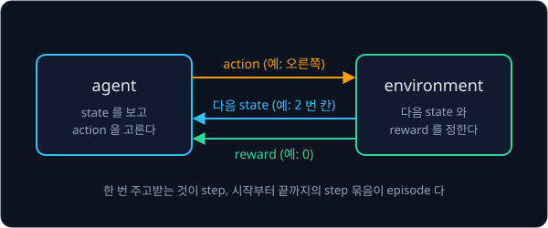

행동을 고르는 프로그램을 **agent** 라 하고, agent 가 행동하는 세계를 **environment** 라 한다. 위 그림처럼 agent 가 지금 상황인 **state** 를 보고 할 일 하나인 **action** 을 고르면, environment 가 다음 state 와 reward 를 돌려준다.
이 주고받기 한 번이 **step** 이고, 시작부터 충전기에 닿거나 계단에서 떨어져 끝날 때까지의 step 묶음이 **episode** 다.

FetchReach 에서는 손끝 위치·속도와 목표점 위치가 state 이고, 손끝의 x·y·z 이동량과 gripper 벌림을 정하는 숫자 넷이 action 이다. 팔에
명령을 한 번 보내는 간격을 control 주기라 하는데, FetchReach 에서는 이 주기 한 번이 step 한 번이다.

## multi-armed bandit

### 기댓값과 추정값

먼저 state 가 하나뿐인 가장 단순한 경우를 본다. 슬롯머신 두 대 앞에서 레버를 100 번 당기고 받은 동전을 모두 갖는다고 하자. 기계 A 는
당길 때마다 동전 1 개를 주고, 기계 B 는 0.5 의 확률로 4 개를 주며 나머지 0.5 의 확률로는 하나도 주지 않는다.

결과마다 그 값에 그 값이 나올 확률을 곱해 모두 더한 값을 **기댓값**이라 하는데, 아주 많이 되풀이했을 때 한 번에 평균적으로 얻는 양이다.
기호로는 $\mathbb E[r] = \sum_x x \times P(x)$ 로 쓴다. $\Sigma$(sigma)는 결과 $x$ 마다 계산한 값을 모두 더하라는 기호이고, $P(x)$ 는
결과 $x$ 가 나올 확률이다.

| 기계 | 결과와 확률 | 기댓값 |
| --- | --- | --- |
| A | 1 개 (확률 1) | $1 \times 1 = 1$ |
| B | 4 개 (확률 0.5), 0 개 (확률 0.5) | $4 \times 0.5 + 0 \times 0.5 = 2$ |

B 는 한 번에 2 개를 주는 일이 없지만 오래 당기면 한 번에 평균 2 개를 준다. 하지만 agent 는
이 확률을 모른다. 이렇게 기댓값을 모르는 선택지 여럿 가운데 하나를 계속 골라 reward 합을 키우는 문제를 **multi-armed bandit** 이라
한다. 손잡이(arm) 하나짜리 슬롯머신을 영어권에서 "one-armed bandit(외팔이 강도)" 이라 부르는 데서 온 이름이다. 선택지 하나를 arm 이라 하고
arm 의 개수는 $k$ 로 적는다. arm $a$ 의 진짜 기댓값은 $q_*(a)$ 로 쓰며, 여기서는 $q_*(A) = 1$, $q_*(B) = 2$ 다.

agent 는 $q_*$ 대신 지금까지 그 arm 에서 받은 reward 의 평균을 쓰고, 이 평균을 추정값 $Q(a)$ 라 한다. 직접 해 본 결과 하나하나를
sample 이라 하는데, sample 이 적으면 평균이 기댓값에서 크게 벗어난다. 평균은 reward 를 모두 적어 두지 않아도 $n$ 번째 reward $r$ 이 들어올 때 $Q(a) \leftarrow Q(a) + \frac{1}{n}(r - Q(a))$ 로 고칠 수 있는데, 이를 incremental 평균이라 한다. 화살표
$\leftarrow$ 는 왼쪽 값을 오른쪽에서 계산한 값으로 바꿔 적으라는 뜻이다. 세 번째까지의 평균이 4 인 기계에서 네 번째 reward 0 을 받으면
$4 + \frac{1}{4}(0 - 4) = 3$ 이 되어 네 값의 평균과 같다. 옛 값에 목표와 옛 값의 차이를 일정 비율만큼 더해 고치는 이 모양은 Q-learning 에서
다시 나온다.

<b>심화: sample 평균과 incremental 평균</b>

기계 B 를 10 번 당겨 0, 0, 4, 4, 0, 4, 4, 0, 4, 4 가 나왔다고 하고 그때까지의 평균을 이으면 아래와 같다. 처음 두 번의 평균은 0 이지만
횟수가 늘수록 기댓값 2 근처로 모이는데, 10 번째의 2.4 도 아직 2 와 딱 맞지는 않는다.

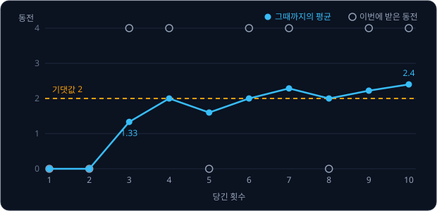

어떤 기계를 네 번 당겨 6, 2, 4, 0 을 받았을 때 평균이 바뀌는 과정이다. $n$ 은 몇 번째로 당겼는지, $r$ 은 그때 받은 reward 다.

| $n$ | 받은 $r$ | 고치기 전 $Q$ | 차이 $r - Q$ | $\frac{1}{n} \times$ 차이 | 고친 $Q$ |
| --- | --- | --- | --- | --- | --- |
| 1 | 6 | 0 | 6 | $\frac{1}{1} \times 6 = 6$ | 6 |
| 2 | 2 | 6 | $-4$ | $\frac{1}{2} \times (-4) = -2$ | 4 |
| 3 | 4 | 4 | 0 | $\frac{1}{3} \times 0 = 0$ | 4 |
| 4 | 0 | 4 | $-4$ | $\frac{1}{4} \times (-4) = -1$ | 3 |

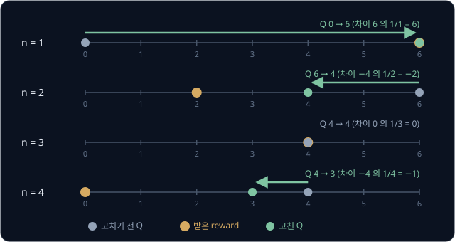

넷째 줄이 정확한 평균인 이유를 숫자로 따라가면 아래와 같다.

1. 세 번째까지의 평균이 4 이므로 세 값의 합은 $4 \times 3 = 12$ 다
2. 네 값의 평균은 $\frac{4 \times 3 + 0}{4}$ 이고, $4 \times 3 = 4 \times 4 - 4$ 로 바꿔 쓰면 $\frac{4 \times 4 - 4 + 0}{4}$ 이다
3. 분자를 둘로 나누면 $\frac{4 \times 4}{4} + \frac{0 - 4}{4} = 4 + \frac{0 - 4}{4} = 3$ 이다

마지막 줄의 4 는 옛 평균이고 $\frac{0 - 4}{4}$ 는 차이 $(0 - 4)$ 의 $\frac{1}{4}$ 이다. 어느 $n$ 에서나 같은 변형이 되므로 incremental
평균은 언제나 진짜 평균과 같다. $n$ 이 커질수록 같은 차이에도 조금만 옮기는데, 이미 많은 sample 이 쌓인 평균은 새 sample 하나로 크게
흔들리지 않아야 하기 때문이다.

### greedy 와 exploration

추정값이 생기면 가장 단순하게는 추정값이 가장 큰 arm 을 고르면 된다. 지금 아는 것 가운데 가장 좋은 쪽을 고르는 일을
**exploitation** 이라 하고, exploitation 만 하는 전략을 **greedy** 라 한다. 처음에 기계 A 와 B 를 한 번씩 당겼더니 A 는 동전 1 개를 줬고
B 는 운 나쁘게 0 개가 나와서, $Q(A) = 1$, $Q(B) = 0$ 이 되었다고 하자.

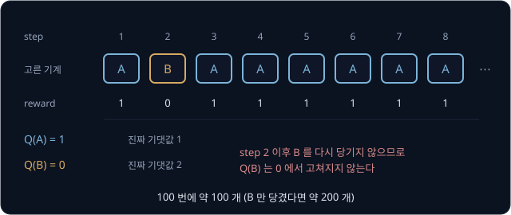

$Q(B)$ 를 고치려면 B 를 다시 당겨야 하는데 greedy 는 $Q(A) = 1$ 이 더 크다는 이유로 B 를 다시 당기지 않는다. B 의 첫 결과가 0 일 확률이 0.5 이므로 greedy 는 절반의 확률로 더 좋은 기계를 버린다.

그래서 추정값이 작아 보이는 arm 도 가끔은 일부러 당겨 봐야 하는데, 정보를 얻으려고 이렇게 당겨 보는 일을 **exploration** 이라 한다.
**ε-greedy** 는 exploration 을 넣는 간단한 방법으로, step 마다 확률 $\varepsilon$(epsilon)으로는 $k$ 개 arm 가운데 하나를 무작위로 고르고
나머지 확률 $1 - \varepsilon$ 으로는 추정값이 가장 큰 arm 을 고른다. 앞의 운 나쁜 시작에서도 무작위 선택으로 B 를 다시 당겨 4 개가 나오면
$Q(B) = \frac{0 + 4}{2} = 2$ 가 되어, 그 뒤로는 추정값만 보고 골라도 B 를 고른다.

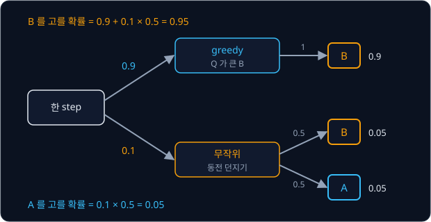

위 그림은 추정값이 제대로 잡힌 뒤 한 step 에서 각 기계를 고를 확률을 보여 준다. 이때 step 당 reward 기댓값은
$0.95 \times 2 + 0.05 \times 1 = 1.95$ 다.

> **오해** exploration 을 많이 할수록 잘 배운다.
>
> **사실** 같은 계산을 $\varepsilon = 0.5$ 로 하면 기댓값이 $0.75 \times 2 + 0.25 \times 1 = 1.75$ 이고, 매번 무작위인 $\varepsilon = 1$ 이면 1.5 로 떨어진다. 추정값이 정확해진
> 뒤의 exploration 은 손해라서 $\varepsilon$ 을 0.1 이나 0.01 처럼 작게 잡는데, 그래도 arm 이 10 개이고 $\varepsilon = 0.1$ 이면 가장 좋은 arm 을 고를 확률이 $0.9 + 0.1 \times \frac{1}{10} = 0.91$
> 에서 더 오르지 않는다.

### UCB

ε-greedy 의 무작위 선택은 어느 arm 을 덜 당겨 봤는지 따지지 않아서, 1000 번 당겨 나쁘다고 밝혀진 arm 과 두 번밖에 안 당긴 arm 을 같은
확률로 고른다. **UCB**(upper confidence bound, 믿을 만한 범위의 위쪽 끝)는 덜 당긴 arm 일수록 추정값에 bonus 를 크게 더하고, 더한 값이
가장 큰 arm 을 고른다. 두 번만 당긴 arm 은 평균이 운에 따라 크게 틀릴 수 있어서, 진짜 값이 꽤 높을 가능성까지 열어 두고 비교한다.

$$
\text{고를 arm} = \arg\max_a \Big[\, Q(a) + c\sqrt{\frac{\ln t}{N(a)}} \,\Big]
$$

$t$ 는 모든 arm 을 당긴 전체 횟수이고, $N(a)$ 는 arm $a$ 를 당긴 횟수이며, $c$ 는 bonus 의 크기를 정하는 숫자다. $\arg\max_a$ 는
괄호 안의 값을 가장 크게 만드는 arm 을 뜻한다. 제곱근 때문에 $N(a)$ 가 4 배가 되면 bonus 가 절반이 되고, natural log $\ln t$ 는 $t$ 가 10 배가 될 때마다 2.3 씩만 커진다.

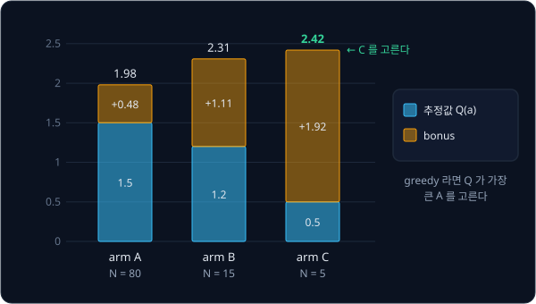

위 그림은 세 arm 을 $t = 100$, $c = 2$ 에서 비교한 예다. 80 번 당긴 A 의 bonus 는 0.48 에 그치지만 다섯 번 당긴 C 의 bonus 는 1.92 나 되어서,
UCB 는 추정값이 가장 작은 C 를 고른다(계산은 아래 심화). C 를 당겨 볼수록 $N(C)$ 가 늘어 bonus 가 줄고, 오래 당기지 않은 arm 은 $t$ 만 늘어 bonus 가 천천히 커지므로 언젠가 다시 확인하게 된다. 한 번도 당기지 않은 arm 은 bonus 가 무한히
크다고 보므로, UCB 는 모든 arm 을 먼저 한 번씩 당긴다. Auer, Cesa-Bianchi, Fischer 가 2002 년에 낸 UCB1 은 이 식에서 $c = \sqrt 2$ 인 경우다.

<b>심화: 단계별 bonus 계산</b>

$\sqrt{x}$ 는 제곱해서 $x$ 가 되는 양수다($\sqrt 9 = 3$, $\sqrt{0.25} = 0.5$). $\ln t$ 는 $e \approx 2.718$ 을 몇 번 곱해야 $t$ 가 되는지
나타내는 수로, $\ln 10 = 2.303$, $\ln 100 = 4.605$, $\ln 1000 = 6.908$ 이다. $t = 100$, $c = 2$ 에서 세 arm 의 bonus 를 안쪽부터 계산하면 아래와 같다.

| arm | $Q(a)$ | $N(a)$ | $\ln t \div N(a)$ | 제곱근 | bonus ($\times c$) | $Q + $ bonus |
| --- | --- | --- | --- | --- | --- | --- |
| A | 1.5 | 80 | $4.605 \div 80 = 0.058$ | 0.240 | 0.480 | 1.98 |
| B | 1.2 | 15 | $4.605 \div 15 = 0.307$ | 0.554 | 1.108 | 2.31 |
| C | 0.5 | 5 | $4.605 \div 5 = 0.921$ | 0.960 | 1.919 | 2.42 |

arm C 를 더 당겨 $N$ 이 20 이 되면 bonus 는 $2\sqrt{4.605 \div 20} = 0.960$ 으로 정확히 절반이 되고, C 를 안 당긴 채 다른 arm 만 900 번
당기면($t = 1000$) $2\sqrt{6.908 \div 5} = 2.351$ 로 커진다.

sample 평균이 진짜 기댓값보다 일정 폭 이상 작게 나올 확률은 당긴 횟수가 늘수록 빠르게 줄어드는데, UCB1 의 bonus $\sqrt{2 \ln t / N}$ 은
이 확률을 따져 정한 폭이다. 폭을 $\ln t$ 에 맞춰 넓혀 두면 가장 좋은 arm 이 아닌 arm 을 당기는 횟수가 $\ln t$ 에 비례하는 정도로만
늘어나고, Auer 등은 이를 Theorem 1 로 증명했다.

### 세 전략의 비교와 로봇의 bandit

세 전략을 비교하려고 arm 이 10 개인 문제를 만든다. arm 마다 기댓값을 무작위로 정하고, reward 는 그 기댓값 근처에서 매번 조금씩 다르게
나오게 한다. 이런 문제 2000 개를 simulation 으로 각각 1000 step 동안 풀고 step 마다 평균을 내면 아래 그림이 나온다. 세 전략 모두
추정값 0 에서 시작하고, UCB 의 $c$ 는 2 로 둔다.

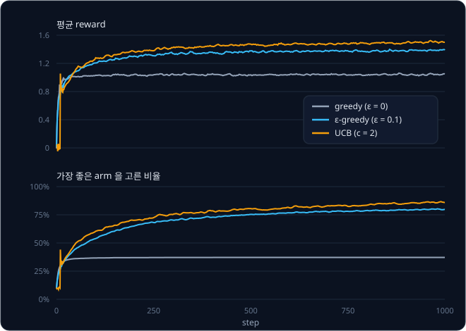

마지막 100 step 의 평균 reward 는 greedy 1.04, ε-greedy($\varepsilon = 0.1$) 1.39, UCB 1.50 이고, 가장 좋은 arm 을 고른 비율은 차례로
37%, 80%, 86% 다. 이 숫자는 simulation 의 무작위 값에 따라 실행할 때마다 0.03 안팎으로 달라진다. greedy 는 초반 몇 step 만에 한 arm 만
고르게 되고, ε-greedy 는 끝까지 섞이는 무작위 선택 때문에 91% 를 넘지 못한다. UCB 는 덜 당긴 arm 을 골라 확인하므로 곡선이 더 빨리, 더
높이 오른다. 같은 실험이 Sutton & Barto 교과서의 그림 2.2 와 2.4 에 있다.

로봇에서 bandit 은 같은 상황에서 여러 방법 가운데 하나를 고를 때 나온다. Dex-Net 1.0(Mahler 등, 2016)은 새 물체에서 뽑은 grasp 후보
하나하나를 arm 으로 두었다. arm 을 한 번 당기는 일은 물체 자세·gripper 자세·마찰을 무작위로 조금씩 바꿔 그 grasp 가 force closure 를
이루는지 확인하는 것이고, 이루면 reward 1, 아니면 0 이다. force closure 는 손가락 접촉만으로 물체가 어느 방향으로도 빠지지 않게 붙잡힌
상태다. 저자들은 좋아 보이는 후보에 확인을 몰아주는 bandit 알고리즘이 후보마다 똑같은 횟수로 확인하는 방법보다 좋은 grasp 를 더 빨리
찾는다는 것을 보였다. 이 논문이 쓴 Thompson sampling 은 UCB 와 달리 arm 마다 진짜 값이 있을 법한 범위에서 값을
하나씩 뽑아 가장 큰 arm 을 고른다.

**확인 문제.** $c = 1$ 이고 $\ln t = 4$ 다. arm X 는 $Q = 2$, $N = 16$ 이고 arm Y 는 $Q = 1$, $N = 1$ 이다. UCB 와 greedy 는 각각
어느 arm 을 고를까?

답 보기

| arm | bonus $c\sqrt{\ln t / N}$ | $Q + $ bonus |
| --- | --- | --- |
| X | $1 \times \sqrt{4 \div 16} = 0.5$ | $2 + 0.5 = 2.5$ |
| Y | $1 \times \sqrt{4 \div 1} = 2$ | $1 + 2 = 3$ |

UCB 는 3 이 더 큰 Y 를 고르고, 추정값만 보는 greedy 는 $Q$ 가 더 큰 X 를 고른다. Y 는 한 번밖에 안 당겨 평균을 아직 믿기 어려워서 UCB 가
한 번 더 확인한다.

## MDP

### gridworld 와 transition

bandit 에서는 무엇을 고르든 다음 step 의 상황이 같았지만, 로봇이 움직이는 문제는 그렇지 않다. 청소기가 위로 한 칸 가면 서 있는 칸이
바뀌고 그 칸에서 갈 수 있는 길과 받을 reward 도 함께 바뀌어서, 지금 action 이 몇 step 뒤의 reward 까지 좌우한다. 이렇게 격자 위를 움직이는
문제를 gridworld 라 하는데, 이 강의는 아래의 3×3 gridworld 를 쓴다.

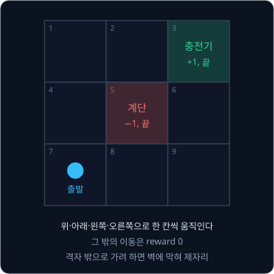

칸 3 과 5 처럼 들어가면 episode 가 끝나는 state 를 terminal state 라 한다. 칸 7 에서는 위로 가든 오른쪽으로 가든 바로 받는 reward 가 0 으로
같아서, bandit 처럼 바로 받는 reward 만 비교해서는 길을 고를 수 없다.

state 에서 action 을 해 다음 state 로 옮겨 가는 일을 **transition** 이라 한다. 바닥이 미끄러워서 고른 방향으로는 0.8 의 확률로 가고,
고른 방향과 직각인 두 방향으로 0.1 씩 미끄러진다고 하자. 아래 그림은 칸 2 에서 오른쪽을 고른 경우다.

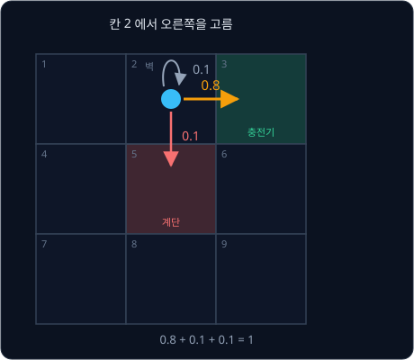

이 확률을 $P(s' \mid s, a)$ 로 쓰고 "state $s$ 에서 action $a$ 를 했을 때 다음 state 가 $s'$ 일 확률" 이라 읽는다. 위 그림에서는
$P(3 \mid 2, \text{오른쪽}) = 0.8$ 이고, 미끄럽지 않은 바닥은 도착 칸 하나의 확률이 1 인 특별한 경우다. 칸 2 에서 오른쪽을 고를 때 바로 받는
reward 의 기댓값은 $1 \times 0.8 + 0 \times 0.1 + (-1) \times 0.1 = 0.7$ 이라서, 계단 바로 옆을 지나는 위험만큼 1 보다 작다.

칸 2 에 어느 길로 왔든 오른쪽을 고르면 확률은 똑같이 0.8, 0.1, 0.1 이다. 이처럼 다음 state 가 지금 state 와 action 에만 달려 있다는 가정을
**Markov 성질**이라 한다. 로봇에서는 이 성질이 맞도록 state 에 무엇을 넣을지 따진다. 관절 각도만으로는 팔이 어느 쪽으로 움직이는 중인지
알 수 없어 다음 순간을 예측할 수 없기 때문이다. 그래서 legged_gym 의 평지 보행 설정에서 policy 는 몸통 속도·각속도·중력 방향·속도 명령과
함께 관절 12 개의 각도·속도·직전 action 까지 숫자 48 개를 state 로 받는다.

### return 과 discount

칸 7 에서 충전기까지 4 step 에 가든 6 step 에 가든 reward 합은 1 로 같지만, 청소기는 빨리 닿을수록 좋다. 그래서 늦게 받는 reward
일수록 조금씩 깎아서 더한다. 깎는 비율을 **discount factor** 라 하고 그리스 문자 $\gamma$(gamma)로 쓰는데, 0 이상 1 미만의 숫자다. 바로
받는 reward 는 그대로 더하고, 한 step 뒤의 reward 에는 $\gamma$ 를 곱하며, 두 step 뒤의 reward 에는 $\gamma^2 = \gamma \times \gamma$ 를
곱한다. 지금부터 받을 reward 를 이렇게 discount 해서 모두 더한 값이 agent 가 키우려는 **return** 이다.

$$
G_t = r_{t+1} + \gamma\, r_{t+2} + \gamma^2 r_{t+3} + \cdots
$$

$G_t$ 는 step $t$ 에서 본 return 이고, $r_{t+1}$ 은 step $t$ 의 action 직후에 받는 reward 다. $\gamma = 0.9$ 로 칸 7 에서 위, 위, 오른쪽,
오른쪽으로 가면($7 \to 4 \to 1 \to 2 \to 3$) reward 는 0, 0, 0, 1 이라 $G = 0 + 0.9 \times 0 + 0.81 \times 0 + 0.729 \times 1 = 0.729$ 다.

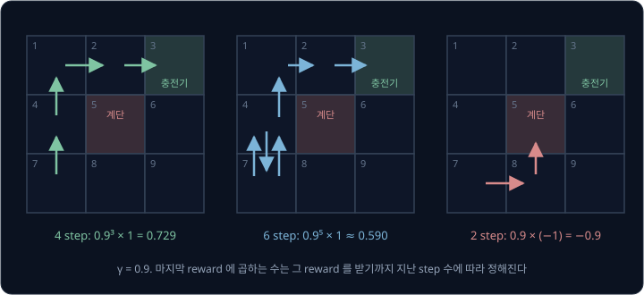

위 그림처럼 돌아서 가면 return 이 작아지고 계단에 빠지면 음수가 되므로, return 을 키우려는 agent 는 계단을 피해 짧은 길을 찾는다.

> **오해** $\gamma$ 는 작을수록 계산이 쉬우니 좋다.
>
> **사실** $\gamma$ 는 agent 가 얼마나 먼 미래까지 보는지를 정한다. $\gamma = 0$ 이면 바로 다음 reward 만 남아서 칸 7 에서는 어느 방향이든 return 이 0 이고 길을 고를 수 없다.

### discount factor 와 control 주기

$\gamma$ 는 초가 아니라 step 단위로 곱하는 수라서, 같은 $\gamma$ 라도 control 주기가 바뀌면 agent 가 내다보는 시간이 달라진다. $\gamma = 0.99$ 이면
곱하는 수 $0.99^n$ 이 0.5 로 줄어드는 데 약 69 step 이 걸린다($n = \ln 0.5 \div \ln 0.99 \approx 69$). agent 가 내다보는 대략의 길이로는
흔히 $\frac{1}{1 - \gamma}$ step 을 쓰는데, $\gamma = 0.99$ 에서는 100 step 이다.

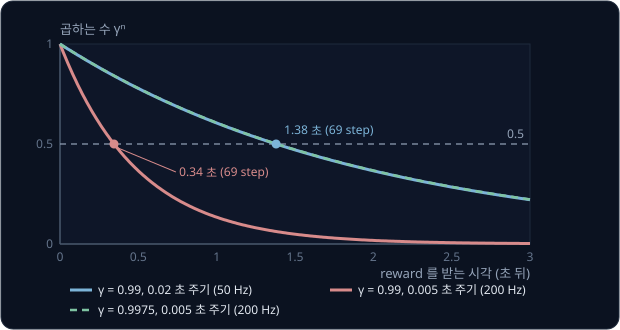

legged_gym 의 기본 설정에서 physics simulation 은 0.005 초씩 나아가고, policy 는 그 네 번에 한 번씩 0.02 초(1초에 50 번)마다 action 을
낸다. 학습 알고리즘 PPO 의 $\gamma$ 는 0.99 이고, 이 조합을 초로 바꾸면 아래와 같다.

| control 주기 | $\gamma$ | 0.5 까지 줄어드는 step | 0.5 까지 줄어드는 시간 | $\frac{1}{1-\gamma}$ step 의 시간 |
| --- | --- | --- | --- | --- |
| 0.02 초 (50 Hz) | 0.99 | 69 | 1.38 초 | 2 초 |
| 0.005 초 (200 Hz) | 0.99 | 69 | 0.34 초 | 0.5 초 |
| 0.005 초 (200 Hz) | 0.9975 | 277 | 1.38 초 | 2 초 |

같은 학습을 200 Hz 로 바꾸면서 $\gamma$ 를 그대로 두면 내다보는 시간이 4 분의 1 로 줄어든다. 50 Hz 일 때의 시간을 지키려면 200 Hz 의
네 step 이 50 Hz 의 한 step 과 같아지도록 $\gamma^4 \approx 0.99$ 인 $\gamma = 0.9975$ 로 올려야 하므로, control 주기를 바꿀 때는 $\gamma$ 도
함께 고친다.

### reward 설계

RL 은 reward 를 키우는 쪽으로만 배우므로, reward 를 어떻게 정하느냐가 로봇이 배울 행동을 정한다. 서론의 FetchReach 에는 reward 가 두
가지 있다.

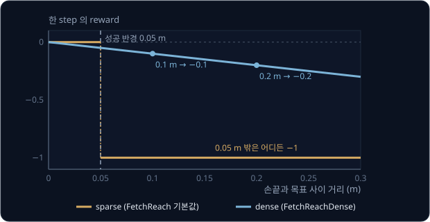

기본값인 sparse reward 는 성공의 뜻이 분명하지만, 0.2 m 떨어진 자리와 0.1 m 떨어진 자리가 똑같이 −1 이라서 처음 몇 번 성공하기
전까지는 어느 쪽으로 움직여야 할지 단서가 없다. dense reward(FetchReachDense)는 손끝과 목표 사이 거리에 마이너스를 붙인 값이라 가까워질수록
커지므로, 매 step 어느 쪽으로 움직여야 할지 알려 준다. 이렇게 목표에 다가가는 과정에 중간 점수를 더해 학습을 돕는 일을 reward shaping
이라 한다.

shaping 을 잘못 설계하면 로봇이 엉뚱한 행동을 배운다. Ng, Harada, Russell 의 1999 년 논문이 든 사례에서는 simulation 속 자전거가 목표 쪽으로
다가갈 때마다 양의 reward 를 받고 멀어질 때는 penalty 를 받지 않았다. 그러자 agent 는 출발점 근처에서 작은 원을 계속 도는 법을 배웠는데, 원을
돌면 다가가는 구간마다 점수를 받기 때문이다. 저자들은 state 마다 점수를 정해 두고 shaping 점수를 다음 state 의 점수에서 지금 state 의
점수를 뺀 값으로 주면 최적 policy 가 바뀌지 않는다는 것을 보였다. 이렇게 주면 한 바퀴를 돌아 제자리에 왔을 때 점수의 합이 0 이 되어
원을 돌 이유가 사라진다.

보행 reward 는 여러 항을 더한 값이다. 아래 표는 legged_gym 의 기본 설정(`legged_robot_config.py`)에 있는 reward 항 가운데 주요한 것이다.

| 항 | 가중치 | 계산하는 양 |
| --- | --- | --- |
| tracking_lin_vel | 1.0 | 명령한 앞뒤·좌우 속도와 실제 속도의 차이 $e$ 로 계산한 $\exp(-e^2 / 0.25)$ |
| tracking_ang_vel | 0.5 | 명령한 회전 속도에 대한 같은 꼴의 점수 |
| feet_air_time | 1.0 | 발이 땅에 닿는 순간, 공중에 있던 시간에서 0.5 초를 뺀 값 |
| lin_vel_z | −2.0 | 몸통 위아래 속도의 제곱 |
| collision | −1.0 | 지정한 몸체(ANYmal 설정에서는 정강이·허벅지) 가운데 땅에 닿은 개수 |
| action_rate | −0.01 | 직전 action 과 지금 action 의 차이의 제곱 |
| torques | −0.00001 | 관절 torque 의 제곱 합 |

양의 항은 명령한 속도로 걷게 하고, 음의 항은 몸통이 위아래로 튀거나 무릎이 땅에 닿거나 action 이 급하게 바뀌는 걸음의 점수를 깎는다.
속도 추종 점수 $\exp(-e^2/0.25)$ 는 오차 $e$ 가 0 이면 1 이고, 0.5 m/s 이면 $\exp(-0.25/0.25) = e^{-1} \approx 0.37$ 이다. legged_gym 코드는
각 가중치에 control 주기 0.02 초를 곱해 쓰고, step 마다 더한 reward 가 음수이면 0 으로 자른다(`only_positive_rewards = True`). 설정 파일
주석에 따르면 early termination 문제를 피하려는 설정이다. penalty 만 쌓이는 학습 초반에는 일찍 넘어져 episode 를 끝내는 쪽이 return 이 커서,
자르지 않으면 로봇이 일부러 넘어지는 법을 배울 수 있다.

<b>심화: 격자에서 본 잘못된 shaping 과 potential-based shaping</b>

gridworld 에서 충전기까지의 칸 거리(가로·세로 칸 수의 합)가 줄어드는 이동마다 +0.1 을 더 주고, 멀어지는 이동에는 아무 penalty 도 주지
않는다고 하자. 칸 2 와 1 의 거리는 각각 1 과 2 이고, value iteration(뒤의 절)으로 최적 policy 를 구하면 $\gamma$ 에 따라 결과가 갈린다.

| 칸 2 에서의 선택 | 받는 reward 의 흐름 | $\gamma = 0.99$ 의 return |
| --- | --- | --- |
| 오른쪽으로 충전기에 들어간다 | $1 + 0.1$ 을 받고 끝 | 1.1 |
| 왼쪽(칸 1)으로 갔다가 다시 칸 2 로 오기를 되풀이 | 0, +0.1, 0, +0.1, ⋯ | $\frac{0.99 \times 0.1}{1 - 0.99^2} \approx 4.975$ |

$\gamma = 0.99$ 에서는 칸 1 과 칸 2 사이를 영원히 오가는 쪽이 return 이 커서, 청소기는 바로 옆의 충전기에 끝내 들어가지 않는다.
$\gamma = 0.9$ 에서는 되풀이의 return 이 $\frac{0.9 \times 0.1}{1 - 0.81} \approx 0.47$ 이라 충전기로 가는 1.1 이 더 크다.

Ng 등이 제안한 potential-based shaping 은 state 마다 점수 $\Phi(s)$ 를 정해 두고 transition 마다 $F = \gamma\,\Phi(s') - \Phi(s)$ 를 더한다.
$\Phi(s) = -0.1 \times (\text{충전기까지의 칸 거리})$ 로 두면 칸 2 에서 칸 1 로 갔다 돌아오는 두 step 의 shaping 합은
$\gamma = 1$ 일 때 정확히 0 이고, $\gamma < 1$ 이면 오히려 조금 손해다. 이렇게 바꾼 reward 로 value iteration 을 계산하면 $\gamma = 0.9$ 와
$0.99$ 모두에서 원래 문제와 같은 policy 가 나온다. 논문은 또 transition 과 reward 를 전혀 모르는 상태에서 최적 policy 를 언제나 지켜 주는
shaping 은 이 꼴뿐이라는 것도 보였다.

### MDP 의 다섯 요소와 policy

지금까지 정한 state·action·transition·reward·discount factor 를 모으면 행동이 다음 상황을 바꾸는 문제를 적는 틀이 되는데, 이 틀을 **MDP**(Markov decision process)라 한다.

| 요소 | 기호 | gridworld 의 값 | legged_gym 보행의 값 |
| --- | --- | --- | --- |
| state 집합 | $\mathcal S$ | 칸 1 ~ 9 | 몸통 속도·중력 방향·관절 상태 등 숫자 48 개 |
| action 집합 | $\mathcal A$ | 위·아래·왼쪽·오른쪽 | 관절 12 개의 목표 각도 |
| transition 확률 | $P(s' \mid s, a)$ | 미끄럽지 않으면 1, 미끄러우면 0.8 / 0.1 / 0.1 | physics simulation 이 정한다 |
| reward | $r(s, a, s')$ | 칸 3 에 들어가면 +1, 칸 5 에 들어가면 −1 | 위 표의 항을 더한 값 |
| discount factor | $\gamma$ | 0.9 | 0.99 |

agent 가 state 마다 어떤 action 을 할지 정한 규칙을 **policy** 라 하고 $\pi$(pi)로 쓴다. gridworld 에서는 칸마다 화살표를 그려 둔 표가
policy 이고($\pi(7) = \text{위}$), 보행 로봇에서는 숫자 48 개를 받아 관절 목표 12 개를 내는 neural network 가 policy 다. action 을 확률로
고르는 policy 는 $\pi(a \mid s)$ 로 쓰며 ε-greedy 도 그 하나다. MDP 를 푼다는 것은 return 의
기댓값이 가장 큰 policy 를 찾는다는 뜻이다. bandit 은 state 가 하나이고 episode 가 한 step 으로 끝나는 가장 작은 MDP 다.

**확인 문제.** 어떤 로봇이 25 Hz 로 action 을 내고 $\gamma = 0.96$ 으로 학습한다. 곱하는 수가 대략 0.5 가 되는 step 수를 표에서 찾고
초로 바꾸자. control 을 100 Hz 로 바꾸며 같은 시간을 지키려면 $\gamma$ 를 대략 얼마로 해야 할까?

| step 수 $n$ | 10 | 17 | 25 |
| --- | --- | --- | --- |
| $0.96^n$ | 0.66 | 0.50 | 0.36 |

답 보기

1. 표에서 $0.96^{17} \approx 0.50$ 이라 17 step 이 걸리고, 25 Hz 의 한 step 은 $1 \div 25 = 0.04$ 초라서 $17 \times 0.04 = 0.68$ 초다
2. 25 Hz 의 한 step 동안 100 Hz 는 네 step 을 가므로 새 $\gamma$ 는 $\gamma^4 = 0.96$ 을 만족해야 한다
3. $0.99^4 \approx 0.961$ 이므로 $\gamma \approx 0.99$ 다

답: 약 0.68 초, $\gamma \approx 0.99$

## value 와 Bellman 식

### value

policy 가 얼마나 좋은지는 칸마다 그 칸에서 출발해 이 policy 를 따를 때 받는 return 으로 잰다. 이 값이 그 칸의 **value** 이고
$V^\pi(s)$ 로 쓴다. 미끄러운 바닥에서는 같은 칸에서 출발해도 episode 마다 return 이 달라지므로 value 는 return 의 기댓값으로 정한다.
미끄럽지 않은 바닥, $\gamma = 0.9$ 에서 충전기로 가는 가장 짧은 길을 고르는 policy 와 모든 칸에서 오른쪽으로 가는 policy 를 비교하면
아래 그림과 같다.

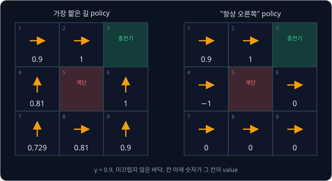

"항상 오른쪽" policy 를 따르면 칸 6 과 9 에서는 벽에 계속 부딪혀 reward 0 만 받고, 칸 4 에서는 계단(칸 5)에 빠져 value 가 −1 이다. 모든 칸에서 가장 짧은
길 policy 의 value 가 크거나 같으므로 이 policy 가 더 좋다.

> **오해** value 는 그 칸에서 받는 reward 다.
>
> **사실** 칸 2 에 서 있는 것만으로 받는 reward 는 없고, $V(2) = 1$ 은 칸 2 에서 출발해 앞으로 받을 return 이 1 이라는 뜻이다.

### Bellman 식

가장 짧은 길 policy 의 value 에는 이웃한 칸끼리 일정한 관계가 있다. 칸 4 에서 위로 가면 칸 1 에 도착하고 칸 1 부터의 return 은 0.9 다.
칸 1 부터의 return 은 한 step 늦게 받으므로, 칸 4 의 return 은 첫 step 의 reward 0 에 그 0.9 를 $\gamma$ 로 한 번 깎아 더한 값이다.

$$
V(4) = 0 + 0.9 \times V(1) = 0 + 0.9 \times 0.9 = 0.81
$$

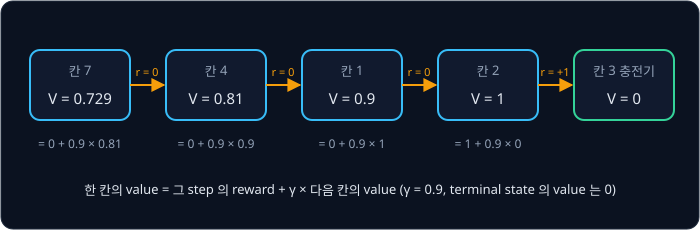

다음 칸이 확률로 정해지면 위 그림의 계산을 도착할 수 있는 칸마다 해서 도착 확률로 평균한다.

$$
V^\pi(s) = \sum_{s'} P(s' \mid s, \pi(s))\,\big[\, r(s, \pi(s), s') + \gamma\, V^\pi(s') \,\big]
$$

이 식은 "policy 가 정한 action $\pi(s)$ 로 도착할 수 있는 칸 $s'$ 마다, 받는 reward 와 $\gamma \times$ 그 칸의 value 를 더하고, 도착 확률을
곱해 모두 더한다" 로 읽는다. 이 관계를 **Bellman 식**이라 하며, Richard Bellman 이 1957 년 책 *Dynamic Programming* 에서 정리했다. 끝에서
받은 reward 가 이 식을 따라 한 칸씩 앞으로 전해지므로, 충전기에서 네 칸 떨어진 칸 7 도 0.729 라는 값을 얻고 그 값으로 어느 길이 나은지
비교할 수 있다. 서론의 로봇 팔도 같은 방식으로, 지나온 움직임마다 그 뒤에 받을 return 을 계산해 어느 움직임이 좋았는지 가린다.

<b>심화: 미끄러운 바닥에서 Bellman 식 검산</b>

미끄러운 바닥에서 가장 짧은 길 policy 를 따를 때 $V(2) \approx 0.7692$ 다(구하는 방법은 value iteration 절). 칸 2 의 action 은 오른쪽이다.

| 도착 칸 $s'$ | 확률 | reward + $\gamma V(s')$ | 확률 × 앞 열 |
| --- | --- | --- | --- |
| 3 | 0.8 | $1 + 0.9 \times 0 = 1$ | 0.8 |
| 2 | 0.1 | $0 + 0.9 \times 0.7692 = 0.6923$ | 0.0692 |
| 5 | 0.1 | $-1 + 0.9 \times 0 = -1$ | −0.1 |

마지막 열을 더하면 $0.8 + 0.0692 - 0.1 = 0.7692$ 로 왼쪽의 $V(2)$ 와 같다. value 가 맞으면 식의 양쪽이 같아지므로, 계산한 value 를
Bellman 식으로 검산할 수 있다.

### Q 값과 최적 value

value $V(s)$ 는 칸마다 숫자 하나라서, 그 칸에서 어느 action 이 더 나은지는 따로 계산해야 한다. 칸 $s$ 에서 먼저 action $a$ 를 하고
그다음부터 가장 좋게 행동할 때 받는 return 의 기댓값을 $Q(s, a)$ 로 쓰는데, bandit 의 $Q(a)$ 에 state 를 하나 더 붙인 값이다. 모든 policy
가운데 가장 좋은 policy 를 따를 때의 value 를 최적 value $V^*(s)$ 라 하고, 미끄럽지 않은 바닥에서는 가장 짧은 길의 value 가 $V^*$ 다.
이 $V^*$ 로 칸 1 의 action 넷을 비교하면 아래 표와 같다.

| 칸 1 의 action | 도착 칸 | $Q(1, a)$ |
| --- | --- | --- |
| 오른쪽 | 2 | $0 + 0.9 \times 1 = 0.9$ |
| 아래 | 4 | $0 + 0.9 \times 0.81 = 0.729$ |
| 위, 왼쪽 | 1 (벽에 막힘) | $0 + 0.9 \times 0.9 = 0.81$ |

가장 큰 0.9 가 $V^*(1)$ 이고, 그 값을 내는 오른쪽이 칸 1 에서 가장 좋은 action 이다. 이 관계를 식으로 적은 것이 Bellman optimality
equation 이다.

$$
V^*(s) = \max_a \sum_{s'} P(s' \mid s, a)\,\big[\, r(s, a, s') + \gamma\, V^*(s') \,\big] = \max_a Q(s, a)
$$

$\max_a$ 는 action 을 모두 넣어 보고 가장 큰 값을 고르라는 뜻이다. 그런데 $V^*$ 를 구하려는 식의 오른쪽에 $V^*$ 가 이미 들어 있어서, 위
표도 $V^*$ 를 미리 알았기에 계산할 수 있었다. $V^*$ 를 모를 때 이 식을 푸는 방법은 다음 절의 value iteration 이다.

**확인 문제.** $\gamma = 0.5$ 이고 미끄럽지 않은 바닥에서 가장 짧은 길 policy 를 따르면 $V(2)$, $V(1)$, $V(4)$ 는 각각 얼마일까?

답 보기

충전기에서 가까운 칸부터 Bellman 식 "reward + $\gamma$ × 다음 칸의 value" 를 적용한다.

| 칸 | 다음 칸 | 계산 | value |
| --- | --- | --- | --- |
| 2 | 3 (terminal) | $1 + 0.5 \times 0$ | 1 |
| 1 | 2 | $0 + 0.5 \times 1$ | 0.5 |
| 4 | 1 | $0 + 0.5 \times 0.5$ | 0.25 |

$\gamma = 0.9$ 일 때의 1, 0.9, 0.81 보다 훨씬 빨리 줄어든다.

## value iteration

### sweep

**value iteration** 은 모든 칸의 value 를 0 으로 놓고 시작해, Bellman optimality equation 의 오른쪽을 계산한 값으로 value 를 거듭
덮어쓴다. 모든 칸을 한 번씩 새로 계산하는 것을 sweep 이라 하고, sweep 을 $k$ 번 한 뒤의 value 를 $V_k$ 로 쓴다.

$$
V_{k+1}(s) = \max_a \sum_{s'} P(s' \mid s, a)\,\big[\, r(s, a, s') + \gamma\, V_k(s') \,\big]
$$

한 sweep 안에서는 모든 칸을 직전 sweep 의 값 $V_k$ 만으로 계산하고, terminal state 3 과 5 의 value 는 언제나 0 이다. 미끄럽지 않은 바닥,
$\gamma = 0.9$ 에서 sweep 2 의 칸 2 를 계산하면 아래 그림과 같다.

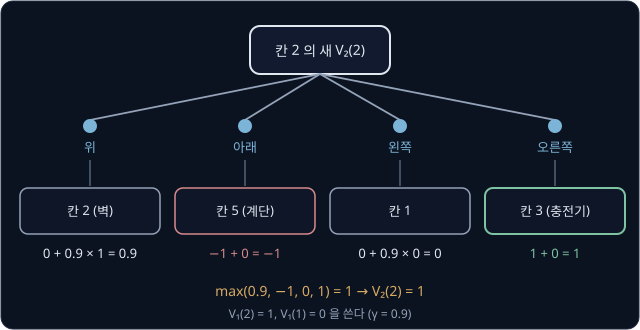

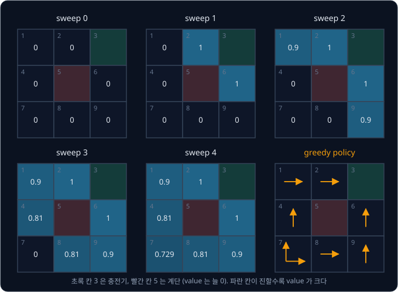

sweep $k$ 가 끝나면 충전기까지 $k$ step 안에 닿는 칸까지 값이 채워져서, value 가 sweep 마다 한 칸씩 멀리 퍼진다. 마지막 값은 앞
절에서 경로를 따라 계산한 $V^*$ 와 같다.

<b>심화: sweep 별 손계산</b>

sweep 1 에서는 모든 $V_0$ 이 0 이라 $\gamma \times V_0$ 이 모두 0 이고, 바로 받는 reward 만 남는다. 칸 2 의 계산은 아래와 같다.

| 칸 2 의 action | 도착 칸 | $r + 0.9 \times V_0(\text{도착 칸})$ |
| --- | --- | --- |
| 위 | 2 (벽) | $0 + 0.9 \times 0 = 0$ |
| 아래 | 5 | $-1 + 0 = -1$ |
| 왼쪽 | 1 | $0 + 0.9 \times 0 = 0$ |
| 오른쪽 | 3 | $1 + 0 = 1$ |

가장 큰 값 1 이 $V_1(2)$ 이고, 칸 6 도 위가 칸 3 이라 $V_1(6) = 1$ 이다. 칸 4 와 8 은 계단 쪽이 −1, 나머지가 0 이라 0 이다.

- sweep 2: 칸 1 은 오른쪽이 $0 + 0.9 \times V_1(2) = 0.9$ 로 가장 커서 $V_2(1) = 0.9$, 칸 9 는 위가 $0.9 \times V_1(6) = 0.9$ 다. 칸 4 의 위는 $0.9 \times V_1(1) = 0$ 이라 아직 0 이고, $V_2(1)$ 은 이번 sweep 에서 막 생긴 값이라 칸 4 의 계산에는 다음 sweep 에야 쓰인다
- sweep 3: 칸 4 의 위가 $0.9 \times V_2(1) = 0.81$, 칸 8 의 오른쪽이 $0.9 \times V_2(9) = 0.81$ 이 된다
- sweep 4: 칸 7 의 위가 $0.9 \times V_3(4) = 0.729$, 오른쪽도 $0.9 \times V_3(8) = 0.729$ 라서 $V_4(7) = 0.729$ 다
- sweep 5: 모든 칸을 다시 계산해도 바뀌는 값이 없다

| sweep $k$ | $V(1)$ | $V(2)$ | $V(4)$ | $V(6)$ | $V(7)$ | $V(8)$ | $V(9)$ |
| --- | --- | --- | --- | --- | --- | --- | --- |
| 1 | 0 | 1 | 0 | 1 | 0 | 0 | 0 |
| 2 | 0.9 | 1 | 0 | 1 | 0 | 0 | 0.9 |
| 3 | 0.9 | 1 | 0.81 | 1 | 0 | 0.81 | 0.9 |
| 4 | 0.9 | 1 | 0.81 | 1 | 0.729 | 0.81 | 0.9 |

### 멈추는 시점과 greedy policy

한 sweep 동안 가장 크게 바뀐 칸의 변화량을 Bellman residual 이라 하는데, 미끄럽지 않은 바닥에서는 sweep 5 에서 정확히 0 이 되어 멈춘다.
미끄러운 바닥에서는 칸 2 에서 벽에 막혀 제자리에 머무는 경우가 있어 칸 2 의 새 값이 자기 옛 값에도 달려 있으므로, residual 이 0.7, 0.504,
0.263, ⋯ 처럼 줄기만 하고 0 이 되지 않는다. 그래서 0.0001 같은 기준을 정해 두고 residual 이 그보다 작아지면 멈추는데, $\gamma = 0.9$ 인
이 격자에서는 sweep 12 에서 멈춘다.

value iteration 이 끝나면 칸마다 action 넷의 $Q(s, a)$ 를 계산해 가장 큰 쪽을 고른다. 이렇게 뽑은 policy 를 value 에 대한 greedy policy 라
하고, 앞 그림의 마지막 격자가 그 결과다. 칸 7 은 위와 오른쪽이 둘 다 0.729 라서 어느 쪽을 골라도 return 이 같다. value iteration 은
transition 확률 $P$ 와 reward $r$ 을 모두 알아야 쓸 수 있지만, sweep 몇 번이면 모든 칸의 최적 value 와 policy 를 한꺼번에 얻는다.

### 미끄러운 바닥의 policy

바닥이 미끄러우면 value 가 달라지고, $\gamma$ 에 따라서는 policy 도 달라진다. 아래 그림에서 $\gamma = 0.9$ 의 value 는 미끄럽지 않을
때보다 작지만 화살표는 그대로다.

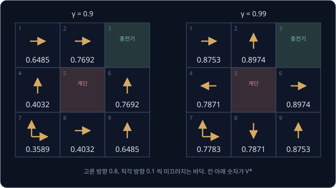

$\gamma = 0.99$ 에서는 계단 옆 네 칸의 policy 가 일부러 벽 쪽을 가리킨다. 칸 2 에서 위를 고르면 0.8 의 확률로 벽에 막혀 제자리에 머물고 0.1 씩 칸 1 과
칸 3(충전기)으로 미끄러지는데, 직각 방향이 계단 쪽이 아니라서 계단에 빠질 일이 없다. 미래를 거의 깎지 않는 $\gamma = 0.99$ 에서는 몇 step
기다리며 깎이는 양보다 0.1 의 확률로 −1 을 받는 손해가 크다. 반대로 $\gamma = 0.9$ 에서는 기다리는 한 step 마다 0.9 배씩 깎이는 손해가 커서
바로 가는 쪽을 고른다. $\gamma$ 는 내다보는 시간뿐 아니라 위험을 얼마나 피할지도 바꾼다.

<b>심화: 미끄러운 바닥의 V* 와 칸 2 의 두 action 비교</b>

value iteration 으로 구한 최적 value 와 action 은 아래와 같다.

| 칸 | $\gamma = 0.9$ 의 $V^*$ | $\gamma = 0.9$ 의 action | $\gamma = 0.99$ 의 $V^*$ | $\gamma = 0.99$ 의 action |
| --- | --- | --- | --- | --- |
| 1 | 0.6485 | 오른쪽 | 0.8753 | 오른쪽 |
| 2 | 0.7692 | 오른쪽 | 0.8974 | 위 (벽) |
| 4 | 0.4032 | 위 | 0.7871 | 왼쪽 (벽) |
| 6 | 0.7692 | 위 | 0.8974 | 오른쪽 (벽) |
| 7 | 0.3589 | 위 또는 오른쪽 | 0.7783 | 위 또는 오른쪽 |
| 8 | 0.4032 | 오른쪽 | 0.7871 | 아래 (벽) |
| 9 | 0.6485 | 위 | 0.8753 | 위 |

$\gamma = 0.99$ 의 $V^*$ 로 칸 2 의 위와 오른쪽을 계산하면 위가 더 크다.

| 칸 2 의 action | 계산 | $Q(2, a)$ |
| --- | --- | --- |
| 위 (벽) | $0.8 \times (0 + 0.99 \times 0.8974) + 0.1 \times (0 + 0.99 \times 0.8753) + 0.1 \times 1$ | $0.7107 + 0.0867 + 0.1 = 0.8974$ |
| 오른쪽 | $0.8 \times 1 + 0.1 \times (0 + 0.99 \times 0.8974) + 0.1 \times (-1)$ | $0.8 + 0.0888 - 0.1 = 0.7888$ |

Gymnasium 의 FrozenLake 도 미끄러운 얼음판 gridworld 로, 같은 구조의 transition 을 쓴다. 다만 기본 설정에서는 고른 방향으로 1/3 의 확률로
가고, 직각인 두 방향으로 1/3 씩 미끄러진다.

**확인 문제.** 미끄럽지 않은 바닥, $\gamma = 0.9$ 에서 value iteration 을 계산할 때 sweep 3 이 끝난 뒤에도 칸 7 의 값이 0 인 이유는 무엇이고,
칸 7 은 몇 번째 sweep 에서 값을 얻을까?

답 보기

1. sweep 3 은 직전 sweep 의 값 $V_2$ 만 본다
2. 칸 7 의 이웃은 칸 4 와 8 인데 $V_2(4) = V_2(8) = 0$ 이라, 위와 오른쪽 모두 $0 + 0.9 \times 0 = 0$ 이다
3. 칸 4 와 8 의 0.81 은 sweep 3 에서 막 생긴 값이라 sweep 4 에서야 칸 7 에 전해진다: $V_4(7) = 0.9 \times 0.81 = 0.729$

답: 칸 7 은 충전기까지 4 step 이 걸리는 칸이라 sweep 4 에서 0.729 를 얻는다.

## Q-learning

### update 식

value iteration 은 $P(s' \mid s, a)$ 를 알아야 하지만, 실제 로봇은 바닥이 얼마나 미끄러운지 미리 알지 못한다. 알 수 있는 것은 "칸 $s$ 에서
action $a$ 를 했더니 reward $r$ 을 받고 칸 $s'$ 에 도착했다" 는 경험 $(s, a, r, s')$ 하나하나뿐이다. **Q-learning** 은 이 경험만으로 최적의
$Q(s, a)$ 를 배우는 방법으로, Christopher Watkins 가 1989 년 박사 논문에서 제안했고 1992 년 Peter Dayan 과 함께 수렴 조건을 증명했다. 칸과
action 마다 $Q$ 를 표에 적어 두고(이 격자에서는 칸 7 개 × action 4 개 = 28 칸), 경험 하나를 겪을 때마다 표의 한 칸을 아래처럼 고친다.

$$
Q(s,a) \leftarrow Q(s,a) + \alpha\big[\,\underbrace{r + \gamma \max_{a'} Q(s',a')}_{\text{target}} - Q(s,a)\,\big]
$$

target 은 이번 reward 에, 도착한 칸에서 가장 좋은 action 의 $Q$ 를 $\gamma$ 로 깎아 더한 값이다. $s'$ 이 terminal state 이면 target 은
$r$ 하나다. target 에서 지금 값을 뺀 차이를 TD error 라 하는데, temporal difference(시간 차)라는 이름처럼 지금의 추정과 한 step 뒤에 다시 본
추정의 차이다. $\alpha$ 는 그 차이의 몇 분의 일만큼 옮길지 정하는 learning rate 다.

위 그림처럼 $Q$ 는 target 쪽으로 TD error 의 $\alpha$ 배만큼 옮겨 간다. bandit 의 incremental 평균과 모양이 같고, 목표만 reward 하나에서
reward 와 다음 칸의 가장 좋은 $Q$ 를 더한 값으로 바뀌었다. value iteration 의 식과 비교하면 도착 확률로 평균하는 $\sum_{s'} P(s' \mid s, a)$
대신 실제로 한 번 겪은 $s'$ 하나를 쓰고, $\alpha$ 만큼만 옮긴다.

### learning rate 와 off-policy

바닥이 미끄러우면 같은 $Q(2, \text{오른쪽})$ 이라도 겪을 때마다 target 이 다르다. 0.8 의 확률로는 충전기에 들어가 target 이 1 이고,
0.1 의 확률로는 계단에 빠져 −1 이다. 예를 들어 다섯 번 겪은 target 이 1, 1, −1, 1, 1 이었다면 $\alpha$ 에 따라 $Q$ 는 아래 그림처럼 바뀐다.
$\alpha = \frac{1}{n}$ 의 $n$ 은 그 $(s, a)$ 를 몇 번째로 겪었는지다.

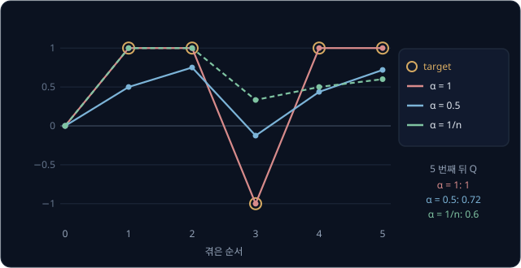

$\alpha = 1$ 은 마지막 target 을 그대로 베끼고, $\alpha = \frac{1}{n}$ 은 bandit 의 incremental 평균과 같아서 다섯 target 의 평균이 된다.
$Q$ 가 배워야 하는 것은 target 의 기댓값이므로 $\alpha$ 를 1 보다 작게 잡는다.

Q-learning 에서 agent 는 지금의 $Q$ 표를 보고 움직이는데, $Q$ 가 가장 큰 action 만 고르면 bandit 의 greedy 처럼 처음 찾은 길만 되풀이해
다른 칸을 끝내 겪지 못한다. 그래서 ε-greedy 로 가끔 무작위 action 을 섞는다. 그래도 target 에는 다음에 실제로 고를 action 이 아니라
$\max_{a'}$ 를 쓰므로, agent 가 가끔 엉뚱한 방향으로 움직여도 표에는 그다음부터 가장 좋게 행동할 때의 값이 쌓인다. 이렇게 데이터를 모으는
policy(ε-greedy)와 배우는 policy(greedy)가 다른 방법을 **off-policy** 라 한다. 미끄럽지 않은 격자에서 $\alpha = 0.5$, $\varepsilon = 0.2$
로 episode 3000 개를 simulation 하면 칸마다 가장 큰 $Q$ 가 value iteration 의 $V^*$ 와 같아진다.

<b>심화: 같은 경로를 되풀이한 Q-learning 손계산</b>

미끄럽지 않은 격자에서 $\gamma = 0.9$, $\alpha = 1$ 로 매 episode 를 같은 경로
$7 \xrightarrow{\text{위}} 4 \xrightarrow{\text{위}} 1 \xrightarrow{\text{오른쪽}} 2 \xrightarrow{\text{오른쪽}} 3$ 으로 움직였다고 하자.
episode 안에서는 지나가는 순서대로 고치고, $\alpha = 1$ 이면 새 $Q$ 는 target 그 자체다.

| episode | $Q(7, \text{위})$ | $Q(4, \text{위})$ | $Q(1, \text{오른쪽})$ | $Q(2, \text{오른쪽})$ |
| --- | --- | --- | --- | --- |
| 시작 | 0 | 0 | 0 | 0 |
| 1 | $0 + 0.9 \times 0 = 0$ | $0 + 0.9 \times 0 = 0$ | $0 + 0.9 \times 0 = 0$ | 1 (terminal, target 은 $r$) |
| 2 | 0 | 0 | $0.9 \times 1 = 0.9$ | 1 |
| 3 | 0 | $0.9 \times 0.9 = 0.81$ | 0.9 | 1 |
| 4 | $0.9 \times 0.81 = 0.729$ | 0.81 | 0.9 | 1 |

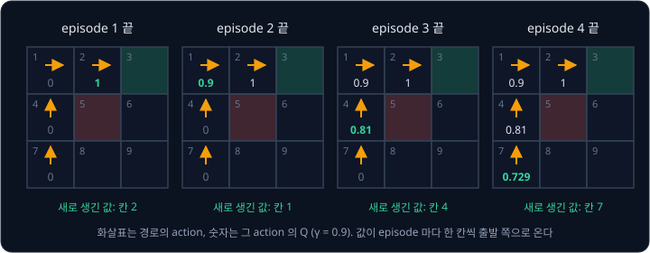

값이 episode 마다 한 칸씩 출발 쪽으로 거슬러 올라오고, 숫자 1, 0.9, 0.81, 0.729 는 value iteration 이 sweep 마다 채운 숫자와 같다. 이
경로가 마침 가장 짧은 길이라서 배운 값이 $V^*$ 와 같고, 경로가 지나지 않은 칸 8 의 $Q$ 는 한 번도 고쳐지지 않아 0 으로 남는다.

같은 경로를 $\alpha = 0.5$ 로 되풀이하면 target 쪽으로 차이의 절반씩만 옮겨서, $Q(2, \text{오른쪽})$ 은 episode 마다 0.5, 0.75, 0.875 로
target 1 과의 거리가 절반씩 줄어든다. 계속 되풀이하면 네 값은 $\alpha = 1$ 일 때와 같은 1, 0.9, 0.81, 0.729 로 수렴한다.

**확인 문제.** agent 가 ε-greedy 로 칸 1 에서 실수로 아래를 골라 칸 4 로 갔다. 칸 4 의 $Q$ 는 위 0.81, 아래 0.6, 왼쪽 0.7, 오른쪽 −1 이고
$Q(1, \text{아래}) = 0.5$, $\gamma = 0.9$, $\alpha = 0.5$ 다. 칸 4 에서 다음에 무작위로 왼쪽을 고를 예정이라면, 이번 update 의 target 과 새
$Q(1, \text{아래})$ 는 얼마일까?

답 보기

1. 고치는 칸은 $Q(1, \text{아래})$ 이고, reward 는 0 이다
2. target 은 다음에 고를 왼쪽(0.7)이 아니라 칸 4 의 가장 큰 값 0.81 을 쓴다: $0 + 0.9 \times 0.81 = 0.729$
3. TD error 는 $0.729 - 0.5 = 0.229$ 다
4. 새 $Q$ 는 $0.5 + 0.5 \times 0.229 = 0.6145$ 다

답: target 0.729, 새 $Q(1, \text{아래}) \approx 0.6145$. 다음에 무엇을 고르든 target 이 그대로인 것은 Q-learning 이 off-policy 이기 때문이다.

## 정리

- bandit 에서는 추정값이 큰 arm 만 고르는 exploitation 이 운 나쁜 첫 sample 때문에 좋은 arm 을 버릴 수 있어서, ε-greedy 는 확률 $\varepsilon$
  으로 무작위로 고르고 UCB 는 덜 당긴 arm 에 $c\sqrt{\ln t / N(a)}$ 의 bonus 를 더해 exploration 을 넣는다
- MDP 는 state·action·transition 확률·reward·$\gamma$ 로 문제를 적고, reward 설계가 로봇이 배울 행동을 정한다. $\gamma$ 는 step 마다
  곱하므로 50 Hz 에서 $\gamma = 0.99$ 이면 약 1.4 초 뒤의 reward 가 절반으로 깎이고, control 주기를 바꾸면 $\gamma$ 도 함께 고쳐야 한다
- value 는 칸에서 출발한 return 의 기댓값이고 Bellman 식 "reward + $\gamma$ × 다음 칸의 value" 로 끝의 reward 를 앞쪽 state 로 전한다.
  value iteration 은 $P$ 를 알 때 이 식으로 모든 칸을 덮어써 $V^*$ 를 구하고, Q-learning 은 $P$ 없이 겪은 경험으로 같은 답에 다가간다

이 강의의 방법은 모두 칸마다 값을 적어 둔 표를 쓴다. 칸이 9 개인 격자는 표 한 장이면 되지만, 보행 로봇의 state 처럼 연속된 값 48 개로
이루어지면 칸을 셀 수 없어 표를 만들 수 없다. 표 대신 neural network 로 $Q$ 를 계산하는 방법은 [DQN → SAC](../off-policy/README.md) 에서,
value 를 거치지 않고 policy 를 직접 고치는 방법은 [Policy Gradient](../policy-gradient/README.md) 에서 다룬다.

## 참고 자료

- Richard S. Sutton, Andrew G. Barto, [Reinforcement Learning: An Introduction (2nd edition)](http://incompleteideas.net/book/the-book-2nd.html)
  — RL 의 표준 교과서로 저자가 [PDF](http://incompleteideas.net/book/RLbook2020.pdf) 를 무료로 공개한다. 2장(bandit, 그림 2.2·2.4),
  3 ~ 4장(MDP·value iteration), 6장(Q-learning)이 이 강의 범위다
- Peter Auer, Nicolò Cesa-Bianchi, Paul Fischer, [Finite-time Analysis of the Multiarmed Bandit Problem](https://doi.org/10.1023/A:1013689704352)
  (2002) — UCB1 을 낸 논문. Figure 1 이 UCB1 의 의사 코드다
- Jeffrey Mahler 외, [Dex-Net 1.0](https://berkeleyautomation.github.io/dex-net/) (ICRA 2016) — grasp 후보를 arm 으로 둔 bandit 으로 좋은
  grasp 를 찾는 논문. 6절이 bandit 알고리즘이다
- Gymnasium-Robotics, [Fetch Reach](https://robotics.farama.org/envs/fetch/reach/) — sparse·dense reward, 0.05 m 성공 반경, 25 Hz control 을
  적은 환경 문서
- leggedrobotics, [legged_gym `legged_robot_config.py`](https://github.com/leggedrobotics/legged_gym/blob/master/legged_gym/envs/base/legged_robot_config.py)
  — 보행 reward 항의 가중치, control 주기(`sim.dt` × `decimation`), PPO 의 $\gamma$ 가 한 파일에 있다. 논문은 Rudin 외,
  [Learning to Walk in Minutes](https://arxiv.org/abs/2109.11978) (CoRL 2021)
- Andrew Y. Ng, Daishi Harada, Stuart Russell, [Policy Invariance Under Reward Transformations](https://people.eecs.berkeley.edu/~russell/papers/icml99-shaping.pdf)
  (ICML 1999) — 원을 도는 자전거 사례와 potential-based shaping. 1절과 3절을 읽는다
- Christopher J. C. H. Watkins, Peter Dayan, [Q-learning](https://doi.org/10.1007/BF00992698) (1992) — Q-learning 이 최적값으로 수렴하는
  조건을 증명한 논문
