# Behavior Cloning

## 학습 목표

- 사람이 직접 조종한 기록을 정답으로 삼아 로봇이 따를 행동 규칙을 학습하는 방법을 설명하고, 그 학습이 Linear Regression 의
  loss·gradient 계산과 같다는 것을 숫자로 보일 수 있다
- 작은 오차가 step 마다 쌓여 시연에서 한 번도 본 적 없는 상황으로 벗어나는 과정을 표로 한 단계씩 따라갈 수 있다
- 사진과 지금의 관절 각도를 받아 다음 관절 각도 7 개를 내는 가장 단순한 모델에서 loss 한 번을 계산할 수 있다
- 사진 한 장에 든 숫자 약 15 만 개를 적은 숫자로 줄이는 세 방법의 장단점을 비교할 수 있다
- 3D 좌표를 계산하지 않고 카메라 영상에서 관절 각도를 바로 배우는 방식이 통하는 조건과 실패하는 경우를 설명할 수 있다
- 같은 상황에 정답 행동이 둘 이상일 때, 오차 제곱의 평균을 줄이는 학습이 두 행동의 평균이라는 엉뚱한 행동을 내는 이유를
  숫자로 설명할 수 있다

## 시연을 따라 하는 학습

### 행동을 가르치는 두 방법

자동차가 차선 가운데를 따라 달리게 만드는 일을 생각해 보자. 첫째 방법은 사람이 규칙을 직접 프로그램으로 짜는 것이다. "카메라
사진에서 차선을 찾고, 차가 차선 가운데에서 얼마나 벗어났는지 계산하고, 벗어난 만큼 핸들을 반대로 꺾는다" 를 한 줄씩 적는다.
그런데 비가 와서 차선이 흐리거나, 차선이 지워진 공사 구간이 나오거나, 그림자가 길게 드리우면 규칙이 틀리기 시작하고, 그때마다
사람이 새 규칙을 덧붙여야 한다.

둘째 방법은 운전을 잘하는 사람이 차를 모는 동안 센서 값과 핸들 각도를 함께 기록해 두고, 컴퓨터가 "이런 센서 값이 들어오면
핸들을 이만큼 꺾는다" 는 관계를 그 기록에서 스스로 찾게 하는 것이다. 사람은 규칙을 말로 설명할 필요 없이 운전만 하면 된다. 이렇게
사람이 직접 해 보이는 것을 시연(demonstration)이라고 하고, 시연을 보여 주는 사람이나 프로그램을 expert(전문가)라고 부른다.

1989년 Pomerleau 의 ALVINN 이 둘째 방법으로 실제 차를 몰았다. 30×32 칸짜리 카메라 영상과 8×32 칸짜리 거리 센서 값을 hidden unit
29 개짜리 neural network(숫자를 곱하고 더하는 층을 여러 겹 쌓은 모델)에 넣고, 사람이 운전하는 동안 기록한 (센서 값, 그때의 핸들 방향) 쌍으로 학습했다. hidden unit 은
[Backpropagation](../autograd/README.md) 에서 본 hidden layer 의 neuron 하나이고, ALVINN 에서는 차선을 찾는 규칙도 핸들을 꺾는
공식도 사람이 짜지 않았다.

로봇 팔도 같은 방식으로 가르친다. 사람이 똑같이 생긴 조종용 팔(leader)을 손으로 움직이면 로봇 팔(follower)이 그 관절 각도를 그대로
따라 움직이고, 그동안 카메라 영상과 관절 각도를 기록한다. 이렇게 사람이 원격으로 로봇을 조종하는 것을 teleoperation 이라고 하고,
기록을 모으는 과정은 [Teleop Dataset](../teleop-dataset/README.md) 에서 다룬다.

**확인 문제.** 비 오는 날 차선이 잘 안 보여서 차가 흔들린다. 규칙을 직접 짜는 방법과 시연에서 배우는 방법은 각각 이 문제를 어떻게
고칠까?

답 보기

규칙을 짜는 방법은 사람이 "차선이 흐릴 때는 ~한다" 는 규칙을 새로 짜서 덧붙인다. 시연에서 배우는 방법은 비 오는 날 사람이 운전한
기록을 더 모아 다시 학습한다. 규칙을 말로 적을 필요가 없다.

### 관측과 action

시연 기록은 짧은 순간들의 모음이다. 차가 센서 값을 한 번 읽고 핸들을 한 번 꺾는 순간을 step 이라고 하고, 1초에 10 번 꺾으면
"10 Hz 로 제어한다" 고 말한다. Hz(헤르츠)는 1초에 몇 번 일어나는지를 세는 단위다.

step 마다 기록하는 것은 두 가지다.

- **관측(observation)** — 그 순간 로봇이 센서로 받은 값으로, 기호로는 $o$ 라고 쓴다. 이 강의의 차는 거리 센서 두 개를 달고
  있어서, 왼쪽 차선 경계까지의 거리 $d_L$ 과 오른쪽 차선 경계까지의 거리 $d_R$ 을 잰다
- **action(행동)** — 그 순간 로봇이 낸 명령으로, 기호로는 $a$ 라고 쓴다. 차라면 핸들을 꺾는 각도이고, 이 강의에서는 오른쪽으로
  꺾으면 양수, 왼쪽으로 꺾으면 음수로 적는다

차선 폭은 3.5 m 라서 차가 정확히 가운데에 있으면 양쪽 거리가 모두 $3.5 \div 2 = 1.75$ m 다. 차가 왼쪽으로 0.5 m 치우치면 왼쪽
경계까지는 $1.75 - 0.5 = 1.25$ m 로 가까워지고 오른쪽 경계까지는 $1.75 + 0.5 = 2.25$ m 로 멀어진다. expert 가 운전한 기록의 일부는
아래와 같다.

| step | $d_L$ (m) | $d_R$ (m) | expert 의 action (도) |
| --- | --- | --- | --- |
| 0 | 1.75 | 1.75 | 0 |
| 1 | 1.25 | 2.25 | +4 |
| 2 | 1.50 | 2.00 | +2 |
| 3 | 1.75 | 1.75 | 0 |

step 1 에서 차가 왼쪽으로 치우치자 expert 는 핸들을 오른쪽으로 4° 꺾었고, 차가 돌아오는 step 2 에서는 2° 만 꺾었다. 시연을 처음부터
끝까지 한 번 한 것을 episode 라고 한다. 10 Hz 로 10 초 동안 운전한 episode 하나에는 step 이 $10 \times 10 = 100$ 개 있고, step 마다
(관측, action) 쌍이 하나씩 생기므로 쌍도 100 개다.

**확인 문제.** 10 Hz 로 20 초짜리 시연을 5 번 하면 (관측, action) 쌍은 모두 몇 개일까?

답 보기

episode 하나에 $10 \times 20 = 200$ 쌍이고, 5 번이면 $200 \times 5 = 1000$ 쌍이다.

### policy

관측을 넣으면 action 이 나오는 규칙을 policy 라고 한다. policy 는 일상에서 쓰는 "정책" 이라는 뜻이 아니라 "상황을 받아 행동을
내는 규칙" 이라는 뜻으로, [Bandits & MDPs](../bandit-mdp/README.md) 에서 칸마다 화살표를 적어 둔 표가 policy 였던 것과 같은
말이다. 이 강의에서는 그 규칙이 표가 아니라 숫자를 곱하고 더하는 모델이다.

policy 는 그리스 문자 $\pi$ 로 적고 pi(파이)라고 읽는다. 학습으로 정할 parameter 들을 한데 묶어 $\theta$ (theta, 세타)라고 부르면,
parameter 가 $\theta$ 인 policy 의 예측은 아래처럼 쓴다.

$$
\hat a = \pi_\theta(o)
$$

이 식은 "관측 $o$ 를 policy $\pi_\theta$ 에 넣어 나온 값이 예측 action $\hat a$ 다" 로 읽는다. $\hat a$ 는 "a 햇" 이라고 읽고, 실제로
expert 가 낸 action $a$ 와 구별하려고 모자를 씌웠다. expert 의 규칙은 $\pi^*$ 로 적고 "파이 스타" 라고 읽는다.

가장 간단한 policy 는 [Linear Regression](../linear-regression/README.md) 의 직선이다. 두 거리의 차이를 $x = d_R - d_L$ 이라고 하면
policy 를 $\hat a = w x + b$ 로 둘 수 있다. step 1 의 관측은 $x = 2.25 - 1.25 = 1$ 이라서, $w = 4$, $b = 0$ 인 policy 는
$\hat a = 4 \times 1 + 0 = 4$ 로 expert 와 같은 4° 를 낸다.

**확인 문제.** $w = 3$, $b = 1$ 인 policy 에 $d_L = 1.0$, $d_R = 2.5$ 가 들어오면 몇 도를 낼까?

답 보기

$x = 2.5 - 1.0 = 1.5$ 이고 $\hat a = 3 \times 1.5 + 1 = 5.5$ 이므로 오른쪽으로 5.5° 다.

### behavior cloning

시연에서 모은 (관측, action) 쌍을 (입력, 정답) 쌍으로 그대로 쓰고, policy 의 예측이 expert 의 action 에 가까워지도록 parameter 를
고치는 방법을 behavior cloning 이라고 한다. behavior 는 "행동", cloning 은 "똑같이 복제하기" 라는 뜻으로, expert 의 행동을 베낀다는
이름이다. 시연을 보고 배우는 방법 전체를 imitation learning(모방 학습)이라고 부르는데, behavior cloning 은 그중 가장 단순한
방법이다.

입력마다 정답이 붙은 데이터로 모델을 학습하는 방식을 supervised learning 이라고 한다. supervised 는 "지도를 받는" 이라는 뜻으로,
정답이 학습을 이끌어 준다는 의미다. Linear Regression 이 바로 supervised learning 이었고, 그 강의의 (전압, 움직인 거리) 자리에
(관측, expert 의 action) 이 들어가면 behavior cloning 이 된다.

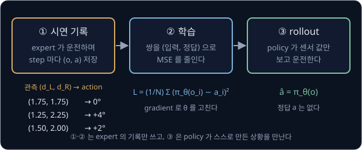

위 그림은 behavior cloning 의 세 단계를 보여 준다. expert 가 운전하며 기록을 남기고(1), 기록의 쌍으로 policy 를 학습하고(2), 학습이
끝난 policy 에게 운전을 맡긴다(3). 셋째 단계처럼 policy 가 직접 처음부터 끝까지 움직여 보는 것을 rollout 이라고 한다.

**확인 문제.** behavior cloning 에서 "정답" 은 무엇이고, 그 정답은 누가 만들었을까?

답 보기

정답은 각 관측에서 expert 가 실제로 낸 action 이다. 사람이 시연하는 동안 기록한 값이라서, 정답을 만든 것은 expert 다.

**요약**

- 시연은 expert 가 직접 해 보인 기록이고, step 마다 관측 $o$ 와 action $a$ 의 쌍이 하나씩 쌓인다
- policy $\pi_\theta$ 는 관측을 받아 action 을 내는 규칙이고, behavior cloning 은 시연 쌍을 정답으로 삼아 policy 를 supervised
  learning 으로 학습한다
- 학습한 policy 에게 실제로 움직임을 맡겨 보는 것이 rollout 이다

## 시연 데이터의 loss 와 gradient

### expert 와 policy 가 보는 값

시연을 보여 주는 expert 는 사람일 수도 있고, 사람 대신 운전 규칙을 따르는 프로그램일 수도 있다. 이 강의의 expert 는 차의 정확한
위치를 아는 프로그램이고, 차가 차선 가운데에서 왼쪽으로 0.5 m 벗어날 때마다 핸들을 오른쪽으로 4° 씩 더 꺾는다. 이런 정확한
위치는 시험장에서 장비로 잴 수 있지만, 실제 도로를 달릴 차에는 그런 장비가 없다. 그래서 학습할 policy 는 차에 달린 거리 센서 값만
보고 핸들 각도를 정해야 한다.

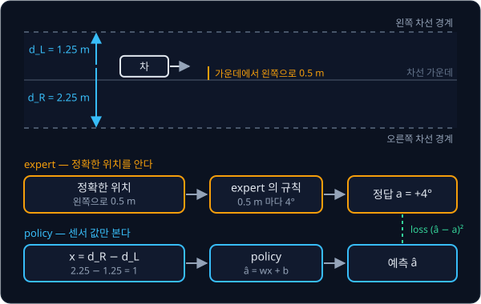

위 그림의 윗부분은 왼쪽으로 0.5 m 치우친 차와, 차에서 양쪽 경계까지 잰 거리 1.25 m 와 2.25 m 다. 아랫부분의 주황 길은 expert 가
정확한 위치(0.5 m)를 보고 정답 4° 를 내는 과정이고, 파란 길은 policy 가 센서 값의 차이 $x = 1$ 만 보고 $\hat a$ 를 예측하는
과정이다. 두 길이 보는 정보가 다르다는 점이 뒤의 "compounding error" 에서 중요해진다.

시연 쌍 두 개로 학습해 보자. 차가 왼쪽으로 0.5 m 치우쳤을 때 $x = 1$ 이고 expert 는 4°, 1 m 치우쳤을 때 $x = 2$ 이고 expert 는
8° 를 꺾었다. 데이터는 $(x, a)$ 꼴로 $(1, 4)$, $(2, 8)$ 이다.

**확인 문제.** 차가 왼쪽으로 0.25 m 치우쳤다면 $d_L$, $d_R$, $x$ 는 얼마이고, 이 expert 는 몇 도를 꺾을까?

답 보기

$d_L = 1.75 - 0.25 = 1.5$, $d_R = 1.75 + 0.25 = 2.0$ 이라 $x = 0.5$ 다. 0.5 m 에 4° 이므로 0.25 m 에는 그 절반인 2° 다. 앞 절의
기록에서 step 2 가 바로 이 경우였다.

### 예측과 MSE

policy $\hat a = w x + b$ 를 $w = 0$, $b = 0$ 에서 시작한다.

| $x$ | 정답 $a$ | 예측 $\hat a = 0 \times x + 0$ | 오차 $\hat a - a$ | 오차의 제곱 |
| --- | --- | --- | --- | --- |
| 1 | 4 | 0 | $-4$ | 16 |
| 2 | 8 | 0 | $-8$ | 64 |

오차는 예측에서 정답을 뺀 값이고, 오차를 제곱해 평균한 값이 MSE(mean squared error)다. 제곱하는 이유는 위로 빗나간 오차와 아래로
빗나간 오차가 서로 지워지지 않게 하기 위해서였고, 평균은 모두 더해 개수로 나눈 값이다. 여기서는 제곱의 합 $16 + 64 = 80$ 을 쌍의
개수 2 로 나눠 $80 \div 2 = 40$ 이다. 이렇게 모델이 얼마나 틀렸는지를 숫자 하나로 나타낸 값을 loss 라고 했다.

일반 식은 Linear Regression 의 MSE 와 똑같다.

$$
L(\theta) = \frac{1}{N}\sum_{i=1}^{N} \big(\pi_\theta(o_i) - a_i\big)^2
$$

이 식은 "시연 쌍마다 policy 의 예측 $\pi_\theta(o_i)$ 에서 expert 의 action $a_i$ 를 빼서 제곱하고, 1 번째부터 $N$ 번째까지 모두
더한 뒤 $N$ 으로 나눈다" 로 읽는다. $\Sigma$ 는 sigma(시그마)라고 읽고 "아래 번호부터 위 번호까지 모두 더하라" 는 기호다. 위 표와
맞추면 $N$ 은 쌍의 개수 2, $o_i$ 는 관측 $x$ 의 1 과 2, $a_i$ 는 4 와 8, $\pi_\theta(o_i)$ 는 예측 0 과 0, $L$ 은 40 이다.
$L(\theta)$ 라고 괄호 안에 $\theta$ 를 적은 것은 시연 쌍은 고정돼 있고 loss 를 바꾸는 것은 parameter 뿐이라는 뜻이다.

**확인 문제.** $w = 2$, $b = 0$ 일 때 두 쌍 $(1, 4)$, $(2, 8)$ 의 MSE 는?

답 보기

예측은 2, 4 이고 오차는 $2 - 4 = -2$, $4 - 8 = -4$ 다. 제곱은 4, 16 이고 합 20 을 2 로 나누면 10 이다.

### gradient 와 update

loss 를 줄이려면 parameter 를 어느 쪽으로 움직여야 하는지 알아야 한다. parameter 하나를 아주 조금 늘렸을 때 loss 가 변하는 비율이
partial derivative 이고, parameter 마다 구한 값을 모은 것이 gradient 였다. MSE 의 gradient 공식도 Linear Regression 과 같다.

$$
\frac{\partial L}{\partial w} = \frac{2}{N}\sum_{i=1}^{N} (\hat a_i - a_i) \times x_i, \qquad
\frac{\partial L}{\partial b} = \frac{2}{N}\sum_{i=1}^{N} (\hat a_i - a_i)
$$

왼쪽 식은 "쌍마다 오차에 $x_i$ 를 곱해 모두 더하고, 2 를 곱한 뒤 $N$ 으로 나눈다" 로, 오른쪽 식은 $x_i$ 를 곱하지 않는다는 것만
다르다. $\partial L / \partial w$ 는 "파셜 L 파셜 w" 라고 읽고 "$b$ 는 그대로 두고 $w$ 만 조금 바꿨을 때 $L$ 이 변하는 비율" 이다.
$w = b = 0$ 에서는 $N = 2$ 라 $\frac{2}{N} = 1$ 이므로

$$
\frac{\partial L}{\partial w} = (-4) \times 1 + (-8) \times 2 = -20, \qquad \frac{\partial L}{\partial b} = (-4) + (-8) = -12
$$

이다. 두 값이 모두 음수이니 $w$ 와 $b$ 를 키워야 loss 가 줄어든다. update 는 parameter 에서 learning rate $\eta$ (eta, 에타)
곱하기 gradient 를 빼는 것이었다. $\eta = 0.05$ 로 하면

$$
w = 0 - 0.05 \times (-20) = 1, \qquad b = 0 - 0.05 \times (-12) = 0.6
$$

이다. 숫자만 바꿔 다음 step 도 계산한다. $w = 1$, $b = 0.6$ 이면 예측은 $1 \times 1 + 0.6 = 1.6$ 과 $1 \times 2 + 0.6 = 2.6$ 이고,
오차는 $1.6 - 4 = -2.4$ 와 $2.6 - 8 = -5.4$ 다.

| 값 | 계산 | 결과 |
| --- | --- | --- |
| loss | $\big((-2.4)^2 + (-5.4)^2\big) \div 2 = (5.76 + 29.16) \div 2$ | 17.46 |
| $\partial L / \partial w$ | $(-2.4) \times 1 + (-5.4) \times 2 = -2.4 - 10.8$ | $-13.2$ |
| $\partial L / \partial b$ | $(-2.4) + (-5.4)$ | $-7.8$ |
| 새 $w$ | $1 - 0.05 \times (-13.2) = 1 + 0.66$ | 1.66 |
| 새 $b$ | $0.6 - 0.05 \times (-7.8) = 0.6 + 0.39$ | 0.99 |

이 계산을 이어 가면 아래 표가 된다. 각 줄은 그 step 의 parameter 와, 그 자리에서 계산한 loss 와 gradient 다.

| step | $w$ | $b$ | loss | $\partial L / \partial w$ | $\partial L / \partial b$ |
| --- | --- | --- | --- | --- | --- |
| 0 | 0 | 0 | 40 | $-20$ | $-12$ |
| 1 | 1 | 0.6 | 17.46 | $-13.2$ | $-7.8$ |
| 2 | 1.66 | 0.99 | 7.72 | $-8.73$ | $-5.04$ |
| 3 | 2.0965 | 1.2420 | 3.51 | $-5.79$ | $-3.23$ |
| 10 | 2.9289 | 1.6356 | 0.29 | $-0.45$ | $+0.06$ |
| 100 | 3.4684 | 0.8602 | 0.075 | $-0.08$ | $+0.13$ |
| 1000 | 3.9993 | 0.0012 | 0.0000 | $0.00$ | $0.00$ |

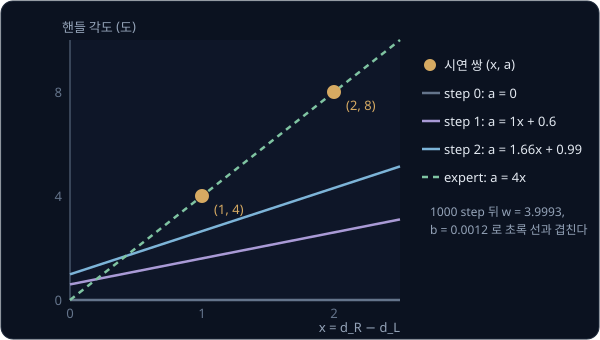

위 그림은 가로축이 센서 값의 차이 $x$, 세로축이 핸들 각도인 좌표평면에 두 시연 쌍(주황 점)과 step 마다의 policy 직선을 그린 것이다.
바닥에 누워 있던 직선이 일어서며 1000 step 무렵에는 expert 의 규칙 $a = 4x$ (초록 점선)와 겹친다. Linear Regression 에서 본 것처럼
$w$ 가 먼저 빠르게 움직여 4 근처를 지나고, 그 뒤 $b$ 가 0 으로 내려가는 동안 $w$ 도 천천히 4 로 다가간다.

**흔한 오해.** behavior cloning 이 로봇만을 위한 특별한 학습 방법이라고 생각하기 쉽다. loss 도 gradient 도 update 도 Linear Regression
과 한 글자도 다르지 않고, 다른 것은 정답이 "expert 가 그 순간 낸 action" 이라는 것 하나다. 차이는 학습이 끝난 뒤 policy 에게 실제로
움직임을 맡길 때 드러나는데, 그 이야기는 다음 절에서 한다.

**확인 문제.** $w = 4$, $b = 1$ 에서 두 쌍 $(1, 4)$, $(2, 8)$ 의 $\frac{\partial L}{\partial w}$ 와 $\frac{\partial L}{\partial b}$ 는?
$\eta = 0.05$ 로 한 step 고치면 $b$ 는 얼마가 될까?

답 보기

예측은 5, 9 이고 오차는 $+1$, $+1$ 이다. $\frac{\partial L}{\partial w} = 1 \times 1 + 1 \times 2 = 3$, $\frac{\partial L}{\partial b} = 1 + 1 = 2$
이다. $b = 1 - 0.05 \times 2 = 0.9$ 로, 예측이 너무 크니 $b$ 가 줄었다.

### 센서가 많은 policy

실제 차는 센서 두 개보다 많은 값을 본다. 차에서 부채꼴로 빛을 쏘아 차선 경계에 닿기까지의 거리를 15 방향에서 재면 관측은 숫자 15
개가 되고, 커브에서는 핸들 각도와 센서 값의 관계가 직선 하나로 맞지 않는다. 그래서 policy 로 여러 층의 neuron 을 쌓은 MLP(multi-layer
perceptron)를 쓴다. MLP 는 [Backpropagation](../autograd/README.md) 에서 본 것처럼 입력에 weight 를 곱해 더하고 bias 를 더한 뒤 곧은
선을 휘게 만드는 함수를 거치는 층을 여러 번 쌓은 모델이다.

policy 가 MLP 로 바뀌어도 할 일은 같다. 시연 쌍마다 예측과 정답의 오차를 제곱해 평균한 MSE 를 loss 로 두고, 출력 쪽에서 입력 쪽으로
층을 거슬러 가며 gradient 를 구하는 backpropagation 으로 모든 weight 의 gradient 를 구해 update 한다. 시연 쌍 수천 개를 수십 개씩 묶은 mini-batch 로 나눠 묶음마다 평균 loss 로 update 하는
과정은 [PyTorch Training Loop](../pytorch-mlp/README.md) 의 학습 loop 와 같다.

학습이 잘 됐는지 보려고 시연 쌍의 일부를 학습에 쓰지 않고 떼어 두었다가 그 쌍들에서 loss 를 잰다. 이렇게 떼어 둔 데이터를
validation set 이라 하고, 거기서 잰 loss 를 validation loss 라고 한다. 처음 보는 쌍에서도 loss 가 낮으면 policy 가 시연을 외우기만
한 것이 아니라 규칙을 배웠다고 본다.

**확인 문제.** 시연 쌍이 1000 개이고 그중 200 개를 validation set 으로 뗐다. 한 묶음에 50 쌍씩 학습하면 학습 데이터를 한 번 다 보는
동안 update 는 몇 번 일어날까?

답 보기

학습에 쓰는 쌍은 $1000 - 200 = 800$ 개이고, $800 \div 50 = 16$ 번이다.

**요약**

- behavior cloning 의 loss 는 시연 쌍에서 잰 MSE $\frac{1}{N}\sum (\pi_\theta(o_i) - a_i)^2$ 이고, gradient 와 update 도 Linear
  Regression 과 같다
- 두 쌍 $(1, 4)$, $(2, 8)$ 에서 $\eta = 0.05$ 로 시작하면 loss 가 40, 17.46, 7.72 로 줄고, policy 는 expert 의 규칙 $a = 4x$ 로
  다가간다
- expert 는 정확한 위치를 보고 정답을 만들지만 policy 는 센서 값만 보고 예측한다

## compounding error

### 시연에 없는 상황

expert 는 운전을 잘하기 때문에 차가 차선 가운데에서 크게 벗어나는 일이 거의 없다. 이 강의의 expert 가 1000 step 을 운전하는 동안
차의 위치는 늘 가운데에서 0.3 m 안쪽이었다고 하자. 그러면 시연 데이터에는 "가운데에서 1 m 벗어난 차가 받는 센서 값" 이 하나도 없고,
"0.3 m 쯤 벗어났을 때 다시 가운데로 돌아오는 장면" 도 드물다.

policy 는 시연에 있는 관측에서만 정답을 보고 배웠다. 학습이 아무리 잘 돼도 예측이 정답과 완전히 같지는 않아서, 시연과 비슷한
상황에서도 핸들을 expert 보다 조금 덜 꺾는 정도의 작은 오차는 남는다. 문제는 이 작은 오차가 차를 움직인다는 데 있다. 핸들을 덜
꺾으면 차가 조금 왼쪽으로 가고, 다음 step 의 관측은 expert 라면 만나지 않았을 위치에서 나온다.

**확인 문제.** 시연에서 차의 위치가 늘 가운데에서 0.3 m 안쪽이었다면, 가운데에서 0.8 m 벗어난 차의 센서 값은 시연 데이터에 있을까?

답 보기

없다. 0.8 m 는 0.3 m 보다 바깥이라 expert 가 한 번도 가 본 적 없는 위치이고, 그 위치의 센서 값에는 정답 action 이 붙어 있지 않다.

### step 별 계산표

policy 에게 운전을 맡기고 step 마다 차가 가운데에서 왼쪽으로 얼마나 벗어났는지를 $y$ (m) 로 따라가 보자. 계산을 위해 policy 의
오차가 아래 규칙을 따른다고 하자.

- 차가 시연에 있던 위치(가운데에서 0.3 m 안쪽)에 있으면 policy 는 거의 맞히지만, 핸들을 조금 덜 꺾어서 한 step 에 0.1 m 씩 왼쪽으로
  밀려난다
- 시연에 없던 위치(0.3 m 바깥)에서는 처음 보는 센서 값이라 더 크게 틀린다. 0.1 m 에 "시연 범위 끝 0.3 m 에서 벗어난 거리" 를 더한
  만큼 왼쪽으로 밀려난다

| step | $y$ (m) | 시연 범위 | policy 의 오차 (m) | 다음 $y$ (m) |
| --- | --- | --- | --- | --- |
| 0 | 0.0 | 안 | 0.1 | 0.1 |
| 1 | 0.1 | 안 | 0.1 | 0.2 |
| 2 | 0.2 | 안 | 0.1 | 0.3 |
| 3 | 0.3 | 안 (끝) | 0.1 | 0.4 |
| 4 | 0.4 | 밖 | $0.1 + (0.4 - 0.3) = 0.2$ | 0.6 |
| 5 | 0.6 | 밖 | $0.1 + (0.6 - 0.3) = 0.4$ | 1.0 |
| 6 | 1.0 | 밖 | $0.1 + (1.0 - 0.3) = 0.8$ | 1.8 |
| 7 | 1.8 | — | — | 차선 이탈 |

차선의 절반 폭은 1.75 m 라서 step 7 에 $y = 1.8$ 이 되며 차선 밖으로 나간다. step 0 부터 3 까지는 오차가 0.1 m 로 작았지만, 같은
방향으로 세 번 쌓이자 차가 시연 범위의 끝 0.3 m 에 닿았고 네 번째에 범위 밖 0.4 m 로 나갔다. 그 뒤로는 처음 보는 위치라 오차가 0.2, 0.4, 0.8 로 step 마다 두 배가 되었다.

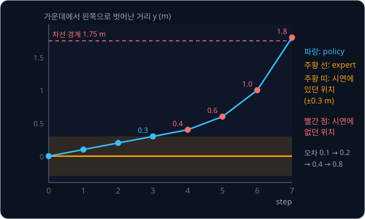

위 그림은 표의 $y$ 를 step 마다 찍어 이은 것이다. expert(주황 실선)는 정확한 위치를 보고 언제든 가운데 쪽으로 꺾으므로 가운데 근처에
머문다. policy(파란 선)는 시연 범위(주황 띠) 안에서 천천히 밀려나다가, 띠를 벗어나는 step 4 부터 기울기가 가팔라진다. 빨간 점은
시연에 없던 위치다.

이렇게 작은 오차가 차를 시연에 없던 상황으로 옮기고, 그 상황에서 오차가 더 커져 step 마다 쌓이는 현상을 compounding error 라고
한다. compound 는 "복리로 불어나다" 라는 뜻으로, 이자에 다시 이자가 붙듯 오차가 오차를 키운다는 의미다.

**흔한 오해.** validation loss 가 낮으면 rollout 도 잘 될 것이라고 생각하기 쉽다. validation set 은 시연에서 떼어 둔 쌍이라 expert 가
지나간 위치에서만 나오고, 거기서 policy 의 오차는 늘 0.1 m 로 작다. 위 표의 step 4 이후처럼 policy 가 스스로 만든 낯선 위치는
validation set 에 하나도 없어서, validation loss 만 봐서는 차가 이탈한다는 것을 알 수 없다.

**확인 문제.** 시연 범위가 0.4 m 이고, 범위 안에서는 한 step 에 0.2 m 씩, 범위 밖에서는 $0.2 +$ (0.4 m 에서 벗어난 거리) 만큼
밀려나는 policy 가 $y = 0$ 에서 출발한다. 몇 step 째에 1.75 m 를 넘을까?

답 보기

$y$ 는 $0 \to 0.2 \to 0.4$ 로 범위 안에서 움직이고, 0.4 는 범위의 끝이라 오차 0.2 로 0.6 이 된다. 0.6 에서는
$0.2 + 0.2 = 0.4$ 라 1.0, 1.0 에서는 $0.2 + 0.6 = 0.8$ 이라 1.8 이 된다. $y$ 가 $0, 0.2, 0.4, 0.6, 1.0, 1.8$ 이므로 step 5 에
1.75 m 를 넘는다.

### distribution shift

값이 얼마나 자주 나왔는지를 구간마다 세어 막대로 그린 그림을 histogram 이라 하고, 그 "어떤 값이 얼마나 자주 나오는가" 를 분포
(distribution)라고 한다. 시연 1000 step 동안 차의 위치를 0.1 m 구간마다 세면 아래와 같았다고 하자.

| 위치 $y$ 의 구간 (m) | $-0.3 \sim -0.2$ | $-0.2 \sim -0.1$ | $-0.1 \sim 0$ | $0 \sim 0.1$ | $0.1 \sim 0.2$ | $0.2 \sim 0.3$ | 0.3 바깥 |
| --- | --- | --- | --- | --- | --- | --- | --- |
| step 수 | 30 | 150 | 320 | 330 | 140 | 30 | 0 |

여섯 구간의 step 수를 모두 더하면 $30 + 150 + 320 + 330 + 140 + 30 = 1000$ 이다. 시연의 위치는 가운데 근처에 몰려 있고 0.3 m 바깥에는 하나도 없다.
그런데 policy 의 rollout 은 0.4, 0.6, 1.0, 1.8 m 를 지나갔다.

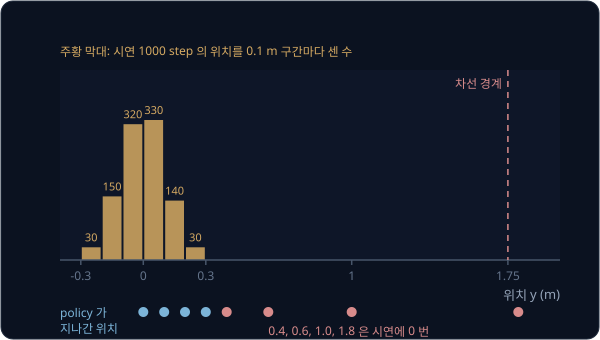

위 그림은 표의 histogram(주황 막대)과 policy 가 지나간 위치(아래 줄의 점)를 같은 가로축에 놓은 것이다. 파란 점 넷(0, 0.1, 0.2,
0.3)은 막대가 있는 곳에 있고, 빨간 점 넷(0.4, 0.6, 1.0, 1.8)은 막대가 없는 곳에 떨어진다.

이처럼 학습할 때 본 입력의 분포와 실행할 때 만나는 입력의 분포가 달라지는 것을 distribution shift 라고 한다. shift 는 "옮겨 가다"
라는 뜻이다. 기호로는 expert 가 지나간 상태의 분포를 $d_{\pi^*}$, policy 가 지나간 상태의 분포를 $d_{\pi_\theta}$ 라고 적는다.
behavior cloning 의 loss 는 $d_{\pi^*}$ 에서 나온 쌍으로만 계산하는데, rollout 에서 policy 가 만나는 상태는 $d_{\pi_\theta}$ 에서 나온다.
distribution shift 가 원인이고 compounding error 는 그 결과로 오차가 쌓이는 현상이다.

**확인 문제.** 위 histogram 에서 차의 위치가 가운데에서 0.1 m 안쪽($-0.1 \sim 0.1$)이었던 step 은 1000 step 중 몇 개일까?

답 보기

$-0.1 \sim 0$ 구간 320 개와 $0 \sim 0.1$ 구간 330 개를 더해 650 개다.

### 실수가 이어질 때의 실수 횟수

오차가 쌓이면 실수가 얼마나 늘어나는지 세어 보자. 10 step 짜리 episode 에서 policy 가 step 마다 10 번에 한 번꼴로 틀린다고 하자.
"10 번에 한 번꼴" 을 확률로 0.1 이라 하고, 이 확률을 그리스 문자 $\epsilon$ (epsilon, 엡실론)으로 적는다. episode 의 길이는 $T$ 로
적는다.

실수가 서로 영향을 주지 않는다면, 한 번 틀려도 다음 step 은 다시 시연과 같은 상황에서 시작한다. 그러면 10 step 동안 틀리는 횟수는
평균 $T \times \epsilon = 10 \times 0.1 = 1$ 번이다.

compounding error 가 있으면 사정이 다르다. 한 번 틀려서 시연에 없는 상황으로 들어가면 그 뒤의 step 도 계속 틀리기 쉽다. 가장 나쁜
경우 첫 실수 뒤의 모든 step 이 틀린다고 하면, 첫 실수가 몇 번째 step 에서 나왔느냐에 따라 틀린 횟수가 정해진다.

| 첫 실수가 나온 step | 1 | 2 | 3 | 4 | 5 | 6 | 7 | 8 | 9 | 10 |
| --- | --- | --- | --- | --- | --- | --- | --- | --- | --- | --- |
| 그 뒤로 틀린 step 수 | 10 | 9 | 8 | 7 | 6 | 5 | 4 | 3 | 2 | 1 |

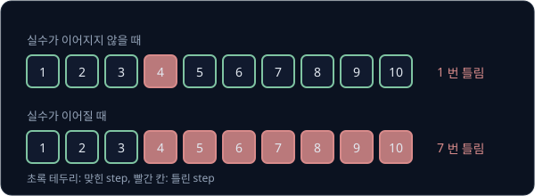

위 그림은 step 4 에서 처음 틀린 두 경우를 비교한다. 실수가 이어지지 않으면 1 번 틀리지만, 이어지면 step 4 부터 10 까지 7 번 틀린다.

일찍 틀릴수록 피해가 크고, 첫 step 에서 틀리면 10 step 이 모두 틀린다. episode 하나에 실수의 기회는 대략 $T\epsilon$ 번이고, 실수
한 번이 많게는 $T$ step 을 망치므로, 틀리는 횟수는 많게는 $T\epsilon \times T = T^2\epsilon$ 까지 늘어난다. 2010년 Ross 와 Bagnell 은
이것을 아래처럼 정리했다.

$$
J(\hat\pi) \le J(\pi^*) + T^2 \epsilon
$$

$J$ 는 episode 하나에서 틀린 step 수의 평균이고, $\hat\pi$ 는 behavior cloning 으로 학습한 policy 다. 기호 $\le$ 는 "작거나 같다" 로
읽는다. 이 식은 "학습한 policy 가 틀리는 횟수는 expert 가 틀리는 횟수보다 많아야 $T^2\epsilon$ 만큼 더 많다" 는 뜻이고, 거꾸로
말하면 가장 나쁜 경우 $T^2\epsilon$ 만큼 더 틀릴 수 있다는 뜻이다.

$T = 100$, $\epsilon = 0.01$ 이면 실수가 이어지지 않을 때는 $100 \times 0.01 = 1$ 번이지만, $T^2\epsilon = 100 \times 100 \times 0.01 = 100$
이라 가장 나쁜 경우에는 100 step 이 모두 틀린다. episode 가 길수록 $T$ 가 제곱으로 들어가서 피해가 빠르게 커진다.

이 문제를 줄이는 방법은 뒤의 강의들에서 다룬다. policy 를 직접 달리게 해서 policy 가 간 낯선 상태에서 expert 에게 정답을 다시
받아 데이터에 더하는 방법은 [DAgger](../dagger/README.md) 다. 2016년 NVIDIA 의 Bojarski 등은 차 옆에 단 카메라의 영상에 "가운데로
돌아오는 쪽으로 조금 더 꺾는" 정답을 붙여, 가운데에서 벗어난 장면을 시연에 일부러 채워 넣었다. action 을 한 step 씩이 아니라 여러
step 묶음으로 내서 policy 가 결정하는 횟수 자체를 줄이는 방법은 [ACT](../act/README.md) 에서 다룬다.

**확인 문제.** $T = 50$, $\epsilon = 0.02$ 이면 실수가 이어지지 않을 때의 평균 실수 횟수와, Ross 와 Bagnell 의 식이 허용하는 가장
나쁜 경우의 추가 실수 횟수는 각각 얼마일까?

답 보기

$T\epsilon = 50 \times 0.02 = 1$ 번이고, $T^2\epsilon = 50 \times 50 \times 0.02 = 50$ 번이다.

**요약**

- 시연은 expert 가 지나간 상태에서만 나오므로, policy 의 작은 오차가 차를 시연에 없는 상태로 옮기면 그곳에서 오차가 더 커진다.
  이 현상이 compounding error 다
- 학습 때와 실행 때 입력의 분포가 달라지는 것이 distribution shift 이고, validation loss 는 시연 쪽 분포에서만 재므로 이 문제를
  보여 주지 못한다
- 실수가 이어지면 틀리는 횟수가 $T\epsilon$ 이 아니라 많게는 $T^2\epsilon$ 까지 늘어난다

## 로봇 팔의 action head

### 관측과 action 의 모양

이제 차에서 로봇 팔로 옮겨 간다. 이 강의의 팔은 관절 6 개와 물건을 쥐는 집게 1 개로 움직인다. 관절마다 모터가 있어서 각도를
바꿀 수 있고, 집게도 모터로 벌리고 오므리므로 그 벌림을 각도 하나로 적는다. 그래서 팔의 자세는 숫자 7 개로 정해진다.

컵을 집는 시연을 기록하면 step 마다 아래를 남긴다.

- **관측** — 팔 앞에 고정한 카메라의 사진 한 장과, 지금 관절 6 개와 집게의 각도 7 개. 로봇이 자기 몸의 상태를 잰 이 7 개를 로봇
  상태(robot state)라고도 부른다
- **action** — 다음 순간 관절 6 개와 집게가 가야 할 목표 각도 7 개. teleoperation 이라면 그 순간 사람이 움직인 leader 팔의 각도다

사진도 숫자로 되어 있다. 사진은 작은 칸이 바둑판처럼 늘어선 것이고, 이 칸 하나를 pixel 이라고 한다. pixel 하나의 색은 빨강(R)·
초록(G)·파랑(B)의 밝기 세 숫자로 적는다. 가로 224 칸, 세로 224 칸 사진이면 pixel 이 $224 \times 224 = 50{,}176$ 개이고, pixel 마다
숫자가 3 개라 사진 한 장은 $50{,}176 \times 3 = 150{,}528$ 개의 숫자다. 이 크기를 "224×224×3" 이라고 적는다.

순서를 정해 늘어놓은 숫자 묶음을 vector 라고 했다. 관절 각도 7 개는 칸이 7 개인 vector 이고, 사진은 칸이 150,528 개인 vector 로
펼쳐 볼 수 있다. policy 가 할 일은 이 숫자들을 받아 칸이 7 개인 action vector 를 내는 것이다.

**확인 문제.** 96×96×3 사진은 숫자가 몇 개일까?

답 보기

$96 \times 96 = 9{,}216$ 이고, 3 을 곱하면 $27{,}648$ 개다.

### 사진을 요약한 feature

숫자 150,528 개를 그대로 쓰지 않고 먼저 짧게 요약하는 것이 보통이다. 숫자가 너무 많으면 시연 몇 만 장으로는 어느 숫자가 중요한지
배우기 어렵기 때문이고, 그 크기는 다음 큰 절에서 숫자로 확인한다. 요약에는 이미 학습을
마친 이미지 모델을 쓴다. 예를 들어 ResNet-18 은 인터넷에서 모은 사진 약 128 만 장을 1000 가지 사물 이름(고양이, 컵, 자동차 …)으로
분류하도록 학습한 모델이다. 이렇게 지금 하려는 일과 다른 큰 데이터로 미리 학습해 둔 것을 pretrained(사전학습)라고 한다.

ResNet-18 은 사진에서 사물 이름을 맞히기 직전에 사진의 내용을 숫자 512 개로 요약한다. 학습하면서 가장자리, 무늬, 둥근 모양, 손잡이
같은 것을 알아보는 법을 익혔기 때문에, 이 512 개에는 사진에 무엇이 어떻게 생겨 있는지가 담긴다. 이처럼 입력을 요약한 숫자 묶음을
feature 라 하고, 입력을 feature 로 바꾸는 부분을 encoder 라고 부른다. ResNet 의 구조는 [CNN](../cnn/README.md) 과
[ResNet](../resnet/README.md) 에서 다룬다.

pretrained encoder 를 쓸 때는 보통 encoder 의 weight 를 고정한다. weight 를 고정하는 것을 freeze 라고 하고, freeze 한 encoder 는
시연으로 학습하는 동안 바뀌지 않는다. 시연으로 고치는 것은 encoder 뒤에 붙인 작은 부분뿐이다.

**확인 문제.** encoder 를 freeze 하면 시연으로 학습하는 동안 encoder 의 weight 는 어떻게 될까?

답 보기

바뀌지 않는다. gradient 로 고치는 것은 encoder 뒤에 붙인 부분의 weight 뿐이다.

### 두 vector 의 concatenation

사진의 feature 512 개와 관절 각도 7 개를 하나의 입력으로 만들려면 두 vector 를 앞뒤로 이어 붙인다. 이 연산을 concatenation 이라고
한다. 작은 예로 $(0.5, 1.0)$ 과 $(2.0)$ 을 이어 붙이면 $(0.5, 1.0, 2.0)$ 이 된다. 칸 수는 더해지므로 $512 + 7 = 519$ 칸짜리 vector 가
나온다.

어느 칸에 무엇이 들어가는지는 한 번 정하면 바꾸지 않는다. 학습할 때는 1~512 번 칸이 사진, 513~519 번 칸이 관절이었는데 실행할 때
순서를 바꿔 넣으면, policy 는 관절 각도를 사진 feature 로 읽어 엉뚱한 action 을 낸다.

**확인 문제.** 카메라가 두 대라 사진 feature 가 512 개씩 두 묶음이고 관절 각도가 7 개면, 이어 붙인 vector 는 몇 칸일까?

답 보기

$512 + 512 + 7 = 1031$ 칸이다.

### MLP head

큰 모델의 끝에 붙어 최종 출력을 내는 작은 부분을 head 라고 하고, action 을 내는 head 를 action head 라고 부른다. 가장 단순한
action head 는 MLP 하나다. 519 칸 입력을 neuron 256 개짜리 hidden layer 에 넣고, 그 출력을 neuron 7 개짜리 출력 layer 에 넣는다.

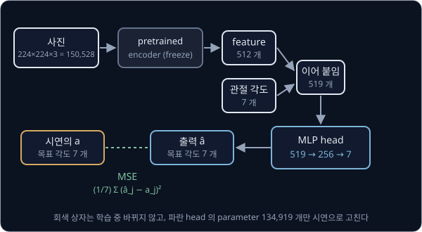

위 그림은 사진과 관절 각도가 action 7 개가 되기까지의 길이다. 회색 상자(encoder)는 freeze 해서 바뀌지 않고, 파란 상자(MLP head)만
시연으로 학습한다. 맨 오른쪽에서 출력 7 개를 시연의 목표 각도 7 개와 비교해 loss 를 잰다.

hidden layer 의 neuron 은 입력에 weight 를 곱해 모두 더하고 bias 를 더한 값, 곧 weighted sum 을 계산한 뒤 ReLU 를 거친다. ReLU 는 음수는 0 으로 바꾸고 양수는 그대로 내보내는 함수로,
$\text{ReLU}(-1) = 0$, $\text{ReLU}(0.5) = 0.5$ 다. [Backpropagation](../autograd/README.md) 의 sigmoid 처럼 곧은 계산을 꺾어 주는
역할을 하고, 계산이 간단해서 요즘 가장 흔히 쓴다. 출력 layer 에는 ReLU 를 쓰지 않는다. 관절 각도는 음수일 수도 있어서, 음수를 0
으로 잘라 버리면 안 되기 때문이다.

작은 숫자로 계산 한 번을 따라가 보자. 입력을 사진 feature 2 개와 관절 각도 1 개로 줄이고, hidden neuron 2 개, 출력 1 개인 MLP 를
쓴다. 입력은 $(0.5, 1.0, 2.0)$ 이다.

| neuron | weight | bias | weighted sum $z$ | ReLU 뒤 |
| --- | --- | --- | --- | --- |
| hidden 1 | $(1, -1, 0.5)$ | 0 | $1 \times 0.5 - 1 \times 1.0 + 0.5 \times 2.0 + 0 = 0.5$ | 0.5 |
| hidden 2 | $(2, -1, -0.5)$ | 0 | $2 \times 0.5 - 1 \times 1.0 - 0.5 \times 2.0 + 0 = -1$ | 0 |
| 출력 | $(2, 3)$ | 1 | $2 \times 0.5 + 3 \times 0 + 1 = 2$ | (ReLU 없음) 2 |

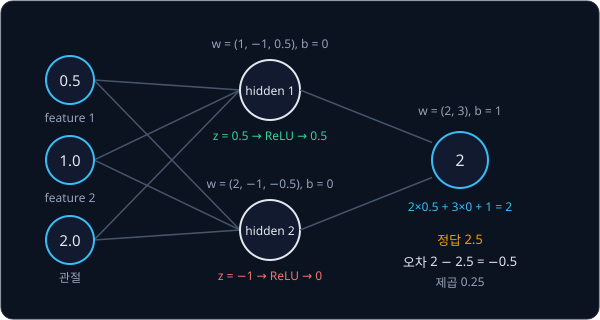

출력은 2 이고, 시연의 정답이 2.5 라면 오차는 $2 - 2.5 = -0.5$, 오차의 제곱은 0.25 다. 실제 head 는 입력 519 칸, hidden 256 개, 출력
7 개로 커질 뿐 칸마다 하는 계산은 이 표와 같다.

head 의 parameter 수는 [Backpropagation](../autograd/README.md) 에서 본 대로 "neuron 수 × (입력 수 + 1)" 을 layer 마다 더한다. 1 을
더하는 것은 neuron 마다 bias 가 하나 있기 때문이다.

| layer | 계산 | parameter 수 |
| --- | --- | --- |
| hidden (519 → 256) | $256 \times (519 + 1)$ | 133,120 |
| 출력 (256 → 7) | $7 \times (256 + 1)$ | 1,799 |
| 합 | | 134,919 |

ResNet-18 의 parameter 는 약 1,170 만 개인데, freeze 했으니 시연으로 고치는 숫자는 head 의 약 13 만 5 천 개뿐이다.

**확인 문제.** 카메라 두 대로 입력이 1031 칸이고 hidden 256 개, 출력 7 개인 head 의 parameter 는 모두 몇 개일까?

답 보기

hidden layer 는 $256 \times (1031 + 1) = 264{,}192$ 개, 출력 layer 는 $7 \times (256 + 1) = 1{,}799$ 개라 합은 $265{,}991$ 개다.

### 관절 각도 7 개의 MSE

head 가 낸 7 개와 시연의 목표 각도 7 개를 비교한다. 각도의 단위는 도(°)이고, 집게는 벌린 각도로 적는다.

| 칸 | 시연의 목표 $a_j$ | head 의 출력 $\hat a_j$ | 오차 $\hat a_j - a_j$ | 오차의 제곱 |
| --- | --- | --- | --- | --- |
| 관절 1 | 10 | 12 | $+2$ | 4 |
| 관절 2 | 45 | 44 | $-1$ | 1 |
| 관절 3 | $-30$ | $-27$ | $+3$ | 9 |
| 관절 4 | 60 | 60 | 0 | 0 |
| 관절 5 | 0 | 1 | $+1$ | 1 |
| 관절 6 | 15 | 13 | $-2$ | 4 |
| 집게 | 30 | 20 | $-10$ | 100 |

제곱의 합은 $4 + 1 + 9 + 0 + 1 + 4 + 100 = 119$ 이고, 7 칸이라 MSE 는 $119 \div 7 = 17$ 이다.

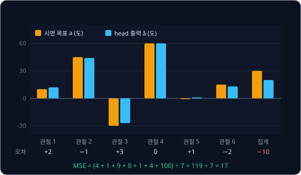

위 그림은 칸마다 시연 목표(주황)와 출력(파랑)을 나란히 세운 것이다. 집게의 막대 차이가 가장 커서 MSE 17 중 대부분인
$100 \div 7 \approx 14.3$ 이 집게 한 칸에서 나왔다.

식으로 쓰면 아래와 같다.

$$
L = \frac{1}{7}\sum_{j=1}^{7} (\hat a_j - a_j)^2
$$

$j$ 는 몇 번째 칸인지를 가리키고, 1 번째부터 7 번째 칸까지 오차를 제곱해 더한 뒤 7 로 나눈다. 앞 표와 맞추면 $\hat a_j - a_j$ 는
오차 열의 $+2, -1, \ldots, -10$, $\Sigma$ 의 결과는 119, $L$ 은 17 이다. 실제 학습에서는 시연 쌍 여러 개의 이 값을 다시 평균한다.

loss 를 출력 $\hat a_j$ 하나로 미분하면 $\frac{2}{7}(\hat a_j - a_j)$ 다. 집게 칸은 $\frac{2}{7} \times (-10) \approx -2.86$, 관절 1 은
$\frac{2}{7} \times 2 \approx 0.57$ 이라 집게 쪽 gradient 가 다섯 배쯤 크다. 크게 틀린 칸일수록 크게 고치라는 신호가 가고, 이 gradient
가 backpropagation 으로 출력 layer 와 hidden layer 의 weight 까지 전해진다.

숫자만 바꿔 한 번 더 한다. 같은 시연 목표에 head 가 $(11, 46, -31, 60, 2, 15, 27)$ 을 냈다면 오차는 $(1, 1, -1, 0, 2, 0, -3)$ 이고 제곱은 $(1, 1, 1, 0, 4, 0, 9)$ 다. 합 16 을 7 로 나눠 MSE 는 약 2.29 로, 앞의 17 보다 훨씬 작다.
집게 오차가 $-10$ 에서 $-3$ 으로 준 것이 가장 크게 작용했다.

**흔한 오해.** 7 칸의 단위가 달라도 그냥 평균하면 된다고 생각하기 쉽다. 관절은 라디안(한 바퀴가 약 6.28 인 각도 단위)으로 $-3$
에서 $3$ 사이이고 집게는 밀리미터로 0 에서 80 사이라면, 집게 칸의 오차가 수십 배 커서 loss 가 거의 집게 하나로 정해진다. 그러면
관절이 조금 틀려도 loss 가 잘 줄지 않아 관절을 제대로 배우지 못한다. 그래서 칸마다 시연에서 잰 평균을 빼고 흩어진 정도로 나눠 크기를
맞춘 뒤 loss 를 잰다. [Linear Regression](../linear-regression/README.md) 의 standardization 과 같은 처리다.

**확인 문제.** 7 칸의 오차가 $(3, -1, 1, 0, 0, 1, -3)$ 이면 MSE 는?

답 보기

제곱은 $9, 1, 1, 0, 0, 1, 9$ 이고 합은 21 이다. $21 \div 7 = 3$ 이다.

**요약**

- 가장 단순한 action head 는 pretrained encoder 의 사진 feature 512 개와 관절 각도 7 개를 이어 붙인 519 개를 MLP 로 받아 목표 각도
  7 개를 낸다
- loss 는 출력 7 개와 시연의 목표 7 개의 MSE 이고, 오차가 큰 칸일수록 gradient 가 크다
- 칸마다 단위와 크기가 다르면 먼저 크기를 맞춰야 한 칸이 loss 를 독차지하지 않는다

## 사진을 적은 숫자로 줄이는 세 방법

### 15 만 개를 그대로 넣을 때의 문제

사진의 숫자 150,528 개와 관절 7 개를 그대로 MLP 에 넣으면 첫 hidden layer 만 해도 parameter 가 $256 \times (150{,}535 + 1) = 38{,}537{,}216$
개, 약 3,850 만 개다. pretrained encoder 를 쓴 head 의 약 290 배다.

시연은 그만큼 많지 않다. 10 초짜리 시연을 30 Hz 로 50 번 기록하면 쌍은 $50 \times 10 \times 30 = 15{,}000$ 개이고, 이웃한 step 의 사진은
거의 똑같아서 실제로 서로 다른 장면은 훨씬 적다. 컵이 1 cm 옆으로 옮겨 가면 컵 가장자리의 pixel 수백 개가 한꺼번에 바뀌는데,
network 는 그중 어느 숫자가 "컵의 위치" 를 뜻하는지부터 시연 몇 만 장으로 알아내야 한다. parameter 에 비해 데이터가 너무 적으면
network 는 규칙을 찾기보다 시연 장면을 하나하나 외워 버리고, 조명이 조금만 바뀌어도 틀린다.

그래서 사진을 먼저 적은 숫자로 줄인다. 방법은 크게 세 가지다.

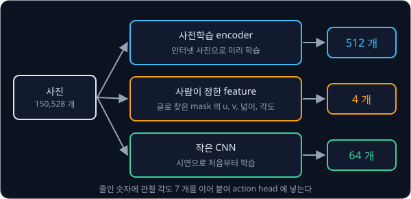

**확인 문제.** 시연을 20 초씩 30 Hz 로 40 번 기록하면 쌍은 몇 개일까?

답 보기

$40 \times 20 \times 30 = 24{,}000$ 개다.

### 사전학습 encoder

앞 절에서 쓴 방법이다. 인터넷 사진 100 만 장 이상으로 미리 학습한 encoder 가 사진을 512 개 정도로 요약한다.

장점은 시연이 적어도 된다는 것이다. 가장자리·모양·사물을 알아보는 법은 이미 익혔으니, 시연으로는 "이 feature 일 때 팔을 어떻게
움직이나" 만 배우면 된다. 단점도 있다. encoder 가 커서(ResNet-18 은 parameter 약 1,170 만 개) 계산이 느리고, 원래 "사진 속 사물의
이름" 을 맞히도록 학습했기 때문에 컵이 사진의 어디에 몇 pixel 차이로 놓였는지 같은 정확한 위치 정보는 덜 담는다. 인터넷 사진과
로봇 작업대의 모습이 많이 다르면 feature 가 작업에 필요한 차이를 놓치기도 한다.

**확인 문제.** 사물 이름을 맞히도록 학습한 encoder 의 feature 가 로봇에게 부족할 수 있는 정보는 무엇일까?

답 보기

물체가 사진의 정확히 어디에 있는지 같은 위치 정보다. "컵이 있다" 는 잘 담지만 "컵이 3 pixel 오른쪽에 있다" 는 덜 담는다.

### 사람이 정한 feature

둘째 방법은 사진에서 무엇을 뽑을지 사람이 정하는 것이다. 요즘은 "빨간 컵" 처럼 글로 적으면 사진에서 그 물체가 차지한 pixel 을
찾아 주는 pretrained 모델이 있다. 예를 들어 Grounding DINO 가 글에 맞는 물체를 상자로 찾고, SAM 이 그 상자 안에서 물체의 모양을
pixel 단위로 따낸다. 사진과 같은 크기의 표에 물체가 있는 pixel 은 1, 없는 pixel 은 0 을 적은 것을 mask 라고 한다.

mask 에서 숫자 몇 개를 계산해 feature 로 쓴다.

- **중심 $(u, v)$** — 1 인 pixel 들의 가로 번호 $u$ 의 평균과 세로 번호 $v$ 의 평균이다. pixel 번호는 사진의 왼쪽 위를 $(0, 0)$ 으로
  두고 오른쪽으로 $u$, 아래로 $v$ 칸을 센다
- **넓이** — 1 인 pixel 의 개수다. 물체가 카메라에 가까울수록 크다
- **각도** — 물체의 긴 쪽이 가로와 이루는 각도다

가로 8 칸, 세로 6 칸짜리 작은 사진에서 mask 가 $u = 2, 3, 4, 5$, $v = 2, 3$ 인 직사각형이라고 하자. 1 인 pixel 은 $4 \times 2 = 8$
개라 넓이는 8 이고, $u$ 의 평균은 $(2 + 3 + 4 + 5) \div 4 = 3.5$, $v$ 의 평균은 $(2 + 3) \div 2 = 2.5$ 다. 긴 쪽이 가로라 각도는
0° 다. 숫자만 바꿔 같은 물체를 세워 $u = 5, 6$, $v = 1, 2, 3, 4$ 에 놓으면 넓이는 똑같이 8 이지만 중심은
$\big((5 + 6) \div 2,\ (1 + 2 + 3 + 4) \div 4\big) = (5.5, 2.5)$ 이고 긴 쪽이 세로라 각도는 90° 다.

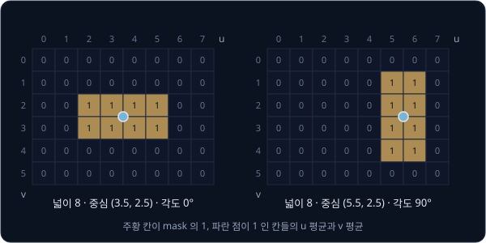

위 그림은 두 mask 를 칸 위에 칠하고 중심을 점으로 찍은 것이다. 사진은 숫자 $8 \times 6 \times 3 = 144$ 개였지만 feature 는
$(u, v, \text{넓이}, \text{각도})$ 4 개뿐이다. 224×224 사진에서도 똑같이 4 개다.

장점은 숫자가 아주 적어 시연이 가장 적게 들고, 사람이 각 숫자의 뜻을 알아서 policy 가 틀렸을 때 원인을 찾기 쉽다는 것이다. mask
가 배경을 지우므로 책상 무늬나 조명이 바뀌어도 feature 는 그대로다. 단점은 사람이 고른 4 개 말고는 policy 가 아무것도 모른다는
것이다. 컵 손잡이의 방향, 옆에 놓인 장애물, 집게가 컵을 이미 쥐었는지 같은 정보는 사라진다. 또 집게가 물체를 가리거나 mask 모델이
엉뚱한 물체를 찾으면 feature 전체가 틀리고, 작업이 바뀔 때마다 무엇을 뽑을지 사람이 다시 정해야 한다.

**확인 문제.** mask 가 $u = 1, 2, 3$, $v = 4$ 인 pixel 세 개라면 중심과 넓이는?

답 보기

$u$ 의 평균은 $(1 + 2 + 3) \div 3 = 2$, $v$ 는 모두 4 라 평균도 4 다. 중심은 $(2, 4)$ 이고 넓이는 3 이다.

### 처음부터 학습하는 작은 CNN

셋째 방법은 사진을 요약하는 network 까지 시연으로 처음부터 학습하는 것이다. CNN(convolutional neural network)은 사진의 작은 조각,
예를 들어 3×3 pixel 마다 같은 weight 묶음을 대 보며 무늬를 찾는 neural network 로, 자세한 계산은 [CNN](../cnn/README.md) 에서 다룬다.
weight 를 무작위로 두고 시작해 action 의 MSE 를 줄이도록 head 와 함께 학습하면, CNN 은 이 작업에 필요한 것(컵의 위치, 집게와 컵의
거리)만 골라 예를 들어 숫자 64 개로 요약하게 된다.

장점은 작업에 꼭 필요한 정보를 스스로 고른다는 것이다. 작게 만들 수 있어서 계산도 빠르다. 단점은 사진을 보는 법부터 배워야 해서
시연이 많이 든다는 것이다. 시연 장면이 적으면 컵 대신 배경의 얼룩이나 그림자를 단서로 외우기 쉽고, 조명·배경이 바뀌면 크게
틀린다.

**확인 문제.** 시연이 수십 개뿐이고 책상 위 조명이 날마다 바뀐다면, 세 방법 중 처음부터 학습하는 작은 CNN 이 가장 불리한 이유는?

답 보기

작은 CNN 은 사진을 보는 법부터 시연으로 배워야 하는데 시연이 적어서, 조명처럼 작업과 상관없는 것을 단서로 외우기 쉽다. 조명이
바뀌면 그 단서가 달라져 크게 틀린다.

### 세 방법의 비교

| 비교 항목 | 사전학습 encoder | 사람이 정한 feature | 처음부터 학습하는 작은 CNN |
| --- | --- | --- | --- |
| 줄인 뒤 숫자 수(예) | 512 | 4 ($u$, $v$, 넓이, 각도) | 64 |
| 시연으로 학습하는 부분 | head 만 (encoder 는 freeze) | head 만 | CNN 과 head 전부 |
| 필요한 시연 양 | 적다 | 가장 적다 | 많다 |
| 장점 | 사진을 보는 일반적인 능력을 이미 갖췄다 | 숫자의 뜻이 분명하고 배경이 바뀌어도 그대로다 | 작업에 필요한 정보를 스스로 고르고 계산이 빠르다 |
| 단점 | 크고 느리며 정확한 위치 정보를 덜 담는다 | 고르지 않은 정보는 모두 잃고 mask 가 틀리면 전부 틀린다 | 시연이 적으면 배경·조명을 외운다 |

**확인 문제.** 컵 하나를 집는 작업에 시연이 20 개뿐이고, 사람이 컵의 위치와 방향만 알면 충분하다고 판단했다. 어느 방법이 가장
알맞을까?

답 보기

사람이 정한 feature 다. 필요한 정보가 위치와 방향뿐이라 4 개로 충분하고, 숫자가 적어 시연 20 개로도 배울 수 있다.

**요약**

- 사진 숫자 150,528 개를 그대로 넣으면 parameter 가 수천만 개라 시연 몇 만 장으로는 외우기만 한다
- 사전학습 encoder 는 512 개 정도로, 사람이 정한 feature 는 mask 의 중심·넓이·각도 4 개로, 작은 CNN 은 시연으로 직접 배운 64 개
  정도로 줄인다
- 숫자가 적을수록 시연이 적게 들지만 버리는 정보가 많고, 많을수록 정보는 남지만 시연이 많이 든다

## 카메라 영상에서 관절 각도로 바로 가는 end-to-end

### 모듈 파이프라인과 end-to-end

로봇 팔로 컵을 집는 전통적인 방법은 일을 여러 단계로 나눠 단계마다 사람이 계산을 짜는 것이다. 사진에서 컵의 pixel 위치를 찾고,
depth 카메라로 그 pixel 까지의 거리를 재고, pixel 과 거리로 컵의 3D 좌표 $(X, Y, Z)$ 를 계산하고, 집게 끝을 그 좌표에 보내려면
관절을 각각 몇 도로 돌려야 하는지 구한다. depth 카메라는 pixel 마다 그곳까지의 거리를 함께 재는 카메라다. 마지막 계산을 inverse
kinematics 라 하고 [Inverse Kinematics](../inverse-kinematics/README.md) 에서 다룬다. 이렇게 단계를 나눠 이은 것을 모듈 파이프라인
이라 하고, [Classical Pick & Place](../classical-pick/README.md) 에서 끝까지 만들어 본다.

end-to-end 는 이 단계를 모두 없애고 network 하나가 사진에서 관절 각도까지 한 번에 배우는 방식이다. 이름은 "입력 끝(end)에서 출력
끝(end)까지" 라는 뜻이다. 앞 절의 action head 가 바로 end-to-end policy 다. 3D 좌표도 거리도 계산하지 않고, 시연의 (사진, 관절 각도)
쌍만으로 학습한다.

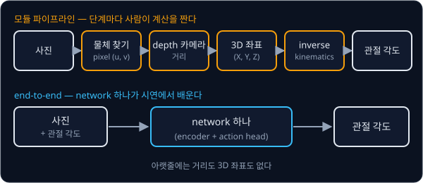

위 그림의 윗줄은 단계마다 사람이 짠 계산을 거치는 길이고, 아랫줄은 network 하나로 가는 길이다. 모듈 파이프라인은 단계마다 결과를
따로 확인할 수 있지만 카메라 위치를 정확히 재는 calibration 이 필요하고, 앞 단계의 오차가 뒤 단계로 그대로 넘어간다. end-to-end 는
calibration 없이 시연만으로 배우지만, 중간 결과가 없어서 틀렸을 때 어디가 틀렸는지 알기 어렵다. calibration 은
[Camera Geometry](../camera-geometry/README.md) 에서 다룬다.

**확인 문제.** 모듈 파이프라인에서 depth 카메라가 거리를 2 cm 길게 쟀다. 이 오차는 어디까지 전해질까?

답 보기

3D 좌표가 틀리고, 그 좌표로 구한 관절 각도도 틀려서 집게가 컵에서 빗나간 곳으로 간다. 앞 단계의 오차가 마지막 단계까지 넘어간다.

### 3D 좌표 없이 되는 이유

end-to-end 가 3D 좌표 없이 통하는 까닭을 숫자로 보자. 카메라를 작업대 위 한자리에 고정하고, 컵을 책상 위 여러 곳에 놓으며
시연했다. 사진 속 컵 중심의 가로 번호 $u$ 와, 컵을 집을 때 관절 1(팔 전체를 좌우로 돌리는 관절)의 각도는 아래와 같았다.

| 사진 속 컵의 $u$ (pixel) | 100 | 200 | 300 |
| --- | --- | --- | --- |
| 집을 때 관절 1 의 각도 (도) | 20 | 40 | 60 |

$u$ 가 100 늘 때마다 각도가 20° 씩 는다. 그러면 시연에 없던 $u = 250$ 에서는 40° 와 60° 사이의 50° 를 내면 된다. network 는 "컵이
사진의 이 자리에 보이면 관절을 이만큼 돌린다" 를 시연 쌍에서 배울 뿐이고, 그 사이에 3D 좌표는 필요 없다. 이 관계를 배우는 일은
Linear Regression 으로 직선을 맞추는 일과 같다.

이것이 통하는 이유는 컵이 늘 책상 위에 놓이기 때문이다. [Camera Geometry](../camera-geometry/README.md) 에서 보았듯이 카메라
한 대는 한 pixel 이 얼마나 먼 곳인지 모른다. 같은 pixel 에 찍히는 점이 카메라에서 뻗은 직선 위 어디든 될 수 있어서다. 그런데 물체가
책상 높이에만 놓인다면 그 직선이 책상과 만나는 점은 하나뿐이라, 고정 카메라의 pixel 하나는 책상 위의 자리 하나와 짝지어진다.

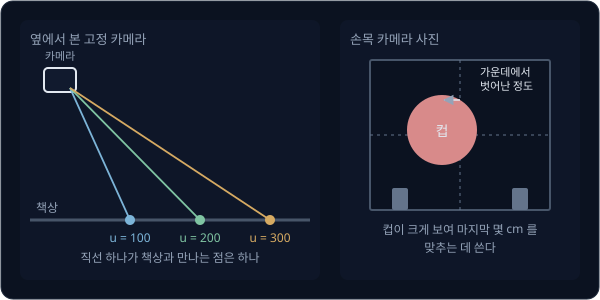

위 그림의 왼쪽은 고정 카메라에서 나간 직선이 책상과 만나는 점이 직선마다 하나라는 것을 보여 준다. 오른쪽은 집게 바로 위에 단
카메라, 곧 손목 카메라의 사진이다. 고정 카메라에서 컵은 수십 pixel 크기로 작게 보이고, 집게가 컵에 다가가면 팔이 컵을 가리기도
한다. 손목 카메라에는 컵이 가까이 크게 찍혀서 집게가 컵 가운데에서 왼쪽으로 몇 mm 벗어났는지, 집게를 닫을 만큼 가까운지가 잘
보인다. 그래서 고정 카메라는 "책상 어디에 컵이 있나" 를, 손목 카메라는 "마지막 몇 cm 를 어떻게 맞추나" 를 맡고, 두 사진의 feature
를 이어 붙여 head 에 넣는다.

**확인 문제.** 위 표의 시연으로 학습한 policy 에 컵이 $u = 150$ 에 보이면 관절 1 은 몇 도쯤일까?

답 보기

$u$ 가 100 에서 50 늘었고 100 당 20° 이므로 $20 + 10 = 30$° 다.

### end-to-end 가 통하는 조건

이 방식은 시연과 실행의 조건이 같을 때만 통한다. 지켜야 할 조건은 아래와 같다.

- **카메라 두 대** — 책상 전체를 보는 고정 카메라와 집게 근처를 보는 손목 카메라를 함께 쓴다. 고정 카메라만으로는 마지막 정렬이
  거칠고, 손목 카메라만으로는 컵이 화면 밖에 있을 때 어디로 가야 할지 모른다
- **카메라 위치 고정** — 시연 때와 실행 때 고정 카메라가 같은 자리, 같은 방향이어야 한다
- **물체 위치를 골고루** — 시연 때 컵을 책상 위 여러 곳에 고르게 놓는다. 예를 들어 다섯 곳에 열 번씩 놓으면 시연은 50 개다
- **시연 범위 안의 실행** — 실행 때 컵도 시연에서 놓았던 범위 안에 있어야 한다

카메라가 움직이면 무슨 일이 생기는지 계산해 보자. 누가 고정 카메라를 건드려, 시연 때 $u = 200$ 에 보이던 책상 위 자리가 이제
$u = 250$ 에 보인다고 하자. 컵은 시연 때와 같은 자리에 있으니 관절 1 은 40° 여야 하지만, policy 는 $u = 250$ 을 보고 50° 를 낸다.
관절 1 이 10° 더 돌면 30 cm 떨어진 집게 끝은 옆으로 얼마나 움직일까? 반지름 30 cm 인 원의 둘레는 $2 \times 3.14 \times 30 \approx 188$ cm
이고, 10° 는 한 바퀴 360° 의 $\frac{10}{360} = \frac{1}{36}$ 이라 $188 \div 36 \approx 5.2$ cm 다. 컵의 지름이 8 cm 라면 집게가 컵
가장자리를 치게 된다.

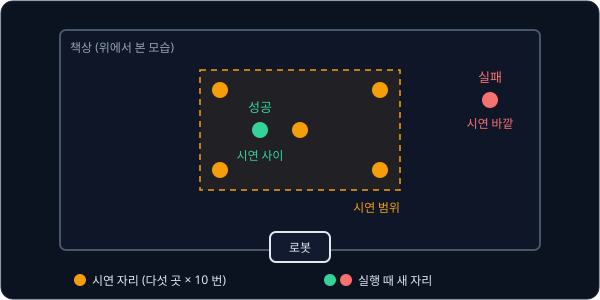

위 그림은 책상을 위에서 본 것이다. 시연에서 컵을 놓은 다섯 자리가 만든 영역 안쪽은 시연 사이를 메우는 계산이라 잘 맞고, 영역
바깥은 시연에 없는 곳이라 policy 가 무엇을 낼지 알 수 없다.

**확인 문제.** 카메라가 밀려 시연 때 $u = 100$ 이던 자리가 $u = 150$ 에 보인다. 컵이 그 자리에 있을 때 policy 는 몇 도를 내고,
몇 도 틀릴까?

답 보기

policy 는 $u = 150$ 을 보고 30° 를 낸다. 컵은 시연 때 $u = 100$ 이던 자리라 20° 가 맞으므로 10° 틀린다.

### 시연 범위 밖의 실패

시연에서 컵을 $u = 100$ 부터 300 사이에만 놓았는데 실행 때 $u = 500$ 에 놓였다고 하자. 표의 규칙을 그대로 늘리면 100° 겠지만,
network 는 직선이 아니라서 시연 범위 밖에서 그 규칙을 따른다는 보장이 없다. 시연 사이를 메우는 것은 잘하지만 시연 바깥으로 늘려
가는 것은 못 한다. 차가 시연에 없던 위치에서 크게 틀린 compounding error 와 같은 이유다.

위치만 그런 것이 아니다. 시연에서 본 적 없는 모양의 컵, 바뀐 조명, 책상 위에 새로 놓인 물건도 모두 시연 범위 밖이다. end-to-end
policy 는 시연에서 본 것과 비슷한 장면에서만 믿을 수 있다.

**흔한 오해.** end-to-end 로 학습한 policy 가 "컵을 집는 법" 을 이해했으니 어디에 놓인 어떤 컵이든 집을 것이라고 생각하기 쉽다.
policy 가 배운 것은 시연 장면과 관절 각도 사이의 짝일 뿐이라, 시연이 덮지 않은 자리·물체·조명에서는 실패한다. 시연 범위를 넓히려면
시연을 더 다양하게 모아야 한다.

**확인 문제.** 시연에서 컵을 늘 책상의 왼쪽 절반에만 놓았다. 실행 때 오른쪽 끝에 놓인 컵을 집지 못하는 이유는?

답 보기

오른쪽 끝은 시연 범위 밖이라 그 자리의 사진에 짝지어진 관절 각도를 한 번도 배우지 못했다. network 는 시연 사이는 메우지만 시연
바깥으로 늘려 가는 것은 보장하지 못한다.

**요약**

- end-to-end 는 사진에서 관절 각도까지 network 하나로 배우고, 3D 좌표나 depth 를 계산하지 않는다
- 물체가 책상 위에 있고 카메라가 고정돼 있으면 pixel 과 책상 위 자리가 하나씩 짝지어져서, 시연에서 "이 pixel 이면 이 각도" 를
  배울 수 있다. 손목 카메라는 마지막 정렬을 맡는다
- 카메라 위치가 바뀌거나 물체·조명이 시연 범위 밖이면 실패한다

## 정답이 여럿인 시연과 multimodal

### 장애물 앞의 두 시연

다시 차로 돌아가자. 차선 한가운데에 상자가 떨어져 있다. expert 는 같은 장면에서 시연 10 번 중 5 번은 핸들을 왼쪽으로 20° 꺾어
상자의 왼쪽으로, 5 번은 오른쪽으로 20° 꺾어 오른쪽으로 피했다. 오른쪽을 양수로 적으니 정답 action 은 $-20$ 이 5 개, $+20$ 이 5 개다.
두 행동 모두 옳고, 핸들을 $-10$° 에서 $+10$° 사이로 꺾으면 상자에 부딪힌다.

관측은 열 번 모두 같다. 그래서 policy 는 이 관측 하나에 action 하나를 내야 한다.

**확인 문제.** 이 시연에서 정답 action 의 평균은 얼마일까?

답 보기

$\big(5 \times (-20) + 5 \times 20\big) \div 10 = 0 \div 10 = 0$° 다. 핸들을 꺾지 않고 곧장 가는 action 이다.

### 평균을 내는 MSE

이 관측에서 policy 가 낼 수 있는 action 을 몇 개 골라 MSE 를 계산해 보자. 예를 들어 $\hat a = -10$ 이면 왼쪽 시연 5 개와의 오차는
$-10 - (-20) = 10$, 오른쪽 시연 5 개와의 오차는 $-10 - 20 = -30$ 이라 MSE 는 $(5 \times 100 + 5 \times 900) \div 10 = 500$ 이다.

| policy 의 action $\hat a$ (도) | 왼쪽 시연과의 오차 | 오른쪽 시연과의 오차 | MSE | 결과 |
| --- | --- | --- | --- | --- |
| $-20$ | 0 | $-40$ | $(0 + 5 \times 1600) \div 10 = 800$ | 왼쪽으로 피한다 |
| $-10$ | 10 | $-30$ | $(5 \times 100 + 5 \times 900) \div 10 = 500$ | 부딪힌다 |
| 0 | 20 | $-20$ | $(5 \times 400 + 5 \times 400) \div 10 = 400$ | 부딪힌다 |
| $+10$ | 30 | $-10$ | $(5 \times 900 + 5 \times 100) \div 10 = 500$ | 부딪힌다 |
| $+20$ | 40 | 0 | $(5 \times 1600 + 0) \div 10 = 800$ | 오른쪽으로 피한다 |

MSE 가 가장 작은 것은 0° 이고, 0° 는 상자로 곧장 돌진하는 action 이다. 상자를 피하는 두 action 은 오히려 MSE 가 가장 크다. MSE 를
줄이도록 학습한 policy 는 두 정답의 평균인 0° 를 배우게 된다.

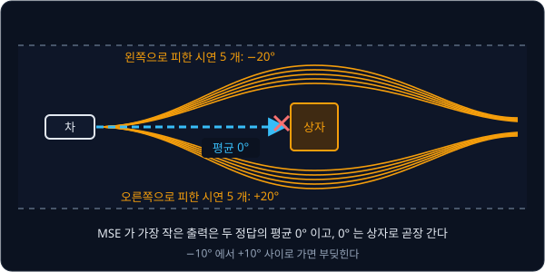

평균이 MSE 를 가장 작게 만드는 이유는 gradient 로 확인할 수 있다. 같은 관측에서 policy 가 내는 값을 $\hat a$ 하나로 두면 loss 는
$L = \frac{1}{N}\sum_i (\hat a - a_i)^2$ 이고, Linear Regression 의 $b$ 에 대한 gradient 와 같은 모양으로

$$
\frac{\partial L}{\partial \hat a} = \frac{2}{N}\sum_{i=1}^{N} (\hat a - a_i)
$$

이다. 가장 낮은 점에서는 gradient 가 0 이므로 $\sum_i (\hat a - a_i) = 0$, 곧 $N \times \hat a = \sum_i a_i$ 이고, 양변을 $N$ 으로
나누면 $\hat a = \frac{1}{N}\sum_i a_i$ 다. 이 값은 정답들의 평균이다. 위 예에서 $\hat a = 0$ 을 넣으면 gradient 가
$\frac{2}{10} \times \big(5 \times 20 + 5 \times (-20)\big) = 0$ 이 되어 확인된다.

숫자만 바꿔 시연이 왼쪽 7 번, 오른쪽 3 번이었다면 평균은 $\big(7 \times (-20) + 3 \times 20\big) \div 10 = (-140 + 60) \div 10 = -8$° 다.
많은 쪽으로 끌려가긴 했지만 $-10$° 에서 $+10$° 사이라 여전히 상자에 부딪힌다. MSE 는 $-8$° 에서 336 이고, 왼쪽으로 피하는 $-20$° 의
$3 \times 40^2 \div 10 = 480$ 보다 작다.

**흔한 오해.** 시연을 더 많이 모으면 이 문제가 풀릴 것이라고 생각하기 쉽다. 왼쪽 500 번, 오른쪽 500 번으로 늘려도 평균은 그대로
0° 다. 문제는 데이터의 양이 아니라 "관측 하나에 숫자 하나" 를 내는 policy 와 MSE 의 조합에 있다.

**확인 문제.** 같은 장면에서 시연 4 개는 $-30$°, 시연 6 개는 $+20$° 였다. MSE 로 학습한 policy 는 몇 도를 낼까?

답 보기

평균 $\big(4 \times (-30) + 6 \times 20\big) \div 10 = (-120 + 120) \div 10 = 0$° 다. 두 정답이 다르게 흩어져 있어도 평균이 0 이면
곧장 돌진한다.

### 분포의 봉우리

실제 시연은 정확히 $\pm 20$° 로 나오지 않고 조금씩 흩어진다. 상자 앞 시연 20 개의 action 을 2° 구간마다 세면 아래와 같았다고 하자.

| action (도) | $-22$ | $-20$ | $-18$ | … | $+18$ | $+20$ | $+22$ |
| --- | --- | --- | --- | --- | --- | --- | --- |
| 시연 수 | 2 | 5 | 3 | 0 | 3 | 5 | 2 |

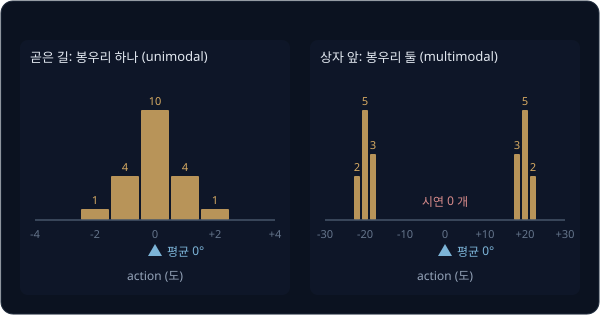

위 그림의 오른쪽이 이 표의 histogram 이다. $-20$° 근처와 $+20$° 근처에 막대가 솟은 언덕이 두 개 있다. 이 언덕을 봉우리라고 하고,
봉우리의 꼭대기처럼 가장 자주 나온 값을 mode 라고 부른다. 평균 $\big(2 \times (-22) + 5 \times (-20) + 3 \times (-18) + 3 \times 18 + 5 \times 20 + 2 \times 22\big) \div 20 = 0$
에는 막대가 하나도 없다. 평균이 "가장 그럴듯한 값" 이 아니라 "아무도 하지 않은 값" 이 된 것이다.

봉우리가 하나인 분포를 unimodal, 여럿인 분포를 multimodal 이라고 한다. uni 는 "하나", multi 는 "여럿" 이라는 뜻이고 modal 은
mode 에서 왔다. 그림 왼쪽처럼 곧은 길에서의 시연은 0° 근처에 봉우리가 하나라 unimodal 이고, 이때는 평균이 봉우리 꼭대기와 거의
같아서 MSE 로 학습해도 괜찮다. 오른쪽처럼 같은 관측에 정답 action 이 여럿인 시연을 multimodal 시연이라고 부른다.

**확인 문제.** 컵을 집는 시연에서 사람마다 컵을 왼쪽에서 집기도, 오른쪽에서 집기도 했다. 이 시연의 집게 위치 분포는 unimodal 일까,
multimodal 일까? MSE 로 학습하면 어떤 일이 생길까?

답 보기

같은 장면에 정답이 둘(왼쪽, 오른쪽)이라 multimodal 이다. MSE 로 학습하면 두 위치의 평균, 곧 컵의 한가운데 위로 집게를 보내서 어느
쪽으로도 제대로 집지 못한다.

### multimodal 의 두 뜻

multimodal 이라는 단어는 로봇 학습 강의에서 서로 다른 두 뜻으로 쓰인다. 아래 표의 둘째 줄은 사진과 글을 같은 기준으로 비교하는
CLIP, 그리고 사진과 글 명령을 받아 로봇의 action 을 내는 VLA(vision-language-action) 모델에서 쓰는 뜻이다.

| 쓰이는 강의 | 뜻 | 예 |
| --- | --- | --- |
| behavior cloning, [ACT](../act/README.md), [Diffusion Policy](../diffusion-policy/README.md) | 같은 관측에 정답 action 이 여럿이라 action 분포의 봉우리가 여럿이다 | 상자를 왼쪽으로도 오른쪽으로도 피한다 |
| [CLIP](../clip/README.md), [RT-2 → OpenVLA](../vla-tokens/README.md) 같은 VLA | 입력의 종류가 여럿이다 | 카메라 사진과 "빨간 컵을 집어" 라는 글과 관절 각도를 함께 받는다 |

첫째 뜻의 modal 은 통계의 mode(가장 자주 나온 값)에서 왔다. 둘째 뜻의 modal 은 modality 에서 왔는데, modality 는 시각·언어·촉각처럼
정보를 받아들이는 감각의 종류를 말한다. VLA 는 vision(사진)·language(글)·action 을 한 모델에서 다루는데, 사진과 글이라는 두 종류의 입력을
받아서 multimodal 모델이라고 부른다. 두 뜻은 철자만 같을 뿐 가리키는 것이 다르다. "multimodal 모델" 은 입력의
종류 이야기이고, "multimodal 시연" 이나 "multimodal 분포" 는 정답이 여럿이라는 이야기다. 사진과 글을 함께 받는 VLA 도 action 을 MSE
로 학습하면 multimodal 시연에서 평균을 낸다.

**확인 문제.** "이 모델은 카메라 영상과 음성 명령을 함께 받는 multimodal 모델이다" 와 "이 데이터셋은 multimodal 이라 MSE 로 학습하면
안 된다" 에서 multimodal 은 각각 어느 뜻일까?

답 보기

앞 문장은 입력의 종류(영상, 음성)가 여럿이라는 뜻이고, 뒤 문장은 같은 관측에 정답 action 이 여럿이라 분포의 봉우리가 여럿이라는
뜻이다.

### 평균을 피하는 방법

평균의 함정을 피하려면 policy 가 숫자 하나가 아니라 "어떤 action 이 얼마나 그럴듯한가" 를 내거나, 봉우리 중 하나를 골라 내거나,
시연이 갈리는 이유를 policy 의 입력에 더해 줘야 한다.
1989년의 ALVINN 도 핸들 각도를 숫자 하나로 내지 않았다. 45 개 출력 unit 을 왼쪽 끝부터 오른쪽 끝까지 방향 하나씩에 짝짓고, 정답
방향 근처의 unit 들이 언덕 모양으로 커지도록 학습했다. 이런 출력은 왼쪽과 오른쪽 두 곳에 언덕을 함께 세울 수 있어서, 숫자 하나를
내는 policy 처럼 두 방향을 하나의 평균으로 합쳐 버리지 않고 둘 중 하나를 고를 여지를 남긴다.

이 생각은 뒤의 강의들로 이어진다. [RT-1](../rt1/README.md) 은 action 의 범위를 256 개 구간으로 나누고 구간마다 확률을 내는 분류
문제로 바꿔, $-20$° 구간과 $+20$° 구간에 높은 확률을 함께 줄 수 있다. [ACT](../act/README.md) 는 학습할 때 시연마다 달라지는
움직임의 방식을 style 이라는 작은 숫자 묶음에 따로 담아 policy 에 함께 넣는다. 같은 관측이라도 style 숫자가 다르면 입력이 달라지니,
학습하는 동안에는 갈라지는 시연을 하나의 평균으로 뭉갤 이유가 사라진다. 로봇을 실제로 움직일 때는 이 숫자를 0 으로 고정해서 같은
관측에 언제나 같은 움직임 하나만 낸다. 그래서 시연이 $-20$° 와 $+20$° 처럼 정반대인 둘로 반반 갈리면, style 숫자 0 이 내는 움직임이
둘 중 하나라는 보장은 없다. [Diffusion Policy](../diffusion-policy/README.md) 는 무작위 숫자에서 출발해 조금씩 고쳐 가며 action 을 만들어서, 출발한 숫자에 따라 두
봉우리 중 하나에 도착한다.

**확인 문제.** action 을 구간으로 나눠 확률을 내는 policy 가 $-20$° 구간에 0.5, $+20$° 구간에 0.5, 나머지에 0 을 냈다. 가장 확률이
높은 구간을 고르면 상자에 부딪힐까?

답 보기

부딪히지 않는다. 고를 수 있는 것은 확률이 높은 $-20$° 나 $+20$° 구간이고, 확률이 0 인 0° 구간은 고르지 않는다. MSE 로 학습한
policy 처럼 두 값의 평균을 새로 만들어 내지 않는다.

**요약**

- 같은 관측에 정답 action 이 여럿이면 MSE 를 가장 작게 만드는 출력은 정답들의 평균이고, $\pm 20$° 의 평균 0° 는 상자로 돌진하는
  action 이다
- 봉우리가 여럿인 action 분포가 multimodal 분포이고, 이 뜻은 VLA·CLIP 에서 "입력의 종류가 여럿" 이라는 뜻의 multimodal 과 다르다
- 평균을 피하는 방법은 RT-1 의 구간 분류, ACT 의 style 숫자, Diffusion Policy 의 무작위 출발점으로 이어진다. ACT 는 실행할 때
  style 숫자를 0 으로 고정하므로, 정반대로 반반 갈린 시연에서 둘 중 하나를 고른다는 보장은 없다

## 정리

- behavior cloning 은 expert 의 시연에서 모은 (관측, action) 쌍을 (입력, 정답) 으로 삼아 policy $\pi_\theta$ 를 supervised learning
  으로 학습한다. loss $\frac{1}{N}\sum (\pi_\theta(o_i) - a_i)^2$ 와 gradient, update 는 Linear Regression 과 같고, 두 쌍
  $(1, 4)$, $(2, 8)$ 에서 loss 가 40, 17.46, 7.72 로 줄며 expert 의 $a = 4x$ 로 다가간다
- 시연은 expert 가 지나간 상태에서만 나온다. policy 의 작은 오차가 차를 시연에 없는 위치로 옮기면 그곳에서 오차가 커져
  $0.1 \to 0.2 \to 0.4 \to 0.8$ m 로 쌓이고, 차가 차선을 벗어난다. 이것이 distribution shift 로 생기는 compounding error 이고, 틀리는
  횟수는 많게는 $T^2\epsilon$ 까지 는다. validation loss 는 시연 쪽 분포에서만 재서 이 문제를 보여 주지 못한다
- 가장 단순한 action head 는 pretrained encoder 의 사진 feature 512 개와 관절 각도 7 개를 이어 붙인 519 개를 MLP 에 넣어 목표 각도
  7 개를 내고, 시연과의 MSE 로 학습한다. 오차 $(2, -1, 3, 0, 1, -2, -10)$ 이면 MSE 는 $119 \div 7 = 17$ 이다
- 사진 숫자 150,528 개는 사전학습 encoder(512), 사람이 정한 mask feature(4), 처음부터 학습하는 작은 CNN(64) 중 하나로 줄인다.
  숫자가 적을수록 시연이 적게 들고, 대신 버리는 정보가 많다
- end-to-end policy 는 고정 카메라의 pixel 과 책상 위 자리가 짝지어지기 때문에 3D 좌표 없이 사진에서 관절 각도를 배운다. 카메라를
  옮기거나 시연 범위 밖에 물체를 두면 실패한다
- 같은 관측에 정답이 여럿인 multimodal 시연에서 MSE 는 정답들의 평균을 내고, 그 평균은 아무도 하지 않은 action 일 수 있다

behavior cloning 의 두 한계 가운데 compounding error 는 policy 가 직접 간 상태에서 expert 의 정답을 다시 받아 데이터를 넓히는
[DAgger](../dagger/README.md) 와, action 을 여러 step 묶음으로 내는 [ACT](../act/README.md) 에서 다룬다. multimodal 시연에서 평균을
내는 문제는 action 을 구간 분류로 바꾼 [RT-1](../rt1/README.md) 에서 처음 다룬다. [ACT](../act/README.md) 는 시연마다 다른
움직임 방식을 style 숫자로 갈라 학습하고, [Diffusion Policy](../diffusion-policy/README.md) 는 무작위 출발점에서 봉우리 하나에
도착하는 방법을 보인다.

## 참고 자료

- Dean A. Pomerleau, [ALVINN: An Autonomous Land Vehicle in a Neural Network](https://proceedings.neurips.cc/paper/1988/hash/812b4ba287f5ee0bc9d43bbf5bbe87fb-Abstract.html) (1989) —
  사람의 운전 기록으로 차를 모는 network 를 학습한 첫 사례. 9 쪽으로 짧고, Figure 1 의 구조와 학습 정답을 정하는 부분만 읽어도 된다
- Stéphane Ross, J. Andrew Bagnell, [Efficient Reductions for Imitation Learning](https://proceedings.mlr.press/v9/ross10a.html) (2010) —
  $T^2\epsilon$ 식의 출처. Section 2 의 Theorem 2.1 에서 실수가 쌓이는 상한을 증명한다
- Mariusz Bojarski et al., [End to End Learning for Self-Driving Cars](https://arxiv.org/abs/1604.07316) (2016) — 같은 발상을
  CNN 과 실제 도로로 키운 NVIDIA 의 연구. 옆 카메라 영상에 가운데로 돌아오는 조향 정답을 붙여 시연에 없는 장면을 채우는 방법이 나온다
- UC Berkeley CS 285, [Supervised Learning of Behaviors 강의 슬라이드](https://rail.eecs.berkeley.edu/deeprlcourse/static/slides/lec-2.pdf) —
  distribution shift 와 compounding error 를 그림으로 설명한다. [강의 페이지](https://rail.eecs.berkeley.edu/deeprlcourse/) 의
  Homework 1 이 imitation learning 이다
- Hugging Face, [Robot Learning: A Tutorial](https://huggingface.co/spaces/lerobot/robot-learning-tutorial) — 로봇 학습 전반을 정리한 튜토리얼로,
  behavior cloning 장을 이 강의 뒤에 읽으면 좋다
