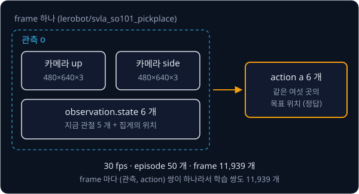

# Behavior Cloning

컵을 집어 상자에 넣는 일을 규칙으로 적으려면 컵이 사진 어디에 있는지 찾는 법, 관절마다 몇 도를 돌릴지, 집게를 언제 닫을지를 상황마다
정해야 해서 몇 줄 못 가 막힌다. 사람은 그 규칙을 말로 설명하지 못해도 조종용 팔을 잡고 로봇을 움직여 일을 해 보일 수는 있다. 규칙을 한 줄도
적지 않고, 이렇게 해 보인 기록만으로 로봇이 같은 일을 하게 만들 수 있을까?

behavior cloning 은 이 기록을 (관측, 행동) 쌍으로 나눠 입력과 정답으로 삼고, 로봇이 따를 규칙을 학습하는 방법이다. NVIDIA 의
Bojarski 등은 2016 년 사람이 운전한 약 72 시간의 기록으로 network 를 학습했고, 이 network 는 실제 도로에서 운전 시간의 약 98% 동안
사람 손 없이 차를 조향했다. 다만 같은 논문에 따르면 사람의 운전 기록만으로 학습한 차는 천천히 도로 밖으로 밀려난다.

## 학습 목표

- behavior cloning 이 시연의 (관측, action) 쌍을 정답 삼아 policy 를 supervised learning 으로 학습한다는 것을 설명하고, loss 와
  gradient 계산을 숫자로 따라갈 수 있다
- 작은 오차가 distribution shift 를 거쳐 compounding error 로 쌓이는 과정과, validation loss 가 그 문제를 보여 주지 못하는 이유를
  설명할 수 있다
- 사진과 관절 각도를 받아 목표 각도를 내는 action head 의 구조와, end-to-end policy 가 통하는 조건을 설명할 수 있다
- 정답 action 이 여럿인 시연에서 MSE 가 평균을 내는 이유와, 봉우리 하나를 고르는 방법들의 차이를 설명할 수 있다

## 시연 데이터

사람이나 프로그램이 일을 직접 해 보인 기록을 **시연**(demonstration)이라 하고, 시연을 보여 주는 쪽을 expert 라고 부른다. 로봇 팔이라면
사람이 똑같이 생긴 조종용 팔(leader)을 손으로 움직이고, 로봇 팔(follower)이 그 관절 각도를 따라 하는 동안 카메라 사진과 관절 각도를
기록한다. 사람이 로봇을 원격으로 조종하는 이 방식을 teleoperation 이라고 한다. 이렇게 기록을 모으는 방법은
[Teleop Dataset](../teleop-dataset/README.md) 에서 다룬다.

로봇이 센서를 한 번 읽고 명령을 한 번 내는 순간을 step 이라고 하는데, 시연은 step 마다 그 순간 센서로 받은 값인 **관측**(observation)
$o$ 와 그 순간 expert 가 낸 명령인 **action** $a$ 를 남긴다. 시연을 처음부터 끝까지 한 번 한 기록은 **episode** 다. 30 Hz(1초에 30 번)로
8 초 동안 시연하면 episode 하나에 (관측, action) 쌍이 $30 \times 8 = 240$ 개 생긴다.

설명을 단순하게 하려고 먼저 차선을 따라 달리는 차를 예로 든다. 양쪽 거리 센서가 잰 왼쪽 차선 경계까지의 거리 $d_L$ 과 오른쪽 경계까지의 거리
$d_R$ 이 관측이고, 핸들을 꺾는 각도가 action 이다(오른쪽이 양수). 차선 폭이 3.5 m 라서 가운데에서는 양쪽이 1.75 m 이고, 왼쪽으로 0.5 m
치우치면 $d_L = 1.75 - 0.5 = 1.25$ m, $d_R = 1.75 + 0.5 = 2.25$ m 다. 이 예의 expert 는 차의 정확한 위치를 아는 프로그램으로, 가운데에서
왼쪽으로 0.5 m 벗어날 때마다 핸들을 오른쪽으로 4° 씩 더 꺾는다.

| step | $d_L$ (m) | $d_R$ (m) | expert 의 action (도) |
| --- | --- | --- | --- |
| 0 | 1.75 | 1.75 | 0 |
| 1 | 1.25 | 2.25 | +4 |
| 2 | 1.50 | 2.00 | +2 |
| 3 | 1.75 | 1.75 | 0 |

step 1 에서 차가 왼쪽으로 0.5 m 치우치자 expert 는 4° 를 꺾었고, 0.25 m 만 남은 step 2 에서는 2° 를 꺾었다.

로봇 팔의 시연도 같은 모양이다. Hugging Face 의 로봇 학습 라이브러리 LeRobot 이 공개한 lerobot/svla_so101_pickplace 는 작은 팔 SO-101 로
물체를 집어 옮긴 시연 dataset 이다.

기록의 한 장면을 frame 이라고 하는데, frame 마다 관측으로는 카메라 두 대의 사진과 관절 5 개·집게의 지금 위치가 들어 있고 action 으로는
같은 여섯 곳의 목표 위치가 들어 있다. 1초에 frame 30 개(30 fps)로 episode 50 개를 기록해 frame 이 모두 11,939 개이고, frame 마다 쌍이
하나라 학습에 쓸 쌍도 11,939 개다. 시연 하나는 평균 $11{,}939 \div 50 \approx 239$ frame 이라 8 초쯤 걸린다.

**확인 문제.** 30 Hz 로 10 초짜리 시연을 40 번 모으면 (관측, action) 쌍은 몇 개일까?

답 보기

1. episode 하나의 step 수: $30 \times 10 = 300$
2. 40 번이면: $300 \times 40 = 12{,}000$

답: 12,000 개다.

## policy 와 behavior cloning

관측을 받아 action 을 내는 규칙을 **policy** 라고 하고 그리스 문자 $\pi$(pi, 파이)로 적는다. 학습으로 정할 parameter 를 한데 묶어
$\theta$(theta, 세타)라고 하면, policy 의 예측은 관측 $o$ 를 policy $\pi_\theta$ 에 넣어 나온 값이라
$\hat a = \pi_\theta(o)$ 로 쓴다. $\hat a$(a hat)의 모자는 expert 가 실제로 낸 $a$ 와 구별하려고 붙인 표시다. expert 의 규칙에는 별을
붙여 $\pi^*$(파이 스타)로 적는다.

시연의 (관측, action) 쌍을 (입력, 정답) 쌍으로 그대로 쓰고, policy 의 예측이 expert 의 action 에 가까워지도록 parameter 를 고치는 방법이
**behavior cloning** 이다. 입력마다 정답이 붙은 데이터로 학습하는 방식이 supervised learning 이므로, behavior cloning 은 그 관측에서
expert 가 낸 action 을 정답으로 쓰는 supervised learning 이다. 시연에서 배우는 방법을 통틀어 imitation learning 이라고 하는데, 그중
behavior cloning 은 처음 모은 시연만 쓰고 학습하는 동안 expert 에게 더 묻지 않는다.

위 그림의 ③ 처럼 학습이 끝난 policy 가 처음부터 끝까지 직접 움직여 보는 것을 rollout 이라고 한다.

expert 는 사람일 수도 있고 프로그램일 수도 있다. 1989 년 Pomerleau 의 ALVINN 은 30×32 크기의 카메라 영상과 8×32 크기의 거리 센서 값을
hidden unit 29 개짜리 neural network 에 넣어 핸들 방향을 냈다. 정답은 프로그램이 만들었는데, 프로그램으로 그린 도로 사진 1200 장마다
차가 7 m 앞에서 도로 가운데에 닿으려면 어떤 곡률로 돌아야 하는지를 계산해 붙였다. 반면 Bojarski 등은 사람이 운전하는 동안 기록한 조향
각을 정답으로 썼다.

## 시연 쌍의 loss 와 gradient

가장 간단한 policy 는 직선이다. 두 거리의 차이 $x = d_R - d_L$ 을 입력으로 쓰면 policy 는 $\hat a = wx + b$ 다. 왼쪽으로 0.5 m 치우치면
$x = 2.25 - 1.25 = 1$ 이고 expert 가 4° 를 꺾으므로, 이 expert 의 규칙은 $a = 4x$ 다. 0.5 m 와 1 m 치우쳤을 때의 시연 쌍 두 개
$(x, a) = (1, 4)$, $(2, 8)$ 로, $w = b = 0$ 에서 학습을 시작한다.

오차는 예측에서 정답을 뺀 값이고, 오차를 제곱해 평균한 MSE 를 loss 로 쓴다. 처음에는 예측이 모두 0 이라 오차가 $-4$, $-8$ 이고 loss 는
$(16 + 64) \div 2 = 40$ 이다. gradient 는 parameter 를 조금 늘렸을 때 loss 가 변하는 비율로, 음수면 그 parameter 를 늘려야 loss 가 준다.
지금 gradient 는 $w$ 쪽이 $-20$ 이고 $b$ 쪽이 $-12$ 라서 둘 다 음수다. learning rate $\eta = 0.05$ 를 곱한 만큼 gradient 의 반대쪽으로
옮기면 $w = 0 - 0.05 \times (-20) = 1$, $b = 0 - 0.05 \times (-12) = 0.6$ 이 된다. 같은 계산을 되풀이한 결과는 아래와 같다.

| step | $w$ | $b$ | loss |
| --- | --- | --- | --- |
| 0 | 0 | 0 | 40 |
| 1 | 1 | 0.6 | 17.46 |
| 2 | 1.66 | 0.99 | 7.72 |
| 10 | 2.9289 | 1.6356 | 0.29 |
| 100 | 3.4684 | 0.8602 | 0.075 |
| 1000 | 3.9993 | 0.0012 | 0.0000 |

[Linear Regression](../linear-regression/README.md) 에서 세 점에 직선을 맞출 때처럼 $w$ 가 먼저 빠르게 움직이고 $b$ 는 느리게 따라온다.
$w$ 의 gradient 에는 오차마다 입력 $x_i$ 가 곱해져서 $b$ 의 gradient 보다 크기 때문이다. 이번 예에서는 정답 $b$ 가 0 인데도, $w$ 가 아직
작은 처음 10 step 동안에는 $b$ 가 1.64 까지 올라가 직선을 두 점 쪽으로 들어 올린다. 그 뒤 수백 step 에 걸쳐 $b$ 는 0 으로 내려오고,
그동안 $w$ 는 2.93 에서 4 로 천천히 다가간다.

<b>심화: gradient 공식과 첫 두 step</b>

MSE 와 그 gradient 는 아래와 같다. $N$ 은 쌍의 개수, $o_i$ 와 $a_i$ 는 $i$ 번째 쌍의 관측과 정답이다.

$$
L(\theta) = \frac{1}{N}\sum_{i=1}^{N} \big(\pi_\theta(o_i) - a_i\big)^2, \qquad
\frac{\partial L}{\partial w} = \frac{2}{N}\sum_{i=1}^{N} (\hat a_i - a_i)\, x_i, \qquad
\frac{\partial L}{\partial b} = \frac{2}{N}\sum_{i=1}^{N} (\hat a_i - a_i)
$$

$N = 2$ 라 $\frac{2}{N} = 1$ 이다. 첫 두 step 을 표로 따라가면 아래와 같다.

| 값 | step 0 ($w = 0$, $b = 0$) | step 1 ($w = 1$, $b = 0.6$) |
| --- | --- | --- |
| 예측 | $0$, $0$ | $1 \times 1 + 0.6 = 1.6$, $1 \times 2 + 0.6 = 2.6$ |
| 오차 | $0 - 4 = -4$, $0 - 8 = -8$ | $1.6 - 4 = -2.4$, $2.6 - 8 = -5.4$ |
| loss | $(16 + 64) \div 2 = 40$ | $(5.76 + 29.16) \div 2 = 17.46$ |
| $\partial L / \partial w$ | $(-4) \times 1 + (-8) \times 2 = -20$ | $(-2.4) \times 1 + (-5.4) \times 2 = -13.2$ |
| $\partial L / \partial b$ | $(-4) + (-8) = -12$ | $(-2.4) + (-5.4) = -7.8$ |
| 새 $w$ | $0 - 0.05 \times (-20) = 1$ | $1 - 0.05 \times (-13.2) = 1.66$ |
| 새 $b$ | $0 - 0.05 \times (-12) = 0.6$ | $0.6 - 0.05 \times (-7.8) = 0.99$ |

policy 가 neural network 로 바뀌어도 순서는 같다. 시연 쌍 수천 개를 수십 개씩 묶은 mini-batch 마다 평균 loss 를 구하고,
backpropagation 으로 모든 weight 의 gradient 를 구해 update 한다.

**흔한 오해.** behavior cloning 을 로봇만을 위한 특별한 학습 방법으로 생각하기 쉽다. loss 와 gradient 와 update 는 Linear Regression 과
똑같고, 정답 자리에 expert 가 그 순간 낸 action 이 들어간다는 것만 다르다. 학습이 잘 됐는지도 똑같이 시연 쌍 일부를 떼어 둔 validation
set 에서 잰 loss(validation loss)로 확인한다. 일반 supervised learning 과 다른 문제는 학습이 끝난 policy 에게 실제로 움직임을 맡길 때
생긴다.

**확인 문제.** $w = 4$, $b = 1$ 에서 두 쌍 $(1, 4)$, $(2, 8)$ 의 gradient 를 구하고, $\eta = 0.05$ 로 한 step 고친 $b$ 를 구하라.

답 보기

1. 예측: $4 \times 1 + 1 = 5$, $4 \times 2 + 1 = 9$
2. 오차: $5 - 4 = +1$, $9 - 8 = +1$
3. gradient ($\frac{2}{N} = 1$): $\frac{\partial L}{\partial w} = 1 \times 1 + 1 \times 2 = 3$, $\frac{\partial L}{\partial b} = 1 + 1 = 2$
4. 새 $b$: $1 - 0.05 \times 2 = 0.9$

답: gradient 는 $(3, 2)$ 이고 $b$ 는 0.9 다. 예측이 정답보다 커서 gradient 가 양수이고, 그래서 $b$ 가 줄었다.

## compounding error

expert 는 운전을 잘해서 1000 step 을 운전하는 동안 차가 늘 가운데에서 0.3 m 안쪽에 있었다고 하자. 그러면 시연에는 0.3 m 바깥의 관측이
하나도 없다. 학습이 잘 돼도 예측이 정답과 똑같지는 않아서 핸들을 조금 덜 꺾는 정도의 오차는 남는다. 그만큼 차가 expert 와 다르게
움직이므로, 다음 관측은 expert 라면 가지 않았을 위치에서 나온다.

policy 에게 운전을 맡기고 차가 가운데에서 왼쪽으로 벗어난 거리 $y$ (m) 를 step 마다 따라가 보자. 계산을 간단히 하려고 policy 의 오차가 아래 규칙을
따른다고 정한다.

- 시연에 있던 위치(0.3 m 안쪽)에서는 핸들을 조금 덜 꺾어 한 step 에 0.1 m 씩 왼쪽으로 밀려난다
- 시연에 없던 위치(0.3 m 바깥)에서는 처음 보는 관측이라 더 크게 틀려서, 0.1 m 에 0.3 m 를 넘어선 거리를 더한 만큼 밀려난다

| step | $y$ (m) | 시연 범위 | 밀려난 거리 (m) | 다음 $y$ (m) |
| --- | --- | --- | --- | --- |
| 0 | 0.0 | 안 | 0.1 | 0.1 |
| 1 | 0.1 | 안 | 0.1 | 0.2 |
| 2 | 0.2 | 안 | 0.1 | 0.3 |
| 3 | 0.3 | 안 (끝) | 0.1 | 0.4 |
| 4 | 0.4 | 밖 | $0.1 + (0.4 - 0.3) = 0.2$ | 0.6 |
| 5 | 0.6 | 밖 | $0.1 + (0.6 - 0.3) = 0.4$ | 1.0 |
| 6 | 1.0 | 밖 | $0.1 + (1.0 - 0.3) = 0.8$ | 1.8 |

차선 폭의 절반이 1.75 m 라서 $y = 1.8$ 이 되는 step 7 에 차가 차선 밖으로 나간다. step 0 부터 3 까지는 같은 방향의 오차가 0.1 m 씩
쌓여 시연 범위의 끝 0.3 m 를 넘었고, 그 뒤로는 처음 보는 위치라 밀려나는 거리가 0.2, 0.4, 0.8 m 로 step 마다 두 배가 되었다. 이렇게 작은 오차 때문에
로봇이 시연에 없던 상황으로 들어가고, 그 상황에서 오차가 더 커지며 쌓이는 현상을 **compounding error** 라고 한다. compound 는 이자에 다시
이자가 붙는 복리(compound interest)에도 쓰는 영어 단어다.

Bojarski 등도 사람의 운전 기록만으로는 network 가 실수에서 돌아오는 법을 배우지 못해 차가 천천히 도로 밖으로 밀려난다고 적었다. 그래서
이들은 앞유리 뒤에 카메라를 세 대 달았다. 왼쪽과 오른쪽 카메라의 영상은 가운데에서 벗어난 차가 보는 장면과 같다. 이 영상에 2 초 안에
원래 자리로 돌아오는 조향을 정답으로 붙여, 벗어났다가 돌아오는 장면의 쌍을 시연에 채워 넣었다.

**확인 문제.** 시연 범위는 0.4 m 다. policy 는 범위 안에서는 한 step 에 0.2 m 씩 밀려나고, 범위 밖에서는 0.2 m 에 0.4 m 를 넘어선
거리를 더한 만큼 밀려난다. $y = 0$ 에서 출발하면 몇 step 째에 1.75 m 를 넘을까?

답 보기

| step | $y$ | 밀려난 거리 | 다음 $y$ |
| --- | --- | --- | --- |
| 0 | 0 | 0.2 (범위 안) | 0.2 |
| 1 | 0.2 | 0.2 (범위 안) | 0.4 |
| 2 | 0.4 | 0.2 (범위 끝) | 0.6 |
| 3 | 0.6 | $0.2 + (0.6 - 0.4) = 0.4$ | 1.0 |
| 4 | 1.0 | $0.2 + (1.0 - 0.4) = 0.8$ | 1.8 |

답: step 5 에 $y = 1.8$ 로 1.75 m 를 넘는다.

## distribution shift

어떤 값이 얼마나 자주 나오는지를 분포(distribution)라고 하고, 값을 구간마다 세어 막대로 그린 그림을 histogram 이라고 한다. 시연
1000 step 동안 차의 위치를 0.1 m 구간마다 세면 아래 그림의 주황 막대처럼 가운데에 몰리고 0.3 m 바깥에는 하나도 없다.

위 그림에서 앞 절의 rollout 이 지나간 위치 가운데 0, 0.1, 0.2, 0.3 m 는 막대가 있는 곳이지만 0.4, 0.6, 1.0, 1.8 m 는 막대가 없는
곳이다. 이처럼 학습할 때 본 입력의 분포와 실행할 때
만나는 입력의 분포가 달라지는 것을 **distribution shift** 라고 한다. 기호로는 expert 가 지나간 상태의 분포를 $d_{\pi^*}$ 로 적고,
policy 가 지나간 상태의 분포를 $d_{\pi_\theta}$ 로 적는다. behavior cloning 의 loss 는 $d_{\pi^*}$ 에서 나온 쌍으로만 계산하는데,
rollout 의 관측은 $d_{\pi_\theta}$ 에서 나온다. distribution shift 가 원인이고, compounding error 는 그 결과로 오차가 쌓이는 현상이다.

**흔한 오해.** validation loss 가 낮으면 rollout 도 잘 될 것이라고 생각하기 쉽다. validation set 은 시연에서 떼어 둔 쌍이라 expert 가
지나간 위치에서만 나오고, 그 위치에서는 policy 의 오차가 늘 0.1 m 로 작다. policy 가 스스로 밀려나 들어간 0.4 m 바깥의 위치는 validation set
에 하나도 없어서, validation loss 만 봐서는 차가 이탈한다는 것을 알 수 없다. 그래서 로봇 policy 는 실제로 rollout 해 본
성공률로 평가한다.

episode 길이를 $T$ 라 하고, 시연과 같은 상황에서 policy 가 한 step 에 틀릴 확률을 $\epsilon$(epsilon)이라 하자. 실수가 서로 영향을 주지 않는다면
한 episode 에서 평균 $T\epsilon$ 번 틀리지만, 한 번 틀려 시연에 없는 상황으로 들어간 뒤로 계속 틀린다면 실수 한 번이 남은 step 을 많게는
$T$ 개까지 망친다. 그래서 틀리는 횟수는 많게는 $T\epsilon \times T = T^2\epsilon$ 까지 늘어나는데, Ross 와 Bagnell 이 2010 년 이 상한을
증명했다. $T = 100$, $\epsilon = 0.01$ 이면 실수가 이어지지 않을 때는 $100 \times 0.01 = 1$ 번이지만 $T^2\epsilon = 100 \times 100 \times 0.01 = 100$
이라, 가장 나쁜 경우에는 100 step 이 모두 틀린다.

<b>심화: 첫 실수의 위치와 T²ε</b>

위 그림은 step 4 에서 처음 틀린 두 경우를 보여 준다. 실수가 이어지지 않으면 1 번 틀리지만, 이어지면 step 4 부터 10 까지 7 번 틀린다. $T = 10$ 인
episode 에서 첫 실수 뒤의 모든 step 이 틀린다고 하면, 틀린 step 수는 첫 실수가 몇 번째 step 에서 나왔는지로 정해진다.

| 첫 실수가 나온 step | 1 | 2 | 3 | 4 | 5 | 6 | 7 | 8 | 9 | 10 |
| --- | --- | --- | --- | --- | --- | --- | --- | --- | --- | --- |
| 그 뒤로 틀린 step 수 | 10 | 9 | 8 | 7 | 6 | 5 | 4 | 3 | 2 | 1 |

일찍 틀릴수록 피해가 크고, 첫 step 에서 틀리면 10 step 이 모두 틀린다. Ross 와 Bagnell 의 Theorem 2.1 은 $\epsilon$ 을 expert 가 지나간
상태의 분포 $d_{\pi^*}$ 에서 잰 policy 의 평균 오차로 정의하고, 이 조건에서 아래 식이 성립함을 보였다.

$$
J(\hat\pi) \le J(\pi^*) + T^2\epsilon
$$

$J$ 는 episode 하나에서 틀린 step 수의 평균이고 $\hat\pi$ 는 behavior cloning 으로 학습한 policy 다. 이 식은 학습한 policy 가 expert 보다
최대 $T^2\epsilon$ 번 더 틀린다는 뜻이다. $\epsilon$ 도 validation loss 처럼 $d_{\pi^*}$ 에서 잰 오차라서, validation loss 가 작아도
rollout 에서 틀리는 횟수는 $T^2$ 에 비례해 커질 수 있다. $T = 50$, $\epsilon = 0.02$ 이면 $T\epsilon = 1$ 번이고
$T^2\epsilon = 50 \times 50 \times 0.02 = 50$ 번이다.

## 로봇 팔의 action head

이 강의에서 예로 드는 로봇 팔은 관절 6 개와 집게 1 개라서 자세가 숫자 7 개로 정해진다(SO-101 은 관절 5 개와 집게 1 개라 6 개다).
관측은 팔 앞에 고정한 카메라의 사진 한 장과 지금의 각도 7 개이고, action 은 다음 순간 가야 할 목표 각도 7 개다. 사진은 pixel 마다
빨강·초록·파랑의 밝기 세 숫자가 있어서, 224×224 사진 한 장은 숫자 $224 \times 224 \times 3 = 150{,}528$ 개로 이루어진다.

이 숫자들은 다른 큰 데이터로 미리 학습해 둔 이미지 모델(pretrained 모델)로 먼저 요약한다. 예를 들어 ResNet-18 은 인터넷 사진 약 128 만 장을 1000 가지 사물
이름으로 분류하도록 학습한 모델로, 사물 이름을 맞히기 직전에 사진을 숫자 512 개로 요약한다. 이렇게 입력을 요약한 숫자 묶음을 feature
라고 하고, 입력을 feature 로 바꾸는 부분을 encoder 라고 한다. encoder 의 weight 를 고정해 시연으로 고치지 않는 것은 freeze 라고 한다.
ResNet 의 구조는 [ResNet](../resnet/README.md) 에서 다룬다.

사진 feature 512 개와 관절 각도 7 개는 앞뒤로 이어 붙여(concatenation) $512 + 7 = 519$ 칸짜리 입력 하나로 만든다. 1 ~ 512 번 칸이
사진이고 513 ~ 519 번 칸이 관절인데, 이 순서는 학습 때와 실행 때 같아야 한다. 모델의 끝에서 action 을 내는 작은 부분을 **action head**
라고 한다. 가장 단순한 action head 는 519 칸을 neuron 256 개짜리 hidden layer 에 넣고, 그 출력을 다시 neuron 7 개짜리 출력 layer 에 넣는
MLP 다.

위 그림에서 회색 상자(encoder)는 freeze 해서 바뀌지 않고, 파란 상자(MLP head)만 시연으로 학습한다. hidden layer 는 weighted sum 뒤에
음수를 0 으로 바꾸는 ReLU 를 거친다. 출력 layer 에는 ReLU 를 쓰지 않는데, 관절 목표 각도는 음수일 수도 있기 때문이다. head 의
parameter 수는 layer 마다 neuron 수 × (입력 수 + 1) 이고, 여기서 1 은 neuron 마다 하나씩 있는 bias 몫이다.

| layer | 계산 | parameter 수 |
| --- | --- | --- |
| hidden (519 → 256) | $256 \times (519 + 1)$ | 133,120 |
| 출력 (256 → 7) | $7 \times (256 + 1)$ | 1,799 |
| 합 | | 134,919 |

ResNet-18 의 parameter 는 11,689,512 개(약 1,170 만 개)인데, freeze 하면 시연으로 고치는 숫자는 head 의 134,919 개뿐이다. 다만 실제
구현이 모두 freeze 하는 것은 아니다. LeRobot 의 ACT 설정은 ImageNet 으로 학습한 ResNet-18 을 기본 encoder 로 쓰면서도 freeze 하지 않고,
나머지 부분과 같은 learning rate $10^{-5}$ 로 함께 학습한다.

<b>심화: 작은 MLP head 의 forward 한 번</b>

입력을 사진 feature 2 개와 관절 각도 1 개로 줄이고, hidden neuron 2 개와 출력 1 개인 MLP 로 계산을 따라간다. 입력은 $(0.5, 1.0, 2.0)$
이고, weight 와 bias 는 계산을 보이려고 정한 값이다.

| neuron | weight | bias | weighted sum $z$ | ReLU 뒤 |
| --- | --- | --- | --- | --- |
| hidden 1 | $(1, -1, 0.5)$ | 0 | $1 \times 0.5 - 1 \times 1.0 + 0.5 \times 2.0 + 0 = 0.5$ | 0.5 |
| hidden 2 | $(2, -1, -0.5)$ | 0 | $2 \times 0.5 - 1 \times 1.0 - 0.5 \times 2.0 + 0 = -1$ | 0 |
| 출력 | $(2, 3)$ | 1 | $2 \times 0.5 + 3 \times 0 + 1 = 2$ | (ReLU 없음) 2 |

시연의 정답이 2.5 라면 오차는 $2 - 2.5 = -0.5$ 이고 오차의 제곱은 0.25 다. 실제 head 는 입력 519 칸, hidden 256 개, 출력 7 개로 커질
뿐 neuron 마다 하는 계산은 이 표와 같다.

## 관절 여러 개의 loss 와 normalization

head 가 낸 7 개와 시연의 목표 각도 7 개를 칸마다 비교하고, 그 오차의 제곱을 평균해 loss 로 쓴다. 아래 그림은 계산을 보이려고 정한 예로, 칸마다 시연의
목표 각도(주황)와 head 의 출력(파랑)을 나란히 세우고 그 차이인 오차를 적었다.

오차의 제곱은 4, 1, 9, 0, 1, 4, 100 이라 합이 $4 + 1 + 9 + 0 + 1 + 4 + 100 = 119$ 이고 7 칸이라 MSE 는 $119 \div 7 = 17$ 이다. 그중 $100 \div 7 \approx 14.3$ 이 집게 한
칸에서 나왔다. loss 를 출력 $\hat a_j$ 하나로 미분하면 $\frac{2}{7}(\hat a_j - a_j)$ 다. 집게 칸은 $\frac{2}{7} \times (-10) \approx -2.86$
이고 관절 1 은 $\frac{2}{7} \times 2 \approx 0.57$ 이라서, 크게 틀린 칸일수록 gradient 가 크다. 이 gradient 가 backpropagation 으로 앞
layer 까지 전해져, weight 를 그 칸의 오차를 줄이는 쪽으로 크게 고친다.

칸마다 값의 크기가 다르면 gradient 도 한쪽으로 쏠린다. 값이 평균에서 보통 얼마나 떨어져 있는지를 나타내는 숫자를 standard deviation
이라고 하는데, 앞의 SO-101 dataset 에 함께 저장된 통계를 보면 팔 전체를 좌우로 돌리는 관절(shoulder_pan)의 action 은 standard deviation
이 44.56 이고 집게의 action 은 9.0 이다. 두 칸이 똑같이 standard deviation 한 개만큼 틀려도 오차의 제곱은 $44.56^2 \approx 1986$ 과
$9.0^2 = 81$ 로 약 24.5 배 차이가 난다. 그래서 loss 를 줄이는 일이 거의 shoulder_pan 을 맞추는 일이 되고, 집게는 덜 배운다.

이를 막으려고 칸마다 평균을 빼고 standard deviation 으로 나눈 값으로 바꾼 뒤 loss 를 잰다. 이 처리를 standardization 이라고 하며, 바꾸고
나면 standard deviation 한 개만큼 틀린 오차가 두 칸 모두 1 이 된다. LeRobot 의 ACT 설정은 관절 상태와 action 을 이 방식(`MEAN_STD`)으로
바꾸고, Diffusion Policy 설정은 최솟값과 최댓값을 써서 −1 ~ 1 사이로 맞추는 방식(`MIN_MAX`)을 쓴다. 어느 쪽이든 실행할 때는 출력을 학습
때와 같은 통계로 되돌려 servo 에 보낸다.

**확인 문제.** 7 칸의 오차가 $(3, -1, 1, 0, 0, 1, -3)$ 이면 MSE 는?

답 보기

1. 오차의 제곱: $9, 1, 1, 0, 0, 1, 9$
2. 합: $9 + 1 + 1 + 0 + 0 + 1 + 9 = 21$
3. 7 칸으로 나누기: $21 \div 7 = 3$

답: 3 이다.

## 사진을 적은 숫자로 줄이는 방법

사진의 숫자 150,528 개와 관절 7 개를 요약 없이 MLP 에 넣으면 첫 hidden layer 의 parameter 만 해도 $256 \times (150{,}535 + 1) = 38{,}537{,}216$
개라서, 앞에서 센 head 전체 134,919 개의 약 286 배($38{,}537{,}216 \div 134{,}919 \approx 286$)다. 그런데 앞의 SO-101 dataset 은 frame 이
11,939 개뿐이고, 이웃한 frame 끼리는 사진이 거의 같다. parameter 에 비해 데이터가 적으면 network 는 규칙을 찾지 못하고 시연 장면을 외워
버려서, 조명만 조금 바뀌어도 틀린다. 그래서 사진을 먼저 적은 숫자로 줄인다.

줄인 숫자가 적을수록 시연이 적게 들지만, 그만큼 버리는 정보도 많다. CNN(convolutional neural network)의 구조는 [CNN](../cnn/README.md) 에서 다룬다.

<b>심화: 세 방법의 비교와 mask feature</b>

| 비교 항목 | pretrained encoder | 사람이 정한 feature | 처음부터 학습하는 작은 CNN |
| --- | --- | --- | --- |
| 줄인 뒤 숫자 수(예) | 512 | 4 (물체의 중심 $u$·$v$, 넓이, 각도) | 64 |
| 필요한 시연 양 | 적다 | 가장 적다 | 많다 |
| 장점 | 사진을 보는 일반적인 능력을 이미 익혔다 | 숫자의 뜻이 분명하고 배경이 바뀌어도 그대로다 | 작업에 필요한 정보를 스스로 고르고 계산이 빠르다 |
| 단점 | 크고 느리며, 사물 이름을 맞히려고 학습해서 정확한 위치 정보를 덜 담는다 | 고르지 않은 정보는 모두 잃고, 물체를 잘못 찾으면 전부 틀린다 | 시연이 적으면 배경이나 조명을 단서로 외운다 |

사람이 정한 feature 는 물체의 mask 에서 계산한다. mask 는 사진과 같은 크기의 표로, 물체가 있는 pixel 에는 1 을 적고 없는 pixel 에는
0 을 적는다. "빨간 컵" 처럼 글로 적으면 사진에서 그 물체가 차지한 pixel 을 찾아 주는 pretrained 모델로 mask 를 얻는데, 예를 들어
Grounding DINO 로 물체를 둘러싼 상자를 찾고 SAM 으로 상자 안 물체의 모양을 따낸다. pixel 번호는 사진의 왼쪽 위를 $(0, 0)$ 으로 두고,
오른쪽으로 갈수록 $u$ 가 1 씩 커지고 아래로 갈수록 $v$ 가 1 씩 커진다.

- 중심 $(u, v)$: 1 인 pixel 들의 $u$ 의 평균과 $v$ 의 평균
- 넓이: 1 인 pixel 의 개수로, 물체가 카메라에 가까울수록 크다
- 각도: 물체의 긴 쪽이 가로와 이루는 각도

가로 8 pixel, 세로 6 pixel 짜리 사진에서 mask 가 $u = 2, 3, 4, 5$, $v = 2, 3$ 인 직사각형이면 넓이는 $4 \times 2 = 8$ 이고, 중심은
$\big((2 + 3 + 4 + 5) \div 4,\ (2 + 3) \div 2\big) = (3.5, 2.5)$ 이며, 긴 쪽이 가로라 각도는 0° 다. 같은 물체를 세워 $u = 5, 6$,
$v = 1, 2, 3, 4$ 에 놓으면 넓이는 똑같이 8 이지만 중심은 $\big((5 + 6) \div 2,\ (1 + 2 + 3 + 4) \div 4\big) = (5.5, 2.5)$ 이고 각도는 90° 다.

사진은 숫자 $8 \times 6 \times 3 = 144$ 개였지만 feature 는 4 개뿐이고, 224×224 사진에서도 4 개다. 대신 컵 손잡이의 방향, 옆의 장애물,
집게가 컵을 이미 쥐었는지 같은 정보는 사라진다.

## end-to-end policy

로봇 팔로 컵을 집는 전통적인 방법은 사진에서 컵의 pixel 위치를 찾고, pixel 마다 거리를 함께 재는 depth 카메라로 컵의 3D 좌표를 계산한 뒤, 집게 끝을 그
좌표에 보내는 관절 각도를 inverse kinematics 로 구하는 것이다. 이렇게 단계마다 사람이 계산을 짜서 이은 모듈 파이프라인은
[Classical Pick & Place](../classical-pick/README.md) 에서 처음부터 끝까지 다룬다. end-to-end 는 중간 단계 없이 network 하나가 사진에서
관절 각도까지를 한 번에 배우는 방식으로, 앞에서 만든 action head 도 end-to-end policy 다.

모듈 파이프라인은 단계마다 결과를 확인할 수 있지만 카메라 calibration 이 필요하고 앞 단계의 오차가 뒤로 넘어간다. 한편 end-to-end 는
calibration 없이 시연만으로 배울 수 있지만, 중간 결과가 없어서 어디가 틀렸는지 알기 어렵다.

카메라를 작업대 위에 고정하고 컵을 책상 위 여러 곳에 놓으며 시연했더니, 사진 속 컵 중심의 가로 pixel 번호 $u$ 와 컵을 집을 때 관절 1(팔 전체를
좌우로 돌리는 관절)의 각도가 아래와 같았다고 하자.

| 사진 속 컵의 $u$ (pixel) | 100 | 200 | 300 |
| --- | --- | --- | --- |
| 집을 때 관절 1 의 각도 (도) | 20 | 40 | 60 |

$u$ 가 100 늘 때마다 각도가 20° 씩 늘어서, 시연에 없던 $u = 250$ 에서는 40° 와 60° 사이의 50° 를 내면 된다. network 는 컵이 사진의
어느 자리에 보이면 관절을 얼마나 돌리는지만 배우고, 그 사이에 3D 좌표는 쓰지 않는다. [Camera Geometry](../camera-geometry/README.md) 에서
본 것처럼 카메라 한 대로는 pixel 하나가 얼마나 먼 곳을 찍은 것인지 알 수 없다. 하지만 물체가 늘 책상 높이에 놓이면 카메라에서 뻗은 직선이
책상과 만나는 점은 하나뿐이라서, 고정 카메라의 pixel 하나가 책상 위의 자리 하나와 짝지어진다.

위 그림의 오른쪽은 집게 바로 위에 단 손목 카메라의 사진으로, 컵이 크게 찍혀 집게가 가운데에서 얼마나 벗어났는지가 잘 보인다. 그래서
두 사진의 feature 를 이어 붙여 head 에 넣고, 고정 카메라로는 컵이 책상 어디에 있는지를 보고 손목 카메라로는 마지막 몇 cm 를 맞춘다.

이 방식은 시연과 실행의 조건이 같을 때만 통한다. LeRobot 의 SO-101 학습 안내서도 시연을 50 번 이상 하되 물체를 놓는 자리마다 10 번씩
하고 카메라를 고정하라고 권하며, 사람이 카메라 사진만 보고도 그 일을 할 수 있어야 한다는 기준을 제시한다. 누가 고정 카메라를 건드려
시연 때 $u = 200$ 에 보이던 자리가 $u = 250$ 에 보이면, 컵은 그대로라 관절 1 은 40° 여야 하는데 policy 는 50° 를 낸다. 10° 는 한 바퀴의
$\frac{10}{360}$ 이라서, 축에서 30 cm 떨어진 집게 끝은 $2 \times 3.14 \times 30 \times \frac{10}{360} \approx 5.2$ cm 옆으로 빗나가
지름 8 cm 인 컵의 가장자리를 친다.

위 그림처럼 시연에서 컵을 놓은 다섯 자리가 만든 영역 안에서는 policy 가 시연 사이를 메우기만 하면 되므로 잘 맞지만, 영역 바깥에서는
무엇을 낼지 알 수 없다. network 는 직선이 아니라서, $u = 500$ 에 놓인 컵에 표의 규칙을 그대로 늘린 100° 를 낸다는 보장이 없다. 차가
시연에 없던 위치에서 크게 틀린 것과 같은 원인이다.

**흔한 오해.** end-to-end policy 가 컵 집는 법을 이해했으니 어디에 놓인 어떤 컵이든 집을 것이라고 생각하기 쉽다. policy 가 배운 것은
시연 장면과 관절 각도 사이의 짝이라, 처음 보는 자리·컵 모양·조명에서는 실패한다. 범위를 넓히려면 시연을 더 다양하게 모아야 한다.

**확인 문제.** 카메라가 밀려 시연 때 $u = 100$ 이던 자리가 $u = 150$ 에 보인다. 컵이 그 자리에 있을 때 policy 는 몇 도를 내고, 몇 도 틀릴까?

답 보기

1. 표의 규칙: $u$ 가 100 늘 때마다 20° 씩 늘므로, $u = 150$ 에서 policy 가 내는 각도는 $20 + 20 \times \frac{50}{100} = 30$°
2. 실제로 맞는 각도: 컵은 시연 때 $u = 100$ 에 보이던 자리에 있으므로 20°
3. 틀린 각도: $30 - 20 = 10$°

답: policy 는 30° 를 내서 10° 틀린다.

## multimodal 시연과 평균

다시 차의 예로, 차선 한가운데에 상자가 떨어져 있는 장면에서 expert 가 시연 10 번 중 5 번은 핸들을 왼쪽으로 20° 꺾어 피했고 나머지
5 번은 오른쪽으로 20° 꺾어 피했다고 하자. 그러면 정답 action 은 $-20$ 이 5 개이고 $+20$ 이 5 개다. 핸들을 $-10$° 에서 $+10$° 사이로
꺾으면 상자에 부딪힌다. 관측은 열 번 모두 같아서 policy 는 이 관측 하나에 action 하나를 내야 한다. policy 가 낼 수 있는 값마다 MSE 를 구하면 아래와
같다.

| policy 의 action $\hat a$ (도) | 왼쪽 시연과의 오차 | 오른쪽 시연과의 오차 | MSE | 결과 |
| --- | --- | --- | --- | --- |
| $-20$ | 0 | $-40$ | $(0 + 5 \times 1600) \div 10 = 800$ | 왼쪽으로 피한다 |
| $-10$ | 10 | $-30$ | $(5 \times 100 + 5 \times 900) \div 10 = 500$ | 부딪힌다 |
| 0 | 20 | $-20$ | $(5 \times 400 + 5 \times 400) \div 10 = 400$ | 부딪힌다 |
| $+10$ | 30 | $-10$ | $(5 \times 900 + 5 \times 100) \div 10 = 500$ | 부딪힌다 |
| $+20$ | 40 | 0 | $(5 \times 1600 + 0) \div 10 = 800$ | 오른쪽으로 피한다 |

MSE 가 가장 작은 action 은 두 정답의 평균인 0° 인데, 0° 는 상자로 곧장 가는 action 이다. 상자를 피하는 두 action 은 반대쪽 시연과의 오차가 커서
MSE 가 오히려 가장 크다.

<b>심화: MSE 를 가장 작게 만드는 값이 평균인 이유</b>

같은 관측에서 policy 가 내는 값을 $\hat a$ 하나로 두면 loss 는 $L = \frac{1}{N}\sum_i (\hat a - a_i)^2$ 이고, $\hat a$ 로 미분하면

$$
\frac{\partial L}{\partial \hat a} = \frac{2}{N}\sum_{i=1}^{N} (\hat a - a_i)
$$

다. loss 가 가장 낮은 점에서는 gradient 가 0 이므로 $\sum_i (\hat a - a_i) = 0$ 이다. 이 식을 $N \hat a = \sum_i a_i$ 로 옮기고 양변을
$N$ 으로 나누면 정답들의 평균 $\hat a = \frac{1}{N}\sum_i a_i$ 가 나온다. 위 예에 $\hat a = 0$ 을 넣어 보면 gradient 가
$\frac{2}{10} \times \big(5 \times 20 + 5 \times (-20)\big) = 0$ 이다.

시연이 왼쪽으로 7 번이고 오른쪽으로 3 번이면 평균은 $\big(7 \times (-20) + 3 \times 20\big) \div 10 = -8$° 로 많은 쪽에 끌려가지만, 여전히 $-10$° 에서
$+10$° 사이라 부딪힌다. $-8$° 의 MSE 는 $(7 \times 12^2 + 3 \times 28^2) \div 10 = 336$ 으로, 왼쪽으로 피하는 $-20$° 의
$3 \times 40^2 \div 10 = 480$ 보다 작다.

**흔한 오해.** 시연을 더 많이 모으면 이 문제가 풀릴 것이라고 생각하기 쉽다. 왼쪽과 오른쪽을 500 번씩으로 늘려도 평균은 그대로 0° 다.
데이터의 양과 관계없이, 관측 하나에 숫자 하나만 내는 policy 를 MSE 로 학습하면 평균이 나온다.

실제 시연은 정확히 $\pm 20$° 로 나오지 않고 조금씩 흩어진다. 상자 앞 시연 20 개의 action 을 2° 구간마다 세면 아래와 같았다고 하자.

| action (도) | $-22$ | $-20$ | $-18$ | … | $+18$ | $+20$ | $+22$ |
| --- | --- | --- | --- | --- | --- | --- | --- |
| 시연 수 | 2 | 5 | 3 | 0 | 3 | 5 | 2 |

위 그림의 오른쪽이 이 표를 그린 histogram 으로, $-20$° 근처와 $+20$° 근처에 언덕(봉우리)이 두 개 솟아 있고 두 봉우리의 평균 0° 에는
막대가 하나도 없다. 봉우리 꼭대기처럼 가장 자주 나온 값을 mode 라고 한다. 봉우리가 하나인 분포는 **unimodal** 이라고 하고, 봉우리가
여럿인 분포는 **multimodal** 이라고 한다. 왼쪽의 곧은 길 시연처럼 봉우리가 하나면 평균이 꼭대기와 거의 같아서 MSE 로 학습해도 괜찮지만, 같은 관측에 정답 action 이
여럿인 multimodal 시연에서는 평균이 아무도 하지 않은 action 이 된다.

multimodal 은 다른 뜻으로도 쓰인다. 사진과 글 명령을 함께 받아 로봇 action 을 내는 VLA(vision-language-action) 모델을 multimodal 모델이라고
부를 때는 입력의 종류가 여럿이라는 뜻이다. 이때의 modal 은 시각·언어 같은 정보의 종류를 가리키는 modality 에서 온 말이다. 입력이 multimodal 인 VLA 도
action 을 MSE 로 학습하면 multimodal 시연에서 평균을 낸다.

**확인 문제.** 같은 장면에서 시연 4 개는 $-30$° 였고 6 개는 $+20$° 였다. 숫자 하나를 내는 policy 를 MSE 로 학습하면 몇 도를 낼까?

답 보기

1. MSE 를 가장 작게 만드는 값은 정답들의 평균이다
2. 평균: $\big(4 \times (-30) + 6 \times 20\big) \div 10 = (-120 + 120) \div 10 = 0$

답: 0° 다. 두 정답이 0° 에서 떨어진 거리가 달라도 평균이 0 이면 곧장 상자로 간다.

## 평균을 피하는 방법

평균을 피하려면 policy 가 숫자 하나만 내지 말고 action 마다 얼마나 그럴듯한지를 내거나, 봉우리 중 하나를 골라 내거나, 시연이 갈리는
이유를 입력으로 받아야 한다.

1989 년의 ALVINN 도 핸들 방향을 숫자 하나로 내지 않았다. 출력 unit 45 개를 왼쪽 끝부터 오른쪽 끝까지 회전 방향 하나씩에 짝짓고, 정답
방향의 unit 을 가운데로 한 9 개 unit 이 언덕 모양(0.10, 0.32, 0.61, 0.89, 1.00, 0.89, 0.61, 0.32, 0.10)으로 켜지도록 학습했다. 실행할
때는 가장 크게 켜진 unit 의 방향을 썼다. 상자 앞 시연처럼 정답이 반반 갈리면 이 출력은 두 언덕이 절반 높이로 함께 솟은 모양이 되고, 가장 큰 unit 을
고르면 두 방향 중 하나가 나온다.

뒤의 강의에서 다루는 세 방법을 이 시연에 견주면 아래와 같다.

| 방법 | policy 가 내는 것 | $\pm 20$° 로 반반 갈린 시연에서 |
| --- | --- | --- |
| [RT-1](../rt1/README.md) | action 범위를 256 개 구간으로 나눴을 때 각 구간의 확률 | $-20$° 구간과 $+20$° 구간에 높은 확률을 함께 주고, 확률이 높은 구간 하나를 고른다 |
| [ACT](../act/README.md) | 학습 때는 시연마다 다른 움직임의 방식(style)을 작은 숫자 묶음 $z$ 로 입력에 더하고, 실행 때는 $z = 0$ 으로 고정해서 낸 action | 같은 관측에 늘 같은 움직임 하나를 내서, 그 움직임이 둘 중 하나라는 보장이 없다 |
| [Diffusion Policy](../diffusion-policy/README.md) | 무작위 숫자에서 출발해 조금씩 고쳐 가며 만든 action | 출발한 숫자에 따라 두 봉우리 중 하나에 도착한다 |

ACT 에서는 학습하는 동안 관측이 같아도 style 숫자가 다르면 입력이 달라지므로, policy 가 갈라지는 시연을 하나의 평균으로 뭉갤 필요가 없다.
ACT 논문에 따르면 이 장치를 뺐을 때 사람 시연으로 학습한 policy 의 성공률이 35.3% 에서 2% 로 떨어졌다. 그러나 로봇을 실제로 움직일 때는
$z$ 를 0 으로 고정하므로, 시연이 $-20$° 와 $+20$° 처럼 정반대인 둘로 반반 갈리면 $z = 0$ 일 때 policy 가 내는 움직임이 둘 중 하나라는
보장은 없다. Diffusion Policy 의 저자들은 블록을 왼쪽으로도 오른쪽으로도 밀 수 있는 Push-T 장면에서, policy 가 두 방식을 모두 배우면서도
rollout 한 번 안에서는 한쪽으로만 간다는 것을 보였다.

**확인 문제.** action 을 구간으로 나눠 확률을 내는 policy 가 $-20$° 구간과 $+20$° 구간에 0.5 씩 주고 나머지 구간에는 0 을 줬다. 가장
확률이 높은 구간을 고르면 상자에 부딪힐까?

답 보기

1. 고를 수 있는 구간: 확률이 가장 높은 $-20$° 나 $+20$° 구간
2. 0° 구간의 확률은 0 이라 고르지 않는다

답: 부딪히지 않는다. MSE 로 학습한 policy 와 달리 두 값의 평균을 새로 만들어 내지 않기 때문이다.

## 정리

- behavior cloning 은 시연의 (관측, action) 쌍을 (입력, 정답) 으로 삼는 supervised learning 이라 loss·gradient·update 가 Linear Regression
  과 같다. 로봇 팔에서는 사진 feature 와 관절 각도를 이어 붙여 action head 에 넣고, 칸마다 standardization 한 뒤 MSE 를 잰다
- 시연은 expert 가 지나간 상태에서만 나온다. policy 의 작은 오차 때문에 차가 시연에 없던 상태로 들어가자, 한 step 에 밀려나는 거리가
  $0.1 \to 0.2 \to 0.4 \to 0.8$ m 로 커졌다. distribution shift 가 원인이고 compounding error 가 결과이며, validation loss 는 이것을
  보여 주지 못한다. 카메라나 물체가 시연 범위를 벗어나면 end-to-end policy 가 실패하는 것도 같은 이유다
- 같은 관측에 정답이 여럿인 multimodal 시연에서 MSE 로 학습한 policy 는 $\pm 20$° 의 평균 0° 처럼 아무도 하지 않은 action 을 낸다. RT-1 의 구간 분류와
  Diffusion Policy 는 봉우리 하나를 고르지만, ACT 는 실행 때 $z = 0$ 으로 고정해서 정반대로 반반 갈린 시연에서 하나를 고른다는 보장이 없다

policy 가 직접 간 상태에서 expert 의 정답을 다시 받아 $T^2\epsilon$ 상한을 $T$ 에 비례하게 줄이는 방법은 [DAgger](../dagger/README.md)
에서 다룬다. [ACT](../act/README.md) 는 action 을 여러 step 묶음으로 내서 결정하는 횟수 자체를 줄이는 방법이고, [RT-1](../rt1/README.md) 은
action 을 256 개 구간의 분류로 바꾸고 지시 문장까지 받는 policy 다.

## 참고 자료

- Dean A. Pomerleau, [ALVINN: An Autonomous Land Vehicle in a Neural Network](https://proceedings.neurips.cc/paper/1988/hash/812b4ba287f5ee0bc9d43bbf5bbe87fb-Abstract.html) (1989) —
  카메라와 거리 센서 값으로 핸들 방향을 내는 network. Figure 1 의 구조와 언덕 모양 정답을 정하는 부분만 읽어도 된다
- Stéphane Ross, J. Andrew Bagnell, [Efficient Reductions for Imitation Learning](https://proceedings.mlr.press/v9/ross10a.html) (2010) —
  $T^2\epsilon$ 식의 출처. Section 2 의 Theorem 2.1 에 실수가 쌓이는 상한이 나온다
- Mariusz Bojarski et al., [End to End Learning for Self-Driving Cars](https://arxiv.org/abs/1604.07316) (2016) — 사람의 운전 기록으로
  CNN 을 학습한 NVIDIA 의 연구. Section 2 에 왼쪽·오른쪽 카메라로 돌아오는 장면을 채우는 방법이 나온다
- UC Berkeley CS 285, [Supervised Learning of Behaviors 강의 슬라이드](https://rail.eecs.berkeley.edu/deeprlcourse/static/slides/lec-2.pdf) —
  distribution shift 와 compounding error, DAgger 를 그림으로 설명한다
- LeRobot, [Imitation Learning on Real-World Robots](https://huggingface.co/docs/lerobot/il_robots) — SO-101 로 시연을 모으고 policy 를
  학습해 실행하는 안내서. 시연 50 개와 카메라 고정 같은 수집 요령이 나온다
- [lerobot/svla_so101_pickplace](https://huggingface.co/datasets/lerobot/svla_so101_pickplace) — 이 강의에서 숫자를 가져온 SO-101 시연
  dataset. [visualize_dataset](https://huggingface.co/spaces/lerobot/visualize_dataset) Space 에서 영상과 관절 곡선을 함께 볼 수 있다
