# Camera Geometry

ROS 2 에서 카메라 driver 를 켜면 사진 topic 옆에 `camera_info` 라는 topic 이 하나 더 올라오고, 사진에서 컵을 찾는 detector 는 컵이
pixel $(370, 215)$ 에 있다는 숫자 두 개를 낸다. 그런데 팔을 뻗으려면 로봇 base 에서 앞으로 몇 m, 옆으로 몇 m, 위로 몇 m 인지 숫자 세 개가
필요하다. pixel 두 숫자에서 3D 위치 세 숫자를 얻으려면 카메라의 무엇을 알아야 하고, 모자란 숫자 하나는 어디서 채워야 할까?

빛이 렌즈 중심 한 점을 지나 곧게 들어온다고 보는 pinhole model 로 계산하면, pixel 하나는 렌즈 중심에서 뻗은 방향 하나에 대응하고 그
방향은 focal length, principal point, lens distortion 계수로 정해진다. 이 숫자는 Zhang(2000)의 checkerboard calibration 으로 구해
`camera_info` 에 담고, 사진에 없는 거리는 depth camera, stereo camera, 크기를 아는 marker 로 채운다.

## 학습 목표

- 3D 점이 pinhole model 로 pixel 이 되는 계산을 따라가고, 사진 한 장으로는 거리를 알 수 없는 이유를 설명할 수 있다
- intrinsics·lens distortion·extrinsics 가 각각 무엇이고 ROS 2 의 `camera_info` 와 tf2 의 어디에 담기는지 설명할 수 있다
- checkerboard calibration 이 homography 와 rotation 의 성질로 첫 추측을 만들고 reprojection error 를 줄이는 과정을 설명할 수 있다
- 크기를 아는 ArUco marker 로 물체의 pose 를 구하고, 그 오차가 거리 방향으로 커지는 이유를 설명할 수 있다

## pixel 좌표와 camera frame

디지털 사진은 색이 하나씩 칠해진 작은 칸이 바둑판처럼 늘어선 것이고, 이 칸 하나를 pixel 이라고 한다. 사진 속 위치는 왼쪽 위 칸을
$(0, 0)$ 으로 두고 오른쪽으로 $u$ 칸, 아래로 $v$ 칸 간 자리로 적는데, 이 $(u, v)$ 를 pixel 좌표라고 한다. 수학의 좌표평면과 달리 $v$ 는
아래로 갈수록 커진다.

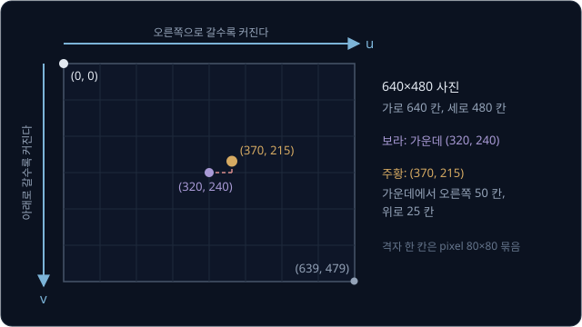

3D 점이 어디에 찍히는지 계산하려면 그 점을 카메라에 붙인 frame 에서 재야 한다. 원점은 렌즈 중심이고 $z$ 축은 카메라가 바라보는
앞쪽을 향한다. $x$ 축은 사진의 오른쪽을 향하고 $y$ 축은 사진의 아래쪽을 향해서 pixel 의 $u$·$v$ 와 방향이 같은데, 이렇게 맞춘 frame 을
camera optical frame 이라 하고 렌즈 중심에서 정면으로 뻗는 $z$ 축을 optical axis 라고 한다. 점 $(0.1, -0.05, 1.0)$ 은 앞으로 1 m,
오른쪽으로 0.1 m, 위로 0.05 m 떨어진 점이다($Y$ 가 음수라 위쪽).

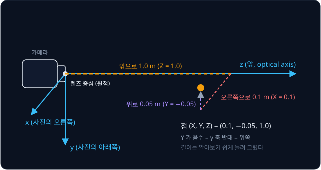

ROS 의 좌표 규약 REP 103 은 로봇 몸체 frame 을 $x$ 앞, $y$ 왼쪽, $z$ 위로 두기 때문에, 카메라에는 이름 끝에 `_optical` 을 붙인 frame 을 따로
두어 camera optical frame 으로 쓴다. RealSense 의 ROS 2 driver 도 `camera_link` 와 따로 `camera_color_optical_frame` 을
publish 하는데, 투영으로 얻은 점을 `camera_link` 좌표로 잘못 읽으면 앞쪽 1 m 가 위쪽 1 m 로 바뀐다.

## pinhole projection

pinhole model 은 렌즈를 작은 구멍 하나로 보고, 점과 구멍을 잇는 직선이 사진이 맺히는 판(image plane)을 지나는 자리에 그 점이 찍힌다고
계산한다. image plane 을 렌즈 중심에서 앞으로 1 m 인 곳에 두면, 앞으로 2 m, 오른쪽으로 0.4 m 인 점으로 그은 직선은 앞으로 1 m 를 갔을 때
오른쪽으로 0.2 m 를 지난다. 두 직각삼각형이 닮아서 image plane 위의 자리는 "옆으로 간 거리 ÷ 앞으로 간 거리" 다.

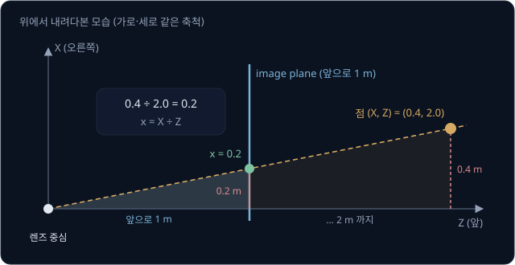

이렇게 depth(카메라 앞쪽 거리) $Z$ 로 나눠 얻은 $x = X/Z$, $y = Y/Z$ 를 normalized coordinates 라고 한다. 여기에 normalized coordinates
1 을 몇 pixel 로 나타낼지 정하는 확대 배율인 **focal length** $f$ 를 곱하고, optical axis 가 찍히는 pixel 인 **principal point** $(c_x, c_y)$ 를
더하면 pixel 좌표가 된다. 이 강의의 예시 카메라는 640×480 사진에 $f_x = f_y = 500$, $(c_x, c_y) = (320, 240)$ 으로 둔다.

| 단계 | 점 $(0.1, -0.05, 1.0)$ | 점 $(-0.2, 0.1, 2.0)$ |
| --- | --- | --- |
| ① depth 로 나누기 | $(0.1, -0.05)$ | $(-0.1, 0.05)$ |
| ② $f = 500$ 곱하기 | $(50, -25)$ | $(-50, 25)$ |
| ③ $(320, 240)$ 더하기 | $(370, 215)$ | $(270, 265)$ |

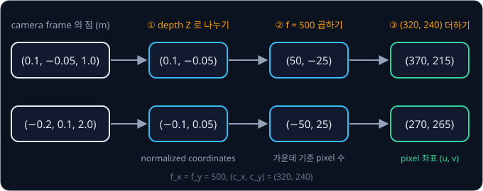

세 단계를 모은 식이 pinhole model 의 투영(projection) 식이다.

$$
u = f_x \frac{X}{Z} + c_x, \qquad v = f_y \frac{Y}{Z} + c_y
$$

pixel 단위의 $f$ 는 렌즈의 focal length(mm)를 pixel 한 칸의 크기(mm)로 나눈 값이다. 사진 가로 pixel 수를 $W$ 라 하면 가운데에서 가장자리까지 $W/2$ pixel 이 수평
시야각(HFOV)의 절반에 해당하므로 $f = (W/2) \div \tan(\text{HFOV}/2)$ 로도 구한다. RealSense 문서가 D435 의 depth 오차를 계산할 때
넣은 가로 848 pixel, HFOV 90° 를 쓰면 $f = 424 \div \tan 45° = 424$ 다.

**확인 문제.** $f_x = f_y = 500$, $(c_x, c_y) = (320, 240)$ 인 카메라에서 camera frame 의 점 $(0.2, 0.1, 2.0)$ 은 어느 pixel 에 찍힐까?

답 보기

1. depth 로 나누기: $(0.2 \div 2.0,\ 0.1 \div 2.0) = (0.1, 0.05)$
2. $f$ 곱하기: $(500 \times 0.1,\ 500 \times 0.05) = (50, 25)$
3. principal point 더하기: $(50 + 320,\ 25 + 240) = (370, 265)$

## intrinsics 와 camera_info

$f_x, f_y, c_x, c_y$ 는 렌즈와 센서가 정하는 카메라 자체의 숫자라 **intrinsics** 라고 부르고, 3×3 행렬 $K$ 하나에 모아 적는다.

$$
K = \begin{bmatrix} f_x & 0 & c_x \\ 0 & f_y & c_y \\ 0 & 0 & 1 \end{bmatrix}, \qquad
s \begin{bmatrix} u \\ v \\ 1 \end{bmatrix} = K \begin{bmatrix} X \\ Y \\ Z \end{bmatrix}
$$

오른쪽 식은 $K$ 를 3D 점에 곱한 결과가 $(u, v, 1)$ 에 어떤 수 $s$ 를 곱한 것과 같다는 뜻이고, $s$ 는 그 점의 depth $Z$ 다. $K$ 를 점
$(-0.2, 0.1, 2.0)$ 에 곱하면 $(540, 530, 2.0)$ 이고, 셋째 숫자 2.0 으로 나누면 앞의 표와 같은 pixel $(270, 265)$ 가 나온다.

<b>심화: K 의 곱셈을 한 줄씩</b>

행렬에 vector 를 곱할 때는 행렬의 각 줄과 vector 의 숫자를 칸끼리 곱해 더한다. 점 $(-0.2, 0.1, 2.0)$ 으로 계산하면 아래와 같다.

| $K$ 의 줄 | 칸끼리 곱해 더하기 | 결과 |
| --- | --- | --- |
| $(500, 0, 320)$ | $500 \times (-0.2) + 0 \times 0.1 + 320 \times 2.0$ | $540$ |
| $(0, 500, 240)$ | $0 \times (-0.2) + 500 \times 0.1 + 240 \times 2.0$ | $530$ |
| $(0, 0, 1)$ | $0 \times (-0.2) + 0 \times 0.1 + 1 \times 2.0$ | $2.0$ |

셋째 줄이 $Z$ 를 그대로 꺼내므로 $s = Z$ 다. $K$ 를 normalized coordinates 끝에 1 을 붙인 $(-0.1, 0.05, 1)$ 에 곱하면 셋째 칸의 $c_x$, $c_y$ 가 1 과
곱해져 "principal point 더하기" 가 곱셈 안에 들어가고, 결과는 바로 $(270, 265, 1)$ 이다. 일반적인 $K$ 에는 pixel 축이 기울어진 정도를 적는
skew 가 첫 줄 둘째 칸에 들어가는데, 예시 카메라에서는 0 이다.

ROS 2 의 `CameraInfo` 메시지는 이 숫자를 아래 칸에 담는다.

| 칸 | 내용 | 예시 카메라 |
| --- | --- | --- |
| `width`, `height` | calibration 할 때의 사진 크기 | 640, 480 |
| `k` | $K$ 를 줄 순서로 펼친 9 개 | $[500, 0, 320, 0, 500, 240, 0, 0, 1]$ |
| `distortion_model`, `d` | lens distortion 모델 이름과 계수 | `plumb_bob`, 5 개 |
| `p` | 왜곡을 편 사진의 3×4 projection 행렬 | stereo 의 baseline 도 여기 담긴다 |

RealSense 의 librealsense 는 같은 숫자를 `rs2_intrinsics` 구조체의 `fx`, `fy`, `ppx`, `ppy` 와 distortion 계수 5 개로 주고, ROS 2 driver 는
이 숫자를 `/camera/camera/color/camera_info` 로 publish 한다.

> **오해** intrinsics 는 카메라마다 하나다.
>
> **사실** intrinsics 는 사진 크기마다 다르다. 같은 센서를 640×480 대신 1280×960 으로 읽으면 pixel 이 가로세로 두 배로 촘촘해져서 $f$ 는 1000, principal point 는 $(640, 480)$ 이
> 되므로, driver 의 해상도를 바꾸면 그 해상도의 `camera_info` 를 써야 한다.

## 카메라 한 대로 알 수 없는 거리

점 $(0.1, -0.05, 1.0)$, $(0.2, -0.1, 2.0)$, $(0.3, -0.15, 3.0)$ 은 세 좌표를 모두 같은 배수로 키운 점이라 depth 로 나누면 배수가 지워져서,
셋 다 normalized coordinates 가 $(0.1, -0.05)$ 이고 pixel $(370, 215)$ 에 찍힌다. 이처럼 렌즈 중심에서 뻗은 직선 하나 위의 점은 거리와
상관없이 같은 pixel 에 찍히므로, pixel 로는 방향만 알 수 있고 거리는 알 수 없다.

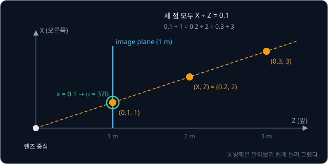

같은 이유로 사진 속 크기만으로는 물체가 작은지 먼지 가릴 수 없다. 물체의 위쪽 끝과 아래쪽 끝을 각각 투영해 빼면 $c_y$ 가 지워져서, 사진
속 높이는 $f \times \text{실제 높이} \div \text{거리}$ 가 된다. $f = 500$ 이면 1 m 앞의 10 cm 컵도 $500 \times 0.1 \div 1 = 50$ pixel 이고 2 m 앞의
20 cm 상자도 $500 \times 0.2 \div 2 = 50$ pixel 이라, 둘은 사진에서 같은 크기로 찍힌다. 거꾸로 실제 크기를 알면 거리 $= f \times \text{실제 크기} \div \text{사진 속 크기}$ 로
구할 수 있고, 뒤에서 볼 ArUco marker 가 이 원리를 쓴다.

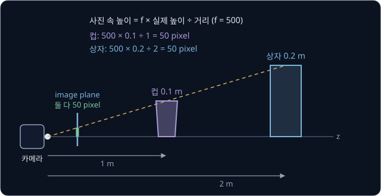

## depth 를 아는 경우의 back-projection

pixel 마다 depth 를 알면 투영의 세 단계를 거꾸로 밟아 3D 점을 되찾을 수 있고, 이 계산을 back-projection 이라고 한다.

| 단계 | pixel $(370, 215)$, depth 1.0 | pixel $(370, 215)$, depth 2.0 |
| --- | --- | --- |
| ① principal point 빼기 | $(50, -25)$ | $(50, -25)$ |
| ② $f = 500$ 으로 나누기 | $(0.1, -0.05)$ | $(0.1, -0.05)$ |
| ③ depth 곱하기 | $(0.1, -0.05, 1.0)$ | $(0.2, -0.1, 2.0)$ |

$$
X = \frac{(u - c_x)\,Z}{f_x}, \qquad Y = \frac{(v - c_y)\,Z}{f_y}
$$

②까지는 depth 와 상관없이 같은 방향이고, ③에서 depth 를 곱해야 점 하나로 정해진다. RealSense 같은 depth camera 는 pixel 마다 거리를 재서
depth image 를 낸다. ROS 2 driver 의 `align_depth.enable` 을 켜면 depth 를 color 카메라의 pixel 에 맞춘 `aligned_depth_to_color/image_raw` 가
나오므로, color 사진에서 찾은 $(u, v)$ 의 depth 를 읽어 color 카메라의 intrinsics 로 back-projection 하면 된다(librealsense 의
`rs2_deproject_pixel_to_point`). 모든 pixel 에 이 계산을 하면 point cloud 가 된다(`depth_image_proc` 의 `point_cloud_xyz_node`).

**확인 문제.** 예시 카메라에서 pixel $(270, 265)$ 의 depth 가 4.0 m 라면 camera frame 의 3D 점은?

답 보기

1. principal point 빼기: $(270 - 320,\ 265 - 240) = (-50, 25)$
2. $f$ 로 나누기: $(-50 \div 500,\ 25 \div 500) = (-0.1, 0.05)$
3. depth 곱하기: $(-0.1 \times 4.0,\ 0.05 \times 4.0,\ 4.0) = (-0.4, 0.2, 4.0)$

## stereo camera 와 depth 오차

카메라 두 대를 옆으로 나란히 놓은 것을 stereo camera 라고 하고, 두 카메라 사이의 거리를 baseline $b$ 라고 한다. 같은 점이 두 사진에서
옆으로 밀려 찍힌 pixel 수가 disparity $d$ 인데, 가까운 점일수록 많이 밀린다. 아래 표의 오른쪽 카메라는 왼쪽 카메라보다 0.1 m 오른쪽에 있어서
그 카메라에서 본 점의 $X$ 가 0.1 작다.

| 3D 점 (왼쪽 카메라 기준) | 왼쪽 $u$ | 오른쪽 $u$ | disparity |
| --- | --- | --- | --- |
| $(0.1, -0.05, 1.0)$ | $500 \times 0.1 \div 1 + 320 = 370$ | $500 \times 0 \div 1 + 320 = 320$ | 50 |
| $(0.2, -0.1, 2.0)$ | $500 \times 0.2 \div 2 + 320 = 370$ | $500 \times 0.1 \div 2 + 320 = 345$ | 25 |

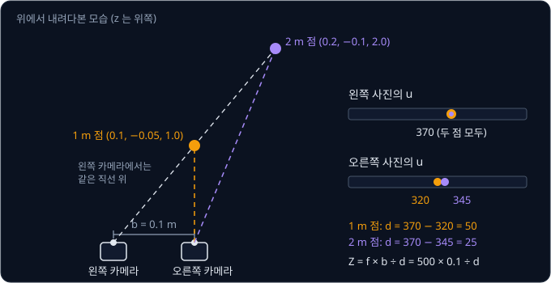

왼쪽 $u$ 에서 오른쪽 $u$ 를 빼면 $fX/Z - f(X - b)/Z = fb/Z$ 라서 depth 는 $Z = fb/d$ 다. 표의 첫 줄은 $500 \times 0.1 \div 50 = 1.0$ m 이고,
둘째 줄은 $500 \times 0.1 \div 25 = 2.0$ m 다. ROS 2 에서는 이 baseline 을 오른쪽 카메라 `camera_info` 의 `p` 에 $T_x = -f_x \times b$ 로 적는다.

disparity 는 두 사진에서 같은 점을 찾아 구하는 값이라 1 pixel 보다 작은 오차가 생기는데, 먼 점일수록 $d$ 가 작아서 같은 오차라도 depth 를
크게 바꾼다. RealSense 문서에 따르면 D435 의 baseline 은 50 mm 이고 depth 가 가장 좋은 해상도는 848×480 이다. 문서는 depth 오차 곡선을
그릴 때 HFOV 90° 와 disparity 오차(subpixel) 0.08 pixel 을 넣는데, 이 값과 앞에서 구한 $f = 424$ 로 직접 계산한 depth 오차는 아래와 같다.

| 거리 $Z$ | disparity $424 \times 0.05 \div Z$ | 0.08 pixel 틀렸을 때 depth 오차 |
| --- | --- | --- |
| 1 m | 21.2 | 약 4 mm |
| 2 m | 10.6 | 약 15 mm |
| 4 m | 5.3 | 약 60 mm |

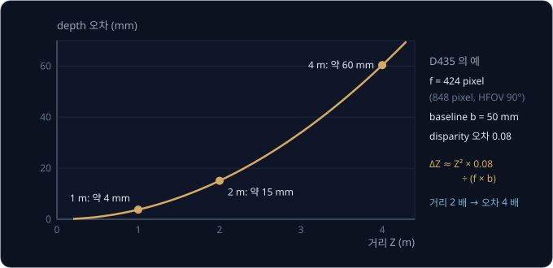

거리가 2 배가 되면 오차는 4 배가 되므로, 정밀하게 집으려면 카메라를 물체 가까이 두고 찍는다.

<b>심화: depth 오차가 거리의 제곱에 비례하는 이유</b>

1 m 의 disparity 는 $424 \times 0.05 \div 1 = 21.2$ pixel 이고, 이것이 21.12 로 잡히면 depth 는 $21.2 \div 21.12 \approx 1.0038$ m 로 약 4 mm
틀린다. 일반적으로 $Z = fb/d$ 에서 disparity 가 $\Delta d$ 만큼 작게 잡히면 depth 는 $fb/(d - \Delta d)$ 가 된다. $\Delta d$ 가 $d$ 보다 훨씬 작으면 그 차이는
$fb\,\Delta d / d^2$ 에 가깝고, 여기에 $d = fb/Z$ 를 넣으면 아래 식이 된다.

$$
\Delta Z \approx \frac{Z^2\,\Delta d}{f\,b}
$$

$Z = 2$ m 면 $4 \times 0.08 \div (424 \times 0.05) = 0.32 \div 21.2 \approx 0.0151$ m 로 표의 15 mm 와 같다. baseline 이나 $f$ 를 키우면 오차가
줄어드는데, 같은 문서에 따르면 D415 는 baseline 이 55 mm 이고 2 megapixel 센서를 쓴다.

## extrinsics

물체의 위치는 보통 로봇 base 나 지도처럼 카메라 밖의 frame(world frame)에서 필요하므로, world frame 의 점 $p_w$ 를 rotation $R$ 과
translation $t$ 로 camera frame 의 점으로 바꾼다.

$$
p_c = R\,p_w + t
$$

$R$ 이 identity matrix $I$ 이고 $t = (-0.1, 0, 1.0)$ 이면 world 의 점 $(0.2, -0.05, 0)$ 은 $(0.2 - 0.1,\ -0.05,\ 0 + 1.0) = (0.1, -0.05, 1.0)$ 이
되어 pixel $(370, 215)$ 에 찍힌다. 카메라가 world 안의 어디에 어느 방향으로 놓였는지를 적은 이 $R$ 과 $t$ 를 **extrinsics** 라고 하고, 숫자는
rotation 3 개와 translation 3 개를 합쳐 6 개다.

> **오해** $t$ 는 world 에서 본 카메라의 위치다.
>
> **사실** $t$ 는 카메라에서 본 world 원점의 위치다. 위 예에서 $t = (-0.1, 0, 1.0)$ 이지만 카메라는 world 의 $(0.1, 0, -1.0)$ 에 있고, 카메라 위치가 필요하면 역변환을 쓴다.

$R$ 옆에 $t$ 를 넷째 칸으로 붙인 3×4 행렬 $[R \mid t]$ 에, world 좌표 끝에 1 을 붙인 vector 를 곱하면 $R\,p_w + t$ 가 한 번에 계산된다.
여기에 $K$ 를 곱하면 world 의 점에서 pixel 까지를 식 하나로 쓸 수 있다.

$$
s \begin{bmatrix} u \\ v \\ 1 \end{bmatrix} = K\,[R \mid t] \begin{bmatrix} X_w \\ Y_w \\ Z_w \\ 1 \end{bmatrix}
$$

| 구분 | 담긴 숫자 | 바뀌는 때 | ROS 2 에서 담는 곳 |
| --- | --- | --- | --- |
| intrinsics $K$ | $f_x, f_y, c_x, c_y$ | 렌즈·해상도를 바꿀 때 | `camera_info` 의 `k` |
| extrinsics $[R \mid t]$ | rotation 3, translation 3 | 카메라를 옮기거나 돌릴 때 | tf2 의 transform |

ROS 2 에서 extrinsics 는 `base_link` 에서 `camera_color_optical_frame` 까지의 tf2 transform 이고, 고정된 카메라면 URDF 나
`static_transform_publisher` 로 넣는다. 카메라 장치 하나 안에도 extrinsics 가 있는데, RealSense driver 의 README 에 실린 D435i 의
`extrinsics/depth_to_color` 예를 보면 depth 카메라가 color 카메라에서 오른쪽으로 약 0.0149 m 떨어져 있다.

<b>심화: 카메라가 optical axis 둘레로 90° 돈 경우</b>

$t = (0, 0, 2.0)$ 이고 $R$ 이 아래 행렬이면, world 의 점 $(0.1, -0.2, 0)$ 은 아래 순서로 pixel 이 된다.

$$
R = \begin{bmatrix} 0 & -1 & 0 \\ 1 & 0 & 0 \\ 0 & 0 & 1 \end{bmatrix}
$$

| 단계 | 계산 | 결과 |
| --- | --- | --- |
| $R\,p_w$ | $(0 \times 0.1 + (-1) \times (-0.2),\ 1 \times 0.1,\ 0)$ | $(0.2, 0.1, 0)$ |
| $t$ 더하기 | $(0.2, 0.1, 0) + (0, 0, 2.0)$ | $(0.2, 0.1, 2.0)$ |
| $K$ 곱하기 | $(500 \times 0.2 + 320 \times 2,\ 500 \times 0.1 + 240 \times 2,\ 2.0)$ | $(740, 530, 2.0)$ |
| 셋째 숫자로 나누기 | $(740 \div 2,\ 530 \div 2)$ | $(370, 265)$ |

![world 의 점에서 pixel 까지. world 점 (0.1, −0.2, 0) 이 extrinsics [R | t] 로 camera frame 의 (0.2, 0.1, 2.0) 이 되고, intrinsics K 를 곱하면 (740, 530, 2.0) 이 되며, depth 로 나누면 pixel (370, 265) 가 된다](figures/world-to-pixel.svg)

앞의 두 상자는 카메라를 어디에 두었는지에 따라 바뀌고, 뒤의 두 상자는 카메라 자체에 따라 바뀐다.

**확인 문제.** $R = I$, $t = (0, 0.1, 2.0)$ 일 때 world 의 점 $(0.2, -0.2, 0)$ 은 예시 카메라의 어느 pixel 에 찍힐까?

답 보기

1. camera frame 으로: $p_c = (0.2,\ -0.2 + 0.1,\ 0 + 2.0) = (0.2, -0.1, 2.0)$
2. depth 로 나누기: $(0.1, -0.05)$
3. $f$ 곱하고 principal point 더하기: $(50 + 320,\ -25 + 240) = (370, 215)$

## lens distortion

실제 카메라는 유리 렌즈로 빛을 모으기 때문에 사진 가장자리로 갈수록 곧은 선이 휘어 찍히는데, 이 어긋남을 lens distortion 이라고 한다. 가장
큰 성분은 점을 중심 쪽으로 당기거나 바깥으로 미는 radial distortion 이다. normalized coordinates 의 원점에서 점까지의 거리를
$r$($r^2 = x^2 + y^2$)이라 하면, 휘어진 자리는 원래 자리에 $r$ 에 따라 달라지는 배율을 곱한 곳이다.

$$
x_d = x\,(1 + k_1 r^2 + k_2 r^4), \qquad y_d = y\,(1 + k_1 r^2 + k_2 r^4)
$$

$k_1$, $k_2$ 는 렌즈마다 다른 distortion 계수다. $k_1$ 이 음수면 가장자리가 안으로 오므라드는 barrel distortion 이고, 양수면 바깥으로
늘어나는 pincushion distortion 이다. OpenCV 의 예제 checkerboard 사진 13 장을 $k_1$, $k_2$ 만 쓰도록 calibration 하면 $k_1 \approx -0.281$,
$k_2 \approx 0.078$ 이 나온다(직접 실행한 결과).

| 점 $(x, y)$ | $r^2$ | 배율 $1 + k_1 r^2 + k_2 r^4$ | $f = 500$ 카메라의 pixel (휘기 전 → 휜 뒤) |
| --- | --- | --- | --- |
| $(0.3, 0)$ | 0.09 | $1 - 0.0253 + 0.0006 \approx 0.975$ | $(470, 240) \to (466, 240)$ |
| $(0.6, 0.45)$ | 0.5625 | $1 - 0.1581 + 0.0247 \approx 0.867$ | $(620, 465) \to (580, 435)$ |

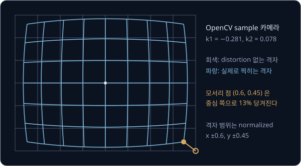

중심에 가까운 점은 2.5% 만 당겨지지만 모서리 근처 점은 13% 당겨져 50 pixel 어긋난다. distortion 은 normalized coordinates 에 곱하는 배율이라
투영의 세 단계 가운데 depth 로 나눈 뒤, $f$ 를 곱하기 전에 들어간다.

렌즈가 센서와 완전히 평행하지 않아 생기는 tangential distortion 까지 넣으면 계수가 5 개다. `CameraInfo` 의 `plumb_bob` 모델은 이 계수를
$(k_1, k_2, t_1, t_2, k_3)$ 순서로 `d` 에 적고, OpenCV 도 같은 순서를 쓴다. 어안 렌즈에는 `equidistant` 모델이 따로 있다. ROS 2 `image_proc` 의 rectify
node 는 `image` 와 `camera_info` 를 받아 왜곡을 편 `image_rect` 를 publish 하고, 그 뒤의 계산은 distortion 없는 pinhole model 로 한다.

> **오해** distortion 은 사진 전체를 조금 줄이는 것이다.
>
> **사실** 배율이 $r$ 에 따라 달라서 가운데는 거의 그대로이고 가장자리만 크게 휜다. 전체를 같은 비율로 줄이는 것은 $f$ 를 바꾸는 것과 같아서 곧은 선이 곧게 남는다.

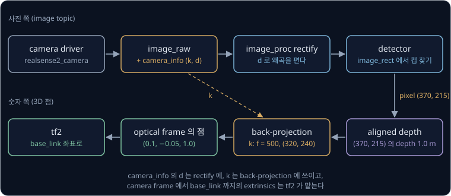

위 그림은 지금까지 본 숫자가 ROS 2 에서 쓰이는 순서를 보여 준다.

**확인 문제.** $k_1 = -0.1$, $k_2 = 0$ 인 렌즈에서 normalized 점 $(0.6, 0.8)$ 은 어디로 옮겨질까?

답 보기

1. $r^2 = 0.6^2 + 0.8^2 = 0.36 + 0.64 = 1$
2. 배율: $1 + (-0.1) \times 1 = 0.9$
3. 휘어진 자리: $(0.6 \times 0.9,\ 0.8 \times 0.9) = (0.54, 0.72)$

$k_1$ 이 음수라 중심 쪽으로 당겨졌다.

## checkerboard calibration 과 reprojection error

intrinsics 와 distortion 계수는 제품마다 조금씩 달라서, 생김새를 정확히 아는 물체를 찍어 거꾸로 구한다. 이 일을 camera calibration 이라고
하고, 흑백 정사각형이 번갈아 칠해진 checkerboard 를 많이 쓴다. 칸 한 변의 길이를 알면 안쪽 corner 마다 판에 붙인 frame(board frame)에서의 좌표를
알 수 있고, 판이 평평하니 모든 corner 의 $Z$ 는 0 이다.

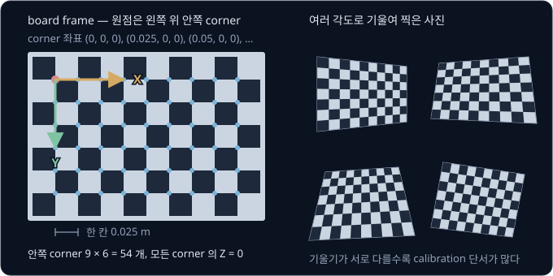

지금 추측한 카메라 숫자로 corner 를 투영한 pixel 과 사진에서 찾은 corner 의 pixel 사이의 거리를 **reprojection error** 라고 한다. 사진에서
$(373, 219)$ 에 찾은 corner 를 $(370, 215)$ 로 투영했다면 $\sqrt{3^2 + 4^2} = 5$ pixel 이다.

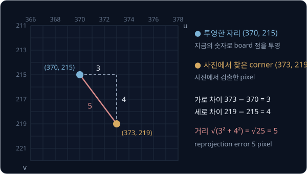

corner 가 많으면 거리를 제곱해 평균한 뒤 제곱근을 씌운 RMS(root mean square)로 모은다. 거리가 1, 7 pixel 인 corner 두 개면
$\sqrt{(1 + 49) \div 2} = 5$ pixel 이라 그냥 평균한 4 보다 크다. 제곱을 거치면서 크게 틀린 corner 가 더 큰 무게를 받기 때문이다. calibration 은
이 RMS 가 가장 작아지는 숫자를 찾는 문제이고, OpenCV 의 `calibrateCamera` 는 결과와 함께 이 RMS 를 돌려준다. OpenCV 예제 사진(640×480,
13 장, 안쪽 corner 9×6)으로 distortion 모델만 바꿔 직접 실행한 결과는 아래와 같다.

| distortion 모델 | $f_x$ | $(c_x, c_y)$ | RMS |
| --- | --- | --- | --- |
| 없음 | 557.5 | $(360.1, 235.5)$ | 1.555 pixel |
| $k_1, k_2$ | 536.5 | $(342.4, 234.3)$ | 0.418 pixel |
| 계수 5 개 | 536.1 | $(342.4, 235.5)$ | 0.409 pixel |

distortion 을 빼면 RMS 가 1.5 pixel 을 넘고 $f_x$ 도 약 4% 커진다. 휘어진 사진을 distortion 없는 모델로 억지로 맞추다 보니 다른 숫자까지
틀어졌다. ROS 2 에서는 `camera_calibration` package 의 `cameracalibrator` node 를 판의 안쪽 corner 수(`--size 8x6`)와 칸 크기(`--square 0.108`,
m)로 띄우고 판을 여러 자세로 보여 준다. 이 node 는 OpenCV 의 calibration 을 써서 기본으로 radial 계수 2 개를 구한다.

<b>심화: 미지수와 숫자 세기</b>

안쪽 corner 가 9×6 인 판의 사진 한 장에는 corner 가 54 개 있어서 pixel 숫자 108 개가 나온다. 판을 찍을 때마다 자리와 각도가 달라 extrinsics 6 개가
사진마다 새로 생기므로, 13 장이면 intrinsics 4 개와 distortion 2 개를 더한 미지수 $6 + 13 \times 6 = 84$ 개를 숫자 $13 \times 108 = 1404$ 개로
맞춘다. 7×5 판을 10 장 찍으면 숫자는 $35 \times 2 \times 10 = 700$ 개이고 미지수는 $6 + 10 \times 6 = 66$ 개다.

**확인 문제.** corner 세 개의 reprojection error 가 각각 0, 0, 3 pixel 이면 RMS 는?

답 보기

1. 제곱: $0, 0, 9$
2. 평균: $9 \div 3 = 3$
3. 제곱근: $\sqrt{3} \approx 1.73$ pixel

그냥 평균한 거리 1 보다 크다.

## homography

RMS 를 줄여 가려면 출발할 첫 추측이 필요한데, 그 추측을 만드는 첫 단계가 homography 다. checkerboard 의 corner 는 모두 $Z = 0$ 이라 전체 투영식에서
$Z$ 에 곱해지는 $R$ 의 셋째 칸이 결과에 영향을 주지 않는다. 그 칸을 지우면 3×3 행렬 하나로 판 위의 점 $(X, Y)$ 와 pixel 이 이어진다.

$$
s \begin{bmatrix} u \\ v \\ 1 \end{bmatrix} = \underbrace{K\,[r_1\ r_2\ t]}_{H} \begin{bmatrix} X \\ Y \\ 1 \end{bmatrix}
$$

$r_1$, $r_2$ 는 $R$ 의 첫째·둘째 칸이고, 평면 위의 점을 다른 평면(사진)의 점으로 옮기는 이 3×3 행렬 $H$ 를 homography 라고 한다.

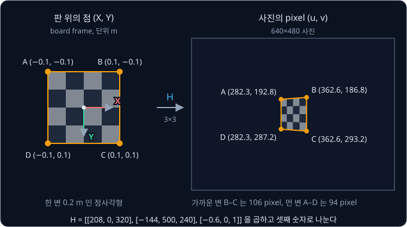

판을 기울이면 $H$ 의 셋째 줄이 $(0, 0, 1)$ 이 아니게 되어 나누는 수 $s$ 가 점마다 달라지고, 정사각형이 사다리꼴로 찍힌다. $H$ 의 모든
숫자에 같은 수를 곱해도 같은 pixel 이 나오므로 숫자 9 개 가운데 8 개만 정하면 된다. 점 하나가 $u$ 와 $v$ 의 식 두 개를 주므로 점은 최소
4 개 필요하다. 바닥을 비추는 mobile robot 카메라도 바닥 위의 점이라면 homography 하나로 pixel 을 바닥 좌표로 바로 옮길 수 있다.

> **오해** homography 는 아무 3D 점에나 쓸 수 있다.
>
> **사실** homography 는 평면 위의 점에만 맞는다. 판에서 튀어나온 점은 $Z$ 가 0 이 아니라서 지운 셋째 칸이 다시 필요하다.

<b>심화: 점 4 개로 H 를 구하는 DLT</b>

앞의 extrinsics 예($R = I$, $t = (-0.1, 0, 1.0)$)로 $H$ 를 만들면 셋째 칸이 $(500 \times (-0.1) + 320,\ 240,\ 1) = (270, 240, 1)$ 이라
$H = [[500, 0, 270], [0, 500, 240], [0, 0, 1]]$ 이고, 판의 점 $(0.2, -0.05)$ 는 $(500 \times 0.2 + 270,\ 500 \times (-0.05) + 240) = (370, 215)$
에 찍힌다.

pixel 은 $u = \dfrac{h_{11}X + h_{12}Y + h_{13}}{h_{31}X + h_{32}Y + h_{33}}$ 처럼 분수로 계산된다($h_{ij}$ 는 $H$ 의 $i$ 번째 줄 $j$ 번째 칸).
양쪽에 분모를 곱하면 나눗셈 없는 식이 된다.

$$
u\,(h_{31}X + h_{32}Y + h_{33}) = h_{11}X + h_{12}Y + h_{13}, \qquad
v\,(h_{31}X + h_{32}Y + h_{33}) = h_{21}X + h_{22}Y + h_{23}
$$

위 예로 확인하면 $u = 370$, $(X, Y) = (0.2, -0.05)$ 에서 왼쪽은 $370 \times 1 = 370$, 오른쪽은 $500 \times 0.2 + 270 = 370$ 이다. 이 식은
$h_{ij}$ 의 일차식이라, 점이 4 개를 넘으면 어긋남의 제곱합이 가장 작은 해를 한 번에 구할 수 있다. 이 방법을 DLT(direct linear
transform)라고 하고, Hartley & Zisserman 의 책 4장에서 자세히 다룬다.

## Zhang 의 방법과 refinement

$H = K\,[r_1\ r_2\ t]$ 이므로 $H$ 의 첫째·둘째 칸에서 $K$ 의 효과를 되돌리면 $r_1$, $r_2$ 가 나와야 한다. rotation matrix 의 칸은 돌아간
frame 의 축이라 두 칸은 길이가 같고 서로 수직이다. $K$ 를 잘못 추측하면 되돌린 두 칸이 이 성질을 어기므로, 사진 한 장의 homography 에서
$K$ 를 정하는 식이 두 개 나온다. 이것이 Zhang(2000)의 방법이다.

판을 세로축 둘레로 기울여 찍은 사진의 homography 가 $H = [[208, 0, 320], [-144, 500, 240], [-0.6, 0, 1]]$ 이고 principal point $(320, 240)$
은 안다고 하자. 칸 $(a, b, w)$ 를 되돌리는 계산은 $\left(\frac{a - c_x w}{f}, \frac{b - c_y w}{f}, w\right)$ 이고, $f$ 를 400, 500, 600 으로
추측해 첫째 칸 $(208, -144, -0.6)$ 과 둘째 칸 $(0, 500, 0)$ 을 되돌리면 아래와 같다.

| 추측한 $f$ | 되돌린 첫째 칸 | 길이 | 되돌린 둘째 칸 | 길이 |
| --- | --- | --- | --- | --- |
| 400 | $(1.0, 0, -0.6)$ | 1.166 | $(0, 1.25, 0)$ | 1.25 |
| 500 | $(0.8, 0, -0.6)$ | 1 | $(0, 1, 0)$ | 1 |
| 600 | $(0.667, 0, -0.6)$ | 0.897 | $(0, 0.833, 0)$ | 0.833 |

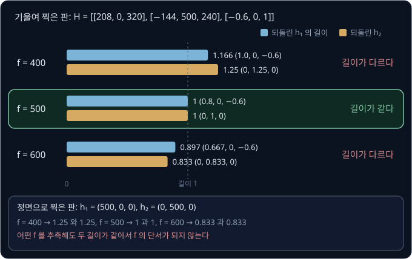

$f = 500$ 일 때만 두 길이가 같다. 판을 정면으로 들고 찍은 사진은 두 칸이 $(500, 0, 0)$, $(0, 500, 0)$ 이라 어떤 $f$ 로 되돌려도 길이가 같아서
단서가 되지 않는다. 일반적인 $K$ 는 pixel 축이 기울어진 정도인 skew 까지 숫자가 5 개라 서로 다르게 기울인 사진이 최소 3 장 필요하다(skew
를 0 으로 두면 2 장). 논문은 판을 평행하게 옮기기만 해서 찍은 사진으로는 새 식이 생기지 않는다는 것도 증명한다. 논문의 simulation 에서는 판을 45° 안팎으로 기울였을 때 결과가 가장
좋았고, 5° 만 기울이자 시도의 40% 가 실패했다.

이렇게 반복 계산 없이 식으로 바로 푼 답을 closed-form 답이라고 한다. 이 답은 lens distortion 을 빼고 계산했고, 줄인 것도 pixel 거리가
아니라 풀기 쉽게 바꾼 식의 어긋남이다. 그래서 이 답을 첫 추측으로 삼아 distortion 까지 넣은 투영으로 reprojection error 의 제곱합을
다시 줄이는데, 이 단계를 refinement 라고 한다. 이때는 숫자를 오차가 줄어드는 쪽으로 조금씩 반복해 고치는 Levenberg-Marquardt 방법을 쓴다.

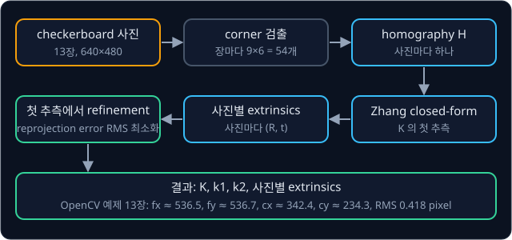

논문의 실제 실험(640×480 카메라, corner 256 개인 판, 사진 5 장)에서는 refinement 로 숫자가 크게 바뀌었다.

| 값 | closed-form | refinement 뒤 |
| --- | --- | --- |
| $f_x$ ($\alpha$) | 877.16 | 832.50 |
| $k_1$ | 0.136 | −0.228 |
| RMS | 0.881 pixel | 0.335 pixel |

closed-form 단계에서 distortion 이 없다고 보고 $K$ 를 구한 뒤 $k_1$ 을 따로 맞췄더니 부호가 반대로 나왔고, 모든 숫자를 함께 고치는
refinement 에서야 barrel distortion 인 $-0.228$ 이 나왔다.

<b>심화: f 를 식으로 풀기와 사진별 extrinsics 꺼내기</b>

되돌린 첫째 칸의 길이 제곱은 $(400/f)^2 + 0.36$ 이고, 둘째 칸의 길이 제곱은 $(500/f)^2$ 이다. 둘을 같게 놓고 정리한다.

$$
\frac{160000}{f^2} + 0.36 = \frac{250000}{f^2} \;\Rightarrow\; 0.36 = \frac{90000}{f^2} \;\Rightarrow\; f^2 = 250000,\ f = 500
$$

$H$ 에 어떤 수가 곱해져 있는지 모르기 때문에, 조건은 길이가 1 이라는 것이 아니라 두 길이가 같다는 것이다. $K$ 를 알면 사진마다
extrinsics 를 꺼낼 수 있는데, 사진에서 구한 homography 가 위의 $H$ 에 2 가 곱해진 $2H$ 라고 해도 결과는 같다.

| 단계 | 계산 | 결과 |
| --- | --- | --- |
| 첫째 칸 되돌리기 | $K^{-1}(416, -288, -1.2)$ | $(1.6, 0, -1.2)$ |
| 곱해진 수 $\lambda$ | $\sqrt{1.6^2 + 1.2^2} = \sqrt{4}$ | $\lambda = 2$ |
| $r_1$ | $(1.6, 0, -1.2) \div 2$ | $(0.8, 0, -0.6)$ |
| $r_2$ | $K^{-1}(0, 1000, 0) \div 2$ | $(0, 1, 0)$ |
| $t$ | $K^{-1}(640, 480, 2) \div 2 = (0, 0, 2) \div 2$ | $(0, 0, 1)$ |

$K^{-1}$ 은 $K$ 를 곱한 효과를 지우는 역행렬이다. 남은 $r_3$ 은 $r_1$ 과 $r_2$ 에 모두 수직인 길이 1 의 vector 로 cross product
$r_1 \times r_2 = (0.6, 0, 0.8)$ 이고, $\lambda$ 의 부호는 판이 카메라 앞에 오도록 $t$ 의 셋째 숫자가 양수가 되게 고른다.

**확인 문제.** 사진 한 장의 homography 에서 $K$ 를 정하는 식은 몇 개 나오고, skew 까지 숫자 5 개를 구하려면 사진이 최소 몇 장 필요할까?

답 보기

"되돌린 두 칸의 길이가 같다" 와 "두 칸이 수직이다" 두 개다. 5 개를 구하려면 식이 5 개 이상 있어야 하므로 $2 \times 3 = 6 \ge 5$ 인 세 장이
필요하고, 두 장이면 식이 4 개라 모자란다.

## ArUco marker 와 물체 pose

물체의 pose(위치와 방향)를 사진 한 장으로 구하려면 빠진 거리를 채워야 하는데, 크기를 정확히 아는 표식을 붙이면 된다. ArUco marker 는 검은
테두리 안의 흑백 칸으로 번호(ID)를 적은 정사각형 표식이다. Garrido-Jurado 등(2014)은 marker 끼리 무늬가 충분히 달라서 서로 잘못 읽힐
가능성이 낮은 marker 묶음(dictionary)을 만드는 방법을 발표했다. OpenCV 의 `DICT_6X6_250` 은 6×6 칸 marker 250 개짜리 dictionary 이고,
detector 는 marker 마다 ID 와 네 꼭짓점의 pixel 을 낸다. 정면을 보는 한 변 0.05 m marker 가 예시 카메라에서 한 변 50 pixel 로 찍혔고 중심이
pixel $(370, 215)$ 라면 위치는 아래처럼 구한다.

| 단계 | 계산 | 결과 |
| --- | --- | --- |
| 거리 = $f$ × 실제 크기 ÷ 사진 속 크기 | $500 \times 0.05 \div 50$ | $Z = 0.5$ m |
| back-projection 의 $X$ | $(370 - 320) \times 0.5 \div 500$ | $X = 0.05$ m |
| back-projection 의 $Y$ | $(215 - 240) \times 0.5 \div 500$ | $Y = -0.025$ m |

marker 가 기울면 정사각형이 사다리꼴로 찍혀 한 변의 길이를 하나로 정할 수 없다. marker 중심을 원점으로 두고 marker 평면을
$Z = 0$ 으로 두면, 한 변이 $a$ 인 네 꼭짓점의 3D 좌표는 $(\pm a/2, \pm a/2, 0)$ 이다. 이 3D 좌표 4 개와 pixel 4 개에서 pose 를 구하는 문제를
PnP(Perspective-n-Point)라고 한다. OpenCV 의 ArUco tutorial 은 이 문제를 `solvePnP` 로 풀고, 그 옵션 가운데 `SOLVEPNP_IPPE_SQUARE` 는
Collins & Bartoli(2014)의 IPPE 를 정사각형 marker 의 꼭짓점 4 개에 맞춘 방식이다.

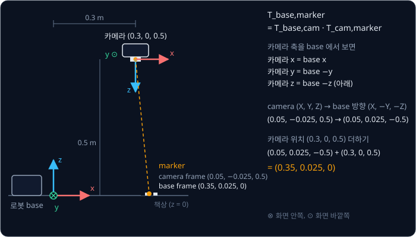

로봇이 쓰려면 base frame 에서의 위치가 필요하므로 base 에서 본 카메라의 pose 를 곱한다.

$$
T_{\text{base,marker}} = T_{\text{base,cam}}\,T_{\text{cam,marker}}
$$

$T_{\text{base,cam}}$ 은 앞에서 본 extrinsics 의 역변환이다. 카메라가 base 의 $(0.3, 0, 0.5)$ 에서 수직 아래를 보면 축은 아래처럼
대응한다.

- 카메라의 $x$ (사진 오른쪽) = base 의 $+x$
- 카메라의 $y$ (사진 아래쪽) = base 의 $-y$
- 카메라의 $z$ (카메라 앞쪽) = base 의 $-z$

그래서 camera 좌표 $(0.05, -0.025, 0.5)$ 는 base 의 축으로 $(0.05, 0.025, -0.5)$ 이고, 여기에 카메라 위치를 더한 $(0.35, 0.025, 0)$ 이
책상 위의 marker 위치다.

marker 꼭짓점의 pixel 은 1 pixel 쯤 틀릴 수 있는데, 같은 1 pixel 이 좌우 위치와 거리에 주는 영향은 크게 다르다.

| 틀린 값 | 원래 계산 | 1 pixel 틀린 계산 | 위치 오차 |
| --- | --- | --- | --- |
| 중심의 $u$ 가 370 → 371 | $50 \times 0.5 \div 500 = 0.05$ | $51 \times 0.5 \div 500 = 0.051$ | 1 mm |
| 한 변이 50 → 49 pixel | $500 \times 0.05 \div 50 = 0.5$ | $500 \times 0.05 \div 49 \approx 0.510$ | 약 1 cm |

한 변 50 pixel 이 1 pixel(2%) 틀리면 거리도 같은 비율인 2% 가 틀려서, 거리 오차가 좌우 오차 $Z \div f = 0.5 \div 500 = 0.001$ m 의
10 배다. marker 가 작거나 멀수록 이 차이가 커지므로, 정밀하게 집으려면 큰 marker 나 여러 marker 를 배열한 board 를 쓰거나 카메라를 가까이 가져간다.

**확인 문제.** 한 변 0.04 m 인 marker 가 $f = 500$ 인 카메라 사진에서 한 변 20 pixel 로 찍혔다. 거리는 얼마이고, 한 변이 1 pixel 틀려
19 pixel 로 찍혔다면 거리는 얼마로 계산될까?

답 보기

1. 20 pixel: $500 \times 0.04 \div 20 = 1$ m
2. 19 pixel: $500 \times 0.04 \div 19 \approx 1.053$ m

약 5 cm 틀린다. 사진 속 한 변이 20 pixel 로 짧아서 1 pixel 이 5% 에 해당하기 때문이다.

## 정리

- pinhole model 에서는 camera optical frame 의 점을 depth 로 나누고 focal length 를 곱한 뒤 principal point 를 더해 pixel 을 얻는다
  ($u = f_x X/Z + c_x$). 같은 직선 위의 점은 같은 pixel 에 찍히므로, 거리는 depth camera, stereo($Z = fb/d$, 오차는 $Z^2$ 에 비례), 크기를 아는
  marker 로 채운다
- intrinsics $K$ 와 distortion 계수는 해상도마다 정해지는 카메라 자체의 숫자로 `camera_info` 의 `k`·`d` 에 담기고, 카메라가 놓인 자리인
  extrinsics $[R \mid t]$ 는 tf2 의 transform 으로 다룬다
- calibration 은 기울인 checkerboard 사진마다 homography 를 구해 rotation 의 두 칸이 길이가 같고 수직이라는 조건으로 $K$ 의 첫 추측을 얻고
  (Zhang 의 방법), distortion 까지 넣어 reprojection error 를 줄인다. distortion 을 빼면 OpenCV 예제의 RMS 가 0.42 에서 1.56 pixel 로 커진다

물체의 3D 위치로 잡기 자세를 정하고 IK 와 경로 계획으로 물체를 옮기는 과정은 [Classical Pick & Place](../classical-pick/README.md) 에서
다룬다. 카메라가 로봇 손목이나 base 의 어디에 달렸는지를 로봇을 움직여 계산으로 구하는 방법은
[Hand-Eye Calibration](../hand-eye-calibration/README.md) 에서 다루고, 움직이는 카메라의 여러 사진에서 같은 점을 찾아 자기 위치와 지도를
함께 만드는 방법은 [Visual SLAM & VIO](../visual-slam/README.md) 에서 다룬다.

## 참고 자료

- OpenCV tutorial [Camera Calibration](https://github.com/opencv/opencv/blob/4.x/doc/py_tutorials/py_calib3d/py_calibration/py_calibration.markdown)
  — 예제 사진으로 `calibrateCamera` 를 실행하고 휜 사진을 펴는 과정
- OpenCV tutorial [Detection of ArUco Markers](https://github.com/opencv/opencv/blob/4.x/doc/tutorials/objdetect/aruco_detection/aruco_detection.markdown)
  — dictionary, 꼭짓점 검출, `solvePnP` 로 marker pose 를 구하는 과정
- ROS 2 [sensor_msgs/CameraInfo](https://github.com/ros2/common_interfaces/blob/rolling/sensor_msgs/msg/CameraInfo.msg) — `k`·`d`·`p` 칸과
  optical frame 의 축을 주석으로 설명한 메시지 정의
- ROS 2 image_pipeline 의 [camera_calibration](https://github.com/ros-perception/image_pipeline/blob/rolling/camera_calibration/doc/index.rst) 과
  [image_proc](https://github.com/ros-perception/image_pipeline/blob/rolling/image_proc/doc/components.rst) 문서 — `cameracalibrator` 옵션과 rectify
  node 의 topic
- RealSense, [Tuning depth cameras for best performance](https://dev.realsenseai.com/?p=41439) — D415·D435 의 baseline, 권장 해상도, depth 오차
- Zhengyou Zhang, [A Flexible New Technique for Camera Calibration](https://www.microsoft.com/en-us/research/publication/a-flexible-new-technique-for-camera-calibration/)
  (2000) — closed-form 풀이, 필요한 사진 수, 실제 카메라 실험의 Table 1
- Hartley & Zisserman, [Multiple View Geometry in Computer Vision](https://www.robots.ox.ac.uk/~vgg/hzbook/) — 6장 camera model, 4장 homography
  와 DLT
- Garrido-Jurado 외, [Automatic generation and detection of highly reliable fiducial markers under occlusion](https://doi.org/10.1016/j.patcog.2014.01.005)
  (2014) — ArUco dictionary 를 만들고 찾는 방법
- Collins & Bartoli, [Infinitesimal Plane-Based Pose Estimation](https://doi.org/10.1007/s11263-014-0725-5) (2014) — OpenCV 의
  `SOLVEPNP_IPPE_SQUARE` 가 쓰는 평면 pose 추정
