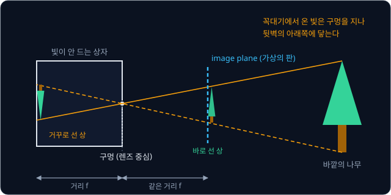
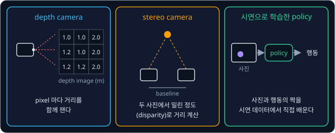
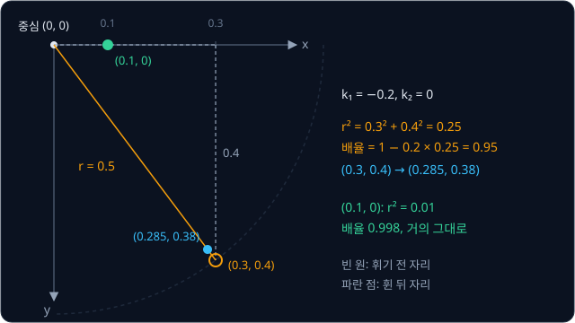

# Camera Geometry

## 학습 목표

- 카메라 앞에 있는 한 점이 사진의 몇 번째 칸에 찍히는지 작은 숫자로 한 단계씩 계산할 수 있다
- 카메라마다 다른 숫자(렌즈가 얼마나 확대하는지, 사진의 중심이 어디인지)와 카메라가 놓인 위치·방향이 이 계산의 어느
  단계에 들어가는지 설명할 수 있다
- 렌즈가 곧은 선을 휘게 찍는 정도를 숫자로 계산할 수 있다
- 무늬를 아는 판을 여러 각도에서 찍은 사진으로 카메라의 숫자를 거꾸로 알아내는 원리를 설명할 수 있다
- 크기를 아는 표식 하나로 물체가 카메라에서 어디에 있는지 구하는 방법을 설명할 수 있다
- 카메라 한 대로는 물체까지의 거리를 알 수 없는 이유와, 로봇이 이 문제를 푸는 방법을 설명할 수 있다

## 사진과 pixel 좌표

### 로봇이 사진에서 알아야 하는 것

책상 위의 컵을 로봇 팔로 집는 장면을 생각해 보자. 팔을 움직이려면 컵이 로봇 몸통에서 앞으로 몇 cm, 옆으로 몇 cm, 위로 몇 cm
떨어져 있는지 알아야 한다. [Rigid Transforms](../transforms/README.md) 에서 본 것처럼, 원점 하나와 서로 수직인 x·y·z 축
세 개로 이루어진 기준을 frame 이라고 하고, 로봇 몸통 바닥에 붙인 frame 을 base frame 이라고 부른다. 로봇에게 필요한 것은
base frame 에서 잰 컵의 좌표 세 개다.

그런데 카메라가 주는 것은 3D 좌표가 아니라 사진 한 장이다. 사진에는 "컵이 사진의 오른쪽 위에 보인다" 는 정보만 있고 "컵이
1 m 앞에 있다" 는 정보는 없다. 이 강의에서는 3D 공간의 점이 사진의 어느 칸에 찍히는지를 계산하는 식을 세우고, 그 식을 거꾸로
써서 사진에서 물체의 위치를 얼마나 알아낼 수 있는지, 무엇은 알아낼 수 없는지를 따져 본다.

### pixel

디지털 사진을 크게 확대하면 작은 정사각형 칸이 바둑판처럼 늘어서 있고, 칸마다 색이 하나씩 칠해져 있다. 이 칸 하나를
pixel 이라고 한다. picture element(그림 요소)를 줄인 말이다. 가로 640 칸, 세로 480 칸인 사진은 "640×480 사진" 이라고 부르고,
pixel 이 $640 \times 480 = 307{,}200$ 개 들어 있다.

사진 속 위치는 "몇 번째 칸인가" 로 말한다. 왼쪽 위 모서리 칸을 $(0, 0)$ 으로 두고, 오른쪽으로 몇 칸 갔는지를 $u$, 아래로 몇
칸 내려갔는지를 $v$ 로 적는다. 이 $(u, v)$ 를 pixel 좌표라고 한다. 640×480 사진에서 $u$ 는 0 부터 639 까지, $v$ 는 0 부터 479
까지다. 정가운데는 $(320, 240)$ 근처이고, 오른쪽 아래 모서리는 $(639, 479)$ 다.

위 그림은 640×480 사진에 pixel 좌표를 매긴 모습이다. 주황 점 $(370, 215)$ 는 가운데에서 오른쪽으로 50 칸, 위로 25 칸 간
자리다. $v$ 는 아래로 갈수록 커지므로 "위로 25 칸" 은 $v$ 가 240 에서 215 로 25 줄어든다는 뜻이다.

**흔한 오해.** 수학 시간의 좌표평면은 $y$ 가 위로 갈수록 커지지만, pixel 좌표의 $v$ 는 아래로 갈수록 커진다. 사진을 위에서부터
한 줄씩 저장하던 방식에서 굳어진 약속이다. 이 강의의 계산에서 부호가 헷갈리면 "$v$ 가 작을수록 사진의 위쪽" 을 떠올린다.

**확인 문제.** 640×480 사진에서 pixel $(300, 260)$ 은 가운데 $(320, 240)$ 에서 어느 쪽으로 몇 칸 떨어져 있을까?

답 보기

$u$ 가 $300 - 320 = -20$ 이라 왼쪽으로 20 칸, $v$ 가 $260 - 240 = +20$ 이라 아래로 20 칸이다.

**요약**

- 로봇은 물체의 3D 좌표가 필요하지만 카메라는 사진을 준다
- 사진은 pixel 이라는 칸의 바둑판이고, 위치는 왼쪽 위에서 오른쪽으로 $u$ 칸, 아래로 $v$ 칸인 pixel 좌표 $(u, v)$ 로 적는다

## camera frame

3D 점이 사진의 어디에 찍히는지 계산하려면, 먼저 그 점이 카메라에서 어느 쪽으로 얼마나 떨어져 있는지를 숫자로 적어야 한다. 그래서
카메라에 붙인 frame 을 하나 정하는데, 이것을 camera frame 이라고 한다. 이 강의에서는 로봇 분야에서 널리 쓰는 OpenCV(사진을
다루는 공개 소프트웨어 모음)의 약속을 따른다.

- 원점은 렌즈의 중심이다
- $z$ 축은 카메라가 바라보는 방향, 곧 카메라 앞쪽이다. 렌즈 중심에서 정면으로 뻗는 이 선을 optical axis(광축)라고 한다
- $x$ 축은 사진의 오른쪽 방향이다
- $y$ 축은 사진의 아래쪽 방향이다. pixel 좌표의 $v$ 와 방향을 맞춘 것이다

camera frame 에서 점 $(X, Y, Z) = (0.1, -0.05, 1.0)$ 은 카메라 앞으로 1.0 m, 오른쪽으로 0.1 m, 위로 0.05 m 떨어진 점이다. $Y$ 가
음수이므로 아래가 아니라 위쪽이다. 단위는 모두 m(미터)이다.

위 그림은 카메라를 비스듬히 본 모습이다. 세 축의 방향과, 점 $(0.1, -0.05, 1.0)$ 까지 각 축을 따라 얼마나 가야 하는지를
점선으로 보여 준다. 이 강의에서 대문자 $X, Y, Z$ 는 3D 공간에서 잰 길이(m)에만 쓰고, 소문자 $x, y$ 는 이와 구별되는 다른 좌표에 쓴다.

**확인 문제.** camera frame 의 점 $(-0.2, 0.1, 2.0)$ 은 카메라에서 어느 쪽에 있을까?

답 보기

$Z = 2.0$ 이라 앞으로 2 m, $X = -0.2$ 라 왼쪽으로 0.2 m, $Y = 0.1$ 이라 아래로 0.1 m 떨어져 있다.

## pinhole camera

### 바늘구멍 사진기

카메라의 원리를 가장 단순하게 보여 주는 장치는 바늘구멍 사진기다. 빛이 들어오지 않는 상자의 한쪽 면에 바늘로 작은 구멍을 뚫으면,
바깥 물체의 각 점에서 나온 빛 가운데 구멍을 지나는 한 줄기만 상자 안으로 들어가 반대쪽 벽에 닿는다. 빛은 곧게 나아가므로 물체의
위쪽에서 온 빛은 벽의 아래쪽에, 왼쪽에서 온 빛은 오른쪽에 닿아서, 벽에는 물체가 거꾸로 뒤집힌 모습이 맺힌다. 이 장치를 영어로
pinhole camera 라고 부르고, 실제 카메라의 렌즈도 계산할 때는 이 구멍 하나처럼 다룬다. 이렇게 단순하게 본 카메라의 모양을
pinhole model 이라고 한다.

위 그림의 왼쪽 상자 안에는 거꾸로 선 나무가 맺힌다. 계산할 때는 뒤집힌 상이 불편하므로, 구멍 앞쪽으로 같은 거리에 가상의 판을
하나 세운다. 구멍과 나무를 잇는 직선이 이 판을 지나는 자리에 점을 찍으면 뒤집히지 않은 같은 크기의 상이 생긴다. 사진이 맺히는
이 판을 image plane 이라고 한다. 구멍은 camera frame 의 원점, 곧 렌즈 중심이다.

### depth 로 나눈 좌표

이제 점 하나가 image plane 의 어디에 찍히는지 계산한다. 계산을 쉽게 하려고 image plane 을 렌즈 중심에서 앞으로 정확히 1 m 떨어진
곳에 둔다.

점 $(0.1, -0.05, 1.0)$ 은 이미 렌즈 중심에서 앞으로 1 m 인 곳에 있으므로 image plane 위의 자리도 오른쪽 0.1, 위 0.05 그대로다.
점 $(0.4, 0.2, 2.0)$ 은 앞으로 2 m 에 있다. 렌즈 중심에서 이 점까지 직선을 그으면, 직선이 앞으로 2 m 가는 동안 오른쪽으로 0.4 m
가므로 앞으로 1 m 만 갔을 때는 그 절반인 0.2 m 만 간다. 아래쪽도 0.2 m 의 절반인 0.1 m 다.

위 그림은 카메라를 위에서 내려다본 모습이다. 큰 직각삼각형(앞으로 2, 오른쪽으로 0.4)과 작은 직각삼각형(앞으로 1, 오른쪽으로 0.2)은
각도가 같아서 모양이 같고 크기만 다르다. 이런 두 삼각형을 닮은 삼각형이라고 하고, 닮은 삼각형은 변의 길이 비율이 같다. 그래서
image plane 위의 자리는 "옆으로 간 거리 ÷ 앞으로 간 거리" 로 구한다.

| 3D 점 $(X, Y, Z)$ | $X \div Z$ | $Y \div Z$ | image plane 위의 자리 $(x, y)$ |
| --- | --- | --- | --- |
| $(0.1, -0.05, 1.0)$ | $0.1 \div 1.0$ | $-0.05 \div 1.0$ | $(0.1, -0.05)$ |
| $(0.4, 0.2, 2.0)$ | $0.4 \div 2.0$ | $0.2 \div 2.0$ | $(0.2, 0.1)$ |
| $(-0.2, 0.1, 2.0)$ | $-0.2 \div 2.0$ | $0.1 \div 2.0$ | $(-0.1, 0.05)$ |

이 계산을 기호로 쓰면 아래와 같다.

$$
x = \frac{X}{Z}, \qquad y = \frac{Y}{Z}
$$

"image plane 위의 가로 자리 $x$ 는 점의 오른쪽 거리 $X$ 를 앞쪽 거리 $Z$ 로 나눈 값이고, 세로 자리 $y$ 는 아래쪽 거리 $Y$ 를
$Z$ 로 나눈 값" 이라고 읽는다. 표의 첫 줄에서 $X = 0.1$, $Y = -0.05$, $Z = 1.0$ 이고, $x = 0.1$, $y = -0.05$ 다. 카메라에서
앞쪽으로 떨어진 거리 $Z$ 를 depth(깊이)라고 하고, 이렇게 depth 로 나눠 얻은 $(x, y)$ 를 normalized coordinates 라고 부른다.
normalized 는 "기준에 맞춰 크기를 고른" 이라는 뜻으로, 여기서는 "image plane 을 1 m 거리에 둔 기준으로 잰" 좌표라는 의미다.

멀리 있는 물체가 작게 보이는 이유가 이 나눗셈에 있다. 같은 0.4 m 라도 $Z = 2$ 이면 $x = 0.2$, $Z = 4$ 이면 $x = 0.1$ 로 줄어든다.

**확인 문제.** 점 $(0.3, -0.6, 3.0)$ 의 normalized coordinates 는?

답 보기

$x = 0.3 \div 3.0 = 0.1$, $y = -0.6 \div 3.0 = -0.2$ 이므로 $(0.1, -0.2)$ 다.

**요약**

- pinhole model 은 렌즈를 작은 구멍 하나로 보고, 점과 구멍을 잇는 직선이 image plane 과 만나는 곳에 점이 찍힌다고 계산한다
- 1 m 거리의 image plane 위 자리는 $x = X/Z$, $y = Y/Z$ 이고, 이것을 normalized coordinates 라고 한다
- depth $Z$ 로 나누기 때문에 멀리 있는 물체일수록 작게 찍힌다

## focal length 와 principal point

normalized coordinates 는 미터를 미터로 나눈 비율이라 pixel 좌표가 아니다. 사진의 몇 번째 칸인지 알려면 이 비율을 pixel 개수로
바꾸는 단계와, 원점을 사진의 왼쪽 위로 옮기는 단계가 더 필요하다.

### focal length

image plane 에서 1 m 거리 기준으로 0.1 만큼 오른쪽인 점이 사진에서는 몇 pixel 오른쪽에 찍힐까? 그 답은 카메라마다 다르다. 렌즈가
많이 확대하는 카메라는 같은 0.1 을 많은 pixel 로, 넓게 찍는 카메라는 적은 pixel 로 나타낸다.

이 확대 정도를 숫자 하나로 적은 것이 focal length(초점 거리)다. pixel 단위의 focal length $f$ 가 500 이면 "normalized coordinates
1 이 500 pixel 에 해당한다" 는 뜻이라서, $x = 0.1$ 은 $500 \times 0.1 = 50$ pixel, $y = -0.05$ 는 $500 \times (-0.05) = -25$
pixel 이 된다.

| 카메라 | $f$ | $x = 0.1$ 의 pixel 수 | $y = -0.05$ 의 pixel 수 |
| --- | --- | --- | --- |
| 넓게 찍는 카메라 | 250 | 25 | $-12.5$ |
| 보통 카메라 | 500 | 50 | $-25$ |
| 많이 확대하는 카메라 | 1000 | 100 | $-50$ |

같은 점이 $f = 1000$ 인 카메라에서는 가운데에서 두 배 멀리 찍힌다. 휴대폰 카메라를 확대하면 물체가 커 보이는 것이 $f$ 가 커지는
것과 같다. 원래 focal length 는 렌즈와 image plane 사이의 실제 거리(mm)를 뜻하지만, 계산에서는 그 거리를 pixel 한 칸의 크기로
나눈 pixel 단위의 값을 쓴다.

가로와 세로의 focal length 를 따로 $f_x$, $f_y$ 로 적기도 한다. pixel 이 완전한 정사각형이 아니면 두 값이 조금 다르기 때문이다.
요즘 카메라에서는 거의 같아서, 이 강의의 예시는 $f_x = f_y = 500$ 을 쓴다.

### principal point

$f$ 를 곱한 $(50, -25)$ 는 사진의 가운데를 원점으로 잰 값이다. 그런데 pixel 좌표의 원점은 왼쪽 위 모서리라서, 가운데의 pixel 좌표를
더해 원점을 옮겨야 한다.

optical axis 가 image plane 을 뚫고 지나가는 자리, 곧 normalized coordinates $(0, 0)$ 이 찍히는 pixel 을 principal point(주점)라고
하고 $(c_x, c_y)$ 로 적는다. principal point 는 보통 사진의 정가운데 근처지만, 렌즈를 조립할 때 생기는 작은 어긋남 때문에
정가운데에서 몇 pixel 벗어나 있기도 하다. 이 강의의 예시 카메라는 $(c_x, c_y) = (320, 240)$ 이다.

$(50, -25)$ 에 $(320, 240)$ 을 더하면 $(370, 215)$ 다. 그래서 camera frame 의 점 $(0.1, -0.05, 1.0)$ 은 pixel $(370, 215)$ 에
찍힌다. 앞에서 사진 위에 표시한 주황 점이 바로 이 점이다.

### pixel 까지의 세 단계

지금까지의 계산은 "depth 로 나누기 → $f$ 곱하기 → principal point 더하기" 세 단계다. 숫자만 바꿔 점 $(-0.2, 0.1, 2.0)$ 으로 한 번
더 계산한다.

| 단계 | 점 $(0.1, -0.05, 1.0)$ | 점 $(-0.2, 0.1, 2.0)$ |
| --- | --- | --- |
| ① depth 로 나누기 | $(0.1, -0.05)$ | $(-0.1, 0.05)$ |
| ② $f = 500$ 곱하기 | $(50, -25)$ | $(-50, 25)$ |
| ③ $(320, 240)$ 더하기 | $(370, 215)$ | $(270, 265)$ |

위 그림은 표의 두 열을 상자와 화살표로 그린 것이다. 둘째 점은 가운데에서 왼쪽으로 50, 아래로 25 pixel 인 $(270, 265)$ 에 찍힌다.
세 단계를 식 하나로 모으면 아래와 같다.

$$
u = f_x \frac{X}{Z} + c_x, \qquad v = f_y \frac{Y}{Z} + c_y
$$

"pixel 의 가로 번호 $u$ 는 $X$ 를 $Z$ 로 나눈 뒤 $f_x$ 를 곱하고 $c_x$ 를 더한 값이고, 세로 번호 $v$ 도 $Y$, $f_y$, $c_y$ 로 같은
계산을 한 값" 이라고 읽는다. 첫째 점에 대입하면 $u = 500 \times 0.1 + 320 = 370$, $v = 500 \times (-0.05) + 240 = 215$ 다. 이 식을
pinhole model 의 투영(projection) 식이라고 한다. 투영은 3D 점을 평면 위로 비추어 옮긴다는 뜻이다.

**흔한 오해.** 계산 결과가 정수가 아니어도 된다. $u = 370.4$ 는 370 번 칸과 371 번 칸 사이의 자리를 뜻하고, 사진에서 점을 찾을 때도
이렇게 칸보다 작은 단위까지 계산한다.

**확인 문제.** $f_x = f_y = 500$, $(c_x, c_y) = (320, 240)$ 인 카메라에서 camera frame 의 점 $(0.2, 0.1, 2.0)$ 은 어느 pixel 에
찍힐까?

답 보기

① $(0.2 \div 2.0, 0.1 \div 2.0) = (0.1, 0.05)$, ② $\times 500$ 하면 $(50, 25)$, ③ $(320, 240)$ 을 더하면 $(370, 265)$ 다.

**확인 문제.** 카메라 바로 정면의 점 $(0, 0, 3.0)$ 은 어느 pixel 에 찍힐까?

답 보기

normalized coordinates 가 $(0, 0)$ 이라 $f$ 를 곱해도 $(0, 0)$ 이고, principal point 를 더하면 $(320, 240)$ 이다. optical axis 위의
점은 거리와 상관없이 모두 principal point 에 찍힌다.

**요약**

- focal length $f$ 는 normalized coordinates 를 pixel 수로 바꾸는 확대 배율이고, 클수록 물체가 크게 찍힌다
- principal point $(c_x, c_y)$ 는 optical axis 가 찍히는 pixel 이고, 이 값을 더해 원점을 사진의 왼쪽 위로 옮긴다
- 투영 식은 $u = f_x X/Z + c_x$, $v = f_y Y/Z + c_y$ 다

## intrinsics 행렬

### 행렬과 vector 의 곱

$f_x, f_y, c_x, c_y$ 네 숫자는 카메라 안쪽(렌즈와 사진 센서)에서 정해지는 값이라 intrinsics(내부 parameter)라고 부른다. parameter 는
"모델 안에서 값을 정해 채워야 하는 숫자" 다. intrinsics 는 보통 숫자를
가로세로로 늘어놓은 표 하나에 모아 적는다. 이런 숫자 표를 행렬(matrix)이라 하고, 숫자를 한 줄로 늘어놓은 묶음을 vector 라고 한다.

$$
K = \begin{bmatrix} f_x & 0 & c_x \\ 0 & f_y & c_y \\ 0 & 0 & 1 \end{bmatrix}
= \begin{bmatrix} 500 & 0 & 320 \\ 0 & 500 & 240 \\ 0 & 0 & 1 \end{bmatrix}
$$

$K$ 는 3 줄 3 칸짜리 행렬로, intrinsics 행렬 또는 camera matrix 라고 부른다. 행렬에 vector 를 곱하는 규칙은 "행렬의 각 줄마다
vector 의 숫자와 칸끼리 곱해 모두 더한다" 이다. 줄이 세 개이니 결과도 숫자 세 개다. normalized coordinates $(0.1, -0.05)$ 끝에 1 을
붙인 vector $(0.1, -0.05, 1)$ 에 $K$ 를 곱해 본다.

| $K$ 의 줄 | 칸끼리 곱해 더하기 | 결과 |
| --- | --- | --- |
| 첫째 줄 $(500, 0, 320)$ | $500 \times 0.1 + 0 \times (-0.05) + 320 \times 1$ | $370$ |
| 둘째 줄 $(0, 500, 240)$ | $0 \times 0.1 + 500 \times (-0.05) + 240 \times 1$ | $215$ |
| 셋째 줄 $(0, 0, 1)$ | $0 \times 0.1 + 0 \times (-0.05) + 1 \times 1$ | $1$ |

결과 $(370, 215, 1)$ 의 앞 두 숫자가 pixel 좌표다. 끝에 붙인 1 이 셋째 칸의 $c_x$, $c_y$ 와 곱해지면서 "principal point 더하기" 가
곱셈 안에 들어간다. 이렇게 좌표 끝에 1 을 붙여 더하기를 곱하기로 바꾸는 방법은
[Rigid Transforms](../transforms/README.md) 에서 본 homogeneous coordinates 와 같은 아이디어다.

### 3D 점에 바로 곱하는 K

$K$ 에 normalized coordinates 대신 3D 점 $(X, Y, Z)$ 를 그대로 곱하고, 나누기를 맨 마지막에 해도 결과는 같다. 점 $(-0.2, 0.1, 2.0)$
으로 해 본다.

| $K$ 의 줄 | 칸끼리 곱해 더하기 | 결과 |
| --- | --- | --- |
| 첫째 줄 | $500 \times (-0.2) + 0 \times 0.1 + 320 \times 2.0$ | $540$ |
| 둘째 줄 | $0 \times (-0.2) + 500 \times 0.1 + 240 \times 2.0$ | $530$ |
| 셋째 줄 | $0 \times (-0.2) + 0 \times 0.1 + 1 \times 2.0$ | $2.0$ |

결과 $(540, 530, 2.0)$ 의 셋째 숫자는 depth $Z = 2.0$ 이다. 세 숫자를 모두 셋째 숫자로 나누면 $(540 \div 2, 530 \div 2, 1) =
(270, 265, 1)$ 로, 앞에서 세 단계로 구한 pixel 과 같다. 이 관계를 식으로 쓰면 아래와 같다.

$$
s \begin{bmatrix} u \\ v \\ 1 \end{bmatrix} = K \begin{bmatrix} X \\ Y \\ Z \end{bmatrix}
$$

"$K$ 에 3D 점을 곱한 결과는 $(u, v, 1)$ 에 어떤 수 $s$ 를 곱한 것과 같다" 라고 읽는다. 위의 예에서 $K$ 를 곱한 결과는
$(540, 530, 2.0)$ 이었고, 이것이 $2.0 \times (270, 265, 1)$ 이므로 $s = 2.0$ 이다. $s$ 는 언제나 그 점의 depth $Z$ 와 같다. 그래서
pixel 을 얻으려면 곱한 결과를 셋째 숫자로 나누면 된다.

**확인 문제.** $K$ 에 점 $(0.2, -0.1, 2.0)$ 을 곱한 결과와, 그것을 셋째 숫자로 나눈 pixel 은?

답 보기

첫째 줄 $500 \times 0.2 + 320 \times 2 = 100 + 640 = 740$, 둘째 줄 $500 \times (-0.1) + 240 \times 2 = -50 + 480 = 430$, 셋째 줄 $2$
이므로 $(740, 430, 2)$ 다. 2 로 나누면 pixel 은 $(370, 215)$ 다.

## 카메라 한 대로 알 수 없는 거리

### 같은 직선 위의 점

바로 위 확인 문제의 점 $(0.2, -0.1, 2.0)$ 은 앞에서 계산한 $(0.1, -0.05, 1.0)$ 과 같은 pixel $(370, 215)$ 에 찍혔다. 우연이 아니다.
두 번째 점은 첫 번째 점의 세 좌표를 모두 2 배 한 것이라, depth 로 나누면 $0.2 \div 2.0 = 0.1$ 처럼 2 배가 지워진다.

| 3D 점 | normalized coordinates | pixel |
| --- | --- | --- |
| $(0.1, -0.05, 1.0)$ | $(0.1, -0.05)$ | $(370, 215)$ |
| $(0.2, -0.1, 2.0)$ | $(0.1, -0.05)$ | $(370, 215)$ |
| $(0.3, -0.15, 3.0)$ | $(0.1, -0.05)$ | $(370, 215)$ |

세 점은 모두 렌즈 중심에서 같은 방향으로 뻗은 직선 하나 위에 있다. pinhole model 에서는 점과 렌즈 중심을 잇는 직선이 image plane
과 만나는 곳에 점이 찍히므로, 한 직선 위의 점은 거리와 상관없이 모두 같은 pixel 에 찍힌다.

위 그림은 카메라를 위에서 내려다본 모습이다. 세 점에서 렌즈 중심으로 오는 빛은 같은 직선을 따라오므로 image plane 의 한 자리에서
만난다. 거꾸로 말하면, pixel $(370, 215)$ 에 무언가 찍혔다는 사실만으로는 그것이 이 직선 위의 어디에 있는지 알 수 없다. 사진 한
장은 각 pixel 에 대해 "어느 방향에 무언가 있다" 는 것만 알려 주고 "얼마나 먼지" 는 알려 주지 않는다.

### 물체 크기와 거리

이 사실은 물체의 크기에서도 그대로 드러난다. 물체의 위쪽 끝과 아래쪽 끝을 각각 투영하면, 사진 속 물체의 높이(pixel 수)는 아래와
같이 구할 수 있다.

$$
\text{사진 속 높이(pixel)} = f \times \frac{\text{실제 높이}}{\text{거리}}
$$

"실제 높이를 거리로 나누고 focal length 를 곱한다" 라고 읽는다. 투영 식 $v = f \times Y/Z + c_y$ 를 위쪽 끝과 아래쪽 끝에 각각
쓰고 빼면 $c_y$ 가 지워져서 이 식이 나온다. $f = 500$ 인 카메라로 두 물체를 찍어 본다.

| 물체 | 실제 높이 | 거리 | 계산 | 사진 속 높이 |
| --- | --- | --- | --- | --- |
| 가까운 컵 | 0.1 m | 1 m | $500 \times 0.1 \div 1$ | 50 pixel |
| 먼 상자 | 0.2 m | 2 m | $500 \times 0.2 \div 2$ | 50 pixel |
| 더 먼 상자 | 0.3 m | 3 m | $500 \times 0.3 \div 3$ | 50 pixel |

위 그림처럼 가까이 있는 작은 컵과 멀리 있는 큰 상자는 사진에서 똑같이 50 pixel 높이다. 사진만 보는 로봇은 "50 pixel 짜리 물체"
가 1 m 앞의 10 cm 물체인지 2 m 앞의 20 cm 물체인지 가릴 수 없다. 영화에서 작은 모형을 카메라 가까이 두고 찍어 진짜 건물처럼
보이게 하는 것도 같은 원리다.

반대로 실제 크기를 알고 있으면 거리를 계산할 수 있다. 식을 거리에 대해 다시 쓰면 "거리 = $f$ × 실제 높이 ÷ 사진 속 높이" 이고,
10 cm 짜리라고 알고 있는 컵이 25 pixel 로 찍혔다면 거리는 $500 \times 0.1 \div 25 = 2$ m 다. 이 강의의 마지막에 나오는, 크기를
아는 표식으로 물체의 위치를 구하는 방법이 이 원리를 쓴다.

**확인 문제.** $f = 500$ 인 카메라에서 4 m 앞의 높이 0.4 m 짜리 의자는 몇 pixel 높이로 찍힐까? 같은 높이로 찍히는 1 m 앞의 물체는
실제로 몇 m 높이일까?

답 보기

$500 \times 0.4 \div 4 = 50$ pixel 이다. 1 m 앞에서 50 pixel 이 되려면 $500 \times h \div 1 = 50$ 이어야 하므로 $h = 0.1$ m 다.

### depth 를 아는 경우의 back-projection

어떤 방법으로든 pixel 마다 depth 를 알게 되면 투영을 거꾸로 계산해 3D 점을 되찾을 수 있다. 투영의 세 단계를 반대 순서로 되돌리면
된다.

| 단계 | pixel $(370, 215)$, depth $1.0$ | pixel $(370, 215)$, depth $2.0$ |
| --- | --- | --- |
| ① principal point 빼기 | $(50, -25)$ | $(50, -25)$ |
| ② $f = 500$ 으로 나누기 | $(0.1, -0.05)$ | $(0.1, -0.05)$ |
| ③ depth 곱하기 | $(0.1, -0.05, 1.0)$ | $(0.2, -0.1, 2.0)$ |

$$
X = \frac{(u - c_x)\,Z}{f_x}, \qquad Y = \frac{(v - c_y)\,Z}{f_y}
$$

"$u$ 에서 $c_x$ 를 빼고 depth $Z$ 를 곱한 뒤 $f_x$ 로 나눈다" 라고 읽는다. 같은 pixel 이라도 depth 가 다르면 다른 3D 점이 나오므로,
②번까지만 계산하면 방향만 알 뿐 3D 점 하나로 정해지지 않는다. 이렇게 pixel 에서 3D 점으로 되돌리는 계산을 back-projection(역투영)
이라고 한다.

**확인 문제.** pixel $(270, 265)$ 의 depth 가 $4.0$ m 라면 camera frame 의 3D 점은?

답 보기

① $(270 - 320, 265 - 240) = (-50, 25)$, ② 500 으로 나누면 $(-0.1, 0.05)$, ③ 4.0 을 곱하면 $(-0.4, 0.2, 4.0)$ 이다.

### 로봇이 거리를 얻는 방법

사진 한 장에서 빠진 depth 를 채우는 방법은 크게 세 가지다.

첫째는 depth camera 다. 보통 카메라처럼 사진을 찍으면서 pixel 마다 그 자리까지의 거리도 함께 재는 카메라로, 눈에 보이지 않는
적외선 무늬를 비추고 그 무늬가 물체 표면에서 휘어진 모양을 보거나, 빛을 쏘아 돌아오기까지 걸린 시간을 재는 방식을 쓴다. 이렇게
얻은 거리 사진을 depth image 라고 하고, pixel 마다 앞의 back-projection 을 하면 사진 전체가 3D 점들의 모음으로 바뀐다.

둘째는 카메라를 두 대 이상 쓰는 것이다. 사람의 두 눈처럼 일정한 거리를 두고 나란히 놓은 카메라 한 쌍을 stereo camera 라고 하고,
두 카메라 사이의 거리를 baseline 이라고 한다. 같은 점이 두 사진에서 옆으로 밀려 찍힌 pixel 수를 disparity 라고 하는데, 가까운
점일수록 많이 밀린다. baseline 이 0.1 m 이고 $f = 500$ 인 두 카메라로 앞의 두 점을 찍어 본다. 오른쪽 카메라는 왼쪽 카메라보다
0.1 m 오른쪽에 있으므로, 오른쪽 카메라에서 본 점의 $X$ 는 0.1 만큼 작다.

| 3D 점 (왼쪽 카메라 기준) | 왼쪽 사진 $u$ | 오른쪽 카메라 기준 $X$ | 오른쪽 사진 $u$ | disparity |
| --- | --- | --- | --- | --- |
| $(0.1, -0.05, 1.0)$ | $500 \times 0.1 + 320 = 370$ | $0.0$ | $500 \times 0 + 320 = 320$ | 50 |
| $(0.2, -0.1, 2.0)$ | $500 \times 0.1 + 320 = 370$ | $0.1$ | $500 \times 0.05 + 320 = 345$ | 25 |

왼쪽 사진 한 장으로는 구별할 수 없던 두 점이 오른쪽 사진에서는 다른 pixel 에 찍혀 구별된다. 오른쪽 카메라 기준의 $X$ 는 baseline $b$ 만큼 작은 $X - b$ 이므로, 왼쪽 $u$ 에서
오른쪽 $u$ 를 빼면 $f X / Z - f (X - b) / Z = f\,b / Z$ 가 되어, depth 는 아래 식으로 구한다.

$$
Z = \frac{f \times b}{d}
$$

"focal length 와 baseline 을 곱하고 disparity 로 나눈다" 라고 읽는다. $b$ 는 baseline, $d$ 는 disparity 다. 첫 줄은
$500 \times 0.1 \div 50 = 1.0$ m, 둘째 줄은 $500 \times 0.1 \div 25 = 2.0$ m 로 실제 depth 가 나온다. 카메라를 여러 대 다는 로봇은
이렇게 서로 다른 자리에서 본 사진을 맞춰 거리를 얻는다.

셋째는 3D 좌표를 직접 계산하지 않는 방법이다. 사람이 로봇을 조종해 일을 해 보이는 것을 시연(demonstration)이라고 하는데, 시연
중에 기록한 (카메라 사진, 그때의 행동) 짝을 아주 많이 모아, 사진을 넣으면 행동이 나오도록 neural network(곱하고 더하는 단순한
계산을 여러 겹 쌓은 큰 모델)를 학습시킨다. 상황을 받아 행동을 내는 이런 규칙을 policy 라고 하고, 시연을 따라 하도록 policy 를
학습하는 방법은 [Behavior Cloning](../behavior-cloning/README.md) 에서 다룬다. 이 policy 는 "컵이 사진에서 이만큼 크고 이 자리에
있으면 팔을 이만큼 뻗는다" 는 대응을 데이터에서 직접 익히므로, depth 를 따로 계산하지 않고도 손을 뻗을 거리를 맞힐 수 있다. 다만
사진 한 장에서는 가까운 작은 물체와 먼 큰 물체가 여전히 똑같아 보이므로, 이런 policy 에도 여러 자리에 단 카메라의 사진을 함께
넣는 경우가 많다.

**확인 문제.** baseline 0.1 m, $f = 500$ 인 stereo camera 에서 disparity 가 10 pixel 인 점의 depth 는?

답 보기

$Z = 500 \times 0.1 \div 10 = 5$ m 다. disparity 가 작을수록 먼 점이다.

**요약**

- 렌즈 중심에서 뻗은 직선 하나 위의 점은 모두 같은 pixel 에 찍혀서, 사진 한 장은 방향만 알려 주고 거리는 알려 주지 않는다
- 가까운 작은 물체와 먼 큰 물체가 같은 pixel 크기로 찍히고, 실제 크기를 알 때만 거리를 계산할 수 있다
- 로봇은 depth camera, 여러 대의 카메라(stereo), 또는 시연에서 사진과 행동의 대응을 배우는 policy 로 이 빈자리를 채운다

## extrinsics

### world frame 에서 camera frame 으로

지금까지는 점의 좌표를 처음부터 camera frame 에서 잰 값으로 받았다. 하지만 실제로는 물체의 위치를 책상이나 로봇 base 에 붙인
frame 에서 아는 경우가 많고, 카메라는 그 frame 안의 어딘가에 비스듬히 놓여 있다. 공간 전체의 기준으로 쓰는 frame 을 world
frame 이라고 한다. world frame 에서 잰 점을 투영하려면 먼저 camera frame 의 좌표로 바꿔야 한다.

[Rigid Transforms](../transforms/README.md) 에서 다룬 것처럼 frame 사이의 변환은 rotation 과 translation 두 부분으로 이루어진다.
rotation 은 축이 돌아간 정도로 3×3 rotation matrix $R$ 로 적고, translation 은 원점이 옮겨진 정도로 숫자 세 개인 vector $t$ 로
적는다. world frame 의 점 $p_w$ 는 아래 식으로 camera frame 의 점 $p_c$ 가 된다.

$$
p_c = R\,p_w + t
$$

"world 좌표에 $R$ 을 곱해 축 방향을 맞추고 $t$ 를 더해 원점을 옮긴다" 라고 읽는다. 먼저 돌아가지 않은 경우부터 계산한다. $R$ 이
대각선만 1 이고 나머지가 0 인 행렬 $I$(identity matrix, 곱해도 vector 를 바꾸지 않는 행렬)이고 $t = (-0.1, 0, 1.0)$ 이면, 카메라의
축은 world 의 축과 같은 방향이고 world 원점은 카메라에서 앞으로 1 m, 왼쪽으로 0.1 m 인 곳에 있다. world 의 점 $(0.2, -0.05, 0)$ 은

$$
p_c = (0.2, -0.05, 0) + (-0.1, 0, 1.0) = (0.1, -0.05, 1.0)
$$

이 되어, 앞에서 계산한 대로 pixel $(370, 215)$ 에 찍힌다.

숫자만 바꿔 카메라가 optical axis 를 중심으로 90° 돌아간 경우를 계산한다. $R$ 이 아래 행렬이고 $t = (0, 0, 2.0)$ 이며, world 의 점은
$(0.1, -0.2, 0)$ 이다.

$$
R = \begin{bmatrix} 0 & -1 & 0 \\ 1 & 0 & 0 \\ 0 & 0 & 1 \end{bmatrix}
$$

| 단계 | 계산 | 결과 |
| --- | --- | --- |
| $R\,p_w$ 첫째 줄 | $0 \times 0.1 + (-1) \times (-0.2) + 0 \times 0$ | $0.2$ |
| $R\,p_w$ 둘째 줄 | $1 \times 0.1 + 0 \times (-0.2) + 0 \times 0$ | $0.1$ |
| $R\,p_w$ 셋째 줄 | $0 \times 0.1 + 0 \times (-0.2) + 1 \times 0$ | $0$ |
| $t$ 더하기 | $(0.2, 0.1, 0) + (0, 0, 2.0)$ | $(0.2, 0.1, 2.0)$ |
| depth 로 나누기 | $(0.2 \div 2.0, 0.1 \div 2.0)$ | $(0.1, 0.05)$ |
| $f$ 곱하고 principal point 더하기 | $(50 + 320, 25 + 240)$ | $(370, 265)$ |

이 $R$ 과 $t$ 처럼 카메라가 world 안의 어디에 어느 방향으로 놓였는지를 나타내는 값을 extrinsics(외부 parameter)라고 한다.
rotation 은 transforms 강의의 axis-angle 처럼 숫자 3개로 적을 수 있고 translation 도 숫자 3개라서, extrinsics 는 숫자 6개다.

**흔한 오해.** $t$ 는 "world 에서 본 카메라의 위치" 가 아니라 "카메라에서 본 world 원점의 위치" 다. 첫 예에서 $t = (-0.1, 0, 1.0)$
이지만, 카메라는 world 원점에서 뒤로 1 m, 오른쪽으로 0.1 m 인 $(0.1, 0, -1.0)$ 에 있다. $p_c = R\,p_w + t$ 는 world 좌표를 camera
좌표로 바꾸는 방향이고, 카메라의 위치를 알고 싶으면 transforms 강의의 역변환을 쓴다.

### 전체 투영식

extrinsics 와 intrinsics 를 이으면 world 의 점에서 pixel 까지의 계산이 한 줄로 적힌다. $R$ 의 세 칸 옆에 $t$ 를 넷째 칸으로 붙인
3 줄 4 칸짜리 행렬 $[R \mid t]$ 에, world 좌표 끝에 1 을 붙인 vector 를 곱하면 $R\,p_w + t$ 가 한 번에 계산된다. 끝의 1 이 $t$ 칸과
곱해져 "더하기" 가 되는 것은 $K$ 에서 본 것과 같다.

$$
s \begin{bmatrix} u \\ v \\ 1 \end{bmatrix} = K\,[R \mid t] \begin{bmatrix} X_w \\ Y_w \\ Z_w \\ 1 \end{bmatrix}
$$

"world 점에 extrinsics 행렬을 곱해 camera frame 으로 옮기고, intrinsics 행렬을 곱한 뒤, 결과를 셋째 숫자 $s$ 로 나누면 pixel 이다"
라고 읽는다. $(X_w, Y_w, Z_w)$ 는 world frame 에서 잰 점이고, $s$ 는 앞에서처럼 camera frame 의 depth 다. 둘째 예에 대입하면
$[R \mid t]$ 를 곱한 결과가 $(0.2, 0.1, 2.0)$, $K$ 를 곱한 결과가 $(740, 530, 2.0)$, 2.0 으로 나눈 pixel 이 $(370, 265)$ 다.

![world 의 점에서 pixel 까지. world 점 (0.1, −0.2, 0) 이 extrinsics [R | t] 로 camera frame 의 (0.2, 0.1, 2.0) 이 되고, intrinsics K 로 (740, 530, 2.0), depth 로 나눠 pixel (370, 265) 가 된다](figures/world-to-pixel.svg)

위 그림은 이 계산을 왼쪽에서 오른쪽으로 그린 것이다. 앞의 두 상자는 카메라를 어디에 두었는지에 따라 바뀌고, 뒤의 두 상자는
카메라 자체에 따라 바뀐다.

| 구분 | 담긴 숫자 | 바뀌는 때 |
| --- | --- | --- |
| intrinsics $K$ | $f_x, f_y, c_x, c_y$ (4개) | 렌즈를 바꾸거나 확대 배율을 바꿀 때 |
| extrinsics $[R \mid t]$ | rotation 3개, translation 3개 (6개) | 카메라를 옮기거나 돌릴 때 |

같은 카메라를 책상에서 선반으로 옮기면 extrinsics 만 바뀌고 intrinsics 는 그대로다. 그래서 intrinsics 는 카메라마다 한 번 구해
두고, extrinsics 는 카메라를 설치한 자리마다 다시 구한다.

**확인 문제.** $R = I$, $t = (0, 0.1, 2.0)$ 일 때 world 의 점 $(0.2, -0.2, 0)$ 은 어느 pixel 에 찍힐까? ($f = 500$,
principal point $(320, 240)$)

답 보기

$p_c = (0.2, -0.2 + 0.1, 0 + 2.0) = (0.2, -0.1, 2.0)$ 이다. 2.0 으로 나누면 $(0.1, -0.05)$, 500 을 곱하면 $(50, -25)$,
principal point 를 더하면 $(370, 215)$ 다.

**요약**

- extrinsics $[R \mid t]$ 는 world 좌표를 camera 좌표로 바꾸는 rotation 과 translation 이고, 카메라를 옮기면 바뀐다
- intrinsics $K$ 는 camera 좌표를 pixel 로 바꾸는 카메라 자체의 숫자이고, 카메라를 옮겨도 그대로다
- 전체 투영은 $s\,(u, v, 1) = K\,[R \mid t]\,(X_w, Y_w, Z_w, 1)$ 이고 $s$ 는 depth 다

## lens distortion

### 휘어 찍히는 곧은 선

pinhole model 에서는 곧은 선이 사진에서도 곧게 찍힌다. 그런데 실제 카메라는 작은 구멍이 아니라 유리 렌즈로 빛을 모으기 때문에,
사진의 가장자리로 갈수록 곧은 선이 휘어 찍힌다. 이런 어긋남을 lens distortion(렌즈 왜곡)이라고 한다. 로봇이 사진에서 물체의
위치를 계산할 때 distortion 을 빼먹으면 사진 가장자리의 물체일수록 위치를 틀리게 계산한다.

### 중심에서의 거리

distortion 의 크기는 점이 사진의 중심에서 얼마나 먼지에 따라 정해진다. normalized coordinates 의 원점 $(0, 0)$ 에서 점 $(x, y)$
까지의 거리를 $r$ 이라고 하면, 직각삼각형의 빗변 길이를 구하는 피타고라스 정리에 따라 $r^2 = x^2 + y^2$ 이다. 가로 $x$, 세로 $y$
를 두 변으로 하는 직각삼각형의 빗변이 $r$ 이기 때문이다.

점 $(0.3, 0.4)$ 이면 $r^2 = 0.09 + 0.16 = 0.25$ 이다. 제곱해서 0.25 가 되는 수는 0.5 이므로 $r = 0.5$ 다. 이렇게 제곱해서 어떤 수가
되는 양수를 그 수의 제곱근이라 하고 $\sqrt{\ }$ 로 적는다. $\sqrt{0.25} = 0.5$ 다.

### radial distortion

가장 큰 distortion 은 점을 중심 쪽으로 당기거나 바깥쪽으로 미는 radial distortion 이다. radial 은 "중심에서 바깥으로 뻗은 방향의"
라는 뜻이다. normalized coordinates 에 아래 배율을 곱해 휘어진 자리 $(x_d, y_d)$ 를 얻는다.

$$
x_d = x\,(1 + k_1 r^2 + k_2 r^4), \qquad y_d = y\,(1 + k_1 r^2 + k_2 r^4)
$$

"원래 자리에 $1 + k_1 r^2 + k_2 r^4$ 라는 배율을 곱한다" 라고 읽는다. $r^4$ 는 $r^2$ 을 한 번 더 제곱한 값이다. $k_1$, $k_2$ 는
렌즈마다 다른 distortion 계수(coefficient, 곱해지는 수)이고, intrinsics 처럼 카메라마다 구해 두는 값이다. $x_d$ 의 $d$ 는
distorted(휘어진)의 첫 글자다.

$k_1 = -0.2$, $k_2 = 0$ 인 렌즈로 두 점을 계산한다.

| 점 $(x, y)$ | $r^2$ | 배율 $1 + k_1 r^2$ | 휘어진 자리 $(x_d, y_d)$ | pixel (휘기 전 → 휜 뒤) |
| --- | --- | --- | --- | --- |
| $(0.3, 0.4)$ | $0.25$ | $1 - 0.2 \times 0.25 = 0.95$ | $(0.285, 0.38)$ | $(470, 440) \to (462.5, 430)$ |
| $(0.1, 0)$ | $0.01$ | $1 - 0.2 \times 0.01 = 0.998$ | $(0.0998, 0)$ | $(370, 240) \to (369.9, 240)$ |

중심에서 먼 점 $(0.3, 0.4)$ 는 5% 당겨져 pixel 로 12.5 칸 움직이지만, 중심에 가까운 점 $(0.1, 0)$ 은 0.2% 만 당겨져 거의
그대로다. $r^2$ 이 중심에서 멀수록 빠르게 커지기 때문이다. distortion 은 normalized coordinates 에 곱하는 단계이므로, 투영의 순서는
"depth 로 나누기 → distortion 배율 곱하기 → $f$ 곱하기 → principal point 더하기" 가 된다.

### barrel distortion 과 pincushion distortion

$k_1$ 이 음수면 가장자리의 점이 중심 쪽으로 당겨져, 곧은 격자의 바깥쪽이 오므라든 술통 모양이 된다. 이것을 barrel distortion
이라고 한다. barrel 은 술통이라는 뜻이다. $k_1$ 이 양수면 반대로 가장자리가 바깥으로 밀려 바늘꽂이처럼 모서리가 뾰족하게 늘어나고,
이것을 pincushion distortion 이라고 한다. 같은 점 $(0.3, 0.4)$ 를 $k_1 = +0.1$ 로 계산하면 배율이 $1 + 0.1 \times 0.25 = 1.025$ 라서
$(0.3075, 0.41)$ 로 밀려난다.

OpenCV 의 예제 사진을 찍은 카메라는 $k_1 \approx -0.281$, $k_2 \approx 0.078$ 이다. 기호 $\approx$ 는 "약" 이라고 읽는다.

| 점 $(x, y)$ | $r^2$ | $r^4$ | 배율 $1 + k_1 r^2 + k_2 r^4$ |
| --- | --- | --- | --- |
| $(0.3, 0)$ | $0.09$ | $0.0081$ | $1 - 0.0253 + 0.0006 \approx 0.975$ |
| $(0.6, 0.45)$ | $0.5625$ | $0.3164$ | $1 - 0.1581 + 0.0247 \approx 0.867$ |

중심 가까운 $(0.3, 0)$ 은 2.5% 만 당겨지지만, 사진 모서리 근처의 $(0.6, 0.45)$ 는 13% 당겨진다. pixel 로는 $(620, 465)$ 에 찍혀야 할
점이 약 $(580, 435)$ 에 찍혀 40 칸 가까이 어긋난다.

위 그림은 이 카메라로 곧은 격자를 찍었을 때의 모습이다. 가운데는 거의 그대로이고 모서리로 갈수록 크게 오므라든다. 실제 렌즈에는
렌즈가 센서와 완전히 평행하지 않아 생기는 다른 종류의 distortion 도 있지만, radial distortion 이 가장 크다.

**흔한 오해.** distortion 은 사진 전체를 같은 비율로 줄이는 것이 아니다. 배율이 $r$ 에 따라 달라서 가운데는 거의 그대로이고
가장자리만 크게 휜다. 그래서 곧은 선이 휘어 보인다. 전체를 같은 비율로 줄이는 것은 $f$ 를 바꾸는 것과 같고, 곧은 선은 곧게 남는다.

**확인 문제.** $k_1 = -0.1$, $k_2 = 0$ 인 렌즈에서 normalized 점 $(0.6, 0.8)$ 은 어디로 옮겨질까?

답 보기

$r^2 = 0.36 + 0.64 = 1$ 이라 배율은 $1 - 0.1 \times 1 = 0.9$ 이고, 휘어진 자리는 $(0.54, 0.72)$ 다. $k_1$ 이 음수라 중심 쪽으로
당겨졌다.

**요약**

- 실제 렌즈는 가장자리로 갈수록 곧은 선을 휘게 찍고, 가장 큰 성분이 radial distortion 이다
- normalized coordinates 에 $1 + k_1 r^2 + k_2 r^4$ 를 곱하며, $r$ 은 중심에서의 거리다
- $k_1 < 0$ 이면 barrel distortion, $k_1 > 0$ 이면 pincushion distortion 이다

## camera calibration

### calibration 이 푸는 문제

투영 계산에는 $f_x, f_y, c_x, c_y, k_1, k_2$ 가 필요한데, 카메라 상자에 이 숫자가 적혀 있는 경우는 드물고 적혀 있어도 제품마다 조금씩
다르다. 그래서 이 숫자들을 사진에서 거꾸로 알아낸다. 생김새를 정확히 아는 물체를 찍고, 그 물체가 사진에 찍힌 자리와 투영 식으로
계산한 자리가 맞도록 숫자를 고르는 것이다. 이 일을 camera calibration 이라고 한다. calibration 은 "눈금을 맞춘다" 는 뜻이다.

### checkerboard

생김새를 정확히 아는 물체로는 흑백 정사각형이 번갈아 칠해진 판을 쓴다. 체스판 무늬라서 checkerboard 라고 한다. 칸의 한 변 길이를
알고 있으므로, 검은 칸과 흰 칸의 꼭짓점이 만나는 안쪽 모서리(corner)마다 판 위에서의 좌표를 정확히 안다. 컴퓨터는 사진에서 이
corner 를 자동으로 찾아 pixel 좌표를 소수점 아래까지 알려 준다.

판에 붙인 frame 을 board frame 이라 하고, 원점을 한 corner 에, $x$·$y$ 축을 판의 가로·세로에 둔다. 판은 평평하므로 모든 corner 의
$Z$ 는 0 이다. 칸 한 변이 0.025 m 이면 corner 좌표는 $(0, 0, 0)$, $(0.025, 0, 0)$, $(0.05, 0, 0)$, … 이다.

안쪽 corner 가 가로 9 개, 세로 6 개인 판이면 사진 한 장에서 corner $9 \times 6 = 54$ 개를 얻고, corner 마다 $u$ 와 $v$ 두 숫자가
있으니 숫자 108 개를 얻는다. OpenCV 의 예제 사진처럼 이 판을 13 장 찍으면 숫자 $13 \times 108 = 1404$ 개가 모인다.

구해야 하는 숫자는 intrinsics 4 개와 distortion 계수 2 개, 그리고 사진마다 다른 extrinsics 6 개다. 사진을 찍을 때마다 판을 다른
자리에 다른 각도로 들고 찍기 때문에 extrinsics 는 사진마다 따로 구해야 한다. 13 장이면 모두 $6 + 13 \times 6 = 84$ 개다. 미지수
84 개를 숫자 1404 개로 맞추는 문제이므로, 미지수보다 훨씬 많은 단서가 있다.

**확인 문제.** 안쪽 corner 가 가로 7 개, 세로 5 개인 판을 10 장 찍었다. 얻는 pixel 숫자는 모두 몇 개이고, intrinsics·distortion 6 개와
사진별 extrinsics 를 합친 미지수는 몇 개일까?

답 보기

corner 는 한 장에 $7 \times 5 = 35$ 개이고 숫자는 $35 \times 2 = 70$ 개라서 10 장이면 700 개다. 미지수는 $6 + 10 \times 6 = 66$ 개다.

### reprojection error

숫자를 잘 골랐는지 확인하려면, 지금 고른 intrinsics·distortion·extrinsics 로 board 의 corner 를 투영해 pixel 을 계산하고,
사진에서 실제로 찾은 corner 의 pixel 과 비교한다. 두 pixel 사이의 거리를 reprojection error 라고 한다. reprojection 은 "다시
투영한다" 는 뜻으로, 아는 3D 점을 지금의 숫자로 다시 투영해 본다는 의미다.

어떤 corner 를 사진에서 $(373, 219)$ 에서 찾았는데 투영 계산은 $(370, 215)$ 를 냈다고 하자. 가로로 3, 세로로 4 차이 나므로
피타고라스 정리로 거리는 $\sqrt{3^2 + 4^2} = \sqrt{9 + 16} = \sqrt{25} = 5$ pixel 이다.

corner 가 많으면 거리들을 하나의 숫자로 모아야 한다. 이때 MSE(오차를
제곱해 평균한 값)와 같은 방법을 쓰고, 마지막에 제곱근을 씌워 단위를 pixel 로 되돌린다. 이 값을 RMS(root mean square)라고 한다.
제곱(square)하고, 평균(mean)을 내고, 제곱근(root)을 씌운다는 순서를 거꾸로 적은 이름이다.

$$
\text{RMS} = \sqrt{\frac{1}{N} \sum_{i=1}^{N} e_i^2}
$$

"corner 마다의 거리 $e_i$ 를 제곱해 모두 더하고, corner 수 $N$ 으로 나눈 뒤, 제곱근을 씌운다" 라고 읽는다. $\Sigma$(sigma, 시그마)
는 "모두 더하라" 는 기호다. 거리가 1 pixel 과 7 pixel 인 corner 두 개라면 아래와 같다.

| 단계 | 계산 | 결과 |
| --- | --- | --- |
| 제곱 | $1^2$, $7^2$ | $1$, $49$ |
| 평균 | $(1 + 49) \div 2$ | $25$ |
| 제곱근 | $\sqrt{25}$ | $5$ |

그냥 평균한 거리는 $(1 + 7) \div 2 = 4$ 인데 RMS 는 5 로 더 크다. 제곱을 거치면서 크게 틀린 corner 가 더 큰 무게를 받기 때문이다.
calibration 은 이 RMS 가 가장 작아지는 숫자를 찾는 문제다. 잘 된 calibration 은 보통 RMS 가 1 pixel 보다 작다.

**확인 문제.** corner 세 개의 reprojection error 가 각각 0, 0, 3 pixel 이면 RMS 는?

답 보기

제곱은 0, 0, 9 이고 평균은 $9 \div 3 = 3$, 제곱근은 $\sqrt{3} \approx 1.73$ pixel 이다. 그냥 평균한 거리 1 보다 크다.

**요약**

- calibration 은 생김새를 아는 checkerboard 를 여러 각도로 찍어 intrinsics·distortion·사진별 extrinsics 를 거꾸로 구하는 일이다
- reprojection error 는 사진에서 찾은 corner 와 지금의 숫자로 투영한 corner 사이의 pixel 거리다
- 여러 corner 의 error 는 RMS(제곱 → 평균 → 제곱근)로 모으고, calibration 은 이 값을 가장 작게 만든다

## homography

RMS 를 줄여 가려면 출발점이 될 첫 추측이 있어야 한다. 아무 숫자에서나 시작하면 엉뚱한 곳에서 헤매기 쉽기 때문이다. 좋은 첫 추측을
식으로 바로 계산하는 방법의 첫 단계가 homography 다.

### 평면 위의 점과 3×3 행렬

checkerboard 의 corner 는 모두 $Z = 0$ 이다. 전체 투영식에서 $[R \mid t]$ 의 네 칸 가운데 셋째 칸은 $Z$ 에 곱해지는데, $Z$ 가 0 이라
그 칸은 결과에 아무 영향을 주지 않는다. 그래서 그 칸을 지우면 $K$ 와 남은 세 칸을 곱한 3×3 행렬 하나로 board 좌표 $(X, Y)$ 와 pixel
이 이어진다.

$$
s \begin{bmatrix} u \\ v \\ 1 \end{bmatrix} = \underbrace{K\,[r_1\ r_2\ t]}_{H} \begin{bmatrix} X \\ Y \\ 1 \end{bmatrix}
$$

$r_1$, $r_2$ 는 $R$ 의 첫째·둘째 칸(열)이다. "평면 위의 점 $(X, Y)$ 끝에 1 을 붙여 3×3 행렬 $H$ 를 곱하고, 셋째 숫자로 나누면 pixel
이다" 라고 읽는다. 평면 위의 점을 다른 평면(사진) 위의 점으로 옮기는 이 3×3 행렬을 homography 라고 한다.

extrinsics 첫 예($R = I$, $t = (-0.1, 0, 1.0)$)로 $H$ 를 만들어 본다. $[r_1\ r_2\ t]$ 는 $(1, 0, 0)$, $(0, 1, 0)$, $(-0.1, 0, 1.0)$
을 세로로 세워 나란히 놓은 행렬이고, 여기에 $K$ 를 곱하면 아래와 같다.

$$
H = \begin{bmatrix} 500 & 0 & 270 \\ 0 & 500 & 240 \\ 0 & 0 & 1 \end{bmatrix}
$$

셋째 칸의 270 은 $500 \times (-0.1) + 320 \times 1.0$ 이다. board 의 점 $(0.2, -0.05)$ 에 곱하면 $(500 \times 0.2 + 270,\ 500
\times (-0.05) + 240,\ 1) = (370, 215, 1)$ 로, 앞에서 계산한 pixel 이 다시 나온다.

판이 카메라를 정면으로 보고 있으면 정사각형은 사진에서도 정사각형이지만, 판을 기울이면 위 그림처럼 가까운 쪽 변이 길고 먼 쪽 변이
짧은 사다리꼴로 찍힌다. 이 경우 $H$ 의 셋째 줄이 $(0, 0, 1)$ 이 아니게 되어, 셋째 숫자 $s$ 가 점마다 달라진다. 점마다 다른 수로
나누기 때문에 정사각형이 사다리꼴로 바뀐다.

### 곱해도 같은 투영

$H$ 의 모든 숫자에 2 를 곱한 $2H$ 로 같은 점을 계산하면 $(740, 430, 2)$ 가 나오고, 셋째 숫자로 나누면 역시 $(370, 215)$ 다.
$H$ 에 0 이 아닌 어떤 수를 곱해도 같은 pixel 이 나온다. 그래서 $H$ 의 숫자 9 개 가운데 하나는 마음대로 정할 수 있고(보통
크기를 1 로 맞춘다), 실제로 사진에서 알아내야 하는 숫자는 8 개다.

### 점 4개가 필요한 이유

pixel 은 $u = \dfrac{h_{11}X + h_{12}Y + h_{13}}{h_{31}X + h_{32}Y + h_{33}}$ 처럼 분수로 계산된다. $h_{ij}$ 는 $H$ 의 $i$ 번째 줄
$j$ 번째 칸의 숫자다. 양쪽에 분모를 곱하면 나눗셈이 없는 식이 된다.

$$
u\,(h_{31}X + h_{32}Y + h_{33}) = h_{11}X + h_{12}Y + h_{13}
$$

$$
v\,(h_{31}X + h_{32}Y + h_{33}) = h_{21}X + h_{22}Y + h_{23}
$$

위 식은 "pixel 의 $u$ 에 $H$ 셋째 줄로 계산한 값을 곱한 것이 $H$ 첫째 줄로 계산한 값과 같다" 고 읽고, 아래 식은 $v$ 와 둘째 줄로 같은
관계를 쓴 것이다. 앞의 예로 확인하면 $u = 370$, $(X, Y) = (0.2, -0.05)$ 에서 왼쪽은 $370 \times (0 + 0 + 1) = 370$, 오른쪽은
$500 \times 0.2 + 0 + 270 = 370$ 으로 같다.

corner 하나에서 $u$ 와 $v$ 의 식이 하나씩, 모두 두 개가 나온다. 알아낼 숫자가 8 개이니 식이 8 개 이상 있어야 하고, 그래서 점이
최소 4 개 필요하다. checkerboard 사진 한 장의 corner 54 개는 식 108 개를 주므로 충분하다. 식이 미지수보다 많으면 모든 식을 정확히
만족하는 해는 없으므로, linear regression 처럼 어긋남의 제곱합이 가장 작은 해를 고른다. 이렇게 식을 곱하고 더하기만 있는 꼴로
바꿔 한 번에 푸는 방법을 DLT(direct linear transform, 직접 선형 변환)라고 한다.

**흔한 오해.** homography 는 평면 위의 점에만 쓸 수 있다. 판에서 튀어나온 점은 $Z$ 가 0 이 아니라서 지운 셋째 칸이 다시 필요하고,
3×3 행렬 하나로는 계산이 맞지 않는다.

**확인 문제.** 위의 $H$ 로 board 의 점 $(-0.1, 0.05)$ 는 어느 pixel 에 찍힐까?

답 보기

$(500 \times (-0.1) + 270,\ 500 \times 0.05 + 240,\ 1) = (220, 265, 1)$ 이므로 pixel $(220, 265)$ 다.

**요약**

- 평면 위의 점($Z = 0$)과 pixel 은 3×3 행렬 하나, homography $H = K\,[r_1\ r_2\ t]$ 로 이어진다
- $H$ 에 어떤 수를 곱해도 같은 투영이라 미지수는 8 개이고, 점 하나가 식 두 개를 주므로 점이 최소 4 개 필요하다

## Zhang 의 방법

### H 안에 섞인 K 와 rotation

Zhang(2000)의 방법은 사진마다 구한 homography 에서 $K$ 를 꺼낸다. $H = K\,[r_1\ r_2\ t]$ 이므로, $H$ 의 첫째·둘째 칸에서 $K$ 의
효과를 되돌리면 $r_1$, $r_2$ 가 나와야 한다. $K$ 를 되돌리는 계산은 투영의 반대로 "principal point 를 빼고 $f$ 로 나누기" 다. 셋째
숫자가 $w$ 인 칸 $(a, b, w)$ 이면 $\left(\frac{a - c_x w}{f_x}, \frac{b - c_y w}{f_y}, w\right)$ 가 된다. 이 계산을 $K^{-1}$ 을
곱한다고 적는데, $K^{-1}$ 은 "$K$ 의 역행렬", 곧 $K$ 를 곱한 효과를 지우는 행렬이다.

여기서 $r_1$ 과 $r_2$ 가 지켜야 하는 성질이 단서가 된다. rotation matrix 의 칸들은 돌아간 frame 의 축 방향이므로 두 가지를 반드시
지킨다.

- **길이가 같다** — 둘 다 길이 1 인 vector(unit vector)다. vector $(a, b, c)$ 의 길이는 피타고라스 정리를 한 번 더 써서
  $\sqrt{a^2 + b^2 + c^2}$ 로 구한다
- **서로 수직이다** — 두 vector 의 칸끼리 곱해 더한 값을 dot product(내적)라고 하는데, 두 vector 가 수직이면 dot product 가 0 이다.
  $(1, 0, 0)$ 과 $(0, 1, 0)$ 은 $1 \times 0 + 0 \times 1 + 0 \times 0 = 0$ 이다

$K$ 를 잘못 추측하면 되돌린 두 칸이 이 성질을 어기게 된다.

### 기울여 찍은 사진의 단서

판을 세로축을 중심으로 기울여 찍은 사진의 homography 가 아래와 같다고 하자. 이 판의 $r_1 = (0.8, 0, -0.6)$, $r_2 = (0, 1, 0)$,
$t = (0, 0, 1.0)$ 이고, 카메라는 지금까지의 $f = 500$, $(c_x, c_y) = (320, 240)$ 이다.

$$
H = \begin{bmatrix} 208 & 0 & 320 \\ -144 & 500 & 240 \\ -0.6 & 0 & 1 \end{bmatrix}
$$

principal point 는 안다고 하고, $f$ 만 모른다고 해 보자. $f$ 를 400, 500, 600 으로 추측하고 첫째 칸 $h_1 = (208, -144, -0.6)$,
둘째 칸 $h_2 = (0, 500, 0)$ 을 되돌린다. 첫째 칸은 $u$ 쪽이 $208 - 320 \times (-0.6) = 208 + 192 = 400$, $v$ 쪽이
$-144 - 240 \times (-0.6) = -144 + 144 = 0$ 이 된 뒤 $f$ 로 나눈다.

| 추측한 $f$ | 되돌린 $h_1$ | 길이 | 되돌린 $h_2$ | 길이 | 두 길이가 같은가 |
| --- | --- | --- | --- | --- | --- |
| 400 | $(1.0, 0, -0.6)$ | $\sqrt{1.36} \approx 1.166$ | $(0, 1.25, 0)$ | $1.25$ | 아니다 |
| 500 | $(0.8, 0, -0.6)$ | $\sqrt{1} = 1$ | $(0, 1, 0)$ | $1$ | 같다 |
| 600 | $(0.667, 0, -0.6)$ | $\approx 0.897$ | $(0, 0.833, 0)$ | $0.833$ | 아니다 |

$f = 500$ 일 때만 두 길이가 같다. "길이가 같아야 한다" 는 조건 하나로 모르는 숫자 $f$ 가 정해졌고, 식으로 풀어도 같은 답이 나온다. 되돌린
$h_1$ 의 길이 제곱은 $(400/f)^2 + 0.36$, $h_2$ 의 길이 제곱은 $(500/f)^2$ 이므로 둘을 같게 놓고 한 줄씩 정리한다.

$$
\frac{160000}{f^2} + 0.36 = \frac{250000}{f^2}
$$

$$
0.36 = \frac{90000}{f^2}
$$

$$
f^2 = \frac{90000}{0.36} = 250000, \qquad f = 500
$$

조건이 "길이가 1 이다" 가 아니라 "길이가 같다" 인 이유는 homography 가 어떤 수를 곱해도 같은 투영이라 실제 크기를 모르기 때문이다.
$H$ 에 2 를 곱하면 두 길이가 모두 2 배가 되지만 서로 같다는 사실은 그대로다.

**흔한 오해.** 판을 정면으로 들고 찍은 사진은 $f$ 를 알려 주지 못한다. extrinsics 첫 예의 $H$ 에서 $h_1 = (500, 0, 0)$,
$h_2 = (0, 500, 0)$ 을 $f = 400$ 으로 되돌리면 $(1.25, 0, 0)$ 과 $(0, 1.25, 0)$ 으로 두 길이가 같고, $f = 600$ 으로 되돌려도
$(0.833, 0, 0)$ 과 $(0, 0.833, 0)$ 으로 같다. 어떤 추측도 조건을 어기지 않으니 $f$ 가 정해지지 않는다. 그래서 calibration 할 때는
판을 여러 방향으로 기울여 찍는다.

### 사진 수와 미지수

사진 한 장은 "길이가 같다" 와 "서로 수직이다" 라는 식 두 개를 준다. 일반적인 $K$ 에는 $f_x, f_y, c_x, c_y$ 와 pixel 축이 기울어진
정도를 나타내는 skew 까지 5 개의 숫자가 있다. 요즘 카메라의 skew 는 0 이지만 Zhang 의 방법은 이것까지 함께 구한다. 사진 두 장이면
식이 4 개로 미지수 5 개보다 적고, 세 장이면 식이 6 개가 되어 5 개를 모두 정할 수 있다. 그래서 사진이 최소 세 장 필요하다.
skew 를 0 으로 정해 두면 미지수가 4 개라 두 장으로도 된다.

단, 세 장 모두 판을 같은 방향, 같은 각도로 기울여 찍으면 세 장이 같은 식을 주어서 새 단서가 늘지 않는다. 사진의 장수보다 기울기의
다양함이 중요하다.

### 사진별 extrinsics

$K$ 를 구하면 사진마다 extrinsics 를 꺼낼 수 있다. 위의 $H$ 에 2 를 곱한 $2H$ 를 사진에서 구했다고 해도 같은 결과가 나오는지 따라간다.

| 단계 | 계산 | 결과 |
| --- | --- | --- |
| 첫째 칸 되돌리기 | $K^{-1}(416, -288, -1.2)$ | $(1.6, 0, -1.2)$ |
| 곱해진 수 $\lambda$ 구하기 | $\sqrt{1.6^2 + 0 + 1.2^2} = \sqrt{4}$ | $\lambda = 2$ |
| $r_1$ | $(1.6, 0, -1.2) \div 2$ | $(0.8, 0, -0.6)$ |
| $r_2$ | $K^{-1}(0, 1000, 0) \div 2$ | $(0, 1, 0)$ |
| $t$ | $K^{-1}(640, 480, 2) \div 2 = (0, 0, 2) \div 2$ | $(0, 0, 1)$ |

$\lambda$(lambda, 람다)는 $H$ 에 몰래 곱해져 있던 수다. 되돌린 첫째 칸의 길이는 원래 1 이어야 하므로, 그 길이로 나누면 $\lambda$ 가
지워진다. 남은 $r_3$ 은 $r_1$ 과 $r_2$ 에 모두 수직이고 길이 1 인 vector 이고, 이 경우 $(0.6, 0, 0.8)$ 이다. 실제로 $r_1$ 과의 dot
product 는 $0.8 \times 0.6 + 0 + (-0.6) \times 0.8 = 0$, $r_2$ 와는 $0$ 이고, 길이는 $\sqrt{0.36 + 0.64} = 1$ 이다. 이렇게 두 vector
에 모두 수직인 셋째 vector 를 구하는 계산을 cross product 라고 하고 $r_3 = r_1 \times r_2$ 로 적는다. $\lambda$ 의 부호는 판이 카메라
앞에 오도록, 곧 $t$ 의 셋째 숫자가 양수가 되도록 고른다.

방정식을 풀어 답을 식 하나로 바로 계산하는 이런 방법을 closed-form 이라고 한다. 반복해서 조금씩 고쳐 가는 방법과 대비되는 말이다.

**확인 문제.** 사진 한 장의 homography 가 $K$ 에 대해 주는 식은 몇 개이고, skew 까지 5 개를 구하려면 사진이 최소 몇 장 필요할까?

답 보기

"두 축의 길이가 같다" 와 "두 축이 수직이다" 두 개다. 5 개를 구하려면 식이 5 개 이상 있어야 하므로 $2 \times 3 = 6 \ge 5$ 인 세 장이
필요하다. 두 장이면 식이 4 개라 모자란다.

**요약**

- homography 를 $K^{-1}$ 로 되돌린 두 칸은 rotation 의 두 축이라 길이가 같고 서로 수직이어야 하고, 이 조건이 $K$ 에 대한 식 두 개가 된다
- 기울여 찍은 사진만 $f$ 의 단서가 되고, skew 까지 구하려면 서로 다르게 기울인 사진이 최소 세 장 필요하다
- $K$ 를 알면 사진마다 $\lambda$, $r_1$, $r_2$, $t$ 를 꺼내고 $r_3 = r_1 \times r_2$ 로 rotation 을 채운다

## refinement

### closed-form 결과를 다시 다듬는 이유

Zhang 의 closed-form 은 빠르지만 그대로 쓰기에는 두 가지가 아쉽다. 하나는 lens distortion 을 빼고 계산했다는 점이다. homography 는
곧은 선이 곧게 찍힌다고 가정하므로 휘어진 사진을 정확히 설명하지 못한다. 다른 하나는 이 방법이 줄이는 양이 pixel 거리가 아니라는
점이다. DLT 는 분모를 곱해 나눗셈을 없앤 식의 어긋남을 줄이는데, 이 어긋남은 사진에서 잰 거리와 같은 값이 아니다. 사진 속 corner
위치에는 noise(측정마다 무작위로 끼어드는 작은 오차)가 있으므로, 우리가 정말 줄이고 싶은 것은 pixel 단위의 reprojection error 다.

그래서 closed-form 으로 얻은 $K$ 와 사진별 extrinsics 를 첫 추측으로 삼고, distortion 계수는 처음에 0 으로 둔 채, reprojection error 의
RMS 가 작아지는 쪽으로 모든 숫자를 함께 조금씩 고쳐 간다. 이 과정을 refinement 라고 한다. gradient descent
처럼 "숫자를 조금 바꿨을 때 오차가 줄어드는 쪽" 으로 움직이기를 되풀이하는 방식이다. 다만 투영에는 depth 로 나누는
계산과 $r^2$ 을 곱하는 계산이 들어 있어서 오차가 숫자들의 직선 관계로 적히지 않는다. 이런 문제를 nonlinear least squares(비선형 최소
제곱)라고 하고, 이 꼴의 문제에 맞춘 풀이 도구를 쓴다.

첫 추측이 좋아야 하는 이유도 여기에 있다. 숫자에 따라 RMS 가 어떻게 바뀌는지 그래프로 그리면 linear regression 의 U 자처럼 바닥이
하나뿐인 모양이 아니어서, 엉뚱한 곳에서 출발하면 가장 낮은 곳이 아닌 다른 오목한 자리에 멈출 수 있다. closed-form 의 답은 정답 근처에서 출발하게 해 준다.

### OpenCV 예제 사진의 결과

OpenCV 에 들어 있는 640×480 checkerboard 예제 사진 13 장(안쪽 corner 9×6)으로 calibration 하면, 미지수 84 개를 숫자 1404 개에 맞추게
된다. distortion 을 $k_1, k_2$ 만 쓰도록 맞춘 조건에서 OpenCV 의 calibration 함수는 $f_x \approx 536.5$, $f_y \approx 536.7$,
$c_x \approx 342.4$, $c_y \approx 234.3$ 과 RMS 0.418 pixel 을 낸다.

| 값 | 결과 | 읽는 법 |
| --- | --- | --- |
| $f_x$, $f_y$ | 536.5, 536.7 | 두 값이 거의 같아 pixel 이 거의 정사각형이다 |
| $c_x$, $c_y$ | 342.4, 234.3 | 정가운데 $(320, 240)$ 에서 오른쪽으로 22 pixel 정도 벗어나 있다 |
| $k_1$, $k_2$ | $\approx -0.281$, $0.078$ | barrel distortion 이다 |
| RMS | 0.418 pixel | corner 위치가 대체로 반 칸 안쪽으로 맞는다 |

**확인 문제.** closed-form 결과가 있는데도 refinement 를 하는 이유 두 가지는?

답 보기

closed-form 은 lens distortion 을 빼고 계산했고, 줄이는 양도 pixel 거리가 아니라 분모를 곱해 바꾼 식의 어긋남이다. refinement 는
distortion 까지 넣은 투영으로 실제 pixel 거리(reprojection error)를 직접 줄인다.

**요약**

- closed-form 은 distortion 을 빼고, pixel 거리가 아닌 식의 어긋남을 줄인 첫 추측이다
- refinement 는 그 추측에서 출발해 모든 숫자를 함께 고쳐 reprojection error 의 RMS 를 직접 줄인다

## ArUco marker 와 물체 pose

### marker

calibration 으로 카메라의 숫자를 알았으니, 이제 물체가 어디에 있는지 구할 차례다. 물체의 3D 위치(어디에 있는가)와 방향(어느 쪽으로
돌아가 있는가)을 합쳐 pose 라고 한다. 그런데 사진 한 장으로는 거리를 알 수 없었다. 이 문제를 피하는 가장 간단한 방법은 크기를 정확히
아는 표식을 물체에 붙이는 것이다.

ArUco marker 는 검은 테두리 안에 흑백 칸으로 번호(ID)를 적은 정사각형 표식이다. 칸의 무늬가 번호마다 충분히 달라서 여러 marker 를
한 사진에서 구별할 수 있고, 한 번호를 다른 번호로 잘못 읽을 가능성이 낮도록 무늬를 골라 두었다(Garrido-Jurado 등, 2014). 컴퓨터는 사진에서
marker 마다 ID 와 네 꼭짓점의 pixel 좌표를 찾아 준다.

### 크기로 구하는 거리

marker 가 카메라를 정면으로 보고 있는 가장 단순한 경우부터 계산한다. 한 변이 0.05 m(5 cm)인 marker 가 사진에서 한 변 50 pixel 로
찍혔고, marker 중심은 pixel $(370, 215)$ 에 있다. $f = 500$, principal point $(320, 240)$ 이다.

| 단계 | 계산 | 결과 |
| --- | --- | --- |
| 거리 = $f$ × 실제 크기 ÷ 사진 속 크기 | $500 \times 0.05 \div 50$ | $Z = 0.5$ m |
| back-projection 의 $X$ | $(370 - 320) \times 0.5 \div 500$ | $X = 0.05$ m |
| back-projection 의 $Y$ | $(215 - 240) \times 0.5 \div 500$ | $Y = -0.025$ m |

크기를 알기 때문에 depth 가 정해지고, depth 를 알면 back-projection 으로 marker 중심의 camera frame 좌표 $(0.05, -0.025, 0.5)$ 가
나온다. 카메라 한 대로는 알 수 없던 거리를 "실제 크기" 라는 정보로 채웠다.

### 기울어진 marker 의 pose

marker 가 기울어져 있으면 정사각형이 사다리꼴로 찍혀 한 변의 길이를 하나로 말할 수 없다. 이때는 checkerboard 와 같은 방법을 쓴다.
marker 중심을 원점으로 하고 marker 평면을 $Z = 0$ 으로 하는 marker frame 을 잡으면, 한 변이 $a$ 인 marker 의 네 꼭짓점은
$(-a/2, a/2, 0)$, $(a/2, a/2, 0)$, $(a/2, -a/2, 0)$, $(-a/2, -a/2, 0)$ 이다. 평면 위의 점 4 개와 그 pixel 4 개를 알면 homography 를
구할 수 있고, $K$ 는 calibration 으로 이미 알므로 Zhang 의 방법에서 사진별 extrinsics 를 꺼낸 것과 똑같이 $r_1$, $r_2$, $t$ 를 꺼낸다.
그 결과가 camera frame 에서 본 marker 의 pose 다. 마지막으로 reprojection error 를 줄이는 refinement 를 한 번 더 하면 더 정확해진다.

### 로봇 base 기준 위치

로봇에게 필요한 것은 camera frame 이 아니라 base frame 에서의 위치다. [Rigid Transforms](../transforms/README.md) 에서처럼
"base 에서 본 카메라의 pose" 를 알면 행렬 곱 하나로 옮길 수 있다.

$$
T_{\text{base,marker}} = T_{\text{base,cam}}\,T_{\text{cam,marker}}
$$

"base 에서 본 marker 의 pose 는 base 에서 본 카메라의 pose 에 카메라에서 본 marker 의 pose 를 곱한 것" 이라고 읽는다. $T$ 는
rotation 과 translation 을 한 행렬에 담은 transforms 강의의 homogeneous transform 이다. 가운데 이름(cam)이 맞물리게 곱하면 순서를
틀리지 않는다.

위치만 따라가 본다. 카메라가 base 원점에서 앞으로 0.3 m, 위로 0.5 m 에 달려 수직 아래를 본다고 하자. 카메라의 $x$ 축은 base 의
$x$ 축과 같은 방향이고, 카메라의 $y$ 축(사진 아래쪽)은 base 의 $-y$ 방향, 카메라의 $z$ 축(앞쪽)은 base 의 $-z$ 방향(아래)이다. 그래서
camera 좌표 $(X, Y, Z)$ 는 base 에서 $(X, -Y, -Z)$ 만큼의 방향이 되고, 여기에 카메라의 위치 $(0.3, 0, 0.5)$ 를 더한다.

$$
p_{\text{base}} = (0.05,\ 0.025,\ -0.5) + (0.3,\ 0,\ 0.5) = (0.35,\ 0.025,\ 0)
$$

marker 는 base 원점에서 앞으로 0.35 m, 옆으로 0.025 m, 높이 0 인 책상 위에 있다. 이 계산은 base 에서 본 카메라의 pose 를 미리 정확히
알고 있어야 하므로, 카메라를 로봇에 단 뒤 그 pose 를 재는 일도 calibration 의 한 부분이다.

### 거리 방향 오차가 큰 이유

marker 꼭짓점의 pixel 은 사진에서 찾는 값이라 1 pixel 정도는 틀릴 수 있다. 같은 1 pixel 이 좌우 위치와 거리에 주는 영향을 비교한다.

| 틀린 값 | 원래 계산 | 1 pixel 틀린 계산 | 위치 오차 |
| --- | --- | --- | --- |
| 중심의 $u$ 가 370 → 371 | $X = 50 \times 0.5 \div 500 = 0.05$ | $X = 51 \times 0.5 \div 500 = 0.051$ | 0.001 m (1 mm) |
| 한 변이 50 → 49 pixel | $Z = 500 \times 0.05 \div 50 = 0.5$ | $Z = 500 \times 0.05 \div 49 \approx 0.510$ | 약 0.010 m (1 cm) |

좌우로는 1 mm 만 틀리지만 거리로는 1 cm 가 틀려 10 배 차이가 난다. 좌우 위치는 1 pixel 이 $Z \div f = 0.5 \div 500 = 0.001$ m 에
해당하지만, 거리는 한 변 50 pixel 가운데 1 pixel(2%)이 틀리면 거리도 2% 틀리기 때문이다. marker 가 작거나 멀어서 사진 속 크기가 작을수록
거리 오차는 더 커진다. 그래서 정밀하게 집어야 하는 로봇은 큰 marker 를 쓰거나, 카메라를 가까이 가져가거나, depth camera 를 함께 쓴다.

**확인 문제.** 한 변 0.04 m 인 marker 가 $f = 500$ 인 카메라 사진에서 한 변 20 pixel 로 찍혔다. 카메라에서 marker 까지의 거리는?

답 보기

거리 = $500 \times 0.04 \div 20 = 1$ m 다.

**확인 문제.** 위 marker 의 한 변이 1 pixel 틀려 19 pixel 로 찍혔다면 거리는 약 얼마로 계산될까?

답 보기

$500 \times 0.04 \div 19 \approx 1.053$ m 로, 약 5 cm 틀린다. 사진 속 크기가 20 pixel 로 작아서 1 pixel 이 5% 에 해당하기 때문이다.

**요약**

- 크기를 아는 marker 는 사진 속 크기로 depth 를 정해 주고, 기울어진 경우에는 꼭짓점 4 개의 homography 와 $K$ 로 pose 를 구한다
- camera frame 의 pose 에 base 에서 본 카메라 pose 를 곱하면 로봇 base 기준 위치가 된다
- 같은 1 pixel 오차라도 거리 방향 오차가 좌우 오차보다 훨씬 크다

## 정리

- 사진은 pixel 의 바둑판이고, 위치는 왼쪽 위에서 오른쪽으로 $u$ 칸, 아래로 $v$ 칸인 pixel 좌표로 적는다
- pinhole model 에서 camera frame 의 점 $(X, Y, Z)$ 는 "depth 로 나누기 → focal length 곱하기 → principal point 더하기" 로 pixel
  $u = f_x X/Z + c_x$, $v = f_y Y/Z + c_y$ 가 된다. $f = 500$, $(c_x, c_y) = (320, 240)$ 이면 $(0.1, -0.05, 1.0)$ 은 $(370, 215)$ 다
- intrinsics $K$ 는 카메라 자체의 숫자이고, extrinsics $[R \mid t]$ 는 카메라가 놓인 자리다. 전체 투영은
  $s\,(u, v, 1) = K\,[R \mid t]\,(X_w, Y_w, Z_w, 1)$ 이고 $s$ 는 depth 다
- depth 로 나누는 단계 때문에 렌즈 중심에서 뻗은 한 직선 위의 점은 모두 같은 pixel 에 찍힌다. 1 m 앞의 10 cm 컵과 2 m 앞의 20 cm
  상자는 똑같이 50 pixel 로 찍혀서, 카메라 한 대의 사진만으로는 거리를 알 수 없다
- 실제 렌즈는 normalized coordinates 에 $1 + k_1 r^2 + k_2 r^4$ 를 곱한 것처럼 가장자리를 휘게 찍는다
- calibration 은 checkerboard 사진의 reprojection error RMS 를 가장 작게 만드는 숫자를 찾는 일이다. 평면과 pixel 을 잇는 homography 를
  사진마다 구하고, rotation 의 두 축이 길이가 같고 수직이라는 조건으로 $K$ 의 첫 추측을 얻은 뒤(Zhang 의 방법), distortion 까지 넣어
  refinement 한다
- 크기를 아는 ArUco marker 는 빠진 depth 를 크기로 채워 pose 를 알려 주지만, 거리 방향 오차가 좌우 오차보다 크다

카메라 한 대는 방향만 알려 주고 거리는 알려 주지 않으므로, 로봇은 이 빈자리를 다른 정보로 채워야 한다. 크기를 아는 marker 를 붙이거나,
pixel 마다 거리를 재는 depth camera 를 쓰거나, stereo camera 처럼 여러 자리에서 본 사진을 맞춰 거리를 계산한다. 이렇게 구한 3D 위치를
IK(관절 각도 계산)와 trajectory(팔이 지나갈 경로)로 이어 물체를 집는 모듈 방식은 [Classical Pick & Place](../classical-pick/README.md)
에서 다룬다. 다른 길은 3D 좌표를 계산하지 않고, 사람이 시연한 (사진, 행동) 짝에서 사진을 보고 바로 행동을 내는 policy 를 학습하는
것이다. 이 방법은 [Behavior Cloning](../behavior-cloning/README.md) 에서 시작해, 여러 카메라의 사진을 함께 넣고 앞으로 할 행동 여러 개를
한 번에 묶어 내는 [ACT](../act/README.md) 로 이어진다.

## 참고 자료

- OpenCV tutorial [Camera Calibration](https://github.com/opencv/opencv/blob/4.x/doc/py_tutorials/py_calib3d/py_calibration/py_calibration.markdown)
  — checkerboard 사진으로 calibration 하는 과정과, distortion 으로 휜 사진을 곧게 펴는 예
- OpenCV tutorial [Detection of ArUco Markers](https://github.com/opencv/opencv/blob/4.x/doc/tutorials/objdetect/aruco_detection/aruco_detection.markdown)
  — marker 의 생김새, ID 와 꼭짓점을 찾는 과정, marker pose 를 구하는 방법
- Zhengyou Zhang, [A Flexible New Technique for Camera Calibration](https://www.microsoft.com/en-us/research/publication/a-flexible-new-technique-for-camera-calibration/)
  (2000) — [Zhang 의 방법](#zhang-의-방법) 절의 원 논문. homography 에서 $K$ 에 대한 식 두 개를 얻는 과정과 closed-form 풀이, 필요한 사진 수를 다룬다
- Wilhelm Burger, "Zhang's Camera Calibration Algorithm: In-Depth Tutorial and Implementation" — 원 논문이 생략한 유도를 한 단계씩 채운
  technical report. [imagingbook extras](https://imagingbook.com/extras/) 페이지에 링크가 있다
- Hartley & Zisserman, [Multiple View Geometry in Computer Vision](https://www.robots.ox.ac.uk/~vgg/hzbook/) — 6장에서 camera model 을,
  4장에서 homography 와 DLT 를 자세히 다루는 교과서
- Garrido-Jurado 외, [Automatic generation and detection of highly reliable fiducial markers under occlusion](https://doi.org/10.1016/j.patcog.2014.01.005)
  (2014) — ArUco marker 의 무늬를 만들고 찾는 방법을 낸 논문
- Collins & Bartoli, [Infinitesimal Plane-Based Pose Estimation](https://doi.org/10.1007/s11263-014-0725-5) (2014) — 평면 위의 점 4 개로
  pose 를 구하는 방법. OpenCV 가 정사각형 marker 의 pose 를 구할 때 쓰는 방법 가운데 하나다
