# Classical Pick & Place

## 학습 목표

- 물체를 집어 다른 곳에 놓는 일을 여섯 단계로 나누고, 단계마다 무엇을 받아 무엇을 내는지 설명할 수 있다
- 사진에서 색이나 물체 이름으로 물체를 찾아 그 가운데 칸의 번호와 돌아간 각도를 구할 수 있다
- 팔을 움직일 계획을 세우려면 사진 속 위치가 아니라 실제 거리(m)로 잰 3D 좌표가 필요한 이유를 설명하고, 사진 속 위치와
  카메라까지의 거리로 그 좌표를 손으로 계산할 수 있다
- 물체 위에서 내려가 잡는 자세와 그 앞뒤의 중간 자세들을 정하고, 각 자세의 관절 각도를 단순화한 팔에서 손으로 구할 수 있다
- 단계마다 생긴 작은 오차가 어떻게 더해져 집기 실패로 이어지는지 숫자로 보일 수 있다
- 사람이 규칙을 짜서 잇는 방식과 시연 데이터로 한 번에 배우는 방식의 장점과 한계를 비교할 수 있다

## 집기 작업과 모듈 파이프라인

### 상자 하나를 옮기는 일

책상 위 어딘가에 한 변 5 cm 짜리 빨간 정육면체 상자가 놓여 있고, 로봇 팔이 이 상자를 집어 정해 둔 자리로 옮겨야 한다고 하자.
이런 정육면체를 이 강의에서는 cube 라고 부른다. 물체를 집어(pick) 다른 곳에 놓는(place) 이 일을 pick-and-place 라고 하고, 공장의
조립 라인과 물류 창고에서 로봇이 가장 많이 하는 일이다.

사람에게는 쉬운 일이지만 로봇에게는 정해야 할 것이 많다. 상자가 어디에 있는지 알아야 하고, 그 위치에 손을 보내려면 관절을 각각
몇 도로 돌려야 하는지 계산해야 하며, 손을 옮기는 동안 상자를 치지 않아야 한다. 로봇이 받는 정보는 책상 위에 달아 둔 카메라의
사진 한 장과 지금의 관절 각도뿐이다.

**확인 문제.** 로봇이 상자를 옮기려면 알아야 하는 것을 세 가지만 꼽아 보자.

답 보기

상자가 어디에 있는지, 그 위치로 손을 보내려면 관절을 각각 몇 도로 돌려야 하는지, 손을 옮기는 동안 무엇에 부딪히지 않는지를
알아야 한다. 상자가 돌아간 각도나 놓을 자리도 답이 될 수 있다.

### 여섯 단계로 나눈 일

이 일을 한 번에 풀기는 어려우므로 작은 단계로 나눈다. 단계마다 무엇을 받아(입력) 무엇을 내는지(출력)를 정해 두고, 앞 단계의
출력을 다음 단계의 입력으로 넘긴다. 이렇게 입력과 출력이 정해진 한 단계를 module 이라 하고, module 을 줄줄이 이어 앞에서 뒤로
데이터가 흐르게 만든 것을 pipeline 이라고 한다. 사람이 규칙을 짜서 module 을 이은 이 방식을 classical(전통적인) pick-and-place
라고 부른다. 데이터로 학습하는 방식이 나오기 전부터 쓰던 방식이라는 뜻이다.

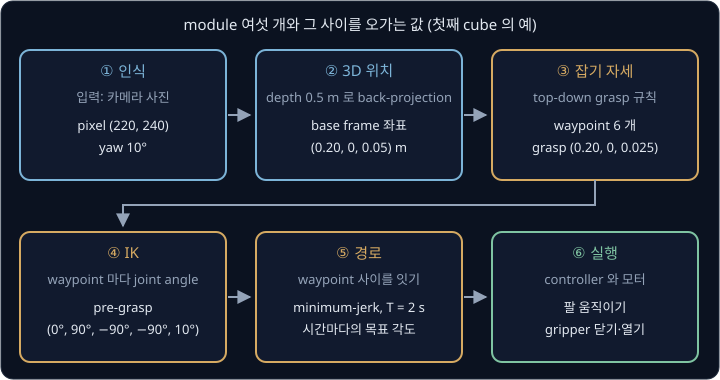

위 그림은 여섯 module 과 그 사이를 오가는 값을 이 강의의 예시 숫자로 보여 준다. 그림에 나온 낱말의 뜻은 아래와 같고, 계산 방법은
각 module 의 절에서 숫자로 다시 따라간다.

- **pixel** — 사진을 이루는 작은 칸 하나. pixel $(220, 240)$ 은 사진 왼쪽 위에서 오른쪽으로 220 칸, 아래로 240 칸 간 자리다
- **yaw** — 위에서 내려다볼 때 물체가 돌아간 각도
- **depth** — 카메라에서 앞쪽으로 물체까지 떨어진 거리. back-projection 은 pixel 과 depth 로 3D 점을 되찾는 계산이다
- **base frame** — 로봇 몸통 바닥을 원점으로 잡은 좌표의 기준. 축 방향은 아래 "예시 장면의 숫자" 에 적었다
- **top-down grasp** — 물체 위에서 수직으로 내려가 쥐는 규칙. waypoint 는 손이 거쳐 가도록 미리 정해 둔 자세다
- **joint angle** — 팔의 관절(joint)이 돌아간 각도. IK(inverse kinematics)는 손의 자세에서 joint angle 을 거꾸로 구하는 계산이다
- **minimum-jerk** — 출발과 도착에서 속도와 가속도가 0 이 되도록 부드럽게 움직이는 경로를 만드는 식. T 는 걸리는 시간이다
- **controller·gripper** — controller 는 목표 각도를 받아 모터의 힘을 정하는 장치이고, gripper 는 팔 끝의 두 손가락짜리 집게다

각 module 이 받는 것과 내는 것을 표로 모으면 아래와 같다.

| 순서 | module | 입력 | 출력 |
| --- | --- | --- | --- |
| ① | 인식 | 카메라 사진 | 사진 속 상자 가운데의 pixel 과 yaw |
| ② | 3D 위치 | pixel, depth | base frame 의 실제 좌표 (m) |
| ③ | 잡기 자세 | 상자의 좌표와 yaw | waypoint 여섯 개 |
| ④ | IK | waypoint 의 손 자세 | joint angle |
| ⑤ | 경로 | waypoint 마다의 joint angle | 시간마다의 목표 각도 |
| ⑥ | 실행 | 시간마다의 목표 각도 | 실제로 움직이는 팔과 gripper |

module 마다 입력과 출력이 분명하기 때문에, 상자를 못 집었을 때 어느 단계의 출력이 틀렸는지 하나씩 따로 확인할 수 있다. 이 성질은
강의 끝에서 이 방식의 가장 큰 장점으로 다시 다룬다.

**확인 문제.** 위 표에서 "관절 각도" 를 출력하는 module 과, 그 출력을 입력으로 받는 module 은 무엇일까?

답 보기

④ IK 가 관절 각도를 내고, ⑤ 경로 module 이 그 관절 각도를 받아 시간마다의 목표 각도를 만든다.

### 예시 장면의 숫자

이 강의는 아래 장면 하나를 처음부터 끝까지 따라간다. 숫자는 [Camera Geometry](../camera-geometry/README.md) 의 예시 카메라를
그대로 이어받았다.

- **로봇 base frame** — frame 은 원점 하나와 서로 수직인 $x$·$y$·$z$ 축 세 개로 이루어진 기준이고, 로봇 몸통 바닥에 붙인 frame 을
  base frame 이라고 한다. 원점은 로봇 바닥의 가운데, $x$ 는 로봇 앞쪽, $y$ 는 로봇 왼쪽, $z$ 는 위쪽이다. 책상 윗면이 $z = 0$ 이고,
  단위는 모두 m(미터)다
- **카메라** — 640×480 사진을 찍는다. focal length(렌즈가 확대하는 정도를 pixel 수로 적은 값)는 $f = 500$, principal point(카메라가
  정면으로 바라보는 방향이 찍히는 칸)는 $(c_x, c_y) = (320, 240)$ 이다. base frame 의 $(0.3, 0, 0.55)$, 곧 로봇 앞으로 30 cm, 책상
  위로 55 cm 높이에 달려 수직 아래를 내려다본다
- **cube** — 한 변 5 cm(0.05 m)의 빨간 정육면체다. 책상에 놓이면 윗면은 높이 0.05 m, 가운데는 높이 0.025 m 에 있다
- **gripper** — 팔 끝에 달린 두 손가락짜리 집게다. 손가락은 최대 7 cm 까지 벌어진다

**요약**

- pick-and-place 는 물체를 집어 다른 곳에 놓는 일이고, classical 방식은 이 일을 module 여섯 개로 나눠 사람이 짠 규칙으로 잇는다
- module 은 입력과 출력이 정해진 한 단계이고, module 을 이은 것이 pipeline 이다

## 사진에서 물체 찾기

첫 module 인 인식은 사진에서 cube 를 찾아, cube 윗면 가운데가 몇 번째 칸에 찍혔는지와 cube 가 얼마나 돌아가 있는지를 낸다. 사진의
칸 하나를 pixel 이라 하고, 왼쪽 위 칸에서 오른쪽으로 $u$ 칸, 아래로 $v$ 칸 간 위치를 pixel 좌표 $(u, v)$ 로 적는다. 이 약속은
[Camera Geometry](../camera-geometry/README.md) 에서 다뤘다.

### 색으로 고르는 mask

사진의 pixel 하나에는 빨강(Red)·초록(Green)·파랑(Blue) 빛이 얼마나 섞였는지를 0 부터 255 까지의 숫자 세 개로 적는다. 이 세 숫자를
머리글자를 따서 RGB 값이라고 한다. $(255, 0, 0)$ 은 새빨강, $(0, 0, 0)$ 은 검정, $(255, 255, 255)$ 는 흰색이다.

cube 는 빨갛고 책상은 회색이므로 "빨간 pixel 만 고르기" 로 cube 를 찾을 수 있다. 사람이 아래 규칙을 정했다고 하자.

> R 이 150 이상이고, G 와 B 가 모두 80 이하이면 cube 다

cube 근처의 pixel 여섯 개에 이 규칙을 대 본다.

| pixel | RGB | R ≥ 150 ? | G, B ≤ 80 ? | 판정 |
| --- | --- | --- | --- | --- |
| cube 윗면 | $(200, 40, 30)$ | 예 | 예 | cube |
| cube 윗면 | $(210, 60, 50)$ | 예 | 예 | cube |
| cube 의 그늘진 모서리 | $(100, 20, 15)$ | 아니오 | 예 | 아님 |
| 책상 | $(120, 110, 100)$ | 아니오 | 아니오 | 아님 |
| 책상의 반사광 | $(230, 200, 190)$ | 예 | 아니오 | 아님 |
| 책상 | $(115, 105, 95)$ | 아니오 | 아니오 | 아님 |

규칙을 사진의 모든 pixel 에 대 보고, cube 라고 판정한 칸은 1, 아닌 칸은 0 으로 적은 표를 mask 라고 한다. mask 는 "가리개" 라는
뜻으로, 0 인 칸을 가리고 1 인 칸만 남긴다는 의미다.

표의 셋째 줄이 문제다. 그늘진 모서리도 cube 인데 R 이 100 이라 규칙에서 빠졌다. 조명이 조금만 어두워져도 cube 의 빨강이
150 아래로 떨어져 cube 를 통째로 놓칠 수 있다.

**확인 문제.** pixel $(160, 70, 60)$ 과 $(240, 90, 30)$ 은 위 규칙으로 cube 일까?

답 보기

$(160, 70, 60)$ 은 R 이 150 이상이고 G·B 가 모두 80 이하라 cube 다. $(240, 90, 30)$ 은 G 가 90 이라 80 을 넘으므로 cube 가
아니다.

### 밝기에 흔들리지 않는 색 비율

조명이 어두워지면 R·G·B 가 거의 같은 비율로 함께 줄어든다. cube 윗면 $(200, 40, 30)$ 이 그늘에서 밝기가 반이 되면
$(100, 20, 15)$ 다. 숫자 하나하나는 반이 됐지만 세 숫자 가운데 빨강이 차지하는 몫은 그대로다.

| pixel | RGB | 합 R + G + B | 빨강의 몫 R ÷ 합 |
| --- | --- | --- | --- |
| 밝은 cube | $(200, 40, 30)$ | 270 | $200 \div 270 \approx 0.74$ |
| 그늘진 cube | $(100, 20, 15)$ | 135 | $100 \div 135 \approx 0.74$ |
| 책상 | $(120, 110, 100)$ | 330 | $120 \div 330 \approx 0.36$ |
| 책상의 반사광 | $(230, 200, 190)$ | 620 | $230 \div 620 \approx 0.37$ |

그래서 규칙을 "빨강의 몫이 0.6 이상이면 cube" 로 바꾸면 밝은 cube 와 그늘진 cube 를 모두 고르고 책상은 고르지 않는다. 이렇게
"어느 색인가" 를 밝기와 떼어 놓고 보는 생각을 정식으로 정리한 것이 HSV 라는 색 표현이다. HSV 는 색을 hue(색상, 빨강·노랑·초록
같은 색의 종류), saturation(채도, 색이 얼마나 진한가), value(명도, 얼마나 밝은가) 세 숫자로 나눠 적는데, 밝기가 바뀌면 주로 value
만 바뀌고 hue 는 거의 그대로라서 hue 의 범위로 색을 고르면 조명에 덜 흔들린다.

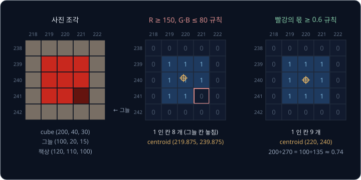

위 그림은 cube 가 찍힌 5×5 칸 조각에 두 규칙을 대어 만든 mask 다. 가운데 3×3 칸이 cube 이고, 오른쪽 아래 칸 하나만 그늘졌다.
첫째 규칙은 그 칸을 놓쳤고, 둘째 규칙은 아홉 칸을 모두 골랐다.

**흔한 오해.** "규칙을 한 번 잘 정하면 계속 쓸 수 있다" 고 생각하기 쉽다. 그런데 0.6 이라는 문턱도 사람이 이 cube 와 이 책상을 보고
정한 숫자다. 책상을 빨간 천으로 덮거나 cube 를 주황색으로 바꾸면 규칙을 다시 정해야 한다.

**확인 문제.** 밝기가 반이 된 책상 pixel $(60, 55, 50)$ 의 빨강의 몫은 얼마이고, "몫 ≥ 0.6" 규칙으로 cube 일까?

답 보기

합은 $60 + 55 + 50 = 165$ 이고 몫은 $60 \div 165 \approx 0.36$ 이다. 0.6 보다 작으므로 cube 가 아니다. 밝은 책상의 몫 0.36 과 같다.

### mask 의 중심 pixel

mask 에서 1 인 칸들이 cube 이므로, 그 칸들의 가운데가 cube 윗면의 가운데다. 칸들의 가운데는 $u$ 끼리, $v$ 끼리 평균을 내어 구한다.
평균은 숫자들을 모두 더한 뒤 개수로 나눈 값이다.

그림의 둘째 규칙은 $u = 219, 220, 221$ 과 $v = 239, 240, 241$ 이 만나는 아홉 칸을 골랐다. $u$ 값 아홉 개는 219, 220, 221 이 세 번씩
나오므로 합이 $3 \times (219 + 220 + 221) = 3 \times 660 = 1980$ 이고, 평균은 $1980 \div 9 = 220$ 이다. $v$ 도 같은 계산으로 240 이다.
그래서 cube 윗면 가운데는 pixel $(220, 240)$ 에 찍혔다.

첫째 규칙처럼 오른쪽 아래 칸 $(221, 241)$ 을 놓치면 여덟 칸만 남는다. $u$ 의 합은 $1980 - 221 = 1759$ 이고 평균은
$1759 \div 8 = 219.875$ 다. $v$ 도 $(2160 - 241) \div 8 = 1919 \div 8 = 239.875$ 로, 가운데가 왼쪽 위로 0.125 칸 밀린다. 그늘진
칸이 하나뿐이라 작은 차이지만, cube 의 절반이 그늘에 들면 가운데가 크게 밀린다. 평균으로 구한 이 가운데를 centroid(무게중심)라고
부른다.

**확인 문제.** mask 에서 1 인 칸이 $(10, 4)$, $(12, 4)$, $(10, 6)$, $(12, 6)$ 네 개다. centroid 는?

답 보기

$u$ 평균은 $(10 + 12 + 10 + 12) \div 4 = 44 \div 4 = 11$, $v$ 평균은 $(4 + 4 + 6 + 6) \div 4 = 20 \div 4 = 5$ 라서 $(11, 5)$ 다.

### 이름으로 찾는 인식기

색 규칙은 빨간 cube 처럼 색이 뚜렷한 물체에만 통한다. "책상 위의 컵" 이나 "드라이버" 처럼 색이 제각각인 물체를 찾으려면 다른
방법이 필요한데, 요즘은 찾을 물체의 이름을 글로 주면 사진에서 그 물체를 찾아 주는 인식기를 많이 쓴다.

이 인식기는 사진과 그 사진을 설명하는 글이 짝지어진 아주 많은 예에서 미리 학습해 둔 neural network(곱하고 더하는 계산을 여러 겹
쌓은 큰 모델)다. 사진과 함께 "red cube" 같은 이름을 넣으면, 사진에서 그 이름에 맞는 물체마다 그것을 둘러싸는 직사각형 하나와
점수 하나를 낸다. 이 직사각형을 bounding box 라 하고, 왼쪽 위 꼭짓점과 오른쪽 아래 꼭짓점의 pixel 좌표 두 개로 적는다. 점수는
"이 상자 안의 물체가 그 이름에 맞을 가능성" 을 0 부터 1 사이로 나타낸 값이다. 미리 정한 몇십 가지 이름만 찾는 옛 인식기와 달리
아무 이름이나 줄 수 있어서 open-vocabulary(정해진 단어 목록에 묶이지 않는) 인식기라고 부르고, YOLO-World(2024)가 그 예다.

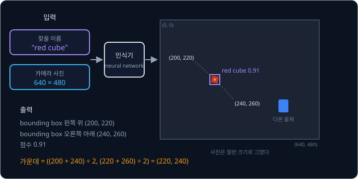

위 그림에서 인식기는 "red cube" 라는 이름을 받아 bounding box 의 왼쪽 위 $(200, 220)$ 와 오른쪽 아래 $(240, 260)$, 점수 0.91 을
냈다. box 의 가운데는 두 꼭짓점의 평균이다.

$$
u = (200 + 240) \div 2 = 220, \qquad v = (220 + 260) \div 2 = 240
$$

색 mask 로 구한 $(220, 240)$ 과 같은 칸이다. 그래서 pipeline 의 첫 module 을 이 인식기로 바꿔 끼워도 뒤 module 은 그대로 쓸 수
있다. cube 를 컵으로 바꾸면 색 문턱을 다시 정하는 대신 이름만 "cup" 으로 바꾸면 된다. 다만 이 인식기가 주는 것도 사진 속 칸
번호뿐이라 거리는 여전히 모르고, bounding box 는 늘 사진의 가로세로에 맞춘 직사각형이라 물체가 돌아간 각도도 알려 주지 않는다.
"점수가 0.5 를 넘는 box 만 믿는다" 같은 문턱도 여전히 사람이 정한다.

**확인 문제.** 인식기가 이름 "cup" 에 대해 bounding box $(100, 50)$–$(160, 130)$ 을 냈다. box 의 가운데 pixel 은?

답 보기

$u = (100 + 160) \div 2 = 130$, $v = (50 + 130) \div 2 = 90$ 이라 $(130, 90)$ 이다.

### 윗면의 회전 각도 yaw

gripper 손가락이 cube 의 마주 보는 두 옆면을 쥐려면, cube 가 위에서 볼 때 얼마나 돌아가 있는지도 알아야 한다. 수직축을 중심으로
돌아간 각도를 yaw 라고 한다. mask 의 바깥 테두리를 감싸는 가장 작은 직사각형을 돌려 가며 맞춰 보면 그 직사각형의 기울기가 yaw
다. 예시 장면의 cube 는 yaw 가 10° 였다고 하자.

정육면체 윗면은 정사각형이라 90° 돌려도 모양이 같다. yaw 10° 인 cube 와 100°, 190°, −80° 인 cube 는 위에서 보면 똑같아서, 사진으로는
이 넷을 가릴 수 없다. 그래서 cube 의 yaw 는 90° 를 더하거나 빼도 같은 값으로 친다.

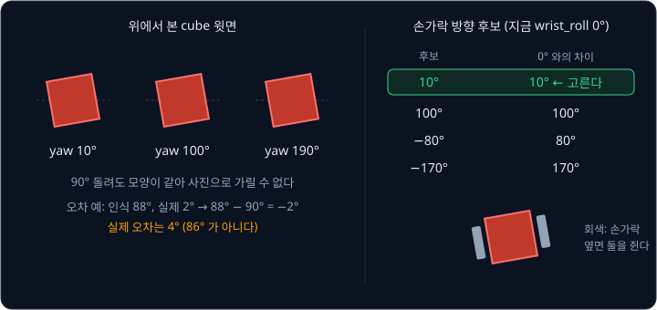

이 성질은 두 곳에서 쓰인다. 첫째는 오차를 잴 때다. 인식이 88° 를 냈고 실제 yaw 가 2° 라면 차이는 86° 처럼 보이지만, 88° 에서 90° 를
빼면 −2° 이므로 실제 오차는 $2 - (-2) = 4°$ 다. 둘째는 손가락 방향을 고를 때로, 뒤의 [gripper 방향과 yaw 후보](#gripper-방향과-yaw-후보) 절에서 계산한다.

**흔한 오해.** yaw 오차를 그냥 빼서 재면 정확한 인식기가 크게 틀린 것처럼 보인다. 위 예처럼 88° 와 2° 는 4° 차이다.

**확인 문제.** 인식이 yaw 를 85° 로 냈고 실제 yaw 는 −3° 다. 90° 주기를 생각한 실제 오차는?

답 보기

85° 에서 90° 를 빼면 −5° 이고, 실제 −3° 와의 차이는 2° 다.

**요약**

- 색 규칙으로 고른 칸을 1 로 적은 mask 의 centroid 가 물체 가운데의 pixel 이다. 밝기보다 색의 비율(HSV 의 hue)로 고르면 조명에 덜
  흔들린다
- 이름을 주면 bounding box 를 찾아 주는 open-vocabulary 인식기로 첫 module 을 바꿀 수 있지만, 이것도 칸 번호만 주고 거리는 주지 않는다
- 정육면체 윗면은 90° 마다 같아 보여서 yaw 는 90° 주기로 다룬다

## depth 와 3D 위치

### 경로 계획에 3D 좌표가 필요한 이유

인식이 낸 pixel $(220, 240)$ 은 "사진의 가운데에서 왼쪽으로 100 칸" 이라는 뜻일 뿐이다. 그런데 팔을 움직일 계획을 세우는 뒤의
module 은 모두 실제 공간의 길이를 쓴다. gripper 를 cube 위 20 cm 에 세우려면 cube 가 몇 m 높이에 있는지 알아야 하고, 관절 각도를
구하려면 손끝이 로봇에서 몇 m 떨어져야 하는지 알아야 한다. "100 칸 왼쪽" 을 몇 cm 로 바꿔야 하는지는 카메라에서 cube 까지가
얼마나 먼지에 따라 달라진다.

그래서 두 번째 module 은 pixel 을 로봇 base frame 에서 m 단위로 잰 3D 좌표 $(x, y, z)$ 로 바꾼다. 경로를 정하는 계산(경로 계획)은
이 3D 좌표만 받는다.

### 카메라 한 대로 모르는 거리

[Camera Geometry](../camera-geometry/README.md) 에서 본 것처럼, 카메라 렌즈 중심에서 뻗은 직선 하나 위의 점은 거리와 상관없이
모두 같은 pixel 에 찍힌다. 렌즈 중심에서 한 방향으로 곧게 뻗어 나가는 이 반직선을 ray 라고 한다. 그 강의에서는 렌즈 중심을 원점으로
하고 $X$ 가 사진의 오른쪽, $Y$ 가 사진의 아래쪽, $Z$ 가 카메라가 바라보는 앞쪽인 camera frame 으로 점을 적었다. camera frame 에서
카메라 앞으로 1 m 인 점 $(0.1, -0.05, 1.0)$ 과 2 m 인 점 $(0.2, -0.1, 2.0)$ 은 같은 ray 위에 있어서 둘 다 pixel $(370, 215)$ 에
찍혔다.

카메라에서 앞쪽으로 떨어진 거리를 depth 라고 한다. 사진 한 장은 pixel 마다 "이 방향에 무언가 있다" 는 것만 알려 주고 depth 는
알려 주지 않으므로, pixel 하나만으로는 3D 점이 하나로 정해지지 않는다. 이 빈칸을 채우는 방법은 이 강의에서 두 가지를 쓴다.

- **depth camera** — 사진을 찍으면서 pixel 마다 depth 도 함께 재는 카메라를 쓴다
- **높이를 아는 평면** — cube 는 언제나 책상 위에 놓이므로 cube 윗면의 높이 0.05 m 를 미리 알고, ray 가 그 높이와 만나는 점을 찾는다

**확인 문제.** 카메라 앞 3 m 에 있는 점 $(0.3, -0.15, 3.0)$ 은 어느 pixel 에 찍힐까? ($f = 500$, $(c_x, c_y) = (320, 240)$)

답 보기

depth 로 나누면 $(0.1, -0.05)$, 500 을 곱하면 $(50, -25)$, $(320, 240)$ 을 더하면 $(370, 215)$ 다. 1 m·2 m 점과 같은 ray 위에
있어서 같은 pixel 이다.

### depth 를 아는 경우의 back-projection

depth camera 가 pixel $(220, 240)$ 의 depth 를 0.5 m 로 쟀다고 하자. 카메라는 높이 0.55 m 에서 수직 아래를 보고 cube 윗면은 높이
0.05 m 이므로, $0.55 - 0.05 = 0.5$ 가 맞는 값이다. 3D 점에서 pixel 을 구하는 투영 계산을 거꾸로 하는 back-projection 의 세 단계를 한 줄씩 한다.

| 단계 | $u$ 쪽 | $v$ 쪽 |
| --- | --- | --- |
| ① principal point 빼기 | $220 - 320 = -100$ | $240 - 240 = 0$ |
| ② $f = 500$ 으로 나누기 | $-100 \div 500 = -0.2$ | $0 \div 500 = 0$ |
| ③ depth 0.5 곱하기 | $-0.2 \times 0.5 = -0.1$ | $0 \times 0.5 = 0$ |

그래서 cube 윗면 가운데는 camera frame 에서 $(X, Y, Z) = (-0.1, 0, 0.5)$ 다. 카메라 앞으로 0.5 m, 사진의 왼쪽 방향으로 0.1 m 에 있는
점이다.

세 단계를 식으로 모으면 Camera Geometry 의 back-projection 식이다.

$$
X = \frac{(u - c_x)\,Z}{f_x}, \qquad Y = \frac{(v - c_y)\,Z}{f_y}
$$

"pixel 번호에서 principal point 를 빼고, depth $Z$ 를 곱한 뒤 focal length 로 나눈다" 라고 읽는다. 표와 맞추면 $u - c_x$ 는 $-100$,
$Z$ 는 0.5, $f_x$ 는 500, 결과 $X$ 는 $-0.1$ 이다.

숫자만 바꿔 한 번 더 한다. 두 번째 예에서는 cube 가 pixel $(220, 40)$ 에 찍혔고 depth 는 역시 0.5 m 다.

| 단계 | $u$ 쪽 | $v$ 쪽 |
| --- | --- | --- |
| ① principal point 빼기 | $220 - 320 = -100$ | $40 - 240 = -200$ |
| ② $f = 500$ 으로 나누기 | $-0.2$ | $-0.4$ |
| ③ depth 0.5 곱하기 | $-0.1$ | $-0.2$ |

camera frame 좌표는 $(-0.1, -0.2, 0.5)$ 다. $Y$ 가 음수이므로 사진의 위쪽 방향으로 0.2 m 떨어져 있다.

**흔한 오해.** depth 에 오차가 있으면 높이만 틀린다고 생각하기 쉽다. depth 가 0.5 대신 0.51 로 재지면 $X$ 도
$-0.2 \times 0.51 = -0.102$ 로 2 mm 바뀐다. back-projection 은 ② 에서 구한 방향에 depth 를 곱하므로, depth 오차는 가로 위치에도
섞여 들어간다.

**확인 문제.** pixel $(420, 290)$ 의 depth 가 0.5 m 다. camera frame 의 3D 점은?

답 보기

① $(100, 50)$, ② 500 으로 나누면 $(0.2, 0.1)$, ③ 0.5 를 곱하면 $(0.1, 0.05)$ 라서 $(0.1, 0.05, 0.5)$ 다.

### camera frame 에서 base frame 으로

camera frame 좌표는 카메라에서 본 위치라서, 로봇이 쓰려면 base frame 좌표로 바꿔야 한다. 수직 아래를 보는 이 카메라의 축은
base frame 의 축과 아래처럼 대응한다(Camera Geometry 의 marker 예와 같은 배치다).

- 카메라의 $X$ (사진 오른쪽) = base 의 $+x$ (로봇 앞쪽)
- 카메라의 $Y$ (사진 아래쪽) = base 의 $-y$ (로봇 오른쪽)
- 카메라의 $Z$ (카메라 앞쪽) = base 의 $-z$ (아래쪽)

그래서 camera 좌표 $(X, Y, Z)$ 는 base 에서 $(X, -Y, -Z)$ 만큼 떨어진 방향이 되고, 여기에 카메라가 달린 자리 $(0.3, 0, 0.55)$ 를
더하면 base frame 좌표다.

$$
p_b = (X,\ -Y,\ -Z) + (0.3,\ 0,\ 0.55)
$$

$p_b$ 는 base frame 에서 잰 점이다. 두 예를 계산한다.

| 예 | camera $(X, Y, Z)$ | $(X, -Y, -Z)$ | 카메라 자리 더하기 | base frame $p_b$ |
| --- | --- | --- | --- | --- |
| 첫째 | $(-0.1, 0, 0.5)$ | $(-0.1, 0, -0.5)$ | $+ (0.3, 0, 0.55)$ | $(0.20, 0, 0.05)$ |
| 둘째 | $(-0.1, -0.2, 0.5)$ | $(-0.1, 0.2, -0.5)$ | $+ (0.3, 0, 0.55)$ | $(0.20, 0.20, 0.05)$ |

첫째 cube 의 윗면 가운데는 로봇 앞 20 cm, 높이 5 cm 이고, 둘째 cube 는 앞 20 cm, 왼쪽 20 cm 에 있다. 높이가 0.05 m 로 나온 것은
cube 윗면의 높이와 맞으므로 계산이 맞았다는 확인도 된다. cube 의 가운데는 윗면에서 반 변(0.025 m)을 내린 $(0.20, 0, 0.025)$ 다.

카메라가 비스듬히 달린 일반적인 경우에는 [Rigid Transforms](../transforms/README.md) 에서 본 homogeneous transform 을 쓴다. 축을 돌리는
rotation 과 원점을 옮기는 translation 을 4×4 숫자 표(행렬) 하나에 담은 것으로, $T_{bo} = T_{bc}\,T_{co}$ 처럼 곱한다. $T_{bc}$ 는
base 에서 본 카메라의 pose(위치와 방향), $T_{co}$ 는 카메라에서 본 cube 의 pose 다.
이 강의의 카메라는 수직 아래를 보므로 위의 축 대응과 더하기만으로 같은 결과가 나온다. 카메라가 base 의 어디에 어느 방향으로
달렸는지를 나타내는 $T_{bc}$ 를 extrinsics 라고 하고, 카메라를 단 뒤 이 값을 재는 일을 calibration 이라고 한다.

**확인 문제.** 앞 확인 문제의 camera 좌표 $(0.1, 0.05, 0.5)$ 는 base frame 에서 어디일까?

답 보기

$(X, -Y, -Z) = (0.1, -0.05, -0.5)$ 에 $(0.3, 0, 0.55)$ 를 더하면 $(0.4, -0.05, 0.05)$ 다. 로봇 앞 40 cm, 오른쪽 5 cm 다.

### 높이를 아는 평면과 ray

depth camera 가 없어도 cube 윗면 높이 0.05 m 를 알면 위치를 구할 수 있다. pixel $(220, 240)$ 의 ray 는 렌즈 중심에서 출발해, 앞으로
1 m 갈 때마다 옆으로 back-projection ② 의 값만큼 간다. ② 의 값이 $(-0.2, 0)$ 이었으므로 camera frame 에서 ray 의 방향은 $(-0.2, 0, 1)$
이고, base frame 으로 축을 바꾸면 $(-0.2, 0, -1)$ 이다. 앞으로 1 m 갈 때마다 로봇 쪽으로 0.2 m, 아래로 1 m 간다는 뜻이다.

ray 위의 점은 출발점에 방향을 $t$ 배 해서 더한 것이다.

$$
p(t) = (0.3,\ 0,\ 0.55) + t \times (-0.2,\ 0,\ -1)
$$

$t$ 는 ray 를 따라 얼마나 갔는지를 나타내는 0 이상의 수다. 이 점의 높이는 $0.55 - t$ 이고, 이것이 cube 윗면 높이 0.05 가 되려면

$$
0.55 - t = 0.05 \quad\Rightarrow\quad t = 0.5
$$

다. $t = 0.5$ 를 넣으면 $p = (0.3 - 0.1,\ 0,\ 0.55 - 0.5) = (0.20, 0, 0.05)$ 로, depth camera 로 구한 점과 같다.

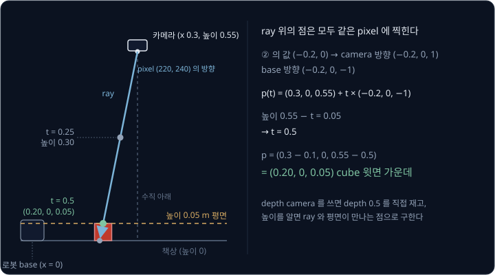

위 그림은 장면을 옆에서 본 것이다. 파란 ray 위의 세 점은 모두 같은 pixel 에 찍히지만, 높이 0.05 m 인 점은 하나뿐이다. cube 가
책상 위에 있다는 정보로 빠진 depth 를 채웠다.

**확인 문제.** 둘째 예의 pixel $(220, 40)$ 은 ② 의 값이 $(-0.2, -0.4)$ 였다. 같은 방법으로 높이 0.05 m 인 점을 구해 보자.

답 보기

camera 방향 $(-0.2, -0.4, 1)$ 을 base 로 바꾸면 $(-0.2, 0.4, -1)$ 이다. 높이 $0.55 - t = 0.05$ 에서 $t = 0.5$ 이고, 점은
$(0.3 - 0.1,\ 0 + 0.2,\ 0.05) = (0.20, 0.20, 0.05)$ 로 back-projection 의 결과와 같다.

### 높이 가정이 틀릴 때

높이를 아는 평면 방법은 "cube 윗면은 언제나 0.05 m" 라는 가정에 기댄다. 누군가 cube 를 두께 5 cm 짜리 책 위에 올려 두면 윗면은
실제로 높이 0.10 m, 위치 $(0.20, 0, 0.10)$ 에 있다. 카메라에서 이 점까지의 depth 는 $0.55 - 0.10 = 0.45$ 이고, pixel 은
$u = 500 \times (-0.1) \div 0.45 + 320 \approx 209$ 에 찍힌다.

pipeline 은 이 사실을 모른 채 pixel 209 의 ray 를 높이 0.05 m 평면과 만나게 한다.

| 단계 | 계산 | 결과 |
| --- | --- | --- |
| ② 방향 | $(209 - 320) \div 500$ | $-0.222$ |
| 가정한 depth | $0.55 - 0.05$ | $0.5$ |
| ③ $X$ | $-0.222 \times 0.5$ | $-0.111$ |
| base 의 $x$ | $0.3 - 0.111$ | $0.189$ |

pipeline 은 cube 가 $(0.189, 0, 0.05)$ 에 있다고 낸다. 실제 $(0.20, 0, 0.10)$ 과 비교하면 앞뒤로 1.1 cm, 높이로 5 cm 가 틀렸다.
gripper 는 cube 윗면보다 5 cm 아래로 내려가려다 cube 를 위에서 누르게 된다. depth camera 는 pixel 209 의 depth 를 0.45 로 직접 재므로
이런 일이 없다.

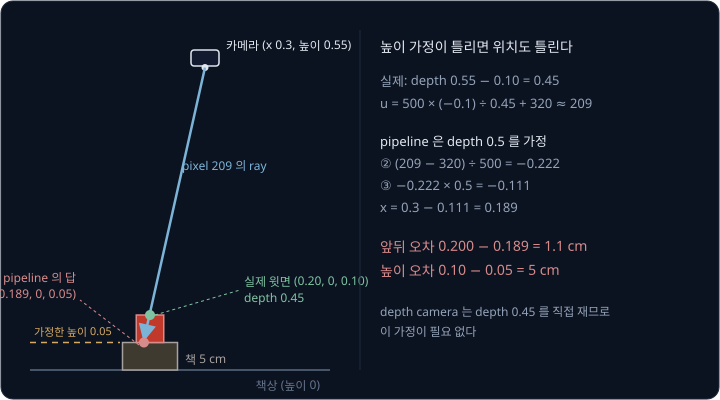

**확인 문제.** 책 위에 올린 cube 를 depth camera 로 쟀더니 pixel 209 의 depth 가 0.45 m 였다. $u$ 쪽 back-projection 으로 base 의 $x$
를 구해 보자. (② 의 값은 $-0.222$)

답 보기

③ $X = -0.222 \times 0.45 \approx -0.1$ 이고 base 의 $x$ 는 $0.3 - 0.1 = 0.2$ 다. 높이는 $0.55 - 0.45 = 0.10$ 이라 실제 위치와 맞는다.

**요약**

- 경로 계획은 pixel 이 아니라 base frame 의 m 단위 3D 좌표를 받는다. 카메라 한 대의 pixel 은 방향(ray)만 정하므로 depth 가 필요하다
- depth 를 알면 back-projection $X = (u - c_x)Z / f_x$ 로 camera 좌표를 구하고, 축 대응과 카메라 자리를 더해 base 좌표로 바꾼다.
  pixel $(220, 240)$, depth 0.5 m 는 base 의 $(0.20, 0, 0.05)$ 다
- depth camera 대신 물체가 놓인 높이를 가정해 ray 와 평면의 교점을 구할 수도 있지만, 가정이 틀리면 위치도 틀린다

## 잡기 자세와 waypoint

### top-down grasp

cube 의 위치를 알았으니 gripper 를 어떤 자세로 가져가 쥘지 정한다. 손의 위치와 방향을 합쳐 pose 라고 하고, 물체를 쥐는 순간의
gripper pose 를 grasp pose 라고 한다. grasp 는 "쥐기" 라는 뜻이다.

이 강의는 가장 단순한 규칙을 쓴다. gripper 를 수직 아래로 향하게 한 채 cube 바로 위에서 내려가, 손가락 끝의 가운데가 cube 의
가운데 높이에 왔을 때 손가락을 닫는다. 위(top)에서 아래(down)로 내려가 쥔다고 해서 top-down grasp 라고 부른다. 첫째 예의 grasp
pose 는 아래와 같다.

- 손끝 위치: cube 가운데 $(0.20, 0, 0.025)$
- 방향: gripper 가 수직 아래를 향하고, 손가락이 벌어지는 방향은 cube 의 yaw 에 맞춘다

손가락은 7 cm 까지 벌어지고 cube 는 5 cm 이므로, 손가락을 다 벌린 채 cube 가운데로 내려가면 양쪽에 $(7 - 5) \div 2 = 1$ cm 씩
여유가 있다. 손끝이 cube 가운데에서 1 cm 넘게 벗어나면 내려가는 손가락이 cube 윗면 모서리에 걸린다. 이 1 cm 가 뒤의 모든
module 이 나눠 쓰는 오차의 한도다.

**확인 문제.** 손가락이 최대 8 cm 벌어지는 gripper 로 한 변 6 cm 인 cube 를 top-down grasp 하면 한쪽 여유는 몇 cm 일까?

답 보기

$(8 - 6) \div 2 = 1$ cm 다.

### gripper 방향과 yaw 후보

손가락은 cube 의 마주 보는 두 옆면에 수직으로 닿아야 한다. gripper 의 두 손가락은 180° 돌려도 같은 모양이고 cube 는 90° 마다 같으므로,
cube 의 yaw 가 10° 이면 손가락 방향의 후보는 90° 간격의 10°, 100°, −80°, −170° 네 개다. 넷 가운데 어느 것을 골라도 쥘 수 있다.

손가락 방향은 손목을 비트는 관절 `wrist_roll` 이 맞춘다. 관절이 돌 수 있는 범위를 joint limit 이라고 하는데, 후보 가운데 joint limit
안에 있고 지금 `wrist_roll` 각도에서 가장 가까운 것을 고르면 손목을 가장 조금 돌린다. 지금 `wrist_roll` 이 0° 라면 네 후보와의
차이는 10°, 100°, 80°, 170° 이므로 10° 를 고른다.

| 후보 | 지금 0° 와의 차이 | 지금 70° 와의 차이 |
| --- | --- | --- |
| 10° | 10° | 60° |
| 100° | 100° | 30° |
| −80° | 80° | 150° |
| −170° | 170° | 240° |

지금 각도가 70° 면 같은 cube 라도 100° 를 고른다. 같은 결과를 내는 답이 여럿일 때 지금 자세에 가까운 것을 고르는 이 규칙은 IK 에서도
다시 나온다.

**확인 문제.** cube 의 yaw 가 30° 이고 지금 `wrist_roll` 이 −50° 다. 고를 손가락 방향은?

답 보기

후보는 30°, 120°, −60°, −150° 이고 −50° 와의 차이는 80°, 170°, 10°, 100° 다. −60° 를 고른다.

### waypoint 여섯 개

grasp pose 만 정하고 팔을 그리로 바로 보내면, 손이 옆에서 비스듬히 다가가다 손가락으로 cube 를 밀어낼 수 있다. 그래서 cube 위에서
먼저 멈춘 뒤 수직으로 내려간다. 이처럼 손이 거쳐 가도록 정해 둔 자세를 waypoint 라고 한다. way(길)와 point(점)를 합친 말이다.
첫째 cube 를 $(0.30, 0, 0.025)$ 에 옮겨 놓는 waypoint 는 아래와 같다. 모든 waypoint 에서 gripper 는 수직 아래를 향한다.

| 순서 | waypoint | 손끝 위치 | 정한 규칙 | gripper |
| --- | --- | --- | --- | --- |
| 1 | pre-grasp | $(0.20, 0, 0.225)$ | grasp 를 0.2 m 올린 자리 | 열림 |
| 2 | grasp | $(0.20, 0, 0.025)$ | cube 가운데 | 도착 후 닫음 |
| 3 | lift | $(0.20, 0, 0.225)$ | grasp 를 0.2 m 올린 자리 | 닫힘 |
| 4 | pre-place | $(0.30, 0, 0.225)$ | place 를 0.2 m 올린 자리 | 닫힘 |
| 5 | place | $(0.30, 0, 0.025)$ | 놓을 자리, cube 가 책상에 닿는 높이 | 도착 후 엶 |
| 6 | retreat | $(0.30, 0, 0.225)$ | place 를 0.2 m 올린 자리 | 열림 |

pre-grasp 는 "쥐기 전", lift 는 "들어 올리기", pre-place 는 "놓기 전", retreat 는 "물러나기" 라는 뜻이다.

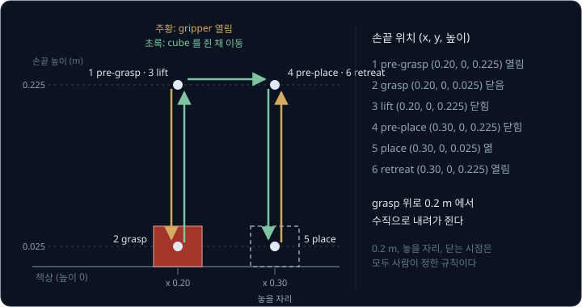

위 그림은 손끝이 지나는 길을 옆에서 본 것이다. 0.2 m 라는 높이, 놓을 자리, 손가락을 닫는 시점은 모두 사람이 정한 숫자와 규칙이다.

**확인 문제.** 둘째 cube(가운데 $(0.20, 0.20, 0.025)$)를 같은 규칙으로 집을 때 pre-grasp 의 손끝 위치는?

답 보기

grasp 위치를 0.2 m 올린 $(0.20, 0.20, 0.225)$ 다.

**요약**

- top-down grasp 는 gripper 를 수직 아래로 향한 채 cube 위에서 내려가 쥐는 규칙이고, 손가락 7 cm 와 cube 5 cm 의 차이에서 오는
  1 cm 가 위치 오차의 한도다
- 손가락 방향은 90° 간격의 yaw 후보 가운데 지금 `wrist_roll` 에 가장 가까운 것을 고른다
- waypoint 는 pre-grasp → grasp → lift → pre-place → place → retreat 로, 옆에서 밀지 않고 수직으로 내려가 쥐도록 사람이 정한 자세다

## IK 로 구하는 joint angle

### 단순화한 팔

waypoint 는 손끝의 pose 인데, 로봇이 모터로 직접 정할 수 있는 것은 관절(joint)이 돌아간 각도, 곧 joint angle 뿐이다. 손끝 pose 에서
거꾸로 joint angle 을 구하는 계산이 [Inverse Kinematics](../inverse-kinematics/README.md) 의 IK 였다. 네 번째 module 은 waypoint
여섯 개마다 IK 를 풀어 joint angle 을 낸다.

손으로 계산할 수 있도록 SO-101 처럼 관절이 다섯 개인 팔을 단순하게 바꾼 모델을 쓴다. 관절 이름은 SO-101 과 같다.

- `shoulder_pan` — 팔 전체를 위에서 볼 때 좌우로 돌린다. 각도는 로봇 앞쪽($+x$)에서 왼쪽($+y$)으로 잰다
- `shoulder_lift` — base 원점 바로 위 높이 0.1 m 에 있는 어깨에서 위팔을 들어 올린다. 위팔 길이는 0.2 m 다
- `elbow_flex` — 팔꿈치를 굽힌다. 아래팔 길이는 0.2 m 다
- `wrist_flex` — 손목을 굽힌다. 손목에서 손끝 가운데까지는 0.075 m 다
- `wrist_roll` — 손목을 비틀어 손가락 방향을 맞춘다

`shoulder_lift` 부터 `wrist_flex` 까지는 [IK 강의](../inverse-kinematics/README.md) 의 평면 팔처럼 옆에서 본 한 평면 안에서 돈다.
`shoulder_lift` 의 각도 $\theta_1$ 은 수평에서 위로 잰 위팔의 방향이고, `elbow_flex` 의 $\theta_2$ 와 `wrist_flex` 의 $\theta_3$ 은 앞
부품의 방향에서 잰 상대 각도다. 그래서 아래팔은 수평에서 $\theta_1 + \theta_2$, gripper 는 $\theta_1 + \theta_2 + \theta_3$ 방향을
가리킨다. $\theta$ 는 그리스 문자 theta(세타)다.

gripper 가 수직 아래를 향하려면 이 방향이 −90° 여야 한다. 그래서 손목은 손끝 바로 위 0.075 m 에 있고, 위팔과 아래팔로 손목을 그
자리에 보내는 일은 IK 강의의 2 관절 팔 문제와 같다.

### 닿는지 확인

IK 를 풀기 전에 팔이 그 자리에 닿는지부터 본다. 위팔과 아래팔을 일직선으로 펴도 어깨에서 손목까지는 $0.2 + 0.2 = 0.4$ m 이므로,
어깨에서 손목까지의 거리가 0.4 m 를 넘으면 답이 없다.

첫째 예의 pre-grasp 를 본다. 손끝이 $(0.20, 0, 0.225)$ 이므로 손목은 그 위 0.075 m 인 높이 0.3 m 에 있다. 어깨는 높이 0.1 m 에
있으므로, 어깨에서 본 손목은 앞으로 0.2 m, 위로 $0.3 - 0.1 = 0.2$ m 다. 두 방향이 직각이라 피타고라스 정리(직각삼각형에서 빗변의
제곱은 나머지 두 변의 제곱의 합)로 거리를 구한다.

$$
d = \sqrt{0.2^2 + 0.2^2} = \sqrt{0.04 + 0.04} = \sqrt{0.08} \approx 0.283
$$

$\sqrt{\ }$ 는 제곱해서 그 수가 되는 양수를 구하는 기호(제곱근)다. 0.283 m 는 0.4 m 보다 작으므로 닿는다.

숫자만 바꿔 place 를 $(0.40, 0, 0.025)$ 로 옮긴 경우를 본다. pre-place 의 손목은 어깨에서 앞으로 0.4 m, 위로 0.2 m 라서
$d = \sqrt{0.16 + 0.04} = \sqrt{0.2} \approx 0.447$ m 다. 0.4 m 를 넘으므로 이 waypoint 에는 닿지 않는다. 이때 IK module 은 실패를
알리고, 사람이 놓을 자리를 가까이 옮기거나 waypoint 높이를 낮추는 규칙을 다시 정해야 한다.

**확인 문제.** 어깨에서 본 손목이 앞으로 0.3 m, 위로 0.4 m 다. 이 팔이 닿을까?

답 보기

$d = \sqrt{0.09 + 0.16} = \sqrt{0.25} = 0.5$ m 로 0.4 m 보다 멀어서 닿지 않는다.

### pre-grasp 의 joint angle

어깨에서 본 손목 목표는 $(0.2, 0.2)$ 이고, 거리는 $d^2 = 0.08$ 이다. IK 강의의 코사인 법칙을 그대로 쓴다.

$$
\cos\theta_2 = \frac{d^2 - L_1^2 - L_2^2}{2 L_1 L_2}
$$

$L_1$, $L_2$ 는 위팔과 아래팔의 길이 0.2 m 이고, $\cos\theta_2$ 는 팔꿈치 각도 $\theta_2$ 의 cos 값이다. 길이 1 짜리 막대를
$\theta$ 만큼 돌렸을 때 막대 끝의 가로 위치가 $\cos\theta$, 세로 위치가 $\sin\theta$ 였다($\cos 0° = 1$, $\cos 90° = 0$,
$\cos 120° = -0.5$). 이 식은 "어깨-손목 거리의
제곱에서 두 팔 길이의 제곱을 빼고, 두 길이 곱의 2 배로 나누면 팔꿈치 각도의 cos 값이 나온다" 로 읽는다. 대입하면

$$
\cos\theta_2 = \frac{0.08 - 0.04 - 0.04}{2 \times 0.2 \times 0.2} = \frac{0}{0.08} = 0
$$

이다. cos 값이 0 인 각도는 90° 이므로 $\theta_2 = 90°$ 이거나 $-90°$ 다. 팔꿈치가 위로 가는 elbow-up 답 $\theta_2 = -90°$ 를 고른다.

$\theta_1$ 은 IK 강의처럼 두 방향의 차 $\theta_1 = \varphi - \beta$ 로 구한다. $\varphi$(phi, 파이)는 어깨에서 손목 목표를 바라본
방향이고, $\beta$(beta, 베타)는 $\theta_1 = 0°$ 로 둔 팔에서 어깨가 손목을 바라본 방향이다.

| 단계 | 계산 | 결과 |
| --- | --- | --- |
| 목표의 방향 $\varphi$ | 손목 목표 $(0.2, 0.2)$ 는 앞과 위가 같은 길이 | $45°$ |
| $\theta_1 = 0°$ 일 때 손목 | $0.2 \times (1 + \cos(-90°),\ \sin(-90°))$ | $(0.2, -0.2)$ |
| 그 손목의 방향 $\beta$ | 앞으로 0.2, 아래로 0.2 | $-45°$ |
| $\theta_1 = \varphi - \beta$ | $45° - (-45°)$ | $90°$ |

위팔은 $\theta_1 = 90°$ 라 수직으로 서고, 아래팔은 $\theta_1 + \theta_2 = 0°$ 라 수평으로 뻗는다.

joint angle 에서 손끝 위치를 구하는 forward kinematics(FK)로 검산한다. 옆에서 본 위치를 (앞뒤 위치, 높이) 로 적으면 어깨는 $(0, 0.1)$ 이다. 위팔이 수직이라 팔꿈치는 어깨 바로 위
0.2 m 인 $(0, 0.3)$ 이고, 아래팔이 수평이라 손목은 앞으로 0.2 m 간 $(0.2, 0.3)$ 이다. 손끝 $(0.2, 0.225)$ 바로 위 0.075 m 라는 목표
손목 위치와 같다. 마지막으로 gripper 가 −90° 를 향하도록 손목을 정한다.

$$
\theta_3 = -90° - (\theta_1 + \theta_2) = -90° - 0° = -90°
$$

cube 가 로봇 정면($y = 0$)에 있으니 `shoulder_pan` 은 0° 이고, `wrist_roll` 은 앞에서 고른 10° 다. pre-grasp 의 joint angle 은
(`shoulder_pan`, `shoulder_lift`, `elbow_flex`, `wrist_flex`, `wrist_roll`) $= (0°, 90°, -90°, -90°, 10°)$ 다.

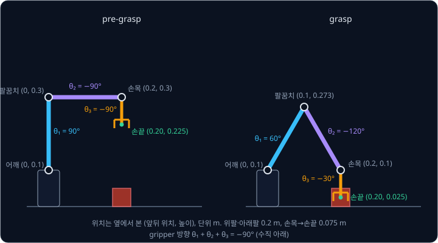

### grasp 의 joint angle

숫자만 바꿔 grasp 를 푼다. 손끝 $(0.20, 0, 0.025)$ 위 0.075 m 인 손목은 높이 0.1 m 로, 어깨와 같은 높이다. 어깨에서 본 손목은
$(0.2, 0)$ 이고 $d^2 = 0.04$ 다.

| 단계 | 계산 | 결과 |
| --- | --- | --- |
| $\cos\theta_2$ | $(0.04 - 0.04 - 0.04) \div 0.08$ | $-0.5$ |
| $\theta_2$ (elbow-up) | cos 값이 $-0.5$ 인 각도 120° 에 음수 | $-120°$ |
| 목표의 방향 $\varphi$ | 손목 목표 $(0.2, 0)$ 은 바로 앞 | $0°$ |
| $\theta_1 = 0°$ 일 때 손목 | $0.2 \times (1 + \cos(-120°),\ \sin(-120°)) = 0.2 \times (0.5, -0.866)$ | $(0.1, -0.173)$ |
| 그 손목의 방향 $\beta$ | $(0.1, -0.173) \div 0.2 = (0.5, -0.866)$ | $-60°$ |
| $\theta_1 = \varphi - \beta$ | $0° - (-60°)$ | $60°$ |
| 아래팔 방향 | $60° + (-120°)$ | $-60°$ |
| $\theta_3$ | $-90° - (-60°)$ | $-30°$ |

검산하면 팔꿈치는 $0.2 \times (\cos 60°, \sin 60°) = (0.1, 0.173)$ 만큼 어깨에서 떨어져 있고, 아래팔이 $-60°$ 방향으로
$0.2 \times (\cos(-60°), \sin(-60°)) = (0.1, -0.173)$ 을 더해 손목이 어깨에서 $(0.2, 0)$ 에 온다. grasp 의 joint angle 은
$(0°, 60°, -120°, -30°, 10°)$ 다.

**흔한 오해.** IK 의 답이 하나라고 생각하기 쉽다. pre-grasp 에서도 팔꿈치를 아래로 꺾는 elbow-down 답 $(\theta_1, \theta_2) = (0°, 90°)$
이 있다. (앞뒤 위치, 높이) 로 적으면 위팔이 수평으로 뻗어 팔꿈치가 $(0.2, 0.1)$, 아래팔이 수직으로 서서 손목이 $(0.2, 0.3)$ 에
온다. 둘 다 손목을 맞추지만, waypoint 마다 다른 답을 고르면 waypoint 사이에서 팔이 크게 뒤집힌다. 그래서 IK module 은 joint
limit 안의 답 가운데 앞 waypoint 의 joint angle 에 가까운 답을 고른다.

**확인 문제.** 둘째 cube 의 grasp 는 손끝 $(0.20, 0.20, 0.025)$ 이다. 위에서 보면 cube 가 어깨에서 앞으로 0.2, 왼쪽으로 0.2 m 라서
`shoulder_pan` 은 45° 이고, 그 방향으로 잰 수평 거리는 $\sqrt{0.08} \approx 0.283$ m 다. 손목은 어깨와 같은 높이다. $\cos\theta_2$ 와
elbow-up 답 $\theta_2$, $\theta_1$, $\theta_3$ 을 구해 보자.

답 보기

$d^2 = 0.08$ 이라 $\cos\theta_2 = (0.08 - 0.08) \div 0.08 = 0$ 이고 $\theta_2 = -90°$ 다. 손목 목표는 그 수평 방향으로 바로 앞이라
$\varphi = 0°$ 이고, $\theta_1 = 0°$ 일 때 손목은 $0.2 \times (1 + 0, -1) = (0.2, -0.2)$ 라 $\beta = -45°$ 다. 그래서
$\theta_1 = 0° - (-45°) = 45°$, 아래팔 방향은 $45° - 90° = -45°$, $\theta_3 = -90° - (-45°) = -45°$ 다.

**요약**

- IK module 은 waypoint 마다 손끝 pose 를 joint angle 로 바꾼다. 먼저 어깨에서 손목까지의 거리가 팔 길이 합 0.4 m 를 넘지 않는지 본다
- gripper 를 수직 아래로 두면 손목 위치가 정해지고, 위팔·아래팔은 코사인 법칙으로, 손목은 $\theta_3 = -90° - (\theta_1 + \theta_2)$ 로
  구한다. 첫째 cube 의 pre-grasp 는 $(0°, 90°, -90°, -90°, 10°)$, grasp 는 $(0°, 60°, -120°, -30°, 10°)$ 다
- 답이 여럿이면 joint limit 안에서 앞 자세에 가까운 답을 고른다

## waypoint 사이의 경로

### minimum-jerk 로 잇기

joint angle 을 pre-grasp 에서 grasp 로 한순간에 바꾸면 모터가 갑자기 큰 힘을 내고 팔이 튄다. 그래서 다섯 번째 module 은 두 waypoint
사이를 시간에 따라 조금씩 옮겨 가는 목표 각도의 목록을 만든다. 시간마다 목표를 정해 둔 이 목록을 trajectory 라고 한다.

minimum-jerk trajectory 는 출발과 도착에서 속도와 가속도가 모두 0 인 부드러운
trajectory 다. jerk 는 가속도가 1 초에 변하는 양이고, 이 trajectory 는 그 jerk 를 가장 작게 만든다.

$$
q(t) = q_0 + (q_f - q_0)\,s(\tau), \qquad s(\tau) = 10\tau^3 - 15\tau^4 + 6\tau^5, \qquad \tau = t / T
$$

$q_0$ 는 출발 joint angle, $q_f$ 는 도착 joint angle, $T$ 는 걸리는 시간이다. $\tau$(tau, 타우)는 지난 시간을 $T$ 로 나눈 비율로
0 에서 1 로 가고, $s(\tau)$ 는 그 비율에서의 진행률이다. 식은 "출발 각도에, 움직일 각도에 진행률을 곱한 만큼을 더한다" 로 읽는다.

pre-grasp $(90°, -90°, -90°)$ 에서 grasp $(60°, -120°, -30°)$ 로 $T = 2$ 초 동안 옮긴다. `shoulder_pan` 과 `wrist_roll` 은 그대로라서
뺐다. `shoulder_lift` 는 −30°, `elbow_flex` 는 −30°, `wrist_flex` 는 +60° 움직인다.

| 시각 $t$ | $\tau$ | 진행률 $s$ | `shoulder_lift` | `elbow_flex` | `wrist_flex` |
| --- | --- | --- | --- | --- | --- |
| 0 s | 0 | 0 | 90° | −90° | −90° |
| 0.5 s | 0.25 | 0.104 | 86.9° | −93.1° | −83.8° |
| 1 s | 0.5 | 0.5 | 75° | −105° | −60° |
| 1.5 s | 0.75 | 0.896 | 63.1° | −116.9° | −36.2° |
| 2 s | 1 | 1 | 60° | −120° | −30° |

1 초의 `shoulder_lift` 는 $90° + (-30°) \times 0.5 = 75°$ 다. 처음과 끝의 0.5 초 동안은 전체의 10% 만 움직이고 가운데에서 빨리 움직인다.

**확인 문제.** 같은 trajectory 에서 0.5 초일 때 `wrist_flex` 를 계산해 보자. (진행률 0.104)

답 보기

$-90° + 60° \times 0.104 = -90° + 6.24° \approx -83.8°$ 다.

### joint angle 을 이을 때 휘는 손끝 경로

joint angle 을 부드럽게 이었으니 손끝도 cube 위에서 곧게 내려갈 것 같지만 그렇지 않다. 표의 1 초 자세 $(75°, -105°, -60°)$ 를 FK 로
계산하면 손끝은 (앞뒤 위치, 높이) $= (0.225, 0.118)$ 에 있다. gripper 방향은 $75° - 105° - 60° = -90°$ 로 수직이지만, 손끝이 앞으로 2.5 cm 밀려 있다.

| 시각 | 손끝 앞뒤 위치 $x$ (m) | 손끝 높이 (m) | 곧은 경로 $x = 0.2$ 와의 차이 |
| --- | --- | --- | --- |
| 0 s | 0.200 | 0.225 | 0 |
| 1 s | 0.225 | 0.118 | 2.5 cm |
| 손끝이 cube 윗면 높이 0.05 m 를 지날 때 | 0.212 | 0.050 | 1.2 cm |
| 2 s | 0.200 | 0.025 | 0 |

관절 각도는 각각 일정한 비율로 움직여도, 손끝 위치는 cos·sin 을 거쳐 계산되기 때문에 곧은 선이 아니라 휘어진 길을 그린다. 손가락이
cube 윗면 높이를 지날 때 1.2 cm 벗어나 있으면 앞에서 구한 여유 1 cm 를 넘어서, 손가락이 cube 모서리에 걸린다.

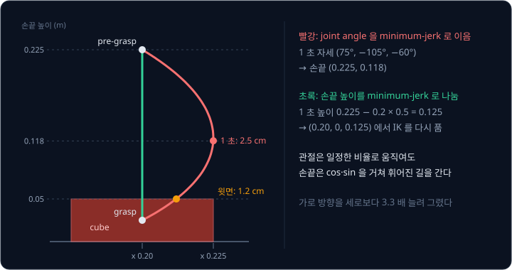

이를 피하려면 손끝 위치 자체를 minimum-jerk 로 나눈다. 손끝 높이를 0.225 m 에서 0.025 m 로 2 초 동안 옮기면 1 초의 높이는
$0.225 + (-0.2) \times 0.5 = 0.125$ m 다. 이렇게 나눈 손끝 위치 $(0.20, 0, 0.125)$ 마다 IK 를 다시 풀어 joint angle 을 구하면 손끝은
수직으로 내려간다. 위 그림의 초록 선이 이 경로다. 계산은 더 들지만 cube 근처처럼 좁은 곳에서는 이 방법을 쓴다.

**흔한 오해.** "joint angle 이 부드러우면 손끝도 곧게 움직인다" 는 틀린 생각이다. 위 표처럼 두 끝 자세가 같은 수직 선 위에 있어도
가운데에서 손끝이 2.5 cm 벗어난다.

**확인 문제.** 손끝 높이를 0.225 m 에서 0.025 m 로 $T = 2$ 초의 minimum-jerk 로 옮긴다. 0.5 초(진행률 0.104)의 목표 높이는?

답 보기

$0.225 + (-0.2) \times 0.104 = 0.225 - 0.0208 \approx 0.204$ m 다.

**요약**

- 경로 module 은 waypoint 사이를 minimum-jerk trajectory $q_0 + (q_f - q_0)s(\tau)$ 로 이어 시간마다의 목표를 만든다
- joint angle 을 이으면 손끝이 휘어서 pre-grasp → grasp 에서 가운데 2.5 cm, cube 윗면 높이에서 1.2 cm 벗어난다
- cube 근처에서는 손끝 위치를 나누고 매 점마다 IK 를 풀어 수직으로 내려간다

## 실행과 확인

### gripper 닫기와 들어 올리기

여섯 번째 module 은 trajectory 의 목표 각도를 시간에 맞춰 모터에 보낸다. [MuJoCo Simulation](../mujoco-sim/README.md) 에서 본 것처럼
목표 각도를 받은 controller 가 모터의 힘을 계산하고, 팔이 움직인다. grasp 에 도착하면 손가락을 닫고, 손가락이 cube 를 누르는 힘이
충분해질 때까지 기다린 뒤 lift 로 들어 올린다.

cube 가 손가락 사이에서 미끄러지지 않으려면 손가락의 마찰 힘이 cube 의 무게를 버텨야 한다. 마찰 계수 $\mu$(mu, 뮤)는 누르는 힘에 비해
마찰 힘이 얼마나 클 수 있는지를 나타내는 값이다. 0.1 kg 짜리 cube 의 무게는 $0.1 \times 9.81 = 0.981$ N(뉴턴, 힘의 단위)이고, 두
손가락이 각각 $F$ 로 누를 때

$$
2 \times \mu \times F \ge 0.981
$$

이어야 한다. $\mu = 1$ 이면 $F \ge 0.49$ N, $\mu = 0.6$ 이면 $F \ge 0.82$ N 이다. 손가락을 닫는 힘도 사람이 정하는 숫자이고, cube 가
더 미끄러운 재질로 바뀌면 다시 정해야 한다.

### 단계마다 확인하는 값

module 마다 출력이 있으므로 실행 중에도 단계별로 확인할 수 있다. 각 확인은 실패했을 때 어느 module 이 원인인지 바로 알려 준다.

| 확인하는 때 | 확인하는 값 | 실패하면 의심할 module |
| --- | --- | --- |
| 인식 직후 | mask 의 칸 수가 cube 크기에 맞는가 | 인식 |
| 3D 위치 직후 | 계산한 높이가 0.05 m 근처인가 | 3D 위치, calibration |
| IK 직후 | 모든 waypoint 의 답이 joint limit 안에 있는가 | 잡기 자세, IK |
| grasp 직후 | 손가락이 다 닫히지 않고 cube 폭에서 멈췄는가 | 실행(빈손으로 닫힘) |
| lift 직후 | cube 가 손가락과 함께 올라왔는가 | 실행(미끄러짐) |

grasp 직후 손가락이 0 cm 까지 다 닫혔다면 손가락 사이에 아무것도 없다는 뜻이다. 5 cm 근처에서 멈췄다면 cube 를 쥔 것이다.

**확인 문제.** grasp 직후 손가락 사이 간격이 0 cm 였다. 어느 단계부터 다시 볼까?

답 보기

손가락이 빈손으로 닫혔으므로 손끝이 cube 가운데에 가지 못한 것이다. 위치를 낸 인식·3D 위치 module 이나 calibration 부터 확인한다.

**요약**

- 실행 module 은 trajectory 를 모터에 보내고, grasp 에 도착하면 손가락을 닫아 마찰 조건 $2\mu F \ge$ (무게) 를 만족할 만큼 누른 뒤 들어 올린다
- module 마다 출력이 있으므로 높이, joint limit, 손가락 간격 같은 값을 단계마다 확인해 실패한 module 을 찾는다

## 오차의 누적

### 단계별 오차 더하기

앞에서 손끝이 cube 가운데에서 1 cm 넘게 벗어나면 손가락이 cube 에 걸린다고 했다. 그런데 손끝 위치에는 여러 module 의 오차가
차례로 섞여 든다. 인식이 pixel 하나를 틀리면 그 오차가 3D 위치를 틀리게 하고, 3D 위치가 틀리면 IK 가 틀린 자리의 joint angle 을
정확히 풀어 버린다. 뒤 module 은 앞 module 의 오차를 알 방법이 없으므로, 오차는 고쳐지지 않고 그대로 넘어가 더해진다.

각 module 의 오차가 아래와 같다고 하자.

| 출처 | 오차가 생기는 이유 | 손끝 위치 오차 |
| --- | --- | --- |
| 인식 | centroid 가 2 pixel 밀림. 1 pixel 은 $Z \div f = 0.5 \div 500 = 0.001$ m | 2 mm |
| calibration | 카메라 자리를 3 mm 틀리게 잼 | 3 mm |
| 실행 | 모터가 목표 각도를 조금 못 따라감 | 3 mm |
| 합 | 같은 방향으로 겹치는 가장 나쁜 경우 | 8 mm |

합 8 mm 는 여유 10 mm 안이라 쥘 수 있다. 오차의 방향이 서로 달라 일부가 지워지기도 하지만, 실패를 막으려면 모두 같은 방향으로
겹치는 가장 나쁜 경우를 기준으로 본다. 여유를 module 마다 나눠 주는 이런 계산을 error budget(오차 예산)이라고 한다.

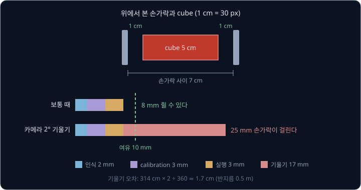

### 카메라 기울기 2° 의 영향

누가 카메라를 건드려 카메라가 2° 기울었는데, pipeline 은 처음 calibration 한 extrinsics 를 그대로 쓴다고 하자. 카메라에서 cube 까지는
0.5 m 이므로, 카메라가 2° 돌면 0.5 m 떨어진 점은 반지름 0.5 m 인 원을 따라 2° 만큼 옆으로 옮겨 간 자리처럼 보인다. 반지름 50 cm 인
원의 둘레는 $2 \times 3.14 \times 50 = 314$ cm 이고, 2° 는 한 바퀴 360° 의 $\frac{2}{360}$ 이므로

$$
314 \times \frac{2}{360} \approx 1.7 \text{ cm}
$$

다. 인식은 pixel 을 정확히 찾았는데도 3D 위치가 1.7 cm 틀리고, 다른 오차와 더하면 $8 + 17 = 25$ mm 로 여유 10 mm 를 훌쩍 넘는다.
그래서 이 방식에서는 카메라를 옮기거나 건드릴 때마다 calibration 을 다시 해야 한다.

**흔한 오해.** 오차가 큰 module 하나만 고치면 된다고 생각하기 쉽다. 오차는 더해지므로, 각 module 이 작은 오차만 내도 합이 여유를 넘을
수 있다. 위 표에서 하나하나는 3 mm 이하지만 합은 8 mm 다.

**확인 문제.** 카메라가 1° 기울었다. 0.5 m 떨어진 cube 의 위치는 약 몇 cm 틀릴까?

답 보기

$314 \times \frac{1}{360} \approx 0.87$ cm 다. 2° 일 때의 절반이다.

**요약**

- 뒤 module 은 앞 module 의 오차를 모르므로 오차는 그대로 넘어가 더해진다
- 여유 10 mm 를 module 마다 나눠 주는 error budget 으로 보면, mm 단위의 작은 오차들도 합이 여유를 넘을 수 있다
- 0.5 m 거리에서 카메라 2° 기울기는 1.7 cm 오차라서, 카메라를 건드리면 calibration 을 다시 해야 한다

## 성공률과 실패 분류

### 50 번 시도

한 번 성공한 것만으로는 pipeline 이 얼마나 믿을 만한지 알 수 없다. 그래서 cube 를 무작위 위치와 yaw 에 놓고 여러 번 시도해 성공한
비율을 잰다. 이 비율을 성공률이라고 한다. "cube 가 5 cm 넘게 들렸다가 놓을 자리 2 cm 안에 놓였다" 처럼 성공의 기준을 미리 숫자로
정해 둔다.

50 번 시도해 41 번 성공했다면 성공률은 $41 \div 50 = 0.82$, 곧 82% 다.

### module 별 실패 표

실패한 9 번은 원인에 따라 나눈다. 단계마다 확인한 값이 있어서 원인을 가릴 수 있다.

| 실패 원인 | 횟수 | 50 번 가운데 비율 |
| --- | --- | --- |
| 인식 (위치나 yaw 를 틀림) | 4 | 8% |
| IK (닿지 않거나 joint limit 밖) | 2 | 4% |
| grasp (쥐었다가 미끄러짐) | 2 | 4% |
| 충돌 (팔이 cube 를 치거나 밀어냄) | 1 | 2% |
| 합 | 9 | 18% |

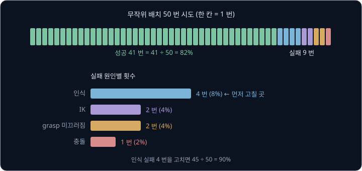

이 표를 보면 어디부터 고칠지 정해진다. 인식 실패가 4 번으로 가장 많으므로 인식 module 의 색 문턱이나 조명을 먼저 손본다. 인식을
고쳐 그 4 번이 모두 성공으로 바뀌면 성공률은 $45 \div 50 = 90\%$ 가 된다. 다른 module 은 건드리지 않아도 된다.

**확인 문제.** 40 번 시도에 30 번 성공했고, 실패 10 번 가운데 grasp 실패가 6 번이다. 성공률은? grasp 실패를 모두 고치면 성공률은?

답 보기

성공률은 $30 \div 40 = 75\%$ 다. grasp 실패 6 번이 성공으로 바뀌면 $36 \div 40 = 90\%$ 다.

**요약**

- 성공 기준을 숫자로 정하고 무작위 배치로 여러 번 시도해 성공률을 잰다. 50 번 중 41 번이면 82% 다
- 실패를 module 별로 나눠 세면 가장 많이 실패한 module 부터 고칠 수 있다

## 모듈 파이프라인의 장점과 한계

### 고장 진단과 학습 데이터

모듈 파이프라인의 첫째 장점은 고장 난 곳을 찾기 쉽다는 것이다. module 마다 입력과 출력이 정해져 있어서 중간 값을 하나씩 확인할 수
있고, 앞 절의 실패 표처럼 실패를 module 별로 나눠 셀 수 있다. pixel 이 맞는지는 사진 위에 점을 찍어 보면 되고, 3D 위치가 맞는지는
높이가 0.05 m 인지 보면 되고, IK 가 맞는지는 FK 로 다시 계산해 보면 된다.

둘째 장점은 학습 데이터가 필요 없다는 것이다. 이 강의의 어느 module 도 사람이 시연한 기록을 쓰지 않았다. 카메라 calibration 과
규칙 몇 개만 있으면 첫 시도부터 동작하고, 같은 cube 를 같은 환경에서 집는 한 결과가 매번 똑같다.

### 손으로 정한 숫자와 규칙

대신 모든 module 에 사람이 정한 숫자가 들어 있다.

| module | 사람이 정한 숫자와 규칙 |
| --- | --- |
| 인식 | 빨강의 몫 문턱 0.6, 인식기의 이름 "red cube" 와 점수 문턱 |
| 3D 위치 | 카메라 extrinsics, cube 윗면 높이 0.05 m |
| 잡기 자세 | 위에서 내려가는 grasp, 손끝 높이 0.025 m, waypoint 높이 0.2 m, 놓을 자리 |
| IK | 답 고르는 규칙(앞 자세에 가까운 답), joint limit |
| 경로 | waypoint 사이 시간 $T = 2$ 초, 손끝을 나눠 IK 하는 구간 |
| 실행 | 손가락 닫는 힘, 성공 기준 5 cm·2 cm |

이 숫자들은 모두 "한 변 5 cm 빨간 cube, 고정 카메라, 같은 조명" 에 맞춰 정한 것이다. 물체가 바뀌면 여러 module 의 숫자를 함께 다시
정해야 한다. cube 를 지름 4 cm, 높이 10 cm 인 원기둥 컵으로 바꾸면 인식 문턱(컵의 색), 높이 가정(윗면 0.10 m), grasp 높이(컵의
가운데 0.05 m), yaw 규칙(원기둥은 어느 방향으로 쥐어도 같음), 손가락 힘(컵의 무게와 재질)이 모두 바뀐다.

### 규칙으로 적기 어려운 작업

top-down grasp 처럼 "위에서 내려가 닫는다" 로 적을 수 있는 작업은 규칙으로 잘 풀린다. 그러나 물체와 손이 여러 곳에서 계속 닿으며
힘을 주고받는 작업, 곧 접촉이 복잡한 작업은 규칙으로 적기 어렵다. 구멍에 꼭 맞는 막대를 끼우는 일은 막대가 구멍 가장자리에 걸릴
때마다 어느 쪽으로 얼마나 비틀지 정해야 하고, 수건을 접는 일은 천이 어떤 모양으로 놓였는지 3D 좌표 몇 개로 적을 수조차 없다.
경우마다 규칙을 손으로 짜 넣다 보면 규칙이 끝없이 늘어난다.

**확인 문제.** cube 를 같은 크기의 파란 cube 로 바꾸면 이 강의의 pipeline 에서 다시 정해야 하는 것은 무엇일까?

답 보기

인식의 색 규칙만 바꾸면 된다(빨강의 몫 대신 파랑의 몫, 또는 인식기의 이름 "blue cube"). 크기와 모양이 같으므로 높이 가정, grasp,
waypoint, IK 는 그대로 쓴다.

### end-to-end 와의 비교

[Behavior Cloning](../behavior-cloning/README.md) 에서는 정반대의 방법을 봤다. 사람이 로봇을 조종해 직접 일을 해 보이는 것을
시연(demonstration)이라 하고, 시연에서 기록한 (카메라 사진, 그때의 관절 각도) 짝으로 neural network 하나를 학습해 사진을 넣으면
관절 각도가 바로 나오게 한다. 상황을 받아 행동을 내는 이 규칙을 policy 라고 하고, 입력 끝(사진)에서 출력 끝(관절 각도)까지 중간
module 없이 한 번에 배운다고 해서 end-to-end 라고 부른다. Levine 등(2016)은 카메라 영상에서 motor torque(모터가 관절을 돌리는 힘)까지를
network 하나로 학습한 end-to-end visuomotor policy 를 내놓으며 모듈 파이프라인의 한계를 정면으로 다뤘다. visuomotor 는 눈으로 본 것(visual)에서 모터
명령(motor)까지를 한 번에 잇는다는 뜻이다.

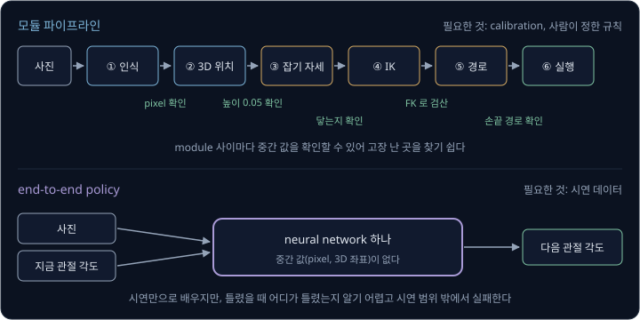

두 방식을 나란히 놓으면 아래와 같다.

| 기준 | 모듈 파이프라인 | end-to-end policy |
| --- | --- | --- |
| 필요한 것 | calibration, 사람이 짠 규칙 | 시연 데이터 (보통 수십~수백 번) |
| 3D 좌표 | 계산한다 (depth 필요) | 계산하지 않는다 |
| 고장 진단 | module 별 중간 값으로 원인을 찾는다 | 중간 값이 없어 어디가 틀렸는지 알기 어렵다 |
| 물체가 바뀌면 | 여러 module 의 규칙을 다시 짠다 | 새 물체의 시연을 모아 다시 학습한다 |
| 접촉이 복잡한 작업 | 규칙으로 적기 어렵다 | 시연에 담긴 대로 배울 수 있다 |
| 실패하기 쉬운 때 | 가정(높이·색·calibration)이 틀릴 때 | 시연 범위 밖의 위치·물체·조명 |

모듈 파이프라인이 더 나은 때는 물체와 환경이 정해져 있고, 정확한 위치가 중요하며, 실패 원인을 설명할 수 있어야 할 때다. 공장 라인에서
같은 부품을 하루에 수천 번 옮기는 일이 그렇다. end-to-end 가 더 나은 때는 물체가 자주 바뀌거나 접촉이 복잡해 규칙으로 적기 어렵고,
시연을 모을 수 있을 때다. 실제 시스템에서는 둘을 섞기도 한다. 예를 들어 이름으로 찾는 인식기로 물체의 위치를 구한 뒤, 손을 그 근처까지
보내는 일은 IK 로 하고 마지막에 쥐는 동작만 학습한 policy 에 맡긴다.

**확인 문제.** 다음 두 작업에는 어느 방식이 더 맞을까? (가) 컨베이어 위를 지나가는 같은 모양의 상자를 하루 종일 옮기기 (나) 매번 모양이
다른 옷을 개기

답 보기

(가)는 물체와 환경이 정해져 있고 같은 동작을 반복하므로 모듈 파이프라인이 맞다. (나)는 옷의 모양을 3D 좌표 몇 개로 적을 수 없고
접촉이 복잡해서 규칙을 짜기 어려우므로, 시연에서 배우는 end-to-end policy 가 맞다.

**요약**

- 모듈 파이프라인은 module 별로 고장을 진단할 수 있고 학습 데이터 없이 동작한다
- 대신 모든 module 에 사람이 정한 숫자가 들어 있어 물체가 바뀌면 여러 곳을 다시 짜야 하고, 접촉이 복잡한 작업은 규칙으로 적기 어렵다
- end-to-end policy 는 시연만으로 사진에서 관절 각도까지 배우지만, 중간 값이 없어 진단이 어렵고 시연 범위 밖에서 실패한다

## 정리

- classical pick-and-place 는 인식 → 3D 위치 → 잡기 자세 → IK → 경로 → 실행의 module 여섯 개를 사람이 짠 규칙으로 잇는다
- 인식은 색 mask 의 centroid 나 이름으로 찾는 open-vocabulary 인식기의 bounding box 로 물체 가운데의 pixel 을 찾는다. 첫째 예는
  pixel $(220, 240)$ 이고, cube 의 yaw 는 90° 주기로 다룬다
- 경로 계획은 base frame 의 m 단위 3D 좌표를 받는데, 카메라 한 대의 pixel 은 방향(ray)만 정한다. depth 0.5 m 로
  back-projection 하면 camera 좌표 $(-0.1, 0, 0.5)$, base 좌표 $(0.20, 0, 0.05)$ 이고, depth 대신 물체가 놓인 높이를 가정해 ray 와
  평면의 교점을 구할 수도 있다
- top-down grasp 와 pre-grasp·grasp·lift·pre-place·place·retreat waypoint 를 정하고, IK 로 joint angle 을 구한다. 단순화한 팔에서
  pre-grasp 는 $(0°, 90°, -90°, -90°, 10°)$, grasp 는 $(0°, 60°, -120°, -30°, 10°)$ 다
- minimum-jerk 로 joint angle 을 이으면 손끝이 휘어 cube 근처에서 1.2 cm 벗어나므로, 좁은 곳에서는 손끝 위치를 나눠 IK 를 푼다
- module 의 오차는 그대로 넘어가 더해진다. 여유 1 cm 안에 인식·calibration·실행 오차가 모두 들어가야 하고, 카메라가 2° 기울면
  1.7 cm 가 틀린다
- module 별 실패 표로 고칠 곳을 찾을 수 있고 학습 데이터도 필요 없지만, 물체가 바뀌거나 접촉이 복잡하면 규칙을 손으로 다시 짜야 한다

이 강의의 pipeline 은 한 변 5 cm 빨간 cube 하나, 고정 카메라, 정해진 조명에 맞춰져 있다. 그 규칙을 사람이 짜는 대신 시연 데이터에서
배우는 방법은 [Behavior Cloning](../behavior-cloning/README.md) 에서 다루고, 시연을 모으는 방법은 [Teleop Dataset](../teleop-dataset/README.md),
앞으로 할 행동 여러 개를 한 번에 내는 policy 는 [ACT](../act/README.md) 와 [Diffusion Policy](../diffusion-policy/README.md) 에서 다룬다.

## 참고 자료

- Russ Tedrake, [Robotic Manipulation — Ch. 3 Basic Pick and Place](https://manipulation.csail.mit.edu/pick.html) — 같은 문제를 frame
  변환, grasp·pre-grasp pose, IK, trajectory 순으로 푸는 MIT 강의 교재. 이 강의 전체를 읽은 뒤 보면 좋다
- OpenCV, [Changing Colorspaces](https://github.com/opencv/opencv/blob/4.x/doc/py_tutorials/py_imgproc/py_colorspaces/py_colorspaces.markdown)
  — 사진을 HSV 로 바꾸고 색 하나만 골라 mask 를 만드는 예. [밝기에 흔들리지 않는 색 비율](#밝기에-흔들리지-않는-색-비율) 절과 함께 읽는다
- OpenCV, [Contour Features](https://github.com/opencv/opencv/blob/4.x/doc/py_tutorials/py_imgproc/py_contours/py_contour_features/py_contour_features.markdown)
  — mask 덩어리의 중심과 그것을 감싸는 가장 작은 회전 직사각형(yaw)을 구하는 방법
- T. Cheng 외, [YOLO-World: Real-Time Open-Vocabulary Object Detection](https://arxiv.org/abs/2401.17270) (2024) — 이름을 주면
  bounding box 를 찾아 주는 open-vocabulary 인식기. 초록과 Figure 1 만 읽어도 입력과 출력을 알 수 있다
- OpenCV, [Detection of ArUco Markers](https://github.com/opencv/opencv/blob/4.x/doc/tutorials/objdetect/aruco_detection/aruco_detection.markdown)
  — 색 대신 크기를 아는 표식을 물체에 붙여 위치와 yaw 를 한 번에 얻는 방법
- S. Garrido-Jurado 외, [Automatic generation and detection of highly reliable fiducial markers under occlusion](https://doi.org/10.1016/j.patcog.2014.01.005)
  (2014) — ArUco marker 의 원 논문
- T. Flash, N. Hogan, [The coordination of arm movements: an experimentally confirmed mathematical model](https://doi.org/10.1523/JNEUROSCI.05-07-01688.1985)
  (1985) — minimum-jerk trajectory 를 처음 제안한 논문
- S. Levine 외, [End-to-End Training of Deep Visuomotor Policies](https://arxiv.org/abs/1504.00702) (2016) — 카메라 영상에서 motor
  torque 까지를 network 하나로 학습한 연구. 모듈 파이프라인과 비교하는 서론을 읽는다
