# CLIP

## 학습 목표

- 정해진 이름 목록 가운데 하나를 고르는 분류기로는 "파란 머그컵" 같은 새 물체를 찾을 수 없는 이유와, 사진에 붙은 설명 글로
  학습하면 이 문제가 풀리는 이유를 설명할 수 있다
- 사진과 글처럼 서로 다른 종류의 입력을 함께 다룬다는 뜻의 multimodal 을, 정답 행동이 여럿이라는 뜻의 multimodal 과 구분할 수 있다
- 사진과 글을 같은 길이의 숫자 목록으로 바꾼 뒤, 두 목록이 가리키는 방향이 얼마나 같은지를 숫자로 계산할 수 있다
- 사진 3장과 설명 3개의 점수표에서, 짝은 가깝게 짝이 아닌 것은 멀게 만드는 학습의 loss(모델이 틀린 정도를 나타낸 숫자)를
  손으로 계산하고, 점수를 키우는 숫자 하나가 왜 필요한지 설명할 수 있다
- 따로 학습하지 않은 분류 문제를 "○○ 사진" 같은 문장 몇 개와 사진을 비교해 푸는 과정을 숫자로 따라 할 수 있다
- 이 방식이 개수 세기·위치 관계·비슷한 종류 구분에 약한 이유와, 물체 이름으로 사진에서 물체를 찾는 모델·사진과 지시문으로
  로봇을 움직이는 모델에 이 학습이 어떻게 쓰이는지 설명할 수 있다

## 정해진 이름표 밖의 물체

### 이름표 1000 개짜리 분류기

[ViT](../vit/README.md) 강의의 모델은 사진을 보고 ImageNet 이라는 사진 모음의 1000 가지 종류 가운데 하나를 골랐다. 사진이 어느 종류에
속하는지를 class 라고 하고, 사진마다 사람이 달아 둔 정답 class 의 이름을 label 이라고 한다. ImageNet 에는 이런 label 이 달린 사진이
약 128만 장 있다. 모델의 마지막 층은 class 마다 점수 하나씩, 모두 1000 개의 점수를 내고 가장 큰 점수의 class 를 고른다.

책상 위를 정리하는 로봇이 이 모델로 "파란 머그컵을 찾아" 라는 지시를 따른다고 하자. 1000 가지 이름표에 "파란 머그컵" 이 없으면
모델은 이 물체를 가리킬 방법이 없다. 이름표에 "컵" 은 있어도 파란색인지, 손잡이가 있는지 같은 구분은 이름표 목록에 없는 한 고를 수
없다. 새 이름을 가르치려면 그 이름의 label 을 단 사진을 수백, 수천 장 모아 다시 학습해야 한다. 집이나 공장에는 처음 보는 물체가
끝없이 나오므로, 물체가 하나 늘 때마다 사진을 모으는 방법은 로봇에 맞지 않는다.

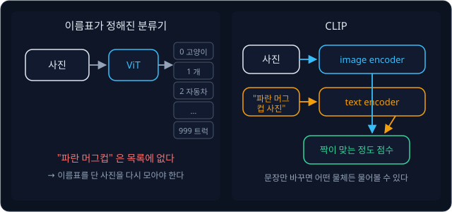

위 그림의 왼쪽이 이름표가 정해진 분류기다. 사진이 ViT 를 지나 0 번 "고양이" 부터 999 번 "트럭" 까지의 이름표 가운데 하나에
도착하고, 목록에 없는 이름은 나올 수 없다. 오른쪽이 이 강의에서 다루는 CLIP 이다. CLIP 은 사진 하나와 문장 하나를 받아 "이 문장이
이 사진을 얼마나 잘 설명하는가" 를 점수로 낸다. 문장은 아무것이나 넣을 수 있으므로 "파란 머그컵 사진" 이라는 문장을 쓰면 목록 없이도
그 물체를 물어볼 수 있다.

**확인 문제.** 이름표 1000 개짜리 분류기에 "빨간 컵" 과 "파란 컵" 을 구분하게 하려면 무엇을 더 해야 할까?

답 보기

"빨간 컵" 과 "파란 컵" 을 새 class 로 정하고, 각 label 을 단 사진을 모아 다시 학습해야 한다. 이름표 목록이 바뀌므로 마지막 층도
class 수에 맞게 다시 만들어야 한다.

### 사진과 함께 올라온 설명 글

인터넷에는 사진이 혼자 올라오는 일이 드물다. 블로그 사진 밑에는 "소파 위에서 자는 고양이" 같은 설명이 붙고, 웹 페이지의 사진에는
화면에 사진이 안 보일 때 대신 읽어 주는 짧은 글(alt text)이 붙는다. 이 글은 사람이 일부러 label 을 단 것은 아니지만 사진에 무엇이
있는지를 대부분 말해 준다.

2021년 OpenAI 의 Radford 등은 이런 사진–글 쌍을 인터넷에서 4억 개 모았다. 영어 Wikipedia 에 100 번 이상 나오는 단어 등으로
만든 검색어 50만 개를 정해 두고, 글에 그 검색어가 들어간 쌍을 검색어 하나당 2만 개까지 모았다. 이렇게 하면 "고양이" 같은 흔한
단어부터 드문 꽃 이름까지 아주 많은 물체 이름이 사진과 함께 들어온다. 이 데이터로 학습한 모델이 CLIP(Contrastive Language–Image
Pre-training)이다. language–image 는 글과 사진, pre-training 은 특정 문제를 풀기 전에 많은 데이터로 미리 해 두는 학습이고,
contrastive 는 "대조하는" 이라는 뜻으로 짝인 것과 짝이 아닌 것을 대조하며 배운다는 데서 왔다.

**확인 문제.** 사진–글 쌍 4억 개를 사람이 label 을 달아서 만들었다면 어떤 어려움이 있었을까?

답 보기

사진 한 장에 1초씩만 써도 4억 초, 곧 약 12년이 걸린다. 인터넷에 이미 붙어 있는 설명 글을 쓰면 이 일을 하지 않아도 된다.

### 맞히기 대신 짝 고르기

설명 글로 학습하는 방법은 두 가지를 생각할 수 있다. 하나는 사진을 보고 설명 글을 한 단어씩 그대로 만들어 내게 하는 방법이다.
[GPT](../gpt/README.md) 처럼 다음 단어를 맞히는 방식인데, 이 방법은 생각보다 어렵다. 같은 고양이 사진을 두고도 "소파 위의
고양이", "낮잠 자는 우리 집 나비", "회색 줄무늬 고양이" 처럼 설명이 끝없이 다를 수 있어서, 모델은 사진에 없는 "우리 집" 이나
"나비" 같은 단어까지 맞히려고 애쓰게 된다.

다른 하나는 설명을 만들지 않고 짝만 고르게 하는 방법이다. 사진 여러 장과 설명 여러 개를 섞어 놓고 "이 사진의 설명은 이 가운데 어느
것인가" 만 맞히게 한다. 설명의 단어를 하나하나 맞힐 필요 없이 사진에 맞는 설명을 다른 설명들과 구별하기만 하면 된다.

CLIP 논문은 두 방법을 같은 계산량으로 비교했다. 설명 글을 한 단어씩 만들어 내는 모델은, 설명에 어떤 단어들이 들어 있는지만 맞히는
더 단순한 모델보다 3 배 느리게 배웠고, 짝 고르기로 바꾸자 다시 4 배 빨라졌다. 여기서 빠르기는 같은 정확도에 이르는 데 드는 계산량으로
쟀다. CLIP 은 짝 고르기를 택했다.

**확인 문제.** 사진 3장과 설명 3개를 섞어 놓았다. 짝 고르기 방식에서 모델이 사진 한 장마다 답해야 하는 것은 무엇일까?

답 보기

설명 3개 가운데 어느 것이 그 사진의 설명인지 하나를 고르는 것이다. 설명 문장을 직접 만들 필요는 없다.

**요약**

- 이름표가 정해진 분류기는 목록 밖의 물체를 가리킬 수 없고, 새 이름마다 label 을 단 사진을 다시 모아야 한다
- 인터넷의 사진–설명 글 쌍 4억 개를 label 대신 쓰면 아주 많은 물체 이름을 사진과 함께 배울 수 있다
- 설명을 한 단어씩 만들기보다 여러 설명 가운데 짝을 고르게 하는 편이 같은 계산량에서 훨씬 빨리 배운다

## multimodal 과 modality

### modality

정보를 받아들이는 감각이나 데이터의 종류를 modality 라고 한다. 사진은 눈으로 보는 시각 modality, 글은 언어 modality, 소리는 청각
modality 다. 로봇에서는 관절 각도나 손에 걸리는 힘처럼 로봇이 자기 몸에 대해 재는 숫자도 하나의 modality 로 친다. 같은 "빨간 컵" 이라도
카메라 사진으로 들어오면 시각 modality, "빨간 컵" 이라는 글자로 들어오면 언어 modality 다.

### 이 강의의 multimodal

multi 는 "여럿" 이라는 뜻이라서, 여러 modality 를 함께 다루는 모델을 multimodal 모델이라고 부른다. CLIP 은 사진과 글이라는 두
modality 를 받으므로 multimodal 모델이다. 사진, "빨간 컵을 집어" 같은 지시문, 관절 각도를 함께 받아 로봇이 할 행동(action)을 내는
VLA(Vision-Language-Action model)도 multimodal 모델이다. 이 강의에서 multimodal 은 언제나 이 뜻, 곧 입력의 종류가 여럿이라는 뜻이다.

### behavior cloning 의 multimodal 과의 차이

[Behavior Cloning](../behavior-cloning/README.md) 강의에서는 multimodal 을 다른 뜻으로 썼다. 차선 가운데의 상자를 사람이 어떤 때는
왼쪽(−20°)으로, 어떤 때는 오른쪽(+20°)으로 피하면, 같은 장면에 대한 정답 action 이 두 무리로 갈린다. action 값이 몰린 언덕을 봉우리,
가장 자주 나온 값을 mode 라고 했고, 봉우리가 여럿인 분포를 multimodal 이라고 불렀다. 이때의 modal 은 통계의 mode 에서 왔다.

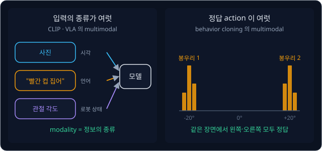

위 그림의 왼쪽은 이 강의의 뜻으로, 사진·지시문·관절 각도라는 세 종류의 입력이 한 모델로 들어간다. 오른쪽은 behavior cloning 의
뜻으로, 입력은 같은 장면 하나인데 정답 action 이 −20° 근처와 +20° 근처 두 봉우리로 나뉜다. 두 뜻은 철자만 같고 가리키는 것이 다르다.
"multimodal 모델" 은 입력의 종류 이야기이고, "multimodal 시연" 이나 "multimodal 분포" 는 정답이 여럿이라는 이야기다. 사진과 글을 함께
받는 VLA 가 multimodal 시연으로 학습하는 일도 있으므로, 한 문장 안에서 두 뜻이 같이 나올 수도 있다.

**확인 문제.** 아래 두 문장의 multimodal 은 각각 어느 뜻일까?
(가) "이 모델은 카메라 사진과 음성 명령을 함께 받는 multimodal 모델이다."
(나) "컵의 손잡이를 왼쪽에서 잡은 시연과 오른쪽에서 잡은 시연이 섞여 있어 action 분포가 multimodal 이다."

답 보기

(가) 는 입력의 종류(사진, 음성)가 둘이라는 뜻이고, (나) 는 같은 장면에서 정답 action 이 두 봉우리로 갈린다는 뜻이다.

**요약**

- modality 는 사진·글·소리·관절 각도처럼 정보의 종류다
- 이 강의의 multimodal 은 여러 modality 를 함께 받는다는 뜻이고, CLIP 은 사진과 글 두 modality 를 다룬다
- behavior cloning 의 multimodal 은 같은 장면에 정답 action 이 여럿이라 분포의 봉우리가 여럿이라는 뜻으로, 이 강의의 뜻과 다르다

## 두 encoder 와 embedding

### 숫자 목록으로 바꾸는 encoder

사진과 글을 비교하려면 둘을 같은 형태의 숫자로 바꿔야 한다. 숫자를 순서대로 묶은 목록을 vector 라고 하고, vector 안 숫자의 개수를
그 vector 의 차원이라고 한다. $[3, 4]$ 는 숫자 2 개라서 2차원 vector 다. 입력을 받아 그 내용을 담은 vector 로 바꾸는 모델을
encoder 라고 하는데, [Transformer](../transformer/README.md) 에서 입력 문장을 읽는 쪽을 encoder 라고 부른 것과 같은 뜻이다.

CLIP 에는 encoder 가 둘 있다. 사진을 받는 image encoder 와 글을 받는 text encoder 다. 두 encoder 가 낸 vector 를 각각 사진의
embedding, 글의 embedding 이라고 부른다. token id 로 표에서 꺼낸 vector 도 embedding 이라고 부르지만,
여기서는 "사진이나 문장 하나 전체를 나타내는 숫자 vector" 라는 넓은 뜻으로 쓴다. 실제 CLIP 에서 두 embedding 은 모두 숫자 512 개다.

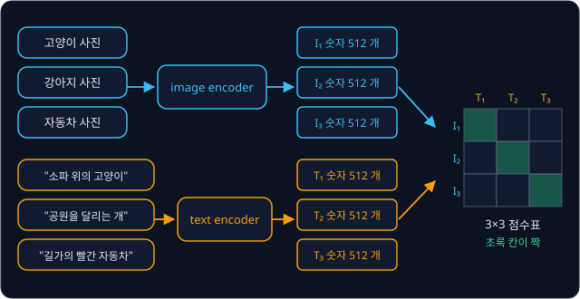

위 그림은 이 강의 내내 쓰는 예다. 위쪽의 사진 3장(고양이, 강아지, 자동차)은 image encoder 를 지나 $I_1, I_2, I_3$ 가 되고, 아래쪽의
설명 3개("소파 위의 고양이", "공원을 달리는 개", "길가의 빨간 자동차")는 text encoder 를 지나 $T_1, T_2, T_3$ 가 된다. $I$ 는 image,
$T$ 는 text 의 첫 글자이고 아래 숫자는 몇 번째인지를 나타낸다. 사진 $i$ 번과 설명 $i$ 번이 짝이라서, 오른쪽 3×3 표의 대각선
초록 칸이 짝이다.

**확인 문제.** 사진 5장과 설명 5개를 넣으면 이런 표의 칸은 몇 개이고, 그 가운데 짝인 칸은 몇 개일까?

답 보기

사진 5장 각각이 설명 5개와 한 번씩 만나므로 $5 \times 5 = 25$ 칸이고, 짝은 대각선의 5 칸이다. 나머지 20 칸은 짝이 아니다.

### image encoder

image encoder 는 [ViT](../vit/README.md) 와 같은 구조다. 사진을 같은 크기의 작은 조각(patch)으로 자르고, 조각마다 숫자 vector 를
하나씩 만들어 Transformer encoder 에 넣는다. Transformer 안에서는 이런 vector 하나하나를 token 이라고 부른다. ViT 는 조각 token 들의
맨 앞에 사진 전체를 요약할 자리인 [CLS] token 을 하나 더 붙였고, 마지막 층에서 [CLS] 자리의 출력을 사진 전체의 요약으로 썼다.
CLIP 의 image encoder 도 이 [CLS] 자리의 출력을 사진의 embedding 으로 쓴다.

ViT 강의에서 분류할 때는 이 출력 뒤에 class 마다 점수를 내는 층을 붙였는데, CLIP 은 그 층을 붙이지 않는다. 점수를 내는 상대가
정해진 이름표 1000 개가 아니라 text encoder 가 내는 글의 embedding 이기 때문이다.

### text encoder

text encoder 는 [GPT](../gpt/README.md) 와 같은 구조의 Transformer 다. 글은 먼저 [BPE Tokenizer](../tokenizer/README.md) 로 잘게
잘라 token id 열로 바뀌고, 맨 앞에 문장의 시작을 알리는 특수 token(SOT, start of text)이, 맨 뒤에 문장의 끝을 알리는 특수
token(EOT, end of text)이 붙는다. GPT 강의의 `<bos>` 와 `<eos>` 에 해당하는 token 이다.

text encoder 는 causal mask 를 쓴다. causal mask 는 각 위치가 자기와 자기보다 앞의 token 만 보게 막는 장치다. 그래서
"소파 위의 고양이" 의 "소파" 자리는 "소파" 까지만 보고, 문장 전체를 본 자리는 맨 끝의 EOT 자리 하나뿐이다. text encoder 는 이 EOT
자리의 출력을 문장의 embedding 으로 쓴다. image encoder 가 사진 전체를 본 [CLS] 자리를 쓰는 것과 같은 생각이다.

**확인 문제.** causal mask 를 쓰는 text encoder 에서 "a photo of a cat." 의 "photo" 자리 출력을 문장의 embedding 으로 쓰면
무엇이 문제일까?

답 보기

"photo" 자리는 SOT, "a", "photo" 까지만 볼 수 있어서 뒤에 오는 "cat" 을 모른다. 고양이 사진인지 개 사진인지 담지 못한 vector 가
문장의 embedding 이 되어 버린다.

### 같은 길이로 맞추는 projection

두 encoder 의 출력은 길이가 다를 수 있다. 실제 CLIP 에서 image encoder 의 [CLS] 출력은 숫자 768 개이고, text encoder 의 EOT 출력은
512 개다. 뒤에서 두 vector 를 칸끼리 곱해 비교하려면 길이가 같아야 하므로, 각 출력에 행렬을 하나씩 곱해 숫자 512 개로 맞춘다.

행렬은 숫자를 가로세로로 늘어놓은 표다. 행렬에 vector 를 곱하면 행렬의 가로줄(행)마다 그 행과 vector 의 dot product 를 하나씩
계산한다. dot product 는 같은 자리 칸끼리 곱해 모두 더한 값이다. 그래서 행이
2 개인 행렬을 곱하면 숫자 2 개가 나온다.

![행렬 곱으로 길이를 맞추는 projection. 사진 쪽 숫자 3 개 [1, 2, 0] 에 2×3 행렬을 곱하면 행마다 dot product 를 해 숫자 2 개 [3, 2] 가 되고, 글 쪽 숫자 2 개 [1, 3] 에 2×2 행렬을 곱하면 [1, 4] 가 되어 둘 다 길이 2 가 된다](figures/projection.svg)

위 그림의 왼쪽은 숫자 3 개짜리 사진 쪽 출력 $[1, 2, 0]$ 에 행이 2 개인 행렬을 곱한다. 첫째 행 $[1, 1, 0]$ 과의 dot product 는
$1 \times 1 + 1 \times 2 + 0 \times 0 = 3$, 둘째 행 $[0, 1, 2]$ 와의 dot product 는 $0 \times 1 + 1 \times 2 + 2 \times 0 = 2$ 라서
결과는 $[3, 2]$ 다. 오른쪽은 글 쪽 출력 $[1, 3]$ 에 행이 2 개인 다른 행렬을 곱해 $[1, 4]$ 를 얻는다. 길이가 3 과 2 로 달랐던 두
출력이 모두 길이 2 가 되었다. 이렇게 행렬을 곱해 vector 를 정해진 길이의 다른 vector 로 옮기는 계산을 projection 이라고 한다.
행렬 안의 숫자는 encoder 의 다른 숫자들처럼 학습으로 정해지는 parameter(데이터를 보고 채우는 숫자)다.

**확인 문제.** vector $[2, 1, 1]$ 에 행 $[1, 0, 1]$ 과 $[0, 2, 0]$ 으로 된 행렬을 곱하면?

답 보기

첫째 행: $1 \times 2 + 0 \times 1 + 1 \times 1 = 3$. 둘째 행: $0 \times 2 + 2 \times 1 + 0 \times 1 = 2$. 결과는 $[3, 2]$ 다.

### 같은 공간

projection 을 거친 사진 embedding 과 글 embedding 은 둘 다 숫자 512 개라서, 숫자 512 개로 위치를 정하는 하나의 공간에 함께 놓을 수
있다. 숫자 2 개짜리 vector 가 좌표평면 위의 한 점, 또는 원점에서 그 점으로 가는 화살표인 것처럼, 숫자 512 개짜리 vector 는 512
차원 공간의 화살표다. 512 차원은 그릴 수 없으므로 아래 그림은 2 차원으로 줄여 그렸다.

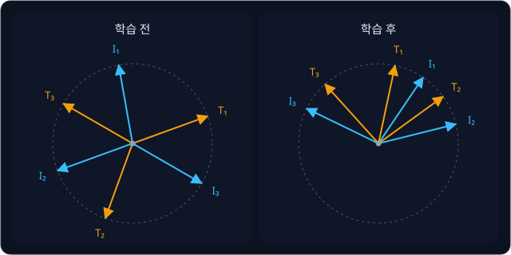

위 그림의 왼쪽은 학습 전이다. encoder 의 숫자가 아무렇게나 정해져 있어서 고양이 사진 $I_1$ 과 고양이 설명 $T_1$ 이 전혀 다른 방향을
가리킨다. 오른쪽은 학습 후로, 짝인 $I_1$ 과 $T_1$, $I_2$ 와 $T_2$, $I_3$ 와 $T_3$ 가 거의 같은 방향을 가리킨다. 짝이 아닌 것끼리도
뜻이 비슷하면 가깝게 놓여서, 고양이와 개는 서로 가깝고 자동차는 멀리 떨어져 있다.

CLIP 의 학습은 이 왼쪽 그림을 오른쪽 그림으로 바꾸는 일이다. 짝인 사진과 글은 같은 방향으로 모으고, 짝이 아닌 것은 다른 방향으로
떼어 놓는다. 이제 "같은 방향" 을 숫자로 재는 방법이 필요하다.

**요약**

- image encoder(ViT 구조)는 [CLS] 자리의 출력을, text encoder(GPT 구조)는 문장 전체를 본 EOT 자리의 출력을 embedding 으로 쓴다
- 행렬을 곱하는 projection 으로 두 embedding 의 길이를 같게 맞춘다
- 같은 길이의 embedding 은 한 공간의 화살표이고, 학습은 짝끼리 같은 방향을 가리키게 만드는 일이다

## cosine similarity

### vector 의 길이

화살표가 얼마나 같은 방향인지 재기 전에, 화살표의 길이부터 정한다. 원점에서 점 $(3, 4)$ 까지 가는 화살표는 가로 3, 세로 4 인 직각
삼각형의 빗변이다. 직각삼각형에서는 빗변의 제곱이 나머지 두 변의 제곱의 합과 같으므로 빗변의 제곱은 $3^2 + 4^2 = 9 + 16 = 25$ 이고,
제곱해서 25 가 되는 수는 5 라서 길이는 5 다.

제곱해서 어떤 수가 되는 양수를 그 수의 제곱근이라고 하고, $\sqrt{25} = 5$ 처럼 $\sqrt{\ }$ 기호로 쓴다. vector $\mathbf{u}$ 의
길이는 $\lVert \mathbf{u} \rVert$ 로 쓰고 "u 의 norm" 이라고 읽는다. 칸이 몇 개든 칸마다 제곱해 더한 뒤 제곱근을 씌운다.

$$
\lVert \mathbf{u} \rVert = \sqrt{u_1^2 + u_2^2 + \cdots + u_d^2}
$$

$u_1$ 은 $\mathbf{u}$ 의 첫째 칸, $d$ 는 칸의 개수다. 이 식은 "칸마다 제곱해서 모두 더하고 제곱근을 씌운다" 로 읽는다.
$\mathbf{u} = [3, 4]$ 이면 $d = 2$ 이고 $\sqrt{9 + 16} = 5$ 다. 숫자만 바꿔 $[6, 8]$ 이면 $\sqrt{36 + 64} = \sqrt{100} = 10$ 이다.

**확인 문제.** vector $[2, 1, 2]$ 의 길이는?

답 보기

$\sqrt{2^2 + 1^2 + 2^2} = \sqrt{4 + 1 + 4} = \sqrt{9} = 3$ 이다.

### 길이 1 로 맞추기

$[3, 4]$ 와 $[6, 8]$ 은 길이가 5 와 10 으로 다르지만 같은 방향을 가리킨다. $[6, 8]$ 은 $[3, 4]$ 의 칸마다 2 를 곱한 것이기 때문이다.
CLIP 은 방향만 비교하고 길이는 무시하고 싶다. 예를 들어 밝은 사진이라서 vector 가 길게 나왔다고 해서 모든 설명과 더 가깝다고
판정하면 안 된다.

그래서 vector 를 자기 길이로 나눠 길이를 1 로 맞춘다. 이 계산을 정규화(normalization)라고 한다.

| vector | 길이 | 길이로 나눈 vector | 나눈 뒤의 길이 |
| --- | --- | --- | --- |
| $[3, 4]$ | 5 | $[3 \div 5, 4 \div 5] = [0.6, 0.8]$ | $\sqrt{0.36 + 0.64} = 1$ |
| $[6, 8]$ | 10 | $[6 \div 10, 8 \div 10] = [0.6, 0.8]$ | 1 |
| $[4, 3]$ | 5 | $[0.8, 0.6]$ | 1 |

길이가 달랐던 $[3, 4]$ 와 $[6, 8]$ 이 정규화하자 똑같이 $[0.6, 0.8]$ 이 되었다. 정규화한 vector 에는 방향만 남는다.

**확인 문제.** $[0, 5]$ 를 정규화하면?

답 보기

길이는 $\sqrt{0 + 25} = 5$ 라서 $[0 \div 5, 5 \div 5] = [0, 1]$ 이다.

### 방향의 비교

정규화한 두 vector 의 dot product 를 cosine similarity 라고 한다. $[3, 4]$ 와 $[4, 3]$ 을 비교하면 정규화한 $[0.6, 0.8]$ 과
$[0.8, 0.6]$ 의 dot product 는 $0.6 \times 0.8 + 0.8 \times 0.6 = 0.48 + 0.48 = 0.96$ 이다.

![좌표평면 위의 vector. u = [3, 4] 와 v = [4, 3] 은 길이 1 로 줄이면 [0.6, 0.8], [0.8, 0.6] 이고 cosine similarity 는 0.96 이다. 같은 방향의 [6, 8] 은 1, 직각인 [4, −3] 은 0, 반대 방향인 [−3, −4] 는 −1 이다](figures/cosine.svg)

위 그림은 $\mathbf{u} = [3, 4]$ 를 기준으로 네 vector 와의 cosine similarity 를 계산한 것이다. 점선 원은 길이 1 인 원으로,
정규화한 vector 는 모두 이 원 위에 끝이 닿는다.

| 비교한 vector | 정규화 | $[0.6, 0.8]$ 과의 dot product | cosine similarity |
| --- | --- | --- | --- |
| $[4, 3]$ | $[0.8, 0.6]$ | $0.48 + 0.48$ | 0.96 (거의 같은 방향) |
| $[6, 8]$ | $[0.6, 0.8]$ | $0.36 + 0.64$ | 1 (같은 방향) |
| $[4, -3]$ | $[0.8, -0.6]$ | $0.48 - 0.48$ | 0 (직각) |
| $[-3, -4]$ | $[-0.6, -0.8]$ | $-0.36 - 0.64$ | −1 (반대 방향) |

cosine similarity 는 같은 방향이면 1, 직각이면 0, 반대 방향이면 −1 이고 언제나 −1 과 1 사이에 있다. 이름은 두 화살표 사이 각도의
cosine 값과 같아서 붙었다. 학교 수학의 삼각함수 cosine 은 각도가 0° 이면 1, 90° 면 0, 180° 면 −1 이고, 정규화한 vector 의 dot
product 가 정확히 이 값이 된다.

식으로 쓰면 아래와 같다.

$$
\cos(\mathbf{u}, \mathbf{v}) = \frac{\mathbf{u}}{\lVert \mathbf{u} \rVert} \cdot \frac{\mathbf{v}}{\lVert \mathbf{v} \rVert}
$$

이 식은 "$\mathbf{u}$ 를 자기 길이로 나누고, $\mathbf{v}$ 도 자기 길이로 나눈 뒤 dot product 를 한다" 로 읽는다. 위 표의 첫 줄에서
$\mathbf{u} = [3, 4]$, $\lVert \mathbf{u} \rVert = 5$, $\mathbf{v} = [4, 3]$, $\lVert \mathbf{v} \rVert = 5$ 이고 결과가 0.96 이다.
CLIP 은 사진 embedding $\mathbf{u}$ 와 글 embedding $\mathbf{v}$ 의 이 값을 "짝이 맞는 정도" 의 점수로 쓴다.

**흔한 오해.** cosine similarity 가 0 이면 "비슷한 정도가 중간" 이라고 읽기 쉽다. 0 은 직각, 곧 두 vector 가 서로 상관없는 방향이라는
뜻이고, 정반대는 −1 이다. 학습이 끝난 CLIP 에서 짝이 아닌 사진과 글은 대개 −1 이 아니라 0 근처에 놓인다.

**확인 문제.** $[1, 0]$ 과 $[0.6, 0.8]$ 의 cosine similarity 는? $[2, 0]$ 과 $[3, 4]$ 는?

답 보기

두 vector 모두 이미 길이 1 이라 $1 \times 0.6 + 0 \times 0.8 = 0.6$ 이다. $[2, 0]$ 은 정규화하면 $[1, 0]$, $[3, 4]$ 는 $[0.6, 0.8]$
이라서 결과는 똑같이 0.6 이다. 길이가 달라도 방향이 같으면 cosine similarity 도 같다.

**요약**

- vector 의 길이는 칸마다 제곱해 더한 값의 제곱근이고, 자기 길이로 나누면 길이 1 인 vector 가 된다(정규화)
- cosine similarity 는 정규화한 두 vector 의 dot product 로, 같은 방향 1, 직각 0, 반대 방향 −1 이다
- CLIP 은 사진 embedding 과 글 embedding 의 cosine similarity 를 짝이 맞는 정도의 점수로 쓴다

## contrastive learning

### 사진 3장과 설명 3개의 유사도 표

학습 중간의 어느 순간, 두 encoder 가 사진 3장과 설명 3개를 embedding 으로 바꾸고 모든 짝의 cosine similarity 를 계산했더니 아래와
같았다고 하자. 실제 embedding 은 숫자 512 개라서 손으로 계산하기 어려우니, 계산이 끝난 점수만 표에 적었다. 표에서 $s_{ij}$ 는 사진
$i$ 와 설명 $j$ 의 cosine similarity 다. $s$ 는 similarity 의 첫 글자다.

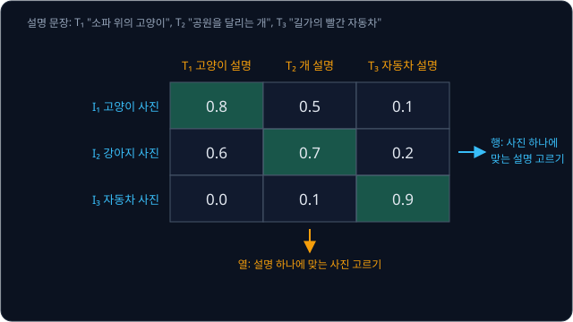

| | $T_1$ "소파 위의 고양이" | $T_2$ "공원을 달리는 개" | $T_3$ "길가의 빨간 자동차" |
| --- | --- | --- | --- |
| $I_1$ 고양이 사진 | **0.8** | 0.5 | 0.1 |
| $I_2$ 강아지 사진 | 0.6 | **0.7** | 0.2 |
| $I_3$ 자동차 사진 | 0.0 | 0.1 | **0.9** |

굵은 대각선이 짝의 점수다. 고양이 사진은 고양이 설명과 0.8 로 가장 가깝고, 자동차 사진은 자동차 설명과 0.9 로 가장 가깝다. 강아지
사진은 개 설명(0.7)과 가장 가깝지만 고양이 설명(0.6)과도 꽤 가깝다. 강아지와 고양이는 둘 다 털이 있는 네 발 동물이라 아직 덜
갈라졌다.

학습이 할 일은 대각선의 점수를 올리고 나머지 점수를 내리는 것이다. 짝인 것과 짝이 아닌 것을 대조(contrast)하며 배운다고 해서 이런
학습을 contrastive learning 이라고 한다. 이 표에서 짝이 아닌 6 칸처럼, 맞는 짝과 비교하려고 함께 넣은 틀린 짝을 negative 라고 하고
짝인 칸을 positive 라고 한다. 한 번의 학습 단계에서 함께 보는 데이터 묶음을 batch 라고 하는데, CLIP 은 negative 를 따로 모으지
않고 같은 batch 에 들어온 다른 쌍들을 negative 로 쓴다.

**확인 문제.** 표에서 가장 헷갈리는 negative, 곧 짝이 아닌데 점수가 가장 높은 칸은 어디일까?

답 보기

강아지 사진 $I_2$ 와 고양이 설명 $T_1$ 의 0.6 이다. 짝인 $I_2$–$T_2$ 의 0.7 과 0.1 밖에 차이 나지 않는다.

### 행마다 softmax

사진 $I_2$ 의 행만 떼어 보자. 이 행은 "강아지 사진의 설명은 $T_1, T_2, T_3$ 가운데 어느 것인가" 라는 세 갈래 문제다. 점수를 세 설명에
대한 확률로 바꾸는 데는 softmax 를 쓴다. softmax 는 점수
$s$ 마다 $e^{s}$ 를 계산하고, 그 합으로 나눠 합이 1 인 비율을 만든다. $e$ 는 약 2.718 인 정해진 수이고, $e^{s}$ 는 $s$ 가 음수여도
양수이며 $s$ 가 클수록 크다. softmax 에 넣는 점수를 logit 이라고 부른다.

CLIP 은 cosine similarity 를 그대로 softmax 에 넣지 않고, temperature 라는 수 $\tau$ 로 나눈 값을 logit 으로 쓴다. $\tau$ 는 그리스
문자 tau(타우)이고, 작은 수로 나눌수록 점수끼리의 차이가 커진다. 여기서는 $\tau = 0.1$ 로 둔다. 0.1 로 나누는 것은 10 을 곱하는 것과
같아서 $I_2$ 행의 logit 은 6, 7, 2 가 된다.

$e^{7}$ 은 1096.6 처럼 큰 수라 손으로 다루기 불편하므로 softmax 의 성질 하나를 쓴다. softmax 는 모든 점수에서 같은 수를
빼도 결과가 같다. 가장 큰 7 을 빼면 logit 은 −1, 0, −5 가 되고 지수가 작아진다. 계산에 쓰는 $e$ 의 값은 아래와 같다.

| $s$ | $-9$ | $-8$ | $-7$ | $-6$ | $-5$ | $-3$ | $-2$ | $-1$ | $0$ |
| --- | --- | --- | --- | --- | --- | --- | --- | --- | --- |
| $e^{s}$ | 0.0001 | 0.0003 | 0.0009 | 0.0025 | 0.0067 | 0.0498 | 0.1353 | 0.3679 | 1 |

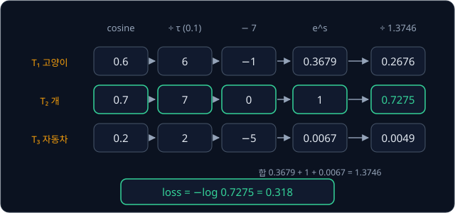

| 설명 | cosine $s$ | $\div \tau$ | $-7$ | $e^{s}$ | $\div 1.3746$ |
| --- | --- | --- | --- | --- | --- |
| $T_1$ 고양이 | 0.6 | 6 | $-1$ | 0.3679 | 0.2676 |
| $T_2$ 개 (정답) | 0.7 | 7 | 0 | 1 | **0.7275** |
| $T_3$ 자동차 | 0.2 | 2 | $-5$ | 0.0067 | 0.0049 |
| 합 | | | | 1.3746 | 1 |

위 그림과 표는 같은 계산이다. 모델은 강아지 사진의 설명이 $T_2$ 일 확률을 0.7275, $T_1$ 일 확률을 0.2676 으로 본다. 정답에 70% 남짓을
주고 있지만, 고양이 설명에도 27% 를 주고 있다.

**확인 문제.** $I_1$ 행의 logit 8, 5, 1 로 정답 $T_1$ 의 확률을 구해 보자. 가장 큰 8 을 빼서 계산한다.

답 보기

8 을 빼면 0, −3, −7 이고 $e^{s}$ 는 1, 0.0498, 0.0009, 합은 1.0507 이다. $T_1$ 의 확률은 $1 \div 1.0507 \approx 0.9517$ 이다.

### cross-entropy loss

확률을 loss 로 바꿀 때는 cross-entropy 를 쓴다. 정답의 확률 $p$ 에 log 를 씌우고 부호를 바꾼
$-\log p$ 다. $\log p$ 는 "$e$ 를 몇 제곱해야 $p$ 가 되는가" 의 답이라서 $\log 1 = 0$ 이고, $p$ 가 1 보다 작으면 음수다. 마이너스를
붙이면 loss 는 0 이상이 되고, 정답 확률이 1 에 가까울수록 0 에 가깝다.

$I_2$ 행에서 정답 $T_2$ 의 확률은 0.7275 였으므로 loss 는 $-\log 0.7275 = 0.318$ 이다. $e^{-0.318} \approx 0.7275$ 라서 맞는 값이다.
세 행을 모두 계산하면 아래와 같다.

| 사진 | logit | 가장 큰 값을 뺀 logit | $e^{s}$ 의 합 | 정답 확률 | loss |
| --- | --- | --- | --- | --- | --- |
| $I_1$ | 8, 5, 1 | 0, −3, −7 | 1.0507 | 0.9517 | 0.049 |
| $I_2$ | 6, 7, 2 | −1, 0, −5 | 1.3746 | 0.7275 | 0.318 |
| $I_3$ | 0, 1, 9 | −9, −8, 0 | 1.0004 | 0.9996 | 0.000 |

$I_3$ 의 loss 는 소수 셋째 자리까지 반올림하면 0 이다. 세 행의 평균은 $(0.049 + 0.318 + 0.000) \div 3 = 0.367 \div 3 \approx 0.122$
다. 평균은 모두 더한 뒤 개수로 나눈 값이다. 가장 헷갈리던 강아지 사진이 loss 의 대부분을 차지한다.

**확인 문제.** 어떤 행에서 정답 확률이 0.5 라면 loss 는? ($\log 0.5 = -0.693$)

답 보기

$-\log 0.5 = 0.693$ 이다. 확률이 0.7275 일 때의 0.318 보다 크다.

### 열 방향 loss 와 전체 loss

행 방향은 "사진 하나에 맞는 설명 고르기" 였다. 같은 표를 세로로 읽으면 "설명 하나에 맞는 사진 고르기" 가 된다. 예를 들어 $T_1$ 열은
"소파 위의 고양이" 라는 설명이 $I_1, I_2, I_3$ 가운데 어느 사진의 설명인지 묻는 문제다. 검색으로 치면 행 방향은 사진으로 글을 찾고,
열 방향은 글로 사진을 찾는다.

| 설명 | logit (열을 위에서 아래로) | 가장 큰 값을 뺀 logit | $e^{s}$ 의 합 | 정답 확률 | loss |
| --- | --- | --- | --- | --- | --- |
| $T_1$ | 8, 6, 0 | 0, −2, −8 | 1.1356 | 0.8806 | 0.127 |
| $T_2$ | 5, 7, 1 | −2, 0, −6 | 1.1378 | 0.8789 | 0.129 |
| $T_3$ | 1, 2, 9 | −8, −7, 0 | 1.0012 | 0.9988 | 0.001 |

열 방향의 평균은 $(0.127 + 0.129 + 0.001) \div 3 = 0.257 \div 3 \approx 0.086$ 이다. CLIP 의 loss 는 행 방향 평균과 열 방향 평균을 다시
평균한 $(0.122 + 0.086) \div 2 = 0.104$ 다. 두 방향을 모두 쓰면 사진으로 글을 찾는 능력과 글로 사진을 찾는 능력을 함께 기른다.

이 계산을 기호로 쓴다. batch 에 쌍이 $B$ 개 있고 $s_{ij}$ 가 사진 $i$ 와 설명 $j$ 의 cosine similarity 일 때, 행 방향 loss 는 아래와 같다.

$$
\mathcal{L}_{\text{행}} = -\frac{1}{B}\sum_{i=1}^{B} \log \frac{e^{s_{ii}/\tau}}{\sum_{j=1}^{B} e^{s_{ij}/\tau}}
$$

$\mathcal{L}$ 은 loss 의 첫 글자를 꾸민 글꼴로 쓴 것이고, $\sum_{j=1}^{B}$ 는 $j$ 를 1 부터 $B$ 까지 바꿔 가며 모두 더하라는 기호다.
분수는 사진 $i$ 의 행에서 정답 칸 $s_{ii}$ 의 softmax 확률이고, 그 $\log$ 에 마이너스를 붙여 $B$ 개 행에서 평균한다. 우리 예에서
$B = 3$, $\tau = 0.1$ 이고 $i = 2$ 일 때 분수의 값이 0.7275, 전체 결과가 0.122 다. 열 방향 $\mathcal{L}_{\text{열}}$ 은 분모의 $s_{ij}$
를 $s_{ji}$ 로 바꿔 같은 열의 칸끼리 더한 식이고 결과가 0.086 이다. 전체 loss 는 $(\mathcal{L}_{\text{행}} + \mathcal{L}_{\text{열}}) \div 2$ 다.

**확인 문제.** 행 방향 평균이 0.2, 열 방향 평균이 0.4 라면 CLIP 의 loss 는?

답 보기

$(0.2 + 0.4) \div 2 = 0.3$ 이다.

### 학습 전과 학습 후

학습을 시작할 때는 두 encoder 의 숫자가 작은 무작위 값이라 cosine similarity 가 모두 0 근처로 비슷하다. 모든 logit 이 같으면 softmax
는 세 설명에 똑같이 $1/3$ 을 주고, loss 는 $-\log \frac{1}{3} = \log 3 \approx 1.099$ 다. batch 에 쌍이 $B$ 개면 같은 이유로
$\log B$ 에서 시작한다. GPT 에서 vocabulary(쓸 수 있는 token 목록)가 $V$ 개일 때 처음 loss 가 $\log V$ 였던 것과 같다.

학습이 더 진행되어 표가 아래처럼 바뀌었다고 하자.

| | $T_1$ | $T_2$ | $T_3$ |
| --- | --- | --- | --- |
| $I_1$ | **0.9** | 0.2 | 0.0 |
| $I_2$ | 0.3 | **0.9** | 0.1 |
| $I_3$ | 0.0 | 0.1 | **0.9** |

$I_2$ 행의 logit 은 3, 9, 1 이고 9 를 빼면 −6, 0, −8 이라 $e^{s}$ 의 합은 $0.0025 + 1 + 0.0003 = 1.0028$, 정답 확률은 0.9972,
loss 는 0.003 이다. 같은 계산을 모든 행과 열에 하면 전체 loss 는 약 0.001 이다.

| 시점 | 전체 loss |
| --- | --- |
| 학습 전 (점수가 모두 같음) | 1.099 |
| 학습 중간 (첫 번째 표) | 0.104 |
| 학습 후 (두 번째 표) | 0.001 |

강아지 사진과 고양이 설명의 점수가 0.6 에서 0.3 으로 내려가고 짝의 점수가 0.9 로 올라가자 loss 가 거의 0 이 되었다.

**확인 문제.** batch 에 쌍이 4 개이고 모든 점수가 같다면 처음 loss 는? ($\log 4 = 1.386$)

답 보기

정답 확률이 $1/4$ 이므로 loss 는 $-\log \frac{1}{4} = \log 4 = 1.386$ 이다.

### loss 가 미는 방향

학습은 loss 가 줄어드는 쪽으로 parameter 를 조금씩 고치는 일이다. parameter 를 조금 바꿨을 때 loss 가 변하는 비율을 gradient 라고
하고, gradient 의 반대 방향으로 고친다. softmax 와 cross-entropy 를 함께 쓰면 각 logit 의
gradient 가 "그 칸의 확률에서, 정답 칸이면 1 을, 아니면 0 을 뺀 값" 이 된다. $I_2$ 행에 적용하면 아래와 같다.

| 설명 | 확률 | 빼는 값 | logit 의 gradient | 고치는 방향 |
| --- | --- | --- | --- | --- |
| $T_1$ 고양이 | 0.2676 | 0 | $+0.2676$ | 점수를 내린다 (가장 세게) |
| $T_2$ 개 | 0.7275 | 1 | $-0.2725$ | 점수를 올린다 |
| $T_3$ 자동차 | 0.0049 | 0 | $+0.0049$ | 거의 그대로 둔다 |

gradient 의 반대 방향으로 고치므로 양수인 칸은 점수가 내려가고 음수인 칸은 올라간다. 이때 negative 둘이 받는 힘은 크게 다르다.
이미 0.2 로 멀리 떨어진 자동차 설명은 0.0049 만큼만 밀리고, 0.6 으로 헷갈리게 가까운 고양이 설명은 0.2676 으로 가장 세게 밀린다.
contrastive learning 은 이미 잘 구분된 짝보다 헷갈리는 짝을 가르는 데 힘을 쓴다.

logit 은 cosine similarity 를 $\tau$ 로 나눈 값이므로, logit 을 내리라는 신호는 두 encoder 의 parameter 까지 전해져 강아지 사진의
embedding 과 고양이 설명의 embedding 의 방향을 서로 벌려 놓는다. 앞의 embedding 공간 그림에서 학습 후에 짝끼리 모이고 짝이 아닌
것끼리 떨어진 것이 이 결과다.

**확인 문제.** $I_1$ 행의 확률이 0.9517, 0.0474, 0.0009 이다. 세 logit 의 gradient 는?

답 보기

정답 $T_1$ 은 $0.9517 - 1 = -0.0483$, $T_2$ 는 $0.0474$, $T_3$ 은 $0.0009$ 다. 이미 정답 확률이 높아서 $I_2$ 행보다 고칠 양이 작다.

### batch 크기

batch 안의 다른 쌍이 negative 이므로, batch 가 클수록 한 사진이 비교할 설명이 많아진다. 사진 3장 batch 에서는 고양이 사진이 개와
자동차 설명만 이기면 되지만, batch 가 커지면 "소파 위의 고양이" 와 "소파 위의 강아지" 처럼 아주 비슷한 negative 가 같은 batch 에
들어올 가능성이 커진다. 헷갈리는 negative 가 가장 세게 밀린다는 앞 절의 결과대로, 이런 negative 가 있어야 encoder 가 세밀한 차이까지
배운다.

CLIP 은 batch 에 쌍을 32,768 개씩 넣었다. 사진 하나마다 negative 가 32,767 개이고, 표는 $32{,}768 \times 32{,}768$, 약 10억 칸이다.
처음 loss 는 $\log 32768 \approx 10.4$ 에서 시작한다.

**확인 문제.** batch 에 쌍이 100 개면 사진 하나가 비교하는 negative 설명은 몇 개이고, 표의 칸은 몇 개일까?

답 보기

자기 짝을 뺀 99 개가 negative 다. 표는 $100 \times 100 = 10{,}000$ 칸이고, 그 가운데 짝은 100 칸이다.

**요약**

- contrastive learning 은 사진–설명 점수표에서 짝(대각선)의 점수는 올리고 같은 batch 의 다른 쌍(negative)의 점수는 내리는 학습이다
- 행마다(사진 → 설명) 그리고 열마다(설명 → 사진) softmax 와 cross-entropy 를 계산해 평균한 것이 CLIP 의 loss 다. 우리 표에서는 0.104 였다
- gradient 는 헷갈리는 negative 를 가장 세게 밀어내고, batch 가 클수록 비교할 negative 가 많아진다

## temperature

### 너무 평평한 softmax

앞 섹션에서 cosine similarity 를 $\tau = 0.1$ 로 나눴다. 나누지 않고 그대로 softmax 에 넣으면 어떻게 될까? $I_1$ 행의 점수 0.8, 0.5,
0.1 로 계산하면 $e^{0.8} = 2.2255$, $e^{0.5} = 1.6487$, $e^{0.1} = 1.1052$ 이고 합은 4.9794 라서 확률은 0.447, 0.331, 0.222 다.
고양이 사진이 고양이 설명과 가장 가깝다는 순서는 맞지만 확률이 평평해서 loss 는 $-\log 0.447 = 0.805$ 로 크다.

게다가 점수를 아무리 좋게 만들어도 확률이 1 에 다가가지 못한다. cosine similarity 는 −1 과 1 사이라서, 정답 칸이
가장 좋은 1 이고 나머지가 가장 나쁜 −1 이어도 세 칸짜리 행의 정답 확률은

$$
\frac{e^{1}}{e^{1} + e^{-1} + e^{-1}} = \frac{2.7183}{2.7183 + 0.3679 + 0.3679} \approx 0.787
$$

에 그친다. batch 가 32,768 개면 분모에 $e^{-1}$ 이 32,767 번 더해져 $\frac{2.7183}{2.7183 + 32767 \times 0.3679} \approx 0.000225$
밖에 안 된다. 완벽한 embedding 을 만들어도 loss 가 $-\log 0.000225 \approx 8.4$ 아래로 내려갈 수 없으니, 학습이 무엇을 고쳐야 할지
신호를 제대로 받지 못한다.

### τ 로 나누기

logit 을 $s / \tau$ 로 만들면 점수끼리의 차이가 $1/\tau$ 배가 된다. softmax 의 결과를 정하는 것은 점수의 크기가 아니라 점수끼리의
차이였으므로, 차이가 커지면 가장 큰 점수에 확률이 몰린다. 언어 모델이 글을 생성할 때 logit 을 temperature 로 나눠 확률이
몰린 정도를 조절하는 것과 같은 계산이다.

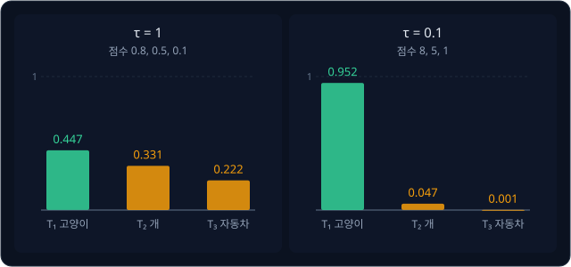

| $\tau$ | $I_1$ 행의 logit | 확률 ($T_1, T_2, T_3$) | loss |
| --- | --- | --- | --- |
| 1 | 0.8, 0.5, 0.1 | 0.447, 0.331, 0.222 | 0.805 |
| 0.1 | 8, 5, 1 | 0.952, 0.047, 0.001 | 0.049 |

위 그림과 표처럼 같은 cosine similarity 인데 $\tau = 0.1$ 로 나누자 정답 확률이 0.447 에서 0.952 로 올랐다. 세 점수의 순서는 두
경우 모두 $T_1 > T_2 > T_3$ 로 같다. $\tau$ 는 순서를 바꾸지 않고 확률이 얼마나 몰릴지만 바꾼다.

**흔한 오해.** $\tau$ 를 작게 할수록 좋다고 생각하기 쉽다. $\tau$ 가 너무 작으면 cosine similarity 의 아주 작은 차이도 큰 logit 차이가
된다. $\tau = 0.01$ 이면 0.01 차이가 logit 1 차이가 되어, 짝을 조금만 잘못 놓아도 loss 가 크게 튀고 학습이 불안정해진다.

**확인 문제.** cosine similarity 가 0.5 와 0.3 인 두 칸이 있다. $\tau = 1$ 과 $\tau = 0.1$ 일 때 두 logit 의 차이는 각각 얼마일까?

답 보기

$\tau = 1$ 이면 logit 이 0.5, 0.3 이라 차이가 0.2 다. $\tau = 0.1$ 이면 5, 3 이라 차이가 2 로, 10 배가 된다.

### 학습하는 temperature

알맞은 $\tau$ 를 사람이 미리 정하기는 어렵다. 그래서 CLIP 은 $\tau$ 도 parameter 로 두고 encoder 와 함께 학습한다. 논문은 $\tau$ 를
0.07 에서 시작했다. 0.07 로 나누는 것은 $1 / 0.07 \approx 14.3$ 을 곱하는 것과 같아서, CLIP 의 구현은 $\tau$ 대신 곱하는 수
$1/\tau$ 를 logit scale 이라는 이름으로 저장한다. 학습 중에 logit scale 이 100 을 넘지 않게, 곧 $\tau$ 가 0.01 보다 작아지지 않게
잘라 두었는데, 이 상한이 없으면 학습이 불안정했다고 논문은 적었다. 공개된 CLIP 은 학습이 끝났을 때 이 상한인 100 에 닿아 있다.

**확인 문제.** logit scale 이 50 이면 $\tau$ 는 얼마이고, cosine similarity 0.3 의 logit 은?

답 보기

$\tau = 1 / 50 = 0.02$ 이고, logit 은 $0.3 \times 50 = 15$ 다.

**요약**

- cosine similarity 는 −1 과 1 사이라서 그대로 softmax 에 넣으면 확률이 평평하고, 완벽한 embedding 에서도 loss 가 크게 남는다
- logit 을 $s / \tau$ 로 만들면 점수 차이가 $1/\tau$ 배가 되어 확률이 정답에 몰린다. $I_1$ 행의 정답 확률이 0.447 에서 0.952 로 올랐다
- CLIP 은 $\tau$ 를 0.07 에서 시작해 함께 학습하고, logit scale $1/\tau$ 가 100 을 넘지 않게 자른다

## zero-shot 분류

### 문장으로 만드는 class

학습이 끝난 CLIP 으로 사진 분류를 해 보자. 고양이, 개, 자동차, 새 네 class 가운데 하나를 고르는 문제다. 이름표 분류기라면 이 네
class 의 label 을 단 사진으로 마지막 층을 학습해야 하지만, CLIP 은 그럴 필요가 없다. class 이름을 문장으로 만들어 text encoder 에
넣으면 class 마다 embedding 이 하나씩 나오고, 이것을 사진 embedding 과 비교하면 된다.

이름만 넣지 않고 문장으로 만드는 이유는 CLIP 이 학습한 글이 대부분 단어 하나가 아니라 사진을 설명하는 문장이었기 때문이다. 그래서
"cat" 보다 "a photo of a cat." 처럼 학습 때 본 글과 비슷한 문장을 넣는 편이 잘 맞는다. 빈칸이 있는 문장 틀 "a photo of a {}." 를
template, template 에 넣어 완성한 문장을 prompt 라고 한다. CLIP 은 영어로 학습했으므로 실제 template 은 영어지만, 이 강의에서는
읽기 쉽게 "{} 사진" 으로 옮겨 쓴다.

### 손 계산

처음 보는 고양이 사진 한 장을 image encoder 에 넣고, 네 prompt "고양이 사진", "개 사진", "자동차 사진", "새 사진" 을 text encoder 에
넣어 cosine similarity 를 계산했더니 0.30, 0.27, 0.18, 0.22 가 나왔다고 하자. 학습이 끝난 CLIP 의 logit scale 은 100 이므로 100 을
곱해 logit 을 만든다.

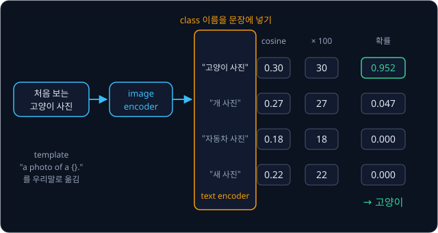

| prompt | cosine | $\times 100$ | $-30$ | $e^{s}$ | 확률 |
| --- | --- | --- | --- | --- | --- |
| "고양이 사진" | 0.30 | 30 | 0 | 1 | **0.952** |
| "개 사진" | 0.27 | 27 | −3 | 0.0498 | 0.047 |
| "자동차 사진" | 0.18 | 18 | −12 | 0.000006 | 0.000 |
| "새 사진" | 0.22 | 22 | −8 | 0.0003 | 0.000 |
| 합 | | | | 1.0501 | 1 |

확률이 가장 큰 "고양이 사진" 을 골라 이 사진을 고양이로 분류한다. 이 네 class 의 사진으로 따로 학습한 적이 없는데도 분류가 된다.
학습 예시를 하나도(zero) 보지 않고(shot) 푼다고 해서 이런 분류를 zero-shot 분류라고 한다.

cosine similarity 만 보면 0.30 과 0.27 은 0.03 차이밖에 나지 않는다. 100 을 곱하면 이 차이가 3 이 되고, softmax 를 지나 0.952 와 0.047
로 크게 벌어진다. 100 을 곱하지 않고 0.30, 0.27, 0.18, 0.22 를 그대로 softmax 하면 확률은 0.265, 0.257, 0.235, 0.244 로 거의
같아진다. 고르는 class 는 같지만 얼마나 확신하는지가 사라진다.

숫자만 바꿔 로봇이 책상 위의 물체를 분류하는 경우를 한 번 더 계산한다. 머그컵 사진과 세 prompt "머그컵 사진", "유리잔 사진",
"그릇 사진" 의 cosine similarity 가 0.28, 0.26, 0.21 이라면 logit 은 28, 26, 21 이고 28 을 빼면 0, −2, −7 이다. $e^{s}$ 는 1,
0.1353, 0.0009, 합은 1.1362 라서 확률은 0.880, 0.119, 0.001 이다. 머그컵과 유리잔은 둘 다 마시는 그릇이라 고양이 예보다 확률이
덜 몰렸다.

**확인 문제.** 어떤 사진과 prompt 두 개의 cosine similarity 가 0.25, 0.23 이다. logit scale 100 으로 첫 prompt 의 확률을 구해 보자.

답 보기

logit 은 25, 23 이고 25 를 빼면 0, −2 다. $e^{s}$ 는 1, 0.1353, 합 1.1353 이라 첫 prompt 의 확률은 $1 \div 1.1353 \approx 0.881$ 이다.

### prompt 의 문구

prompt 의 문구를 바꾸면 결과가 달라진다. CLIP 논문은 class 이름만 넣는 대신 "A photo of a {label}." template 을 쓰자 ImageNet 의
zero-shot 정확도가 1.3%p 올랐다고 적었다. %p 는 퍼센트 포인트로, 정확도 70% 가 71.3% 가 되는 것처럼 퍼센트 값끼리의 차이다.

문구가 중요한 다른 이유는 한 단어가 여러 뜻을 가질 때다. 영어 "crane" 은 공사장의 크레인이기도 하고 새인 두루미이기도 한데,
ImageNet 에는 두 class 가 모두 있다. 반려동물 사진을 모은 dataset(학습이나 평가에 쓰려고 모아 둔 데이터 묶음)의 "boxer" 는 개 품종이지만, 이름만 받은 text encoder 는
권투 선수로 읽을 수도 있다. 논문은 이런 dataset 에서 "A photo of a {label}, a type of pet." 처럼 종류를 밝힌 template 이 도움이
되었다고 적었다.

**확인 문제.** 새 사진을 분류하는데 class 이름이 "crane" 이다. "a photo of a crane." 과 "a photo of a crane, a type of bird." 중
어느 prompt 가 더 나을까?

답 보기

뒤의 것이다. "a type of bird" 가 붙어 있어 text encoder 가 크레인이 아니라 두루미의 뜻으로 embedding 을 만든다.

### template 여러 개의 평균

template 하나에만 기대지 않으려고, 여러 template 으로 같은 class 의 prompt 를 여러 개 만든 뒤 embedding 을 평균하기도 한다.
"고양이 사진", "큰 고양이의 사진", "흐릿한 고양이 사진" 처럼 문구는 달라도 모두 고양이를 가리키므로, 평균하면 문구 하나의 버릇에
덜 흔들리는 고양이 embedding 이 된다. 여러 모델이나 여러 입력의 결과를 합쳐 쓰는 이런 방법을 ensemble 이라고 한다.

2 차원으로 줄인 예로 계산한다. template 두 개로 만든 고양이 embedding 이 $[0.8, 0.6]$ 과 $[0.6, 0.8]$ 이면, 칸마다 평균한 vector 는
$[(0.8 + 0.6) \div 2, (0.6 + 0.8) \div 2] = [0.7, 0.7]$ 이다. 이 vector 의 길이는 $\sqrt{0.49 + 0.49} = \sqrt{0.98} \approx 0.99$ 라서
1 이 아니므로, 다시 정규화해 $[0.7 \div 0.99, 0.7 \div 0.99] \approx [0.707, 0.707]$ 을 고양이 class 의 embedding 으로 쓴다.

CLIP 논문은 ImageNet 에서 template 80 개를 ensemble 해 template 하나일 때보다 정확도를 3.5%p 더 올렸다. class 마다 평균 embedding 을
한 번만 계산해 두면 되므로, 분류할 사진이 아무리 많아도 계산량은 template 하나일 때와 같다.

**확인 문제.** template 두 개로 만든 embedding 이 $[1, 0]$ 과 $[0, 1]$ 이다. 평균하고 정규화하면? ($\sqrt{0.5} \approx 0.707$)

답 보기

평균은 $[0.5, 0.5]$ 이고 길이는 $\sqrt{0.25 + 0.25} = \sqrt{0.5} \approx 0.707$ 이다. 정규화하면 $[0.5 \div 0.707, 0.5 \div 0.707]
\approx [0.707, 0.707]$ 이다.

**요약**

- zero-shot 분류는 class 이름을 template 에 넣은 prompt 의 embedding 과 사진 embedding 의 cosine similarity 를 비교해 가장 큰 class 를
  고른다. 그 class 의 사진으로 따로 학습하지 않는다
- cosine similarity 의 작은 차이(0.30 과 0.27)도 logit scale 100 을 곱하면 확률 0.952 와 0.047 로 벌어진다
- prompt 의 문구가 결과를 바꾸고, template 여러 개의 embedding 을 평균하는 ensemble 이 정확도를 더 올린다

## 인터넷 데이터로 얻은 능력과 한계

### 처음 보는 물체 이름을 아는 이유

zero-shot 분류에서 class 이름은 아무것이나 넣을 수 있다. 이름표 분류기는 class 마다 마지막 층의 점수 칸이 따로 있어서 칸이 없는
이름은 다룰 수 없지만, CLIP 에서 class 를 나타내는 것은 text encoder 가 그 이름으로 만든 embedding 이다. text encoder 는 글을 BPE
token 으로 잘라 읽으므로 어떤 글자열이든 embedding 으로 바꿀 수 있다.

이 embedding 이 맞는 사진 근처에 놓이는 이유는 학습 데이터의 크기에 있다. 사진–글 쌍 4억 개는 영어 Wikipedia 에 자주 나오는 단어
50만 개를 검색어로 모은 것이라, 웬만한 물체 이름은 어딘가에서 그 물체의 사진과 함께 등장했다. 4억 쌍 가운데 "머그컵" 이 들어간
설명이 수천 개 있었다면, 학습은 그 설명들의 embedding 을 머그컵 사진들 쪽으로 끌어당겼다. 그 결과 "머그컵" 이라는 글이 들어간
embedding 은 머그컵 사진들이 모인 방향을 가리키게 되었다.

이름이 조합된 경우에도 어느 정도 통한다. "파란 머그컵" 이라는 설명이 데이터에 드물어도 "파란" 이 붙은 설명과 "머그컵" 이 붙은
설명은 많았으므로, text encoder 는 두 단어의 뜻을 합쳐 파란색 머그컵 쪽을 가리키는 embedding 을 만들 수 있다.

CLIP 논문의 가장 큰 모델은 ImageNet 의 label 이 달린 학습 사진 128만 장을 하나도 쓰지 않고 zero-shot 으로 76.2% 를 맞혔다. 이 숫자는
ImageNet 학습 사진으로 직접 학습한 ResNet-50 과 같은 수준이다. ResNet-50 은 사진 위로 작은 filter 를 옮겨 가며 계산하는 모델로,
[ResNet](../resnet/README.md) 에서 다뤘다.

**흔한 오해.** zero-shot 을 "CLIP 이 그런 사진을 한 번도 본 적이 없다" 로 읽기 쉽다. zero-shot 에서 0 인 것은 그 분류 문제의 label
이 달린 학습 예시다. CLIP 은 4억 쌍 속에서 고양이 사진을 아마 아주 많이 봤다. 정말로 학습 데이터에 거의 없던 종류에서는 약해서,
논문은 손글씨 숫자 사진 모음인 MNIST 에서 zero-shot 정확도가 88% 에 그쳤다고 적었다. 사진의 pixel 숫자를 그대로 쓰는 아주 단순한
분류기보다도 낮았는데, 4억 쌍 안에 손글씨 숫자처럼 생긴 사진이 거의 없었다.

**확인 문제.** 어떤 공장에서만 쓰는 특수 부품 "X-7 브래킷" 을 CLIP 의 zero-shot 분류로 잘 찾을 수 있을까? 그 이유는?

답 보기

어렵다. 이 이름과 그 부품의 사진이 인터넷의 사진–글 쌍에 거의 없었을 것이라, text encoder 가 "X-7 브래킷" 으로 만든 embedding 이 그
부품 사진 쪽을 가리키도록 학습된 적이 없다.

### 개수 세기

CLIP 은 사진 속 물체의 개수를 세는 데 약하다. 논문은 이를 CLIP 이 어려워하는 "더 추상적이고 체계적인 일" 의 예로 들었다.

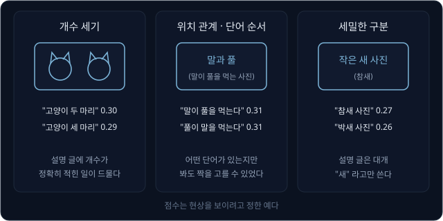

위 그림의 왼쪽처럼 고양이 두 마리 사진에 "고양이 두 마리" 와 "고양이 세 마리" 를 비교하면 점수가 0.30 과 0.29 처럼 거의 같게 나오기
쉽다. 그림의 점수는 이런 현상을 보여 주려고 든 예다. 인터넷 설명 글은 "고양이들" 처럼 쓰지 "정확히 두 마리" 를 적는 일이 드물어서,
학습 데이터부터 개수 정보가 적다. 또 contrastive learning 은 batch 안의 다른 설명과 구별만 되면 loss 가 내려가는데, 같은 batch
에 "고양이 세 마리" 처럼 개수만 다른 설명이 들어오는 일이 거의 없어서 개수를 구별하라는 신호를 받지 못한다.

**확인 문제.** contrastive learning 이 개수를 구별하라는 신호를 받으려면 batch 에 어떤 negative 가 있어야 할까?

답 보기

정답 설명과 개수만 다른 설명, 예를 들어 "고양이 두 마리" 사진의 batch 에 "고양이 세 마리" 가 negative 로 들어와야 한다. 그래야 둘을
구별해야 loss 가 내려간다.

### 위치 관계와 단어 순서

"컵 왼쪽의 공" 과 "공 왼쪽의 컵" 은 같은 단어로 되어 있고 순서만 다르다. 2023년 Yuksekgonul 등은 "the horse is eating the grass"(말이
풀을 먹는다) 와 "the grass is eating the horse"(풀이 말을 먹는다) 처럼 단어 순서만 바꾼 설명 두 개 가운데 사진에 맞는 것을 고르게 하는
시험을 만들었다. 무작위로 골라도 50% 를 맞히는 시험에서, CLIP 은 "왼쪽", "뒤" 같은 위치 관계를 묻는 문제를 56% 맞혀 무작위와 거의
같았다.

이유도 개수와 같다. 4억 쌍의 batch 에서 정답 설명 "말이 풀을 먹는다" 를 다른 설명 "소파 위의 고양이", "길가의 빨간 자동차" 와 구별하려면
"말" 과 "풀" 이라는 단어가 들어 있는지만 봐도 충분하다. 순서를 몰라도 loss 가 내려가므로 encoder 는 순서를 담는 법을 배우지 않았다. 이
논문은 이렇게 어떤 단어가 있는지만 보는 모델을 bag-of-words(단어를 순서 없이 자루에 담은 것)처럼 행동한다고 표현했다.

로봇에게는 이 한계가 크다. "왼쪽 컵을 집어" 에서 중요한 정보는 "왼쪽" 인데, CLIP 의 embedding 하나로는 이 정보가 잘 남지 않는다. 사진
전체를 숫자 512 개 하나로 요약하는 것도 이유다. [ViT](../vit/README.md) 강의에서 본 것처럼 [CLS] 하나로 요약하면 "무엇이 있는가" 는
남아도 "어디에 있는가" 가 흐려진다. 그래서 로봇을 움직이는 VLA 는 embedding 하나 대신 사진 조각마다의 출력(patch token)을 모두 언어
모델에 넘긴다. 언어 모델은 [GPT](../gpt/README.md) 처럼 앞의 token 들을 읽고 다음 token 을 내는 모델이다.

**확인 문제.** 위 시험처럼 설명 두 개 가운데 하나를 고르는 문제 100 개를 무작위로 풀면 대략 몇 개를 맞힐까? CLIP 의 56% 는 이보다
몇 개 더 맞힌 것일까?

답 보기

둘 중 하나를 무작위로 고르면 절반, 곧 약 50 개를 맞힌다. 56% 는 56 개라서 무작위보다 6 개쯤 더 맞힐 뿐이다.

### 세밀한 구분

참새와 박새, 자동차의 세부 모델, 비행기의 기종처럼 겉모습이 비슷한 종류를 가르는 문제를 fine-grained 분류라고 한다. fine-grained 는
"결이 고운", 곧 아주 세밀하다는 뜻이다. CLIP 논문은 차의 모델, 꽃의 종, 비행기 기종 구분에서 각 문제에 맞춰 학습한 모델보다 CLIP 의
성능이 낮다고 적었다. 사진 속 가장 가까운 차까지의 거리를 분류하는 것처럼 인터넷 설명에 거의 나오지 않는 일에서는 무작위 수준에 가깝다고도
적었다.

설명 글을 쓰는 사람은 대개 "새" 나 "작은 새" 라고 쓰지 종 이름까지 적지 않는다. 종 이름이 붙은 사진이 적으니 "참새 사진" 과 "박새 사진"
의 embedding 이 서로 가깝게 남고, 그림 오른쪽의 0.27 과 0.26 처럼 점수가 비슷하게 나오기 쉽다.

**확인 문제.** 개수 세기, 위치 관계, 세밀한 구분이 약한 데에는 공통된 원인이 하나 있다. 무엇일까?

답 보기

인터넷 설명 글에 그 정보(정확한 개수, 위치 관계, 종 이름)가 잘 적혀 있지 않고, batch 안의 다른 설명과 구별하는 데 그 정보가 거의 필요하지
않았다. 그래서 학습이 그 정보를 embedding 에 담으라는 신호를 받지 못했다.

**요약**

- CLIP 이 처음 보는 이름도 다룰 수 있는 것은 class 를 text encoder 의 embedding 으로 나타내고, 4억 쌍에 아주 많은 물체 이름이 사진과
  함께 들어 있었기 때문이다. zero-shot 은 그 문제의 label 로 학습하지 않았다는 뜻이다
- 개수 세기, 위치 관계·단어 순서(무작위 50% 에 대해 56%), 세밀한 구분에 약하다. 설명 글에 그 정보가 드물고, batch 의 negative 와
  구별하는 데 필요하지 않았기 때문이다
- 사진 전체를 embedding 하나로 요약하면 위치 정보가 흐려지므로, 로봇의 VLA 는 patch token 전부를 쓴다

## CLIP 의 실제 크기

지금까지의 계산을 OpenAI 가 공개한 CLIP ViT-B/32 모델의 실제 숫자로 옮기면 아래 그림과 같다. ViT-B/32 의 B 는 Base 크기를, 32 는 patch
한 변이 32 pixel 이라는 뜻이다.

![OpenAI CLIP ViT-B/32 의 실제 크기. 224×224 사진은 32×32 patch 49 개와 [CLS] 를 합친 token 50 개로 12층 ViT(폭 768)를 지나고, [CLS] 출력 768 개를 행렬 곱으로 512 개로 바꾼다. 문장은 SOT 와 EOT 를 붙인 token 으로 12층 transformer(폭 512)를 지나고, EOT 자리 출력을 512 개로 바꾼다. 둘을 길이 1 로 맞춰 cosine similarity 에 100 을 곱한다](figures/dual-encoder.svg)

위 그림의 왼쪽은 사진의 길이다. 224×224 사진을 한 변 32 pixel 로 자르면 한 변에 $224 \div 32 = 7$ 개, 모두 $7 \times 7 = 49$ 개의 patch
가 나오고 [CLS] 를 더해 token 50 개가 된다. 12 층을 지난 [CLS] 출력 768 개를 projection 으로 512 개로 바꾸고 정규화한다. 오른쪽은
문장의 길이다. "a photo of a cat." 은 "a", "photo", "of", "a", "cat", "." 의 token 6 개에 SOT 와 EOT 를 붙여 8 개가 되고, EOT 자리의
출력 512 개를 projection 한 뒤 정규화한다.

| 부분 | 값 |
| --- | --- |
| image encoder | ViT, patch 32, token 50, token 하나의 숫자 768 개, 12 층 |
| text encoder | GPT 같은 Transformer, vocabulary 49,408 개, 문장 길이 최대 token 77 개, token 하나의 숫자 512 개, 12 층 |
| embedding | 숫자 512 개 |
| logit scale ($1/\tau$) | 0.07 의 역수 약 14.3 에서 시작, 상한 100 |
| batch | 쌍 32,768 개 |
| 학습 데이터 | 인터넷의 사진–글 쌍 4억 개 |
| 전체 parameter | 151,277,313 개 (약 1.5억) |

**확인 문제.** patch 한 변이 16 pixel 인 CLIP ViT-B/16 에 224×224 사진을 넣으면 [CLS] 를 포함해 token 이 몇 개일까?

답 보기

한 변에 $224 \div 16 = 14$ 개라 patch 는 $14 \times 14 = 196$ 개이고, [CLS] 를 더해 197 개다.

## SigLIP

### 한 행 전체가 필요한 softmax

CLIP 의 loss 는 행마다 softmax 를 계산했다. softmax 의 분모는 그 행의 모든 칸을 더한 값이라서, 사진 한 장의 loss 를 구하려면 batch 의
모든 설명과의 점수가 한곳에 모여 있어야 한다. batch 가 32,768 개면 표가 약 10억 칸이고, 이 표를 여러 GPU(계산을 나눠 맡는 칩)에 나눠
계산해도 행의 합을 구하려면 모든 GPU 가 서로의 embedding 을 주고받아야 한다.

2023년 Google 의 Zhai 등은 softmax 대신 sigmoid 를 쓰는 SigLIP(Sigmoid Loss for Language Image Pre-training)을 발표했다. SigLIP 은
CLIP 과 같은 두 encoder 와 같은 점수표를 쓰고 loss 만 바꾼다.

### sigmoid

sigmoid 는 아무 숫자 $x$ 를 받아 0 과 1 사이의 값을 내는 함수다. 함수는 값 하나를 넣으면 값 하나가 정해져 나오는 규칙이다.
sigmoid 는 그리스 문자 $\sigma$ (sigma, 시그마)로 쓴다.

$$
\sigma(x) = \frac{1}{1 + e^{-x}}
$$

이 식은 "$e$ 의 $-x$ 제곱에 1 을 더하고, 1 을 그 값으로 나눈다" 로 읽는다. $x = 0$ 이면 $e^{0} = 1$ 이라 $1 \div 2 = 0.5$ 이고,
$x = 3$ 이면 $e^{-3} = 0.0498$ 이라 $1 \div 1.0498 \approx 0.953$, $x = -3$ 이면 $e^{3} = 20.086$ 이라 $1 \div 21.086 \approx 0.047$
이다. $x$ 가 클수록 1 에, 작을수록 0 에 다가가서 "짝일 확률" 처럼 읽을 수 있다.

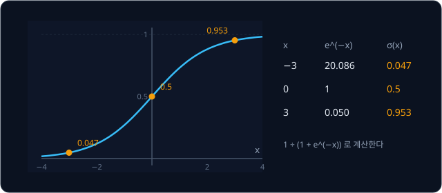

**확인 문제.** $\sigma(-1)$ 은? ($e^{1} = 2.718$)

답 보기

$1 \div (1 + 2.718) = 1 \div 3.718 \approx 0.269$ 다.

### 칸마다 따로 내리는 판정

SigLIP 은 표의 칸 하나하나를 "이 사진과 이 설명이 짝인가" 를 묻는 예/아니오 문제로 본다. 칸마다 logit 을 $t \cdot s_{ij} + b$ 로
만든다. $t$ 는 CLIP 의 logit scale 처럼 학습하는 곱하는 수이고, $b$ 는 학습하는 bias(더하는 수)다. 정답 표시 $z_{ij}$ 는 짝이면 $+1$,
짝이 아니면 $-1$ 이다.

$$
\mathcal{L}_{\text{sig}} = -\frac{1}{B}\sum_{i=1}^{B}\sum_{j=1}^{B} \log \sigma\big(z_{ij}\,(t\, s_{ij} + b)\big)
$$

이 식은 "칸마다 logit 에 정답 표시를 곱해 sigmoid 를 씌우고, 그 log 에 마이너스를 붙여 모든 칸에서 더한 뒤 $B$ 로 나눈다" 로 읽는다.
짝인 칸은 $\sigma(\text{logit})$ 이 1 에 가까울수록, 짝이 아닌 칸은 $\sigma(-\text{logit})$ 이 1 에 가까울수록, 곧 logit 이 크게 음수일수록
loss 가 작다. 다른 칸을 더하는 분모가 없어서 칸마다의 loss 를 따로 계산할 수 있다.

같은 3×3 표에 $t = 10$, $b = -5$ 를 써 본다. $I_2$–$T_1$ 칸은 cosine 0.6 이라 logit 은 $10 \times 0.6 - 5 = 1$ 이고 짝이 아니라 $z = -1$
이다. $\sigma(-1) = 0.269$ 라서 loss 는 $-\log 0.269 = 1.313$ 이다. 아홉 칸을 모두 계산하면 아래 그림과 같다.

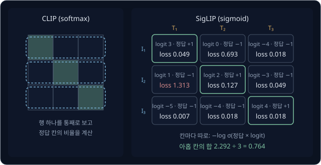

| | $T_1$ | $T_2$ | $T_3$ |
| --- | --- | --- | --- |
| $I_1$ | logit 3, 짝 → $-\log \sigma(3) = 0.049$ | logit 0, 짝 아님 → $-\log \sigma(0) = 0.693$ | logit −4, 짝 아님 → $-\log \sigma(4) = 0.018$ |
| $I_2$ | logit 1, 짝 아님 → $-\log \sigma(-1) = 1.313$ | logit 2, 짝 → $-\log \sigma(2) = 0.127$ | logit −3, 짝 아님 → $-\log \sigma(3) = 0.049$ |
| $I_3$ | logit −5, 짝 아님 → $-\log \sigma(5) = 0.007$ | logit −4, 짝 아님 → $-\log \sigma(4) = 0.018$ | logit 4, 짝 → $-\log \sigma(4) = 0.018$ |

아홉 칸의 합은 2.292 이고 $B = 3$ 으로 나누면 loss 는 0.764 다. 가장 큰 loss 1.313 은 CLIP 에서도 가장 헷갈리던 강아지 사진–고양이 설명
칸에서 나왔다. 칸마다 따로 계산하므로 GPU 마다 자기가 맡은 칸만 계산하면 되고, 행 전체의 합을 모을 필요가 없다. SigLIP 논문은 이
loss 가 batch 를 더 크게 키울 수 있게 해 주면서, batch 가 작을 때는 softmax loss 보다 성능이 좋았다고 적었다. batch 를 100만까지
키워 보았지만 효과가 금방 줄어들어 32,000 정도면 충분하다고도 적었다.

**확인 문제.** $t = 10$, $b = -5$ 에서 cosine 0.9 인 짝의 칸과 cosine 0.5 인 짝이 아닌 칸의 loss 는? ($\sigma(4) = 0.982$, $\sigma(0) = 0.5$)

답 보기

짝의 logit 은 $9 - 5 = 4$ 라서 $-\log \sigma(4) = -\log 0.982 \approx 0.018$ 이다. 짝이 아닌 칸의 logit 은 $5 - 5 = 0$ 이라
$-\log \sigma(0) = -\log 0.5 = 0.693$ 이다.

### bias 가 −10 에서 시작하는 이유

SigLIP 은 $t$ 를 10, $b$ 를 −10 에서 시작한다. batch 에 쌍이 $B$ 개면 칸 $B^2$ 개 가운데 짝은 $B$ 개뿐이다. $B = 32{,}768$ 이면 칸
가운데 짝의 비율은 $1 / 32{,}768 \approx 0.00003$ 이다. 학습을 시작할 때 cosine similarity 는 0 근처라 logit 은 거의 $b$ 이고,
$\sigma(-10) \approx 0.00005$ 다. 곧 모든 칸에 "짝일 확률이 거의 0" 이라고 답하며 시작하는데, 실제로 거의 모든 칸이 짝이 아니므로
처음부터 크게 틀리지 않는다. $b = 0$ 에서 시작하면 모든 칸에 0.5 를 주게 되어, 수가 압도적으로 많은 짝이 아닌 칸들의 loss 가
처음 학습을 휩쓴다. 논문의 실험에서도 −10 에서 시작한 bias 가 결과를 꾸준히 좋게 했다.

**확인 문제.** $B = 4$ 인 batch 의 표에서 짝이 아닌 칸은 몇 개일까?

답 보기

칸은 $4 \times 4 = 16$ 개이고 짝은 4 개라서 짝이 아닌 칸은 12 개다.

**요약**

- SigLIP 은 CLIP 과 같은 두 encoder 와 점수표를 쓰고, 행마다의 softmax 대신 칸마다의 sigmoid 로 "짝인가" 를 판정한다
- 칸마다의 loss 를 따로 계산할 수 있어 큰 batch 를 여러 GPU 에 나누기 쉽고, 작은 batch 에서도 잘 학습된다. 우리 표의 loss 는 0.764 였다
- 짝이 아닌 칸이 압도적으로 많으므로 bias 를 −10 에서 시작해 "거의 모두 짝이 아님" 에서 출발한다

## CLIP 을 쓰는 모델

### open-vocabulary detector

[Classical Pick & Place](../classical-pick/README.md) 에서 물체 이름을 글로 주면 사진에서 그 물체를 찾아 주는 인식기를 썼다. 이 인식기는
물체를 둘러싸는 직사각형인 bounding box 와 점수를 내고, 정해진 단어 목록에 묶이지 않고 아무 이름이나 받을 수 있어서 open-vocabulary
detector 라고 부른다. vocabulary 는 쓸 수 있는 단어 목록이고, open 은 그 목록이 열려 있다는 뜻이다. 2024년의 YOLO-World 가 그 예다.

YOLO-World 는 물체 이름을 숫자로 바꾸는 데 CLIP 의 text encoder 를 그대로 가져다 쓴다. 사용자가 "cup" 이라는 이름을 주면 CLIP text
encoder 가 그 embedding 을 만들고, 사진에서 물체가 있을 만한 상자마다 계산한 embedding 과 비교해 점수가 높은 상자를 고른다. 예를
들어 상자 A 의 embedding 이 "cup" 과 0.31, 상자 B 가 0.12 의 점수를 받으면 상자 A 를 컵으로 표시한다. 이 강의의 zero-shot 분류는 사진
전체를 문장과 비교했고, YOLO-World 는 같은 비교를 상자 하나하나에 한다. YOLO-World 는 상자와 이름의 짝을 맞히는 contrastive learning 으로 학습했고, 이름은
미리 embedding 으로 바꿔 두므로 실행할 때 text encoder 를 다시 돌리지 않아도 된다.

**확인 문제.** YOLO-World 로 찾을 물체를 "cup" 에서 "screwdriver" 로 바꾸려면 무엇을 해야 할까?

답 보기

"screwdriver" 를 CLIP text encoder 에 넣어 새 embedding 을 만들기만 하면 된다. 드라이버 사진을 모아 다시 학습할 필요는 없다.

### VLA 의 image encoder

사진과 지시문을 함께 받아 로봇 action 을 내는 VLA 는 대개 사진과 글을 함께 받아 글을 내는
VLM(Vision-Language Model) 위에 만든다. 2024년 Google 이 공개한 VLM 인 PaliGemma 의 image encoder 가 SigLIP 이다. SigLIP 의
image encoder 는 ViT 구조이고, 이 강의의 sigmoid loss 로 사진과 설명의 짝을 맞히며 학습했다. 그래서 그 출력은 "빨간 컵" 같은 말과
같은 공간에 놓이도록 이미 맞춰져 있다.

[π0](../pi0/README.md) 는 PaliGemma 의 parameter 값에서 출발해 로봇 데이터로 더 학습한 VLA 다. [RT-2 → OpenVLA](../vla-tokens/README.md)
에서 다루는 OpenVLA 는 SigLIP 과 또 다른 ViT 구조의 image encoder 인 DINOv2 의 출력을 합쳐 언어 모델에 넣는다. 이때 VLA 는 CLIP 의 zero-shot 분류처럼 embedding
하나를 쓰지 않고, 위치 관계의 한계에서 본 대로 patch token 전부를 언어 모델에 넘긴다.

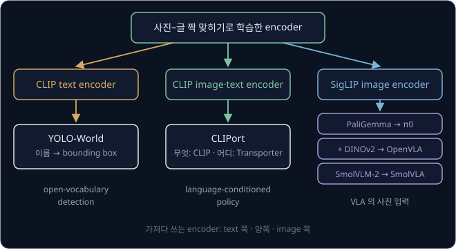

위 그림의 왼쪽 길은 text encoder 가 이름을 embedding 으로 바꿔 YOLO-World 가 bounding box 를 찾게 하는 쓰임이고, 오른쪽 길은 sigmoid
loss 로 학습한 image encoder 가 PaliGemma 를 거쳐 π0 와 OpenVLA 같은 VLA 의 사진 입구가 되는 쓰임이다.

**확인 문제.** VLA 의 image encoder 로 이름표 1000 개로 학습한 ViT 보다 SigLIP 이 더 잘 맞는 이유는 무엇일까?

답 보기

SigLIP 의 출력은 사진과 설명 글의 짝을 맞히며 학습되어 말과 같은 공간에 놓여 있다. 그래서 언어 모델이 "빨간 컵" 같은 지시문 token 과
사진 token 을 함께 다루기 쉽다. 이름표로 학습한 ViT 는 1000 가지 class 를 가르는 데 필요한 정보만 담는다.

## 정리

- 이름표가 정해진 분류기는 목록 밖의 물체를 가리킬 수 없다. CLIP 은 인터넷의 사진–설명 글 쌍 4억 개로, 사진과 문장이 얼마나 잘 맞는지
  점수를 내도록 학습해 이 문제를 푼다
- 이 강의의 multimodal 은 사진과 글처럼 여러 modality(정보의 종류)를 함께 다룬다는 뜻이다. behavior cloning 의 multimodal, 곧 같은
  장면에 정답 action 이 여럿이라 분포의 봉우리가 여럿이라는 뜻과 다르다
- image encoder(ViT, [CLS] 출력)와 text encoder(GPT 구조, EOT 출력)가 각자 embedding 을 내고, projection 으로 길이를 같게 맞춘다.
  두 embedding 을 정규화해 dot product 한 cosine similarity 가 점수이고, 같은 방향 1, 직각 0, 반대 −1 이다
- contrastive learning 은 사진 $B$ 장 × 설명 $B$ 개의 점수표에서 행마다·열마다 softmax 와 cross-entropy 를 계산해 짝의 점수를 올리고
  negative 의 점수를 내린다. 우리 3×3 표에서 행 평균 0.122, 열 평균 0.086, loss 0.104 였고, gradient 는 헷갈리는 negative(강아지
  사진–고양이 설명)를 가장 세게 밀어냈다
- cosine similarity 는 −1 과 1 사이라 그대로는 softmax 가 평평하다. temperature $\tau$ 로 나누면 점수 차이가 $1/\tau$ 배가 되어,
  $\tau = 0.1$ 에서 정답 확률이 0.447 에서 0.952 로 올랐다. CLIP 은 $\tau$ 를 0.07 에서 시작해 학습하고 $1/\tau$ 를 100 이하로 자른다
- zero-shot 분류는 class 이름을 "a photo of a {}." 같은 template 에 넣은 prompt 와 사진의 cosine similarity 를 비교해 고른다. 고양이
  사진에서 0.30, 0.27, 0.18, 0.22 가 100 배되어 확률 0.952 로 고양이를 골랐다. 문구와 template ensemble 이 정확도를 바꾼다
- 처음 보는 이름을 다루는 것은 class 가 text encoder 의 embedding 이고 4억 쌍에 아주 많은 이름이 사진과 함께 있었기 때문이다. 반면
  개수 세기, 위치 관계·단어 순서, 세밀한 구분에는 약하다. 설명 글에 그 정보가 드물고 batch 의 negative 와 구별하는 데 필요하지 않았다
- SigLIP 은 softmax 대신 칸마다 sigmoid 로 "짝인가" 를 판정해 큰 batch 를 나누기 쉽고 작은 batch 에서도 잘 학습한다. bias 는 −10 에서
  시작한다
- YOLO-World 같은 open-vocabulary detector 는 CLIP 의 text encoder 로 물체 이름을 embedding 으로 바꿔 bounding box 를 찾고,
  PaliGemma·π0·OpenVLA 같은 VLA 는 SigLIP 의 image encoder 를 사진 입구로 쓴다

CLIP 은 사진과 문장이 얼마나 잘 맞는지 점수를 낼 뿐, 문장을 만들어 내거나 로봇 action 을 내지는 못한다. 사진 전체를 embedding 하나로
요약하기 때문에 "왼쪽 컵" 같은 위치 정보도 흐려진다. 사진 encoder 의 patch token 을 언어 모델에 넘기고 action 까지 token 으로 생성하게
만든 VLA 는 [RT-2 → OpenVLA](../vla-tokens/README.md) 에서, SigLIP 을 쓰는 PaliGemma 위에 action 을 내는 부분을 따로 붙인 VLA 는
[π0](../pi0/README.md) 에서 다룬다.

## 참고 자료

- Alec Radford et al., [Learning Transferable Visual Models From Natural Language Supervision](https://arxiv.org/abs/2103.00020)
  (2021) — CLIP 논문. 2.3절과 그림 3 의 의사 코드(계산 순서를 코드처럼 적은 것)가 이 강의의 contrastive loss 이고, 3.1.4절이 prompt 문구와 template ensemble,
  6절이 개수 세기·세밀한 구분 같은 한계다
- Xiaohua Zhai et al., [Sigmoid Loss for Language Image Pre-Training](https://arxiv.org/abs/2303.15343) (2023) — SigLIP 논문. 3.2절이
  sigmoid loss 의 식, Algorithm 1 이 그 의사 코드이고, 4절에서 batch 크기와 bias 초기값의 영향을 비교한다
- Mert Yuksekgonul et al., [When and why vision-language models behave like bags-of-words, and what to do about it?](https://arxiv.org/abs/2210.01936)
  (2023) — 단어 순서와 위치 관계를 묻는 시험에서 CLIP 이 무작위에 가깝다는 결과와 그 이유. 1절과 그림 1 을 읽는다
- T. Cheng et al., [YOLO-World: Real-Time Open-Vocabulary Object Detection](https://arxiv.org/abs/2401.17270) (2024) — CLIP 의 text
  encoder 로 이름을 embedding 으로 바꾸는 open-vocabulary detector. 3.2절의 Text Encoder 문단과 그림 3 을 본다
- Yannic Kilcher, [OpenAI CLIP: Connecting Text and Images (Paper Explained)](https://www.youtube.com/watch?v=T9XSU0pKX2E) — CLIP 논문을
  그림과 함께 읽어 주는 영상
- Lilian Weng, [Contrastive Representation Learning](https://lilianweng.github.io/posts/2021-05-31-contrastive/) — contrastive loss
  의 계보와 batch 안의 negative 를 쓰는 방식 정리. 이 강의를 마친 뒤 더 넓게 보고 싶을 때 읽는다
- OpenAI, [CLIP](https://github.com/openai/CLIP) — 공개 weight 와 tokenizer. dataset 별 class 이름과 template 은
  [`data/prompts.md`](https://github.com/openai/CLIP/blob/main/data/prompts.md) 에 있다
- OpenAI, [Prompt Engineering for ImageNet 노트북](https://github.com/openai/CLIP/blob/main/notebooks/Prompt_Engineering_for_ImageNet.ipynb)
  — template 80 개의 embedding 을 평균해 zero-shot 분류기를 만드는 과정
- Hugging Face, [CLIP 문서](https://huggingface.co/docs/transformers/model_doc/clip) — 같은 모델의 다른 구현과 사용 예
- Google, [big_vision](https://github.com/google-research/big_vision) — SigLIP 공식 구현과 weight
