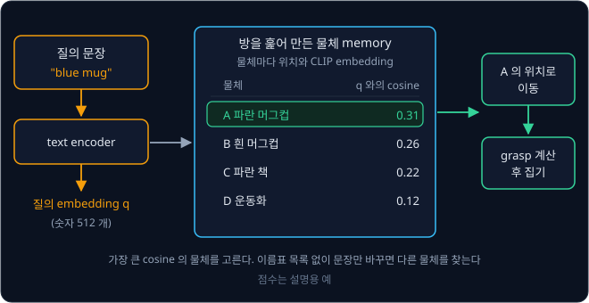

# CLIP

책상 정리 로봇에게 "파란 머그컵을 집어" 라고 했는데, 로봇의 물체 detector 는 COCO dataset 의 80 가지 class 로 학습해서 "cup" 은 알아도
"파란 머그컵" 이라는 이름을 고를 방법이 없다. 물체 이름이 하나 늘 때마다 사진 수백 장에 이름을 달아 detector 를 다시 학습해야 할까?

CLIP 은 인터넷에서 모은 사진–글 쌍 4억 개로 사진과 문장을 같은 공간의 vector 로 바꾸도록 학습해서, 학습이 끝나면 아무 문장이나 사진과
비교해 점수를 낼 수 있다. 이름표 목록이 따로 없어서 찾을 물체가 바뀌면 문장만 바꾸면 된다. 2024년의 OK-Robot 은 CLIP 계열 model 로 물체를
찾아, 처음 가 본 집 10 곳에서 따로 학습하지 않고 물건을 집어 옮기는 시도의 58.5% 에 성공했다.

## 학습 목표

- 사진 $B$ 장과 설명 $B$ 개의 유사도 행렬에서 InfoNCE loss 가 짝의 점수를 올리고 같은 batch 의 다른 쌍을 negative 로 밀어내는 과정을
  숫자로 설명할 수 있다
- temperature 가 없으면 학습이 막히는 이유와, 학습한 CLIP 의 logit scale 100 이 zero-shot 분류의 확률을 정하는 방식을 설명할 수 있다
- CLIP 이 개수·위치 관계·세밀한 구분에 약한 이유와, SigLIP 이 loss 를 바꾼 이유를 설명할 수 있다
- open-vocabulary detection, language-conditioned policy, VLA 의 image encoder 에서 CLIP 식 학습이 어떻게 쓰이는지 설명할 수 있다

## 정해진 class 목록의 한계

[ViT](../vit/README.md) 의 분류 model 은 사람이 class 이름(label)을 달아 둔 ImageNet 사진 약 128만 장으로 학습해, 마지막 층이 1000
가지 class 마다 점수를 하나씩 내고 가장 큰 점수의 class 를 고른다.

위 그림의 왼쪽처럼 이름표가 정해진 분류기에서는 목록에 없는 이름이 나올 수 없어서, "파란 컵" 이라는 구분을 넣으려면 label 을 단 사진을
모아 마지막 층부터 다시 학습해야 한다. 오른쪽의 CLIP 은 사진 하나와 문장 하나를 받아 그 문장이 사진을 얼마나 잘 설명하는지 점수를 낸다.
문장은 아무것이나 넣을 수 있으니 "a photo of a blue mug" 를 넣으면 목록 없이도 그 물체를 물어볼 수 있다.

## 사진–글 쌍 4억 개

인터넷의 사진에는 "소파 위에서 자는 고양이" 같은 설명이나, 사진이 안 보일 때 대신 읽어 주는 짧은 글(alt text)이 붙어 있다. 사람이
label 로 단 글은 아니지만 대개 사진에 무엇이 있는지가 적혀 있다.

2021년 OpenAI 의 Radford 등은 이런 쌍을 4억 개 모았다. 영어 Wikipedia 에 100 번 이상 나오는 단어 등으로 검색어 50만 개를 만들고, 글에
그 검색어가 들어간 쌍을 검색어 하나당 2만 개까지 모아 흔한 단어와 드문 단어가 고르게 들어오게 했다. 이 데이터로 학습한 model 이
CLIP(Contrastive Language–Image Pre-training)이다. pre-training 은 특정 문제를 풀기 전에 많은 데이터로 미리 해 두는 학습이고, contrastive
는 짝인 것과 짝이 아닌 것을 대조(contrast)하며 배운다는 뜻이다.

설명 글로 학습하는 한 방법은 [GPT](../gpt/README.md) 처럼 사진을 보고 설명을 한 단어씩 맞히게 하는 것이다. 그런데 같은 고양이 사진에도
"소파 위의 고양이", "낮잠 자는 우리 집 나비" 처럼 설명이 끝없이 달라서, model 이 사진에 없는 "우리 집" 같은 단어까지 맞혀야 한다. 다른
방법은 설명을 만들지 않고, 사진 여러 장과 설명 여러 개를 섞어 놓은 뒤 어느 설명이 어느 사진의 것인지 짝만 고르게 하는 것이다. CLIP 논문은
같은 정확도에 이르는 데 드는 계산량으로 둘을 비교했다.

| 학습 방식 | 계산량 비교 |
| --- | --- |
| 설명을 한 단어씩 생성 (Transformer language model) | 기준 |
| 설명에 들어 있는 단어 목록만 맞히기 (bag-of-words) | 3 배 적게 든다 |
| 설명과 사진의 짝 고르기 (contrastive) | bag-of-words 보다 다시 4 배 적게 든다 |

CLIP 은 짝 고르기를 택했는데, 짝을 고르려면 사진과 글을 같은 꼴의 숫자로 바꿔 비교할 수 있어야 한다.

## 두 encoder 와 embedding 공간

CLIP 에는 입력을 그 내용을 담은 vector 로 바꾸는 encoder 가 둘 있다. 사진을 맡는 image encoder 와 글을 맡는 text encoder 인데, 둘이 내는
vector 는 사진이나 문장 하나 전체를 나타내며 이 vector 를 embedding 이라고 부른다.

위 그림은 이 강의 내내 쓰는 예다. 사진 3장(고양이, 강아지, 자동차)은 image encoder 를 지나 $I_1, I_2, I_3$ 가 되고, 설명 3개("소파 위의
고양이", "공원을 달리는 개", "길가의 빨간 자동차")는 text encoder 를 지나 $T_1, T_2, T_3$ 가 된다. $I$ 와 $T$ 는 image 와 text 의 첫 글자다.
사진 $i$ 번과 설명 $i$ 번이 짝이라서 오른쪽 표에서는 대각선의 초록 칸이 짝이다.

image encoder 는 ViT 구조라서 사진을 patch 로 잘라 Transformer encoder 에 넣고, 맨 앞 [CLS] 자리의 출력을 사진의 embedding 으로 쓴다.
ViT 분류 model 과 달리 class 점수를 내는 층은 붙이지 않는다. text encoder 는 GPT 와 같은 구조의 Transformer 로, 문장 앞뒤에 시작 token(SOT)과
끝 token(EOT)을 붙여 읽는다. 각 위치가 자기보다 앞의 token 만 보는 causal mask 를 쓰기 때문에 문장 전체를 본 자리는 맨 끝의 EOT 하나뿐이고,
그 자리의 출력이 문장의 embedding 이다.

두 출력은 길이가 다를 수 있어서 각자 행렬을 하나씩 곱해 같은 길이로 맞춘다. 이렇게 행렬을 곱해 vector 를 정해진 길이의 다른 vector 로
옮기는 계산을 projection 이라고 하고, 행렬 안의 숫자도 학습으로 정한다. 그다음 vector 를 자기 길이로 나눠 길이를 1 로 맞추고, 길이 1 인
두 vector 의 dot product 인 cosine similarity 를 짝이 맞는 정도의 점수로 쓴다. cosine similarity 는 [Vectors & Matrices](../vectors-matrices/README.md)
에서 본 대로 두 vector 가 같은 방향이면 1 이고 직각이면 0 이며 반대 방향이면 −1 이다. 예를 들어 $[3, 4]$ 와 $[4, 3]$ 은 길이 5 로 나누면
$[0.6, 0.8]$ 과 $[0.8, 0.6]$ 이고, 점수는 $0.6 \times 0.8 + 0.8 \times 0.6 = 0.96$ 이다. 길이를 1 로 맞춰 두면 밝은 사진이라 vector 가 길게
나와도 모든 설명과의 점수가 덩달아 커지지 않는다.

위 그림은 512 차원 공간을 2 차원으로 줄여 그린 것이다. 학습 전(왼쪽)에는 encoder 의 숫자가 아무렇게나 정해져 있어서 고양이 사진 $I_1$ 과
고양이 설명 $T_1$ 이 다른 방향을 가리킨다. 학습 후(오른쪽)에는 짝끼리 거의 같은 방향을 가리키고, 짝이 아니어도 뜻이 비슷한 고양이와 개는
가깝게 놓인다. CLIP 의 학습은 왼쪽을 오른쪽으로 바꾸는 일이다.

<b>심화: CLIP ViT-B/32 의 실제 크기</b>

OpenAI 가 공개한 CLIP ViT-B/32 의 숫자로 옮기면 아래와 같다. B 는 Base 크기라는 뜻이고, 32 는 patch 한 변이 32 pixel 이라는 뜻이다.

![OpenAI CLIP ViT-B/32 의 실제 크기. 224×224 사진은 32×32 patch 49 개와 [CLS] 를 합친 token 50 개로 12층 ViT(폭 768)를 지나고, [CLS] 출력 768 개를 행렬 곱으로 512 개로 바꾼다. 문장은 SOT 와 EOT 를 붙인 token 으로 12층 transformer(폭 512)를 지나고, EOT 자리 출력을 512 개로 바꾼다. 둘을 길이 1 로 맞춰 cosine similarity 에 100 을 곱한다](figures/dual-encoder.svg)

| 부분 | ViT-B/32 의 값 |
| --- | --- |
| image encoder | 224×224 사진, patch $224 \div 32 = 7$ 개씩 $7 \times 7 = 49$ 개 + [CLS] = token 50 개, 폭 768, 12 층 |
| text encoder | vocabulary 49,408 개, 최대 token 77 개, 폭 512, 12 층 |
| projection | image 768 → 512, text 512 → 512 |
| 전체 parameter | 151,277,313 개 (약 1.5억) |

parameter 수와 projection 행렬의 크기는 Hugging Face 에 공개된 weight 파일에서 셀 수 있다. patch 한 변이 14 pixel 인 ViT-L/14 는
224×224 사진에서 한 변에 $224 \div 14 = 16$ 개, 모두 $16 \times 16 = 256$ 개의 patch 에 [CLS] 를 더한 token 257 개를 쓴다.

## 유사도 행렬과 contrastive learning

학습 중간의 어느 순간에 두 encoder 가 사진 3장과 설명 3개를 embedding 으로 바꿔 모든 조합의 cosine similarity 를 계산했더니 아래와
같았다고 하자. 숫자는 계산을 따라가기 쉽게 정한 예다. $s_{ij}$ 는 사진 $i$ 와 설명 $j$ 의 cosine similarity 를 뜻한다.

| | $T_1$ "소파 위의 고양이" | $T_2$ "공원을 달리는 개" | $T_3$ "길가의 빨간 자동차" |
| --- | --- | --- | --- |
| $I_1$ 고양이 사진 | 0.8 | 0.5 | 0.1 |
| $I_2$ 강아지 사진 | 0.6 | 0.7 | 0.2 |
| $I_3$ 자동차 사진 | 0.0 | 0.1 | 0.9 |

대각선의 짝인 칸은 **positive** 라고 하고, 짝이 아닌 칸은 **negative** 라고 한다. 학습은 positive 의 점수를 올리고 negative 의 점수를
내리는데, negative 를 따로 모으지는 않는다. CLIP 은 학습 단계 한 번에 함께 보는 데이터 묶음인 batch 안에서 다른 쌍의 설명을 그대로
negative 로 쓴다. 이 표에서 가장 헷갈리는 negative 는 강아지 사진 $I_2$ 와 고양이 설명 $T_1$ 의 칸으로, 점수 0.6 이
짝의 0.7 과 0.1 밖에 차이 나지 않는다.

### 행마다 softmax 와 cross-entropy

사진 $I_2$ 의 행은 $T_1, T_2, T_3$ 가운데 강아지 사진의 설명을 고르는 문제다. 점수를 확률로 바꾸는 데는 softmax 를
쓰는데, CLIP 은 cosine similarity 를 temperature 라는 수 $\tau$(tau)로 나눈 값을 softmax 에 넣는다. $\tau$ 를 쓰는 이유는 다음 절에서
다루고, 여기서는 $\tau = 0.1$ 로 둔다. 0.1 로 나누면 점수가 10 배가 되어 $I_2$ 행은 6, 7, 2 가 된다.

softmax 는 모든 점수에서 같은 수를 빼도 결과가 같아서 가장 큰 7 을 빼고 계산한다. $e^{-1} = 0.3679$, $e^{0} = 1$, $e^{-5} = 0.0067$ 이고 합이
1.3746 이라 확률은 0.2676, 0.7275, 0.0049 다. model 은 정답 $T_2$ 에 73% 를 주면서도 고양이 설명에 27% 를 주고 있다.

loss 는 정답 확률의 $\log$ 에 마이너스를 붙인 cross-entropy $-\log p$ 로 계산한다. 정답 확률이 1 에 가까울수록 loss 는 0 에 가까워지는데,
$I_2$ 행은 $-\log 0.7275 = 0.318$ 이다. 같은 계산을 세 행에 하면 $I_1$ 0.049, $I_2$ 0.318, $I_3$ 0.000 으로 평균 0.122 다.

같은 표를 세로로 읽으면 설명마다 맞는 사진을 고르는 문제가 된다. 행 방향으로는 사진으로 글을 찾는 법을 배우고 열 방향으로는 글로 사진을
찾는 법을 배우므로, CLIP 은 두 방향의 loss 평균을 다시 평균해 쓴다. 이 표의 열 방향 평균은 0.086 이라 전체 loss 는
$(0.122 + 0.086) \div 2 = 0.104$ 다.

이렇게 batch 안의 다른 sample 을 negative 로 두고 $B$ 개 가운데 짝 하나를 고르는 문제를 softmax 와 cross-entropy 로 푸는 loss 를
**InfoNCE** loss 라고 부른다. 이름은 2018년 van den Oord 등이 붙였다. NCE 는 진짜 짝을 noise 처럼 섞인 가짜 짝들과 구별하며 배우는
noise-contrastive estimation 의 줄임말이다.

<b>심화: 행·열 손계산과 InfoNCE 의 식</b>

$\tau = 0.1$ 로 나눈 logit 을 행과 열마다 계산하면 아래와 같다. 가장 큰 값을 빼고 $e^{s}$ 를 계산하며, $e^{-9} = 0.0001$, $e^{-8} = 0.0003$,
$e^{-7} = 0.0009$, $e^{-6} = 0.0025$, $e^{-3} = 0.0498$, $e^{-2} = 0.1353$ 을 쓴다.

| 행 (사진 → 설명) | logit | 가장 큰 값을 뺀 logit | $e^{s}$ 의 합 | 정답 확률 | loss |
| --- | --- | --- | --- | --- | --- |
| $I_1$ | 8, 5, 1 | 0, −3, −7 | 1.0507 | 0.9517 | 0.049 |
| $I_2$ | 6, 7, 2 | −1, 0, −5 | 1.3746 | 0.7275 | 0.318 |
| $I_3$ | 0, 1, 9 | −9, −8, 0 | 1.0004 | 0.9996 | 0.000 |

| 열 (설명 → 사진) | logit | 가장 큰 값을 뺀 logit | $e^{s}$ 의 합 | 정답 확률 | loss |
| --- | --- | --- | --- | --- | --- |
| $T_1$ | 8, 6, 0 | 0, −2, −8 | 1.1356 | 0.8806 | 0.127 |
| $T_2$ | 5, 7, 1 | −2, 0, −6 | 1.1378 | 0.8789 | 0.129 |
| $T_3$ | 1, 2, 9 | −8, −7, 0 | 1.0012 | 0.9988 | 0.001 |

행 평균은 $(0.049 + 0.318 + 0.000) \div 3 \approx 0.122$, 열 평균은 $(0.127 + 0.129 + 0.001) \div 3 \approx 0.086$, 전체는
$(0.122 + 0.086) \div 2 = 0.104$ 다.

| 이 예의 값 | 기호로 쓴 값 |
| --- | --- |
| 쌍 3 개 | $B = 3$ |
| $I_2$ 행의 정답 확률 $1 \div 1.3746 = 0.7275$ | $\dfrac{e^{s_{22}/\tau}}{\sum_{j} e^{s_{2j}/\tau}}$ |
| 행 평균 0.122 | $\mathcal{L}_{\text{행}}$ |

$$
\mathcal{L}_{\text{행}} = -\frac{1}{B}\sum_{i=1}^{B} \log \frac{e^{s_{ii}/\tau}}{\sum_{j=1}^{B} e^{s_{ij}/\tau}}, \qquad
\mathcal{L} = \frac{\mathcal{L}_{\text{행}} + \mathcal{L}_{\text{열}}}{2}
$$

$\sum_{j=1}^{B}$ 는 $j$ 를 1 부터 $B$ 까지 바꿔 가며 더하라는 기호이고, $\mathcal{L}_{\text{열}}$ 은 분모의 $s_{ij}$ 를 $s_{ji}$ 로 바꿔 같은 열의
칸끼리 더한 식이다. 학습이 더 진행되어 짝의 점수가 모두 0.9 가 되고 강아지 사진–고양이 설명은 0.3 이 된 표(나머지는 0.2, 0.0, 0.1, 0.0, 0.1)에서
같은 계산을 하면 전체 loss 는 약 0.001 이다.

### 헷갈리는 negative 를 미는 gradient

softmax 와 cross-entropy 를 함께 쓰면 각 logit 의 gradient 가 "그 칸의 확률 − (정답 칸이면 1, 아니면 0)" 으로 간단해진다. 학습은 parameter 를
gradient 의 반대 방향으로 고치므로 gradient 가 양수인 칸은 점수가 내려가고 음수인 칸은 올라간다. $I_2$ 행에 적용하면 아래와 같다.

| 설명 | 확률 | logit 의 gradient | 고치는 방향 |
| --- | --- | --- | --- |
| $T_1$ 고양이 (negative) | 0.2676 | $0.2676 - 0 = +0.2676$ | 점수를 가장 세게 내린다 |
| $T_2$ 개 (positive) | 0.7275 | $0.7275 - 1 = -0.2725$ | 점수를 올린다 |
| $T_3$ 자동차 (negative) | 0.0049 | $0.0049 - 0 = +0.0049$ | 거의 그대로 둔다 |

같은 negative 라도 이미 0.2 로 멀리 떨어진 자동차 설명은 0.0049 만큼만 밀리고, 0.6 으로 가까운 고양이 설명은 0.2676 으로 50 배 넘게 세게
밀린다. 이 신호가 두 encoder 의 parameter 까지 전해져 강아지 사진과 고양이 설명의 embedding 방향을 벌려 놓으므로, contrastive learning
에서는 이미 잘 구분한 쌍보다 헷갈리는 쌍이 학습을 더 크게 바꾼다.

### batch 크기

batch 가 클수록 사진 하나가 비교할 negative 가 많아지고, "소파 위의 고양이" 와 "소파 위의 강아지" 처럼 아주 비슷한 negative 가 같은 batch
에 들어올 가능성도 커진다. 헷갈리는 negative 의 gradient 가 가장 크므로, 이런 negative 가 있어야 encoder 가 세밀한 차이를 배운다. CLIP 은
batch 에 쌍을 32,768 개씩 넣어서, 사진 하나마다 negative 가 32,767 개이고 유사도 행렬은 $32{,}768 \times 32{,}768$, 약 10억 7천만 칸이다.

학습을 시작할 때는 모든 점수가 0 근처로 비슷해서 softmax 가 $B$ 개에 똑같이 $1/B$ 를 주고, loss 는 $-\log \frac{1}{B} = \log B$ 에서 시작한다.
$B = 32{,}768$ 이면 $\log 32768 \approx 10.4$ 다.

**확인 문제.** batch 에 쌍이 4 개이고 모든 점수가 같다. 처음 loss 는 얼마이고, 사진 하나가 비교하는 negative 는 몇 개일까? ($\log 4 = 1.386$)

답 보기

1. 점수가 모두 같으면 softmax 가 네 설명에 $1/4$ 씩 준다
2. loss 는 정답 확률의 $-\log$ 라서 $-\log \frac{1}{4} = \log 4 = 1.386$ 이다
3. negative 는 자기 짝을 뺀 $4 - 1 = 3$ 개다

## temperature

cosine similarity 를 $\tau$ 로 나누지 않고 그대로 softmax 에 넣으면 확률이 평평해진다. $I_1$ 행의 0.8, 0.5, 0.1 을 그대로 넣으면 확률은 0.447,
0.331, 0.222 라서, 순서는 맞아도 loss 가 $-\log 0.447 = 0.805$ 로 크다.

| $\tau$ | $I_1$ 행의 logit | 확률 ($T_1, T_2, T_3$) | loss |
| --- | --- | --- | --- |
| 1 | 0.8, 0.5, 0.1 | 0.447, 0.331, 0.222 | 0.805 |
| 0.1 | 8, 5, 1 | 0.952, 0.047, 0.001 | 0.049 |

$\tau$ 로 나누지 않으면 embedding 을 아무리 잘 만들어도 확률은 평평하게 남는다. cosine similarity 는 −1 과 1 사이라서 정답 칸이 1 이고 나머지가 모두 −1 인 가장
좋은 경우에도 세 칸짜리 행의 정답 확률은 0.787 에 그친다. batch 가 32,768 이면 정답 확률이 0.000225 라서 loss 가 8.4 아래로 내려가지 않는다.
embedding 이 완벽해져도 loss 가 시작점의 10.4 에서 2 정도만 줄어드니, 좋은 embedding 과 나쁜 embedding 의 loss 차이가 작다.

$\tau$ 로 나누면 점수끼리의 차이가 $1/\tau$ 배가 된다. softmax 의 결과는 점수의 크기가 아니라 점수끼리의 차이로 정해지므로, 차이가 커지면 가장
큰 점수에 확률이 몰린다. 위 표처럼 $\tau = 0.1$ 로 나누면 정답 확률이 0.447 에서 0.952 로 오르지만, 세 점수의 순서는 그대로다. 언어 model 이
글을 생성할 때 logit 을 temperature 로 나눠 확률이 몰리는 정도를 조절하는 것과 같은 계산이다.

<b>심화: τ 가 없을 때의 loss 하한</b>

정답 칸이 1 이고 나머지 $B - 1$ 칸이 −1 인 가장 좋은 행의 정답 확률은 아래와 같다.

$$
p = \frac{e^{1}}{e^{1} + (B - 1)\,e^{-1}}
$$

$B = 3$ 이면 $2.7183 \div (2.7183 + 2 \times 0.3679) \approx 0.787$, $B = 32{,}768$ 이면 $2.7183 \div (2.7183 + 32767 \times 0.3679)
\approx 0.000225$ 이고 loss 는 $-\log 0.000225 \approx 8.4$ 다. $\tau = 0.01$ 로 나누면 같은 행의 logit 이 100 과 −100 이 되어 분모의
$32767 \times e^{-200}$ 은 사실상 0 이고, loss 하한도 0 에 가까워진다.

CLIP 은 $\tau$ 도 encoder 와 함께 학습하며, 시작값은 0.07 이다. 구현에서는 나누는 수 $\tau$ 대신 곱하는 수 $1/\tau$ 를 **logit scale**
이라는 이름으로 저장하므로 logit scale 의 시작값은 $1 / 0.07 \approx 14.3$ 이다. logit scale 은 100 을 넘지 않게 잘라 두어서 $\tau$ 가 0.01
보다 작아지지 않는데, 저자들은 이 상한이 없으면 학습이 불안정했다고 보고했다. 실제로 저장하는 값은 logit scale 의 $\log$ 이고, 공개된
ViT-B/32 weight 에 든 값은 4.6052 라서 $e^{4.6052} = 100.0$ 이다. 학습이 끝났을 때 logit scale 이 상한 100 에 닿아 있었다는 뜻이다.

> **오해** $\tau$ 는 작을수록 좋다.
>
> **사실** $\tau = 0.01$ 이면 cosine 0.01 차이가 logit 1 차이가 되어서, 짝을 조금만 잘못 놓아도 loss 와 gradient 가 크게 튀고 학습이 불안정해진다.

**확인 문제.** logit scale 이 50 이면 $\tau$ 는 얼마이고, cosine similarity 0.5 와 0.3 의 logit 차이는 얼마일까?

답 보기

1. logit scale 은 $1/\tau$ 라서 $\tau = 1 \div 50 = 0.02$ 다
2. logit 은 $0.5 \times 50 = 25$ 와 $0.3 \times 50 = 15$ 다
3. 차이는 $25 - 15 = 10$ 으로, cosine 차이 0.2 의 50 배다

## zero-shot 분류

학습이 끝난 CLIP 으로 고양이, 개, 자동차, 새 네 class 가운데 하나를 고르는 분류를 해 보자. 이름표 분류기라면 네 class 의 label 을 단 사진으로
마지막 층을 학습해야 하지만, CLIP 은 class 이름을 문장으로 만들어 text encoder 에 넣기만 한다. class 마다 embedding 이 하나씩 나오고,
이 embedding 들을 사진 embedding 과 비교해 가장 가까운 class 를 고른다.

CLIP 이 학습한 글은 대부분 단어 하나가 아니라 사진을 설명하는 문장이었기 때문에, class 이름도 문장으로 만들어 넣는다. "a photo of a {}."
처럼 빈칸이 있는 문장 틀은 **template** 이라 하고, 빈칸을 채운 문장은 **prompt** 라고 한다. 이 강의에서는 읽기 쉽게 "{} 사진" 으로 옮겨 쓴다.

처음 보는 고양이 사진과 네 prompt 의 cosine similarity 가 0.30, 0.27, 0.18, 0.22 로 나왔다고 하자(예로 정한 값). 학습한 logit scale 100 을
곱하면 logit 은 30, 27, 18, 22 이고, 가장 큰 30 을 빼면 0, −3, −12, −8 이다.

| prompt | cosine | $\times 100$ | $-30$ | $e^{s}$ | 확률 |
| --- | --- | --- | --- | --- | --- |
| "고양이 사진" | 0.30 | 30 | 0 | 1 | 0.952 |
| "개 사진" | 0.27 | 27 | −3 | 0.0498 | 0.047 |
| "자동차 사진" | 0.18 | 18 | −12 | 0.000006 | 0.000 |
| "새 사진" | 0.22 | 22 | −8 | 0.0003 | 0.000 |

확률이 가장 큰 고양이를 고른다. CLIP 은 이 네 class 의 label 달린 사진으로 학습한 적이 없는데, 이렇게 학습 예시(shot)를 하나도(zero) 보지
않고 푸는 분류를 **zero-shot** 분류라고 한다. cosine 은 0.30 과 0.27 로 0.03 밖에 차이 나지 않지만, 100 을 곱하면 차이가 3 이 되어 확률이
0.952 와 0.047 로 벌어진다. 100 을 곱하지 않으면 확률이 0.265, 0.257, 0.235, 0.244 로 거의 같아져서, 고르는 class 는 같아도 그 답을 얼마나
확신하는지는 확률에 드러나지 않는다.

CLIP 논문의 가장 큰 model 은 ImageNet 의 label 달린 학습 사진 128만 장을 하나도 쓰지 않고 zero-shot 으로 76.2% 를 맞혀, 그 사진으로 직접
학습한 원래의 ResNet-50 과 같은 수준에 이르렀다.

### prompt 의 문구

같은 class 라도 prompt 의 문구에 따라 결과가 달라지는데, CLIP 논문이 ImageNet 에서 잰 결과는 아래와 같다. %p 는 퍼센트 포인트로, 70% 가
71.3% 가 되는 것처럼 퍼센트 값끼리의 차이다.

| prompt 를 만드는 방법 | ImageNet zero-shot 정확도 변화 |
| --- | --- |
| class 이름만 넣기 | 기준 |
| "A photo of a {label}." template 하나 | +1.3%p |
| template 80 개로 만든 embedding 의 평균 | 거기서 +3.5%p 더 |

여러 template 으로 만든 같은 class 의 embedding 을 평균해 쓰는 방법을 ensemble 이라고 한다. "고양이 사진", "흐릿한 고양이 사진" 처럼 문구가
달라도 모두 고양이를 가리키므로, 평균하면 특정 문구 하나 때문에 생기는 오차가 줄어든다. class 마다 평균 embedding 을 한 번만 계산해 두면 되므로 분류할
때의 계산량은 template 하나일 때와 같다.

한 단어가 여러 뜻일 때도 문구가 중요하다. ImageNet 에는 공사장의 크레인과 새인 두루미가 둘 다 "crane" 이라는 class 로 들어 있어서,
이름만으로는 text encoder 가 어느 뜻인지 알 수 없다. 논문은 반려동물 dataset 에서 "A photo of a {label}, a type of pet." 처럼 종류를
밝힌 template 이 도움이 되었다고 적었다.

<b>심화: template ensemble 의 평균과 다시 정규화</b>

2 차원으로 줄인 예로 계산한다. template 두 개로 만든 고양이 embedding 이 $[0.8, 0.6]$ 과 $[0.6, 0.8]$ 이면 성분마다 평균한 vector 는
$[(0.8 + 0.6) \div 2,\ (0.6 + 0.8) \div 2] = [0.7, 0.7]$ 이다. 이 vector 의 길이는 $\sqrt{0.49 + 0.49} = \sqrt{0.98} \approx 0.99$ 라서 1 이
아니므로, 다시 길이로 나눠 $[0.7 \div 0.99,\ 0.7 \div 0.99] \approx [0.707, 0.707]$ 을 고양이 class 의 embedding 으로 쓴다. 평균한 vector 는
길이가 1 보다 짧아지므로 이 단계를 빼면 그 class 의 cosine 이 모두 작게 나온다. OpenAI CLIP 저장소의 ImageNet prompt engineering
notebook 이 80 개 template 으로 이 계산을 한다.

로봇에서도 문구가 결과를 바꾼다. 서론의 OK-Robot 은 사용자의 문장을 CLIP embedding 으로 바꿔 memory 에 저장한 물체 가운데 가장 가까운 것을
찾는다. 10 개 집에서 171 번 시도한 실험에서 세부 실패 원인 가운데 가장 많은 것은 엉뚱한 물체를 찾은 경우로 전체의 9.3% 였고, 논문에는 뜻이
거의 같은 두 문장 가운데 하나로는 물체를 찾고 다른 하나로는 못 찾은 예가 실려 있다.

> **오해** zero-shot 은 CLIP 이 그런 사진을 한 번도 본 적이 없다는 뜻이다.
>
> **사실** 0 개인 것은 그 분류 문제의 label 이 달린 학습 예시일 뿐이고, CLIP 은 4억 쌍 속에서 고양이 사진을 아주 많이 봤을 것이다. 학습 데이터에 거의 없던 종류에는 약해서, 손글씨 숫자 사진 모음인 MNIST 에서는
> zero-shot 정확도가 88% 에 그쳐 pixel 값을 그대로 쓰는 logistic regression 보다도 낮았다.

**확인 문제.** 어떤 사진과 prompt 두 개의 cosine similarity 가 0.25, 0.23 이다. logit scale 100 으로 첫 prompt 의 확률을 구해 보자.
($e^{-2} = 0.1353$)

답 보기

1. logit 은 $0.25 \times 100 = 25$, $0.23 \times 100 = 23$ 이다
2. 가장 큰 25 를 빼면 0, −2 이고 $e^{s}$ 는 1, 0.1353 이다
3. 합은 $1 + 0.1353 = 1.1353$ 이라 첫 prompt 의 확률은 $1 \div 1.1353 \approx 0.881$ 이다

## 개수·위치 관계·세밀한 구분의 한계

CLIP 이 처음 보는 class 이름도 다루는 것은 웬만한 물체 이름이 4억 쌍 어딘가에서 그 물체의 사진과 함께 나왔기 때문이다. 같은 이유로 인터넷
설명 글에 잘 적히지 않는 정보는 embedding 에도 잘 담기지 않는다.

위 그림의 점수는 현상을 보이려고 정한 예이고, 실제 실험 결과는 아래와 같다.

| 약한 작업 | 근거 |
| --- | --- |
| 개수 세기 | CLIP 논문: 합성 장면의 물체 수 세기(CLEVRCounts)에서 zero-shot 이 약하다 |
| 위치 관계·단어 순서 | Yuksekgonul 등(2023): 순서만 바꾼 설명 둘 중 하나를 고르는 시험(무작위로 고르면 50%)에서 CLIP ViT-B/32 는 관계 전체를 59% 맞히고, 위·아래·뒤 같은 공간 관계는 56% 맞힌다 |
| 세밀한 구분 | CLIP 논문: 차의 모델, 꽃의 종, 비행기 기종 구분에서 각 문제에 맞춰 학습한 model 보다 낮다 |
| 거리 | CLIP 논문: 사진 속 가장 가까운 차까지의 거리 분류(KITTI Distance)에서 약하다 |

contrastive learning 은 batch 의 다른 설명과 구별만 되면 loss 가 내려간다. 정답 설명 "말이 풀을 먹는다" 를 다른 설명 "소파 위의 고양이",
"길가의 빨간 자동차" 와 구별하려면 "말" 과 "풀" 이라는 단어가 들어 있는지만 봐도 충분하다. 순서를 몰라도 loss 가 내려가니 encoder 는
순서를 담는 법을 배우지 않는다. Yuksekgonul 등은 이런 model 이 단어를 순서 없이 자루에 담은 bag-of-words 처럼 행동한다고 표현했다. encoder 가 개수를
배우지 않는 것은 "고양이 세 마리" 처럼 개수만 다른 설명이 같은 batch 에 들어오는 일이 드물기 때문이다. 세밀한 구분에 약한 것은 설명 글을
쓰는 사람이 대개 "새" 라고만 쓰고 종 이름까지 적지 않기 때문이다.

Yuksekgonul 등은 CLIP ViT-B/32 를 COCO 의 사진 설명으로 다시 학습하면서, 설명의 단어 순서를 바꾼 문장을 일부러 negative 로 넣은 NegCLIP 도
만들었다. 관계 시험에서 원래 CLIP ViT-B/32 는 59% 를 맞혔고, negative 를 넣지 않고 COCO 로 다시 학습만 한 model 은 63% 를 맞혔으며, NegCLIP
은 81% 를 맞혔다. 헷갈리는 negative 가 있어야 그 차이를 구별하는 gradient 가 생긴다.

로봇에게는 위치 관계에 약한 점이 특히 문제가 된다. "왼쪽 컵을 집어" 에서 중요한 정보는 "왼쪽" 인데, 사진 전체를 [CLS] 자리의 vector 하나로
요약하면 무엇이 있는지는 남아도 어디에 있는지는 흐려진다. 그래서 로봇 model 은 CLIP 의 embedding 하나에 기대지 않고 위치를 다른 부분에
맡기거나 patch 마다 나온 출력을 모두 쓰는데, 그 예는 다음 절에서 다룬다.

**확인 문제.** 개수 세기, 위치 관계, 세밀한 구분이 약한 데에는 공통된 원인이 있다. 그 원인과, 위치 관계를 보강하려면 batch 에 어떤 negative 를
넣어야 하는지 답해 보자.

답 보기

1. 인터넷 설명 글에 정확한 개수, 위치 관계, 종 이름이 잘 적혀 있지 않다
2. batch 안의 다른 설명과 구별하는 데 그 정보가 거의 필요하지 않아서, 학습이 그 정보를 embedding 에 담으라는 gradient 를 받지 못했다
3. 위치 관계를 가르치려면 정답 설명과 단어는 같고 순서나 관계만 다른 설명("컵 왼쪽의 공" 에 대한 "공 왼쪽의 컵")을 negative 로 넣는다.
   NegCLIP 이 이 방법으로 관계 시험의 정확도를 81% 까지 올렸다

## SigLIP

CLIP 의 loss 는 행마다 softmax 를 계산하는데, softmax 의 분모는 그 행의 모든 칸을 더한 값이다. 사진 한 장의 loss 를 구하려면 batch 의 모든
설명과의 점수가 한곳에 모여야 해서, 행렬을 여러 GPU 에 나눠 계산해도 모든 GPU 가 서로의 embedding 을 주고받아야 한다.

2023년 Google 의 Zhai 등이 발표한 **SigLIP**(Sigmoid Loss for Language Image Pre-training)은 같은 두 encoder 와 같은 유사도 행렬을 쓰고
loss 만 바꾼다. 행렬의 칸 하나하나를 "이 사진과 이 설명이 짝인가" 를 묻는 예/아니오 문제로 보고, 칸마다 sigmoid 로 따로 판정한다. sigmoid
$\sigma(x) = 1 / (1 + e^{-x})$ 는 아무 숫자를 0 과 1 사이로 바꾸는 함수로, 예를 들어 $\sigma(0) = 0.5$, $\sigma(3) = 0.953$, $\sigma(-3) = 0.047$ 이다.

칸마다 logit 을 $t \cdot s_{ij} + b$ 로 만든다. $t$ 는 CLIP 의 logit scale 처럼 학습하는 곱하는 수이고, $b$ 는 학습하는 bias(더하는 수)다.
짝인 칸은 $\sigma(\text{logit})$ 이 1 에 가까울수록 loss 가 작고, 짝이 아닌 칸은 $\sigma(-\text{logit})$ 이 1 에 가까울수록 loss 가 작다.

앞의 3×3 표에 예로 $t = 10$, $b = -5$ 를 넣어 계산해 보자. 짝이 아닌 칸 가운데 가장 헷갈리던 $I_2$–$T_1$ 칸은 cosine 이 0.6 이라 logit 이
$10 \times 0.6 - 5 = 1$ 이다. $\sigma(-1) = 0.269$ 라서 이 칸의 loss 는 $-\log 0.269 = 1.313$ 으로 아홉 칸 가운데 가장 크다. 아홉 칸의 합
2.292 를 $B = 3$ 으로 나눈 0.764 가 이 표의 SigLIP loss 다. 다른 칸을 더하는 분모가 없으니 GPU 마다 자기가 맡은 칸만 계산하면 된다.

<b>심화: SigLIP loss 의 식과 아홉 칸의 계산</b>

정답 표시 $z_{ij}$ 를 짝이면 $+1$, 짝이 아니면 $-1$ 로 두면 loss 는 아래와 같다.

$$
\mathcal{L}_{\text{sig}} = -\frac{1}{B}\sum_{i=1}^{B}\sum_{j=1}^{B} \log \sigma\big(z_{ij}\,(t\, s_{ij} + b)\big)
$$

칸마다 logit 에 정답 표시를 곱해 sigmoid 를 씌우고, 그 $\log$ 에 마이너스를 붙여 모든 칸에서 더한 뒤 $B$ 로 나눈다. $t = 10$, $b = -5$ 로
계산한 아홉 칸의 값은 위 그림에 있다. 짝인 세 칸은 logit 이 3, 2, 4 라서 loss 가 0.049, 0.127, 0.018 이고, 짝이 아닌 여섯 칸의 loss 는
0.693, 0.018, 1.313, 0.049, 0.007, 0.018 이다. 모두 더하면 2.292 이고, $B = 3$ 으로 나누면 0.764 다. 짝이 아닌 칸의 $-\log \sigma(-\text{logit})$
은 logit 이 음수일수록 작으므로, 학습은 짝이 아닌 칸의 logit 을 큰 음수 쪽으로 보낸다.

SigLIP 은 학습을 $t = 10$, $b = -10$ 에서 시작한다. batch 에 쌍이 $B$ 개면 칸 $B^2$ 개 가운데 짝은 $B$ 개뿐이라, $B = 32{,}768$ 이면 짝의
비율이 $1 / 32{,}768 \approx 0.00003$ 이다. 학습을 시작할 때는 cosine 이 0 근처라 logit 이 거의 $b$ 이고, $\sigma(-10) \approx 0.00005$ 라서
모든 칸의 짝일 확률을 거의 0 으로 보고 출발한다. 실제로 거의 모든 칸이 짝이 아니므로 처음부터 크게 틀리지 않는다. $b = 0$ 에서 시작하면 모든
칸에 0.5 를 주게 되어, 수가 압도적으로 많은 짝이 아닌 칸의 loss 가 처음 몇 학습 단계에서 parameter 를 크게 바꿔 놓는다.

SigLIP 논문은 이 loss 가 batch 를 더 크게 키울 수 있게 하면서 batch 가 작을 때도 softmax loss 보다 성능이 좋았다고 보고했다. 저자들은
batch 를 100만까지 키워 봤는데, 효과가 금방 줄어들어 32,000 정도면 충분했다. 미리 학습한 image encoder 를 고정하고 text 쪽만 학습한
SigLiT 은 TPUv4 칩 4 개로 이틀 만에 ImageNet zero-shot 정확도 84.5% 에 이르렀다.

**확인 문제.** $t = 10$, $b = -5$ 에서 cosine 0.9 인 짝의 칸과 cosine 0.5 인 짝이 아닌 칸의 loss 는? ($\sigma(4) = 0.982$, $\sigma(0) = 0.5$)

답 보기

| 칸 | logit $10 s - 5$ | 정답 표시 | loss |
| --- | --- | --- | --- |
| 짝, cosine 0.9 | $9 - 5 = 4$ | $+1$ | $-\log \sigma(4) = -\log 0.982 \approx 0.018$ |
| 짝 아님, cosine 0.5 | $5 - 5 = 0$ | $-1$ | $-\log \sigma(0) = -\log 0.5 = 0.693$ |

짝이 아닌 칸의 logit 이 0 이면 짝일 확률을 0.5 로 본다는 뜻이라 loss 가 크다.

## 로봇에서의 쓰임

CLIP 식으로 학습한 encoder 를 로봇에서 쓰는 방식은 아래 그림처럼 어느 encoder 를 가져다 쓰는지로 나눌 수 있다.

### open-vocabulary detection 과 picking

[Classical Pick & Place](../classical-pick/README.md) 에서 본 YOLO-World 는 물체 이름을 숫자로 바꾸는 데 CLIP 의 text encoder 를 그대로 쓴다.
사용자가 "cup" 을 주면 text encoder 가 그 embedding 을 만들고, detector 는 사진에서 물체가 있을 만한 영역마다 계산한 embedding 과 비교해 점수가
높은 영역에 bounding box 를 그린다. zero-shot 분류가 사진 전체를 문장과 비교했다면, 이 detector 는 같은 비교를 영역 하나하나에 한다. 정해진
단어 목록에 묶이지 않아서 이런 detector 를 open-vocabulary detector 라고 부른다.

YOLO-World 는 학습에 쓰지 않은 LVIS dataset(물체 class 1203 개)에서 V100 GPU 로 1초에 사진 52 장을 처리하며 35.4 AP 를 얻었다. 찾을 이름을
미리 정해 두면 그 embedding 을 한 번만 계산해 detector 의 weight 처럼 넣어 둘 수 있어서, 실행 중에는 text encoder 를 다시 계산하지 않는다.
찾을 물체를 "cup" 에서 "screwdriver" 로 바꿀 때도 새 이름의 embedding 을 한 번 계산하면 되고, 드라이버 사진을 모아 다시 학습할 필요는 없다.

서론의 OK-Robot 은 이 방식으로 Hello Robot 의 Stretch 를 움직였다. 먼저 집 안을 iPhone 으로 훑으며 찍은 영상의 frame 마다 CLIP 계열
open-vocabulary detector 인 OWL-ViT 로 물체를 찾고, 물체마다 위치와 CLIP embedding 을 memory 에 저장한다. "blue mug"(파란 머그컵) 같은 문장이
들어오면 위 그림처럼 문장의 embedding 과 가장 가까운 물체를 골라 그 위치로 가고, 미리 학습한 grasp model(AnyGrasp)이 정한 자세로 집는다.
그림의 점수는 예로 든 값이고, 실제 성공률은 10 개 집에서 58.5% 였다. 질의 문장을 다듬고 물건 주변을 치운 뒤 너무 크거나 투명하거나 미끄러운
물체를 뺀 조건에서는 성공률이 82.4% 까지 올랐다.

### language-conditioned policy

지시문을 함께 받아 행동을 내는 policy 를 language-conditioned policy 라고 한다. 2021년의 CLIPort 는 앞 절에서 본 CLIP 의 위치 약점을 피하려고
위치를 맡는 부분을 따로 두었다. CLIP 의 image encoder(학습 중 고정)와 text encoder 가 어느 물체인지를 맡는 semantic stream 이 되고, 위치를
정밀하게 맞히는 Transporter network 가 어디를 집고 어디에 놓을지를 맡는 spatial stream 이 된다. 논문 제목의 What and Where 가 이 두 갈래다.

CLIPort 는 Franka Panda 팔로 9 가지 실제 작업을 하는 multi-task model 하나를 image–action 쌍 179 개로 학습했다. 시뮬레이션 실험에서는 학습
시연에 한 번도 나오지 않은 "pink" 같은 색 이름을 잘 다루지 못했는데, 논문은 CLIP 이 인터넷에서 그 단어를 배웠어도 로봇이 보는 장면에서는 조명에 따라
색이 달라 보이기 때문이라고 설명했다. 다른 작업에서 분홍 블록을 본 multi-task model 은 평가 작업에서 처음 나온 "pink block" 도 훨씬 잘 다뤘다.

### VLA 의 SigLIP

사진과 지시문을 받아 로봇 action 을 내는 VLA 는 대개 사진과 글을 함께 받아 글을 내는 VLM(Vision-Language Model)을 바탕으로 만들고, 그
VLM 의 image encoder 로 SigLIP 을 많이 쓴다. SigLIP 은 사진과 설명 글의 짝을 맞히며 학습해서 출력이 "빨간 컵" 같은 말과 같은 공간에 놓이므로,
언어 model 이 지시문 token 과 사진 token 을 함께 다루기 쉽다.

| model | 사진 입력 |
| --- | --- |
| PaliGemma (2024, VLM) | SigLIP So400m image encoder + Gemma-2B 언어 model |
| [π0](../pi0/README.md) (2024) | PaliGemma 의 weight 에서 출발해 로봇 데이터로 더 학습 |
| OpenVLA (2024) | SigLIP 과 DINOv2 의 출력을 이어 붙여 Llama 2 에 넣는다 |
| SmolVLA (2025) | SmolVLM-2 의 SigLIP 을 쓰고, 사진 한 장을 visual token 64 개로 줄인다 |

OpenVLA 저자들은 SigLIP 에 DINOv2 를 더하면 공간 추론이 나아진다고 보았고, 이 조합을 쓴 VLM 으로 만든 policy 가 LLaVA 로 만든 policy 보다
로봇 작업 성공률이 약 10%p 높았다고 보고했다. 또 zero-shot 분류는 사진 하나를 embedding 하나로 줄이지만, VLA 는 [ViT](../vit/README.md) 에서 본 patch token 을 전부 언어 model 에 넘겨 위치 정보를 지킨다.

> **오해** CLIP 을 붙이면 로봇이 지시문을 이해해 바로 움직인다.
>
> **사실** CLIP 은 사진과 문장이 얼마나 맞는지 점수를 낼 뿐 action 을 내지 않는다. OK-Robot 에서 CLIP 은 물체를 고르는 데만 쓰였고 집는 자세는 grasp model 이 정했다. CLIPort 는 위치를
> Transporter 에 맡겼고, VLA 에서도 action 은 언어 model 이나 그 뒤에 따로 붙인 부분이 낸다.

**확인 문제.** OK-Robot 처럼 물체 memory 에 CLIP embedding 을 저장해 둔 로봇이 있다. 찾을 물체를 "blue mug" 에서 "red screwdriver" 로 바꾸면
무엇을 다시 계산해야 하고, 무엇은 그대로 쓸 수 있을까?

답 보기

1. 새 문장 "red screwdriver" 를 text encoder 에 넣어 질의 embedding 하나를 새로 계산한다
2. memory 에 저장한 물체별 위치와 CLIP embedding 은 그대로 쓰고, 새 질의 embedding 과의 cosine similarity 만 다시 계산해 가장 큰 물체를 고른다
3. 드라이버 사진을 모으거나 model 을 다시 학습할 필요는 없다

## 정리

- CLIP 은 사진–글 쌍 4억 개로 image encoder 와 text encoder 를 함께 학습해, 사진과 문장을 길이 1 인 512 차원 vector 로 바꾸고 cosine
  similarity 를 점수로 쓴다. batch 의 유사도 행렬에서 행·열마다 softmax 와 cross-entropy 를 계산하는 InfoNCE loss 가 짝의 점수를 올리고
  같은 batch 의 다른 쌍을 negative 로 밀어내며, 헷갈리는 negative 일수록 세게 민다
- cosine 은 −1 ~ 1 이라 temperature 로 나눠야 학습이 되고, CLIP 은 $\tau$ 를 0.07 에서 시작해 학습하며 logit scale $1/\tau$ 를 100 이하로
  자른다. zero-shot 분류는 class 이름을 넣은 prompt 와 사진의 점수를 비교해 고르고, 문구와 template ensemble 이 정확도를 바꾼다
- CLIP 은 설명 글에 드물게 적히는 개수·위치 관계·세밀한 구분에 약하다(관계 시험에서 CLIP ViT-B/32 의 정확도는 59% 로, 무작위로 고를 때의 50% 와 큰 차이가 없다). SigLIP 은
  softmax 대신 칸마다 sigmoid 를 써서 큰 batch 를 여러 GPU 에 나누기 쉽게 했다
- 로봇에서는 YOLO-World·OK-Robot 의 open-vocabulary picking, CLIPort 의 language-conditioned policy, π0·OpenVLA·SmolVLA 의 SigLIP image
  encoder 로 쓰인다

CLIP 은 점수를 낼 뿐 문장이나 로봇 action 을 만들어 내지는 못한다. 사진 encoder 의 patch token 을 언어 model 에 넘기고 action 까지 token 으로
생성하게 만든 VLA 는 [RT-2 → OpenVLA](../vla-tokens/README.md) 에서 다룬다. SigLIP 을 쓰는 PaliGemma 에 action 을 내는 부분을 따로 붙인
VLA 는 [π0](../pi0/README.md) 에서 다룬다.

## 참고 자료

- Alec Radford et al., [Learning Transferable Visual Models From Natural Language Supervision](https://arxiv.org/abs/2103.00020)
  (2021) — CLIP 논문. 4억 쌍을 모은 방법(2.2절), contrastive loss 와 pseudocode(2.3절, 그림 3), prompt 문구와 template ensemble(3.1.4절),
  개수 세기·세밀한 구분 같은 한계(6절)를 본다
- Xiaohua Zhai et al., [Sigmoid Loss for Language Image Pre-Training](https://arxiv.org/abs/2303.15343) (2023) — SigLIP 논문. sigmoid loss 의
  식과 bias 초기값(3.2절), pseudocode(Algorithm 1), batch 크기의 영향(4절)을 본다
- Mert Yuksekgonul et al., [When and why vision-language models behave like bags-of-words, and what to do about it?](https://arxiv.org/abs/2210.01936)
  (2023) — 단어 순서와 관계를 묻는 ARO 시험과 NegCLIP. 그림 1 과 부록 Table 2 의 관계별 정확도를 본다
- Mohit Shridhar et al., [CLIPort: What and Where Pathways for Robotic Manipulation](https://arxiv.org/abs/2109.12098) (2021) — CLIP 과
  Transporter 를 두 갈래로 묶은 language-conditioned policy. 그림 2 가 구조다
- T. Cheng et al., [YOLO-World: Real-Time Open-Vocabulary Object Detection](https://arxiv.org/abs/2401.17270) (2024) — CLIP text encoder 로
  이름을 embedding 으로 바꾸는 open-vocabulary detector. 3.2절의 Text Encoder 문단과 prompt-then-detect 설명을 본다
- Peiqi Liu et al., [OK-Robot: What Really Matters in Integrating Open-Knowledge Models for Robotics](https://arxiv.org/abs/2401.12202)
  (2024) — CLIP·OWL-ViT·AnyGrasp 로 처음 가 본 집에서 물건을 집어 옮기는 system. 구조(II 절)와 실험·실패 원인 분석(III 절)을 본다
- OpenAI, [CLIP](https://github.com/openai/CLIP) — 공개 weight 와 tokenizer. dataset 별 class 이름과 template 은
  [`data/prompts.md`](https://github.com/openai/CLIP/blob/main/data/prompts.md), 80 개 template ensemble 은
  [Prompt Engineering for ImageNet notebook](https://github.com/openai/CLIP/blob/main/notebooks/Prompt_Engineering_for_ImageNet.ipynb) 에 있다
- Lilian Weng, [Contrastive Representation Learning](https://lilianweng.github.io/posts/2021-05-31-contrastive/) — InfoNCE 를 비롯한
  contrastive loss 의 계보와 batch 안의 negative 를 쓰는 방식 정리
- Google, [big_vision](https://github.com/google-research/big_vision) — SigLIP 공식 구현과 weight
