# CNN

## 학습 목표

- 컴퓨터가 사진을 숫자 격자로 저장하는 방식과, 컬러 사진이 숫자 판 세 장인 이유를 설명할 수 있다
- 사진을 한 줄로 펴서 기존의 여러 층 모델에 넣으면 생기는 두 문제(숫자가 너무 많음, 위치가 조금만 바뀌어도 다르게 봄)를
  숫자로 보일 수 있다
- 작은 숫자 판을 사진 위에서 한 칸씩 옮기며 겹친 칸끼리 곱해 더하는 계산(convolution)을 5×5 사진과 3×3 숫자 판으로 손으로 할
  수 있다
- 숫자 판을 옮기는 칸 수, 테두리에 덧대는 0, 묶음마다 가장 큰 값만 남기는 계산이 결과의 크기를 어떻게 바꾸는지 계산할 수 있다
- 1998년의 손글씨 숫자 인식 모델 LeNet 을 층마다 따라가며 결과 크기와 학습할 숫자의 개수를 셀 수 있다
- 층을 깊이 쌓을수록 한 칸이 사진의 더 넓은 영역을 보는 이유와, 사진을 적은 수의 요약 숫자로 줄이는 일이 로봇이 행동을 고르는
  데 쓰이는 방식을 설명할 수 있다

## 숫자 격자로 된 사진

로봇 팔이 책상 위의 컵을 집으려면 컵이 어디 있는지 알아야 하고, 그 정보는 대개 카메라 사진에서 온다. 사람은 사진을 보자마자
"컵이 왼쪽에 있다" 를 알지만, 컴퓨터가 받는 것은 숫자뿐이다. 그래서 사진을 다루는 모델을 이해하려면 사진이 어떤 숫자로
저장되는지부터 알아야 한다.

### pixel 과 밝기 값

디지털 사진은 아주 작은 네모 칸을 가로세로로 빽빽하게 늘어놓은 것이다. 이 칸 하나를 pixel(픽셀)이라고 부르는데, picture
element(그림의 낱알)를 줄인 말이다. 흑백 사진이라면 pixel 마다 밝기를 나타내는 숫자가 하나씩 들어 있다. 보통은 0 이 가장 어두운
검정, 255 가 가장 밝은 흰색이고, 그 사이 값은 회색이다.

아래는 가로 5 칸, 세로 5 칸짜리 아주 작은 흑백 사진이다. 계산을 간단히 하려고 밝기를 흰색 1, 검정 0 두 값으로만 적었다.

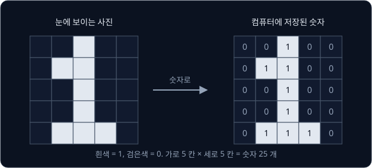

위 그림의 왼쪽은 사람이 보는 모습이고 오른쪽은 컴퓨터에 저장된 숫자다. 사람 눈에는 숫자 "1" 처럼 보이지만, 컴퓨터에게 이 사진은
숫자 25 개를 가로 5 개, 세로 5 개로 늘어놓은 격자일 뿐이다. 이 강의는 이 5×5 사진을 처음부터 끝까지 예시로 쓴다.

칸의 자리는 (위에서 몇 번째 줄, 왼쪽에서 몇 번째 칸) 으로 적고, 둘 다 0 부터 센다. 맨 왼쪽 위 칸이 $(0, 0)$, 그 오른쪽 칸이
$(0, 1)$ 이다. 이 사진에서 $(0, 2)$ 는 1(흰색)이고 $(0, 0)$ 은 0(검정)이다.

손으로 쓴 숫자 0~9 를 28×28 흑백 사진으로 모은 MNIST 라는 데이터가 있다. 선수 강의 [PyTorch Training Loop](../pytorch-mlp/README.md)
에서 숫자를 알아맞힌 바로 그 데이터이고, 사진 한 장이 숫자 $28 \times 28 = 784$ 개다.

**확인 문제.** 위 5×5 사진에서 $(4, 1)$ 과 $(2, 3)$ 의 값은? 그리고 흰 칸(1)은 모두 몇 개인가?

답 보기

$(4, 1)$ 은 맨 아래 줄의 왼쪽에서 두 번째 칸이라 1, $(2, 3)$ 은 가운데 줄의 오른쪽에서 두 번째 칸이라 0 이다. 흰 칸은 줄마다
1, 2, 1, 1, 3 개라 모두 8 개다.

### 컬러 사진의 channel

컬러 사진은 pixel 마다 숫자가 세 개다. 화면은 빨강(Red)·초록(Green)·파랑(Blue) 빛을 섞어 모든 색을 만드는데, pixel 마다 이 세
빛의 세기를 각각 0~255 로 적어 두기 때문이다. 세 색의 첫 글자를 따서 RGB 라고 부른다. 빨강은 $(255, 0, 0)$, 노랑은 빨강과 초록을
섞은 $(255, 255, 0)$, 흰색은 세 빛을 모두 가장 세게 켠 $(255, 255, 255)$ 다.

같은 색의 숫자만 모으면 사진과 크기가 같은 숫자 판이 한 장 나온다. 그래서 컬러 사진은 "빨강 세기 판", "초록 세기 판", "파랑
세기 판" 세 장을 겹쳐 놓은 것으로 볼 수 있고, 이 판 한 장 한 장을 channel 이라고 한다. 흑백 사진은 channel 이 1 장, 컬러 사진은
3 장이다.

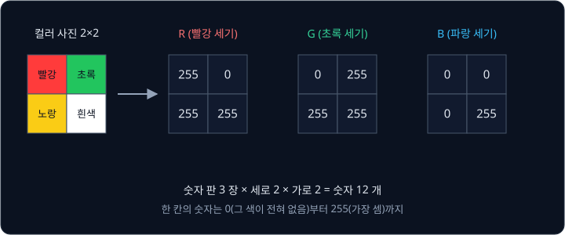

위 그림은 2×2 컬러 사진을 channel 세 장으로 나눈 것이다. 왼쪽 위 pixel 은 빨강이라 R 판에만 255 가 있고, 오른쪽 아래 pixel 은
흰색이라 세 판 모두 255 다. 사진 하나에 든 숫자는 $3 \times 2 \times 2 = 12$ 개다.

이 강의에서는 숫자 판 묶음의 크기를 "장 수 × 세로 × 가로" 순서로 적는다. 위 사진은 $3 \times 2 \times 2$, 5×5 흑백 사진은
$1 \times 5 \times 5$, MNIST 사진은 $1 \times 28 \times 28$ 이다.

로봇 카메라 사진은 훨씬 커서, 사진을 다루는 모델에 흔히 넣는 224×224 컬러 사진만 해도 숫자가

$$
3 \times 224 \times 224 = 3 \times 50{,}176 = 150{,}528
$$

개다. 휴대폰 사진(가로세로 수천 pixel)보다 훨씬 작게 줄인 사진인데도 숫자가 15만 개를 넘는다.

**확인 문제.** 가로 32, 세로 32 인 컬러 사진에는 숫자가 몇 개 있을까?

답 보기

channel 3 장 × 세로 32 × 가로 32 이므로 $3 \times 32 \times 32 = 3 \times 1{,}024 = 3{,}072$ 개다.

**요약**

- 사진은 pixel 마다 밝기 숫자를 적은 격자다. 흑백은 pixel 하나에 숫자 하나, 컬러는 R·G·B 세 개다
- 같은 색의 숫자만 모은 판 한 장이 channel 이고, 컬러 사진은 channel 3 장이다
- 224×224 컬러 사진 한 장은 숫자 150,528 개다

## 사진을 MLP 에 넣을 때의 문제

### MLP 와 펼친 입력

neural network 는 neuron(뉴런)이라는 작은 계산 단위를 여러 층으로 이어 만든 모델로, 선수 강의 [Backpropagation](../autograd/README.md)
과 [PyTorch Training Loop](../pytorch-mlp/README.md) 에서 다뤘다. neuron 하나는 입력마다 weight 를 곱해 모두 더하고 bias 를 더한 값 $z$ 를 계산한다. weight 는
입력마다 곱하는 숫자이고, bias 는 마지막에 더하는 숫자다. 입력이 $x_1 = 2$, $x_2 = 3$ 이고 weight 가 $w_1 = 1$, $w_2 = -1$,
bias 가 $b = 4$ 이면 $z = 1 \times 2 + (-1) \times 3 + 4 = 3$ 이다. 같은 입력을 받는 neuron 을 여러 개 나란히 둔 것이 layer(층)이고,
layer 를 여러 겹 쌓은 network 가 MLP(multi-layer perceptron)다. weight 와 bias 처럼 학습으로 정하는 숫자를 parameter 라고 한다.

MLP 의 입력은 숫자 한 줄이라서 사진을 넣으려면 격자를 한 줄로 펴야 한다. 첫째 줄 다섯 칸 뒤에 둘째 줄 다섯 칸을 붙이고,
그 뒤에 셋째 줄을 붙이는 식으로 이어 가면 5×5 사진이 숫자 25 개짜리 한 줄이 된다. 이렇게 펴는 일을 flatten 이라고 한다.

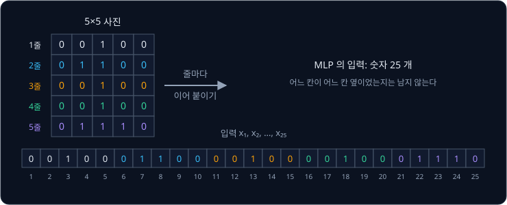

위 그림에서 색이 같은 숫자는 같은 줄에서 왔다. 펴고 나면 사진에서 위아래로 붙어 있던 $(0, 2)$ 와 $(1, 2)$ 가 한 줄의 3 번째와
8 번째 자리로 다섯 칸 떨어진다. MLP 는 25 개 입력을 모두 똑같이 "서로 다른 입력" 으로 다루기 때문에, 어느 칸이 어느 칸의
위아래·옆이었는지는 모델에 남지 않는다.

**확인 문제.** 5×5 사진을 위처럼 펼쳤을 때, 사진의 $(2, 0)$ 은 한 줄의 몇 번째 자리에 놓일까? (한 줄의 자리는 1 부터 센다)

답 보기

$(2, 0)$ 앞에는 0 번 줄 5 칸과 1 번 줄 5 칸이 먼저 놓이므로 $5 + 5 + 1 = 11$ 번째다. 그림에서 주황색이 시작하는 자리다.

### parameter 수

MLP 의 neuron 하나는 입력 하나마다 weight 를 하나씩 가지고, bias 를 하나 더 가진다. 5×5 사진이면 neuron 하나에 weight 25 개와
bias 1 개, 모두 26 개다.

사진이 커지면 이 수가 빠르게 불어난다.

| 사진 | 입력 숫자 수 | neuron 하나의 parameter | neuron 1,000 개 layer 의 parameter |
| --- | --- | --- | --- |
| 5×5 흑백 | 25 | 26 | 26,000 |
| 28×28 흑백 (MNIST) | 784 | 785 | 785,000 |
| 224×224 컬러 | 150,528 | 150,529 | 150,529,000 |

마지막 줄은 $150{,}528 \times 1{,}000 + 1{,}000 = 150{,}529{,}000$ 으로, 첫 layer 하나에만 parameter 가 1억 5천만 개다. parameter 가
많으면 계산과 메모리가 그만큼 들고, 그 많은 숫자를 맞추려면 학습 데이터도 훨씬 많이 필요하다.

**확인 문제.** 64×64 컬러 사진을 펼쳐 neuron 10 개짜리 layer 에 넣으면 parameter 는 몇 개일까?

답 보기

입력은 $3 \times 64 \times 64 = 12{,}288$ 개다. neuron 하나에 weight 12,288 개와 bias 1 개라 12,289 개이고, 10 개면
$12{,}289 \times 10 = 122{,}890$ 개다.

### 위치 이동에 약한 weight

두 번째 문제는 위치다. neuron 하나가 "이 사진은 숫자 1 인가?" 를 판정한다고 하자. 5×5 사진의 흰 칸 8 곳에 weight 1 을 주고
나머지 17 칸에는 weight 0 을 준 뒤, bias 를 $-6$ 으로 두었다. 그러면 $z$ 는 "weight 1 인 칸 중 흰 칸의 개수 − 6" 이 되고,
[Perceptron](../perceptron/README.md) 처럼 $z$ 가 0 보다 크면 "1 이다" 로 판정한다.

이제 같은 "1" 을 오른쪽으로 한 칸만 옮긴 사진을 넣어 보는데, 사람 눈에는 똑같은 숫자 1 이다.

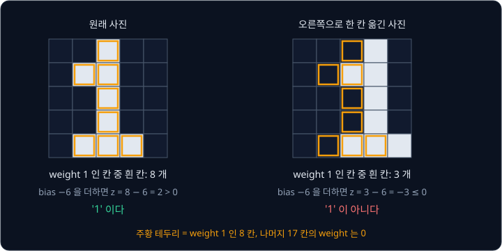

| 사진 | weight 1 인 칸 중 흰 칸 | $z$ | 판정 |
| --- | --- | --- | --- |
| 원래 자리 | 8 | $8 - 6 = 2$ | 1 이다 |
| 오른쪽으로 한 칸 | 3 | $3 - 6 = -3$ | 1 이 아니다 |

옮긴 사진에서 weight 1 인 칸과 겹치는 흰 칸은 $(1, 2)$, $(4, 2)$, $(4, 3)$ 세 곳뿐이다. 한 줄로 편 25 개 입력 중 10 개의 값이
바뀌었으니, MLP 가 보기에는 전혀 다른 입력이다.

MLP 의 weight 는 "몇 번째 입력" 마다 따로 있어서, 왼쪽 위에서 배운 모양을 오른쪽 아래에서 알아보려면 그 자리의 weight 로 다시
배워야 한다. 사진 속 물체는 어디에나 나타날 수 있으니, 같은 모양을 자리마다 따로 배우는 것은 데이터와 parameter 를 모두 낭비한다.

**흔한 오해.** "사람 눈에 같은 사진이면 모델도 비슷하게 본다" 고 생각하기 쉽다. MLP 는 자리마다 다른 weight 를 쓰기 때문에, 한
칸 옮긴 사진은 입력의 40%(25 개 중 10 개)가 바뀐 다른 사진이다.

**확인 문제.** 위 neuron 에 흰 칸이 하나도 없는 새까만 5×5 사진을 넣으면 $z$ 는 얼마이고, 판정은 무엇일까?

답 보기

모든 입력이 0 이라 곱해 더한 값은 0 이고, $z = 0 - 6 = -6$ 이다. 0 보다 작으므로 "1 이 아니다" 다.

**요약**

- 사진을 MLP 에 넣으려면 한 줄로 펴야(flatten) 하고, 펴면 어느 칸이 이웃이었는지가 모델에 남지 않는다
- 224×224 컬러 사진을 neuron 1,000 개 layer 에 넣으면 parameter 가 1억 5천만 개다
- MLP 는 자리마다 weight 가 따로라서, 한 칸 옮긴 "1" 에서 곱해 더한 값이 8 에서 3 으로 떨어진다

## convolution

Yann LeCun 등은 위 두 문제를 convolution 이라는 계산으로 풀었고, 1998년에 발표한 LeNet-5 가 그 대표 모델이다. 사진 전체에 weight 를 하나씩 두지 않고 3×3 처럼 작은
숫자 판 하나만 두고, 그 판을 사진 위에서 한 칸씩 옮기며 같은 계산을 되풀이한다. convolution 을 쌓아 만든 neural network 를
CNN(Convolutional Neural Network)이라고 부른다.

### filter 와 window

convolution 에 쓰는 작은 숫자 판을 filter 라고 하고, kernel 이라고도 부른다. 이 강의의 첫 filter 는 3×3 이다.

$$
K = \begin{bmatrix} -1 & 2 & -1 \\ -1 & 2 & -1 \\ -1 & 2 & -1 \end{bmatrix}
$$

$K$ 는 filter 를 가리키는 이름이고, 대괄호 안은 세 줄 세 칸의 숫자 판이다. 줄마다 가운데가 2, 양옆이 $-1$ 이다.

filter 를 사진 위에 겹쳐 놓으면 filter 와 같은 크기의 사진 조각이 filter 밑에 깔린다. 이 3×3 조각을 window 라고 하며, filter 는 한
번에 window 안의 9 칸만 본다. 창문 너머로 바깥의 일부만 보이는 것과 같다.

### 첫 칸의 손 계산

filter 를 사진의 왼쪽 위에 겹치면 window 는 사진의 0~2 번 줄, 0~2 번 칸이다.

$$
\text{window} = \begin{bmatrix} 0 & 0 & 1 \\ 0 & 1 & 1 \\ 0 & 0 & 1 \end{bmatrix}
$$

window 와 filter 에서 같은 자리에 있는 숫자끼리 곱한다. 9 자리를 하나씩 적으면 아래와 같다.

| 자리 | window 값 | filter 값 | 곱 |
| --- | --- | --- | --- |
| $(0, 0)$ | 0 | $-1$ | 0 |
| $(0, 1)$ | 0 | 2 | 0 |
| $(0, 2)$ | 1 | $-1$ | $-1$ |
| $(1, 0)$ | 0 | $-1$ | 0 |
| $(1, 1)$ | 1 | 2 | 2 |
| $(1, 2)$ | 1 | $-1$ | $-1$ |
| $(2, 0)$ | 0 | $-1$ | 0 |
| $(2, 1)$ | 0 | 2 | 0 |
| $(2, 2)$ | 1 | $-1$ | $-1$ |

곱 9 개를 모두 더하면 $0 + 0 - 1 + 0 + 2 - 1 + 0 + 0 - 1 = -1$ 이다. 이 $-1$ 이 출력의 왼쪽 위 칸 $(0, 0)$ 에 들어간다.

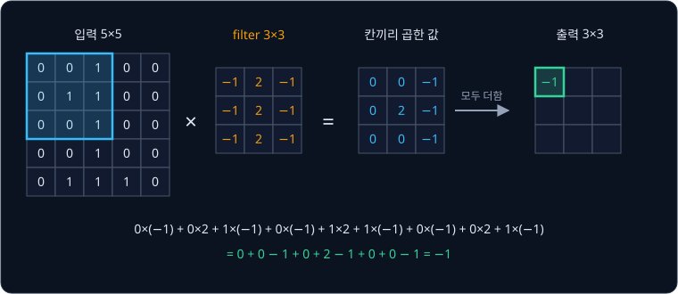

위 그림은 같은 계산을 한 장에 담은 것이다. 파란 테두리가 window, 주황 숫자가 filter, 가운데 판이 칸끼리 곱한 값이고, 그 9 개를
더한 값이 초록 칸에 들어간다. 계산은 [Perceptron](../perceptron/README.md) 의 "입력마다 weight 를 곱해 더하기" 와 똑같고, filter 의
숫자 9 개가 weight 역할을 한다.

**확인 문제.** window 가 $\begin{bmatrix} 0 & 1 & 0 \\ 0 & 1 & 0 \\ 0 & 1 & 0 \end{bmatrix}$ 처럼 가운데 세로줄만 흰색이면 위
filter 와 곱해 더한 값은? window 9 칸이 모두 1 이면?

답 보기

가운데 세로줄 window 는 1 이 filter 의 2 와만 겹치므로 $2 + 2 + 2 = 6$ 이다. 모두 1 이면 9 칸 filter 값을 다 더한 값이라
줄마다 $-1 + 2 - 1 = 0$ 이고 합도 0 이다.

### filter 를 옮기며 채운 출력

다음에는 filter 를 오른쪽으로 한 칸 옮기는데, 그러면 window 는 0~2 번 줄, 1~3 번 칸이 된다.

$$
\text{window} = \begin{bmatrix} 0 & 1 & 0 \\ 1 & 1 & 0 \\ 0 & 1 & 0 \end{bmatrix}
$$

이 filter 는 줄마다 "왼쪽 × $(-1)$ + 가운데 × 2 + 오른쪽 × $(-1)$" 이므로 줄 단위로 계산하면 빠르다. 첫째 줄 $[0, 1, 0]$ 은
$0 + 2 + 0 = 2$, 둘째 줄 $[1, 1, 0]$ 은 $-1 + 2 + 0 = 1$, 셋째 줄 $[0, 1, 0]$ 은 2 라서 합은 $2 + 1 + 2 = 5$ 다. 한 칸 더 옮기면
window 는 줄마다 $[1, 0, 0]$ 이라 줄마다 $-1$, 합은 $-3$ 이다.

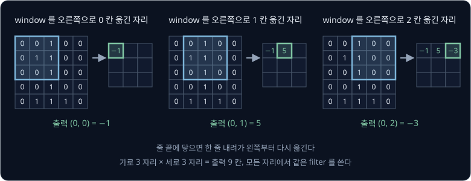

오른쪽 끝에 닿으면 한 줄 내려가 다시 왼쪽부터 옮긴다. filter 의 왼쪽 위 모서리가 놓일 수 있는 자리는 가로 0·1·2, 세로 0·1·2 로
모두 9 곳이라 출력은 3×3 이다. 9 자리를 모두 줄 단위로 계산하면 아래와 같다.

| 출력 자리 | window 의 세 줄 | 줄마다 $-l + 2m - r$ | 합 |
| --- | --- | --- | --- |
| $(0, 0)$ | $[0,0,1]$, $[0,1,1]$, $[0,0,1]$ | $-1$, $1$, $-1$ | $-1$ |
| $(0, 1)$ | $[0,1,0]$, $[1,1,0]$, $[0,1,0]$ | $2$, $1$, $2$ | $5$ |
| $(0, 2)$ | $[1,0,0]$, $[1,0,0]$, $[1,0,0]$ | $-1$, $-1$, $-1$ | $-3$ |
| $(1, 0)$ | $[0,1,1]$, $[0,0,1]$, $[0,0,1]$ | $1$, $-1$, $-1$ | $-1$ |
| $(1, 1)$ | $[1,1,0]$, $[0,1,0]$, $[0,1,0]$ | $1$, $2$, $2$ | $5$ |
| $(1, 2)$ | $[1,0,0]$, $[1,0,0]$, $[1,0,0]$ | $-1$, $-1$, $-1$ | $-3$ |
| $(2, 0)$ | $[0,0,1]$, $[0,0,1]$, $[0,1,1]$ | $-1$, $-1$, $1$ | $-1$ |
| $(2, 1)$ | $[0,1,0]$, $[0,1,0]$, $[1,1,1]$ | $2$, $2$, $0$ | $4$ |
| $(2, 2)$ | $[1,0,0]$, $[1,0,0]$, $[1,1,0]$ | $-1$, $-1$, $1$ | $-1$ |

표에서 $l, m, r$ 는 window 한 줄의 왼쪽·가운데·오른쪽 값이다. 결과를 3×3 으로 늘어놓으면

$$
\begin{bmatrix} -1 & 5 & -3 \\ -1 & 5 & -3 \\ -1 & 4 & -1 \end{bmatrix}
$$

이다. 가운데 세로 줄에 5, 5, 4 가 모였는데, 사진의 "1" 이 세로로 서 있는 자리다. 앞의 확인 문제에서 본 대로 window 가 가운데
세로선과 똑같으면 6 이 나오는데, $(0, 1)$ 과 $(1, 1)$ 은 "1" 의 왼쪽으로 삐친 칸 하나 때문에 1 이 깎여 5 가 됐고, $(2, 1)$ 은 맨 아래 가로획 $[1, 1, 1]$ 줄이
0 을 내서 4 가 됐다. 반대로 흰
세로선이 window 의 왼쪽이나 오른쪽 가장자리에 걸리면 $-1$ 과 곱해져 값이 음수가 된다.

**확인 문제.** 같은 filter 를 아래 3×4 사진에 대면 출력은 몇 칸이고, 각 칸의 값은?

$$
\begin{bmatrix} 0 & 0 & 1 & 0 \\ 0 & 0 & 1 & 0 \\ 0 & 0 & 1 & 0 \end{bmatrix}
$$

답 보기

filter 가 놓일 수 있는 자리는 세로 1 곳, 가로 2 곳이라 출력은 1×2 다. 왼쪽 자리의 window 는 줄마다 $[0, 0, 1]$ 이라 줄마다
$-1$, 합은 $-3$ 이다. 오른쪽 자리는 줄마다 $[0, 1, 0]$ 이라 줄마다 2, 합은 6 이다. 흰 세로선이 window 한가운데 오는 자리에서
가장 큰 값이 나온다.

### 가로선 filter 의 계산

같은 사진에 숫자만 바꾼 filter 를 대 본다.

$$
K_{\text{가로}} = \begin{bmatrix} -1 & -1 & -1 \\ 2 & 2 & 2 \\ -1 & -1 & -1 \end{bmatrix}
$$

이번에는 가운데 줄이 2, 위아래 줄이 $-1$ 이다. window 의 윗줄 합을 $A$, 가운데 줄 합을 $B$, 아랫줄 합을 $C$ 라 하면 결과는
$-A + 2B - C$ 이다. 왼쪽 위 window 는 줄마다 합이 $1, 2, 1$ 이라 $-1 + 4 - 1 = 2$ 다. 맨 아래 가운데 window 는 줄 합이
$1, 1, 3$ 이라 $-1 + 2 - 3 = -2$ 다. 9 자리를 모두 계산하면

$$
\begin{bmatrix} 2 & 2 & 0 \\ -1 & -1 & 0 \\ -1 & -2 & -1 \end{bmatrix}
$$

이다. 가로선 filter 는 가운데 줄에 흰 칸이 많고 위아래 줄에 적은 window, 곧 가로로 놓인 선에서 큰 값을 낸다.

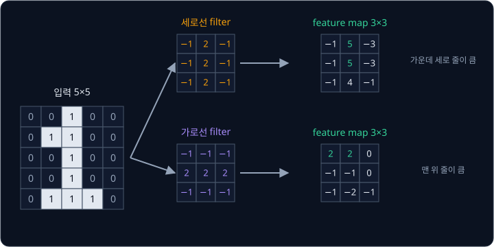

위 그림처럼 filter 가 달라지면 같은 사진에서 큰 값이 나오는 자리도 달라진다. filter 는 "이런 모양이 여기 있는가" 를 묻는 질문이고,
출력의 각 칸은 그 자리에서 나온 답이다. filter 모양과 window 가 닮을수록 값이 크다. 이렇게 filter 하나로 사진 전체를 훑어 얻은
숫자 판을 feature map 이라고 한다. feature 는 "특징" 이라는 뜻으로, feature map 은 "세로선이 어디에 얼마나 있는가" 같은 특징 하나를
자리별로 적은 지도다.

**확인 문제.** 가로선 filter 로 window $\begin{bmatrix} 0 & 0 & 0 \\ 1 & 1 & 1 \\ 0 & 0 & 0 \end{bmatrix}$ 을 계산하면?

답 보기

줄 합이 $A = 0$, $B = 3$, $C = 0$ 이라 $-0 + 2 \times 3 - 0 = 6$ 이다. 가운데에 가로선이 꽉 찬 window 라 이 filter 의 최댓값이 나온다.

### 학습으로 정해지는 filter 값

세로선 filter 와 가로선 filter 는 사람이 숫자를 골라 만든 것이다. CNN 에서는 filter 의 숫자를 사람이 정하지 않고, MLP 의 weight
처럼 parameter 로 두고 학습한다. 처음에는 아무 숫자로 시작하고, 모델이 정답에서 얼마나 틀렸는지를 숫자 하나로 나타낸 loss 를 줄이는 쪽으로 filter 숫자를
조금씩 고친다. [Linear Regression](../linear-regression/README.md) 에서 직선의 $w$, $b$ 를 고친 gradient descent 와 같은 방법이다.

손글씨 숫자로 학습을 마친 CNN 의 첫 층 filter 를 그려 보면 상당수가 특정 방향의 선이나 밝고 어두운 경계에 반응하는 모양이 된다.
숫자를 가려내는 데 세로선·가로선·사선 같은 정보가 쓸모 있기 때문에, 학습이 그런 filter 를 스스로 찾아낸다.

### convolution 의 수식

손 계산을 기호로 적는다. 입력 사진을 $x$, filter 를 $K$, 출력을 $y$ 라 하고, $x[i, j]$ 를 "$x$ 의 $i$ 번째 줄 $j$ 번째 칸 값" 으로
읽는다.

$$
y[i, j] = \sum_{u=0}^{2} \sum_{v=0}^{2} K[u, v] \times x[i + u,\; j + v] + b
$$

$\Sigma$ 는 sigma(시그마)라고 읽고 "아래 번호부터 위 번호까지 바꿔 가며 모두 더하라" 는 기호다.
[Linear Regression](../linear-regression/README.md) 에서 본 그 기호이고, 여기서는 두 번 겹쳐 있어서 $u$ 를 0·1·2, $v$ 를 0·1·2 로
바꿔 가며 9 가지 조합을 모두 더한다. 기호를 하나씩 읽으면 아래와 같다.

| 기호 | 뜻 | $y[0, 1] = 5$ 를 계산할 때 |
| --- | --- | --- |
| $i, j$ | 출력 칸의 줄·칸 번호 | $i = 0$, $j = 1$ |
| $u, v$ | filter 안의 줄·칸 번호 | 0·1·2 를 모두 돈다 |
| $K[u, v]$ | filter 의 $(u, v)$ 칸 숫자 | 예: $K[1, 1] = 2$ |
| $x[i + u, j + v]$ | 그 filter 칸 밑에 깔린 사진 값 | $u = 1, v = 1$ 이면 $x[1, 2] = 1$ |
| $b$ | bias. filter 하나에 하나씩 더하는 숫자 | 손 계산에서는 0 |

식 전체는 "filter 의 9 칸마다 그 밑에 깔린 사진 값과 곱하고, 모두 더한 뒤 bias 를 더해 출력 $(i, j)$ 에 적는다" 로 읽는다. bias 가
$-2$ 였다면 $y[0, 1]$ 은 $5 - 2 = 3$ 이 된다. 출력 자리 $(i, j)$ 를 하나 옮기면 $x[i + u, j + v]$ 의 자리도 함께 옮겨 가는데, 이것이
"filter 를 옮긴다" 를 식으로 적은 것이다.

수학 교과서의 convolution 은 filter 를 상하좌우로 뒤집어 곱한다. 딥러닝 도구가 계산하는 convolution 은 뒤집지 않고 그대로 곱하며,
수학에서는 이쪽을 cross-correlation 이라고 부른다. filter 숫자를 어차피 학습으로 정하기 때문에, 뒤집힌 filter 를 배우면 그만이라
결과에는 차이가 없다.

**확인 문제.** 수식으로 $y[2, 1]$ 을 계산할 때 $u = 2$, $v = 0$ 에 해당하는 사진 칸은 어디이고, 그 값과 filter 값의 곱은?

답 보기

사진 칸은 $x[2 + 2, 1 + 0] = x[4, 1]$ 이고 값은 1 이다. filter 값 $K[2, 0] = -1$ 과 곱하면 $-1$ 이다.

### weight sharing

출력 9 칸은 모두 같은 filter 숫자 9 개로 계산됐다. 자리마다 따로 weight 를 두지 않고 한 벌을 돌려 쓰는 것을 weight sharing
(weight 공유)이라고 한다.

같은 일을 MLP 로 하면 어떻게 되는지 비교한다. 5×5 사진을 받아 숫자 9 개를 내는 MLP layer 는 neuron 9 개가 각각 weight 25 개와
bias 1 개를 가지므로 $9 \times 26 = 234$ 개의 parameter 가 있다. convolution 은 filter 숫자 9 개와 bias 1 개, 모두 10 개다.

| 방식 | 출력 칸 하나가 보는 입력 | parameter 수 |
| --- | --- | --- |
| MLP layer (출력 9 개) | 25 칸 전부 | $9 \times (25 + 1) = 234$ |
| 3×3 convolution | 가까운 3×3 = 9 칸 | $9 + 1 = 10$ |

convolution 은 두 가지를 가정한다. 하나는 사진에서 의미 있는 모양은 가까운 pixel 끼리 만든다는 것이고(그래서 3×3 만 본다),
다른 하나는 세로선은 사진 어디에 있어도 세로선이라는 것이다(그래서 같은 filter 를 모든 자리에 쓴다). 사진에서는 두 가정이 대체로
맞아서, parameter 가 훨씬 적은데도 잘 작동한다. 사진이 커져도 filter 크기는 그대로라 parameter 수가 늘지 않는다.

**확인 문제.** 224×224 흑백 사진에 3×3 filter 하나로 convolution 을 하면 parameter 는 몇 개일까?

답 보기

filter 숫자 9 개와 bias 1 개로 10 개이고, 사진 크기와 상관없이 filter 크기만으로 정해진다.

### 위치 이동과 출력

MLP 에서 문제가 됐던 "오른쪽으로 한 칸 옮긴 1" 을 세로선 filter 로 계산해 본다.

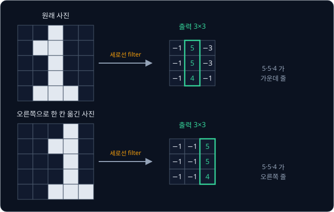

| 사진 | 세로선 filter 의 출력 |
| --- | --- |
| 원래 자리 | $\begin{bmatrix} -1 & 5 & -3 \\ -1 & 5 & -3 \\ -1 & 4 & -1 \end{bmatrix}$ |
| 오른쪽으로 한 칸 | $\begin{bmatrix} -1 & -1 & 5 \\ -1 & -1 & 5 \\ -1 & -1 & 4 \end{bmatrix}$ |

5, 5, 4 가 가운데 세로 줄에서 오른쪽 세로 줄로 옮겨 갔을 뿐 값은 그대로다. 같은 filter 가 모든 자리를 똑같이 계산하기 때문에,
모양이 옮겨 가면 그 모양에 대한 답도 같은 만큼 옮겨 간다. 입력을 옮기면 출력도 같은 만큼 옮겨 가는 이 성질을 translation
equivariance 라고 한다. translation 은 "평행 이동", equivariance 는 "함께 변함" 이라는 뜻이다. MLP 처럼 값이 8 에서 3 으로
떨어지지 않고, "세로선이 있다" 는 정보는 자리만 바뀐 채 그대로 남는다.

**확인 문제.** 원래 사진의 세로선 filter 출력에서 가장 큰 값 5 는 $(0, 1)$ 에 있었다. 사진을 오른쪽으로 한 칸 옮기면 그 5 는 어느
칸으로 갈까?

답 보기

같은 줄에서 오른쪽으로 한 칸 옮긴 $(0, 2)$ 다. 위 표의 둘째 출력에서 $(0, 2)$ 가 5 다.

**요약**

- convolution 은 작은 filter 를 사진 위에서 한 칸씩 옮기며, 겹친 window 와 칸끼리 곱해 모두 더한 값(+ bias)을 출력 칸에 적는다
- 세로선 filter 를 "1" 사진에 대면 세로획 자리에서 5·5·4 가 나온다. filter 하나가 만든 출력 판이 feature map 이다
- 모든 자리에 같은 filter 를 쓰므로(weight sharing) parameter 가 9 + 1 개뿐이고, 입력을 옮기면 출력도 같은 만큼 옮겨 간다

## 출력 크기의 조절

5×5 사진에 3×3 filter 를 대면 출력이 3×3 으로 줄었다. 출력 크기는 filter 를 몇 칸씩 옮기는지, 테두리를 어떻게 다루는지에 따라
달라진다.

### stride

지금까지는 filter 를 한 칸씩 옮겼다. 두 칸씩 건너뛰며 옮길 수도 있는데, 한 번에 옮기는 칸 수를 stride 라고 한다. stride 는
원래 "보폭" 이라는 뜻이다.

5×5 사진에 stride 2 로 3×3 filter 를 대면 filter 의 왼쪽 위 모서리는 가로 0·2, 세로 0·2 에만 놓인다. 네 자리의 값은 stride 1
출력 $\begin{bmatrix} -1 & 5 & -3 \\ -1 & 5 & -3 \\ -1 & 4 & -1 \end{bmatrix}$ 에서 $(0, 0)$, $(0, 2)$, $(2, 0)$, $(2, 2)$ 만 골라낸
것과 같아서

$$
\begin{bmatrix} -1 & -3 \\ -1 & -1 \end{bmatrix}
$$

이다. stride 를 2 로 하면 출력의 가로세로가 대략 반으로 줄어 계산이 빨라지지만, 이 예에서처럼 세로획 위의 5 를 건너뛰는
일도 생긴다.

### padding

stride 1 이어도 3×3 filter 는 사진 테두리 칸을 window 의 가운데에 두지 못한다. 예를 들어 $(0, 0)$ 칸은 filter 의 가운데에 오는
일이 한 번도 없어서, 출력이 입력보다 가로세로 2 칸씩 작아진다. 층을 지날 때마다 이렇게 줄면 몇 층 만에 사진이 사라진다.

그래서 사진 테두리에 0 을 한 줄씩 덧대고 계산하는데, 이것을 padding 이라고 한다. 덧대는 줄 수가 1 이면 5×5 사진이 7×7 이 되고,
3×3 filter 를 대면 출력은 다시 5×5 다. 왼쪽 위 window 는

$$
\begin{bmatrix} 0 & 0 & 0 \\ 0 & 0 & 0 \\ 0 & 0 & 1 \end{bmatrix}
$$

이라 줄마다 $0, 0, -1$ 이고 합은 $-1$ 이다.

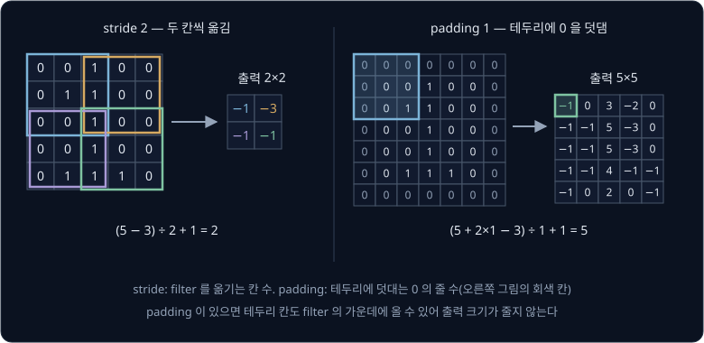

위 그림의 왼쪽은 stride 2 의 네 window 를 서로 다른 색으로, 오른쪽은 padding 으로 덧댄 0 을 회색으로 그렸다. padding 1 일 때의
5×5 출력 가운데 3×3 은 padding 없이 계산한 출력과 같다. 덧댄 0 이 닿지 않는 자리이기 때문이다.

### 출력 크기 공식

사진의 세로 길이를 $H$, filter 크기를 $k$, padding 을 $p$, stride 를 $s$ 라고 하면 출력의 세로 길이는

$$
H_{\text{out}} = \left\lfloor \frac{H + 2p - k}{s} \right\rfloor + 1
$$

이다. 이 식은 "양쪽에 padding 을 더한 길이 $H + 2p$ 에서 filter 크기 $k$ 를 빼고, stride $s$ 로 나눠 소수점 아래를 버린 뒤 1 을
더한다" 로 읽는다. $\lfloor \cdot \rfloor$ 은 floor(내림) 기호로, 안의 값보다 크지 않은 가장 큰 정수를 뜻한다.
$\lfloor 2.5 \rfloor = 2$, $\lfloor 3 \rfloor = 3$ 이다.

filter 의 왼쪽 위 모서리는 0 번 칸부터 $H + 2p - k$ 번 칸까지 놓일 수 있다. 그 사이를 $s$ 칸씩 건너뛰면
놓이는 자리가 "건너뛴 횟수 + 처음 자리 1 곳" 만큼 생긴다. 가로 길이도 같은 식으로 계산한다.

| $H$ | $k$ | $p$ | $s$ | 계산 | $H_{\text{out}}$ |
| --- | --- | --- | --- | --- | --- |
| 5 | 3 | 0 | 1 | $\lfloor (5 + 0 - 3) / 1 \rfloor + 1 = 2 + 1$ | 3 |
| 5 | 3 | 0 | 2 | $\lfloor (5 + 0 - 3) / 2 \rfloor + 1 = 1 + 1$ | 2 |
| 5 | 3 | 1 | 1 | $\lfloor (5 + 2 - 3) / 1 \rfloor + 1 = 4 + 1$ | 5 |
| 6 | 3 | 0 | 2 | $\lfloor (6 + 0 - 3) / 2 \rfloor + 1 = \lfloor 1.5 \rfloor + 1 = 1 + 1$ | 2 |
| 28 | 5 | 2 | 1 | $\lfloor (28 + 4 - 5) / 1 \rfloor + 1 = 27 + 1$ | 28 |
| 224 | 7 | 3 | 2 | $\lfloor (224 + 6 - 7) / 2 \rfloor + 1 = \lfloor 111.5 \rfloor + 1 = 111 + 1$ | 112 |

위 세 줄은 손으로 계산한 예와 같은 값이고, 넷째 줄은 나눗셈이 나누어떨어지지 않는 경우다. 6 칸짜리 줄에서 filter 의 모서리는
0 과 2 에 놓이고, 다음 자리 4 에서는 filter 가 4·5·6 번 칸을 덮어야 하는데 6 번 칸이 없어서 놓이지 못한다. 마지막 줄은 뒤의
[ResNet](../resnet/README.md) 첫 층의 설정으로, 224×224 사진이 112×112 가 된다.

**흔한 오해.** padding 을 하면 사진에 없던 정보가 생긴다고 생각하기 쉽다. 덧대는 값은 모두 0 이라 곱해도 0 이고, 하는 일은
테두리 칸도 filter 가운데에 올 수 있게 자리를 만들어 출력 크기를 지키는 것뿐이다.

**확인 문제.**

1. 32×32 사진에 5×5 filter 를 padding 0, stride 1 로 대면 출력 크기는?
2. 같은 사진에 3×3 filter 를 padding 1, stride 2 로 대면?

답 보기

1. $\lfloor (32 + 0 - 5) / 1 \rfloor + 1 = 27 + 1 = 28$ 이라 28×28 이다.
2. $\lfloor (32 + 2 - 3) / 2 \rfloor + 1 = \lfloor 15.5 \rfloor + 1 = 15 + 1 = 16$ 이라 16×16 이다.

**요약**

- stride 는 filter 를 옮기는 칸 수, padding 은 테두리에 덧대는 0 의 줄 수다
- 출력 길이는 $\lfloor (H + 2p - k) / s \rfloor + 1$ 이다. 5×5 사진, 3×3 filter 이면 stride 1 에서 3, stride 2 에서 2, padding 1 에서 5 다

## 여러 channel 의 convolution

지금까지는 channel 이 한 장인 흑백 사진만 다뤘다. 컬러 사진은 channel 이 3 장이고, 앞에서 본 것처럼 filter 를 여러 개 쓰면 출력도
feature map 여러 장이 된다.

### 입력 channel 이 여러 장일 때

입력이 여러 장이면 filter 도 입력과 같은 장 수로 만든다. 컬러 사진에 3×3 filter 를 쓰면 filter 는 3×3 판 3 장, 숫자 27 개다.
계산은 장마다 겹친 window 와 칸끼리 곱해 더한 뒤, 장마다 나온 값을 모두 더하고 bias 를 한 번 더한다.

곱셈 수를 줄이려고 channel 2 장짜리 3×3 입력과 2×2 filter 로 계산해 본다.

$$
x_0 = \begin{bmatrix} 1 & 0 & 2 \\ 0 & 1 & 0 \\ 1 & 2 & 1 \end{bmatrix},\quad
x_1 = \begin{bmatrix} 0 & 1 & 1 \\ 1 & 0 & 0 \\ 2 & 1 & 0 \end{bmatrix},\quad
K_0 = \begin{bmatrix} 1 & 0 \\ 0 & 1 \end{bmatrix},\quad
K_1 = \begin{bmatrix} 0 & 1 \\ 1 & 0 \end{bmatrix},\quad b = 1
$$

$x_0$, $x_1$ 은 입력의 0 번·1 번 channel 이고, $K_0$, $K_1$ 은 filter 의 0 번·1 번 장이다. 출력의 왼쪽 위 칸을 계산한다.

| 단계 | 계산 | 값 |
| --- | --- | --- |
| 0 번 channel | window $\begin{bmatrix} 1 & 0 \\ 0 & 1 \end{bmatrix}$ 와 $K_0$: $1 \times 1 + 0 \times 0 + 0 \times 0 + 1 \times 1$ | 2 |
| 1 번 channel | window $\begin{bmatrix} 0 & 1 \\ 1 & 0 \end{bmatrix}$ 와 $K_1$: $0 \times 0 + 1 \times 1 + 1 \times 1 + 0 \times 0$ | 2 |
| 합치기 | $2 + 2 + b = 2 + 2 + 1$ | 5 |

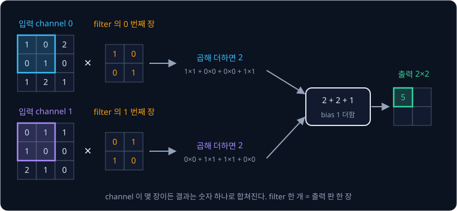

오른쪽으로 한 칸 옮긴 자리도 같은 방법이다. 0 번 channel 의 window $\begin{bmatrix} 0 & 2 \\ 1 & 0 \end{bmatrix}$ 은 $K_0$ 과 곱해
더하면 $0 + 0 + 0 + 0 = 0$, 1 번 channel 의 window $\begin{bmatrix} 1 & 1 \\ 0 & 0 \end{bmatrix}$ 은 $K_1$ 과 곱해 더하면
$0 + 1 + 0 + 0 = 1$ 이고, 합치면 $0 + 1 + 1 = 2$ 다. 네 자리를 모두 계산한 출력은
$\begin{bmatrix} 5 & 2 \\ 5 & 4 \end{bmatrix}$ 다.

입력이 몇 장이든 filter 하나는 출력 판 한 장을 만든다. channel 마다 따로 계산한 값을 마지막에 하나로 더하기 때문이다. 컬러
사진이라면 "빨강 판의 이 모양 + 초록 판의 이 모양 + 파랑 판의 이 모양" 을 한꺼번에 보는 filter 가 되어, 특정 색의 경계 같은 것에
반응하도록 학습될 수 있다.

**확인 문제.** 위 예에서 출력의 왼쪽 아래 칸 $(1, 0)$ 을 계산해 보자.

답 보기

0 번 channel 의 window 는 $\begin{bmatrix} 0 & 1 \\ 1 & 2 \end{bmatrix}$ 라 $K_0$ 과 곱해 더하면 $0 + 0 + 0 + 2 = 2$ 다. 1 번
channel 의 window 는 $\begin{bmatrix} 1 & 0 \\ 2 & 1 \end{bmatrix}$ 라 $K_1$ 과 곱해 더하면 $0 + 0 + 2 + 0 = 2$ 다. 합치면
$2 + 2 + 1 = 5$ 다.

### 여러 filter 와 출력 channel

세로선 filter 와 가로선 filter 를 한 사진에 함께 쓰면 feature map 이 2 장 나온다. filter 를 6 개 쓰면 6 장이다. convolution 을 하는
층을 convolution layer, 줄여서 conv layer 라고 하는데, 이 feature map 들을 겹쳐 놓은 묶음이 conv layer 의 출력이고 출력의 장 하나하나도
channel 이라고 부른다. 출력 channel 수는 filter 수와
같다.

그래서 convolution layer 하나는 "입력 channel 몇 장, 출력 channel 몇 장, filter 크기" 로 정해진다. 앞 층의 출력 channel 이 다음
층의 입력 channel 이 되므로, 둘째 층의 filter 는 첫 층이 만든 feature map 여러 장을 한꺼번에 보고 "세로선과 가로선이 이 자리에서
만난다" 같은 더 복잡한 모양을 찾는다.

### conv layer 의 parameter 수

filter 하나에는 숫자가 (입력 channel 수) × $k$ × $k$ 개 있고 bias 가 하나 붙는다. filter 가 출력 channel 수만큼 있으므로

$$
\text{parameter 수} = C_{\text{out}} \times (C_{\text{in}} \times k \times k + 1)
$$

이다. $C_{\text{in}}$ 은 입력 channel 수, $C_{\text{out}}$ 은 출력 channel 수(= filter 개수), $k$ 는 filter 크기다. 앞의 2 channel
예는 filter 가 하나라 $1 \times (2 \times 2 \times 2 + 1) = 9$ 개다.

| 층 | $C_{\text{in}}$ | $C_{\text{out}}$ | $k$ | 계산 | parameter |
| --- | --- | --- | --- | --- | --- |
| 흑백 사진, 세로선 filter 하나 | 1 | 1 | 3 | $1 \times (1 \times 9 + 1)$ | 10 |
| 컬러 사진, filter 64 개 | 3 | 64 | 3 | $64 \times (3 \times 9 + 1) = 64 \times 28$ | 1,792 |
| LeNet 첫 층 | 1 | 6 | 5 | $6 \times (1 \times 25 + 1) = 6 \times 26$ | 156 |
| LeNet 둘째 층 | 6 | 16 | 5 | $16 \times (6 \times 25 + 1) = 16 \times 151$ | 2,416 |

224×224 컬러 사진에 filter 64 개짜리 층을 써도 parameter 는 1,792 개다. 같은 사진을 펼쳐 neuron 64 개짜리 MLP layer 에 넣으면
$64 \times 150{,}529 = 9{,}633{,}856$ 개이니, 5 천 배 넘게 차이 난다.

**흔한 오해.** filter 크기 $k \times k$ 만 세고 입력 channel 수를 곱하는 것을 빠뜨리기 쉽다. 컬러 사진의 3×3 filter 는 숫자 9 개가
아니라 $3 \times 9 = 27$ 개다.

**확인 문제.** 입력 channel 16 장에 3×3 filter 32 개를 쓰는 층의 parameter 는 몇 개일까?

답 보기

filter 하나는 $16 \times 3 \times 3 = 144$ 개에 bias 1 개를 더해 145 개다. 32 개면 $32 \times 145 = 4{,}640$ 개다.

**요약**

- 입력 channel 이 여러 장이면 filter 도 같은 장 수이고, 장마다 곱해 더한 값을 모두 더한 뒤 bias 를 더해 숫자 하나를 낸다
- filter 하나가 출력 판(channel) 한 장을 만들어서 출력 channel 수는 filter 수와 같다
- parameter 수는 $C_{\text{out}} \times (C_{\text{in}} k^2 + 1)$ 이다

## pooling

stride 1 convolution 에 padding 을 알맞게 주면 크기가 그대로 유지되는데, 사진 전체를 요약하려면 어딘가에서 크기를 줄여야 한다.
줄이는 방법 중 하나가 pooling 으로, 이웃한 칸 몇 개를 숫자 하나로 합친다. pool 은 "모으다" 라는 뜻이다.

### max pooling

가장 흔한 pooling 은 max pooling 이다. feature map 을 겹치지 않는 2×2 묶음으로 나누고, 묶음마다 가장 큰 값 하나만 남긴다.

$$
F = \begin{bmatrix} 1 & 3 & 0 & 2 \\ 2 & 0 & 1 & 1 \\ 0 & 1 & 4 & 0 \\ 2 & 2 & 0 & 1 \end{bmatrix}
$$

| 묶음 | 네 값 | 가장 큰 값 |
| --- | --- | --- |
| 왼쪽 위 | 1, 3, 2, 0 | 3 |
| 오른쪽 위 | 0, 2, 1, 1 | 2 |
| 왼쪽 아래 | 0, 1, 2, 2 | 2 |
| 오른쪽 아래 | 4, 0, 0, 1 | 4 |

결과는 $\begin{bmatrix} 3 & 2 \\ 2 & 4 \end{bmatrix}$ 이다.

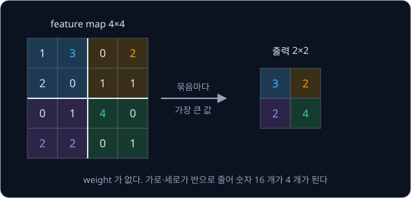

max pooling 에는 학습할 숫자가 없다. 하는 일은 "이 2×2 구역 어딘가에 그 특징이 있었는가" 만 남기고 정확한 자리는 버리는 것이다.
feature map 의 큰 값은 "여기에 세로선이 있다" 같은 뜻이므로, 구역에서 가장 강한 답 하나만 남겨도 중요한 정보는 대부분 남는다.
가로세로가 반으로 줄어 숫자는 4 분의 1 이 된다. 2×2 묶음을 겹치지 않게 옮기는 것은 $k = 2$, $s = 2$ 인 filter 와 같아서, 출력
크기도 앞의 공식으로 계산한다. 28×28 은 $\lfloor (28 - 2) / 2 \rfloor + 1 = 14$ 가 된다.

묶음의 평균을 남기는 average pooling 도 있다. 위 $F$ 의 왼쪽 위 묶음이라면 $(1 + 3 + 2 + 0) \div 4 = 1.5$ 를 남긴다.

**확인 문제.** $\begin{bmatrix} 5 & 1 & 0 & 0 \\ 2 & 3 & 0 & 7 \\ 1 & 1 & 2 & 2 \\ 0 & 6 & 2 & 2 \end{bmatrix}$ 에 2×2 max pooling 을
하면?

답 보기

왼쪽 위 $\{5, 1, 2, 3\}$ 에서 5, 오른쪽 위 $\{0, 0, 0, 7\}$ 에서 7, 왼쪽 아래 $\{1, 1, 0, 6\}$ 에서 6, 오른쪽 아래
$\{2, 2, 2, 2\}$ 에서 2 라서 $\begin{bmatrix} 5 & 7 \\ 6 & 2 \end{bmatrix}$ 다.

### pooling 과 작은 위치 이동

max pooling 은 작은 위치 차이를 지운다. 0 으로 가득 찬 4×4 feature map 에서 $(0, 1)$ 칸 하나만 5 라고 하자. max pooling 결과는
왼쪽 위 칸만 5 인 $\begin{bmatrix} 5 & 0 \\ 0 & 0 \end{bmatrix}$ 이다.

| 5 의 자리 | 속한 묶음 | max pooling 결과 |
| --- | --- | --- |
| $(0, 1)$ (원래) | 왼쪽 위 | $\begin{bmatrix} 5 & 0 \\ 0 & 0 \end{bmatrix}$ |
| $(0, 0)$ (왼쪽으로 한 칸) | 왼쪽 위 | $\begin{bmatrix} 5 & 0 \\ 0 & 0 \end{bmatrix}$ |
| $(1, 1)$ (아래로 한 칸) | 왼쪽 위 | $\begin{bmatrix} 5 & 0 \\ 0 & 0 \end{bmatrix}$ |
| $(0, 2)$ (오른쪽으로 한 칸) | 오른쪽 위 | $\begin{bmatrix} 0 & 5 \\ 0 & 0 \end{bmatrix}$ |

같은 묶음 안에서 움직이면 결과가 완전히 같다. 이렇게 입력을 옮겨도 출력이 아예 변하지 않는 성질을 translation invariance
(invariance 는 "변하지 않음")라고 한다. convolution 의 equivariance 는 "출력이 함께 옮겨 감" 이고, invariance 는 "출력이 그대로" 라는
차이가 있다.

마지막 줄처럼 묶음 경계를 넘으면 결과도 바뀌기 때문에 CNN 이 위치에 완전히 무관해지지는 않는다. 다만 pooling 을 여러 번 거치면
묶음 한 칸이 원래 사진에서 점점 넓은 구역을 대표하게 되어, 한두 pixel 정도의 이동에는 결과가 거의 흔들리지 않는다.

**요약**

- max pooling 은 겹치지 않는 2×2 묶음마다 가장 큰 값만 남겨 가로세로를 반으로 줄이고, 학습할 숫자가 없다
- 같은 묶음 안의 작은 이동은 결과를 바꾸지 않는다(translation invariance). 묶음 경계를 넘는 이동은 결과를 바꾼다

## 작은 CNN 의 손 계산

convolution 과 pooling 사이에 음수를 0 으로 바꾸는 계산 하나를 끼워 차례로 이으면 작은 CNN 이 된다. 5×5 "1" 사진 하나로 처음부터
끝까지 계산하고, 사진을 옮겼을 때 결과가 어떻게 되는지 MLP 와 비교한다.

### ReLU

convolution 층 뒤에는 보통 ReLU(Rectified Linear Unit)라는 계산이 붙는다. 들어온 값이 음수면 0 으로 바꾸고, 0 이상이면 그대로 둔다.

$$
\text{ReLU}(z) = \max(0, z)
$$

$\max(0, z)$ 는 "0 과 $z$ 중 큰 값" 이다. $\text{ReLU}(5) = 5$, $\text{ReLU}(-3) = 0$, $\text{ReLU}(0) = 0$ 이다. 세로선 filter 출력의 첫
줄 $[-1, 5, -3]$ 에 ReLU 를 적용하면 $[0, 5, 0]$ 이 되어, "세로선이 있다" 는 양수 답만 남는다.

층 사이에 ReLU 가 필요한 이유는 곱해 더하기만 여러 번 쌓으면 결국 곱해 더하기 한 번과 같아지기 때문이다. 입력에 2 를 곱하는 층
뒤에 3 을 곱하는 층을 이으면 입력에 6 을 곱하는 층 하나와 같은 식이 되지만, 사이에 ReLU 가 있으면 음수 입력에서는 0 이 나와서
하나로 합쳐지지 않는다. [Backpropagation](../autograd/README.md) 에서 neuron 마다 붙인 sigmoid 도 층 사이에서 이렇게 꺾이는 역할을
한다.

**확인 문제.** $[2, -4, 0, 7, -1]$ 에 ReLU 를 적용하면?

답 보기

음수인 $-4$ 와 $-1$ 만 0 이 되어 $[2, 0, 0, 7, 0]$ 이다.

### convolution 에서 pooling 까지

5×5 "1" 사진에 세 계산을 차례로 적용한다.

1. 세로선 filter 로 convolution 을 한다. padding 1, stride 1 이라 출력은 5×5 다
2. ReLU 로 음수를 모두 0 으로 바꾼다
3. 2×2 max pooling 을 한다. 출력 크기는 $\lfloor (5 - 2) / 2 \rfloor + 1 = 1 + 1 = 2$ 라 2×2 이고, 5×5 의 마지막 줄과 마지막 칸은
   어느 묶음에도 들지 않는다

| 단계 | 결과 |
| --- | --- |
| convolution (padding 1) | $\begin{bmatrix} -1 & 0 & 3 & -2 & 0 \\ -1 & -1 & 5 & -3 & 0 \\ -1 & -1 & 5 & -3 & 0 \\ -1 & -1 & 4 & -1 & -1 \\ -1 & 0 & 2 & 0 & -1 \end{bmatrix}$ |
| ReLU | $\begin{bmatrix} 0 & 0 & 3 & 0 & 0 \\ 0 & 0 & 5 & 0 & 0 \\ 0 & 0 & 5 & 0 & 0 \\ 0 & 0 & 4 & 0 & 0 \\ 0 & 0 & 2 & 0 & 0 \end{bmatrix}$ |
| 2×2 max pooling | $\begin{bmatrix} 0 & 5 \\ 0 & 5 \end{bmatrix}$ |

convolution 출력의 가운데 3×3 은 앞에서 padding 없이 계산한 $\begin{bmatrix} -1 & 5 & -3 \\ -1 & 5 & -3 \\ -1 & 4 & -1 \end{bmatrix}$
과 같다. ReLU 뒤에는 세로획이 지나가는 2 번 칸 줄에만 양수가 남는다. pooling 의 왼쪽 위 묶음은 0~1 번 줄, 0~1 번 칸이라 모두 0 이고,
오른쪽 위 묶음은 0~1 번 줄, 2~3 번 칸 $\{3, 0, 5, 0\}$ 이라 5 다. 아래 두 묶음도 같은 방법으로 0 과 5 다.

숫자 25 개였던 사진이 숫자 4 개로 줄었고, 그 4 개는 "오른쪽 절반 위아래에 세로선이 강하게 있다" 는 내용을 담고 있다.

### 옮긴 사진의 결과

같은 세 계산을 오른쪽으로 한 칸 옮긴 사진에 적용한다.

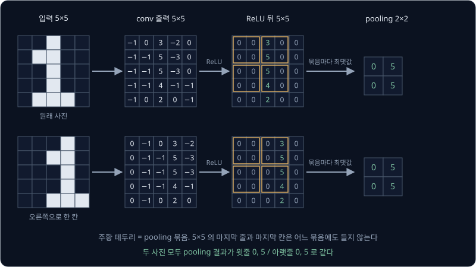

위 그림의 아래 줄을 보면, convolution 출력에서 3·5·5·4·2 줄이 2 번 칸에서 3 번 칸으로 한 칸 옮겨 갔다(translation equivariance).
그런데 2 번 칸과 3 번 칸은 같은 pooling 묶음에 속하므로, pooling 결과는 원래 사진과 똑같은 $\begin{bmatrix} 0 & 5 \\ 0 & 5 \end{bmatrix}$
이다.

| 입력 | MLP neuron 의 곱해 더한 값 | 작은 CNN 의 결과 |
| --- | --- | --- |
| 원래 사진 | 8 | $\begin{bmatrix} 0 & 5 \\ 0 & 5 \end{bmatrix}$ |
| 오른쪽으로 한 칸 | 3 | $\begin{bmatrix} 0 & 5 \\ 0 & 5 \end{bmatrix}$ |
| 왼쪽으로 한 칸 | 3 | $\begin{bmatrix} 5 & 0 \\ 5 & 0 \end{bmatrix}$ |

MLP 는 어느 쪽으로든 한 칸 옮기자 값이 8 에서 3 으로 떨어졌다. 왼쪽으로 옮긴 사진에서 weight 1 인 칸과 겹치는 흰 칸은 $(1, 1)$,
$(4, 1)$, $(4, 2)$ 세 곳이다. 작은 CNN 의 결과는 오른쪽으로 옮겼을 때 그대로다. 왼쪽으로 옮기면 세로획이 1 번 칸으로 가서 왼쪽
묶음에 들어가므로 결과도 바뀌지만, "위아래로 길게 세로선이 있다" 는 내용(5 와 5)은 그대로 남고 자리만 바뀐다.

**확인 문제.** 작은 CNN 에서 pooling 을 빼고 ReLU 뒤의 5×5 를 그대로 펼쳐 쓴다면, 원래 사진과 오른쪽으로 옮긴 사진에서 값이 다른
자리는 몇 곳일까?

답 보기

원래 사진은 2 번 칸 줄에 3, 5, 5, 4, 2 가 있고, 옮긴 사진은 3 번 칸 줄에 같은 값이 있다. 두 줄의 다섯 칸씩, 모두 10 곳의 값이
다르다. pooling 이 있어야 이 차이가 사라진다.

**요약**

- ReLU 는 $\max(0, z)$ 로 음수를 0 으로 바꾸고, 층 사이에 들어가 층을 쌓은 효과를 만든다
- convolution → ReLU → max pooling 을 거치면 5×5 "1" 사진이 숫자 4 개 $\begin{bmatrix} 0 & 5 \\ 0 & 5 \end{bmatrix}$ 로 줄어든다
- 오른쪽으로 한 칸 옮긴 사진에서 MLP 의 값은 8 에서 3 으로 떨어지지만, 작은 CNN 의 결과는 같은 묶음 안의 이동이라 그대로다

## LeNet

작은 CNN 뒤에 MLP 를 붙이면 사진을 보고 답을 내는 모델이 된다. 1998년 LeCun 등이 손글씨 숫자를 알아보려고 만든 LeNet-5 가 그
대표 예다. 아래에서는 오늘날 흔히 쓰는 형태로 조금 바꾼 LeNet 을 따라간다.

### 층별 크기

입력은 MNIST 사진 $1 \times 28 \times 28$ 이고, 출력은 숫자 0~9 각각에 대한 점수 10 개다.

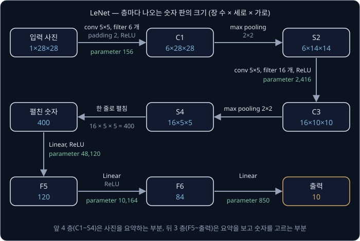

그림의 C 는 convolution, S 는 크기를 줄이는 subsampling(여기서는 max pooling), F 는 MLP 의 layer 를 뜻한다. MLP 의 layer 를
Linear layer 라고도 부르는데, 입력마다 weight 를 곱해 더하는 계산이 직선(linear)의 식과 같은 꼴이라 붙은 이름이다.

| 층 | 하는 일 | 크기 계산 | 출력 크기 |
| --- | --- | --- | --- |
| 입력 | MNIST 사진 | | $1 \times 28 \times 28$ |
| C1 | 5×5 filter 6 개, padding 2, ReLU | $\lfloor (28 + 4 - 5)/1 \rfloor + 1 = 28$ | $6 \times 28 \times 28$ |
| S2 | 2×2 max pooling | $\lfloor (28 - 2)/2 \rfloor + 1 = 14$ | $6 \times 14 \times 14$ |
| C3 | 5×5 filter 16 개, padding 0, ReLU | $\lfloor (14 - 5)/1 \rfloor + 1 = 10$ | $16 \times 10 \times 10$ |
| S4 | 2×2 max pooling | $\lfloor (10 - 2)/2 \rfloor + 1 = 5$ | $16 \times 5 \times 5$ |
| 펼치기 | 한 줄로 펴기 | $16 \times 5 \times 5$ | 400 |
| F5 | Linear 400 → 120, ReLU | | 120 |
| F6 | Linear 120 → 84, ReLU | | 84 |
| 출력 | Linear 84 → 10 | | 10 |

conv 층을 지날 때마다 장 수는 1 → 6 → 16 으로 늘고, pooling 을 지날 때마다 가로세로는 28 → 14 → 5 로 준다. 사진의 "어디에" 정보는
줄이고, "무엇이 있는가" 를 담는 feature 의 종류는 늘리는 구조다. C3 의 filter 는 $6 \times 5 \times 5$ 크기라 S2 의 feature map
6 장을 한꺼번에 본다.

1998년 원 논문의 LeNet-5 는 ReLU 대신 [Backpropagation](../autograd/README.md) 에서 본 tanh 와 비슷한 계산을, max pooling 대신 학습하는 계수가 붙은 subsampling 을 쓰고, C3 에서는
일부 channel 끼리만 잇는 연결표를 썼다. ReLU·max pooling·전체 연결로 바꿔도 크기 계산과 전체 흐름은 같고, 아래 parameter 수는 이
전체 연결 구성으로 센 값이다.

### parameter 수 비교

| 층 | 계산 | parameter |
| --- | --- | --- |
| C1 | $6 \times (1 \times 5 \times 5 + 1)$ | 156 |
| C3 | $16 \times (6 \times 5 \times 5 + 1)$ | 2,416 |
| F5 | $400 \times 120 + 120$ | 48,120 |
| F6 | $120 \times 84 + 84$ | 10,164 |
| 출력 | $84 \times 10 + 10$ | 850 |
| 합 | $156 + 2{,}416 + 48{,}120 + 10{,}164 + 850$ | 61,706 |

S2, S4 는 max pooling 이라 parameter 가 없다. Linear layer 의 parameter 는 "입력 수 × 출력 수 + 출력 수(bias)" 로 센다.

[PyTorch Training Loop](../pytorch-mlp/README.md) 에서 MNIST 를 푼 MLP(784 → 256 → 10)는 parameter 가
$784 \times 256 + 256 + 256 \times 10 + 10 = 203{,}530$ 개였다. LeNet 은 그 3 분의 1 도 안 되는 61,706 개다. 특히 사진을 직접 보는
첫 층은 MLP 가 $784 \times 256 + 256 = 200{,}960$ 개인데 LeNet 의 C1 은 156 개뿐이다. LeNet 의 parameter 는 대부분 뒤쪽 Linear
layer 에 있고, 그 Linear layer 들이 보는 것은 사진 784 개 pixel 이 아니라 conv 와 pooling 이 줄여 놓은 400 개 숫자다.

**확인 문제.** C3 의 filter 를 16 개가 아니라 8 개로 줄이면 C3 의 parameter 와 펼친 숫자의 개수는 각각 몇 개가 될까?

답 보기

C3 은 $8 \times (6 \times 25 + 1) = 8 \times 151 = 1{,}208$ 개다. S4 출력이 $8 \times 5 \times 5$ 라 펼친 숫자는 200 개가 된다.

### 출력 10 개

마지막 층은 숫자 10 개를 낸다. 0 번째 값은 "이 사진이 숫자 0 이다" 에 대한 점수, 1 번째 값은 "숫자 1 이다" 에 대한 점수이고,
가장 큰 값의 자리를 답으로 고른다. 출력이 $[0.2, 7.1, 1.3, \ldots]$ 처럼 1 번째 값이 가장 크면 답은 1 이다. 학습은
[PyTorch Training Loop](../pytorch-mlp/README.md) 의 MLP 와 똑같다. 정답 자리의 점수가 커지도록 정한 loss 를 줄이는 쪽으로, conv 의
filter 숫자까지 포함한 parameter 61,706 개를 gradient descent 로 함께 고친다.

**요약**

- LeNet 은 conv → pooling → conv → pooling 으로 $1 \times 28 \times 28$ 사진을 $16 \times 5 \times 5 = 400$ 개 숫자로 줄이고, Linear
  세 층으로 숫자 10 개 중 하나를 고른다
- parameter 는 61,706 개로 같은 문제를 푼 MLP(203,530 개)의 3 분의 1 이 안 되고, 대부분 뒤쪽 Linear layer 에 있다
- conv 층을 지날 때마다 장 수는 1 → 6 → 16 으로 늘고, pooling 을 지날 때마다 가로세로는 28 → 14 → 5 로 준다

## receptive field

LeNet 의 C1 filter 는 5×5 조각밖에 보지 못한다. 그런데 숫자 "8" 과 "0" 을 가르려면 위아래 고리가 둘인지 하나인지, 곧 사진의
넓은 영역을 함께 봐야 한다. CNN 은 작은 filter 를 층층이 쌓아 이 문제를 푼다.

### 한 층의 receptive field

출력 한 칸의 값을 계산할 때 쓰인 입력 영역을 그 칸의 receptive field 라고 한다. 원래는 신경과학 용어로, 눈의 신경세포 하나가
반응하는 시야의 범위를 가리키던 말이다. 3×3 convolution 의 출력 한 칸은 입력 3×3 을 보므로 receptive field 가 3×3 이다. 앞의 손
계산에서 출력 $(0, 1)$ 의 값 5 는 사진의 0~2 번 줄, 1~3 번 칸만으로 정해졌고, 사진의 맨 아래 줄이 바뀌어도 이 칸은 바뀌지 않는다.

### 층을 쌓을 때의 receptive field

5×5 사진에 3×3 convolution 을 한 번 하면 3×3 이 되고, 그 위에 3×3 convolution 을 한 번 더 하면 1×1 이 된다.

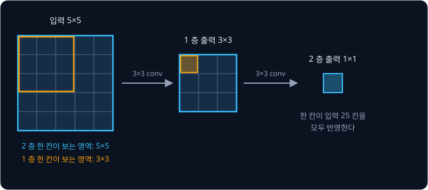

2 층의 한 칸은 1 층 출력 3×3 을 본다. 1 층 출력의 칸들은 각자 입력 3×3 을 보는데, 왼쪽 끝 칸은 입력 0~2 번 칸을, 오른쪽 끝
칸은 2~4 번 칸을 본다. 그래서 2 층의 한 칸은 입력 0~4 번, 곧 5×5 전체를 반영한다. 층이 하나 늘 때마다 receptive field 가 양쪽으로
1 칸씩, 모두 2 칸 넓어진다.

| 쌓은 3×3 conv 수 | receptive field |
| --- | --- |
| 1 | $3$ |
| 2 | $3 + 2 = 5$ |
| 3 | $5 + 2 = 7$ |
| 10 | $1 + 10 \times 2 = 21$ |

filter 크기가 $k$ 이고 stride 가 1 이면 층마다 $k - 1$ 씩 넓어져서, $L$ 층 뒤의 receptive field 는 $1 + L \times (k - 1)$ 이다.

### pooling 과 receptive field

pooling 을 섞으면 receptive field 가 훨씬 빨리 넓어진다. 2×2 pooling 뒤의 feature map 에서는 이웃한 두 칸이 원래 사진에서 2 pixel
떨어진 곳을 대표한다. 그래서 그 위에 놓인 5×5 filter 가 한 칸 넓게 볼 때마다 사진에서는 2 pixel 씩 넓어진다. 이 "이웃 칸 사이의
거리" 를 간격이라고 부르면, 층마다 아래 두 규칙으로 계산한다.

- 새 receptive field = 이전 receptive field + $(k - 1)$ × 이전 간격
- 새 간격 = 이전 간격 × stride

LeNet 에 적용하면 아래와 같다.

| 층 | $k$, stride | receptive field 계산 | receptive field | 간격 |
| --- | --- | --- | --- | --- |
| 입력 | | | 1 | 1 |
| C1 | 5, 1 | $1 + 4 \times 1$ | 5 | $1 \times 1 = 1$ |
| S2 | 2, 2 | $5 + 1 \times 1$ | 6 | $1 \times 2 = 2$ |
| C3 | 5, 1 | $6 + 4 \times 2$ | 14 | $2 \times 1 = 2$ |
| S4 | 2, 2 | $14 + 1 \times 2$ | 16 | $2 \times 2 = 4$ |

S4 의 한 칸은 28×28 사진 중 16×16, 사진 한 변의 절반을 넘는 영역을 본다. S4 의 25 칸이 저마다 사진의 넓은 영역을 요약하고 있어서,
그 400 개 숫자를 보는 F5 는 사진 전체에 대한 판단을 내릴 수 있다.

**확인 문제.** 5×5 filter, stride 1 인 conv 를 세 번 쌓으면 receptive field 는? 3×3 conv 를 세 번 쌓은 것과 비교하면?

답 보기

층마다 $5 - 1 = 4$ 씩 넓어지므로 $1 + 3 \times 4 = 13$ 이다. 3×3 을 세 번 쌓으면 $1 + 3 \times 2 = 7$ 이다.

### 깊은 층이 보는 패턴

receptive field 가 넓어지면 한 칸이 알아볼 수 있는 모양도 커진다. 첫 층의 filter 는 3×3 이나 5×5 안에 들어가는 짧은 선이나
경계밖에 찾지 못한다. 둘째 층은 첫 층의 feature map 들을 조합하므로 "세로선 위쪽 끝에 짧은 사선이 붙은 모양" 처럼 선 몇 개가
만나는 모서리나 꺾임을 찾을 수 있다. 더 깊은 층은 그런 조각을 다시 조합해 "위에 고리가 있고 아래로 획이 내려간 모양" 같은,
숫자 9 의 대부분을 덮는 큰 패턴에 반응할 수 있다.

층마다 새로 배우는 것은 바로 아래층 feature 의 조합뿐인데도, 층이 쌓이면 작은 선 → 모서리 → 부분 → 물체 순서로 큰 패턴이
만들어진다. 같은 질문을 처음부터 사진 전체 크기의 filter 로 하려면 parameter 가 크게 늘고 위치 이동에도 약해진다.

**흔한 오해.** filter 가 커야 큰 물체를 알아본다고 생각하기 쉽다. LeNet 의 filter 는 끝까지 5×5 지만, 층과 pooling 을 쌓으면서 S4 의
한 칸은 16×16 을 본다. 큰 패턴은 큰 filter 가 아니라 깊은 층에서 나온다.

**요약**

- 출력 한 칸이 반영하는 입력 영역이 receptive field 다. 3×3 conv 하나는 3, 둘이면 5, 셋이면 7 이다
- pooling 이 간격을 넓혀서 LeNet 의 S4 한 칸은 28×28 사진 중 16×16 을 본다
- 깊은 층은 아래층의 작은 feature 를 조합해 더 큰 패턴을 찾는다

## feature 와 로봇 policy

### 사진을 요약하는 feature

LeNet 을 다시 보면 크게 두 부분이다. 앞의 conv·pooling 층은 사진 784 개 pixel 을 400 개 숫자로 바꾸고, 뒤의 Linear 층은 그 400 개를
120, 84 개로 더 줄여 마지막에 답을 고른다. 400 개 숫자 하나하나는 "사진의 이 구역에 이런 모양이 얼마나 강하게 있는가" 를 담은
값이다. 이처럼 원래 데이터에서 판단에 필요한 내용만 뽑아 적은 숫자를 feature 라고 하고, feature 를 모은 한 줄을 feature vector
라고 한다. vector 는 숫자를 정해진 순서로 늘어놓은 묶음이다.

사진을 적은 수의 feature 로 줄이는 것이 CNN 의 역할이다. 사진의 pixel 값은 조명이 조금 밝아지거나 물체가 한 칸 옮겨 가기만 해도
많이 바뀌지만, 잘 학습된 feature 는 "숫자 1 의 세로획이 있다" 같은 내용을 담고 있어서 그런 변화에 덜 흔들린다.

| 모델 | 입력 숫자 | 마지막 feature | 줄어든 비율 |
| --- | --- | --- | --- |
| LeNet | $1 \times 28 \times 28 = 784$ | F6 출력 84 개 | 약 9 분의 1 |
| ResNet-18 | $3 \times 224 \times 224 = 150{,}528$ | 512 개 | 294 분의 1 |

ResNet-18 은 뒤의 [ResNet](../resnet/README.md) 에서 다루는, 층을 18 개 쌓은 CNN 이다. $150{,}528 \div 512 = 294$ 라서 사진을 294
분의 1 로 줄인 숫자 512 개로 요약한다.

**확인 문제.** 96×96 컬러 사진을 CNN 이 feature 256 개로 요약하면 숫자는 몇 분의 1 로 줄어들까?

답 보기

사진은 $3 \times 96 \times 96 = 3 \times 9{,}216 = 27{,}648$ 개다. $27{,}648 \div 256 = 108$ 이라 108 분의 1 이다.

### policy 의 입력

로봇이 지금 보고 있는 것을 받아 다음에 할 행동을 내는 규칙이나 모델을 policy 라고 한다. 영어 policy 는 원래 "방침" 이라는 뜻으로,
"이런 상황에서는 이렇게 한다" 를 정해 둔 것이다. policy 가 받는 입력을 observation(관측), 내는 출력을 action(행동)이라고 부른다.
로봇 팔이라면 observation 은 카메라 사진과 관절 각도, action 은 관절마다 다음에 갈 목표 각도다.

카메라 사진 150,528 개 숫자를 그대로 MLP policy 에 넣으면 이 강의 앞부분의 두 문제가 그대로 생긴다. 첫 layer 의 parameter 가
너무 많고, 컵이 몇 pixel 옆에 놓여도 policy 는 처음 보는 입력으로 받아들인다. 그래서 사진은 CNN 으로 먼저 feature 로 줄이고, 그
feature 를 관절 각도 같은 다른 숫자와 이어 붙여 policy 에 넣는다.

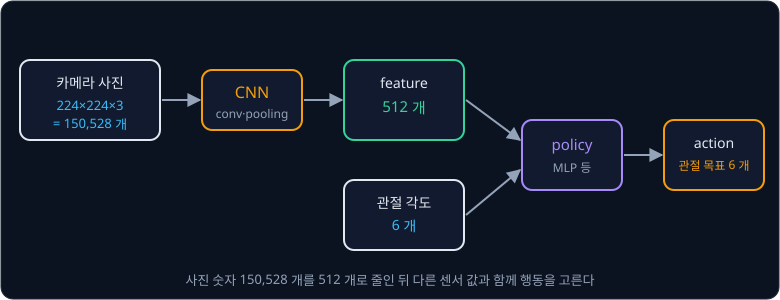

위 그림에서 policy 가 실제로 받는 숫자는 $512 + 6 = 518$ 개다. 사진을 그대로 받았다면 $150{,}528 + 6 = 150{,}534$ 개였다. 이 구조에서
CNN 은 사진을 읽는 부분이라 image encoder 라고 부른다. encoder 는 데이터를 다른 형태의 숫자로 바꿔 적는 부분이라는 뜻이다.

뒤의 강의들이 이 구조를 이어 간다.

- [Behavior Cloning](../behavior-cloning/README.md) 은 사람이 조종한 기록, 곧 (observation, 그때 사람이 한 action) 쌍을 정답으로
  삼아 policy 를 학습하는 방법이다. 1989년의 ALVINN 은 30×32 카메라 사진을 펼쳐 neural network 에 넣었고, 2016년 NVIDIA 의
  PilotNet 은 같은 일을 CNN 으로 해서 카메라 사진에서 바로 조향각을 냈다
- [ResNet](../resnet/README.md) 은 층을 훨씬 깊게 쌓은 CNN 이다. 그 강의의 ResNet-18 이 내는 feature 를 [ACT](../act/README.md)
  와 Diffusion Policy 같은 로봇 policy 가 카메라 사진을 읽는 image encoder 로 쓴다

**확인 문제.** 카메라 두 대의 사진을 각각 CNN 으로 feature 512 개씩 만들고, 관절 각도 7 개와 이어 붙여 policy 에 넣는다. policy 가
받는 숫자는 몇 개일까?

답 보기

$512 + 512 + 7 = 1{,}031$ 개다.

**요약**

- 사진을 판단에 필요한 적은 수의 요약 숫자(feature)로 줄이는 것이 CNN 의 역할이다. ResNet-18 은 150,528 개를 512 개로 줄인다
- policy 는 observation 을 받아 action 을 내는 모델이고, 카메라 사진은 CNN(image encoder)이 만든 feature 의 형태로 policy 에 들어간다

## 정리

- 사진은 pixel 마다 밝기 숫자를 적은 격자이고, 컬러 사진은 R·G·B channel 3 장이다. 224×224 컬러 사진 한 장은 숫자 150,528 개다
- 사진을 펼쳐 MLP 에 넣으면 neuron 1,000 개짜리 첫 layer 에만 parameter 가 1억 5천만 개가 필요하고, "1" 을 한 칸만 옮겨도
  곱해 더한 값이 8 에서 3 으로 떨어져 다른 사진으로 본다
- convolution 은 작은 filter 를 한 칸씩 옮기며 window 와 칸끼리 곱해 더한다. 세로선 filter 를 5×5 "1" 사진에 대면
  $\begin{bmatrix} -1 & 5 & -3 \\ -1 & 5 & -3 \\ -1 & 4 & -1 \end{bmatrix}$ 이 나오고, filter 하나가 만든 이 판이 feature map 이다
- 같은 filter 를 모든 자리에 써서(weight sharing) parameter 가 적고, 입력을 옮기면 출력도 같은 만큼 옮겨 간다(translation
  equivariance). filter 숫자는 gradient descent 로 학습한다
- 출력 길이는 $\lfloor (H + 2p - k)/s \rfloor + 1$ 이다. stride 는 옮기는 칸 수, padding 은 테두리에 덧대는 0 의 줄 수다
- 입력 channel 이 여러 장이면 filter 도 같은 장 수이고, 출력 channel 수는 filter 수다. parameter 는
  $C_{\text{out}} \times (C_{\text{in}} k^2 + 1)$ 개다
- max pooling 은 2×2 묶음마다 가장 큰 값만 남겨 크기를 반으로 줄이고, 묶음 안의 작은 이동을 지운다
- LeNet 은 $1 \times 28 \times 28$ 을 conv·pooling 두 번으로 400 개 숫자로 줄인 뒤 Linear 세 층으로 숫자를 고르며, parameter 는
  61,706 개다. S4 의 한 칸은 receptive field 가 16×16 이라 사진의 넓은 영역을 요약한다
- 사진을 적은 수의 feature 로 줄이는 것이 CNN 의 역할이고, 로봇 policy 는 이 feature 를 관절 각도 같은 숫자와 함께 받아 action 을
  낸다

LeNet 은 conv 층이 둘뿐이라 28×28 흑백 숫자처럼 작고 단순한 사진만 다룰 수 있다. 컬러 사진 속 수많은 물체를 가리려면 층을 수십
개 쌓아야 하는데, 그냥 쌓기만 하면 오히려 학습이 잘 되지 않는다. 층을 건너뛰는 연결로 이 문제를 푼 깊은 CNN 은
[ResNet](../resnet/README.md) 에서 다룬다. 사진을 작은 조각으로 잘라 convolution 없이 문장의 단어처럼 다루는 모델은
[ViT](../vit/README.md), convolution 층으로 잡음에서 사진을 만들어 내는 생성 모델은 [DDPM](../ddpm/README.md), 사람이 조종한 기록으로
policy 를 학습하는 방법은 [Behavior Cloning](../behavior-cloning/README.md) 에서 다룬다.

## 참고 자료

- Yann LeCun et al., [Gradient-Based Learning Applied to Document Recognition](http://yann.lecun.com/exdb/publis/pdf/lecun-01a.pdf)
  (1998) — LeNet-5 의 원 논문. 2 절(Convolutional Neural Networks for Isolated Character Recognition)에 층별 구조와 크기가 있다
- Kumar Chellapilla, Sidd Puri, Patrice Simard, [High Performance Convolutional Neural Networks for Document Processing](https://inria.hal.science/inria-00112631)
  (2006) — convolution 을 큰 행렬 곱 한 번으로 바꿔 빠르게 계산하는 방법. CNN 을 실제로 빠르게 돌리는 원리가 궁금할 때 읽는다
- Stanford CS231n, [Convolutional Neural Networks 강의 노트](https://cs231n.github.io/convolutional-networks/) — 출력 크기 공식,
  channel 이 여러 장인 convolution, pooling 을 그림과 함께 정리한 글. "Convolutional Layer" 절의 움직이는 그림을 꼭 본다
- Vincent Dumoulin, Francesco Visin, [A guide to convolution arithmetic for deep learning](https://arxiv.org/abs/1603.07285) —
  padding·stride 조합마다 출력 크기가 어떻게 되는지 그림으로 정리한 글. 움직이는 그림은 [conv_arithmetic](https://github.com/vdumoulin/conv_arithmetic) 에 있다
- [CNN Explainer](https://poloclub.github.io/cnn-explainer/) — 작은 CNN 의 feature map 과 filter 계산을 브라우저에서 눌러 보며 따라가는
  도구. 이 강의의 손 계산을 실제 사진으로 확인할 수 있다
- Dive into Deep Learning, [Convolutions for Images](https://d2l.ai/chapter_convolutional-neural-networks/conv-layer.html)·[LeNet](https://d2l.ai/chapter_convolutional-neural-networks/lenet.html)
  — cross-correlation 정의부터 LeNet 학습까지 차례로 설명한 교재의 두 절
