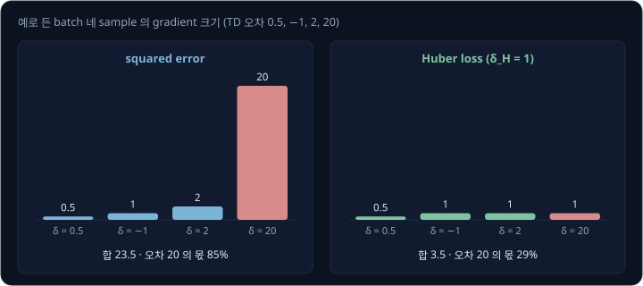
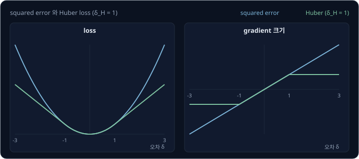
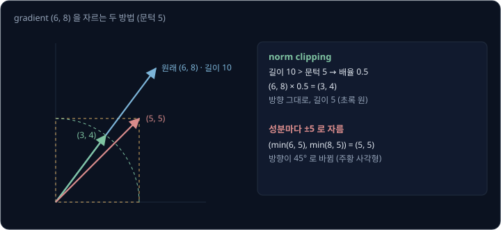
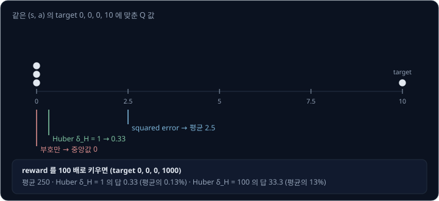
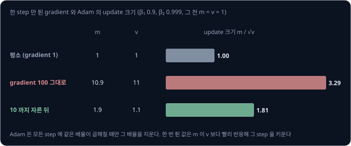
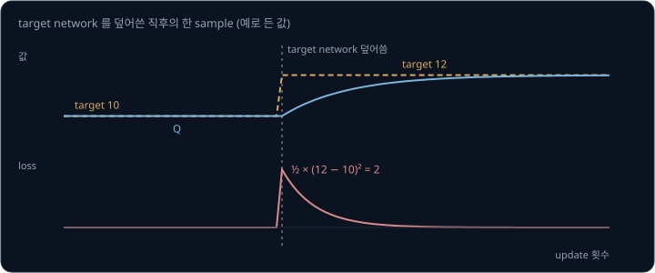

# Critic Loss

[DQN → SAC](../off-policy/README.md) 에서 본 DQN 과 SAC 의 critic 은 transition 마다 TD target 을 계산하고, 자기 Q 값이 그 target 에 가까워지도록
학습한다. 학습 초반이나 reward 가 큰 환경에서는 Q 값과 target 의 차이가 같은 batch 안에서도 sample 마다 수십 배씩 다른데, 이때 어떤 sample 이 network 를
얼마나 세게 끄는지는 loss 를 어떤 꼴로 쓰느냐에 달렸다. squared error 를 쓰면 오차가 큰 sample 하나가 update 를 거의 혼자 정하고, 오차를 자르면
그 sample 의 몫이 줄어든다. 같은 DQN 이라도 Stable-Baselines3 는 Huber loss 를 쓰고 CleanRL 은 squared error 를 쓴다. 이 선택은 학습에서 무엇을
바꿀까?

DQN 논문(Mnih 등 2015)의 저자들은 TD 오차를 −1 과 1 사이로 잘랐더니 학습이 더 안정됐다고 적었다. 이 강의는 그 자르기가 gradient 에서 무엇을
하는지에서 시작해, 비슷해 보이는 gradient norm clipping 과의 차이, reward 가 클 때 Huber loss 의 critic 이 평균이 아닌 값을 배우는 이유, Adam 이
gradient 의 배율을 지우는 범위를 숫자로 본다.

## 학습 목표

- squared error 와 Huber loss 에서 sample 하나가 gradient 에 보태는 양을 계산하고, 오차가 큰 sample 의 몫이 어떻게 달라지는지 설명할 수 있다
- DQN 의 error clipping, Huber loss, gradient norm clipping 이 각각 gradient 의 무엇을 바꾸는지 구분할 수 있다
- reward 의 크기에 비해 Huber loss 의 경계가 작을 때 critic 이 평균 return 이 아닌 값을 배우는 이유를 숫자로 설명할 수 있다
- Adam 이 gradient 의 일정한 배율은 지우지만 sample 사이의 가중과 한 step 만 갑자기 튄 gradient(spike)는 지우지 못하는 이유를 설명할 수 있다

## TD 오차와 squared error

critic 의 학습은 regression 이다. transition 마다 TD target $y = r + \gamma \cdot (\text{다음 state 의 값})$ 을 계산하고, Q network 의 출력
$Q(s, a)$ 를 $y$ 에 맞춘다. $\gamma$ 는 미래의 reward 를 깎아 더하는 discount factor 다. $y$ 와 $Q(s, a)$ 의 차이 $\delta = y - Q(s, a)$ 를 **TD 오차**라고
한다. SAC 논문(Haarnoja 등 2018)의 식 (7)은 이 차이의 제곱에 $\tfrac12$ 을 곱한 값을 batch 에서 평균한 것이고, critic 은 이 값을 줄이도록
학습한다. sample 하나의 이 loss 를 squared error 라고 하고, batch 에서 평균한 값을 MSE(mean squared error)라고 한다.

$$
L = \tfrac12 \delta^2
$$

이 loss 를 $Q$ 로 미분하면 $-\delta$ 다. gradient 의 부호를 보면, 오차가 + 이면(target 이 Q 보다 크면) gradient 가 − 라서 Q 를 키우는 쪽으로
고치고, 오차가 − 이면 Q 를 줄이는 쪽으로 고친다. 크기는 오차에 비례하므로, 오차가 10 배인 sample 은 10 배 세게 끈다.

예를 들어 batch 에 sample 이 넷 있고 TD 오차가 0.5, −1, 2, 20 이라고 하자. 앞의 셋은 Q 가 거의 맞은 sample 이고, 마지막 하나는 드물게 큰
reward 를 받았거나 target 이 크게 바뀐 sample 이다.

| sample | TD 오차 $\delta$ | squared error 의 gradient 크기 $\lvert\delta\rvert$ |
| --- | --- | --- |
| 1 | 0.5 | 0.5 |
| 2 | −1 | 1 |
| 3 | 2 | 2 |
| 4 | 20 | 20 |
| 합 | | 23.5 |

network 의 weight 를 고치는 양은 sample 마다 구한 gradient 를 더한 값이라서, 네 번째 sample 하나가 $20 \div 23.5 = 85\%$ 를 정한다. 그 sample 의 target
이 잘못 계산된 값이라면 이번 update 는 거의 그 잘못을 따라 움직인다.

> **오해** TD 오차가 큰 sample 은 그만큼 배울 것이 많으니 세게 끄는 것이 늘 맞다.
>
> **사실** critic 의 target 은 아직 학습 중인 network 로 계산한 값이라 그 자체가 틀릴 수 있다. squared error 에서는 오차 20 인 sample 하나가 오차 0.5 ~ 2 인 sample 셋을 합친 것보다 5 배 넘게 세게 끈다.

**확인 문제.** TD 오차가 1, −1, 1, −1, 16 인 batch 에서 squared error 를 쓰면, 오차 16 인 sample 이 gradient 크기의 합에서 차지하는 비율은 얼마일까?

답 보기

1. sample 마다 gradient 크기는 오차의 절댓값이다: 1, 1, 1, 1, 16
2. 합은 $1 + 1 + 1 + 1 + 16 = 20$
3. 비율은 $16 \div 20 = 0.8$

답: 80% 다.

## Huber loss

**Huber loss** 는 오차가 작을 때는 squared error 와 같고, 오차가 미리 정한 경계 $\delta_H$ 를 넘으면 그때부터 직선으로 자라는 loss 다. 직선 구간의
기울기가 일정해서, 오차가 아무리 커도 gradient 크기는 $\delta_H$ 를 넘지 않는다. TD 오차의 기호 $\delta$ 와 구분하려고 이 강의에서는 Huber 의
경계를 $\delta_H$ 로 적는다.

| 오차 $\lvert\delta\rvert$ | loss | gradient 크기 |
| --- | --- | --- |
| $\delta_H$ 보다 작음 | $\tfrac12 \delta^2$ | $\lvert\delta\rvert$ |
| $\delta_H$ 이상 | $\delta_H (\lvert\delta\rvert - \tfrac12 \delta_H)$ | $\delta_H$ |

PyTorch 의 `HuberLoss` 는 경계를 `delta` 라는 이름으로 받고 기본값은 1.0 이다. 비슷한 `SmoothL1Loss` 는 경계를 `beta` 라는 이름으로 받고
기본값은 역시 1.0 이다. 공식 문서에 따르면 `SmoothL1Loss` 는 Huber loss 를 `beta` 로 나눈 것과 같아서, 직선 구간의 기울기가 `beta` 와 상관없이
늘 1 이다. 경계가 1 이면 두 loss 는 같다.

앞 절의 batch 에 $\delta_H = 1$ 인 Huber loss 를 쓰면 gradient 크기는 0.5, 1, 1, 1 이 된다. 오차 2 와 20 은 둘 다 경계를 넘어 1 로 잘린다. 합은
3.5 이고, 오차 20 인 sample 의 몫은 $1 \div 3.5 = 29\%$ 로 줄어든다.

경계를 넘은 sample 도 gradient 의 부호는 그대로라서, Q 를 target 쪽으로 고치는 방향은 같고 세기만 일정해진다.

<b>심화: Huber loss 의 gradient 와 SmoothL1Loss</b>

오차를 $x = Q - y$ 로 두면 Huber loss 는 $\lvert x\rvert < \delta_H$ 에서는 $\tfrac12 x^2$ 이고, 그 밖에서는 $\delta_H(\lvert x\rvert - \tfrac12\delta_H)$ 다.
두 식은 $\lvert x\rvert = \delta_H$ 에서 값이 $\tfrac12\delta_H^2$ 로 같다. 미분도 안쪽 식은 $x$ 이고 바깥 식은 $\delta_H \cdot \mathrm{sign}(x)$ 라서
($\mathrm{sign}(x)$ 는 $x$ 의 부호로, 양수면 1 이고 음수면 −1 이다) 경계에서 $\pm\delta_H$ 로 같다. 그래서 loss 와 gradient 가 끊기지 않고 이어진다. gradient 를 한 식으로 쓰면 $x$ 를 $[-\delta_H, \delta_H]$ 로 자른 값이다.

PyTorch 문서에 따르면 `SmoothL1Loss` 는 안쪽에서는 $\tfrac12 x^2 / \beta$ 이고 바깥에서는 $\lvert x\rvert - \tfrac12\beta$ 라서, Huber loss 를 $\beta$
로 나눈 것과 같다. 그래서 `SmoothL1Loss` 의 직선 구간 기울기는 $\beta$ 와 상관없이 1 이고, `HuberLoss` 의 직선 구간 기울기는 $\delta_H$ 다. 경계를 바꾸면 두 loss
의 gradient 크기가 다르게 바뀐다는 점을 구현을 옮길 때 확인한다. $\beta \to 0$ 이면 `SmoothL1Loss` 는 절댓값 loss 가 되고, $\delta_H \to \infty$
이면 `HuberLoss` 는 squared error 가 된다.

> **오해** Huber loss 는 오차가 큰 sample 을 학습에서 빼 버린다.
>
> **사실** 경계를 넘은 sample 의 gradient 는 0 이 아니라 $\delta_H$ 로 일정하다. 앞의 batch 에서 오차 20 인 sample 은 여전히 Q 를 키우는 쪽으로 1 만큼 끈다. 세기가 오차에 비례하지 않을 뿐이다.

**확인 문제.** TD 오차가 1, −1, 1, −1, 16 인 batch 에 $\delta_H = 1$ 인 Huber loss 를 쓰면, 오차 16 인 sample 의 몫은 얼마일까?

답 보기

1. 오차가 1 이상인 sample 의 gradient 크기는 $\delta_H = 1$ 이다. 여기서는 다섯 sample 모두 1 이 된다
2. 합은 5
3. 비율은 $1 \div 5 = 0.2$

답: 20% 다. squared error 의 80% 에서 줄었다.

## DQN 의 error clipping

DQN 논문의 Methods 절에서 저자들은 update 의 오차 항 $r + \gamma \max_{a'} Q(s', a'; \theta^-) - Q(s, a; \theta)$ 를 −1 과 1 사이로 자르는 것이
도움이 됐다고 적었다. $\theta$ 는 학습 중인 online network 의 parameter 이고, $\theta^-$ 는 target network 의 parameter 다. 저자들은 이어서
절댓값 함수 $\lvert x\rvert$ 의 미분이 음수에서는 −1 이고 양수에서는 1 이라서, 이 자르기가 (−1, 1) 밖의 오차에 절댓값 loss 를 쓰는 것과 같고
학습을 더 안정시켰다고 설명했다. 논문은 "Huber" 라는 이름을 쓰지 않았지만, gradient 를 보면 $\delta_H = 1$ 인 Huber loss 와 같다.

저자들은 같은 논문에서 reward 도 잘랐다. 양수 reward 는 모두 1 로 바꾸고, 음수 reward 는 모두 −1 로 바꾸고, 0 은 그대로 두었다. 저자들은
이렇게 하면 오차의 미분이 커지는 것을 막아 49 개 Atari 게임에 같은 learning rate 를 쓰기 쉬워진다고 적었다. 다만 크기가 다른 reward 를 구별하지 못해 성능에 영향을
줄 수 있다는 점도 함께 적었다. 오차 자르기는 gradient 의 세기를 줄이고 학습 목표는 그대로 두지만, reward 자르기는 무엇을 잘한 것으로 칠지를
바꾼다.

같은 알고리즘이라도 구현마다 critic 의 loss 가 다르다. 2026 년 10 월에 열어 본 각 저장소의 기본값은 아래와 같다.

| 구현 | critic loss | 그 밖의 장치 |
| --- | --- | --- |
| Stable-Baselines3 DQN | `smooth_l1_loss` (Huber, 경계 1) | `clip_grad_norm_` 최대 10 |
| CleanRL DQN | `mse_loss` | Adam, clipping 없음 |
| Dopamine DQN (TensorFlow 판) | `huber_loss` | RMSProp |
| Dopamine DQN (JAX 판) | 기본값 `mse` | 기본 optimizer Adam |
| Stable-Baselines3 SAC | 두 critic 의 `mse_loss` 합에 0.5 를 곱함 | clipping 없음 |
| CleanRL SAC | 두 critic 의 `mse_loss` 합 | clipping 없음 |

Dopamine 의 JAX 판 문서에 따르면 JAX 판이 기본으로 쓰는 Adam 은 원래 Nature DQN 과 TensorFlow 판의 optimizer 와 다르다. 같은 이름의 알고리즘을 비교할 때는
loss 와 optimizer 가 같은지부터 확인한다.

> **오해** DQN 은 squared error 로 학습한다.
>
> **사실** DQN 논문의 Algorithm 1 에는 squared error 가 적혀 있지만, Methods 절에서 저자들은 오차 항을 −1 과 1 사이로 잘랐다고 밝혔다. gradient 로 보면 경계 1 인 Huber loss 를 쓴 것과 같다.

## gradient norm clipping

gradient 를 줄이는 또 하나의 방법은 loss 를 그대로 두고 gradient 전체의 길이를 자르는 것이다. Pascanu 등(2013)은 순서대로 들어오는 입력을 처리하는
RNN(recurrent neural network)의 학습에서 gradient 가 갑자기 커지는 문제를 다루며, gradient 의 norm(모든 parameter 의 gradient 를 한 vector 로 이어 붙인 길이)이 정한 문턱을 넘으면 그 vector 를
문턱 길이로 줄이는 방법(Algorithm 1)을 제안했다. 방향은 그대로 두고 길이만 바꾸므로, 내려가는 방향을 유지한다고 저자들은 적었다.

예를 들어 parameter 가 둘이고 gradient 가 $(6, 8)$ 이면 길이는 $\sqrt{6^2 + 8^2} = 10$ 이다. 문턱이 5 이면 모든 성분에 $5 \div 10 = 0.5$ 를 곱해
$(3, 4)$ 가 되고, 방향은 그대로다. 성분마다 따로 ±5 로 자르면 $(5, 5)$ 가 되어 방향이 바뀐다. PyTorch 의 `clip_grad_norm_` 은 길이로 자르는
방식이고, 배율을 1 이하로 묶어 gradient 를 키우지는 않는다.

Huber loss 와 norm clipping 은 둘 다 큰 gradient 를 줄이지만 자르는 자리가 다르다. Huber 는 sample 마다 먼저 자르고 더하므로 sample 사이의 몫이
바뀐다. norm clipping 은 batch 의 gradient 를 다 더한 뒤 전체에 같은 배율을 곱하므로 sample 사이의 몫은 그대로다.

| 방법 | 자르는 자리 | 앞 절 batch 에서 오차 20 인 sample 의 몫 |
| --- | --- | --- |
| squared error | 자르지 않음 | $20 \div 23.5 = 85\%$ |
| Huber loss ($\delta_H = 1$) | sample 마다 | $1 \div 3.5 = 29\%$ |
| squared error + norm clipping | batch 합 전체 | 85% (모두 같은 배율로 줄어서 그대로) |

<b>심화: norm clipping 의 계산</b>

parameter 가 여러 묶음(층마다 있는 weight 와 bias)으로 나뉘어 있어도 norm 은 하나로 계산한다. PyTorch 의 `clip_grad_norm_` 은 묶음마다 gradient 의
norm 을 구한 뒤, 그 norm 들을 한 vector 로 이어 붙인 것처럼 다시 norm 을 구한다. 2-norm 이면 모든 gradient 성분의 제곱을 더해 제곱근을 씌운 값과
같다. 문턱을 max_norm, 자르기 전의 norm 을 total_norm 이라고 하면 배율은
$\min\!\big(\text{max\_norm} / (\text{total\_norm} + 10^{-6}),\ 1\big)$ 이고, 모든 gradient 에 같은 배율을 곱한다. 배율이 1 을
넘지 않으므로 norm 이 문턱보다 작은 gradient 는 그대로 둔다. 이 함수는 자르기 전의 norm 을 돌려주므로, 그 값을 기록하면 spike 가 얼마나 자주
생기는지 볼 수 있다.

Pascanu 등은 이 문턱에 학습이 크게 민감하지 않다고 적었다. 그 전까지 쓰이던 방식은 gradient 의 성분 하나하나를 정한 크기로 자르는 것이었고,
저자들은 그 방식과 달리 norm 으로 자르면 내려가는 방향이 유지된다는 점을 들었다.

> **오해** gradient norm clipping 을 켜면 Huber loss 를 쓴 것과 같다.
>
> **사실** norm clipping 은 batch 의 gradient 를 다 더한 뒤 같은 배율로 줄여서, 오차 20 인 sample 이 85% 를 정하는 비율은 그대로다. Huber 는 sample 마다 잘라 그 몫을 29% 로 줄인다.

**확인 문제.** gradient 가 $(9, 12)$ 이고 norm clipping 의 문턱이 3 이다. 자른 뒤의 gradient 는 무엇일까?

답 보기

1. 길이는 $\sqrt{9^2 + 12^2} = \sqrt{225} = 15$ 다
2. 문턱 3 을 넘으므로 배율은 $3 \div 15 = 0.2$ 다
3. 성분마다 곱하면 $(9 \times 0.2,\ 12 \times 0.2) = (1.8,\ 2.4)$

답: $(1.8, 2.4)$ 이고, 길이는 3 이며 방향은 그대로다.

## reward 크기와 Huber 의 직선 구간

Huber 의 경계 $\delta_H$ 는 오차의 크기와 견주어 정해야 한다. 같은 환경에서 reward 만 100 배로 키우면 TD 오차도 대략 100 배가 되는데, 경계를 1 로
두면 거의 모든 sample 이 직선 구간에 들어간다. 그러면 모든 sample 의 gradient 크기가 1 로 같아져서, gradient 에는 오차의 부호만 남는다.

gradient 에 부호만 남으면 critic 이 배우는 값이 달라진다. critic 은 같은 $(s, a)$ 에서 나오는 여러 target 의 평균을 배워야 하고, 이 평균이 기대 return 이다. squared
error 로 맞춘 값은 target 들의 평균이 되지만, 부호만 보는 loss 로 맞춘 값은 + 쪽과 − 쪽 sample 수가 같아지는 값인 중앙값이 된다. Huber 로 맞춘
값은 경계에 따라 그 사이에 놓인다.

예를 들어 같은 $(s, a)$ 에서 target 이 0, 0, 0, 10 으로 나왔다고 하자. 네 번에 한 번 큰 reward 를 받는 행동이라 평균은 2.5 이고 중앙값은 0 이다.
$\delta_H = 1$ 인 Huber 로 맞춘 Q 값은 gradient 의 합이 0 이 되는 자리다. Q 가 0 과 1 사이에 있다고 두면 gradient 는 아래와 같다.

| target | Q 가 0 과 1 사이일 때 gradient 크기 | 방향 |
| --- | --- | --- |
| 0 (세 개) | 각각 $Q - 0 = Q$ (경계 안) | Q 를 줄임 |
| 10 | 1 (경계 밖이라 잘림) | Q 를 키움 |

Q 를 줄이는 쪽의 합 $3Q$ 와 키우는 쪽의 1 이 같아야 하므로 $3Q = 1$ 이고, $Q = 1/3 \approx 0.33$ 이다. 평균 2.5 의 13% 에 그친다.

reward 를 100 배로 키워 target 이 0, 0, 0, 1000 이 되면 평균은 250 인데, 경계를 1 로 둔 Huber 의 답은 같은 계산으로 여전히 $1/3$ 이다. 평균
250 의 0.13% 다. 경계도 100 배인 100 으로 키우면 답은 $100/3 \approx 33.3$ 으로, 평균 250 의 13% 가 되어 원래 비율로 돌아온다.

그래서 Huber loss 를 쓸 때는 reward 의 크기를 함께 본다. DQN 처럼 reward 를 ±1 로 자르면 오차도 대체로 경계 근처에 머물고, reward 를 자르지 않는
환경에서 경계를 1 로 두면 critic 이 평균보다 작은 값을 배울 수 있다. reward 의 크기를 맞추는 방법은 [Reward Scale & Shaping](../reward-scale/README.md)
에서 다룬다.

<b>심화: squared error 는 평균을, 절댓값 loss 는 중앙값을 맞춘다</b>

target $y_1, \dots, y_n$ 에 하나의 값 $q$ 를 맞춘다고 하자.

squared error $\sum_i \tfrac12 (q - y_i)^2$ 를 $q$ 로 미분하면 $\sum_i (q - y_i) = nq - \sum_i y_i$ 다. 이 값이 0 이 되는 $q$ 는
평균 $\frac1n \sum_i y_i$ 다.

절댓값 loss $\sum_i \lvert q - y_i\rvert$ 의 미분은 $q$ 보다 작은 target 의 개수에서 큰 target 의 개수를 뺀 값이다. 이 값이 0 이 되려면 $q$ 의 양쪽에
target 이 같은 수만큼 있어야 하므로 $q$ 는 중앙값이다.

Huber loss 의 미분은 경계 안의 target 에 대해서는 $q - y_i$ 이고, 경계 밖의 target 에 대해서는 $\pm\delta_H$ 다. 본문 예의 target 0, 0, 0, 10 과
$\delta_H = 1$ 에서 $q$ 가 0 과 1 사이라면 세 개의 0 은 경계 안($q - 0 = q$)이고 10 은 경계 밖($-1$)이라서 미분은 $3q - 1$ 이다. 0 이 되는 $q = 1/3$
은 0 과 1 사이라 가정과 맞는다. $\delta_H$ 가 커질수록 경계 안에 드는 target 이 늘어 답은 평균 쪽으로, 작아질수록 중앙값 쪽으로 간다.

> **오해** Huber loss 의 경계는 기본값 1 로 두면 어느 환경에서나 같은 효과를 낸다.
>
> **사실** 경계는 TD 오차의 크기와 견주어 의미가 정해진다. target 0, 0, 0, 10 에서 경계 1 인 Huber 의 답은 평균 2.5 의 13% 인 0.33 이고, reward 를 100 배로 키우면 평균 250 의 0.13% 로 떨어진다.

**확인 문제.** 같은 $(s, a)$ 의 target 이 0, 0, 0, 0, 0, 0, 0, 0, 0, 20 이다(열 번에 한 번 20). squared error 로 맞춘 값과, $\delta_H = 1$ 인 Huber 로
맞춘 값은 각각 얼마일까?

답 보기

1. squared error 는 평균을 맞추므로 $20 \div 10 = 2$
2. Huber 는 $Q$ 가 0 과 1 사이라고 두면 아홉 개의 0 은 경계 안이라 각각 $Q$ 만큼 줄이고, 20 은 경계 밖이라 1 만큼 키운다
3. gradient 의 합이 0 이 되는 자리: $9Q = 1$ 이므로 $Q = 1/9 \approx 0.11$

답: squared error 는 2, Huber 는 약 0.11 이다.

## Adam 이 지우는 배율

reward 를 키우면 squared error 의 gradient 도 커지는데, 실제 update 의 크기는 optimizer 에 따라 달라진다. Adam 논문(Kingma 와 Ba 2015)의 저자들은
Adam 의 update 크기가 gradient 의 배율에 영향을 받지 않는다고 적었다. Adam 은 parameter 마다 gradient 의 이동 평균(최근 값에 더 큰 무게를
두는 평균) $m$ 과 gradient 제곱의 이동 평균 $v$ 를 두고, $m / \sqrt{v}$ 에 learning rate 를 곱한 만큼 움직인다. gradient 에 $c$ 를 곱하면 $m$ 은
$c$ 배가 되고 $v$ 는 $c^2$ 배가 되므로, $m$ 을 $\sqrt{v}$ 로 나누면 $c$ 가 지워진다.

DQN 논문의 저자들이 쓴 RMSProp 도 gradient 를 gradient 제곱의 이동 평균의 제곱근으로 나누므로, gradient 의 배율이 비슷하게 지워진다.

그래서 loss 에 일정한 수를 곱하는 차이는 Adam 의 update 를 거의 바꾸지 않는다. Stable-Baselines3 SAC 는 critic loss 에 0.5 를 곱하고 CleanRL SAC
는 곱하지 않지만, 둘 다 Adam 을 쓰므로 이 차이로 update 크기가 두 배 차이 나지는 않는다.

Adam 은 모든 step 에 똑같이 곱해진 배율만 지우고, 아래 두 가지는 지우지 못한다.

첫째는 sample 사이의 몫이다. TD 오차가 0.5, −1, 2, 20 인 앞의 batch 에서 오차 20 인 sample 이 $20 \div 23.5 = 85\%$ 를 정하는 것은 batch 안의
비율이라서, 전체에 같은 수를 곱해도 85% 는 그대로다.
Huber 처럼 sample 마다 자르는 방법만 이 비율을 바꾼다.

둘째는 갑자기 튄 gradient 다. 예를 들어 어떤 parameter 의 gradient 가 오래 1 이었다가 한 step 만 100 이 됐다고 하자. Adam 은 $m$ 을 고칠 때
이전 $m$ 에 $\beta_1$ 을 곱하고 새 gradient 에 $1 - \beta_1$ 을 곱해 더하며, $v$ 도 같은 방식으로 $\beta_2$ 를 써서 고친다. 기본값 $\beta_1 = 0.9$,
$\beta_2 = 0.999$ 를 쓰고 그 전까지 $m = 1$, $v = 1$ 이었다고 두면 아래와 같다.

| | $m$ | $v$ | $m / \sqrt{v}$ (평소 1) |
| --- | --- | --- | --- |
| gradient 100 그대로 | $0.9 \times 1 + 0.1 \times 100 = 10.9$ | $0.999 \times 1 + 0.001 \times 100^2 = 11.0$ | 3.29 |
| norm clipping 으로 10 까지 자름 | $0.9 \times 1 + 0.1 \times 10 = 1.9$ | $0.999 \times 1 + 0.001 \times 10^2 = 1.10$ | 1.81 |

튄 gradient 를 그대로 두면 그 step 은 평소의 3.3 배를 움직이고, 10 으로 자르면 1.8 배에 그친다. $m$ 이 $v$ 보다 빨리 반응해서 한 번 튄 값은 Adam
안에서도 다 지워지지 않는다. Stable-Baselines3 DQN 이 Adam 과 함께 `clip_grad_norm_` 을 쓰는 것은 이런 순간을 막는 장치로 볼 수 있다.

<b>심화: Adam 의 step 크기 상한</b>

Adam 논문 2.1 절에 따르면 bias 를 고친 $\hat m_t$, $\hat v_t$ 로 쓴 update $\Delta_t = \alpha\, \hat m_t / \sqrt{\hat v_t}$ 의 크기에는 상한이 있다.
$\alpha$ 는 learning rate 다.
$(1 - \beta_1) > \sqrt{1 - \beta_2}$ 이면 $\lvert\Delta_t\rvert \le \alpha (1 - \beta_1) / \sqrt{1 - \beta_2}$ 이고, 그렇지 않으면 $\lvert\Delta_t\rvert \le \alpha$
다. 기본값 $\beta_1 = 0.9$, $\beta_2 = 0.999$ 에서는 $1 - \beta_1 = 0.1$ 이 $\sqrt{0.001} \approx 0.032$ 보다 크므로 앞의 경우이고, 상한은
$\alpha \times 0.1 / 0.032 \approx 3.16\alpha$ 다. 저자들은 앞의 경우가 gradient 가 그 전까지 모두 0 이다가 지금 step 에만 0 이 아닌, 가장 드문드문한 경우에만 생긴다고 적었다. 본문의 예는 그 전까지 $m = v = 1$ 이라 $m$ 에 앞의 값 $0.9$ 가 더해지므로 3.29 로 이 어림보다 조금 크다. 저자들은 이 상한을 현재
parameter 주변에 신뢰 영역을 두는 것으로 해석했다.

같은 절에서 저자들은 gradient 를 $c$ 배 하면 $\hat m_t$ 는 $c$ 배, $\hat v_t$ 는 $c^2$ 배가 되어 서로 지워진다고 적었다.

> **오해** Adam 을 쓰면 gradient 의 크기는 신경 쓰지 않아도 된다.
>
> **사실** Adam 은 모든 step 에 똑같이 곱해진 배율만 지운다. batch 안에서 오차 20 인 sample 이 85% 를 정하는 비율과, 한 step 만 100 배로 튄 gradient 가 평소의 3.3 배를 움직이게 하는 일은 남는다.

**확인 문제.** 오래 1 이던 gradient 가 한 step 만 50 이 됐다. $\beta_1 = 0.9$, $\beta_2 = 0.999$, 그 전의 $m = 1$, $v = 1$ 로 두면 그 step 의
$m / \sqrt{v}$ 는 얼마일까?

답 보기

1. $m = 0.9 \times 1 + 0.1 \times 50 = 5.9$
2. $v = 0.999 \times 1 + 0.001 \times 50^2 = 0.999 + 2.5 = 3.499$
3. $\sqrt{3.499} \approx 1.87$ 이므로 $m / \sqrt{v} \approx 5.9 \div 1.87 \approx 3.15$

답: 약 3.15 다. 평소의 3 배쯤 움직인다.

## critic loss 값 읽기

supervised learning 에서는 정답이 고정되어 있어서 loss 가 줄면 잘 배운 것이다. critic 에서는 target 에 쓰는 다음 state 의 값이 critic 자신이나
target network 에서 나오므로, critic 이 배우는 동안 target 도 함께 바뀐다.

예를 들어 어떤 $(s, a)$ 의 Q 가 target 10 에 거의 맞아 그 sample 의 loss 가 0 에 가깝다고 하자. DQN 은 parameter update 10,000 번마다 target
network 를 학습 중인 online network 로 덮어쓴다(DQN 논문의 Extended Data Table 1). 덮어쓴 직후 다음 state 의 값이 커져 target 이 12 가 되면,
Q 는 아직 10 이라서 squared error 는 $\tfrac12 \times (12 - 10)^2 = 2$ 로 뛴다. loss 가 늘어난 이유는 critic 이 나빠져서가 아니라 따라갈 목표가
움직여서다. SAC 처럼 target network 를 매 update 조금씩 섞는 방식([twin critic 과 soft target](../off-policy/README.md#twin-critic-과-soft-target))
에서는 loss 가 이렇게 한 번에 뛰지 않고, target 이 천천히 움직여 loss 도 완만하게 오르내린다.

loss 의 크기는 reward 의 크기에 따라서도 달라진다. reward 를 100 배로 키우면 TD 오차도 대략 100 배가 되어 squared error 는 $100^2 = 10{,}000$ 배가 되고,
Huber 의 직선 구간에서는 100 배가 된다. 그래서 reward 배율이나 loss 종류가 다른 두 실험의 critic loss 숫자는 직접 비교할 수 없다.

DQN 논문의 저자들은 학습이 안정적으로 진행된다는 것을 critic loss 대신 두 지표로 보였다(Fig. 2). 하나는 episode 한 번에 얻은 점수의 평균이고,
다른 하나는 학습 전에 모아 둔 state 묶음(held-out set)에서 계산한 Q 의 평균이다. 같은 state 묶음을 계속 쓰므로 critic 이 매기는 가치의 크기가
어떻게 변하는지 비교할 수 있다. 저자들은 reward 를 잘랐기 때문에 그림의 Q 값도 잘린 reward 의 크기에 맞춰 나온다는 점도 밝혔다.

| 지표 | 보는 것 | 읽을 때 주의할 점 |
| --- | --- | --- |
| critic loss | Q 와 target 의 차이 | target 이 움직이면 오르고, reward 배율과 loss 종류에 따라 크기가 달라진다 |
| 고정한 state 묶음의 평균 Q | critic 이 매기는 가치의 크기 | 실제로 받은 return 과 견줘야 [overestimation](../off-policy/README.md#overestimation-과-double-q) 이 보인다 |
| episode 의 평균 return | policy 의 실제 성적 | 탐색용 noise 를 켜고 재면 낮게 나온다. DQN 저자들은 5% 확률로 무작위 action 을 고르는 ε = 0.05 로 평가했다 |

평균 Q 가 실제 return 과 비슷한 크기로 자라다 멈추면 critic 이 제대로 따라가는 것이고, return 은 그대로인데 평균 Q 만 계속 커지면 critic 이
가치를 부풀리고 있다는 신호다.

> **오해** critic loss 가 커지면 학습이 망가진 것이다.
>
> **사실** critic 의 target 은 학습 중에 계속 바뀐다. target network 를 덮어쓴 직후 target 이 10 에서 12 로 바뀌면, Q 가 그대로여도 squared error 는 0 근처에서 2 로 뛴다. 학습이 망가졌는지는 고정한 state 묶음의 평균 Q 와 실제 return 을 함께 보고 판단한다.

**확인 문제.** Q 가 10 에 맞아 있던 sample 의 target 이, target network 를 덮어쓴 직후 13 이 됐다. 이 sample 의 squared error 와, $\delta_H = 1$ 인
Huber loss 는 각각 얼마일까?

답 보기

1. TD 오차는 $13 - 10 = 3$ 이다
2. squared error 는 $\tfrac12 \times 3^2 = 4.5$
3. Huber 는 오차 3 이 경계 1 을 넘으므로 $\delta_H(\lvert\delta\rvert - \tfrac12\delta_H) = 1 \times (3 - 0.5) = 2.5$

답: squared error 는 4.5, Huber loss 는 2.5 다.

## 정리

- squared error 의 gradient 는 TD 오차에 비례해서, 오차 0.5, −1, 2, 20 인 batch 에서는 오차 20 인 sample 이 update 의 85% 를 정한다
- Huber loss 는 경계 $\delta_H$ 를 넘는 오차의 gradient 를 $\delta_H$ 로 묶어, 같은 batch 에서 오차 20 인 sample 의 몫을 85% 에서 29% 로 줄인다. DQN 의 error clipping 은 경계 1 인 Huber 와 같다
- gradient norm clipping 은 batch 합 전체를 같은 배율로 줄여 방향과 sample 사이의 몫을 그대로 둔다
- reward 에 비해 경계가 작으면 critic 은 평균이 아닌 중앙값 쪽 값을 배운다. target 0, 0, 0, 10 에서 경계 1 인 Huber 의 답은 평균 2.5 가 아닌 0.33 이다
- Adam 은 일정한 배율을 지우지만 sample 사이의 몫과 한 step 의 spike 는 지우지 못한다. 오래 1 이던 gradient 가 한 step 만 100 이 되면 그 step 은 평소의 3.3 배를 움직인다
- critic loss 는 target 이 움직이면 오르고 reward 배율에 따라 크기가 바뀐다. 학습 상태는 고정한 state 묶음의 평균 Q 와 실제 return 으로 본다

다음 강의 [Reward Scale & Shaping](../reward-scale/README.md) 에서는 critic 이 다루는 값의 크기 자체를 바꾸는 방법을 본다. reward 에 수를 곱하거나
더할 때 policy 가 바뀌는 경우와 바뀌지 않는 경우를 보고, target 을 normalize 하는 Pop-Art 와 reward 의 평균을 빼는 reward centering 을 다룬다.

## 참고 자료

- Volodymyr Mnih 외, [Human-level control through deep reinforcement learning](https://storage.googleapis.com/deepmind-media/dqn/DQNNaturePaper.pdf)
  (Nature 2015) — Methods 의 "Training details" 에서 reward 자르기를 읽고, "Training algorithm for deep Q-networks" 의 끝 문단에서 오차 항 자르기를 읽는다
- Razvan Pascanu, Tomas Mikolov, Yoshua Bengio, [On the difficulty of training recurrent neural networks](https://arxiv.org/abs/1211.5063) (2013) —
  3.2 절과 Algorithm 1 의 gradient norm clipping
- Diederik P. Kingma, Jimmy Ba, [Adam: A Method for Stochastic Optimization](https://arxiv.org/abs/1412.6980) (2015) — 2.1 절의 step 크기 상한과
  gradient 배율에 대한 불변성
- Tuomas Haarnoja 외, [Soft Actor-Critic](https://arxiv.org/abs/1801.01290) (2018) — 4.2 절 식 (7) 의 critic loss
- PyTorch 문서, [HuberLoss](https://docs.pytorch.org/docs/stable/generated/torch.nn.HuberLoss.html),
  [SmoothL1Loss](https://docs.pytorch.org/docs/stable/generated/torch.nn.SmoothL1Loss.html),
  [clip_grad_norm_](https://docs.pytorch.org/docs/stable/generated/torch.nn.utils.clip_grad_norm_.html) — 두 loss 의 정의와 관계, norm clipping 의
  계산 방식
- [Stable-Baselines3](https://github.com/DLR-RM/stable-baselines3) 의 `dqn/dqn.py`·`sac/sac.py`, [CleanRL](https://github.com/vwxyzjn/cleanrl) 의
  `dqn.py`·`sac_continuous_action.py`, [Dopamine](https://github.com/google/dopamine) 의 `tf/agents/dqn/dqn_agent.py`·`jax/agents/dqn/dqn_agent.py` —
  구현마다 다른 critic loss 와 optimizer
