# DAgger

## 학습 목표

- 학습한 운전 규칙이 직접 운전할 때만 들어가는 위치가 운전을 잘하는 쪽의 시연을 아무리 늘려도 데이터에 생기지 않는 이유를 숫자로 설명할 수 있다
- 학습한 규칙에게 직접 운전을 맡기고, 차가 지나간 위치마다 운전을 잘하는 쪽에 정답 조향을 물어 데이터에 더한 뒤 다시 학습하는
  반복을 한 바퀴씩 표로 따라갈 수 있다
- 반복할 때마다 데이터가 퍼진 범위와 운전 규칙의 오차가 어떻게 바뀌는지 계산할 수 있다
- 정답을 묻는 동안 누가 운전대를 잡을지 step 마다 무작위로 섞는 방법과, 저장하는 정답이 늘 운전을 잘하는 쪽의 조향이어야 하는
  이유를 설명할 수 있다
- 운전 시간이 길어질 때 시연만 따라 한 규칙은 실수가 시간의 제곱만큼, 이 반복으로 학습한 규칙은 시간에 비례해서만 는다는 것을
  작은 숫자로 비교할 수 있다
- 실제 로봇에서 사람에게 매 순간 정답을 묻기 어려운 이유와, 사람이 위험할 때만 넘겨받아 기록하는 방법을 설명할 수 있다

## behavior cloning 이 채우지 못하는 상태

### 차선 주행 예시

[Behavior Cloning](../behavior-cloning/README.md) 에서 쓴 차선 주행 예시를 그대로 이어서 쓴다. 차선 폭은 3.5 m 이고, 차가
가운데에서 왼쪽으로 벗어난 거리를 $y$ (m) 로 적는다. 차에는 거리 센서가 양쪽에 달려 있어서 왼쪽 경계까지의 거리 $d_L$ 과
오른쪽 경계까지의 거리 $d_R$ 을 잰다. 차가 가운데에 있으면 둘 다 1.75 m 이고, 왼쪽으로 $y$ 만큼 벗어나면 $d_L = 1.75 - y$,
$d_R = 1.75 + y$ 가 된다. 두 거리의 차이 $x = d_R - d_L$ 은 $y$ 의 두 배다.

센서로 받은 값을 관측(observation) $o$, 핸들을 꺾는 명령을 action $a$ 라고 했다. 핸들은 오른쪽으로 꺾으면 양수, 왼쪽으로 꺾으면
음수로 적는다. 운전을 잘해서 정답을 보여 주는 쪽을 expert 라고 불렀고, 이 예시의 expert 는 차의 정확한 위치를 아는 프로그램으로
"0.5 m 벗어날 때마다 오른쪽으로 4° 씩 더 꺾는다" 는 규칙을 따른다. 식으로 쓰면 $a = 4x$ 이고, $x = 2y$ 이므로 $a = 8y$ 와 같다.

관측을 받아 action 을 내는 규칙을 policy 라고 하고 그리스 문자 $\pi$ (pi, 파이)로 적었다. expert 의 규칙은 $\pi^*$ (파이 스타),
학습으로 만든 규칙은 $\hat\pi$ (파이 햇)이다. expert 가 운전한 기록, 곧 시연(demonstration)에서 모은 (관측, action) 쌍을
(입력, 정답) 으로 삼아 policy 를 학습하는 방법이 behavior cloning(BC)이었다. 학습한 policy 에게 처음부터 끝까지 운전을 맡겨 보는
것을 rollout 이라고 했다.

BC 강의에서 policy 에게 운전을 맡겼을 때 차는 아래처럼 움직였다. 시연에 있던 위치(가운데에서 0.3 m 안쪽)에서는 핸들을 조금 덜
꺾어 한 step 에 0.1 m 씩 밀려났고, 시연에 없던 위치에서는 0.1 m 에 "0.3 m 에서 더 벗어난 거리" 를 더한 만큼 밀려났다. step 은
센서를 한 번 읽고 핸들을 한 번 꺾는 순간이다.

| step | $y$ (m) | 시연 범위 | 밀려난 거리 (m) | 다음 $y$ (m) |
| --- | --- | --- | --- | --- |
| 0 | 0.0 | 안 | 0.1 | 0.1 |
| 1 | 0.1 | 안 | 0.1 | 0.2 |
| 2 | 0.2 | 안 | 0.1 | 0.3 |
| 3 | 0.3 | 안 (끝) | 0.1 | 0.4 |
| 4 | 0.4 | 밖 | $0.1 + (0.4 - 0.3) = 0.2$ | 0.6 |
| 5 | 0.6 | 밖 | $0.1 + (0.6 - 0.3) = 0.4$ | 1.0 |
| 6 | 1.0 | 밖 | $0.1 + (1.0 - 0.3) = 0.8$ | 1.8 |

차선의 절반 폭이 1.75 m 라서 step 7 에 $y = 1.8$ 이 되며 차가 차선을 벗어난다. 밀려난 거리, 곧 오차가 0.1, 0.2, 0.4, 0.8 로
step 마다 커지는 이 현상을 compounding error 라고 불렀다. 그 원인은 학습할 때 본 위치의 분포와 실행할 때 만나는 위치의 분포가
다르다는 데 있었고, 이것을 distribution shift 라고 했다. 분포(distribution)는 "어떤 값이 얼마나 자주 나오는가" 를 뜻한다.

**확인 문제.** 차가 왼쪽으로 0.6 m 벗어났을 때 $d_L$, $d_R$, $x$ 는 얼마이고, expert 는 몇 도를 꺾을까?

답 보기

$d_L = 1.75 - 0.6 = 1.15$, $d_R = 1.75 + 0.6 = 2.35$ 라서 $x = 2.35 - 1.15 = 1.2$ 다. expert 는 $a = 4 \times 1.2 = 4.8$° 를
꺾는다. $a = 8y = 8 \times 0.6 = 4.8$ 로 계산해도 같다.

### 시연을 늘려도 비어 있는 위치

BC 강의에서 시연 1000 step 동안 차의 위치를 0.1 m 구간마다 센 결과는 아래와 같았다.

| 위치 $y$ 의 구간 (m) | $-0.3 \sim -0.2$ | $-0.2 \sim -0.1$ | $-0.1 \sim 0$ | $0 \sim 0.1$ | $0.1 \sim 0.2$ | $0.2 \sim 0.3$ | 0.3 바깥 |
| --- | --- | --- | --- | --- | --- | --- | --- |
| 시연 1000 step | 30 | 150 | 320 | 330 | 140 | 30 | 0 |
| 시연 2000 step | 60 | 300 | 640 | 660 | 280 | 60 | 0 |

데이터가 부족해서 차가 벗어났다고 생각하면 시연을 두 배로 늘리고 싶어진다. 같은 expert 가 같은 방식으로 1000 step 을 더 운전하면
구간마다 step 수가 대략 두 배가 된다. 가운데 근처는 330 에서 660 으로 늘지만 0.3 m 바깥은 $0 \times 2 = 0$ 이라 여전히 0 이다.
expert 는 운전을 잘해서 애초에 0.3 m 바깥으로 가지 않으므로, 시연을 열 배, 백 배로 늘려도 그곳의 기록은 생기지 않는다.

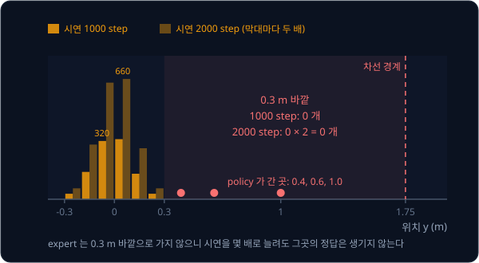

위 그림은 시연 1000 step(진한 주황)과 2000 step(옅은 주황)의 막대를 나란히 놓은 것이다. 막대는 모두 두 배로 자랐지만 빨간
영역에는 막대가 하나도 없고, policy 가 rollout 에서 지나간 0.4, 0.6, 1.0 m 는 모두 그 빈 영역에 찍힌다.

기호로는 expert 가 운전할 때 지나가는 위치의 분포를 $d_{\pi^*}$, 학습한 policy 가 운전할 때 지나가는 위치의 분포를
$d_{\hat\pi}$ 라고 적는다. $d$ 는 distribution 의 첫 글자이고 아래 첨자는 누가 운전했는지를 가리킨다. 시연을 늘리는 것은
$d_{\pi^*}$ 에서 더 많이 뽑는 것일 뿐이라서, $d_{\hat\pi}$ 에만 있는 위치는 채워지지 않는다.

**흔한 오해.** "시연을 충분히 많이 모으면 compounding error 가 사라진다" 고 생각하기 쉽다. 위 표처럼 시연을 늘리면 expert 가
가는 곳의 막대만 커진다. policy 가 실수한 뒤에 들어가는 위치는 expert 가 가지 않는 곳이라 0 에 무엇을 곱해도 0 이다.

**확인 문제.** 같은 expert 의 시연을 1000 step 에서 5000 step 으로 늘리면 $0 \sim 0.1$ 구간과 0.3 바깥 구간의 step 수는 각각
대략 얼마가 될까?

답 보기

다섯 배로 늘었으므로 $0 \sim 0.1$ 구간은 $330 \times 5 = 1650$, 0.3 바깥은 $0 \times 5 = 0$ 이다.

### 비어 있는 위치의 정답

빈 위치를 채우려면 그 위치에 가 봐야 한다. 그런데 expert 는 그곳에 가지 않으니, 그곳에 가는 것은 실수를 하는 policy 쪽이다.
그래서 policy 에게 직접 운전을 맡겨 policy 가 실제로 들어간 위치를 기록하고, 그 위치마다 "여기서는 몇 도를 꺾었어야 했는가" 를
expert 에게 물으면 빈 곳에 정답이 붙는다.

이 예시의 expert 는 차의 정확한 위치만 알면 언제든 $a = 8y$ 를 계산해 답할 수 있는 프로그램이다. policy 가 지나간 세 위치에
정답을 붙이면 아래와 같다.

| 위치 $y$ (m) | $d_L$ (m) | $d_R$ (m) | $x = d_R - d_L$ | expert 의 정답 $a = 4x$ (도) |
| --- | --- | --- | --- | --- |
| 0.4 | 1.35 | 2.15 | 0.8 | 3.2 |
| 0.6 | 1.15 | 2.35 | 1.2 | 4.8 |
| 1.0 | 0.75 | 2.75 | 2.0 | 8.0 |

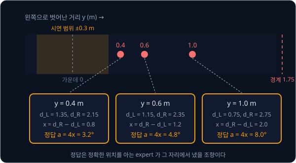

위 그림의 위쪽 띠는 차선을 위에서 본 것이다. 주황 영역이 시연이 있던 범위이고, 빨간 점이 policy 가 들어간 위치다. 아래 상자마다
그 위치에서 센서가 읽는 값과 expert 가 낸 정답이 적혀 있다. 이 쌍들은 "차가 1.0 m 벗어나 $d_L = 0.75$, $d_R = 2.75$ 를
읽었다면 오른쪽으로 8° 꺾어라" 처럼, 시연에는 한 번도 없던 "벗어난 뒤 돌아오는 법" 을 담고 있다.

**확인 문제.** policy 가 0.8 m 벗어난 위치에 들어갔다. 이 위치의 $x$ 와 expert 의 정답은?

답 보기

$d_L = 1.75 - 0.8 = 0.95$, $d_R = 1.75 + 0.8 = 2.55$ 라서 $x = 1.6$ 이고, 정답은 $4 \times 1.6 = 6.4$° 다.

**요약**

- expert 는 0.3 m 바깥으로 가지 않으므로 시연을 몇 배로 늘려도 그곳의 기록은 0 이다. 시연을 늘리는 것은 $d_{\pi^*}$ 에서 더
  뽑는 것일 뿐이다
- 빈 위치는 실수하는 policy 가 직접 운전해야 들어갈 수 있고, 그 위치마다 expert 에게 정답 $a = 8y$ 를 물으면 "벗어난 뒤 돌아오는
  법" 이 데이터에 생긴다

## DAgger 의 반복

### Dataset Aggregation

앞 절의 생각을 되풀이하는 방법이 DAgger 다. 2011년 Ross·Gordon·Bagnell 이 제안했고, 이름은 Dataset Aggregation 을 줄인
것이다. aggregation 은 "여러 개를 한데 모으기" 라는 뜻이라서, 이름 그대로 "데이터를 계속 모아 합친다" 는 방법이다.

반복 한 바퀴를 iteration 이라고 하고, iteration 하나는 네 단계다.

1. 지금의 policy 에게 운전을 맡긴다
2. 차가 지나간 위치마다 센서 값 $o$ 를 기록한다
3. 각 위치에서 expert 가 냈을 action $\pi^*(o)$ 를 정답으로 붙인다
4. 새 쌍을 지금까지 모은 데이터에 합치고, 합친 데이터 전체로 policy 를 다시 학습한다

새로 학습한 policy 로 다시 1 번부터 시작하면 다음 iteration 이다. iteration 번호를 $i$ 로 적고, iteration $i$ 에서 운전하는
policy 를 $\hat\pi_i$ 로 적는다. $\hat\pi_2$ 는 "두 번째 iteration 에서 운전하는 policy" 다.

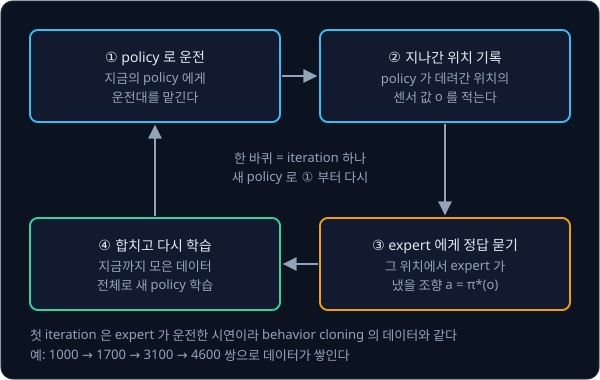

위 그림은 네 단계가 한 바퀴를 도는 모습이다. 파란 상자 두 개는 policy 가 운전하며 위치를 모으는 단계, 주황 상자는 expert 에게
묻는 단계, 초록 상자는 학습 단계다. 학습하는 방법은 BC 와 같고, 학습에 쓰는 데이터를 모으는 방법만 다르다.

**확인 문제.** DAgger 의 네 단계 가운데 expert 가 하는 일은 어느 단계이고, 그 단계에서 expert 는 운전대를 잡을까?

답 보기

③ 단계다. expert 는 운전대를 잡지 않고, policy 가 데려간 위치마다 "여기서는 몇 도를 꺾었어야 했는가" 만 답한다.

### 첫 iteration 과 시연 데이터

첫 iteration 에는 아직 학습한 policy 가 없다. 그래서 첫 iteration 에서는 expert 가 직접 운전하고, 그 기록에 expert 자신의
action 을 정답으로 붙인다. 이것은 BC 의 시연과 똑같다. 이 강의에서는 BC 강의의 시연 1000 step 을 iteration 1 의 데이터로 쓴다.

iteration 1 의 데이터로 학습한 policy 가 $\hat\pi_2$ 이고, BC 강의에서 step 7 에 차선을 벗어난 바로 그 policy 다. 정리하면
iteration 1 까지는 BC 와 같고, iteration 2 부터 DAgger 만의 일이 시작된다.

**확인 문제.** $\hat\pi_2$ 를 학습한 데이터는 몇 쌍이고, 그 데이터는 누가 운전한 기록일까?

답 보기

iteration 1 의 시연 1000 쌍이고, expert 가 운전한 기록이다. 그래서 $\hat\pi_2$ 는 BC 로 학습한 policy 와 같다.

### 이 강의의 계산 규칙

iteration 이 지날 때 차가 어떻게 움직이는지 손으로 계산하려면, 학습한 policy 가 어디서 얼마나 틀리는지 정해 두어야 한다. BC 강의의
규칙을 그대로 쓰되, "시연 범위" 를 "데이터에 정답이 있는 범위" 로 넓혀 읽는다.

- **아는 범위** — 가운데(0)부터 데이터에 정답이 있는 가장 먼 위치 $c$ 까지를 policy 가 아는 범위로 본다. 사이사이 정답이 없는
  위치는 양옆 정답을 이어서 맞힌다고 둔다. iteration 1 의 시연만 있으면 $c = 0.3$ 이다
- **아는 범위 안** ($y \le c$) — policy 는 거의 맞히지만 한 step 에 0.1 m 씩 왼쪽으로 밀려난다
- **아는 범위 밖** ($y > c$) — 처음 보는 센서 값이라 $0.1 + (y - c)$ 만큼 밀려난다
- **expert 가 운전한 step** — 오차가 없어서 $y$ 가 그대로다
- **episode** — 처음부터 끝까지 한 번 운전하는 것을 episode 라고 했다. 이 강의의 episode 는 길어야 15 step 이고, $y$ 가
  1.75 m 를 넘으면 차선을 벗어난 것이라 그 자리에서 끊는다. 벗어난 위치는 기록하지 않는다

$c = 0.3$ 이면 이 규칙은 BC 강의의 계산표와 똑같다. 기호 $\le$ 는 "작거나 같다", $>$ 는 "크다" 로 읽는다.

규칙에 단순하게 만든 부분이 두 곳 있다. 첫째, policy 의 0.1 m 오차가 늘 왼쪽으로만 쌓인다고 두었다. 실제 오차는 왼쪽과 오른쪽으로
섞여 나와 서로 상쇄되기도 하므로, 이 계산은 가장 나쁜 경우를 따라간다. 둘째, 실제 expert 는 벗어난 차를 가운데로 되돌리지만
계산을 쉽게 하려고 "더 밀려나지 않는다" 로만 두었다.

정답 $a = 4x$ 는 직선 하나라서, policy 가 [Linear Regression](../linear-regression/README.md) 의 직선 $\hat a = wx + b$ 라면 0.3 m
안쪽 데이터만으로도 $w = 4$, $b = 0$ 을 찾아 바깥까지 그대로 늘여 쓸 수 있다. 그런데 실제 차의 policy 는 BC 강의에서 본 것처럼 센서 15 개를 받는 MLP(곱하고 더하는 층을 여러 겹 쌓은 모델)이고, 차선 경계에 가까워지면 15 개 센서 값이
가운데에서와 전혀 다른 모양이 되어 데이터에 없는 곳에서는 맞히지 못한다. 위 규칙은 이 성질을 숫자 하나 $c$ 로 줄인 것이다.

**확인 문제.** $c = 0.5$ 인 policy 가 $y = 0.7$ 에 있다. 한 step 뒤 $y$ 는?

답 보기

$0.7 > 0.5$ 라서 아는 범위 밖이다. $0.1 + (0.7 - 0.5) = 0.3$ 만큼 밀려나 $0.7 + 0.3 = 1.0$ 이 된다.

### iteration 2 의 손 계산

iteration 2 에서는 $\hat\pi_2$ ($c = 0.3$) 가 운전한다. 아래 표는 BC 강의의 rollout 에 한 열을 더한 것으로, 마지막 열이
DAgger 가 새로 만드는 정답이다.

| step | $y$ (m) | 아는 범위 ($c = 0.3$) | 밀려난 거리 (m) | 다음 $y$ (m) | 기록할 정답 $8y$ (도) |
| --- | --- | --- | --- | --- | --- |
| 0 | 0.0 | 안 | 0.1 | 0.1 | 0 |
| 1 | 0.1 | 안 | 0.1 | 0.2 | 0.8 |
| 2 | 0.2 | 안 | 0.1 | 0.3 | 1.6 |
| 3 | 0.3 | 안 | 0.1 | 0.4 | 2.4 |
| 4 | 0.4 | 밖 | 0.2 | 0.6 | 3.2 |
| 5 | 0.6 | 밖 | 0.4 | 1.0 | 4.8 |
| 6 | 1.0 | 밖 | 0.8 | 1.8 | 8.0 |
| 7 | 1.8 | 이탈 | — | — | 기록 안 함 |

step 0 부터 6 까지 일곱 위치에 정답이 붙는다. 실제로는 iteration 마다 episode 를 여러 번 돌리므로, 이 강의에서는 iteration 마다
같은 운전을 100 번 한다고 둔다. 규칙에 무작위가 없어서 100 번 모두 같은 길을 가고, 위치마다 정답이 100 개씩 쌓인다. 새로 생긴
쌍은 $7 \times 100 = 700$ 개라서 데이터는 $1000 + 700 = 1700$ 쌍이 된다.

새 데이터에서 가장 먼 위치는 1.0 m 다. 그래서 iteration 2 의 데이터까지 합쳐 학습한 $\hat\pi_3$ 은 아는 범위가 $c = 1.0$ 으로
넓어진다. 0.5, 0.7, 0.8, 0.9 m 에는 정답이 없지만 양옆 정답(0.4 와 0.6, 0.6 과 1.0)을 이어서 맞힌다고 둔 규칙 때문이다.

**확인 문제.** iteration 2 에서 0.3 m 바깥의 위치에 붙은 정답은 모두 몇 쌍일까? (episode 100 번)

답 보기

0.3 m 바깥 위치는 0.4, 0.6, 1.0 세 곳이고, 위치마다 100 쌍이라 $3 \times 100 = 300$ 쌍이다.

### 실행한 조향과 저장하는 정답

iteration 2 에서 차를 움직인 것은 policy 의 조향이다. 하지만 데이터에 저장하는 정답은 policy 가 꺾은 각도가 아니라 같은 위치에서
expert 가 냈을 각도다. 두 값은 서로 다르고, 그 차이가 바로 policy 가 배워야 할 내용이다.

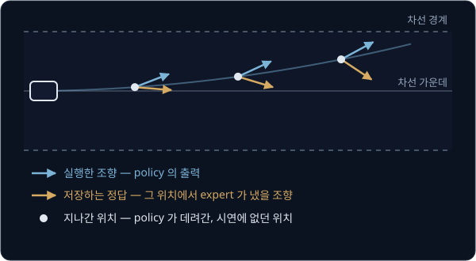

위 그림에서 흰 점은 policy 가 운전하며 지나간 위치다. 파란 화살표는 policy 가 실제로 꺾은 방향이라 차는 계속 왼쪽 위로 밀려나고,
주황 화살표는 expert 가 같은 위치에서 냈을 조향이라 차를 가운데 쪽으로 돌려놓는 방향이다. DAgger 는 주황 화살표만 저장한다.

**흔한 오해.** policy 가 실제로 꺾은 각도를 그대로 정답으로 저장해도 데이터가 늘어나니 도움이 된다고 생각하기 쉽다. 예를 들어
0.6 m 에서 policy 가 1.6° 를 꺾었는데 그 1.6° 를 정답으로 저장하면, 다시 학습한 policy 는 0.6 m 에서 또 1.6° 를 낸다. 자기가 이미
내던 값을 다시 배운 것이라 새로 아는 것이 없고, 아는 범위는 $c = 0.3$ 그대로다. 그러면 다음 iteration 의 rollout 도 위 표와 똑같이
step 7 에 벗어나고, 이 일이 iteration 마다 되풀이된다. 아는 범위를 넓히는 것은 데이터의 양이 아니라 expert 의 정답이다.

**확인 문제.** 1.0 m 에서 policy 가 2° 를 꺾었다. 이 위치에 저장할 정답은 몇 도일까?

답 보기

policy 가 꺾은 2° 가 아니라 expert 의 정답 $8 \times 1.0 = 8$° 다.

### 모은 데이터 전체로 다시 학습

4 단계를 식으로 적으면 아래와 같다.

$$
\mathcal{D} \leftarrow \mathcal{D} \cup \{(o,\ \pi^*(o))\}, \qquad
\hat\pi_{i+1} = \arg\min_{\pi} \sum_{(o,\,a)\in\mathcal{D}} \big(\pi(o) - a\big)^2
$$

기호를 하나씩 읽으면 아래와 같다.

- $\mathcal{D}$ 는 "필기체 D" 라고 읽고, 지금까지 모은 (관측, 정답) 쌍 전체의 묶음이다. D 는 dataset 의 첫 글자다
- $\{ \cdots \}$ 는 쌍 여러 개를 하나로 묶은 것이고, 여기서는 이번 iteration 에 새로 모은 쌍들이다. 쌍마다 관측 $o$ 와 그 관측에서
  expert 가 낼 action $\pi^*(o)$ 가 짝을 이룬다
- $\cup$ 는 합집합(union)이라고 읽고, 두 묶음을 하나로 합친다는 뜻이다. $\{(1, 4), (2, 8)\} \cup \{(0.8, 3.2)\}$ 는
  $\{(1, 4), (2, 8), (0.8, 3.2)\}$ 다
- $\leftarrow$ 는 "오른쪽에서 계산한 것을 왼쪽에 새로 넣는다" 는 뜻이다. 그래서 첫 식은 "지금까지의 데이터에 새 쌍을 합쳐 데이터를
  바꾼다" 로 읽는다
- $\arg\min_\pi$ 는 "아그 민" 이라고 읽고, 뒤의 값을 가장 작게 만드는 $\pi$ 를 고르라는 뜻이다. 뒤의 값은 데이터의 쌍마다 예측
  $\pi(o)$ 에서 정답 $a$ 를 빼서 제곱해 모두 더한 것이다

그래서 둘째 식은 "합친 데이터 전체에서 오차 제곱의 합을 가장 작게 만드는 policy 를 다음 policy $\hat\pi_{i+1}$ 로 삼는다" 로
읽는다. 오차 제곱의 합을 쌍의 개수로 나누면 MSE(mean squared error, 오차 제곱의 평균)가 되는데, 평균은 모두 더해
개수로 나눈 값이다. 합이 가장 작은 policy 는 개수로 나눈 평균도 가장 작으므로, 어느 쪽으로 재도 고르는 policy 는 같다.
실제 학습은 BC 와 같이, 오차를 줄이는 방향(gradient)을 구해 policy 안의 숫자(parameter)를 조금씩 고치는 방식으로 한다.

iteration 2 의 숫자에 맞추면 $\mathcal{D}$ 는 처음에 시연 1000 쌍이고, 새 묶음은 0, 0.1, 0.2, 0.3, 0.4, 0.6, 1.0 m 의 쌍 700 개다.
합친 $\mathcal{D}$ 는 1700 쌍이고, 이것으로 학습한 policy 가 $\hat\pi_3$ 이다.

DAgger 는 이번 iteration 의 데이터만이 아니라 처음부터 모은 데이터 전체로 학습한다. 이번 데이터만 쓰면 policy 가 이번에 가지 않은
곳의 정답을 잊는다. 예를 들어 어떤 iteration 의 policy 가 가운데 근처에만 머물렀다면 그 데이터에는 1.0 m 의 정답이 없고, 그것만으로
학습한 다음 policy 는 1.0 m 를 다시 모르게 되어 또 그곳으로 밀려나 버린다. 전체를 합쳐 두면 한 번 받은 정답이 계속 남는다.

**확인 문제.** 오차를 MSE 로 재는 직선 policy $\hat a = 4x$ 에 쌍 $(1, 4)$, $(2, 8)$, $(0.8, 3.2)$ 를 넣으면 오차 제곱의 합은?
같은 쌍들에서 $\hat a = 3x$ 의 오차 제곱의 합은?

답 보기

$\hat a = 4x$ 의 예측은 4, 8, 3.2 라서 오차가 모두 0 이고 합도 0 이다. $\hat a = 3x$ 의 예측은 3, 6, 2.4 이고 오차는 $-1$, $-2$,
$-0.8$ 이라 제곱은 1, 4, 0.64, 합은 $5.64$ 다. 둘 중 $\arg\min$ 이 고르는 것은 합이 더 작은 $\hat a = 4x$ 다.

**요약**

- DAgger(Dataset Aggregation)의 iteration 하나는 policy 로 운전 → 지나간 위치 기록 → expert 의 정답 붙이기 → 모은 데이터 전체로
  다시 학습이다. iteration 1 은 expert 가 운전하는 시연이라 BC 와 같다
- iteration 2 에서 $\hat\pi_2$ 가 간 위치 일곱 곳에 정답이 붙어 데이터가 1000 쌍에서 1700 쌍이 되고, 아는 범위가 0.3 m 에서
  1.0 m 로 넓어진다
- 저장하는 정답은 늘 expert 의 action 이다. policy 가 실행한 조향을 저장하면 새로 배우는 것이 없다

## iteration 별 데이터와 오차

### iteration 3 과 4 의 rollout

iteration 3 에서는 $\hat\pi_3$ ($c = 1.0$) 이 운전한다. 1.0 m 까지는 아는 범위라 0.1 m 씩만 밀려난다.

| step | $y$ (m) | 아는 범위 ($c = 1.0$) | 밀려난 거리 (m) | 다음 $y$ (m) |
| --- | --- | --- | --- | --- |
| 0 | 0.0 | 안 | 0.1 | 0.1 |
| 1 | 0.1 | 안 | 0.1 | 0.2 |
| 2 | 0.2 | 안 | 0.1 | 0.3 |
| 3 | 0.3 | 안 | 0.1 | 0.4 |
| 4 | 0.4 | 안 | 0.1 | 0.5 |
| 5 | 0.5 | 안 | 0.1 | 0.6 |
| 6 | 0.6 | 안 | 0.1 | 0.7 |
| 7 | 0.7 | 안 | 0.1 | 0.8 |
| 8 | 0.8 | 안 | 0.1 | 0.9 |
| 9 | 0.9 | 안 | 0.1 | 1.0 |
| 10 | 1.0 | 안 (끝) | 0.1 | 1.1 |
| 11 | 1.1 | 밖 | $0.1 + (1.1 - 1.0) = 0.2$ | 1.3 |
| 12 | 1.3 | 밖 | $0.1 + (1.3 - 1.0) = 0.4$ | 1.7 |
| 13 | 1.7 | 밖 | $0.1 + (1.7 - 1.0) = 0.8$ | 2.5 |

step 14 에 $y = 2.5$ 로 차선을 벗어난다. $\hat\pi_2$ 가 step 7 에 벗어났던 것과 비교하면 두 배를 버텼다. 오차가 0.2, 0.4, 0.8 로
불어나는 모양은 그대로인데, 불어나기 시작하는 자리가 0.3 m 에서 1.0 m 로 밀려났다. 기록한 위치는 step 0 부터 13 까지 14 곳이라 새
쌍은 $14 \times 100 = 1400$ 개, 데이터는 $1700 + 1400 = 3100$ 쌍이 된다. 가장 먼 정답은 1.7 m 라서 $\hat\pi_4$ 의 아는 범위는
$c = 1.7$ 이다.

iteration 4 에서는 $\hat\pi_4$ ($c = 1.7$) 가 운전한다. 15 step 동안 $y$ 는 0, 0.1, 0.2, …, 1.4 를 지나는데, 모두 1.7 보다 작아
아는 범위 안이다. 매 step 0.1 m 씩 밀려나 15 step 이 끝날 때 $y = 0.1 \times 15 = 1.5$ 이고, 1.75 m 를 넘지 않았으니 차선 안에
남는다. 기록한 위치는 15 곳이라 데이터는 $3100 + 1500 = 4600$ 쌍이 된다. 새로 모은 위치 중 가장 먼 곳은 1.4 m 라서 아는 범위는
$c = 1.7$ 그대로이고, iteration 5 의 policy 도 iteration 4 와 같은 길을 간다.

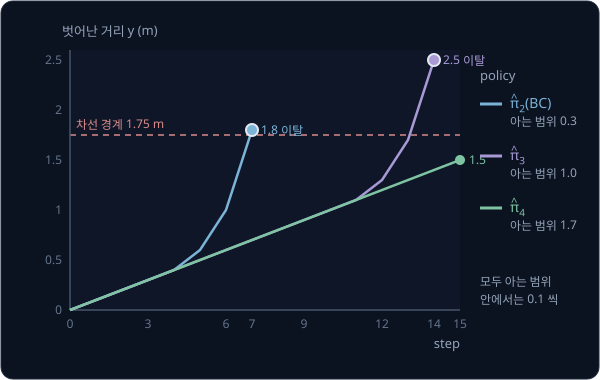

위 그림은 세 policy 의 $y$ 를 step 마다 찍어 이은 것이다. 아는 범위 안에서는 세 policy 가 똑같이 0.1 m 씩 밀려나므로 선이 겹친다.
파란 선($\hat\pi_2$)은 step 4 에서, 보라 선($\hat\pi_3$)은 step 11 에서 갈라져 가팔라지고, 초록 선($\hat\pi_4$)은 끝까지 곧은
직선이다.

| iteration | 운전한 policy | 아는 범위 $c$ (m) | 이탈 step | 새 쌍 | 누적 쌍 |
| --- | --- | --- | --- | --- | --- |
| 1 | expert | — | — | 1000 | 1000 |
| 2 | $\hat\pi_2$ (BC) | 0.3 | 7 | 700 | 1700 |
| 3 | $\hat\pi_3$ | 1.0 | 14 | 1400 | 3100 |
| 4 | $\hat\pi_4$ | 1.7 | 없음 (15 step 완주) | 1500 | 4600 |

**확인 문제.** iteration 3 의 rollout 에서 기록한 위치 중 1.0 m 보다 먼 곳은 어디이고, 그 위치들의 정답은 몇 도일까?

답 보기

1.1, 1.3, 1.7 m 다. 정답은 $8y$ 라서 각각 $8.8$°, $10.4$°, $13.6$° 다.

### 데이터 분포의 변화

iteration 이 지날 때 누적 데이터가 어디에 퍼져 있는지 세어 보자. 시연 1000 쌍은 모두 0.3 m 안쪽에 있었다. 0.3 m 바깥 위치의 쌍은
iteration 2 에서 0.4, 0.6, 1.0 의 300 쌍, iteration 3 에서 0.4 ~ 1.0 의 일곱 곳과 1.1, 1.3, 1.7 을 합친 열 곳의 1000 쌍,
iteration 4 에서 0.4 ~ 1.4 의 열한 곳의 1100 쌍이 생긴다.

| 시점 | 누적 쌍 | 0.3 m 안쪽 | 0.3 m 바깥 | 바깥의 비율 | 가장 먼 정답 (m) |
| --- | --- | --- | --- | --- | --- |
| iteration 1 뒤 | 1000 | 1000 | 0 | 0 % | 0.3 |
| iteration 2 뒤 | 1700 | 1400 | 300 | 약 18 % | 1.0 |
| iteration 3 뒤 | 3100 | 1800 | 1300 | 약 42 % | 1.7 |
| iteration 4 뒤 | 4600 | 2200 | 2400 | 약 52 % | 1.7 |

0.3 m 안쪽은 시연 1000 쌍에 iteration 마다 0, 0.1, 0.2, 0.3 m 의 네 곳 × 100 = 400 쌍씩 더해져 1000, 1400, 1800, 2200 이 된다.
바깥의 비율은 바깥 쌍을 누적 쌍으로 나눈 값으로, iteration 2 뒤라면 $300 \div 1700 \approx 0.18$, 곧 100 쌍 중 18 쌍꼴이다.

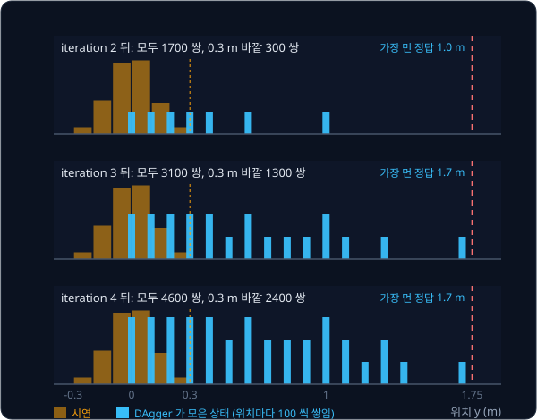

위 그림은 세 시점의 누적 데이터를 위치마다 막대로 그린 것이다. 주황 막대(시연)는 세 시점 모두 같고, 파란 막대(DAgger 가 모은
위치)가 iteration 마다 오른쪽으로 퍼지며 같은 위치에서는 키가 자란다. iteration 1 뒤의 데이터 분포가 $d_{\pi^*}$ 하나였다면,
iteration 이 지날수록 데이터는 policy 들이 실제로 간 분포 $d_{\hat\pi_2}$, $d_{\hat\pi_3}$, $d_{\hat\pi_4}$ 를 함께 담는다.
DAgger 는 학습 데이터의 분포를 policy 가 운전할 때 만나는 분포 쪽으로 옮겨서 distribution shift 를 줄인다.

데이터의 양이 아니라 데이터가 놓인 자리가 차이를 만든다는 것도 숫자로 확인할 수 있다. iteration 4 뒤의 4600 쌍과 같은 양을 expert
의 시연만으로 모았다고 하자. expert 는 0.3 m 바깥으로 가지 않으므로 4600 쌍도 모두 0.3 m 안쪽에 있고, 아는 범위는 $c = 0.3$ 그대로다.
이 데이터로 학습한 policy 는 $\hat\pi_2$ 와 똑같이 step 7 에 벗어난다. 같은 4600 쌍이라도 DAgger 의 데이터로 학습한 $\hat\pi_4$ 는
15 step 을 완주한다.

| 데이터 4600 쌍을 모은 방법 | 0.3 m 바깥 쌍 | 아는 범위 $c$ (m) | 이탈 step |
| --- | --- | --- | --- |
| expert 의 시연만 | 0 | 0.3 | 7 |
| DAgger (iteration 1 ~ 4) | 2400 | 1.7 | 없음 (15 step 완주) |

**확인 문제.** expert 의 시연을 10,000 쌍까지 늘려 학습한 policy 는 이 계산 규칙에서 몇 step 째에 차선을 벗어날까?

답 보기

시연은 아무리 늘려도 0.3 m 안쪽뿐이라 $c = 0.3$ 이고, rollout 은 $\hat\pi_2$ 와 같은 $0, 0.1, 0.2, 0.3, 0.4, 0.6, 1.0, 1.8$ 이라
step 7 에 벗어난다.

**확인 문제.** iteration 3 뒤에 1.0 m 위치에 쌓인 쌍은 몇 개일까?

답 보기

1.0 m 는 iteration 2 의 rollout(step 6)과 iteration 3 의 rollout(step 10)에서 한 번씩 기록됐다. episode 100 번씩이라
$100 + 100 = 200$ 쌍이다.

### 자기가 간 상태에서 잰 오차

policy 가 얼마나 잘하는지 재는 방법은 두 가지다. 시연에서 떼어 둔 쌍으로 오차를 재는 validation loss 가 하나이고, policy 가
직접 운전하며 간 위치에서 오차를 재는 것이 다른 하나다. 이 예시에서 오차는 한 step 에 밀려난 거리다.

시연은 모두 0.3 m 안쪽에 있고 세 policy 모두 그곳을 알기 때문에, 시연 위치에서 재면 오차는 셋 다 한 step 에 0.1 m 다. 자기가 간
위치에서 재면 사정이 다르다. $\hat\pi_2$ 의 rollout 에서 밀려난 거리는 0.1, 0.1, 0.1, 0.1, 0.2, 0.4, 0.8 이고, 합은 1.8, step 은
7 개라 평균은 $1.8 \div 7 \approx 0.26$ m 다.

| policy | 시연 위치에서 잰 오차 (m) | 자기가 간 위치의 오차 합 (m) | step 수 | 자기가 간 위치에서 잰 평균 오차 (m) |
| --- | --- | --- | --- | --- |
| $\hat\pi_2$ (BC) | 0.1 | $0.1 \times 4 + 0.2 + 0.4 + 0.8 = 1.8$ | 7 | $1.8 \div 7 \approx 0.26$ |
| $\hat\pi_3$ | 0.1 | $0.1 \times 11 + 0.2 + 0.4 + 0.8 = 2.5$ | 14 | $2.5 \div 14 \approx 0.18$ |
| $\hat\pi_4$ | 0.1 | $0.1 \times 15 = 1.5$ | 15 | $1.5 \div 15 = 0.10$ |

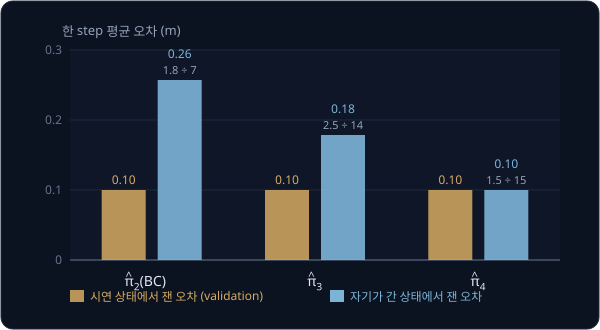

위 그림의 주황 막대는 세 policy 가 똑같은데 파란 막대는 iteration 마다 낮아진다. validation loss 만 보면 세 policy 가 똑같아
보이지만, 실제 운전에서 중요한 것은 파란 막대다. DAgger 의 iteration 은 파란 막대를 주황 막대 높이까지 끌어내리는 과정이다.

**흔한 오해.** "validation loss 가 그대로이니 DAgger 가 아무것도 고치지 못했다" 고 판단하기 쉽다. 위 표에서 validation loss 에
해당하는 왼쪽 열은 0.1 에서 움직이지 않지만, 차선을 벗어나던 policy 는 15 step 을 완주하게 됐다. validation set 이 시연에서 뗀
쌍이라 policy 가 스스로 만든 낯선 위치가 하나도 들어 있지 않기 때문이다.

**확인 문제.** 어떤 policy 의 rollout 에서 밀려난 거리가 0.1, 0.1, 0.2, 0.4 였다. 자기가 간 위치에서 잰 평균 오차는?

답 보기

합은 $0.1 + 0.1 + 0.2 + 0.4 = 0.8$ 이고 step 이 4 개라 $0.8 \div 4 = 0.2$ m 다.

### DAgger 가 줄이지 못하는 오차

$\hat\pi_4$ 도 한 step 에 0.1 m 씩은 계속 밀려나서, 15 step 뒤에는 1.5 m 까지 벗어나 있다. DAgger 가 없앤 것은 낯선 위치에서
오차가 0.2, 0.4, 0.8 로 불어나는 부분이고, 아는 위치에서도 남는 0.1 m 는 그대로다. 그 0.1 m 를 줄이는 일은 더 좋은 모델과 더
정확한 학습의 몫이다.

위 계산에서 1.5 m 까지 밀려난 것은 0.1 m 오차가 늘 왼쪽으로만 쌓인다고 둔 가장 나쁜 경우라서 생긴 일이기도 하다. 실제 policy 는
아는 위치에서 expert 처럼 가운데 쪽으로 돌아오는 조향을 배워서, 작은 오차가 생겨도 다음 step 들에서 되돌아온다. 그 "되돌아오는
법" 이 바로 DAgger 가 벗어난 위치마다 받아 둔 정답이다.

논문은 이 "되돌아오는 법" 의 효과를 실험으로 보였다. Ross 등은 3D 자동차 경주 게임 Super Tux Kart 에서 사람이 조이스틱으로 매 장면의 올바른 조향을
알려 주게 하고, 공중에 떠 있는 트랙에서 한 바퀴에 몇 번 떨어지는지를 쟀다. iteration 마다 한 바퀴(약 1000 쌍)씩 데이터를 모았는데,
expert 의 주행만으로 학습한 방식은 데이터를 늘려도 나아지지 않았는데, 논문은 그 이유를 비슷한 주행만 반복되어 실수에서 돌아오는
법을 배우지 못했기 때문이라고 설명했다. 반면 DAgger 는 5 iteration 뒤에 거의 떨어지지 않다가 15 iteration
뒤에는 한 번도 떨어지지 않았다.

숫자를 바꿔 같은 계산을 한 번 더 해 보자. 아는 범위 안에서 한 step 에 0.2 m 씩 밀려나는 더 서툰 policy 라면, 아는 범위 밖에서는
$0.2 + (y - c)$ 만큼 밀려난다. 시연만 있는 $c = 0.3$ 에서 iteration 2 의 rollout 은 아래와 같다.

| step | $y$ (m) | 아는 범위 ($c = 0.3$) | 밀려난 거리 (m) | 다음 $y$ (m) |
| --- | --- | --- | --- | --- |
| 0 | 0.0 | 안 | 0.2 | 0.2 |
| 1 | 0.2 | 안 | 0.2 | 0.4 |
| 2 | 0.4 | 밖 | $0.2 + (0.4 - 0.3) = 0.3$ | 0.7 |
| 3 | 0.7 | 밖 | $0.2 + (0.7 - 0.3) = 0.6$ | 1.3 |
| 4 | 1.3 | 밖 | $0.2 + (1.3 - 0.3) = 1.2$ | 2.5 |

step 5 에 차선을 벗어나고, 가장 먼 정답은 1.3 m 다. iteration 을 이어 가면 아래처럼 된다.

| iteration | 아는 범위 $c$ (m) | 지나간 위치 (m) | 이탈 step |
| --- | --- | --- | --- |
| 2 | 0.3 | 0, 0.2, 0.4, 0.7, 1.3 | 5 |
| 3 | 1.3 | 0, 0.2, …, 1.2, 1.4, 1.7 | 9 |
| 4 | 1.7 | 0, 0.2, …, 1.6 | 9 |

iteration 3 의 policy 는 1.2 m 까지 0.2 씩 가다가 1.4 m 에서 아는 범위를 벗어나 $0.2 + 0.1 = 0.3$, 1.7 m 에서 $0.2 + 0.4 = 0.6$ 만큼
밀려나 step 9 에 2.3 m 가 된다. iteration 4 의 policy 는 끝까지 아는 범위 안이지만 0.2 씩 아홉 번 밀려나 step 9 에 1.8 m 가 된다.
DAgger 로 step 5 가 step 9 까지 늦춰졌지만, 아는 위치에서도 0.2 m 씩 밀리는 policy 는 $1.75 \div 0.2 = 8.75$ 이므로 아홉 번째 step 에
경계를 넘는다. 불어나는 오차는 DAgger 가 없애고, 한 step 의 오차가 크면 그만큼은 남는다.

**확인 문제.** 계산 규칙에서 아는 범위 안의 오차를 0.1 m 대신 0.05 m 로 바꾸고 $c$ 가 충분히 크다면, 15 step 뒤 $y$ 는?

답 보기

매 step 0.05 m 씩 밀려나므로 $0.05 \times 15 = 0.75$ m 다. DAgger 의 iteration 은 그대로여도 한 step 의 오차를 줄이면 이렇게
결과가 좋아진다.

### 마지막에 쓸 policy 선택

DAgger 의 이론은 마지막 iteration 의 policy 가 가장 좋다고 보장하지 않는다. 보장하는 것은 "iteration 마다 얻은 policy 들 가운데
좋은 policy 가 적어도 하나 있다" 는 것이다. 그래서 논문의 알고리즘은 마지막 줄에서 iteration 마다 얻은 $\hat\pi_2, \hat\pi_3, \ldots$
를 검증용으로 따로 떼어 둔 데이터(validation)로 평가해 가장 좋은 것을 돌려준다.

위 예시라면 $\hat\pi_2$ 는 step 7, $\hat\pi_3$ 은 step 14 에 벗어나고 $\hat\pi_4$ 는 완주했으니 $\hat\pi_4$ 를 고른다. 실제 학습에서는
뒤의 policy 가 앞의 policy 보다 나빠지는 일도 있어서, 마지막 것을 그냥 쓰지 않고 iteration 마다 평가해 고른다.

**확인 문제.** 다섯 policy 를 각각 rollout 해 15 step 동안 차선을 지킨 비율을 쟀더니 40 %, 70 %, 90 %, 85 %, 88 % 였다. 어느 iteration 의
policy 를 쓸까?

답 보기

90 % 인 세 번째 policy 다. 마지막 policy 가 88 % 로 조금 더 낮으므로, 마지막 것을 고르지 않고 평가 결과로 고른다.

**요약**

- iteration 2, 3, 4 의 policy 는 아는 범위가 0.3, 1.0, 1.7 m 로 넓어지면서 step 7, step 14 에 벗어나다가 15 step 을 완주하고, 누적
  데이터는 1000, 1700, 3100, 4600 쌍으로 늘며 0.3 m 바깥의 비율이 0 % 에서 약 52 % 까지 오른다. 같은 4600 쌍을 시연만으로
  모으면 아는 범위가 0.3 m 그대로라 step 7 에 벗어난다
- 시연 위치에서 잰 오차는 0.1 m 로 그대로지만 자기가 간 위치에서 잰 평균 오차는 0.26, 0.18, 0.10 m 로 준다. DAgger 가 줄이는 것은
  낯선 위치에서 오차가 불어나는 부분이고, 아는 위치의 0.1 m 는 남는다
- 이론은 iteration 별 policy 들 가운데 좋은 것이 하나 있다고 보장하므로, 마지막에 쓸 policy 는 평가해서 고른다

## expert 와 policy 를 섞는 운전

### 확률 β

지금까지는 iteration 2 부터 policy 혼자 운전했다. 논문은 운전대를 expert 와 policy 가 나눠 잡는 방법도 함께 다룬다. step 마다
누가 운전할지 무작위로 정해서, 확률 $\beta$ 로 expert 의 조향을, 나머지 확률 $1 - \beta$ 로 policy 의 조향을 실행한다. $\beta$ 는
그리스 문자이고 beta(베타)라고 읽는다. $\beta = 0.5$ 라면 step 마다 동전을 던져 앞면이면 expert, 뒷면이면 policy 가 운전대를 잡는
것과 같다.

확률은 "여러 번 해 보면 몇 번에 한 번꼴로 일어나는가" 를 0 과 1 사이의 수로 적은 것이다. $\beta = 0.5$ 라면 두 번에 한 번꼴로
expert 가 운전하고, 10 step 이면 평균 $0.5 \times 10 = 5$ step 을 expert 가 운전한다. 동전을 실제로 던지면 매번 정확히 5 번이 나오지는
않고, 4 번이나 6 번이 나오기도 한다.

iteration $i$ 에서 이렇게 섞은 운전 규칙을 $\pi_i$ 라고 적고, 아래처럼 쓴다.

$$
\pi_i = \beta_i\,\pi^* + (1-\beta_i)\,\hat\pi_i
$$

이 식은 "iteration $i$ 의 운전은 확률 $\beta_i$ 로 expert $\pi^*$, 확률 $1 - \beta_i$ 로 학습한 policy $\hat\pi_i$ 가 맡는다" 로
읽는다. 모자를 쓰지 않은 $\pi_i$ 는 섞은 운전 규칙이고, 모자를 쓴 $\hat\pi_i$ 는 학습한 policy 다.

**흔한 오해.** 식에 덧셈과 곱셈이 있어서 두 조향을 섞어 평균을 낸다고 읽기 쉽다. 1.0 m 에서 expert 가 8°, policy 가 2° 를 낸다면
$\beta = 0.5$ 일 때 $0.5 \times 8 + 0.5 \times 2 = 5$° 를 꺾는 것이 아니다. 동전이 expert 를 고르면 8° 를, policy 를 고르면 2° 를
그대로 실행하고, 5° 를 실행하는 step 은 없다.

어느 쪽이 운전하든 저장하는 정답은 늘 expert 의 action 이다. expert 가 운전한 step 이라면 실행한 조향과 정답이 같고, policy 가 운전한
step 이라면 앞 절처럼 둘이 다르다.

**확인 문제.** $\beta = 0.25$ 로 20 step 을 운전하면 expert 가 운전하는 step 은 평균 몇 개일까?

답 보기

$0.25 \times 20 = 5$ 개다. 나머지 평균 15 step 은 policy 가 운전한다.

### β = 0.5 의 rollout

$\hat\pi_2$ ($c = 0.3$) 를 $\beta = 0.5$ 로 expert 와 섞어 운전해 보자. 동전이 아래 "운전자" 열처럼 나왔다고 하자. E 는 expert,
P 는 policy 다. 계산 규칙대로 expert 가 운전한 step 에는 $y$ 가 그대로다.

| step | $y$ (m) | 운전자 | 밀려난 거리 (m) | 다음 $y$ (m) | 기록할 정답 $8y$ (도) |
| --- | --- | --- | --- | --- | --- |
| 0 | 0.0 | P | 0.1 | 0.1 | 0 |
| 1 | 0.1 | E | 0 | 0.1 | 0.8 |
| 2 | 0.1 | P | 0.1 | 0.2 | 0.8 |
| 3 | 0.2 | P | 0.1 | 0.3 | 1.6 |
| 4 | 0.3 | E | 0 | 0.3 | 2.4 |
| 5 | 0.3 | P | 0.1 | 0.4 | 2.4 |
| 6 | 0.4 | P | $0.1 + 0.1 = 0.2$ | 0.6 | 3.2 |
| 7 | 0.6 | P | $0.1 + 0.3 = 0.4$ | 1.0 | 4.8 |
| 8 | 1.0 | E | 0 | 1.0 | 8.0 |
| 9 | 1.0 | P | $0.1 + 0.7 = 0.8$ | 1.8 | 8.0 |

10 번 중 E 가 3 번 나왔고, 차는 policy 혼자 운전할 때의 step 7 보다 늦은 step 10 에 벗어난다. 기록한 위치는 policy 혼자 운전할 때와
같은 0 ~ 1.0 m 범위지만, 가운데 근처 위치를 더 오래 지나며 모았다.

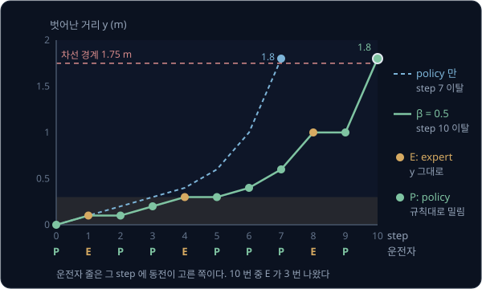

위 그림에서 주황 점은 expert 가 운전한 step 으로, 그 step 에는 선이 수평이다. 파란 점선은 같은 policy 가 혼자 운전한 경우다.
expert 가 끼어든 만큼 차가 천천히 밀려나서, 실수가 많은 초기 policy 로 데이터를 모을 때 차가 덜 위험한 곳에 머문다.

**확인 문제.** 같은 $\hat\pi_2$ 를 운전자 순서 P, P, E, E, P 로 5 step 운전하면 $y$ 는 어떻게 변할까?

답 보기

$y$ 는 $0 \to 0.1 \to 0.2 \to 0.2 \to 0.2 \to 0.3$ 이다. P 일 때만 0.1 씩 밀려나고 E 일 때는 그대로다. 마지막 $y = 0.3$ 은 아직
아는 범위 안이다.

### β schedule

iteration 마다 $\beta_i$ 를 어떻게 바꿀지 정한 것을 schedule 이라고 한다. 논문은 두 가지를 다룬다.

| schedule | $\beta_1$ | $\beta_2$ | $\beta_3$ | $\beta_4$ |
| --- | --- | --- | --- | --- |
| $\beta_i = p^{\,i-1}$, $p = 0.5$ | 1 | 0.5 | 0.25 | 0.125 |
| $\beta_i = \mathbb{1}[i = 1]$ | 1 | 0 | 0 | 0 |

첫 줄의 $p^{\,i-1}$ 은 $p$ 를 $i - 1$ 번 곱한다는 뜻이다. $i = 3$ 이면 $0.5 \times 0.5 = 0.25$ 이고, $i = 1$ 이면 한 번도 곱하지
않아서 1 로 정한다. iteration 마다 expert 의 몫이 절반으로 줄어든다.

둘째 줄의 $\mathbb{1}[\cdots]$ 는 indicator function 이라고 부르고, 괄호 안이 맞으면 1, 틀리면 0 을 낸다. $\mathbb{1}[i = 1]$ 은
$i = 1$ 일 때만 1 이라서, iteration 1 은 expert 만 운전하고 그 뒤로는 policy 만 운전한다. 이 강의의 iteration 2 ~ 4 계산이 이
schedule 이었다.

두 schedule 모두 $\beta_1 = 1$ 로 시작한다. iteration 1 은 expert 만 운전하니 학습한 policy 가 없어도 시작할 수 있고, 그 데이터가
BC 의 시연과 같다. 논문은 이 둘 가운데 parameter $p$ 를 정할 필요가 없는 $\mathbb{1}[i = 1]$ 이 실제로는 가장 잘 될 때가 많다고 적었다.
expert 가 오래 끼어들수록 모은 위치가 expert 의 분포 쪽으로 돌아가서, policy 가 혼자 갈 위치를 늦게 채우기 때문이다.

**확인 문제.** $p = 0.5$ schedule 에서 iteration 5 의 $\beta_5$ 는? 이 iteration 에 100 step 을 운전하면 expert 는 평균 몇 step 을
운전할까?

답 보기

$\beta_5 = 0.5^{4} = 0.5 \times 0.5 \times 0.5 \times 0.5 = 0.0625$ 이고, $0.0625 \times 100 = 6.25$ step 이다.

**요약**

- 섞은 운전 $\pi_i = \beta_i\pi^* + (1-\beta_i)\hat\pi_i$ 는 step 마다 확률 $\beta_i$ 로 expert, $1 - \beta_i$ 로 policy 가 운전대를
  잡는다는 뜻이다. 두 조향의 평균을 실행하는 것이 아니고, 저장하는 정답은 늘 expert 의 action 이다
- $\beta = 0.5$ 로 섞으면 $\hat\pi_2$ 의 차가 step 7 대신 step 10 에 벗어나 초기 데이터 수집이 덜 위험하다
- schedule 은 $\beta_i = 0.5^{i-1}$ 과 $\beta_i = \mathbb{1}[i = 1]$ 이 있고, 둘 다 $\beta_1 = 1$ 이라 iteration 1 은 BC 의 시연과 같다

## 실수가 쌓이는 정도

### 실수 한 번의 피해

BC 강의에서는 오차가 쌓이는 정도를 "틀린 step 수" 로 셌다. policy 가 step 마다 틀릴 확률을 $\epsilon$ (epsilon, 엡실론), episode
의 길이를 $T$ 로 적었다. $\epsilon = 0.1$ 이면 10 번에 한 번꼴로 틀린다는 뜻이다.

BC 의 가장 나쁜 경우에는 한 번 틀려서 시연에 없는 위치로 들어가면 그 뒤 step 이 모두 틀렸다. 10 step 짜리 episode 에서 step 4 에
처음 틀리면 step 4 부터 10 까지 7 번 틀린다. DAgger 로 학습한 policy 는 벗어난 위치의 정답도 배웠기 때문에, 한 번 틀려도 몇 step
안에 돌아온다. 실수 한 번 때문에 틀리게 되는 step 수(실수한 그 step 포함)의 상한을 $u$ 라고
하면, $u = 2$ 인 policy 는 step 4 에 틀렸을 때 step 4, 5 두 번만 틀리고 step 6 부터는 다시 맞힌다.

| 첫 실수가 나온 step | 1 | 2 | 3 | 4 | 5 | 6 | 7 | 8 | 9 | 10 |
| --- | --- | --- | --- | --- | --- | --- | --- | --- | --- | --- |
| BC 의 가장 나쁜 경우에 틀린 step 수 | 10 | 9 | 8 | 7 | 6 | 5 | 4 | 3 | 2 | 1 |
| $u = 2$ 일 때 틀린 step 수 | 2 | 2 | 2 | 2 | 2 | 2 | 2 | 2 | 2 | 1 |

마지막 칸이 1 인 것은 step 10 에서 틀리면 episode 가 끝나 더 틀릴 step 이 없기 때문이다.

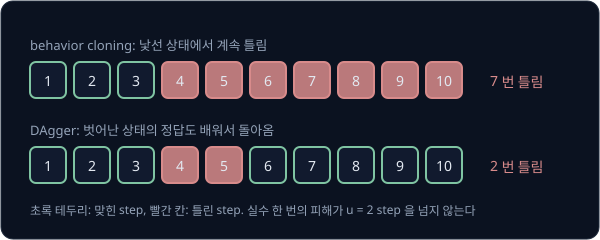

위 그림의 윗줄은 BC 강의에서 본 실수의 연쇄이고, 아랫줄은 같은 자리에서 틀린 DAgger policy 다. 빨간 칸이 윗줄은 episode 끝까지
이어지지만 아랫줄은 두 칸에서 멈춘다. BC 의 실수 한 번은 남은 step 수만큼, 많게는 $T$ 만큼 피해를 낼 수 있고, DAgger 의 실수 한
번은 $u$ 만큼만 피해를 낸다.

**확인 문제.** 20 step 짜리 episode 의 step 6 에서 처음 틀렸다. BC 의 가장 나쁜 경우와 $u = 3$ 인 DAgger policy 는 각각 몇 번
틀릴까?

답 보기

BC 는 step 6 부터 20 까지 $20 - 6 + 1 = 15$ 번이다. DAgger policy 는 step 6, 7, 8 의 3 번이다.

### 두 상한 식

episode 하나에서 틀린 step 수의 평균을 $J$ 라고 하면, BC 강의에서 본 Ross 와 Bagnell(2010)의 식은 아래였다.

$$
J(\hat\pi) \le J(\pi^*) + T^2\epsilon
$$

"학습한 policy 가 틀리는 횟수는 expert 보다 많아야 $T^2\epsilon$ 만큼 더 많다" 로 읽는다. episode 에 실수의 기회는 대략 $T\epsilon$
번이고, 실수 한 번이 많게는 $T$ step 을 망치므로 $T\epsilon \times T = T^2\epsilon$ 이 된다.

DAgger 논문은 iteration 을 충분히 돌리면 그동안 얻은 policy 들 가운데 아래를 만족하는 policy $\hat\pi$ 가 있다는 것을 보였다.

$$
J(\hat\pi) \le J(\pi^*) + uT\epsilon_N + O(1)
$$

기호를 하나씩 읽으면 아래와 같다.

- $u$ 는 앞 절의 "실수 한 번 때문에 틀리게 되는 step 수의 상한" 이다. 한 번 틀려도 금방 돌아오는 문제라면 $u$ 가 작다
- $\epsilon_N$ 은 "엡실론 N" 이라고 읽는다. $N$ 번의 iteration 에서 policy 들이 실제로 간 상태를 모두 모아 놓고, 그 상태들을 가장
  잘 맞히는 policy 하나가 내는 평균 오차다. 시연 위치가 아니라 policy 가 간 위치에서 재므로, [자기가 간 상태에서 잰 오차](#자기가-간-상태에서-잰-오차) 절의 평균 오차와
  같은 종류다
- $O(1)$ 은 big-O(빅 오) 표기로 "$T$ 가 아무리 커져도 일정한 크기 아래에 머무는 작은 항" 이라는 뜻이다. iteration 수가 유한해서
  생기는 작은 차이를 담는다

그래서 이 식은 "DAgger 로 얻은 좋은 policy 는 expert 보다 많아야 $uT\epsilon_N$ 에 작은 상수를 더한 만큼만 더 틀린다" 로 읽는다.
실수의 기회 $T\epsilon_N$ 번에 실수 한 번의 피해 $u$ 를 곱한 것이라, 앞 절의 표와 같은 계산이다.

**확인 문제.** $T = 10$, $\epsilon = 0.1$ 이면 실수의 기회는 몇 번이고, 실수 한 번이 $u = 2$ step 을 망치면 더 틀리는 step 은 몇 개까지일까?

답 보기

실수의 기회는 $10 \times 0.1 = 1$ 번이고, 그 한 번이 2 step 을 망치므로 $1 \times 2 = 2$ 개다. 식으로는 $uT\epsilon = 2 \times 10 \times 0.1 = 2$ 다.

### 지나고 보니 가장 좋은 policy

DAgger 의 상한은 online learning 이라는 분야의 결과로 증명한다. online learning 은 문제가 라운드마다 하나씩 주어지고, 라운드마다
답을 먼저 낸 뒤 채점을 받는 학습을 말한다. DAgger 에서는 iteration 하나가 라운드 하나이고, 라운드 $i$ 의 문제는 "policy $\hat\pi_i$
가 운전해 간 위치들" 이다. 입력마다 정답이 붙은 데이터로 학습하는 보통의 supervised learning 에서는 문제가 미리 정해져
있지만, DAgger 에서는 앞 라운드에서 고른 policy 에 따라 다음 라운드의 문제가 달라진다.

모든 라운드가 끝난 뒤 뒤돌아보면, 모든 라운드의 위치를 한꺼번에 놓고 가장 잘 맞히는 policy 하나를 찾을 수 있다. 이것을 "지나고
보니 가장 좋은 policy" 라고 부르고, 라운드마다 실제로 고른 policy 의 오차 합에서 이 policy 의 오차 합을 뺀 값을 regret(후회)이라고
한다. 라운드 수로 나눈 regret 이 라운드가 쌓일수록 0 으로 줄어드는 방법을 no-regret 방법이라고 한다. 논문은 "지금까지 모은 데이터
전체에 가장 잘 맞는 policy 를 다음 policy 로 고르는" DAgger 의 학습이 Follow-The-Leader 라는 no-regret 방법과 같다는 것을 이용했다.
Follow-The-Leader 는 "지금까지의 성적 1 등을 따라간다" 는 뜻이다.

차선 예시의 숫자로 regret 을 계산해 보자. 라운드마다 고른 policy 의 오차는 [자기가 간 상태에서 잰 오차](#자기가-간-상태에서-잰-오차) 절에서 구한 평균 오차다.
지나고 보니 가장 좋은 policy 는 $\hat\pi_4$ 다. 아는 범위가 1.7 m 라서 세 라운드의 위치(0 ~ 1.0, 0 ~ 1.7, 0 ~ 1.4 m)를 모두 알고, 어느
라운드에서 재도 평균 오차가 0.1 m 다.

| 라운드 (iteration) | 고른 policy | 고른 policy 의 평균 오차 (m) | $\hat\pi_4$ 의 평균 오차 (m) | 차이 (m) |
| --- | --- | --- | --- | --- |
| 2 | $\hat\pi_2$ | 0.26 | 0.10 | 0.16 |
| 3 | $\hat\pi_3$ | 0.18 | 0.10 | 0.08 |
| 4 | $\hat\pi_4$ | 0.10 | 0.10 | 0 |
| 합 | | 0.54 | 0.30 | 0.24 |

regret 은 $0.54 - 0.30 = 0.24$ 이고, 라운드 3 개로 나누면 $0.24 \div 3 = 0.08$ 이다. iteration 5 부터는 $\hat\pi_4$ 와 같은 policy
가 운전해 차이가 0 이므로, regret 은 0.24 에 머물고 라운드 수만 는다. 라운드가 4 개면 $0.24 \div 4 = 0.06$, 10 개면
$0.24 \div 10 = 0.024$ 로 라운드당 regret 이 0 에 다가간다.

라운드당 regret 이 0 에 가까워지면, iteration 마다 고른 policy 들의 평균 오차가 "지나고 보니 가장 좋은 policy" 의 오차 $\epsilon_N$
과 거의 같아진다. 그러면 고른 policy 들 가운데 적어도 하나는 자기가 간 위치에서 오차가 $\epsilon_N$ 근처인 policy 이고, 그 policy 의
실수 기회는 $T\epsilon_N$ 번, 피해는 한 번에 $u$ 라서 $uT\epsilon_N$ 상한이 나온다. "iteration 별 policy 가운데 좋은 것이 하나
있다" 는 보장이 이 계산에서 나온다.

**확인 문제.** 라운드 네 번의 고른 policy 평균 오차가 0.3, 0.2, 0.1, 0.1 이고, 지나고 보니 가장 좋은 policy 의 오차는 네 라운드 모두
0.1 이다. regret 과 라운드당 regret 은?

답 보기

고른 policy 의 합은 $0.3 + 0.2 + 0.1 + 0.1 = 0.7$, 가장 좋은 policy 의 합은 $0.1 \times 4 = 0.4$ 라서 regret 은
$0.7 - 0.4 = 0.3$ 이다. 라운드당 regret 은 $0.3 \div 4 = 0.075$ 다.

### 작은 T 로 비교한 두 상한

$\epsilon = 0.1$, $u = 2$ 로 두고 $T$ 를 늘려 가며 두 상한을 계산하면 아래와 같다. 상수항 $O(1)$ 은 $T$ 와 상관없이 작으므로 빼고
비교한다.

| $T$ | 실수의 기회 $T\epsilon$ | BC 의 상한 $T^2\epsilon$ | DAgger 의 상한 $uT\epsilon$ | 두 상한의 비 $T^2\epsilon \div uT\epsilon$ |
| --- | --- | --- | --- | --- |
| 2 | $2 \times 0.1 = 0.2$ | $2 \times 2 \times 0.1 = 0.4$ | $2 \times 2 \times 0.1 = 0.4$ | 1 |
| 4 | 0.4 | $4 \times 4 \times 0.1 = 1.6$ | $2 \times 4 \times 0.1 = 0.8$ | 2 |
| 6 | 0.6 | $6 \times 6 \times 0.1 = 3.6$ | $2 \times 6 \times 0.1 = 1.2$ | 3 |
| 8 | 0.8 | $8 \times 8 \times 0.1 = 6.4$ | $2 \times 8 \times 0.1 = 1.6$ | 4 |
| 10 | 1.0 | $10 \times 10 \times 0.1 = 10$ | $2 \times 10 \times 0.1 = 2$ | 5 |

$T$ 가 2 씩 늘 때 DAgger 의 상한은 0.4 씩 일정하게 늘지만, BC 의 상한은 1.2, 2.0, 2.8, 3.6 씩 점점 더 크게 는다. $T$ 가 두 배,
세 배가 될 때 값도 똑같이 두 배, 세 배가 되는 관계를 "비례한다" 고 하고, DAgger 의 상한은 $T$ 에 비례한다. BC 의 상한은 $T$ 를 두 번
곱한 $T^2$ 에 비례해서, $T$ 가 두 배가 되면 네 배가 된다. 두 상한의 비는 $T^2\epsilon \div uT\epsilon = T \div u$ 라서, episode 가
길수록 차이가 커진다.

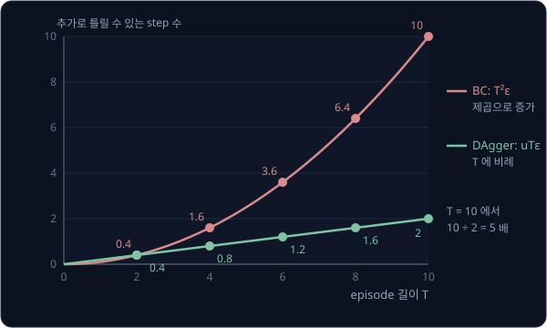

위 그림은 표의 두 열을 같은 좌표평면에 그린 것이다. 빨간 곡선($T^2\epsilon$)은 오른쪽으로 갈수록 가파르게 휘어 오르고, 초록
직선($uT\epsilon$)은 같은 기울기로 오른다. $T = 2$ 에서는 두 점이 겹치고, $T = 10$ 에서는 10 과 2 로 다섯 배가 벌어진다.

BC 강의에서 쓴 $T = 100$, $\epsilon = 0.01$ 로 바꿔도 같은 모양이다.

| $T$ | $T^2\epsilon$ ($\epsilon = 0.01$) | $uT\epsilon$ ($u = 2$) | 비 $T \div u$ |
| --- | --- | --- | --- |
| 10 | 1 | 0.2 | 5 |
| 20 | 4 | 0.4 | 10 |
| 50 | 25 | 1 | 25 |
| 100 | 100 | 2 | 50 |

$T = 100$ 이면 BC 는 가장 나쁜 경우 100 step 을 모두 틀릴 수 있지만, DAgger 의 상한은 2 step 이다.

**흔한 오해.** "DAgger 의 상한이 작으니 DAgger policy 는 늘 몇 번밖에 틀리지 않는다" 고 읽기 쉽다. 상한에는 $\epsilon_N$ 이 들어
있고, 이 값은 policy 가 간 위치에서 잰 오차라서 모델이 그 위치들을 잘 맞히지 못하면 커진다. DAgger 가 보장하는 것은 실수가 $T$ 에
비례해서만 쌓인다는 것이고, 한 step 의 실수 자체를 0 으로 만들지는 않는다. "DAgger 가 줄이지 못하는 오차" 에서 $\hat\pi_4$ 에 0.1 m 오차가
남았던 것과 같은 이야기다.

**확인 문제.** $\epsilon = 0.05$, $u = 2$, $T = 20$ 이면 BC 의 상한과 DAgger 의 상한은 각각 얼마이고, 몇 배 차이일까?

답 보기

BC 는 $20 \times 20 \times 0.05 = 20$, DAgger 는 $2 \times 20 \times 0.05 = 2$ 라서 10 배다. $T \div u = 20 \div 2 = 10$ 으로도
같은 답이 나온다.

**요약**

- BC 의 실수 한 번은 남은 step 을 모두 망칠 수 있어 피해가 많게는 $T$ 이고, 벗어난 위치의 정답을 배운 DAgger policy 의 실수 한
  번은 $u$ step 안에서 끝난다
- BC 의 상한은 $T^2\epsilon$ 이고 DAgger 의 상한은 $uT\epsilon_N + O(1)$ 이다. $\epsilon = 0.1$, $u = 2$ 이면 $T = 10$ 에서 10 과 2 이고, 두
  상한의 비 $T \div u$ 는 episode 가 길수록 커진다
- 상한은 DAgger 의 학습을 no-regret 방법인 Follow-The-Leader 로 보고 증명한다. 차선 예시의 regret 은 0.24 이고, 라운드당 regret 은
  라운드가 3, 4, 10 개일 때 0.08, 0.06, 0.024 로 0 에 다가간다
- $\epsilon_N$ 은 policy 가 간 위치에서 잰 오차라서, DAgger 도 한 step 의 오차 자체는 줄여 주지 않는다

## 실물 로봇에서의 한계

### 사람 expert 에게 매 step 묻는 일의 어려움

이 강의의 expert 는 차의 정확한 위치를 아는 프로그램이라 policy 가 어떤 위치로 데려가든 바로 $a = 8y$ 를 답했다. DAgger 는 이처럼
"아무 상태에서나 바로 정답을 내는 expert" 를 전제한다. 실물 로봇에서 expert 는 대개 사람인데, 사람은 이런 expert 가 되기 어렵다.

- **운전대를 잡지 않은 채 내는 정답** — DAgger 의 ③ 단계에서 사람은 운전대를 잡지 않은 채 "지금 몇 도를 꺾었어야 했는가" 를 답해야 한다.
  사람은 자기가 꺾은 결과를 보면서 조금씩 고쳐 가며 운전하는데, 운전대가 policy 에게 있으면 자기 답이 차를 어떻게 움직일지 볼 수
  없다. HG-DAgger 논문은 이 때문에 사람이 내는 정답의 질이 떨어지기 쉽다고 지적했다
- **위험한 운전** — 데이터를 모으려면 아직 서툰 policy 가 실제 차나 로봇 팔을 움직여야 한다. 시뮬레이션에서는 차선을 벗어나도
  되돌리면 그만이지만, 실물에서는 차가 부딪히거나 팔이 물건을 떨어뜨린다
- **묻는 횟수** — 매 step 정답이 필요해서, 사람이 답해야 하는 횟수가 아주 많다. 다음 절에서 숫자로 센다

**확인 문제.** 이 강의의 expert 가 0.7 m 위치의 정답을 바로 낼 수 있는 이유는 무엇이고, 사람 운전자라면 무엇이 어려울까?

답 보기

expert 가 차의 정확한 위치를 아는 프로그램이라 $8 \times 0.7 = 5.6$° 를 바로 계산할 수 있다. 사람 운전자는 운전대를 잡지 않은 채
화면만 보고 "5.6° 를 꺾었어야 했다" 를 정확히 말하기 어렵고, 그런 답을 매 step 해야 한다.

### 묻는 횟수

10 Hz 로 제어하는 로봇을 생각하자. Hz(헤르츠)는 1초에 몇 번 일어나는지를 세는 단위라서, 10 Hz 는 1초에 10 step 이다.

| 항목 | 계산 | 값 |
| --- | --- | --- |
| episode 하나 (60 초) | $10 \times 60$ | 600 step |
| iteration 하나 (episode 20 번) | $600 \times 20$ | 12,000 step |
| iteration 5 번 | $12{,}000 \times 5$ | 60,000 step |
| 모두 답하는 데 걸리는 시간 | $60{,}000 \div 10$ | 6,000 초 = 100 분 |

DAgger 를 그대로 하면 사람이 60,000 번 정답을 말해야 하고, step 하나를 실제 시간 그대로(0.1 초에 하나) 답해도 100 분을 쉬지 않고
답해야 한다. 실제로는 한 step 에 0.1 초보다 훨씬 오래 걸리므로 몇 배가 더 든다.

**확인 문제.** 30 Hz 로 제어하는 로봇 팔에서 20 초짜리 episode 를 10 번 돌리면 DAgger 는 정답을 몇 번 물어야 할까?

답 보기

episode 하나에 $30 \times 20 = 600$ step 이고, 10 번이면 $600 \times 10 = 6000$ 번이다.

### HG-DAgger

2019년 Kelly 등의 HG-DAgger(Human-Gated DAgger)는 운전대를 누가 잡을지를 사람이 정하게 바꿨다. policy 가 운전하는 동안 사람은
지켜보다가, 위험한 상태에 들어갔다고 판단하면 운전대를 넘겨받아 안전한 곳으로 되돌리고, 안전해지면 다시 policy 에게 넘긴다. 이름의
gate 는 "문" 이라는 뜻으로, 운전 권한이 오가는 문을 사람이 여닫는다는 의미다.

정답은 사람이 직접 운전한 구간에서만 기록한다. 사람이 운전대를 쥐고 자기 조작의 결과를 보며 운전하므로 정답의 질이 좋고, 넘겨받는
시작점은 policy 가 데려간 위험한 상태라서 DAgger 처럼 policy 가 실제로 가는 상태 근처의 정답이 모인다. 논문은 이 방법을 시뮬레이션과
실제 시험 차량의 자율주행 과제에서 시험해 DAgger 와 BC 보다 좋은 결과를 보였다. 사람이 개입한 순간마다 policy 가 얼마나 확신이
없었는지도 기록해, 이 값으로 policy 가 위험해지는 기준을 데이터에서 배우는 방법도 함께 냈다.

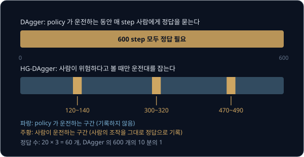

위 그림의 윗줄은 DAgger 로, 600 step 전체가 주황(정답이 필요한 step)이다. 아랫줄은 HG-DAgger 로, 대부분은 policy 가 운전하는 파란
구간이고 사람이 넘겨받은 세 구간만 주황이다. 한 번에 20 step 씩 세 번 넘겨받았다면 정답은 $20 \times 3 = 60$ 개로, DAgger 의 600 개의
10 분의 1 이다.

[Behavior Cloning](../behavior-cloning/README.md) 의 차선 예시에 대입하면, 차가 0.6 m 쯤 벗어나는 순간 사람이 운전대를 잡고 가운데로
되돌리는 장면이 기록된다. 이 장면이 바로 시연에 없던 "벗어난 뒤 돌아오는 법" 이다.

**확인 문제.** 600 step episode 에서 사람이 두 번, 한 번에 30 step 씩 넘겨받았다. HG-DAgger 가 기록하는 정답은 몇 개이고, 전체
step 의 몇 분의 몇일까?

답 보기

$30 \times 2 = 60$ 개이고, $60 \div 600 = \frac{1}{10}$ 이다.

### SafeDAgger

2016년 Zhang 과 Cho 의 SafeDAgger 는 "언제 물을지" 를 사람 대신 모델이 정한다. policy 와 별도로 safety policy 라는 작은 모델을
학습해서, 지금 상태에서 policy 의 action 이 expert 의 action 과 크게 다를지를 expert 에게 묻지 않고 미리 예측한다. 크게 다를 것 같은
상태에서만 expert 가 운전을 넘겨받고 정답을 주고, 나머지는 policy 가 그대로 운전한다. 논문은 자동차 경주 시뮬레이터에서 DAgger 보다
적게 물어도 학습이 된다는 것을 보였다.

HG-DAgger 와 SafeDAgger 는 묻는 시점을 고르는 쪽이 다르다. HG-DAgger 는 사람이 지켜보다 직접 고르고, SafeDAgger 는 학습한 safety
policy 가 고른다.

**확인 문제.** SafeDAgger 의 safety policy 가 예측하는 것은 무엇이고, 그 예측이 "크게 다르다" 일 때 무슨 일이 일어날까?

답 보기

지금 상태에서 policy 의 action 이 expert 의 action 과 크게 다를지를 예측한다. 크게 다를 것 같으면 expert 가 운전을 넘겨받고
그 상태의 정답을 준다.

### LeRobot 의 human-in-the-loop 수집

오픈소스 로봇 학습 도구 LeRobot 은 HG-DAgger 와 같은 방식을 실물 로봇 팔에 붙여 쓰는 human-in-the-loop 데이터 수집을 제공한다.
human-in-the-loop 는 "사람이 반복 고리 안에 들어가 있다" 는 뜻이다. 사람이 똑같이 생긴 조종용 팔(leader)을 움직이면 로봇 팔(follower)이 따라 움직이는 teleoperation 장비를 쓰고, 한 episode 는
아래 순서로 진행된다.

1. 학습한 policy 가 혼자 팔을 움직이고 사람은 지켜본다
2. 곧 실패할 것 같으면 사람이 일시정지를 누른다. 로봇 팔은 그 자세로 멈추고, 모터가 달린 leader 팔이 로봇 팔과 같은 자세로 스스로
   움직여 맞춘다
3. 사람이 넘겨받아 leader 팔로 로봇 팔을 좋은 상태로 되돌리고(recovery), 그 자리에서 올바른 동작을 이어서 보여 준다(correction).
   이 움직임은 모두 기록된다
4. policy 에게 다시 넘기면 policy 가 그 자리에서 이어서 움직인다. 2 ~ 4 를 필요한 만큼 되풀이한다

모은 데이터를 처음의 시연과 합쳐 policy 를 다시 학습하고, 새 policy 로 같은 수집을 되풀이한다. 처음 시연과 합쳐 다시 학습하는
것이 DAgger 의 aggregation 이고, policy 가 실패하려는 상태에서 사람의 정답을 받는 것이 DAgger 가 빈 위치를 채우는 방법이다. 2 번에서
leader 팔을 먼저 로봇 팔 자세에 맞추는 것은, 사람이 넘겨받는 순간 두 팔의 자세가 달라 로봇 팔이 leader 팔 쪽으로 갑자기 크게 움직이는 일을 막기 위해서다.

**확인 문제.** LeRobot 의 human-in-the-loop 수집에서 recovery 와 correction 은 각각 무엇이고, 둘 중 어느 것이 기록될까?

답 보기

recovery 는 실패하려는 로봇 팔을 사람이 좋은 상태로 되돌리는 움직임이고, correction 은 그 자리에서 올바른 동작을 이어서 보여 주는
움직임이다. 둘 다 기록된다.

**요약**

- DAgger 는 아무 상태에서나 바로 정답을 내는 expert 를 전제한다. 사람은 운전대 없이 정확한 정답을 말하기 어렵고, 서툰 policy 의
  실물 운전은 위험하며, 10 Hz·60 초·20 episode·5 iteration 이면 60,000 번을 물어야 한다
- HG-DAgger 는 사람이 위험할 때만 넘겨받아 직접 운전한 구간만 기록하고, SafeDAgger 는 학습한 safety policy 가 물을 시점을 고른다
- LeRobot 의 human-in-the-loop 수집은 policy 실행 → 일시정지 → leader 팔로 recovery·correction → policy 로 복귀를 되풀이하고,
  모은 데이터를 시연과 합쳐 다시 학습한다

## 정리

- behavior cloning 의 시연은 expert 가 가는 위치($d_{\pi^*}$)에서만 나와서, policy 가 실수한 뒤 들어가는 0.3 m 바깥 위치는 시연을 몇
  배로 늘려도 0 개다
- DAgger 의 iteration 은 policy 로 운전 → 지나간 위치 기록 → expert 의 정답 붙이기 → 모은 데이터 전체로 다시 학습이다. 저장하는
  정답은 늘 expert 의 action 이고, policy 가 실행한 조향을 저장하면 새로 배우는 것이 없다
- 차선 예시에서 iteration 2, 3, 4 의 policy 는 아는 범위가 0.3, 1.0, 1.7 m 로 넓어지며 step 7, step 14 에 벗어나다가 15 step 을
  완주했다. 누적 데이터는 1000, 1700, 3100, 4600 쌍이고, 자기가 간 위치에서 잰 평균 오차는 0.26, 0.18, 0.10 m 로 줄었지만 시연
  위치에서 잰 오차는 0.1 m 그대로였다
- 섞은 운전 $\pi_i = \beta_i\pi^* + (1-\beta_i)\hat\pi_i$ 는 step 마다 확률 $\beta_i$ 로 expert 가 운전대를 잡는다는 뜻이고,
  schedule 은 $0.5^{i-1}$ 과 $\mathbb{1}[i = 1]$ 이 있다
- 틀린 step 수의 상한은 BC 에서 $T^2\epsilon$ 이고 DAgger 에서 $uT\epsilon_N + O(1)$ 이다. $\epsilon = 0.1$, $u = 2$, $T = 10$ 이면 10 과 2 이고,
  비 $T \div u$ 는 episode 가 길수록 커진다. DAgger 가 줄이는 것은 오차가 불어나는 부분이고, 한 step 의 오차는 남는다
- 사람 expert 에게 매 step 묻기는 어렵고 위험하며 횟수가 많다. HG-DAgger 는 사람이 넘겨받은 구간만 기록하고, SafeDAgger 는 safety
  policy 가 고른 상태에서만 expert 에게 묻는다. LeRobot 은 leader 팔로 넘겨받는 human-in-the-loop 수집을 제공한다

DAgger 는 데이터를 모으는 방법을 바꿔 compounding error 를 줄였다. 같은 문제를 policy 쪽에서 다루는 방법도 있는데, action 을 한 step
씩이 아니라 여러 step 묶음으로 내서 policy 가 결정하는 횟수 자체를 줄이는 것이다. 이 방법은 [ACT](../act/README.md) 에서 다룬다.
실물 로봇 팔로 시연을 모으는 과정은 [Teleop Dataset](../teleop-dataset/README.md) 에서, 학습한 policy 를 실물 팔에서 돌리고
human-in-the-loop 수집을 붙여 보는 일은 [Real Robot](../real-robot/README.md) 에서 다룬다.

## 참고 자료

- Stéphane Ross, Geoffrey J. Gordon, J. Andrew Bagnell, [A Reduction of Imitation Learning and Structured Prediction to No-Regret Online Learning](https://arxiv.org/abs/1011.0686) (2011) —
  DAgger 논문. Algorithm 3.1 이 이 강의의 네 단계이고, Section 3 에 $uT\epsilon_N$ 상한이, Section 5.1 에 Super Tux Kart 실험이 있다.
  [AISTATS 판](https://proceedings.mlr.press/v15/ross11a.html)
- UC Berkeley CS 285, [Supervised Learning of Behaviors 강의 슬라이드](https://rail.eecs.berkeley.edu/deeprlcourse/static/slides/lec-2.pdf) —
  "DAgger: Dataset Aggregation" 슬라이드가 알고리즘과 사람이 정답을 붙이기 어려운 이유를 그림으로 설명한다
- Michael Kelly et al., [HG-DAgger: Interactive Imitation Learning with Human Experts](https://arxiv.org/abs/1810.02890) (2019) —
  사람이 위험할 때만 운전을 넘겨받아 정답을 모으는 변형. Fig. 1 이 운전 권한을 넘기는 제어 구조이고, Section II 가 알고리즘이다
- Jiakai Zhang, Kyunghyun Cho, [Query-Efficient Imitation Learning for End-to-End Autonomous Driving](https://arxiv.org/abs/1605.06450) (2016) —
  SafeDAgger. safety policy 가 policy 가 틀릴 것 같은 상태를 골라 그때만 expert 에게 묻는다
- LeRobot, [Human-In-the-Loop Data Collection](https://huggingface.co/docs/lerobot/hil_data_collection) — 실물 팔에서 사람이 leader
  팔로 개입해 recovery·correction 을 모으는 절차와, DAgger·HG-DAgger 와의 관계를 정리한 문서
