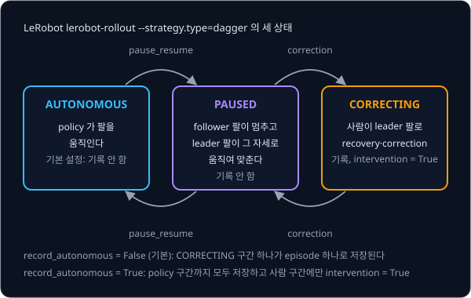

# DAgger

behavior cloning 으로 학습한 policy 는 시연과 비슷한 상황에서는 잘 움직이다가도, 작은 실수로 시연에 없던 위치나 자세에 들어가면 더 크게
틀리고 결국 실패한다. 시연을 열 배로 늘려도 이 문제는 그대로인데, 시연하는 expert 는 애초에 그런 상태로 가지 않아서 새 시연에도 그
상태가 들어 있지 않기 때문이다. policy 가 실수한 뒤에만 들어가는 상태의 정답은 어디서 얻어야 할까?

그 상태로 가는 것은 policy 자신이므로, policy 에게 직접 움직이게 하고 지나간 상태마다 expert 에게 정답을 물어 데이터에 더하면 된다.
이 반복이 2011 년 Ross·Gordon·Bagnell 이 발표한 DAgger 다. Ross 등은 2013 년 이 방법으로 카메라 하나만 단 소형 드론에게 숲속의 나무를
피해 나는 법을 가르쳤다. 사람 조종사가 드론이 찍은 영상을 3 배 느리게 다시 보며 장면마다 옳은 방향을 입력했고, 드론은 3 km 넘게 나는
동안 나무 680 그루 이상을 피했다.

## 학습 목표

- 시연을 늘려도 policy 가 실수한 뒤 들어가는 상태가 데이터에 생기지 않는 이유와, DAgger 가 그 상태에 expert 의 정답을 붙이는 반복을
  설명할 수 있다
- iteration 마다 데이터가 퍼지는 범위와 policy 가 차선을 벗어나기까지의 step 수를 표로 따라가고, 저장하는 정답이 늘 expert 의 action 이어야 하는
  이유를 설명할 수 있다
- expert 와 policy 를 확률 β 로 섞는 운전과, 실수가 behavior cloning 에서는 $T^2$ 에, DAgger 에서는 $T$ 에 비례해 쌓이는 이유를
  설명할 수 있다
- 사람에게 매 step 정답을 묻기 어려운 이유와, HG-DAgger·LeRobot 처럼 사람이 위험할 때만 넘겨받아 기록하는 수집 방식을 설명할 수 있다

## 시연이 채우지 못하는 상태

[Behavior Cloning](../behavior-cloning/README.md) 의 차선 주행 예시를 이어서 쓴다. 차선 폭은 3.5 m 이고, 차가 가운데에서 왼쪽으로 벗어난
거리를 $y$ (m) 로 적는다. 차 양쪽의 거리 센서는 왼쪽 경계까지의 거리 $d_L = 1.75 - y$ 와 오른쪽 경계까지의 거리 $d_R = 1.75 + y$ 를
재고, 두 거리의 차이 $x = d_R - d_L$ 은 $2y$ 다. 센서 값이 관측 $o$ 이고 핸들 각도가 action $a$ 이며, 관측을 받아 action 을 내는 규칙이
policy 다. expert 의 policy $\pi^*$ 는 차의 정확한 위치를 아는 프로그램이라 핸들을 오른쪽으로 $a = 4x = 8y$ 도 꺾는다. 시연으로 학습한
policy 는 $\hat\pi$ 로 적는다.

expert 의 시연 1000 step 동안 차는 늘 가운데에서 0.3 m 안쪽에 있었다. 이 예에서는 이 시연으로 학습한 policy 가 0.3 m 안쪽에서 핸들을
조금 덜 꺾어 한 step 에 0.1 m 씩 밀려나고, 처음 보는 0.3 m 바깥에서는 $0.1 + (y - 0.3)$ m 씩 밀려난다고 둔다. 이 policy 에게 처음부터 끝까지
운전을 맡기는 rollout 을 하면 $y$ 는 $0 \to 0.1 \to 0.2 \to 0.3 \to 0.4 \to 0.6 \to 1.0 \to 1.8$ 로 움직이고, 차선의 절반 폭 1.75 m 를
넘는 step 7 에 차선을 벗어난다. 작은 오차가 차를 시연에 없던 상태로 옮기고 그곳에서 오차가 더 커지는 이 현상이 compounding error 다.

시연이 부족해서 벗어났다고 보고 같은 expert 가 1000 step 을 더 운전하면, 구간마다 step 수가 대략 두 배가 된다.

| 위치 $y$ 의 구간 (m) | $-0.3 \sim -0.2$ | $-0.2 \sim -0.1$ | $-0.1 \sim 0$ | $0 \sim 0.1$ | $0.1 \sim 0.2$ | $0.2 \sim 0.3$ | 0.3 바깥 |
| --- | --- | --- | --- | --- | --- | --- | --- |
| 시연 1000 step | 30 | 150 | 320 | 330 | 140 | 30 | 0 |
| 시연 2000 step | 60 | 300 | 640 | 660 | 280 | 60 | 0 |

expert 가 운전할 때 지나가는 상태의 분포는 $d_{\pi^*}$ 로 적고, 학습한 policy 가 운전할 때 지나가는 상태의 분포는 $d_{\hat\pi}$ 로
적는다. $d$ 는 distribution 의 첫 글자이고, 아래 첨자는 누가 운전했는지를 가리킨다. 두 분포가 다른 것을 distribution shift 라고 하는데,
시연을 늘리는 것은 $d_{\pi^*}$ 에서 더 많이 뽑는 것일 뿐이라서 $d_{\hat\pi}$ 에만 있는 상태는 채워지지 않는다.

**흔한 오해.** "시연을 충분히 많이 모으면 compounding error 가 사라진다" 고 생각하기 쉽지만, 빈 곳은 데이터의 양이 아니라 누가
운전했느냐 때문에 생긴다. policy 가 실수한 뒤 들어가는 곳은 expert 가 가지 않는 곳이라 0 에 무엇을 곱해도 0 이다.

**확인 문제.** 같은 expert 의 시연을 1000 step 에서 5000 step 으로 늘리면 $0 \sim 0.1$ 구간과 0.3 바깥 구간의 step 수는 각각 대략 얼마일까?

답 보기

시연을 5 배로 늘렸으므로 구간마다 5 를 곱한다. $0 \sim 0.1$ 구간은 $330 \times 5 = 1650$ 이고, 0.3 바깥은 $0 \times 5 = 0$ 이다.

답: 1650 과 0 이다. 0.3 바깥은 시연을 몇 배로 늘려도 비어 있다.

## DAgger 의 반복

### Dataset Aggregation

빈 상태에 가는 것은 실수하는 policy 쪽이므로, policy 에게 운전을 맡겨 실제로 들어간 상태를 기록하고 상태마다 "여기서는 몇 도를
꺾었어야 했는가" 를 expert 에게 묻는다. 이 일을 되풀이하는 방법이 **DAgger** 이고, 이름은 Dataset Aggregation 을 줄인 것이다.
aggregation 은 여러 개를 한데 모은다는 뜻이라, 이름 그대로 데이터를 계속 모아 합치는 방법이다.

반복 한 바퀴를 iteration 이라고 하며, iteration 하나는 아래 네 단계로 이루어진다.

1. 지금의 policy 에게 운전을 맡긴다
2. 차가 지나간 상태마다 관측 $o$ 를 기록한다
3. 각 상태에서 expert 가 냈을 action $\pi^*(o)$ 를 정답으로 붙인다
4. 새 쌍을 지금까지 모은 데이터에 합치고, 합친 데이터 전체로 policy 를 다시 학습한다

학습하는 방법은 behavior cloning 과 같고 데이터를 모으는 방법만 다르다. iteration 번호는 $i$ 로 적고, iteration $i$ 에서 운전하는
policy 는 $\hat\pi_i$ 로 적는다.

첫 iteration 에는 아직 학습한 policy 가 없어서 expert 가 직접 운전하고, 그 기록에 expert 자신의 action 을 붙인다. behavior cloning 의
시연과 같은 데이터라서 이 강의에서는 시연 1000 step 을 iteration 1 의 데이터로 쓴다. 그 데이터로 학습한 $\hat\pi_2$ 가 앞 절에서
step 7 에 차선을 벗어난 policy 이고, DAgger 에만 있는 단계는 iteration 2 부터 시작된다.

### 이 강의의 계산 규칙

iteration 마다 차가 어떻게 움직이는지 손으로 계산하려고, 앞 절의 규칙에서 "시연 범위" 를 "데이터에 정답이 있는 범위" 로 넓혀 읽는다.

- 가운데부터 데이터에 정답이 있는 가장 먼 위치 $c$ 까지를 policy 가 아는 범위로 본다. 사이사이 비어 있는 위치는 양옆 정답을 이어서
  맞힌다고 둔다. 시연만 있으면 $c = 0.3$ 이다
- 아는 범위 안($y \le c$)에서는 한 step 에 0.1 m 씩 왼쪽으로 밀려나고, 밖($y > c$)에서는 $0.1 + (y - c)$ m 씩 밀려난다
- expert 가 운전한 step 에는 $y$ 가 그대로다
- 처음부터 끝까지 한 번 운전하는 episode 는 길어야 15 step 이다. $y$ 가 1.75 m 를 넘으면 그 자리에서 끊고, 벗어난 위치는 기록하지 않는다
- iteration 마다 같은 운전을 100 번 한다. 규칙에 무작위가 없으니 100 번 모두 같은 길을 가고 위치마다 정답이 100 개씩 쌓인다

실제 policy 는 센서 여러 개를 받는 MLP 라서 차선 경계 근처의 센서 값이 가운데와 전혀 다른 모양이 되면 맞히지 못한다. $c$ 는 이 성질을
숫자 하나로 줄여 나타낸다.

<b>심화: 계산 규칙에서 단순하게 만든 부분</b>

실제 오차는 왼쪽과 오른쪽으로 섞여 나와 서로 상쇄되기도 하지만, 이 규칙은 늘 왼쪽으로만 쌓이는 가장 나쁜 경우를 따라간다. 실제 expert 는
벗어난 차를 가운데로 되돌리는데, 계산을 쉽게 하려고 "더 밀려나지 않는다" 로만 두었다. 정답 $a = 8y$ 는 직선이라, policy 가 직선 모델
$\hat a = wx + b$ 라면 0.3 m 안쪽 데이터만으로도 $w = 4$, $b = 0$ 을 찾아 바깥까지 그대로 늘여 쓸 수 있다. 데이터가 없는 곳에서 틀리는
것은 입력이 많고 모양이 복잡한 모델에서 생기는 일이다.

### iteration 2 의 정답

iteration 2 에서는 $\hat\pi_2$ ($c = 0.3$) 가 운전한다. 마지막 열이 DAgger 가 새로 만드는 정답이다.

| step | $y$ (m) | 아는 범위 ($c = 0.3$) | 밀려난 거리 (m) | 다음 $y$ (m) | 기록할 정답 $8y$ (도) |
| --- | --- | --- | --- | --- | --- |
| 0 | 0.0 | 안 | 0.1 | 0.1 | 0 |
| 1 | 0.1 | 안 | 0.1 | 0.2 | 0.8 |
| 2 | 0.2 | 안 | 0.1 | 0.3 | 1.6 |
| 3 | 0.3 | 안 | 0.1 | 0.4 | 2.4 |
| 4 | 0.4 | 밖 | $0.1 + (0.4 - 0.3) = 0.2$ | 0.6 | 3.2 |
| 5 | 0.6 | 밖 | $0.1 + (0.6 - 0.3) = 0.4$ | 1.0 | 4.8 |
| 6 | 1.0 | 밖 | $0.1 + (1.0 - 0.3) = 0.8$ | 1.8 | 8.0 |
| 7 | 1.8 | 이탈 | — | — | 기록 안 함 |

step 0 부터 6 까지 일곱 위치에 정답이 붙는다. 운전을 100 번 하므로 새 쌍은 $7 \times 100 = 700$ 개이고, 데이터는 $1000 + 700 = 1700$
쌍이 된다. 새 데이터에서 가장 먼 위치가 1.0 m 라서, 이 데이터까지 합쳐 학습한 $\hat\pi_3$ 은 아는 범위가 $c = 1.0$ 으로 넓어진다.

차가 1.0 m 벗어나 $d_L = 0.75$, $d_R = 2.75$ 를 읽었을 때 오른쪽으로 8° 꺾는다는 쌍처럼, 새 정답은 시연에 한 번도 없던 내용인 벗어난
뒤 돌아오는 법을 담는다.

**확인 문제.** policy 가 0.8 m 벗어난 위치에 들어갔다. 이 위치의 $d_L$, $d_R$, $x$ 와 expert 의 정답은?

답 보기

$y = 0.8$ 을 센서 식에 넣는다.

$$
d_L = 1.75 - 0.8 = 0.95, \qquad d_R = 1.75 + 0.8 = 2.55, \qquad x = 2.55 - 0.95 = 1.6
$$

답: 정답은 $a = 4 \times 1.6 = 6.4$° 다. $a = 8y = 8 \times 0.8 = 6.4$ 로 계산해도 같다.

### 실행한 조향과 저장하는 정답

iteration 2 에서 차를 움직인 것은 policy 의 조향이지만, 데이터에 저장하는 정답은 같은 위치에서 expert 가 냈을 조향이다. 두 값은 서로
다르고, 그 차이가 policy 가 배워야 할 내용이다.

**흔한 오해.** policy 가 실제로 꺾은 각도를 정답으로 저장해도 데이터가 늘어나니 도움이 된다고 생각하기 쉽다. 예를 들어 0.6 m 에서
policy 가 1.6° 를 꺾었고 그 1.6° 를 저장하면, 다시 학습한 policy 는 0.6 m 에서 또 1.6° 를 낸다. 자기가 내던 값을 다시 배웠을 뿐이라 아는
범위는 $c = 0.3$ 그대로이고, 다음 rollout 도 step 7 에 벗어난다. 아는 범위를 넓히는 것은 데이터의 양이 아니라 expert 의 정답이다.

### 모은 데이터 전체로 다시 학습

4 단계를 식으로 적으면 아래와 같다.

$$
\mathcal{D} \leftarrow \mathcal{D} \cup \{(o,\ \pi^*(o))\}, \qquad
\hat\pi_{i+1} = \arg\min_{\pi} \sum_{(o,\,a)\in\mathcal{D}} \big(\pi(o) - a\big)^2
$$

첫 식은 지금까지 모은 데이터 $\mathcal{D}$ 에 이번 iteration 의 (관측, expert 정답) 쌍을 합친다는 뜻이고, 둘째 식은 합친 데이터
전체에서 오차 제곱의 합이 가장 작은 policy 를 다음 policy 로 삼는다는 뜻이다.

이번 iteration 의 데이터만 쓰면 이번에 가지 않은 곳의 정답을 잊는다. 어떤 iteration 의 policy 가 가운데 근처에만 머물렀다면 그 데이터에는
1.0 m 의 정답이 없어서, 그것만으로 학습한 다음 policy 는 1.0 m 를 다시 모르고 또 그곳으로 밀려난다. 처음부터 모은 데이터를 모두 합쳐
두면 한 번 받은 정답이 계속 남는다.

<b>심화: 식의 기호와 오차 제곱의 합</b>

- $\mathcal{D}$ 는 "필기체 D" 로 읽고, 지금까지 모은 (관측, 정답) 쌍 전체다. D 는 dataset 의 첫 글자다
- $\{ \cdots \}$ 는 이번 iteration 에 새로 모은 쌍들이고, 쌍마다 관측 $o$ 와 그 관측에서 expert 가 낼 action $\pi^*(o)$ 가 짝을 이룬다
- $\cup$ 는 합집합(union)이라 두 묶음을 하나로 합친다. $\{(1, 4), (2, 8)\} \cup \{(0.8, 3.2)\} = \{(1, 4), (2, 8), (0.8, 3.2)\}$ 다
- $\leftarrow$ 는 오른쪽에서 계산한 것을 왼쪽에 새로 넣는다는 뜻이다
- $\arg\min_\pi$ 는 뒤의 값을 가장 작게 만드는 $\pi$ 를 고르라는 뜻이다. 뒤의 값은 쌍마다 예측 $\pi(o)$ 에서 정답 $a$ 를 빼서 제곱해
  모두 더한 것이다

오차 제곱의 합을 쌍의 개수로 나누면 MSE(오차 제곱의 평균)가 되는데, 합이 가장 작은 policy 는 평균도 가장 작으므로 어느 쪽으로 재도 고르는
policy 는 같다. 실제 학습은 behavior cloning 과 같이 gradient 를 따라 parameter 를 조금씩 고친다.

예를 들어 쌍 $(x, a) = (1, 4)$, $(2, 8)$, $(0.8, 3.2)$ 에서 두 직선 policy 를 비교하면 아래와 같다.

| policy | 예측 | 오차 | 오차 제곱의 합 |
| --- | --- | --- | --- |
| $\hat a = 4x$ | 4, 8, 3.2 | 0, 0, 0 | 0 |
| $\hat a = 3x$ | 3, 6, 2.4 | $-1$, $-2$, $-0.8$ | $1 + 4 + 0.64 = 5.64$ |

$\arg\min$ 이 고르는 것은 합이 더 작은 $\hat a = 4x$ 다.

## iteration 별 데이터와 오차

### iteration 3 과 4 의 rollout

iteration 3 에서는 $\hat\pi_3$ ($c = 1.0$) 이 운전한다. 1.0 m 까지는 아는 범위라 0.1 m 씩만 밀려나다가, step 11 의 1.1 m 에서 아는 범위를
벗어난 뒤로는 0.2, 0.4, 0.8 m 씩 밀려나 step 14 에 2.5 m 로 차선을 벗어난다. iteration 4 의 $\hat\pi_4$ ($c = 1.7$) 는 15 step 동안 지나는
0 ~ 1.4 m 가 모두 아는 범위 안이라, 매 step 0.1 m 씩만 밀려나 1.5 m 에서 episode 를 마친다.

| iteration | 운전한 policy | 아는 범위 $c$ (m) | 이탈 step | 기록한 위치 | 새 쌍 | 누적 쌍 |
| --- | --- | --- | --- | --- | --- | --- |
| 1 | expert | — | — | 시연 | 1000 | 1000 |
| 2 | $\hat\pi_2$ (behavior cloning) | 0.3 | 7 | 7 곳 | 700 | 1700 |
| 3 | $\hat\pi_3$ | 1.0 | 14 | 14 곳 | 1400 | 3100 |
| 4 | $\hat\pi_4$ | 1.7 | 없음 (15 step 완주) | 15 곳 | 1500 | 4600 |

오차가 불어나는 모양은 iteration 마다 같지만, 불어나기 시작하는 위치가 $\hat\pi_2$ 의 0.3 m 에서 $\hat\pi_3$ 의 1.0 m 로 옮겨 갔다.

<b>심화: iteration 3 과 4 의 step 별 계산</b>

iteration 3 의 $\hat\pi_3$ ($c = 1.0$) 은 step 0 부터 10 까지 0.1 m 씩 밀려나 0 에서 1.1 m 까지 간다. 그 뒤는 아래와 같다.

| step | $y$ (m) | 아는 범위 ($c = 1.0$) | 밀려난 거리 (m) | 다음 $y$ (m) |
| --- | --- | --- | --- | --- |
| 10 | 1.0 | 안 (끝) | 0.1 | 1.1 |
| 11 | 1.1 | 밖 | $0.1 + (1.1 - 1.0) = 0.2$ | 1.3 |
| 12 | 1.3 | 밖 | $0.1 + (1.3 - 1.0) = 0.4$ | 1.7 |
| 13 | 1.7 | 밖 | $0.1 + (1.7 - 1.0) = 0.8$ | 2.5 |

기록한 위치는 step 0 ~ 13 의 14 곳(0, 0.1, …, 1.0, 1.1, 1.3, 1.7 m)이라 새 쌍은 $14 \times 100 = 1400$ 개, 데이터는 $1700 + 1400 = 3100$
쌍이다. 가장 먼 정답이 1.7 m 라서 $\hat\pi_4$ 의 아는 범위는 $c = 1.7$ 이다.

iteration 4 의 $\hat\pi_4$ 는 15 step 동안 $y = 0, 0.1, \ldots, 1.4$ 를 지나는데 모두 1.7 보다 작다. 15 step 이 끝날 때
$y = 0.1 \times 15 = 1.5$ 로 1.75 m 안이다. 기록한 15 곳을 더해 데이터는 $3100 + 1500 = 4600$ 쌍이 된다. 새 위치 가운데 가장 먼 곳이
1.4 m 라서 아는 범위는 1.7 m 그대로이고, iteration 5 의 policy 도 같은 길을 간다.

### 데이터 분포의 변화

iteration 이 지나며 누적 데이터가 어디에 놓이는지 세면 아래와 같다. 0.3 m 안쪽에는 시연 1000 쌍에 더해 iteration 마다 0, 0.1, 0.2, 0.3 m
네 곳에서 100 쌍씩 400 쌍이 쌓인다. 0.3 m 바깥에는 iteration 2 에서 3 곳(300 쌍), iteration 3 에서 10 곳(1000 쌍), iteration 4 에서
11 곳(1100 쌍)이 더해진다.

| 시점 | 누적 쌍 | 0.3 m 안쪽 | 0.3 m 바깥 | 바깥의 비율 | 가장 먼 정답 (m) |
| --- | --- | --- | --- | --- | --- |
| iteration 1 뒤 | 1000 | 1000 | 0 | 0 % | 0.3 |
| iteration 2 뒤 | 1700 | 1400 | 300 | $300 \div 1700 \approx 18$ % | 1.0 |
| iteration 3 뒤 | 3100 | 1800 | 1300 | $1300 \div 3100 \approx 42$ % | 1.7 |
| iteration 4 뒤 | 4600 | 2200 | 2400 | $2400 \div 4600 \approx 52$ % | 1.7 |

iteration 1 뒤의 데이터는 $d_{\pi^*}$ 에서만 나왔지만, iteration 이 지날수록 policy 들이 실제로 간 분포 $d_{\hat\pi_2}$, $d_{\hat\pi_3}$,
$d_{\hat\pi_4}$ 에서 나온 데이터가 함께 쌓인다. DAgger 는 이렇게 학습 데이터의 분포를 policy 가 운전할 때 만나는 분포 쪽으로 옮겨서
distribution shift 를 줄인다. 같은 4600 쌍을 expert 의 시연만으로 모았다면 모두 0.3 m 안쪽이라 아는 범위가 0.3 m 그대로였을 것이다.

**확인 문제.** iteration 3 뒤에 1.0 m 위치에 쌓인 쌍은 몇 개일까?

답 보기

1.0 m 를 기록한 rollout 은 iteration 2 의 step 6 과 iteration 3 의 step 10 이고, rollout 마다 운전을 100 번 했다.

답: $100 + 100 = 200$ 쌍이다. 시연에는 1.0 m 가 없어서 더할 것이 없다.

### 자기가 간 상태에서 잰 오차

policy 의 오차는 시연에서 떼어 둔 쌍으로 잴 수도 있고(validation loss), policy 가 직접 운전하며 간 상태에서 잴 수도 있다. 이 예시에서는
한 step 에 밀려난 거리를 오차로 본다. 시연은 모두 0.3 m 안쪽이고 세 policy 모두 그곳을 알아서, 시연 위치에서 재면 셋 다 0.1 m 다.

| policy | 시연 위치에서 잰 오차 (m) | 자기가 간 위치의 오차 합 (m) | step 수 | 자기가 간 위치의 평균 오차 (m) |
| --- | --- | --- | --- | --- |
| $\hat\pi_2$ | 0.1 | $0.1 \times 4 + 0.2 + 0.4 + 0.8 = 1.8$ | 7 | $1.8 \div 7 \approx 0.26$ |
| $\hat\pi_3$ | 0.1 | $0.1 \times 11 + 0.2 + 0.4 + 0.8 = 2.5$ | 14 | $2.5 \div 14 \approx 0.18$ |
| $\hat\pi_4$ | 0.1 | $0.1 \times 15 = 1.5$ | 15 | $1.5 \div 15 = 0.10$ |

실제 운전의 성능을 나타내는 것은 자기가 간 위치에서 잰 오차(파랑)이고, DAgger 의 iteration 은 이 값을 시연 위치에서 잰 오차(주황)
높이까지 낮춘다.

**흔한 오해.** "validation loss 가 그대로이니 DAgger 가 아무것도 고치지 못했다" 고 판단하기 쉽다. 앞의 표에서 validation loss 에 해당하는
열은 0.1 에서 움직이지 않지만, 차선을 벗어나던 policy 는 15 step 을 완주하게 됐다. validation set 은 시연에서 뗀 쌍이라 policy 가 스스로
만든 낯선 상태가 하나도 들어 있지 않기 때문이다.

### DAgger 가 줄이지 못하는 오차

$\hat\pi_4$ 도 한 step 에 0.1 m 씩은 계속 밀려난다. DAgger 가 없앤 것은 낯선 상태에서 오차가 0.2, 0.4, 0.8 로 불어나는 부분이고, 아는
상태에서도 남는 0.1 m 는 그대로다. 이 오차를 줄이려면 더 좋은 모델과 더 정확한 학습이 필요하다.

DAgger 논문은 3D 자동차 경주 게임 Super Tux Kart 로 이 효과를 보였다. 우주 공간에 떠 있어 어디서든 떨어질 수 있는 트랙에서 사람이
조이스틱으로 장면마다 옳은 조향을 알려 줬고, 저자들은 1초에 5 번 조향을 고치는 직선 모델을 iteration 마다 한 바퀴(약 1000 쌍)씩 데이터를
모아 학습했다.

| 방법 | 트랙에서 떨어진 횟수 |
| --- | --- |
| expert 의 주행만 (supervised) | 데이터를 늘려도 줄지 않음 |
| SMILe (이전 방법) | 20 iteration 뒤에도 한 바퀴에 평균 두 번쯤 |
| DAgger | 5 iteration 뒤 거의 없음, 15 iteration 뒤 한 번도 없음 |

논문은 expert 의 주행만 모으면 비슷한 바퀴가 반복될 뿐 실수에서 돌아오는 법을 배우지 못한다고 설명했다.

마지막에 쓸 policy 는 iteration 마다 얻은 $\hat\pi_2, \hat\pi_3, \ldots$ 를 평가해 고른다. 이론은 그 가운데 좋은 policy 가 적어도 하나
있다고 보장할 뿐 마지막 policy 가 가장 좋다고 보장하지 않아서, 논문의 알고리즘도 마지막 줄에서 validation 으로 가장 좋은 것을 돌려준다.

<b>심화: 한 step 의 오차가 큰 policy</b>

아는 범위 안에서 한 step 에 0.2 m 씩 밀려나는 더 서툰 policy 라면, 밖에서는 $0.2 + (y - c)$ 만큼 밀려난다. 같은 계산 규칙으로 iteration 을
이어 가면 아래와 같다.

| iteration | 아는 범위 $c$ (m) | 지나간 위치 (m) | 이탈 step |
| --- | --- | --- | --- |
| 2 | 0.3 | 0, 0.2, 0.4, 0.7, 1.3 | 5 |
| 3 | 1.3 | 0, 0.2, …, 1.2, 1.4, 1.7 | 9 |
| 4 | 1.7 | 0, 0.2, …, 1.6 | 9 |

iteration 2 에서는 0.4 m 부터 아는 범위 밖이라 밀려나는 거리가 $0.2 + 0.1 = 0.3$, $0.2 + 0.4 = 0.6$, $0.2 + 1.0 = 1.2$ 로 커지고, step 5
에 2.5 m 가 된다. iteration 3 에서는 1.2 m 까지 0.2 씩 가다가 1.4 m 부터 밀려나는 거리가 $0.2 + 0.1 = 0.3$, $0.2 + 0.4 = 0.6$ 으로 커져
step 9 에 2.3 m 가 된다. iteration 4 는 끝까지 아는 범위 안이지만 0.2 씩 아홉 번 밀려나 step 9 에 1.8 m 가 된다. $1.75 \div 0.2 = 8.75$
라서, 아는 상태에서도 0.2 m 씩 밀리는 policy 는 아홉 번째 step 에 경계를 넘는다. DAgger 로 이탈이 step 5 에서 step 9 로 늦춰졌지만, 한
step 의 오차가 크면 그 오차만큼은 남는다.

## expert 와 policy 를 섞는 운전

### 확률 β

지금까지는 iteration 2 부터 policy 혼자 운전했지만, DAgger 논문은 운전대를 expert 와 policy 가 나눠 잡는 방법도 함께 다룬다. step 마다
누가 운전할지 무작위로 정해서, 확률 $\beta$ (beta, 베타)로 expert 의 조향을 실행하고 나머지 확률 $1 - \beta$ 로 policy 의 조향을 실행한다.
$\beta = 0.5$ 라면 step 마다 동전을 던져 앞면이 나오면 expert 가, 뒷면이 나오면 policy 가 운전대를 잡는다. iteration $i$ 의 이 운전 규칙을
$\pi_i$ 로 적는다.

$$
\pi_i = \beta_i\,\pi^* + (1-\beta_i)\,\hat\pi_i
$$

모자를 쓰지 않은 $\pi_i$ 는 섞은 운전 규칙이고, 모자를 쓴 $\hat\pi_i$ 는 학습한 policy 다. 처음 몇 iteration 의 policy 는 데이터가 적어
실수가 많고, policy 가 나아지면 더는 가지 않을 엉뚱한 상태를 많이 모은다. 논문은 그래서 expert 가 일부 step 을 맡게 하는 편이 실제로
바람직할 때가 많다고 적었다.

위 그림은 $\hat\pi_2$ ($c = 0.3$) 를 $\beta = 0.5$ 로 섞어 운전한 예다. expert 가 맡은 step 만큼 차가 덜 밀려나서, 실수가 많은 초기 policy
로 데이터를 모으는 동안에도 차가 덜 위험한 곳에 머문다.

**흔한 오해.** 식에 곱셈과 덧셈이 있어서 두 조향의 평균을 실행한다고 읽기 쉽다. 1.0 m 에서 expert 가 8°, policy 가 2° 를 낸다고 해도
$\beta = 0.5$ 일 때 $0.5 \times 8 + 0.5 \times 2 = 5$° 를 꺾는 step 은 없다. 동전이 expert 를 고르면 8° 를 실행하고, policy 를 고르면 2° 를
실행한다. 누가 운전했든 저장하는 정답은 늘 expert 의 action 이다.

<b>심화: β = 0.5 의 step 별 계산</b>

동전이 아래 "운전자" 열처럼 나왔다고 하자. E 는 expert 이고 P 는 policy 다. 계산 규칙대로 expert 가 운전한 step 에는 $y$ 가 그대로다.

| step | $y$ (m) | 운전자 | 밀려난 거리 (m) | 다음 $y$ (m) | 기록할 정답 $8y$ (도) |
| --- | --- | --- | --- | --- | --- |
| 0 | 0.0 | P | 0.1 | 0.1 | 0 |
| 1 | 0.1 | E | 0 | 0.1 | 0.8 |
| 2 | 0.1 | P | 0.1 | 0.2 | 0.8 |
| 3 | 0.2 | P | 0.1 | 0.3 | 1.6 |
| 4 | 0.3 | E | 0 | 0.3 | 2.4 |
| 5 | 0.3 | P | 0.1 | 0.4 | 2.4 |
| 6 | 0.4 | P | $0.1 + 0.1 = 0.2$ | 0.6 | 3.2 |
| 7 | 0.6 | P | $0.1 + 0.3 = 0.4$ | 1.0 | 4.8 |
| 8 | 1.0 | E | 0 | 1.0 | 8.0 |
| 9 | 1.0 | P | $0.1 + 0.7 = 0.8$ | 1.8 | 8.0 |

기록한 위치는 policy 혼자 운전할 때와 같은 0 ~ 1.0 m 범위지만, 가운데 근처를 더 오래 지나며 모았다. $\beta = 0.5$ 라면 10 step 중 expert 가
운전하는 step 은 평균 $0.5 \times 10 = 5$ 개인데, 동전을 실제로 던지면 이 예처럼 3 개가 나오기도 한다.

### β schedule

iteration 마다 $\beta_i$ 를 어떻게 바꿀지 정한 것을 schedule 이라고 한다. 논문이 다루는 두 schedule 은 모두 $\beta_1 = 1$ 로 시작한다.
iteration 1 은 expert 만 운전하니 학습한 policy 없이도 시작할 수 있고, 그 데이터는 behavior cloning 의 시연과 같다.

- $\beta_i = p^{\,i-1}$ 은 $p$ 를 $i - 1$ 번 곱한 값이다. $p = 0.5$ 면 1, 0.5, 0.25, 0.125 로 iteration 마다 expert 의 몫이 절반이 된다
- $\beta_i = \mathbb{1}[i = 1]$ 의 $\mathbb{1}[\cdots]$ 는 indicator function 이라, 괄호 안이 맞으면 1 이고 틀리면 0 이다. 그래서 iteration
  1 만 expert 가 운전하고 그 뒤로는 policy 만 운전한다. 이 강의의 iteration 2 ~ 4 계산이 이 schedule 이었다

![iteration 마다 expert 가 운전대를 잡을 확률 β 의 세 schedule. 1[i = 1] 은 1 다음부터 0 이 되고, 0.5^(i−1) 은 1, 0.5, 0.25 로 절반씩 줄며, 0.85^(i−1) 은 1, 0.85, 0.72 로 천천히 줄어든다](figures/beta-schedule.svg)

위 그림의 보라 선은 HG-DAgger 논문이 비교 대상으로 쓴 DAgger 의 설정이다. 그 논문은 behavior cloning 으로 초기화한 뒤 $\beta$ 를 0.85
에서 시작해 epoch 마다 0.85 를 곱했다.

DAgger 논문은 parameter 를 정할 필요가 없는 $\mathbb{1}[i = 1]$ 이 실제로 가장 잘 될 때가 많다고 적었다. 다만 $p$ 를 0.1 ~ 0.9 로 바꿔 본
Super Mario Bros. 실험에서는 $p = 0.5$ 가 한 stage 평균 3030 의 거리를 가서 $\mathbb{1}[i = 1]$ 의 2980 보다 조금 나았다. 저자들은
$\mathbb{1}[i = 1]$ 로는 초기에 Mario 가 장애물 앞에 끼어 같은 자리에 머문 데이터만 많이 모이지만, expert 가 가끔 운전하면 그 자리를
기록하면서도 Mario 가 빠져나와 더 다양한 데이터가 모이기 때문일 수 있다고 봤다. 반대로 $p = 0.9$ 는 20 iteration 이 끝날 때도
아직 나아지는 중이었는데, 논문은 이것을 뒤 iteration 에서도 expert 를 자주 쓰면 수렴이 느려지는 예로 들었다.

**확인 문제.** $p = 0.5$ schedule 에서 $\beta_5$ 는 얼마이고, 이 iteration 에 100 step 을 운전하면 expert 는 평균 몇 step 을 운전할까?

답 보기

$\beta_i = 0.5^{\,i-1}$ 에 $i = 5$ 를 넣는다.

$$
\beta_5 = 0.5^{4} = 0.5 \times 0.5 \times 0.5 \times 0.5 = 0.0625
$$

답: $0.0625 \times 100 = 6.25$ step 이다.

## 실수가 쌓이는 정도

### 실수 한 번의 피해

policy 가 step 마다 틀릴 확률을 $\epsilon$ (epsilon, 엡실론)으로 두고, episode 의 길이를 $T$ 로 둔다. 가장 나쁜 경우 behavior cloning 의
policy 는 한 번 틀려 시연에 없는 상태로 들어가면 그 뒤 step 을 모두 틀린다. 10 step episode 의 step 4 에서 처음 틀리면 step 4 부터 10 까지
7 번 틀린다.

DAgger 논문은 실수 한 번의 피해를 $u$ 라는 숫자로 잰다. $u$ 는 한 step 에서 틀린 action 을 하고 그 뒤를 expert 가 이어 맡았을 때 늘어나는
비용의 상한이라, 비용이 틀린 step 수라면 실수 한 번 때문에 틀리게 되는 step 수의 상한이 된다. 벗어난 차를 몇 step 안에 되돌릴 수 있는
차선 주행처럼 실수에서 회복할 수 있는 문제는 $u$ 가 작다. DAgger 의 데이터에는 벗어난 상태에서 expert 가 낸 정답이 들어 있어서, policy 도
실수한 뒤 expert 처럼 차를 되돌리도록 배운다.

위 그림은 $u = 2$ 로 둔 예다. behavior cloning 의 실수 한 번은 남은 step 수만큼, 많게는 $T$ 만큼 피해를 내지만, 회복할 줄 아는 policy 의
실수 한 번은 $u$ 만큼만 피해를 낸다.

### 두 상한

episode 하나에서 틀린 step 수의 평균을 $J$ 라고 하면, 두 방법의 상한은 아래와 같다.

| 방법 | 상한 | $\epsilon$ 을 잰 곳 |
| --- | --- | --- |
| behavior cloning (Ross·Bagnell 2010) | $J(\hat\pi) \le J(\pi^*) + T^2\epsilon$ | expert 가 간 상태 $d_{\pi^*}$ |
| DAgger (Ross·Gordon·Bagnell 2011) | $J(\hat\pi) \le J(\pi^*) + uT\epsilon_N + O(1)$ | policy 들이 직접 간 상태 |

behavior cloning 의 $\epsilon$ 은 시연에서 잰 오차라서, policy 가 한 번 틀려 낯선 상태로 들어가면 그곳의 오차는 $\epsilon$ 과 상관없이
커질 수 있다. 그래서 실수의 기회 $T\epsilon$ 번마다 피해가 많게는 $T$ 씩 붙어 $T\epsilon \times T = T^2\epsilon$ 이 된다. DAgger 의
$\epsilon_N$ 은 policy 들이 직접 간 상태에서 잰 오차라서 낯선 상태의 오차가 이미 그 안에 들어 있고, 실수의 기회 $T\epsilon_N$ 번에 피해
$u$ 를 곱하면 $uT\epsilon_N$ 이 된다. $O(1)$ 은 $T$ 가 커져도 일정한 크기 아래에 머무는 작은 항이다. 논문은 iteration 을 충분히 되풀이하면
그동안 얻은 policy 들 가운데 이 상한을 만족하는 policy 가 있음을 보였다.

위 그림은 $\epsilon = 0.1$, $u = 2$ 로 두고 $O(1)$ 을 뺀 두 상한을 $T$ 마다 계산한 예다. $T$ 가 두 배가 되면 DAgger 의 상한은 두 배가
되고 behavior cloning 의 상한은 네 배가 되어서, 두 상한의 비 $T^2\epsilon \div uT\epsilon = T \div u$ 는 episode 가 길수록 커진다. 1초에
10 번 결정하는 로봇이 30 초짜리 작업을 하면 $T = 10 \times 30 = 300$ 이다.

**흔한 오해.** "DAgger 의 상한이 작으니 DAgger policy 는 늘 몇 번밖에 틀리지 않는다" 고 읽기 쉽다. 상한의 $\epsilon_N$ 은 policy 가 간 상태에서
잰 오차라서 모델이 그 상태들을 잘 맞히지 못하면 커지고, 실수에서 회복하기 어려운 문제라면 $u$ 도 커진다. DAgger 는 실수가 $T$ 에 비례해 쌓인다고
보장할 뿐 한 step 의 실수를 0 으로 만들지는 않는다. $\hat\pi_4$ 에 0.1 m 오차가 남은 것도 같은 이유다.

**확인 문제.** $\epsilon = 0.05$, $u = 2$, $T = 20$ 이면 behavior cloning 의 상한과 DAgger 의 상한은 각각 얼마이고, 몇 배 차이일까?

답 보기

| 상한 | 식에 넣은 값 | 결과 |
| --- | --- | --- |
| behavior cloning $T^2\epsilon$ | $20 \times 20 \times 0.05$ | 20 |
| DAgger $uT\epsilon$ | $2 \times 20 \times 0.05$ | 2 |

답: 20 과 2 로 10 배 차이다. $T \div u = 20 \div 2 = 10$ 으로도 같은 답이 나온다.

<b>심화: 상한의 조건과 no-regret online learning</b>

논문의 Theorem 2.2 는 policy $\pi$ 가 아래 두 조건을 만족하면 $J(\pi) \le J(\pi^*) + uT\epsilon$ 이라고 적는다.

- 자기가 간 상태의 분포 $d_\pi$ 에서 잰 오차(0-1 loss 의 상한)가 $\epsilon$ 이다
- 어느 step 에서든 아무 action 을 한 뒤 expert 가 이어 맡을 때의 남은 비용이, expert 의 action 을 한 경우보다 최대 $u$ 만큼 크다

behavior cloning 의 $\epsilon$ 은 $d_{\pi^*}$ 에서 잰 값이라 이 정리를 바로 쓸 수 없고, Theorem 2.1 의 $T^2\epsilon$ 이 남는다. 논문은
오차가 $\epsilon$ 이어도 비용이 $T^2$ 꼴로 커지는 문제가 실제로 있어서 이 상한을 더 줄일 수 없다(tight)고 적었다.

DAgger 의 상한은 online learning 의 결과로 증명한다. online learning 은 라운드마다 답을 먼저 낸 뒤 채점을 받는 학습이다. DAgger 에서는
iteration 하나가 라운드 하나이고, 라운드 $i$ 의 문제는 $\hat\pi_i$ 가 운전해 간 상태들이다. 앞 라운드에서 고른 policy 에 따라 다음
라운드의 문제가 달라진다. 모든 라운드가 끝난 뒤 돌아보면 모든 라운드의 상태를 한꺼번에 가장 잘 맞히는 policy 가 있는데, 이것을 best
policy in hindsight 라고 한다. 라운드마다 고른 policy 의 오차 합에서 이 policy 의 오차 합을 뺀 값이 regret 이고, 라운드 수로 나눈 regret
이 0 으로 줄어드는 방법이 no-regret 방법이다. 지금까지 모은 데이터 전체에 가장 잘 맞는 policy 를 다음 policy 로 고르는 DAgger 의 학습은
Follow-The-Leader 라는 no-regret 방법과 같다.

차선 예시로 계산해 보자. 라운드마다 고른 policy 의 오차는 [자기가 간 상태에서 잰 오차](#자기가-간-상태에서-잰-오차) 절의 평균 오차다.
best policy in hindsight 는 $\hat\pi_4$ 인데, 아는 범위가 1.7 m 라서 세 라운드의 위치를 모두 알고 어느 라운드에서 재도 평균 오차가
0.1 m 다.

| 라운드 (iteration) | 고른 policy | 고른 policy 의 평균 오차 (m) | $\hat\pi_4$ 의 평균 오차 (m) | 차이 (m) |
| --- | --- | --- | --- | --- |
| 2 | $\hat\pi_2$ | 0.26 | 0.10 | 0.16 |
| 3 | $\hat\pi_3$ | 0.18 | 0.10 | 0.08 |
| 4 | $\hat\pi_4$ | 0.10 | 0.10 | 0 |
| 합 | | 0.54 | 0.30 | 0.24 |

regret 은 $0.54 - 0.30 = 0.24$ 이고 라운드당 $0.24 \div 3 = 0.08$ 이다. iteration 5 부터는 $\hat\pi_4$ 와 같은 policy 가 운전해 차이가 0
이므로 regret 은 0.24 에 머문다. 그래서 라운드가 4 개면 라운드당 regret 이 $0.24 \div 4 = 0.06$ 이고, 10 개면 $0.24 \div 10 = 0.024$ 로
0 에 다가간다.

라운드당 regret 이 0 에 가까워지면 고른 policy 들의 평균 오차가 best policy in hindsight 의 오차 $\epsilon_N$ 과 거의 같아진다. 그러면
고른 policy 가운데 적어도 하나는 자기가 간 상태에서 오차가 $\epsilon_N$ 근처다. 그 policy 에 Theorem 2.2 를 쓰면 $uT\epsilon_N$ 이 나오고,
iteration 수가 유한해서 생기는 차이는 $O(1)$ 에 들어간다. 논문의 Theorem 3.2 는 iteration 수 $N$ 이 $uT$ 에 log 항을 곱한
크기($\tilde O(uT)$)면 이 상한이 성립한다고 적는다. $\beta_i$ 를 쓰는 경우에는 $\beta_i$ 의 평균이 iteration 이 늘수록 0 으로 가야 같은 보장이 나온다.

## 사람 expert 와 개입 기반 수집

### 사람에게 매 step 묻는 어려움

이 강의의 expert 는 차의 정확한 위치를 아는 프로그램이라 policy 가 어디로 데려가든 바로 $a = 8y$ 를 답했다. DAgger 는 이처럼 아무 상태에서나
바로 정답을 내는 expert 를 전제하는데, 실물 로봇에서 expert 는 대개 사람이다.

- $\beta = 0$ 으로 policy 가 운전하는 동안 사람은 자기 답이 실행되는 모습을 보지 못한 채 정답을 말해야 한다. 사람은 자기 조작의 결과를 보며
  고쳐 가는데, HG-DAgger 논문은 이 feedback 이 없거나 $\beta$ 로 운전 권한이 자주 바뀌면 사람이 조작이 늦게 먹히는 것처럼 느껴 정답의
  질이 떨어진다고 지적했다
- 서툰 policy 가 실물을 움직여야 데이터가 모인다. 시뮬레이션에서는 되돌리면 그만이지만, 실물에서는 차가 부딪히고 팔이 물건을 떨어뜨린다
- 매 step 정답이 필요해서 묻는 횟수가 아주 많다

드론 실험에서 Ross 등도 이 문제를 겪었다. 조종사가 얼마나 크게 꺾을지를 feedback 없이 정하다 보니 지나치게 크게 꺾는 일이 많아서, 저자들은
조이스틱 입력에 따라 움직이는 세로선을 영상에 띄워 드론이 대략 어디로 갈지 보여 주었다. 조종사의 반응이 늦는 문제는 영상을 3 배 느리게
다시 보며 정답을 입력하게 해서 줄였다. 충돌을 막으려고 조종사가 넘겨받거나 비상 착륙을 시킬 수 있게도 했다.

예를 들어 1초에 10 번 제어하는 로봇이 60 초짜리 episode 를 iteration 마다 20 번씩, 5 iteration 동안 되풀이한다면 사람에게 묻는 횟수는
아래와 같다.

| 항목 | 계산 | 값 |
| --- | --- | --- |
| episode 하나 | $10 \times 60$ | 600 step |
| iteration 하나 (episode 20 번) | $600 \times 20$ | 12,000 step |
| iteration 5 번 | $12{,}000 \times 5$ | 60,000 step |
| 0.1 초에 하나씩 쉬지 않고 답하는 시간 | $60{,}000 \div 10$ | 6,000 초 = 100 분 |

### HG-DAgger

2019 년 Kelly 등의 **HG-DAgger**(Human-Gated DAgger)는 운전대를 누가 잡을지를 사람이 정하게 바꿨다. 사람은 policy 가 운전하는 동안
지켜보다가 위험한 상태에 들어갔다고 판단하면 운전대를 넘겨받아 안전한 곳으로 되돌리고, 안전해지면 다시 policy 에게 넘긴다. gate 는
문이라는 뜻으로, 운전 권한이 오가는 문을 사람이 여닫는다는 데서 붙은 이름이다. 정답은 사람이 운전대를 쥔 구간에서만 기록한다. 사람이
자기 조작의 결과를 보며 운전하니 정답의 질이 좋고, 넘겨받는 시작점이 policy 가 데려간 위험한 상태라서 DAgger 처럼 policy 가 실제로 가는
상태 근처의 정답이 모인다.

위 그림은 사람이 한 번에 20 step 씩 세 번 넘겨받았다고 둔 예다.

논문은 장애물 차 사이를 지나는 두 차선 도로 과제를 시뮬레이션과 SAIC 의 MG-GS 시험 차량으로 시험했다. 시험 차량에서 사람 expert 는 보조
핸들로 조작했는데, 핸들을 돌리면 운전을 넘겨받고 버튼을 누르면 policy 에게 돌려줬다. 세 방법 모두 expert 정답 10,000 개로 behavior
cloning 을 먼저 한 뒤 epoch 마다 정답 2,000 개씩 다섯 epoch 를 더 모았다. 시험 차량에서 처음 5,000 sample 동안 센 결과는 아래와 같다.

| 방법 | 충돌 | 도로 이탈 |
| --- | --- | --- |
| behavior cloning | 1 | 6 |
| DAgger ($\beta$ 0.85 에서 시작, epoch 마다 × 0.85) | 1 | 1 |
| HG-DAgger | 0 | 0 |

논문은 시험 차량의 데이터가 적어 통계적으로 강한 결론은 아니라고 밝혔다. 시뮬레이션에서는 뒤 epoch 로 갈수록 $\beta$ 가 줄어 policy 의
몫이 커지자 DAgger 가 오히려 불안정해졌다. 저자들은 사람이 조작이 늦게 먹히는 것처럼 느껴 정답의 질이 떨어졌기 때문이라고 추정했다.

<b>심화: doubt 문턱과 SafeDAgger</b>

HG-DAgger 는 사람이 넘겨받는 순간마다 policy 의 doubt 도 기록한다. policy 를 neural network 여러 개의 ensemble 로 두면 같은 관측에 대한
출력들이 서로 갈리는데, 그 정도를 잰 값이 doubt 다. 기록한 doubt 가운데 마지막 25 % 의 평균을 문턱 $\tau$ 로 삼고, doubt 가 그보다 큰
상태를 위험한 곳으로 본다. 개입 기록을 많이 쓰면 $\tau$ 를 더 많은 데이터로 정할 수 있고, 데이터를 더 받아 최종 policy 에 가까워진 뒤쪽
policy 의 개입만 쓰면 최종 policy 에 더 맞는 값이 나온다. 저자들은 둘 사이의 절충으로 마지막 25 % 를 골랐다.

묻는 시점을 사람 대신 모델이 고르는 방법도 있다. 2016 년 Zhang·Cho 의 SafeDAgger 는 policy 의 action 이 expert 와 크게 다를지를 expert
에게 묻지 않고 예측하는 safety policy 를 따로 학습해, 크게 다를 것 같은 상태에서만 expert 에게 넘긴다. 저자들은 자동차 경주 simulator
TORCS 에서 DAgger 보다 훨씬 적게 묻고도 policy 를 학습할 수 있음을 보였다.

### LeRobot 과 RaC 의 개입 수집

실물 로봇 팔에서는 사람이 조종용 팔(leader)을 움직이면 로봇 팔(follower)이 따라 움직이는 teleoperation 장비에 HG-DAgger 와 같은 방식을
붙여 쓴다. LeRobot 은 `lerobot-rollout --strategy.type=dagger` 로 이 수집 방식을 제공하는데, 키보드나 발 페달의 두 입력으로 세 상태를
오간다.

사람이 곧 실패할 것 같다고 보고 `pause_resume` 을 누르면 PAUSED 가 되어 follower 팔이 그 자세로 멈추고, SO-101 처럼 모터가 달린 leader
팔이 follower 팔의 자세로 스스로 움직인다. 넘겨받는 순간 두 팔의 자세가 다르면 follower 팔이 leader 팔 쪽으로 갑자기 크게 움직이기 때문에
이렇게 자세를 맞춘다. 이어서 `correction` 을 누르면 CORRECTING 이 되고, 사람이 leader 팔로 로봇 팔을 좋은 상태로 되돌린(recovery) 뒤 그
자리에서 올바른 동작을 이어 보여 준다(correction). 이 구간의 frame 에는 `intervention = True` 가 붙는다.

기본 설정 `record_autonomous = False` 에서는 policy 구간은 저장하지 않고 correction 구간 하나를 episode 하나로 저장해서, 정답을 사람
구간에서만 받는 HG-DAgger 와 같다. 모은 데이터를 처음 시연과 합쳐 다시 학습하고(aggregation), 새 policy 로 같은 수집을 되풀이한다.

LeRobot 문서는 이 절차의 근거로 2025 년 Hu 등의 RaC(Recovery and Correction)를 든다. RaC 는 사람의 개입에 규칙 두 개를 정했다.

- 넘겨받으면 먼저 로봇을 policy 에게 익숙한 상태로 되돌리고(recovery), 이어서 하던 하위 작업을 끝까지 해 보인다(correction)
- 개입이 끝나면 episode 를 바로 끝낸다. 그대로 이어 가면 뒤 하위 작업의 데이터가 policy 와 사람이 번갈아 만든 상태에서 모이는데, 이 상태는
  policy 가 혼자 움직일 때 만나는 상태와 달라 학습에 별 도움이 되지 않기 때문이다

양팔 로봇으로 셔츠를 옷걸이에 거는 과제에서 RaC 는 5 시간의 데이터(시연, recovery, correction)로 전체 성공률 78.3 % 를 냈다. 저자들이
같은 과제의 이전 연구와 비교한 표를 보면 ALOHA Unleashed 는 시연 5345 개(저자들의 추정으로 약 89 시간)로 75.0 % 였다. 과제 구성이 완전히
같지는 않지만, RaC 는 약 $89 \div 5 \approx 18$ 분의 1 의 데이터로 비슷한 성공률을 냈다. 저자들이 DROID dataset 의 1 % 표본을
살펴보니 recovery 동작이 든 episode 는 3.68 % 뿐이었다. 사람의 시연은 깔끔하게 성공한 궤적 위주라 실수에서 돌아오는 장면이 드물다.

**확인 문제.** LeRobot 의 기본 설정에서 policy 가 혼자 움직인 구간과 사람이 넘겨받은 구간 가운데 어느 쪽이 저장되고, 저장되는 쪽에는 어떤
표시가 붙을까?

답 보기

기본값 `record_autonomous = False` 에서는 사람이 넘겨받은 CORRECTING 구간만 episode 하나로 저장되고, 그 frame 에 `intervention = True` 가
붙는다. `True` 로 바꾸면 policy 구간도 저장하지만, `intervention = True` 는 여전히 사람 구간에만 붙는다.

## 정리

- 시연은 expert 가 가는 상태에서만 나와서, policy 가 실수한 뒤 들어가는 상태는 시연을 몇 배로 늘려도 0 개다. DAgger 는 policy 로 운전 →
  지나간 상태 기록 → expert 의 정답 붙이기 → 모은 데이터 전체로 다시 학습을 되풀이한다. 차선 예시에서 step 7 에 벗어나던 policy 가
  iteration 4 에서는 15 step 을 완주했다
- 섞은 운전 $\pi_i = \beta_i\pi^* + (1-\beta_i)\hat\pi_i$ 는 step 마다 확률 $\beta_i$ 로 expert 가 운전대를 잡는다는 뜻이다. 틀린 step 수의
  상한은 behavior cloning 이 $T^2\epsilon$ 이고 DAgger 가 $uT\epsilon_N + O(1)$ 인데, 이 차이는 오차를 expert 가 간 상태에서 재느냐 policy
  가 간 상태에서 재느냐에서 나온다
- 사람에게 매 step 묻는 일은 어렵고 위험하며 횟수도 많다. HG-DAgger 는 사람이 위험할 때만 넘겨받은 구간을 기록하고, LeRobot 과 RaC 는
  실물 팔에서 recovery·correction 구간을 모아 시연과 합쳐 다시 학습한다

DAgger 는 데이터를 모으는 방법을 바꿔 compounding error 를 줄였다. policy 쪽에서는 action 을 여러 step 묶음으로 내서 결정하는 횟수 자체를
줄일 수 있는데, 이 방법은 [ACT](../act/README.md) 에서 다룬다. 실물 팔로 시연을 모으는 과정은 [Teleop Dataset](../teleop-dataset/README.md)
에서 설명하고, 학습한 policy 를 실물 팔에서 실행하며 사람이 개입하는 수집을 붙이는 일은 [Real Robot](../real-robot/README.md) 에서 다룬다.
사람이 넘겨받은 기록을 정답뿐 아니라 reward 로도 쓰는 방법은 [VLA + RL](../vla-rl/README.md) 에서 다룬다.

## 참고 자료

- Stéphane Ross, Geoffrey J. Gordon, J. Andrew Bagnell, [A Reduction of Imitation Learning and Structured Prediction to No-Regret Online Learning](https://arxiv.org/abs/1011.0686) (2011) —
  DAgger 논문. 네 단계와 $\beta_i$(Algorithm 3.1), 두 상한(Theorem 2.1·2.2·3.2), 게임 실험(Section 5)을 보면 된다.
  [AISTATS 판](https://proceedings.mlr.press/v15/ross11a.html)
- Stéphane Ross et al., [Learning Monocular Reactive UAV Control in Cluttered Natural Environments](https://arxiv.org/abs/1211.1690) (2013) —
  DAgger 로 숲속 드론 비행을 배운 실물 실험. Section III-C 가 사람 조종사에게 정답을 받을 때의 문제와 해결책이다
- UC Berkeley CS 285, [Supervised Learning of Behaviors 강의 슬라이드](https://rail.eecs.berkeley.edu/deeprlcourse/static/slides/lec-2.pdf) —
  "DAgger: Dataset Aggregation" 슬라이드가 알고리즘을 그림으로 설명한다
- Michael Kelly et al., [HG-DAgger: Interactive Imitation Learning with Human Experts](https://arxiv.org/abs/1810.02890) (2019) —
  사람이 위험할 때만 넘겨받는 변형. 수집 절차(Algorithm 1)와 시험 차량 결과(Table II)를 보면 된다
- Jiakai Zhang, Kyunghyun Cho, [Query-Efficient Imitation Learning for End-to-End Autonomous Driving](https://arxiv.org/abs/1605.06450) (2016) —
  SafeDAgger. Section 3 이 policy 가 틀릴 것 같은 상태를 고르는 safety policy 다
- Zheyuan Hu et al., [RaC: Robot Learning for Long-Horizon Tasks by Scaling Recovery and Correction](https://arxiv.org/abs/2509.07953) (2025) —
  recovery 와 correction 으로 개입 규칙을 정한 실물 양팔 실험. Table 1 이 셔츠 걸기 비교다
- LeRobot, [Human-In-the-Loop Data Collection](https://huggingface.co/docs/lerobot/hil_data_collection) — 실물 팔에서 개입 수집을 하는
  절차와 DAgger·HG-DAgger·RaC 와의 관계를 정리한 문서
- LeRobot, [`rollout/strategies/dagger.py`](https://github.com/huggingface/lerobot/blob/main/src/lerobot/rollout/strategies/dagger.py) —
  세 상태와 `record_autonomous`, `intervention` 표시를 구현한 소스. 파일 첫 docstring 에 동작이 정리돼 있다
