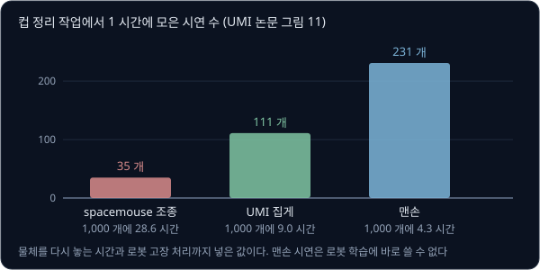
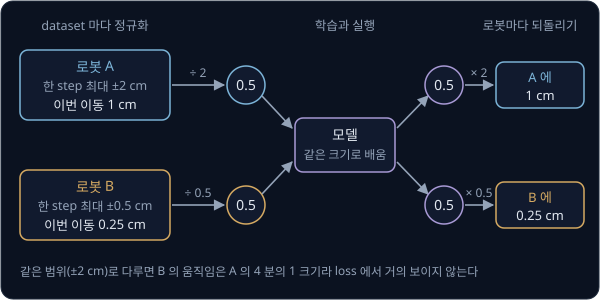
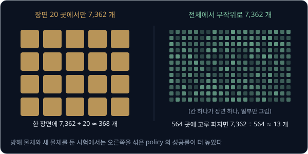
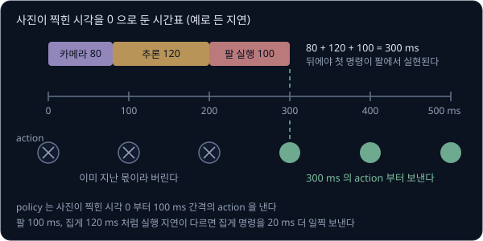
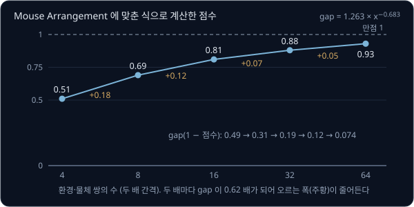
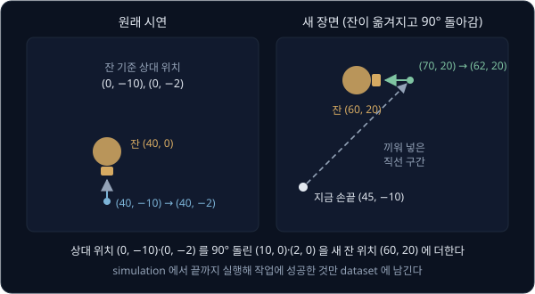
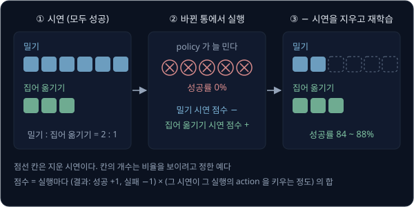
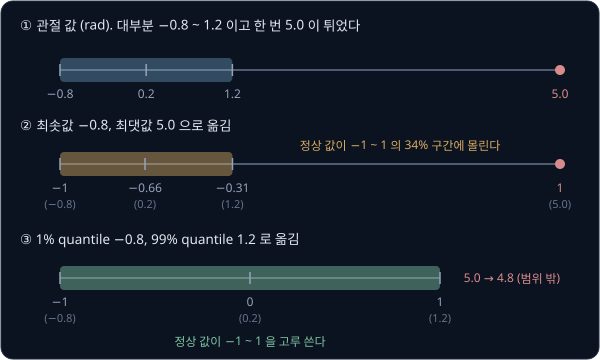

# Robot Data Scaling

UMI 논문의 저자들은 손에 쥐는 집게로 에스프레소 컵을 받침 접시에 올리는 시연을 모아 로봇 팔의 policy 를 학습했다. 실험실 한 곳에서 2 명이
모은 시연 305 개로 학습한 policy 는 그 실험실에서 20 번 모두 성공했지만, 실험실 데이터만으로 학습한 policy 를 처음 보는 카페 테이블에 옮기자
로봇은 컵 쪽으로 움직이지도 않았다. 3 명이 집·사무실·식당·야외 30 곳에서 모은 시연 1,400 개로 학습하자 처음 보는 두 장소에서 60 번 중 43 번
(71.7%) 성공했다. 처음 보는 곳에서도 일하는 policy 를 만들려면 어떤 시연을 얼마나 모아야 하고, 사람이 한 번씩 직접 보여 줘야 하는 시연을
어떻게 그만큼 모을 수 있을까?

이 물음에 대한 실험의 답은 시연의 개수보다 장면과 물체의 가짓수를 먼저 늘리라는 것이다. Lin 등(2024)은 시연 4 만 개 이상과 실물 시험
1 만 5 천 번 이상으로 이 관계를 쟀고, 환경 32 곳에 곳마다 다른 물체 하나로 시연 50 개씩 모으는 계획을 세웠다. 4 명이 오후 한나절 동안 이렇게
모은 데이터로 학습한 policy 는 처음 보는 환경과 물체에서 약 90% 성공했다. 이 강의는 그런 데이터를 마련하는 방법과 모은 데이터를
고르고 섞는 방법을 다룬다.

## 학습 목표

- 로봇 데이터가 웹 데이터처럼 모이지 않는 이유와, Open X-Embodiment·DROID 가 서로 다른 로봇·카메라·장면의 데이터를 합치거나 모은 방식과 그 효과를 설명할 수 있다
- 로봇 없이 시연을 모으는 UMI 가 손목 카메라, 영상으로 손끝 궤적을 구하는 SLAM, 지연을 맞추는 latency matching 으로 무엇을 맞추는지 설명할 수 있다
- 환경·물체의 가짓수와 환경마다의 시연 수가 일반화에 주는 효과를, 가짓수를 두 배로 할 때마다 오차가 같은 비율로 주는 power law 로 읽고 수집 계획을 세울 수 있다
- 적은 시연을 늘리는 합성 시연(MimicGen·DemoGen), 실행 결과로 시연을 고르는 CUPID, VLA pretraining 의 데이터 섞기(data mixture)가 각각 무엇을 풀고 어디서 막히는지 설명할 수 있다

## 로봇 데이터가 모자란 이유

[CLIP](../clip/README.md) 은 인터넷에서 모은 사진과 글 4 억 쌍으로 학습했다. 사진과 글은 사람들이 다른 목적으로 올려 둔 것을 모으기만 하면
되지만, 로봇 policy 의 학습 데이터에는 관측과 함께 그 순간 로봇에 보낸 action 이 있어야 해서 인터넷에서 긁어 올 수 없다. DROID 논문도 로봇
데이터가 모자란 이유로 이 점을 먼저 들었다. 시연 하나마다 사람과 로봇이 함께 있어야 하고, 한 번 할 때마다 물체를 다시 놓고 로봇을 처음 자세로
돌려야 한다.

UMI 논문의 저자들은 같은 사람이 컵 정리 작업의 시연을 15 분 동안 몇 개 모으는지 세어 1 시간당 개수로 적었다. 물체를 다시 놓는 시간과
로봇 고장을 처리하는 시간까지 넣은 값이다.

| 수집 방식 | 1 시간에 모은 시연 | 시연 1,000 개에 드는 시간 |
| --- | --- | --- |
| spacemouse 로 로봇 조종 (teleoperation) | 35 개 | $1000 \div 35 \approx 28.6$ 시간 |
| 손에 쥐는 UMI 집게 | 111 개 | $1000 \div 111 \approx 9.0$ 시간 |
| 맨손 (로봇 학습에 바로 쓸 수 없다) | 231 개 | $1000 \div 231 \approx 4.3$ 시간 |

여러 기관이 힘을 합쳐도 규모는 크지 않다. DROID 연구진은 같은 로봇 18 대를 13 개 기관에 두고 50 명이 12 개월 동안 시연을 모아 성공한 시연
76,000 개(350 시간)를 얻었고, 실패로 표시된 시연도 따로 약 16,000 개 있었다.

frame 의 개수만 보면 로봇 데이터도 작지 않다. DROID 는 1 초에 15 번 기록했으므로 frame 은 $350 \times 3600 \times 15 = 1{,}890$ 만 개다. 하지만
이웃한 frame 은 거의 같은 사진이다. [Teleop Dataset](../teleop-dataset/README.md#lerobotdataset-의-표와-영상) 에서 영상을 바뀐 부분만 적어
270 분의 1 로 줄일 수 있었던 것도 그래서다. 일반화를 좌우하는 것은 frame 의 개수가 아니라 장면·물체·작업의 가짓수이고, DROID 의 1,890 만 frame 은
장면 564 곳에서 나왔다. 장면 하나에 평균 $76{,}000 \div 564 \approx 135$ 개의 시연이 있다.

로봇 데이터를 늘리는 연구는 크게 네 갈래다. 남이 모은 데이터를 합치고(Open X-Embodiment), 같은 로봇을 여러 곳에 보내 장면을 바꿔
가며 모으고(DROID), 로봇 없이 사람 손으로 모으고(UMI), 적은 시연을 컴퓨터로 늘린다(MimicGen). 모은 뒤에는 무엇을 남기고 어떤 비율로 섞을지를
정한다.

**확인 문제.** spacemouse 조종으로는 1 시간에 시연 35 개를, UMI 로는 111 개를 모은다. 시연 500 개를 모으는 데 각각 몇 시간이 걸리고, UMI 는 몇 배
빠를까?

답 보기

1. spacemouse: $500 \div 35 \approx 14.3$ 시간
2. UMI: $500 \div 111 \approx 4.5$ 시간
3. 배수: $111 \div 35 \approx 3.2$ 배

## Open X-Embodiment 와 RT-X

[Teleop Dataset](../teleop-dataset/README.md#공통-dataset-형식) 에서 본 Open X-Embodiment(OXE)는 21 개 기관에 걸친 연구실 34 곳의 robot dataset
60 개를 RLDS 라는 한 형식으로 바꿔 모은 것이다. 로봇 22 종의 trajectory 가 100 만 개를 넘고, 언어 지시로 센 skill 은 527 가지이며, 가장 많이
나오는 로봇은 Franka 다. 이름의 embodiment 는 로봇의 몸(생김새와 관절 구성)을 뜻하고, X 는 여러 몸을 가로지른다(cross)는 뜻이다.

형식을 하나로 맞춰도 내용까지 같아지지는 않는다. 논문의 그림 3 에 나온 세 dataset 만 해도 하나는 1 초에 3 번 손끝 위치·회전의 변화량과 집게를
적고, 하나는 1 초에 10 번 손끝 속도와 z 축 회전 속도를 적고, 하나는 1 초에 5 번 손끝 위치의 변화량만 적고 회전은 적지 않는다. 카메라의 개수와
놓인 자리도 dataset 마다 다르다. RT-X 의 저자들은 이 차이를 대략만 맞췄다(coarse alignment).

- 카메라는 dataset 마다 대표 카메라 하나를 골라 같은 해상도로 줄인다
- action 은 손끝의 x, y, z, roll, pitch, yaw 와 집게(또는 그 변화 빠르기)의 숫자 7 개로 바꾼다
- action 의 크기는 dataset 마다 따로 정규화한 뒤 [RT-1](../rt1/README.md) 처럼 256 칸으로 자른다
- 좌표계는 맞추지 않는다. 어떤 로봇의 x 는 앞쪽이고 다른 로봇의 x 는 옆쪽일 수 있으며, 값이 위치인지 변화량인지 속도인지도 원래 로봇의 제어
  방식을 따른다

dataset 마다 따로 정규화하는 이유는 숫자로 보면 분명하다. 예를 들어 로봇 A 의 dataset 은 한 step 에 손끝을 x 쪽으로 최대 ±2 cm 옮기고, 로봇 B
의 dataset 은 최대 ±0.5 cm 옮긴다고 하자. 각자의 최댓값으로 나누면 A 의 1 cm 와 B 의 0.25 cm 가 똑같이 0.5 가 되어, 모델은 두 로봇에서 같은
크기의 숫자를 배운다. 실행할 때는 모델이 낸 0.5 를 그 로봇의 범위로 되돌려 A 에는 1 cm 를 보내고 B 에는 0.25 cm 를 보낸다. 같은 범위로 다루면
B 의 움직임은 A 의 4 분의 1 크기에 그쳐 loss 에서 거의 보이지 않는다.

이렇게 맞춘 데이터로 학습한 RT-1-X 는 RT-1 과 구조가 같은 3,500 만 parameter 모델이다. 저자들이 실험에 쓴 데이터는 로봇 9 종의 dataset
12 개를 섞은 것이었다. 데이터가 적은 dataset 5 개의 원래 로봇에서 시험하자, RT-1-X 는 그 dataset 만으로 학습한 원래 방법보다 5 개 중 4 개에서 나았고
평균 성공률이 50% 높았다(1.5 배). 구조가 같으므로 이 차이는 다른 로봇의 데이터에서 왔다. 데이터가 많은 dataset 에서는 결과가 달랐다.

| 시험한 곳 | 그 dataset 만으로 학습한 RT-1 | RT-1-X (3,500 만) | RT-2-X (550 억) |
| --- | --- | --- | --- |
| Bridge 과제 (Stanford, WidowX) | 40% | 27% | 50% |
| Bridge 과제 (UC Berkeley, WidowX) | 30% | 27% | 30% |
| RT-1 논문의 과제 (Google 로봇) | 92% | 73% | 91% |

RT-1-X 가 오히려 낮았는데, 저자들은 작은 모델이 여러 로봇의 데이터를 다 담지 못한 underfitting 으로 보았다. 사진과 글로 pretrained 된 VLM 위에
만든 550 억 parameter 의 RT-2-X 는 같은 데이터를 담아냈다.

다른 로봇에서 배운 skill 이 넘어오는지도 시험했다. Bridge dataset 의 WidowX 팔에는 있고 Google 로봇의 데이터에는 없는 skill 을 Google 로봇에
시키자, Google 로봇 데이터로만 학습한 RT-2 는 27.3% 를 냈고 OXE 를 함께 학습한 RT-2-X 는 75.8% 를 냈다($75.8 \div 27.3 \approx 2.8$ 배).
RT-2-X 의 학습에서 Bridge 만 빼자 42.8% 로 떨어져서, 늘어난 skill 의 상당 부분이 WidowX 의 데이터에서 왔다고 볼 수 있다.

> **오해** 여러 로봇의 데이터를 섞으면 어느 로봇의 성능이든 오른다.
>
> **사실** Google 로봇 과제에서 그 로봇의 데이터만으로 학습한 RT-1 은 92% 였지만, 같은 구조로 로봇 9 종의 데이터를 함께 배운 RT-1-X 는 73% 였다. 데이터가 넉넉한 로봇에서는 모델이 커야 섞은 데이터의 이득을 본다.

<b>심화: 정규화와 256 칸, RT-2-X 의 설계 선택</b>

정규화 방식은 여러 가지인데, 아래는 dataset 의 −최대와 +최대를 −1 과 1 로 옮기는 방식으로 계산한 예다. −1 ~ 1 을 256 칸으로 자르면 칸 하나의
폭은 $2 \div 256 \approx 0.0078$ 이다.

| | 로봇 A (±2 cm) | 로봇 B (±0.5 cm) |
| --- | --- | --- |
| 실제 범위의 폭 | 4 cm | 1 cm |
| dataset 마다 정규화한 뒤 칸 하나 | $4 \div 256 \approx 0.016$ cm | $1 \div 256 \approx 0.004$ cm |
| A 의 범위 하나로 자를 때 B 가 쓰는 칸 | | $1 \div (4 \div 256) = 64$ 칸 |

A 의 범위 하나로 두 로봇을 함께 자르면 B 의 움직임 전체가 256 칸 가운데 64 칸에 몰리고, B 의 칸 하나는 0.016 cm 로 4 배 거칠어진다.

같은 논문의 표 II 는 RT-2-X 의 설계 선택도 비교한다. Bridge skill 을 Google 로봇에서 시험한 성공률이다.

| 설정 | 성공률 |
| --- | --- |
| 550 억, 사진 이력 없음 | 75.8% |
| 50 억, 지난 사진을 함께 봄(이력 길이 2) | 44.4% |
| 50 억, 사진 이력 없음 | 14.5% |
| 50 억, 이력 길이 2, 웹 pretraining 없이 처음부터 | 0% |

모델이 클수록, 지난 사진을 함께 볼수록 다른 로봇의 skill 이 더 많이 넘어왔고, 웹 데이터로 pretrained 된 weight 없이 처음부터 학습한 모델은
아무 skill 도 얻지 못했다.

**확인 문제.** 로봇 C 의 dataset 은 한 step 에 손끝을 최대 ±4 cm 옮기고, dataset 마다 최댓값으로 나눠 정규화했다. 모델이 −0.25 를 냈다면 로봇 C
에 보낼 이동량은?

답 보기

정규화할 때 4 cm 로 나눴으므로 되돌릴 때는 4 cm 를 곱한다. $-0.25 \times 4 = -1$ 이라서 x 쪽으로 −1 cm 다.

## DROID 와 장면 다양성

OXE 는 이미 있던 dataset 을 모은 것이라 dataset 하나하나는 장면이 몇 곳뿐이고, DROID 논문을 쓸 무렵 장면을 모두 합쳐도 약 300 곳이었다. DROID
연구진은 거꾸로 같은 장비를 여러 곳에 보내 장면부터 늘렸다.

장비는 바퀴 달린 책상에 올린 Franka Panda 팔과 집게, 삼각대에 세운 stereo 카메라 두 대와 손목 카메라 한 대이고, 사람은 VR 헤드셋(Meta Quest
2)의 손 controller 로 손끝의 위치·자세와 집게를 조종한다. 1 초에 15 번 기록하고,
action 은 관절 값과 손끝 자세 두 가지로 모두 적는다. 수집 절차도 다양성을 늘리도록 짰다.

- 새 장면마다 바깥 카메라의 자리를 새로 정하고, 체커보드로 카메라와 로봇의 상대 위치를 다시 잰다
- 수집 프로그램이 그 장면의 작업 목록에서 하나를 무작위로 골라 보여 줘서, 사람이 쉬운 작업만 고르지 않게 한다
- 프로그램이 이따금 로봇 받침 밀기, 카메라 옮기기, 조명 바꾸기, 물건 더하고 빼기를 지시한다
- 한 장면에서 시연을 최대 100 개쯤(20 분 분량쯤) 모은 뒤 다음 장면으로 옮긴다

장면은 로봇 앞의 작업 공간이 크게 바뀔 때만 새로 센다. 같은 책상에서 물건 배치나 식탁보만 바꾼 것은 새 장면이 아니다. 이렇게 센 장면이 건물
52 채의 564 곳이고, 바깥 카메라의 시점은 1,417 가지이며, 지시문의 동사로 센 작업은 86 가지다.

저자들은 DROID 를 다른 작업의 학습에 섞어 효과를 쟀다. 실험실·사무실·가정의 작업 6 개마다 그 자리에서 시연 50 ~ 150 개를 모으고
[Diffusion Policy](../diffusion-policy/README.md) 를 세 가지로 학습했다. 하나는 그 시연만 쓰고, 하나는 batch 마다 절반을 DROID 에서 뽑고, 하나는
절반을 OXE 에서 뽑았다. 처음 위치만 조금 바꾼 시험에서 DROID 를 섞은 policy 의 평균 성공률은 다음으로 좋은 방법보다 22%p 높았고, 방해 물체를
두거나 물체를 바꾼 시험에서는 17%p 높았다.

장면 다양성의 몫을 따로 보려고 저자들은 DROID 에서 시연 7,362 개를 두 방식으로 뽑았다. 하나는 시연이 가장 많은 장면 20 곳에서만 뽑아 장면
하나에 평균 $7{,}362 \div 20 \approx 368$ 개이고, 다른 하나는 전체에서 무작위로 뽑아 수백 곳의 장면에 흩어져 있다(564 곳에 고루 퍼지면 한 곳에
$7{,}362 \div 564 \approx 13$ 개). 양은 같은데, 방해 물체와 새 물체를 둔 시험에서는 흩어진 쪽을 섞은 policy 의 성공률이 더 높았다.

<b>심화: 절반씩 섞을 때 시연 하나가 뽑히는 빈도</b>

예를 들어 그 자리의 시연 50 개와 DROID 76,000 개를 한 더미로 합쳐 고르게 뽑으면, 그 자리 시연의 몫은 $50 \div 76{,}050 \approx 0.07\%$ 라서 batch
64 개에 하나도 들어가지 않을 때가 대부분이다. batch 의 절반 32 개씩을 두 더미에서 따로 뽑으면 step 마다 아래처럼 쓰인다.

| | 그 자리 시연 | DROID 시연 |
| --- | --- | --- |
| 더미의 크기 | 50 | 76,000 |
| batch 에서 받은 자리 | 32 | 32 |
| 시연 하나가 step 마다 뽑히는 횟수 | $32 \div 50 = 0.64$ | $32 \div 76{,}000 \approx 0.00042$ |

그 자리 시연 하나가 DROID 시연 하나보다 $0.64 \div 0.00042 \approx 1{,}520$ 배 자주 쓰인다. 섞는 비율은 목표 작업을 잊지 않게 하는 쪽과 큰 데이터의
다양성을 얻는 쪽 사이에서 정한다. 예시가 많은 조합을 덜 뽑도록 $n$ 대신 $n^{0.43}$ 에 비례해 뽑은 π0 의 방식은
[π0](../pi0/README.md#pretraining-과-fine-tuning) 에서 다룬다.

**확인 문제.** 그 자리의 시연이 100 개이고 batch 64 개의 절반을 DROID(76,000 개)에서 뽑는다. 그 자리 시연 하나는 DROID 시연 하나보다 몇 배 자주
쓰일까?

답 보기

1. 그 자리 시연 하나: $32 \div 100 = 0.32$ 번
2. DROID 시연 하나: $32 \div 76{,}000 \approx 0.00042$ 번
3. 배수: $0.32 \div 0.00042 \approx 760$ 배. 그 자리 시연이 50 개에서 100 개로 두 배가 되어, 1,520 배의 절반으로 줄었다

## UMI 와 로봇 없는 수집

로봇 팔을 책상째 식당이나 야외로 옮기기는 어렵고, 장면마다 카메라 calibration 도 필요하다. UMI(Universal Manipulation Interface)는 로봇 대신
사람이 3D 프린터로 만든 집게를 들고 다니며 시연을 모은다. 집게 위의 센서는 GoPro 카메라 하나뿐이고, 실행할 때는 로봇 팔 끝에 같은 집게와 같은
GoPro 를 같은 자리에 단다. 집게 부품 값은 73 달러, GoPro 와 부속은 298 달러이고, 무게는 780 g 이다.

사람이 손으로 보인 시연을 로봇이 따라 배우려면 policy 가 보는 사진과 배우는 action 이 로봇에서와 같아야 한다. UMI 는 이것을 아래처럼 맞추고,
저자들은 컵 정리 작업에서 각 장치의 효과를 쟀다(모두 갖춘 policy 는 UR5 팔에서 20 번 중 20 번 성공했다).

| 필요한 것 | UMI 의 방법 | 논문의 비교 |
| --- | --- | --- |
| 사람과 로봇이 같은 사진을 본다 | 집게 손가락에 고정한 손목 카메라만 쓴다 | 같은 policy 를 다른 로봇 팔(Franka FR2)에 올려도 20 번 중 18 번 성공했다 |
| 주변이 보인다 | 155° fisheye 렌즈를 달고, 사진을 펴지 않고 그대로 넣는다 | 사진을 69° 로 잘라 펴면 20 번 중 11 번이었다 |
| 깊이를 짐작한다 | 화면 양옆의 거울이 다른 시점의 사진을 하나씩 더 준다 | 거울 속 사진을 좌우로 뒤집어 넣어야 20 번 중 20 번이었고, 그대로 넣으면 17 번, 거울이 없으면 18 번이었다 |
| 손끝의 6 DoF 궤적을 안다 | GoPro 의 영상과 IMU 로 SLAM 을 풀어 실제 크기의 궤적을 얻는다 | 평균 위치 오차는 6.1 mm 이고, 회전 오차는 3.5° 다 |
| 집게를 벌린 폭을 안다 | 손가락에 붙인 marker 를 사진에서 읽는다 | 놓는 순간이 중요한 던지기 작업에 쓴다 |
| 로봇이 할 수 있는 움직임이다 | 로봇의 관절 한계를 넘는 시연은 지운다 | |

SLAM 은 카메라가 움직이며 찍은 영상으로 주변 지도와 카메라의 위치를 함께 구하는 방법이다. 카메라 하나로는 움직인 거리의 실제 크기를 알 수 없어서,
UMI 는 [Visual SLAM](../visual-slam/README.md#vio) 에서 본 것처럼 IMU 의 가속도로 실제 크기를 정하는 ORB-SLAM3 를 쓴다.

### latency matching

손에 든 UMI 에서는 사진, 손끝 궤적, 집게 폭이 모두 GoPro 한 대에서 나오므로 같은 순간의 값이다. 로봇에서는 사진이 카메라에서 컴퓨터로 오는 데,
policy 가 계산하는 데, 팔이 명령을 따라가는 데 각각 시간이 걸린다. 그대로 두면 policy 는 이미 지난 순간의 사진을 보고, 이미 지난 순간의 몫인
action 을 보낸다.

예를 들어 policy 가 1 초에 10 번(100 ms 간격) action 을 내고, 사진이 찍힌 뒤 컴퓨터에 닿기까지 80 ms, 추론에 120 ms, 팔이 명령을 따라가는 데
100 ms 가 걸린다고 하자(마지막 값은 논문 그림 5 의 예와 같다). 사진이 찍힌 시각을 0 이라 하면 첫 명령이 팔에서 실현되는 것은 빨라도
$80 + 120 + 100 = 300$ ms 뒤다. policy 는 시각 0 부터의 action 을 내므로, 0 ms·100 ms·200 ms 의 action 셋은 버리고 300 ms 의 action 부터 보낸다.

이렇게 맞추지 않으면 손끝이 1 초에 0.5 m 로 움직이는 동안 300 ms 의 차이는 $0.5 \times 0.3 = 0.15$ m(15 cm)의 어긋남이 된다. 관측 쪽에서도
UMI 는 지연이 가장 긴 카메라를 기준으로 삼아, 사진이 찍힌 시각에 맞춰 로봇의 손끝 자세와 집게 값을 보간해 짝짓는다. 팔과 집게의 실행 지연이
다르면 명령도 각자 그만큼 앞당긴다. 그림 5 의 예처럼 팔이 100 ms 이고 집게가 120 ms 라면 집게 명령을 20 ms 더 일찍 보낸다.

물체를 집어 알맞은 통에 던지는 작업에서 latency matching 을 켠 policy 는 120 개 중 105 개(87.5%)를 맞는 통에 넣었고, 지연을 모두 0 으로 두자
69 개(57.5%)로 떨어졌다. 저자들은 팔의 움직임이 흔들려 던지는 속도가 나오지 않고, 팔과 집게의 시각이 어긋나 놓는 순간이 틀린 것을 원인으로 들었다.

UMI 에도 한계가 있다. SLAM 은 사진 속 무늬로 위치를 잡으므로 흰 벽만 보이는 곳에서는 궤적을 잃는다. Lin 등은 UMI 로 모은 시연의 약 90% 만
쓸 수 있었고, 문이나 서랍처럼 화면을 크게 가리는 물체는 SLAM 이 카메라가 멈춘 것으로 잘못 읽어서 그런 작업을 피했다. UMI 논문의 비교에서 수집 속도는
맨손의 48% 였다.

<b>심화: absolute, delta, relative trajectory action</b>

UMI 의 action 은 policy 를 계산하는 순간의 손끝 자세를 기준으로 적은 앞으로의 손끝 자세들이다(relative trajectory). 손끝의 x 위치 하나만 놓고, 예를
들어 지금 10 cm 에 있는 손끝이 앞으로 세 step 동안 12, 14, 16 cm 로 가야 한다면 세 표현은 아래와 같다.

| 표현 | 기준 | 적는 값 | 오차가 생기는 방식 |
| --- | --- | --- | --- |
| absolute | 로봇 받침의 좌표계 | 12, 14, 16 | SLAM 좌표와 로봇 좌표를 맞춘 오차가 모든 값에 그대로 남는다 |
| delta | 바로 앞 step 의 목표 | +2, +2, +2 | step 마다 0.1 cm 씩 틀리면 셋째에서 0.3 cm 로 쌓인다 |
| relative | 계산하는 순간의 손끝 | +2, +4, +6 | 셋 모두 같은 지금 자세를 기준으로 해서 오차가 쌓이지 않는다 |

absolute 를 쓰려면 사람이 모은 궤적을 로봇 받침의 좌표계로 옮겨야 하는데, 장소마다 바뀌는 수집 현장에서는 그 기준을 잡기 어렵다. 저자들이
책상에 marker 를 붙여 SLAM 좌표와 로봇 좌표를 맞춘 뒤 absolute 로 학습하자 컵 정리는 20 번 중 5 번만 성공했고, delta 는 16 번, relative 는 20 번
성공했다. 관측에 넣는 지난 손끝 자세도 지금 자세 기준으로 적어서, 지난 자세 2 개를 넣으면 policy 가 속도를 알 수 있다. 같은 이유로 실행 중에
로봇 받침을 옮겨도 물체가 팔이 닿는 곳에 있는 한 작업에 지장이 없었다.

**확인 문제.** policy 가 1 초에 20 번(50 ms 간격) action 을 내고, 카메라 지연이 60 ms, 추론이 90 ms, 팔의 실행 지연이 100 ms 다. 사진이 찍힌
시각을 0 이라 할 때 버리는 action 은 몇 개이고, 몇 ms 의 action 부터 보낼까?

답 보기

1. 첫 명령이 실현되는 시각: $60 + 90 + 100 = 250$ ms
2. 그보다 앞선 action: 0, 50, 100, 150, 200 ms 의 5 개를 버린다
3. 250 ms 의 action 부터 보낸다

## data scaling law

UMI 로 장소를 옮겨 가며 시연을 모을 수 있게 되자 Lin 등(2024)은 무엇을 늘려야 하는지를 직접 쟀다. 작업은 물병을 집어 머그잔에 물을 붓고 받침에
놓는 Pour Water 와, 마우스를 집어(기울어져 있으면 밀어서 바로잡고) 마우스 패드에 앞을 보게 놓는 Mouse Arrangement 다. policy 는 DINOv2 로
pretrained 된 ViT-L/14 image encoder 를 단 Diffusion Policy 이고, 시험은 학습에 없던 환경이나 물체에서만 했다. 점수는 단계마다 0 ~ 3 점을 매겨
만점으로 나눈 값(normalized score, 최대 1)이다.

데이터는 세 묶음으로 모았다. 한 환경에서 물체 32 개로, 같은 물체로 환경 32 곳에서, 환경 32 곳에서 곳마다 다른 물체 하나로 각각 시연 120 개씩이다.
묶음마다 환경·물체를 1, 2, 4, 8, 16, 32 개 골라 그 시연의 100%, 50%, …, 3.125% 만 써서 policy 를 따로 학습했다. 결과는 세 가지로 정리된다.

- 환경·물체의 가짓수를 늘리면 처음 보는 환경·물체의 점수가 꾸준히 오른다. 물체 8 개로 학습한 policy 가 두 작업 모두 새 물체에서 0.8 을 넘었다
- 가짓수를 고정하고 시연만 늘리면 점수가 금방 멈춘다. 환경 실험에서 시연을 50% 쓴 곡선과 100% 쓴 곡선이 거의 겹쳤다
- 환경을 바꾸는 쪽이 물체를 바꾸는 쪽보다 어렵다. 가짓수가 적을 때 환경을 늘린 쪽의 점수가 덜 올랐다

점수가 1 에 얼마나 못 미치는지(1 − 점수)를 optimality gap 이라 하면, gap 은 가짓수를 두 배로 늘릴 때마다 일정한 비율로 줄었다. Mouse Arrangement
에서 환경·물체 쌍의 수 $x$ 에 맞춘 식은 gap $= 1.263 \times x^{-0.683}$ 이고, $2^{-0.683} \approx 0.62$ 라서 쌍을 두 배로 늘릴 때마다 gap 이 0.62 배가
된다. 이렇게 가짓수를 두 배로 할 때마다 같은 비율로 줄어드는 관계를 power law 라고 한다. 아래 값은 이 식으로 계산한 것이다.

| 환경·물체 쌍 | gap (식으로 계산) | 점수 |
| --- | --- | --- |
| 8 | 0.31 | 0.69 |
| 16 | $0.31 \times 0.62 \approx 0.19$ | 0.81 |
| 32 | $0.19 \times 0.62 \approx 0.12$ | 0.88 |
| 64 | $0.12 \times 0.62 \approx 0.074$ | 0.93 |

쌍을 두 배로 늘릴 때마다 오르는 점수의 폭은 0.12, 0.07, 0.05 로 줄어든다. 저자들은 이 식으로 점수 0.99 에는 쌍이 1,191 개 필요하다고 예측했고,
검증은 다음 연구로 남겼다.

저자들은 한 환경에 물체를 여러 개 두는 경우도 쟀다. 환경 16 곳에 곳마다 물체 4 개로 시연을 모아, Pour Water 에서 환경 수와 환경당 물체 수를
바꿔 학습했다(논문 그림 6).

| 환경 수 | 환경당 물체 1 개 | 2 개 | 3 개 | 4 개 |
| --- | --- | --- | --- | --- |
| 1 | 0.14 | 0.37 | 0.44 | 0.36 |
| 4 | 0.46 | 0.61 | 0.54 | 0.52 |
| 16 | 0.74 | 0.76 | 0.79 | 0.73 |

환경이 한 곳뿐일 때는 물체를 늘린 효과가 컸지만, 환경이 16 곳이면 물체를 늘려도 0.73 ~ 0.79 로 거의 같았다. 저자들은 환경을 최대한 많이 두고
환경마다 물체는 하나만 쓰라고 권했다.

시연 수는 쌍이 8, 16, 32 개일 때 각각 전체 400, 800, 1,600 개에서 점수가 멈췄다. 모두 쌍 하나에 50 개라서, 저자들은 이만한 난도의 작업이면
쌍마다 50 개를 권했다. 이 계획(쌍 32 개 × 시연 50 개 = 1,600 개)을 새 작업인 수건 접기와 충전기 뽑기에 적용하자, 4 명이 오후 한나절 동안 모은
데이터로 처음 보는 환경 8 곳에서 87.5% 와 90.0% 를 냈다. 지시의 종류를 줄인 쪽이 양을 줄인 쪽만큼 일반화를 잃은
[RT-1](../rt1/README.md#시연-데이터와-일반화) 의 실험과 같은 방향이다.

모델 쪽에서는 image encoder 의 크기가 점수를 갈랐다. 쌍 32 개로 학습한 Pour Water 에서 ViT-S, ViT-B, ViT-L 은 0.66, 0.81, 0.90 을 냈고,
pretrained weight 없이 처음부터 학습하면 0.03 이었다. action 을 만드는 U-Net 을 키우는 것은 효과가 없었다.

> **오해** 새 장소에서 성공률이 낮으면 지금 장소의 시연을 더 모으면 된다.
>
> **사실** 환경 수를 고정하고 쓰는 시연을 50% 에서 100% 로 늘려도 처음 보는 환경의 점수는 거의 그대로였다. 시연 1,600 개를 모은다면 환경 32 곳에 50 개씩 나눈 쪽이 처음 보는 곳에서 약 90% 를 냈다.

<b>심화: power law 와 log 눈금</b>

gap 이 가짓수를 두 배로 할 때마다 같은 비율로 줄면, 가로와 세로를 모두 log 눈금(1, 10, 100 이 같은 간격인 눈금)으로 그렸을 때 점들이 직선 위에
놓인다. Mouse Arrangement 의
환경·물체 쌍으로 대응을 적으면 아래와 같다.

| 이 예의 값 | 기호로 쓴 값 |
| --- | --- |
| 환경·물체 쌍의 수 8, 16, 32 | $x$ |
| gap 0.31, 0.19, 0.12 | $y$ |
| 식에 쌍 1 개를 넣은 값 1.263 | $\beta$ |
| 두 배마다 곱하는 0.62 $= 2^{-0.683}$ 의 지수 0.683 | $\alpha$ |
| gap $= 1.263 \times x^{-0.683}$ | $y = \beta x^{-\alpha}$ (양변에 log 를 쓰면 $\log y = \log \beta - \alpha \log x$) |

저자들은 100% 시연으로 학습한 6 개 점(1 ~ 32 개)에 이 직선을 맞췄고, 점이 6 개뿐이라 데이터를 아무리 늘려도 남는 오차를 뜻하는 상수항은 넣지
않았다. 직선에 얼마나 잘 맞는지를 나타내는 상관계수 $r$ 은 이 경우 0.942 다. 0.99 에 필요한 쌍의 수는 gap 을 0.01 로 두고 푼다.

$$
0.01 = 1.263 \times x^{-0.683} \quad\Rightarrow\quad x^{0.683} = 126.3 \quad\Rightarrow\quad x = 126.3^{1 / 0.683} \approx 1{,}190
$$

논문이 적은 1,191 과의 차이는 계수를 반올림한 데서 온다. 환경 수에 맞춘 지수는 Pour Water 에서 0.844 였고 Mouse Arrangement 에서 0.466
이었다. 지수는 작업마다 다르고, 시연 수에 대해서는 이런 직선이 잘 맞지 않았다.

**확인 문제.** 환경·물체 쌍을 두 배로 늘릴 때마다 gap 이 0.62 배가 된다고 하자. 쌍 16 개에서 점수가 0.80 이었다면 64 개에서는 몇 점쯤일까?

답 보기

1. 16 개의 gap: $1 - 0.80 = 0.20$
2. 32 개: $0.20 \times 0.62 = 0.124$
3. 64 개: $0.124 \times 0.62 \approx 0.077$
4. 점수: $1 - 0.077 \approx 0.92$

## MimicGen 과 합성 시연

사람의 시연 하나는 대부분 물체에 다가가는 움직임이다. 머그잔이 책상 어디에 있든 잔을 집는 손의 움직임은 잔을 기준으로 보면 거의 같다.
MimicGen(Mandlekar 등, 2023)은 이 점을 이용해 사람 시연 몇 개를 새 물체 위치에 맞게 옮겨 시연을 수백 ~ 수천 개로 늘린다. MimicGen 이 기대는
가정은 세 가지다.

- action 이 손끝 자세의 변화량이라서, 시연을 손끝 목표 자세의 순서로 읽을 수 있다
- 작업이 물체 하나씩을 다루는 하위 작업의 순서로 나뉘고, 그 순서를 사람이 알려 준다(너트 집기 → 기둥에 끼우기)
- 데이터를 만드는 동안에는 하위 작업이 시작될 때마다 그 물체의 자세를 안다. policy 를 실행할 때는 몰라도 된다

시연은 아래 순서로 만든다. 같은 과정을 양손 humanoid 로 넓힌 DexMimicGen 은 [GR00T N1](../groot/README.md#dexmimicgen-으로-늘린-simulation-시연)
에서 다뤘다.

1. 사람 시연을 하위 작업 구간으로 나눈다
2. 새 장면에서 구간마다 원래 시연의 구간 하나를 골라, 손끝과 물체의 상대 자세가 그대로 남게 옮긴다
3. 지금 손끝에서 옮긴 구간의 시작까지 직선 구간을 끼운다
4. simulation 에서 끝까지 실행해 작업에 성공한 것만 남긴다

저자들은 작업마다 사람 시연 10 개로 1,000 개를 만들어 같은 policy(BC-RNN)로 학습했다.

| 작업 | 사람 시연 10 개 | MimicGen 1,000 개 |
| --- | --- | --- |
| Square (사각 너트를 기둥에 끼우기) | 11.3% | 90.7% |
| Threading (바늘을 받침의 구멍에 꿰기) | 19.3% | 98.0% |
| Three Piece Assembly (세 조각 조립) | 1.3% | 82.0% |

작업 18 개에서 사람 시연 약 200 개로 시연 5 만 개 이상을 만들었다. 같은 개수끼리 비교하면 사람 시연 10 개에서 만든 200 개와 사람이 직접 모은
200 개로 학습한 policy 의 성공률이 대부분 비슷했다. 만든 시연을 200 개에서 1,000 개로 늘리면 크게 올랐지만, 1,000 개에서 5,000 개로는 별로
오르지 않았다.

옮긴 궤적이 늘 성공하지는 않는다. 성공한 시도의 비율을 data generation rate 라 하는데, 정밀한 기어 조립(Gear Assembly)의 넓은 배치(D1)에서는
8.2% 였다. 1,000 개를 얻으려면 시도가 $1000 \div 0.082 \approx 12{,}200$ 번 필요하지만 그 데이터로 학습한 policy 는 76.0% 를 내서, 생성률이 낮다고
데이터가 나쁜 것은 아니었다. 한계도 데이터에 남는다.

- 성공한 시도만 남기므로 옮기기 쉬운 배치가 많이 남는다. 물체 배치 공간을 칸으로 나눠 세자 Three Piece Assembly 의 넓은 배치(D1)는 칸의 43.5%
  만 채웠다
- 끼워 넣은 직선 구간은 충돌을 따지지 않고, 사진과 관계없이 움직이는 구간이라 policy 가 따라 배우기 어렵다. 저자들은 단단한 물체를 천천히
  다루는 작업에서만 시험했다
- 실물에서는 시도마다 로봇을 실제로 움직여야 한다. 블록 쌓기는 243 번 시도해 200 개(82.3%)를 얻었고 커피 캡슐 넣기는 192 번 시도해 100 개
  (52.1%)를 얻었는데, 학습한 policy 는 36% 와 14% 였다(사람 시연 10 개만 쓴 policy 는 둘 다 0%)

DemoGen(Xue 등, 2025)은 실물에서 로봇을 움직이지 않고 시연을 만든다. 사진 대신 깊이 카메라의 point cloud(3 차원 점들의 모음)를 관측으로 쓰면,
물체에 해당하는 점들을 골라 옮기는 것만으로 물체가 다른 곳에 있었을 때의 관측을 만들 수 있다. action 은 물체와 닿는 구간을 통째로 옮기고 빈
공간을 지나는 구간은 motion planning 으로 다시 잇는다. 저자들은 사람 시연 1 개를 두 번 replay 해 point cloud 기록 3 개를 얻고, 평가할 배치마다
물체 자리를 ±1.5 cm 안에서 조금씩 옮긴 9 개씩을 만들었다. 궤적 하나를 만드는 계산은 0.01 초였고, 실물 작업 8 개의 평균 성공률이 11.0% 에서 74.6% 로 올랐다. 시연한
배치에서 멀어질수록 성공률이 떨어졌는데, 저자들은 카메라 하나로 본 point cloud 에서는 옮긴 물체의 보이는 면이 실제와 달라지기 때문으로 보았다.

<b>심화: 물체 기준으로 구간을 옮기는 계산</b>

위에서 본 2 차원으로 그림의 예를 계산한다. 원래 시연에서 잔은 $(40, 0)$ cm 에 있었고, 손끝은 $(40, -10)$ 에서 $(40, -2)$ 로 다가갔다. 잔을 기준으로
적으면 손끝은 잔에서 $(0, -10)$ 과 $(0, -2)$ 만큼 떨어진 곳을 지난다.

새 장면에서 잔이 $(60, 20)$ 에 반시계 방향으로 90° 돌아가 있으면, 잔 기준의 상대 위치도 함께 90° 돌린다. 점 $(a, b)$ 를 반시계 방향으로 90° 돌리면
$(-b, a)$ 가 된다.

| 원래 상대 위치 | 90° 돌린 상대 위치 | 새 잔 위치에 더한 손끝 목표 |
| --- | --- | --- |
| $(0, -10)$ | $(10, 0)$ | $(60 + 10, 20 + 0) = (70, 20)$ |
| $(0, -2)$ | $(2, 0)$ | $(62, 20)$ |

손끝과 잔의 상대 위치는 원래 시연과 같아서, 손끝은 잔의 손잡이 쪽에서 똑같은 거리로 다가간다. 위치와 방향을 함께 담은 4×4 자세 행렬로 적으면
아래와 같다. 자세 행렬의 곱과 역행렬은 [Rigid Transforms](../transforms/README.md) 에서 다룬다.

| 이 예의 값 | 기호로 쓴 값 |
| --- | --- |
| 원래 잔의 자세: $(40, 0)$, 돌지 않음 | $T_O$ |
| 원래 손끝 목표: $(40, -10)$ | $T_C$ |
| 잔 기준의 상대 위치: $(0, -10)$ | $T_O^{-1} T_C$ |
| 새 잔의 자세: $(60, 20)$, 90° 돌아감 | $T_O'$ |
| 새 손끝 목표: 상대 위치를 90° 돌려 더한 $(70, 20)$ | $T_C' = T_O' \, T_O^{-1} \, T_C$ |

**확인 문제.** data generation rate 가 25% 인 작업에서 성공한 시연 1,000 개를 얻으려면 시도를 몇 번 해야 할까?

답 보기

시도 4 번 중 1 번이 성공하므로 $1000 \div 0.25 = 4{,}000$ 번이다.

## 시연 고르기

[Teleop Dataset](../teleop-dataset/README.md#시연자와-방식의-일관성) 에서 본 것처럼 성공한 시연끼리도 policy 에 해로운 것이 섞인다. 시연이 수천
개로 늘면 사람이 하나씩 보고 고를 수 없어서 자동으로 골라야 하는데, 무엇을 기준으로 삼을지가 문제다.

시연 일부를 떼어 두고 그 action 을 얼마나 잘 맞히는지(validation MSE)로 고르면 편하지만, 이 값은 실물 성공률과 어긋날 때가 많다. Lin 등의 실험에서
image encoder 를 LoRA 로만 고친 policy 는 전체 weight 를 고친 policy 보다 validation MSE 가 낮았지만(0.0049 와 0.006), 실물 점수는 0.72 와 0.90 으로
더 낮았다. policy 는 실행하는 동안 자기 action 으로 바뀐 장면을 다시 보므로, 한 step 씩 맞히는 오차가 작아도 이어지는 결정에서 어긋날 수 있다.
그 원리는 [Behavior Cloning](../behavior-cloning/README.md#compounding-error) 에서 다뤘다.

CUPID(Agia 등, 2025)는 시연 하나를 학습에서 빼거나 더하면 실물 성공률이 어떻게 바뀔지를 기준으로 삼는다. 그대로 재려면 시연마다 policy 를 다시
학습하고 다시 시험해야 하지만, CUPID 는 policy 를 한 번 학습하고 실물에서 몇십 번(실물 실험에서는 25 번) 실행한 기록만으로 이 값을 어림한다.
influence function 은 학습 데이터 하나의 무게를 조금 늘릴 때 모델의 출력이 얼마나 바뀌는지를 다시 학습하지 않고 어림하는 계산이다. CUPID 는
실행 기록의 action 마다 그 시연을 더 학습하면 그 action 이 더 잘 나오는지를 influence function 으로 계산하고, 성공한 실행의 action 에는 + 를
붙이고 실패한 실행의 action 에는 − 를 붙여 더한다. 점수가 − 인 시연은 policy 를 실패한 실행 쪽으로 미는 시연이라 지우고, 새로 모은 시연 가운데서는
점수가 큰 것부터 더한다.

저자들의 TuckBox 작업은 재활용 통을 받침대 밑에 밀어 넣는 일이다. 통을 바닥에서 밀어 넣는 시연과 집어서 옮긴 뒤 밀어 넣는 시연이 2 : 1 로
섞여 있고, 시험 때는 겉으로 보이지 않게 통의 무게 배치를 바꿔 밀기가 실패하게 했다. 밀기가 많은 데이터로 학습한 policy 는 늘 밀어서 한 번도
성공하지 못했는데, 실패한 실행의 밀기 action 을 만든 시연들의 점수가 − 로 나와 걸러지자 집어 옮기는 동작이 늘어 성공률이 84 ~ 88% 가 됐다. 실행
기록 없이 시연만 보고 품질을 매기는 DemInf 는 움직임의 편차가 큰 집어 옮기기 시연을 품질이 낮다고 보고 걸러서, 그 데이터로 학습한 policy 는
다시 밀기만 했다.

> **오해** 성공한 시연만 남기면 dataset 에 해로운 시연은 없다.
>
> **사실** TuckBox 의 시연은 모두 성공한 것이었지만, 2 : 1 로 많은 밀기 시연이 시험 조건에서 늘 실패하는 policy 를 만들었다. 시연의 값은 그 시연이 실행 결과에 준 영향으로 재야 한다.

<b>심화: influence 점수의 부호</b>

CUPID 의 점수를 단순하게 적으면, 시연 하나의 점수는 실행 기록마다 "그 실행의 결과(성공 +1, 실패 −1)" 와 "그 시연을 더 학습할 때 그 실행의 action
이 더 그럴듯해지는 정도" 를 곱해 더한 값이다. 뒤의 값은 학습한 weight 에서 loss 의 gradient 와 Hessian(gradient 가 weight 에 따라 바뀌는 정도를 담은 표)으로 계산하는 influence function 이고,
논문은 이 계산을 줄이려고 TRAK 이라는 근사를 쓴다. 아래는 실행 3 번과 시연 2 개로 만든 예다. influence 값은 설명을 위해 정한 값이다.

| | 실행 1 (성공, +1) | 실행 2 (실패, −1) | 실행 3 (실패, −1) | 점수 |
| --- | --- | --- | --- | --- |
| 시연 A 의 influence | +0.2 | +0.5 | +0.4 | $0.2 - 0.5 - 0.4 = -0.7$ |
| 시연 B 의 influence | +0.6 | −0.1 | 0.0 | $0.6 + 0.1 + 0 = +0.7$ |

influence 가 + 이면 그 시연을 더 학습할 때 그 실행의 action 이 더 잘 나오고, − 이면 덜 나오고, 0 이면 변화가 없다. 시연 A 는 실패한 실행의
action 을 키우므로 점수가 − 이고, 시연 B 는 성공한 실행의 action 을 키우고 실패한 실행의 action 을 줄이므로 + 다. 실제 계산은 실행마다 그 실행의
모든 step 과 시연의 모든 step 의 쌍에 대해 이 값을 더하고 실행 수로 나눈다. 실행이 적으면 점수가 흔들려서, 저자들은 실물 작업마다 실행 25 번을
썼다. 실행이 모두 실패한 TuckBox 에서도 쓸 수 있는 것은 실패한 실행만으로도 어느 시연이 그 실패를 만들었는지 가릴 수 있기 때문이다.

**확인 문제.** 실행 결과가 성공, 성공, 실패이고, 어떤 시연의 influence 가 차례로 +0.1, +0.3, +0.6 이다. 이 시연의 점수는 얼마이고, 지울 후보인가?

답 보기

1. 실행마다 결과를 곱한다: $(+1)(0.1) + (+1)(0.3) + (-1)(0.6)$
2. 점수: $0.1 + 0.3 - 0.6 = -0.2$
3. 점수가 − 라서 policy 를 실패한 실행 쪽으로 더 미는 시연이고, 지울 후보다

## VLA pretraining 의 data mixture

VLA 의 pretraining 데이터는 이 강의에서 본 데이터를 섞은 것이다. [OpenVLA](../vla-tokens/README.md#openvla-의-구조와-학습-데이터) 는 OXE 의
시연 97 만 개로 학습했고, π0 는 직접 모은 약 10,000 시간에 OXE·DROID 를 섞었다. π0.5(Physical Intelligence, 2025)의 저자들은 목표 로봇의 데이터가 적을 때 섞는 데이터의 종류마다 몫을 쟀다. 목표는 처음 보는 집에서 부엌과
침실을 치우는 이동 로봇이고, 학습 데이터는 다섯 가지다.

| 데이터 | 내용 |
| --- | --- |
| 이동 로봇 (MM) | 집 약 100 곳에서 모은 이동 로봇의 집안일 약 400 시간 |
| 여러 집의 고정 팔 (ME) | 들고 다니기 쉬운 고정 팔로 더 많은 집에서 모은 데이터 |
| 실험실의 여러 로봇 (CE) | 실험실 책상에서 여러 종류의 로봇으로 모은 작업. OXE 도 들어 있다 |
| 하위 작업 글 (HL) | "베개를 집어" 같은 다음 하위 작업을 글로 맞히는 예시 |
| 웹 데이터 (WD) | 사진 설명, 질문 답하기, 물체 위치 찾기 |

로봇마다 action 의 크기와 개수가 다르므로 π0.5 는 dataset 마다, action 의 차원마다 하위 1% 값과 상위 1% 값(1% 와 99% quantile)을 −1 과 1 로
옮긴다. 개수가 적은 로봇의 action 은 가장 큰 로봇에 맞춘 길이까지 0 으로 채우고, 관절 목표인지 손끝 목표인지는 지시문 앞에 control mode 를 글로
붙여 알린다. 최솟값과 최댓값 대신 1% 와 99% 를 쓰면, 기록 중에 한 번 튄 값이 범위를 넓혀 나머지 값을 좁은 구간에 몰아넣는 일을 막는다.

저자들은 이동 로봇 데이터를 모은 장소의 수를 3, 12, 22, 53, 82, 104 곳으로 바꿔 가며 post-training 하고 학습에 없던 집에서 시험했다. 장소가 많은
데이터일수록 시연도 많으므로, 학습 step 을 40,000 번으로 맞춰 모든 모델이 같은 수의 서로 다른 예시를 보게 했다. 장소가 늘수록 네 작업(접시를
싱크대에, 물건을 서랍에, 빨래를 바구니에, 침대 정리)의 점수가 대체로 올랐고, 104 곳으로 학습한 모델은 시험하는 집의 데이터까지 넣어 학습한 모델과
비슷한 점수를 냈다. 다른 데이터 없이 104 곳의 이동 로봇 데이터만으로 학습한 모델은 그보다 훨씬 낮았다.

저자들이 섞는 데이터를 하나씩 빼 보니, 여러 집의 고정 팔(ME)이나 실험실의 여러 로봇(CE)을 뺄 때 점수가 크게 떨어졌고 둘 다 빼면 더 떨어졌다. 웹 데이터(WD)
는 집안일 점수에는 큰 차이가 없었지만, 학습에 없던 종류의 물건을 이름으로 골라 집는 시험에서 차이가 났다. [π0](../pi0/README.md) 에서 본 것처럼
첫 학습 단계 예시의 97.6% 가 목표 로봇이 아닌 데이터였는데, 그 데이터가 처음 보는 집에서의 성능을 받쳤다.

Generalist AI 는 2025 년 11 월 블로그에서 집·창고·작업장 수천 곳의 실물 조작 데이터 27 만 시간으로 GEN-0 를 학습했다고 밝혔다. 회사의 보고에
따르면 pretraining 데이터의 양과 post-training 뒤 validation error 사이에 power law 관계가 있었고, 1B(10 억) parameter 모델은 일찍 더 나아지지 않은 반면
7B 이상은 계속 나아졌다. 데이터가 커질수록 모델도 커야 한다는 점에서 RT-1-X 의 underfitting 과 같은 방향이지만, 논문으로 검증된 결과는 아니다.

<b>심화: quantile 정규화의 계산</b>

예를 들어 어떤 dataset 의 손목 관절 action 이 대부분 −0.8 ~ 1.2 rad 이고, 1% quantile 이 −0.8, 99% quantile 이 1.2 인데 기록 중 한 번 5.0 이
튀었다고 하자. 두 방식으로 옮긴 값은 아래와 같다.

| 관절 값 $x$ (rad) | 최솟값·최댓값(−0.8, 5.0)으로 옮긴 값 | 1%·99% quantile(−0.8, 1.2)로 옮긴 값 |
| --- | --- | --- |
| −0.8 | $2 \times 0 \div 5.8 - 1 = -1$ | $2 \times 0 \div 2 - 1 = -1$ |
| 0.2 | $2 \times 1 \div 5.8 - 1 \approx -0.66$ | $2 \times 1 \div 2 - 1 = 0$ |
| 1.2 | $2 \times 2 \div 5.8 - 1 \approx -0.31$ | $2 \times 2 \div 2 - 1 = 1$ |
| 5.0 | $1$ | $2 \times 5.8 \div 2 - 1 = 4.8$ |

quantile 로 옮긴 0.2 의 계산을 기호와 맞춰 적으면 아래와 같다.

| 이 예의 값 | 기호로 쓴 값 |
| --- | --- |
| 관절 값 0.2 | $x$ |
| 1% quantile −0.8 | $q_{01}$ |
| 99% quantile 1.2 | $q_{99}$ |
| $2 \times (0.2 + 0.8) \div (1.2 + 0.8) - 1 = 0$ | $x' = 2 \times \dfrac{x - q_{01}}{q_{99} - q_{01}} - 1$ |

최솟값·최댓값을 쓰면 정상 값이
−1 ~ −0.31 의 34% 구간에 몰려, action 을 칸으로 자르는 모델에서는 쓸 수 있는 칸이 그만큼 줄고 연속 action 을 내는 모델에서는 값의 차이가
작아진다. quantile 로 옮기면 값의 1% 가 −1 ~ 1 밖으로 나가지만 정상 값은 −1 ~ 1 을 고루 쓴다.

**확인 문제.** 어떤 dataset 의 action 한 차원이 1% quantile −1.0, 99% quantile 3.0 이다. 값 2.0 은 quantile 정규화로 몇이 될까?

답 보기

1. 범위의 폭: $3.0 - (-1.0) = 4.0$
2. 아래 끝에서 떨어진 거리: $2.0 - (-1.0) = 3.0$
3. $2 \times 3.0 \div 4.0 - 1 = 0.5$

## 정리

- 로봇 데이터는 관측과 action 이 함께 있어야 해서 웹에서 모을 수 없다. OXE 는 dataset 60 개를 손끝 action 7 개와 dataset 별 정규화로 대략 맞춰
  RT-1-X 의 평균 성공률을 50% 높였지만 데이터가 많은 로봇에서는 작은 모델이 underfitting 했고, DROID 는 같은 장비로 장면 564 곳을 모아 섞은 policy
  의 성공률을 22%p 높였다
- UMI 는 같은 손목 카메라, SLAM·IMU 로 구한 손끝 궤적, latency matching 으로 사람 손의 시연을 로봇 policy 로 옮긴다(지연을 맞추지 않으면 던지기
  87.5% → 57.5%). Lin 등에 따르면 gap 은 환경·물체 쌍의 수에 대한 power law 로 줄고(쌍이 두 배면 0.62 배), 쌍마다 시연은 50 개쯤에서 효과가 멈춘다
- MimicGen 은 사람 시연 10 개를 1,000 개로 늘려 Square 성공률을 11.3% 에서 90.7% 로 올렸지만 성공한 시도만 남겨 배치가 치우친다. 시연은 실행 결과에
  준 영향으로 고르고(CUPID, TuckBox 0% → 84 ~ 88%), VLA 는 quantile 로 정규화한 여러 로봇과 웹의 데이터를 섞는다(π0.5 는 장소 104 곳)

이렇게 모은 데이터로 사진과 글을 함께 읽는 모델에 action 출력을 붙인 VLA 는 [RT-2 → OpenVLA](../vla-tokens/README.md) 와 [π0](../pi0/README.md) 에서
다룬다. humanoid 처럼 실물 데이터가 특히 적은 로봇에서 사람 영상·생성 영상·simulation 을 쌓아 쓰는 방법은 [GR00T N1](../groot/README.md) 에서
다루고, 사람의 시연 대신 로봇이 직접 해 본 성공과 실패로 policy 를 더 학습하는 방법은 [VLA + RL](../vla-rl/README.md) 에서 다룬다.

## 참고 자료

- Open X-Embodiment Collaboration, [Open X-Embodiment: Robotic Learning Datasets and RT-X Models](https://arxiv.org/abs/2310.08864) (2023) — IV-A 절의
  coarse alignment, 그림 4 와 표 I 의 작은·큰 dataset 결과, 표 II 의 emergent skill
- A. Khazatsky, K. Pertsch 외, [DROID](https://arxiv.org/abs/2403.12945) (2024) — III 절의 장비와 수집 절차, 그림 8 의 co-training, V-C 절의 장면
  다양성 실험
- C. Chi, Z. Xu 외, [Universal Manipulation Interface](https://arxiv.org/abs/2402.10329) (2024) — III 절의 수집 장치와 latency matching, V ~ VII 절의
  비교 실험·30 곳 일반화·수집 속도
- F. Lin, Y. Hu 외, [Data Scaling Laws in Imitation Learning for Robotic Manipulation](https://arxiv.org/abs/2410.18647) (2024) — 4 절의 그림 2 ~ 7 과
  power law 식, 5 절의 수집 계획 검증, 부록 E.1 의 MSE 와 실물 점수
- A. Mandlekar 외, [MimicGen](https://arxiv.org/abs/2310.17596) (2023) — 4 절의 구간 옮기기, 그림 4 의 결과, 6.3 ~ 6.4 절의 생성률과 실물 실험, 부록
  R 의 배치 치우침
- Z. Xue, S. Deng 외, [DemoGen](https://arxiv.org/abs/2502.16932) (2025) — point cloud 편집으로 시연을 만드는 과정과 표 III 의 실물 결과
- C. Agia 외, [CUPID](https://arxiv.org/abs/2506.19121) (2025) — 5 절의 performance influence 와 그림 4 의 TuckBox 결과
- Physical Intelligence, [π0.5](https://arxiv.org/abs/2504.16054) (2025) — IV 절의 학습 데이터와 action 정규화, V-B·V-C 절의 장소 수와 데이터 빼 보기
  실험
- Generalist AI, [GEN-0](https://generalistai.com/blog/nov-04-2025-GEN-0) (2025) — 27 만 시간 데이터와 power law 를 보고한 회사 블로그
