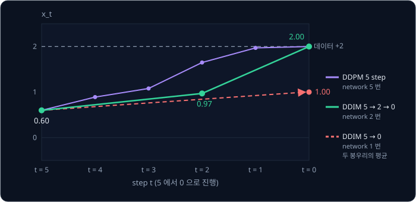
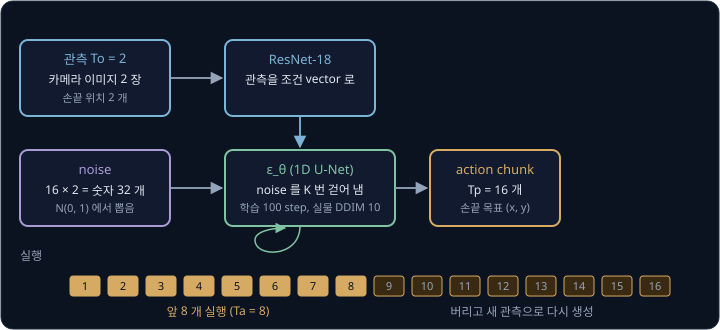

# DDPM

상자를 왼쪽으로 비켜 간 시연과 오른쪽으로 비켜 간 시연을 반반 모아, 출력과 정답의 차이를 제곱해 줄이는 MSE 로 policy 를 학습시키면
policy 는 두 길의 평균인 가운데 길을 내서 상자에 그대로 부딪힌다. 같은 데이터를 VAE 로 학습해도 sample 의 일부는 두 길 사이로
번진다. 정답이 둘로 갈라진 데이터에서 평균 대신 둘 중 한 길을 또렷하게 뽑아내려면 무엇이 달라져야 할까?

DDPM(Denoising Diffusion Probabilistic Model)은 sample 을 한 번에 만들지 않고, 무작위 숫자에서 출발해 noise 를 조금씩 걷어 내는 작은
step 을 수십에서 천 번 밟아 만든다. step 하나 안에서는 평균을 내도 괜찮고, 어느 길로 갈지는 여러 step 에 걸쳐 정해진다. Chi 등의
Diffusion Policy(2023)는 이 방법으로 앞으로 16 step 동안의 로봇 action 을 한꺼번에 만들어, 네 개의 benchmark 에서 이전 방법보다 성공률을 평균
46.9% 높였다.

## 학습 목표

- forward process 와 noise schedule 로 어느 step 의 값이든 원래 데이터에서 한 번에 만드는 식을 숫자로 계산할 수 있다
- network 가 섞인 noise $\epsilon$ 을 맞히도록 학습하는 이유와 그 loss, noise 에서 한 step 씩 거꾸로 걸어 sample 을 만드는 계산을 설명할 수 있다
- step 수와 sampling 시간의 관계, DDIM 이 같은 network 로 step 을 건너뛰는 방식을 설명할 수 있다
- 봉우리가 여럿인 데이터에서 DDPM 이 봉우리 하나를 고르는 이유와, Diffusion Policy 가 이 성질로 action 을 만드는 방식을 설명할 수 있다

## 한 번에 만드는 생성과 나눠 만드는 생성

[VAE](../vae/README.md) 는 표준 정규분포에서 숫자 몇 개(latent $z$)를 뽑아 decoder 에 한 번 넣어 그림을 만든다. decoder 는 계산 한 번으로
그림이 어느 무리에 속할지와 pixel 하나하나의 값을 함께 정해야 하는데, 학습 중에 정답이 갈라지는 경우를 만나면 정답들의 평균을 배운다. pixel 하나의 정답이 절반은 1(흰색), 절반은 0(검정)이면 MSE 를 가장 작게 하는 출력은 0.5 라서 그 pixel 은 회색이 되고,
VAE 의 sample 이 흐릿한 것도 이 때문이다.

DDPM 은 이 일을 작은 step 여러 개로 나눈다. 깨끗한 데이터에 무작위 값(noise)을 조금씩 더해 망가뜨리는 계산은 배울 것 없이 정해 둘 수 있고,
여러 번 되풀이하면 데이터의 흔적이 사라져 noise 만 남는다. network 는 조금 망가진 값에서 조금 덜 망가진 값을 맞히는 법, 다시 말해 그
과정을 거꾸로 밟는 법만 배운다. 이 network 를 되풀이해 쓰면 순수한 noise 에서 시작해 noise 를 조금씩 걷어 내며 데이터에 닿는다.

그림 아래 줄의 $x$ 에 붙은 아래첨자는 step 번호로, $x_0$ 은 noise 가 없는 원래 데이터이고 숫자가 클수록 noise 가 많이 섞인 상태다. 데이터를
noise 로 만드는 방향은 **forward process** 라고 하고, noise 에서 데이터로 돌아오는 방향은 **reverse process** 라고 한다. network 가 배우는
쪽은 reverse process 다.

이름의 denoising 은 noise 를 걷어 낸다는 뜻이고, probabilistic 은 확률을 쓴다는 뜻이다. diffusion(확산)은 물에 떨어뜨린 잉크가 퍼져 물 전체에
고르게 섞이는 현상인데, forward process 가 데이터를 noise 로 고르게 퍼뜨리는 모습이 닮아서 이 이름이 붙었다. 이 방법은 2015 년
Sohl-Dickstein 등이 비평형 열역학(nonequilibrium thermodynamics)에서 착안해 처음 제안했다. 2020 년에 Ho, Jain, Abbeel 이 섞인 noise 를
맞히는 단순한 loss 로 선명한 그림을 만들면서 지금의 형태가 되었다.

## forward process

원래 데이터가 숫자 하나 $x_0 = 2$ 이고, step 마다 지금 값에 0.8 을 곱한 뒤 새로 뽑은 noise 에 0.6 을 곱해 더한다고 하자. noise 는
평균 0, 표준편차 1 인 종 모양 분포인 표준 정규분포 $\mathcal N(0, 1)$ 에서 뽑은 숫자이고 그리스 문자 $\epsilon$("엡실론")으로 적는다.
[Probability & Gaussians](../probability/README.md) 에서 본 68-95-99.7 규칙대로 $\epsilon$ 의 약 95% 는 $-2$ ~ 2 안에 들어간다. 아래
표의 $\epsilon$ 은 예로 고른 값이고, $x_{t-1}$ 은 step $t$ 직전의 값이며 $x_t$ 는 step $t$ 를 마친 값이다.

| step $t$ | 지금 값 $x_{t-1}$ | $0.8 \times x_{t-1}$ | 뽑은 $\epsilon$ | $0.6 \times \epsilon$ | 새 값 $x_t$ |
| --- | --- | --- | --- | --- | --- |
| 1 | 2 | 1.6 | 0.5 | 0.3 | 1.9 |
| 2 | 1.9 | 1.52 | $-1$ | $-0.6$ | 0.92 |
| 3 | 0.92 | 0.74 | 0.2 | 0.12 | 0.86 |
| 4 | 0.86 | 0.69 | 1.5 | 0.9 | 1.59 |
| 5 | 1.59 | 1.27 | $-0.5$ | $-0.3$ | 0.97 |

같은 $x_0 = 2$ 에서 $\epsilon$ 만 다르게 뽑으면 아래 그림의 실행 2 처럼 전혀 다른 길로 간다.

두 실행은 noise 때문에 오르내리지만, 원래 값 2 에서 온 몫은 step 마다 0.8 이 곱해져 점선처럼 줄어든다. 다섯 step 뒤에는
$2 \times 0.8^5 \approx 0.66$ 이고 스무 step 뒤에는 $2 \times 0.8^{20} \approx 0.023$ 이라서 step 을 오래 밟으면 원래 값의 흔적이 거의 사라진다.

DDPM 은 새 데이터를 만들 때 forward process 의 끝 상태에서 출발해 거꾸로 돌아오는데, 생성할 때는 원래 데이터 $x_0$ 를 모른다. 그래서
forward process 의 끝은 $x_0$ 가 무엇이었든 언제나 $\mathcal N(0, 1)$ 이 되도록 만들고, 0.8 을 곱하는 단계도 이 때문에 필요하다. 곱하지
않고 noise 만 더하면 끝 상태의 가운데가 언제까지나 2 에 머물고, step 마다 분산이 $0.6^2 = 0.36$ 씩 쌓여 100 step 뒤에는 분산이
36 이 된다.

이 규칙을 일반적인 식으로 쓰면 아래와 같다.

$$
x_t = \sqrt{1 - \beta_t}\; x_{t-1} + \sqrt{\beta_t}\; \epsilon, \qquad \epsilon \sim \mathcal N(0, 1)
$$

$\beta_t$("베타")는 step $t$ 에서 더하는 noise 의 분산이다. $\epsilon \sim \mathcal N(0, 1)$ 은 "$\epsilon$ 을 $\mathcal N(0, 1)$ 에서 뽑는다"
로 읽는다. 위 예는 $\beta_t = 0.36$ 이라서 $\sqrt{1 - 0.36} = 0.8$ 을 곱하고 $\sqrt{0.36} = 0.6$ 을 곱한 noise 를 더했다. 두 계수를 제곱해
더하면 $(1 - \beta_t) + \beta_t = 1$ 이라서, 분산이 1 인 값은 몇 step 을 밟아도 분산이 1 로 유지된다.

**흔한 오해.** [VAE](../vae/README.md) 에서 본 $\beta$ 는 loss 에서 KL 항에 곱한 무게였지만, DDPM 의 $\beta_t$ 는 step $t$ 에서 더하는
noise 의 분산이라 이름만 같고 전혀 다른 값이다. step 마다 값이 다를 수 있어서 아래첨자 $t$ 가 붙는다.

<b>심화: 분산을 1 로 지키는 계수</b>

값들에 $a$ 를 곱하면 분산은 $a^2$ 배가 되고, 서로 영향을 주지 않고 따로 뽑은(독립인) 두 값을 더하면 분산끼리 더해진다. 평균 0, 분산 1 인
값 $-1$, $+1$ 에 0.8 을 곱하면 $-0.8$, $+0.8$ 이고 분산은 $0.64$ 다. 여기에 noise 쪽 값 $-0.6$, $+0.6$ 을 모든 짝으로 더하면 아래 그림
왼쪽처럼 $-1.4$, $-0.2$, $0.2$, $1.4$ 가 나오고, 분산은 $(1.96 + 0.04 + 0.04 + 1.96) \div 4 = 1$ 로 $0.64 + 0.36$ 과 같다.

줄이지 않고 더하기만 하면 분산은 $1 + 0.36 = 1.36$ 으로 커진다. 0.9 를 곱하고 $0.3\,\epsilon$ 을 더하는 규칙이라면 $0.81 + 0.09 = 0.9$ 라서
분산이 step 마다 줄어든다. 두 계수의 제곱의 합이 정확히 1 일 때만 분산이 1 로 유지된다.

**확인 문제.** $\beta_t = 0.64$ 인 step 에서 $x_{t-1} = 2$ 이고 $\epsilon = 0.5$ 가 뽑혔다. $x_t$ 는?

답 보기

① 두 계수를 구한다.

$$
\sqrt{1 - 0.64} = \sqrt{0.36} = 0.6, \qquad \sqrt{0.64} = 0.8
$$

② 식에 넣는다.

$$
x_t = 0.6 \times 2 + 0.8 \times 0.5 = 1.2 + 0.4 = 1.6
$$

답: 1.6. $\beta_t$ 가 크면 원래 값을 많이 덜어 내고 noise 를 많이 넣는다.

## noise schedule

DDPM 은 step 마다 $\beta_t$ 를 다르게 정하는데, 처음에는 작게 두어 데이터를 조금만 망가뜨리고 뒤로 갈수록 키운다. 전체 step 수를 $T$ 라고
할 때 $\beta_1, \ldots, \beta_T$ 를 미리 정해 둔 표를 **noise schedule** 이라고 한다. 이 강의에서는 손으로 계산할 수 있게 $T = 5$ 로 두고
$\beta_t$ 를 0.1 씩 늘린 schedule 을 예로 쓴다. $\alpha_t = 1 - \beta_t$("알파")는 직전 값의 분산 가운데 남기는 비율이고, $\bar\alpha_t$("알파 바")는
$\alpha_1$ 부터 $\alpha_t$ 까지를 모두 곱한 값이다.

| step $t$ | 1 | 2 | 3 | 4 | 5 |
| --- | --- | --- | --- | --- | --- |
| $\beta_t$ | 0.1 | 0.2 | 0.3 | 0.4 | 0.5 |
| $\alpha_t = 1 - \beta_t$ | 0.9 | 0.8 | 0.7 | 0.6 | 0.5 |
| $\bar\alpha_t$ (바로 왼쪽 칸 × $\alpha_t$) | 0.9 | 0.72 | 0.504 | 0.3024 | 0.1512 |
| $\sqrt{\bar\alpha_t}$ (원래 값에 곱함) | 0.95 | 0.85 | 0.71 | 0.55 | 0.39 |
| $\sqrt{1 - \bar\alpha_t}$ (noise 에 곱함) | 0.32 | 0.53 | 0.70 | 0.84 | 0.92 |

원래 값에는 step 마다 $\sqrt{\alpha_t}$ 가 곱해지므로 step $t$ 까지 모두 합치면 $\sqrt{\bar\alpha_t}$ 가 곱해지고, 분산 1 가운데 나머지
$1 - \bar\alpha_t$ 는 noise 의 몫이다. 그래서 step 을 차례로 밟지 않고 $\epsilon$ 하나로 어느 step 의 값이든 바로 만들 수 있다.

$$
x_t = \sqrt{\bar\alpha_t}\; x_0 + \sqrt{1 - \bar\alpha_t}\; \epsilon
$$

$x_0 = 2$, $t = 3$ 에서 $\epsilon = 0.5$ 가 뽑혔다면 표의 $t = 3$ 칸에서 $x_3 = 0.71 \times 2 + 0.70 \times 0.5 = 1.42 + 0.35 = 1.77$ 이다.
[VAE](../vae/README.md) 에서 본 reparameterization trick $z = \mu + \sigma\epsilon$ 과 같은 꼴이라서, $x_t$ 는 평균 $\sqrt{\bar\alpha_t}\,x_0$,
표준편차 $\sqrt{1 - \bar\alpha_t}$ 인 정규분포를 따른다.

<b>심화: 한 번에 건너뛰는 식의 유도</b>

$\beta = 0.36$ 으로 고정하고 두 step 을 펼친다. $\epsilon_1$, $\epsilon_2$ 는 step 1 과 step 2 에서 따로 뽑은 noise 다.

$$
\begin{aligned}
x_2 &= 0.8\, x_1 + 0.6\, \epsilon_2 = 0.8\,(0.8\, x_0 + 0.6\, \epsilon_1) + 0.6\, \epsilon_2 \\
    &= 0.64\, x_0 + 0.48\, \epsilon_1 + 0.6\, \epsilon_2
\end{aligned}
$$

$x_0 = 2$, $\epsilon_1 = 0.5$, $\epsilon_2 = -1$ 을 넣으면 $1.28 + 0.24 - 0.6 = 0.92$ 로, forward process 표에서 두 step 을 밟아 얻은 값과 같다.
noise 부분 $0.48\,\epsilon_1 + 0.6\,\epsilon_2$ 는 독립인 두 정규분포 값의 합이라 그 자체도 정규분포이고 분산은
$0.48^2 + 0.6^2 = 0.5904$ 다. 그래서 $\epsilon$ 하나에 $\sqrt{0.5904} = 0.768$ 을 곱한 것과 분포가 같고, $x_2 = 0.64\,x_0 + 0.768\,\epsilon$
으로 쓸 수 있다. $\bar\alpha_2 = 0.64 \times 0.64 = 0.4096$ 이라서 $\sqrt{\bar\alpha_2} = 0.64$, $\sqrt{1 - \bar\alpha_2} = 0.768$ 이 정확히 이
두 계수다.

일반적으로는 $\bar\alpha_t = \prod_{s=1}^{t} \alpha_s$ 로 적는다. $\prod$ 는 1 번째부터 $t$ 번째까지 모두 곱한다는 기호다.

**확인 문제.** $T = 5$ schedule 에서 $x_0 = -2$, $t = 2$, $\epsilon = 1$ 이면 $x_2$ 는?

답 보기

① 표의 $t = 2$ 칸에서 $\sqrt{\bar\alpha_2} = 0.85$, $\sqrt{1 - \bar\alpha_2} = 0.53$ 을 읽는다.

② 한 번에 건너뛰는 식에 넣는다.

$$
x_2 = 0.85 \times (-2) + 0.53 \times 1 = -1.70 + 0.53 = -1.17
$$

답: $-1.17$.

## T 와 β 의 크기

$T = 5$ schedule 에서는 $\sqrt{\bar\alpha_5} = 0.39$ 라서 $x_5$ 에 원래 값이 아직 39% 남아 있다. 다섯 step 만에 원래 값을 거의 지우려면
step 마다 $\beta_t \approx 0.87$ 처럼 커야 하는데, 한 step 의 변화가 크면 reverse process 가 어려워진다. 데이터가 $-2$ 와 $+2$ 일 때 큰 step
하나를 거친 값 $x_t$ 만 보고 직전 값을 짐작하면, 직전 값이 있을 범위가 $+2$ 근처와 $-2$ 근처 두 무리로 갈라진다. 이 범위를 종 모양 하나로
맞히면 가운데가 데이터에 없는 두 무리의 평균에 놓인다. $\beta_t = 0.018$ 처럼 작은 step 이면 한 step 에 표준편차 $\sqrt{0.018} \approx 0.13$
만큼만 흔들리므로 직전 값은 $x_t$ 바로 근처의 봉우리 하나로 몰리고, reverse step 은 그 가운데와 폭만 맞히면 된다.

<b>심화: 큰 step 에서 갈라지는 직전 값</b>

$\bar\alpha_5$ 를 0.00004 정도로 줄이려면 $0.13^5 \approx 0.00004$ 이므로 step 마다 $\alpha_t = 0.13$ 이고 $\beta_t = 0.87$ 이어야 한다. 이 step
한 번으로 $x_1 = \sqrt{0.13}\,x_0 + \sqrt{0.87}\,\epsilon = 0.36\,x_0 + 0.93\,\epsilon$ 을 만든다고 하자. $x_1 = 0.2$ 를 받았을 때 $x_0 = +2$
였다면 $\epsilon = (0.2 - 0.72) \div 0.93 \approx -0.56$ 이어야 하고, $x_0 = -2$ 였다면 $\epsilon = (0.2 + 0.72) \div 0.93 \approx 0.99$ 여야
한다. 둘 다 $\mathcal N(0, 1)$ 에서 흔히 나오는 값이라, 두 경우의 확률 밀도를 합이 1 이 되게 나누면 $+2$ 쪽이 0.58 이고 $-2$ 쪽이 0.42 다. 이 범위를 종 모양 하나로 맞히면
가운데가 $0.58 \times 2 - 0.42 \times 2 \approx 0.33$ 에 놓인다.

그래서 Ho 등은 $T = 1000$ 으로 두고 $\beta_t$ 를 0.0001 에서 0.02 까지 일정한 간격으로 늘렸다(linear schedule). 가장 큰 마지막 step 에서도
noise 의 표준편차가 $\sqrt{0.02} \approx 0.14$ 라 한 step 의 변화가 작고, 1000 step 을 다 밟으면 $\bar\alpha_{1000} \approx 0.00004$ 가 되어
원래 값이 거의 남지 않는다. Nichol 과 Dhariwal 은 linear schedule 의 뒤쪽 4 분의 1 이 거의 noise 만 다룬다고 보고, $\bar\alpha_t$ 가 cos 곡선을
따라 천천히 줄도록 정한 cosine schedule 을 제안했다. 두 schedule 의 계수를 직접 계산하면 아래와 같다.

| $t$ | linear $\sqrt{\bar\alpha_t}$ | linear $\sqrt{1-\bar\alpha_t}$ | cosine $\sqrt{\bar\alpha_t}$ | cosine $\sqrt{1-\bar\alpha_t}$ |
| --- | --- | --- | --- | --- |
| 100 | 0.947 | 0.321 | 0.986 | 0.167 |
| 250 | 0.724 | 0.690 | 0.920 | 0.391 |
| 500 | 0.280 | 0.960 | 0.703 | 0.711 |
| 750 | 0.058 | 0.998 | 0.380 | 0.925 |
| 1000 | 0.006 | 1.000 | 0.000 | 1.000 |

로봇에서는 $T$ 를 더 작게 잡는데, Diffusion Policy 는 cosine schedule 을 $T = 100$ 으로 썼다. LeRobot 의 Diffusion Policy 설정도 기본으로
`num_train_timesteps: 100` 과 cosine schedule 인 `beta_schedule: squaredcos_cap_v2` 를 쓴다. 이 schedule 을 계산하면 $t = 50$ 에서 $\sqrt{\bar\alpha_{50}} \approx 0.70$
으로, step 수만 줄었을 뿐 $T = 1000$ cosine 의 $t = 500$ 과 같은 모양이다.

이미지에 쓸 때는 pixel 밝기를 $-1$ ~ $+1$ 로 바꾼 뒤 pixel 마다 $\epsilon$ 을 따로 뽑아 같은 식을 쓴다.

**확인 문제.** $T = 1000$ 에서 $x_0 = 2$ 일 때, $x_{500}$ 에 남은 원래 값의 몫 $\sqrt{\bar\alpha_{500}} \times x_0$ 는 linear 와 cosine
schedule 에서 각각 얼마일까?

답 보기

① 표의 $t = 500$ 줄에서 linear $\sqrt{\bar\alpha_{500}} = 0.280$, cosine $\sqrt{\bar\alpha_{500}} = 0.703$ 을 읽는다.

② 각각 2 를 곱한다.

$$
0.280 \times 2 = 0.56, \qquad 0.703 \times 2 \approx 1.41
$$

답: linear 는 0.56 이고 cosine 은 약 1.41 이다. 같은 $t = 500$ 에서도 cosine 쪽에 원래 값이 두 배 넘게 남아 있다.

## noise 를 맞히는 network

앞 절의 $x_3 = 1.77$ 은 $0.71 \times x_0 + 0.70 \times \epsilon$ 으로 만든 값이라, 섞인 noise 가 $\epsilon = 0.5$ 라는 것을 안다면 noise 몫
$0.70 \times 0.5 = 0.35$ 를 빼고 원래 값에 곱했던 0.71 로 나눠 $x_0 = (1.77 - 0.35) \div 0.71 = 2$ 를 되찾는다. 기호로 쓰면 아래와 같다.

$$
x_0 = \frac{x_t - \sqrt{1 - \bar\alpha_t}\; \epsilon}{\sqrt{\bar\alpha_t}}
$$

$x_t$ 와 $t$ 는 알고 있으니 모르는 것은 $\epsilon$ 하나뿐이라서, DDPM 은 network 에게 $x_t$ 에 섞인 noise 를 맞히게 한다.
이 network 를 $\epsilon_\theta(x_t, t)$ 로 적는다. $\theta$("세타")는 network 의 weight 전체이고, 괄호 안은 network 가 받는 입력이다.

step 번호 $t$ 를 함께 주는 이유는 같은 $x_t$ 라도 $t$ 에 따라 섞인 noise 가 다르기 때문이다. $x_0 = 2$ 에서 온 $x_t = 1.42$ 를 받았을 때,
$t = 3$ 이면 $1.42 = 0.71 \times 2 + 0.70 \times \epsilon$ 에서 $\epsilon = 0$ 이고 $t = 1$ 이면 $1.42 = 0.95 \times 2 + 0.32 \times \epsilon$
에서 $\epsilon = -1.5$ 다. $t$ 가 크면 network 는 대부분이 noise 인 값에서 원래 값이 어느 쪽이었는지 어림하고, $t$ 가 작으면 거의 깨끗한
데이터에 섞인 작은 흔들림을 골라낸다.

network 의 출력은 언제나 입력 $x_t$ 와 모양이 같다. 숫자 하나나 2 차원 점에는 MLP 를 쓰고, 그림에는 [CNN](../cnn/README.md) 에서 본
convolution 층으로 그림을 줄였다가 다시 키워 pixel 마다 출력을 내는 U-Net 을 쓴다. step 번호 $t$ 는 정해진 계산으로 숫자 수십 개짜리
vector(time embedding)로 늘려 넣는다. Diffusion Policy 가 action 에 쓰는 1D U-Net 은 [Diffusion Policy](../diffusion-policy/README.md) 에서 다룬다.

## 학습과 loss

학습 한 번은 Ho 등의 Algorithm 1 대로 아래 순서로 한다.

1. 데이터에서 $x_0$ 하나를 꺼낸다
2. 1 부터 $T$ 까지에서 $t$ 를 무작위로 하나 고른다
3. $\mathcal N(0, 1)$ 에서 $\epsilon$ 을 뽑아 $x_t = \sqrt{\bar\alpha_t}\,x_0 + \sqrt{1 - \bar\alpha_t}\,\epsilon$ 을 만든다
4. network 에 $x_t$ 와 $t$ 를 넣어 noise 를 맞히게 하고, 정답 $\epsilon$ 과의 차이를 제곱해 loss 를 구한다
5. gradient descent 로 loss 가 줄어드는 쪽으로 $\theta$ 를 조금 고친다

그림의 예처럼 noise 가 숫자 하나이면 차이를 제곱한 $(0.5 - 0.3)^2 = 0.04$ 가 loss 이고, noise 가 숫자 여러 개이면 자리마다 차이를 제곱해 모두 더하고,
여러 예를 한 번에 학습할 때는 예마다 구한 loss 를 평균한다.

<b>심화: 여러 예의 loss</b>

데이터가 $+2$ 와 $-2$ 두 값이고 $T = 5$ schedule 을 쓸 때 예 세 개를 계산하면 아래와 같다. network 의 예측 칸은 학습 도중에 나올 법한
값을 이 예에서 정해 넣었다.

| 예 | $x_0$ | $t$ | $\epsilon$ | $x_t$ | network 의 예측 | loss |
| --- | --- | --- | --- | --- | --- | --- |
| 1 | 2 | 3 | 0.5 | $0.71 \times 2 + 0.70 \times 0.5 = 1.77$ | 0.3 | $(0.5 - 0.3)^2 = 0.04$ |
| 2 | $-2$ | 1 | $-1$ | $0.95 \times (-2) + 0.32 \times (-1) = -2.22$ | $-0.6$ | $(-1 + 0.6)^2 = 0.16$ |
| 3 | 2 | 5 | 1.2 | $0.39 \times 2 + 0.92 \times 1.2 \approx 1.88$ | 1.0 | $(1.2 - 1.0)^2 = 0.04$ |

평균은 $(0.04 + 0.16 + 0.04) \div 3 = 0.08$ 이다. 기호로는 $L = \frac{1}{N}\sum_{i=1}^{N} \lVert \epsilon_i - \epsilon_\theta(x_{t_i}, t_i) \rVert^2$
로 적는다. $N$ 은 예의 개수이고, $\sum$ 은 1 번째부터 $N$ 번째까지 모두 더하라는 기호이며, $\lVert \cdot \rVert^2$ 은 자리마다 차이를
제곱해 모두 더한 값이다. 위 표라면 $N = 3$ 이고 $L = 0.08$ 이다.

학습에는 step 을 차례로 밟는 부분이 없어서, $t = 700$ 을 골라도 한 번에 건너뛰는 식으로 $x_{700}$ 을 바로 만들고 그 step 에서만 noise 를
맞힌다. 학습을 오래 하는 동안 $t$ 가 고르게 뽑히므로 network 는 모든 step 을 연습하게 된다. noise 를 정답으로 고른 이유는 아래와 같다.

- noise 를 알면 앞의 복원 식으로 $x_0$ 가 계산된다. 정답 noise 는 학습 순서 3 에서 직접 뽑은 값이라 사람이 달 필요도 없다
- 정답은 $t$ 가 1 이든 1000 이든 $\mathcal N(0, 1)$ 에서 뽑은 숫자라서, 한 network 가 모든 step 의 출력 크기를 똑같이 맞추면 된다
- Ho 등의 실험에서는 reverse step 의 평균을 직접 맞히게 했을 때보다 noise 를 맞히게 했을 때 그림이 더 좋았다

LeRobot 의 Diffusion Policy 도 기본으로는 `prediction_type: epsilon` 으로 noise 를 맞히며, `sample` 로 바꾸면 깨끗한 action 을 직접
맞힌다.

**흔한 오해.** 학습이 잘 되면 loss 가 0 까지 내려간다고 생각하기 쉽지만, 같은 입력에 정답이 여럿이면 그럴 수 없다. 데이터가 $+2$ 와
$-2$ 이고 $t = 5$ 에서 $x_5 = 0.2$ 를 받았다면, 원래 값이 $+2$ 일 때 섞인 noise 는 $(0.2 - 0.78) \div 0.92 \approx -0.63$ 이고 $-2$ 일 때는
$(0.2 + 0.78) \div 0.92 \approx 1.07$ 이다. network 가 무엇을 내든 둘 중 하나와는 어긋나므로 loss 는 0 이 되지 않는다. 이때 network 가 내는
값은 [1 차원 두 봉우리](#1-차원-두-봉우리) 에서 계산한다.

<b>심화: ELBO 와 단순한 loss</b>

DDPM 의 loss 는 VAE 처럼 데이터가 나올 확률에 log 를 씌운 값의 하한(ELBO)에서 출발해 유도할 수 있다. 유도하면 step 마다 다른 무게
$\frac{\beta_t^2}{2\sigma_t^2 \alpha_t (1 - \bar\alpha_t)}$ 가 곱해진 noise 오차의 합이 나오는데, Ho 등은 이 무게를 떼어 내고 모든 step 을
같은 무게로 더한 $L_\text{simple}$ 을 썼다. 무게를 떼면 noise 가 작아 쉬운 작은 $t$ 의 비중이 줄어 어려운 큰 $t$ 의 오차를
더 많이 줄이게 된다. 논문의 CIFAR-10 실험에서는 이 단순한 loss 가 FID 3.17 로 가장 좋았다. FID 는 만든 그림과 실제 그림의 통계가 얼마나
다른지 잰 점수로, 낮을수록 실제 그림에 가깝다.

## reverse process 의 한 step

forward 한 step 은 직전 값에 $\sqrt{\alpha_t}$ 를 곱하고 noise 를 더했으므로, 새 데이터를 만들 때 거꾸로 밟으려면 이번 step 에 더해진
noise 를 빼고 $\sqrt{\alpha_t}$ 로 나누면 된다. network 가 맞히는 것은 $x_0$ 부터 쌓인 noise 전체라서 그 가운데 이번 step 의
몫만 뺀다. 식은 아래와 같다(Ho 등의 Algorithm 2).

$$
x_{t-1} = \frac{1}{\sqrt{\alpha_t}}\Big(x_t - \frac{\beta_t}{\sqrt{1 - \bar\alpha_t}}\;\epsilon_\theta(x_t, t)\Big) + \sigma_t\, z,
\qquad z \sim \mathcal N(0, 1)
$$

"network 가 맞힌 noise 에 이번 step 의 계수를 곱해 $x_t$ 에서 빼고, $\sqrt{\alpha_t}$ 로 나눈 뒤, 새로 뽑은 $z$ 에 $\sigma_t$ 를 곱해 더한다"
로 읽는다. $T = 5$ schedule 의 계수는 아래와 같다.

| step $t$ | 1 | 2 | 3 | 4 | 5 |
| --- | --- | --- | --- | --- | --- |
| $\beta_t / \sqrt{1 - \bar\alpha_t}$ (빼는 noise 의 계수) | 0.32 | 0.38 | 0.43 | 0.48 | 0.54 |
| $1 / \sqrt{\alpha_t}$ (나눠 되돌리는 수) | 1.05 | 1.12 | 1.20 | 1.29 | 1.41 |
| $\sigma_t = \sqrt{\beta_t}$ (새 noise 의 크기) | 0.32 | 0.45 | 0.55 | 0.63 | 0.71 |

괄호 안의 계산은 $x_{t-1}$ 이 있을 법한 범위의 가운데를 낸다. 같은 $x_t$ 에 이를 수 있는 $x_{t-1}$ 은 그 가운데 근처에 종 모양으로 퍼져
있으므로, 가운데에 새 noise $\sigma_t z$ 를 더해 그 범위에서 하나를 뽑는다. $z$ 는 $\mathcal N(0, 1)$ 에서 새로 뽑은 숫자로 VAE 의 latent
$z$ 와는 다른 값이다.

새 noise 를 빼고 가운데만 따라가면 sample 이 실제 데이터보다 좁게 몰린다. 데이터가 $\pm 2$ 에 표준편차 0.5 로 퍼져 있을 때, 이 강의에서
noise 를 정확히 맞히는 network 로 $T = 1000$ sampling 을 2 만 번 해 보면 새 noise 를 뺀 경우 $+$ 쪽 sample 의 표준편차가 0.5 에서 0.14 로
줄어 봉우리 안쪽에 몰린다.

마지막 step($t = 1$)의 결과는 최종 sample $x_0$ 라서 $z$ 를 더하지 않는다. 여기에 noise 를 더하면 깨끗하게 만든 값을 다시 흐트러뜨릴
뿐이다. 데이터가 $+2$ 와 $-2$ 두 값일 때 $x_5 = 0.60$ 에서 시작한 sampling 은 아래 그림의 실행 A 처럼 2.00 에 닿는다. step 4 ~ 2 에서 network 는 음수 noise 를 냈다. $x_t$ 에 음수 noise 가 섞여 값이 원래보다 작아졌다고 추정한 것이라, 그 몫을 빼면 값이
$+2$ 쪽으로 올라간다.

<b>심화: T = 5 sampling 계산표</b>

실행 A 의 계산이다. $\epsilon_\theta$ 칸은 noise 를 정확히 맞히는 network 의 값으로, [1 차원 두 봉우리](#1-차원-두-봉우리) 의 방법으로
계산했다. $z$ 칸은 예로 고른 값이고, 곱한 결과는 소수 셋째 자리에서 반올림했다.

| $t$ | $x_t$ | $\epsilon_\theta$ | 계수 × $\epsilon_\theta$ | 빼고 $\times \frac{1}{\sqrt{\alpha_t}}$ | $z$ | $\sigma_t z$ | $x_{t-1}$ |
| --- | --- | --- | --- | --- | --- | --- | --- |
| 5 | 0.60 | 0.23 | $0.54 \times 0.23 = 0.12$ | $1.41 \times 0.48 = 0.68$ | 0.3 | 0.21 | 0.89 |
| 4 | 0.89 | $-0.10$ | $-0.05$ | $1.29 \times 0.94 = 1.21$ | $-0.2$ | $-0.13$ | 1.08 |
| 3 | 1.08 | $-0.47$ | $-0.20$ | $1.20 \times 1.28 = 1.54$ | 0.2 | 0.11 | 1.65 |
| 2 | 1.65 | $-0.09$ | $-0.03$ | $1.12 \times 1.68 = 1.88$ | 0.2 | 0.09 | 1.97 |
| 1 | 1.97 | 0.23 | 0.07 | $1.05 \times 1.90 = 2.00$ | 없음 | 0 | 2.00 |

실행 B 는 $x_5 = -0.40$ 에서 $\epsilon_\theta = -0.14$, 0.20, 0.74, 0.69, 0.21 과 $z = -0.4$, 0.3, 0.2, $-0.1$ 로 같은 계산을 해 $-2.00$ 에 닿는다.

<b>심화: 빼는 noise 의 계수</b>

network 가 맞힌 noise 전체는 $\sqrt{1 - \bar\alpha_t}\,\epsilon$ 이고, 그 분산 $1 - \bar\alpha_t$ 가운데 이번 step 이 보탠 분산은 $\beta_t$ 다.
그래서 쌓인 noise 가운데 $\frac{\beta_t}{1 - \bar\alpha_t}$ 를 이번 step 의 몫으로 보고 빼는데, 여기에 noise 전체의 계수 $\sqrt{1 - \bar\alpha_t}$
를 곱해 한 번 약분한 것이 $\frac{\beta_t}{\sqrt{1 - \bar\alpha_t}}$ 다.

| step $t$ | 1 | 2 | 3 | 4 | 5 |
| --- | --- | --- | --- | --- | --- |
| $\beta_t \div (1 - \bar\alpha_t)$ | $0.1 \div 0.1 = 1.00$ | $0.2 \div 0.28 = 0.71$ | $0.3 \div 0.496 = 0.60$ | 0.57 | 0.59 |

step 1 에서는 noise 전체가 step 1 에서 더해진 것이라 몫이 1 이고, 식은 forward 한 step $x_1 = \sqrt{0.9}\,x_0 + \sqrt{0.1}\,\epsilon$ 을 그대로
거꾸로 푼 것과 같다. 이 계수는 직관으로 얻은 것이지만, $x_t$ 와 $x_0$ 를 함께 알 때 $x_{t-1}$ 이 따르는 정규분포의 평균을 정확히 계산해도 같은
식이 나온다(Ho 등의 식 (7) 과 (11)).

**확인 문제.** $T = 5$ schedule 의 step 2 에서 $x_2 = 1.0$ 이고 network 가 $\epsilon_\theta = 0.5$ 를 냈다. 새 noise 를 더하기 전의 값은?

답 보기

① 계수 표의 step 2 칸에서 빼는 noise 의 계수 0.38, 나눠 되돌리는 수 1.12 를 읽는다.

② 이번 step 의 몫을 뺀다.

$$
1.0 - 0.38 \times 0.5 = 1.0 - 0.19 = 0.81
$$

③ 1.12 를 곱한다.

$$
0.81 \times 1.12 \approx 0.91
$$

답: 약 0.91. 여기에 $\sigma_2 z = 0.45 \times z$ 를 더하면 $x_1$ 이다.

## step 수와 sampling 시간

학습은 예 하나에 network 를 한 번 쓰지만, sampling 은 정답 noise 를 모르는 채 $t = T$ 부터 1 까지 모든 step 을 차례로 밟으므로 sample 하나에
network 를 $T$ 번 쓴다.

DDIM 논문에 따르면 Nvidia 2080 Ti GPU 에서 DDPM 으로 $32 \times 32$ 그림 5 만 장을 만드는 데 약 20 시간이 걸리고, 한 번에 그림을 만드는
GAN 으로는 1 분도 걸리지 않는다. 로봇은 sampling 이 끝나야 action 을 받으므로 이 시간만큼 반응이 늦어진다. Diffusion Policy 의 실물
실험에서는 로봇에 명령을 0.1 초마다 보냈는데, network 한 번에 0.01 초가 걸린다고 하면 $T = 1000$ 은 sample 하나에 10 초가 걸리고 $T = 100$
도 1 초가 걸린다.

reverse step 식은 직전 값이 봉우리 하나짜리 종 모양으로 퍼져 있다고 가정하고 만든 식이다. 이 식을 그대로 두고 10 step 씩 건너뛰면 한 번에
건너뛰는 변화가 커져 직전 값이 여러 무리로 갈라지므로, [T 와 β 의 크기](#t-와-β-의-크기) 에서 본 문제가 다시 생긴다.

**확인 문제.** network 한 번에 0.02 초가 걸린다. $T = 100$ 으로 모든 step 을 밟을 때와 10 step 으로 줄였을 때 sample 하나에 걸리는 시간은?

답 보기

network 를 쓰는 횟수에 한 번의 시간을 곱한다.

$$
100 \times 0.02 = 2 \text{ 초}, \qquad 10 \times 0.02 = 0.2 \text{ 초}
$$

답: 2 초와 0.2 초.

## DDIM

DDIM(Denoising Diffusion Implicit Models)은 Song, Meng, Ermon 이 2020 년에 제안한 sampling 방법으로, DDPM 과 같은 loss 로 학습한 network 를
그대로 쓰면서 step 을 건너뛴다. 한 step 은 두 단계로 계산한다.

1. network 가 맞힌 noise 로 원래 값의 추정 $\hat x_0$("엑스 제로 햇")를 구한다: $\hat x_0 = (x_t - \sqrt{1 - \bar\alpha_t}\,\epsilon_\theta) \div \sqrt{\bar\alpha_t}$
2. 그 $\hat x_0$ 와 같은 $\epsilon_\theta$ 를 한 번에 건너뛰는 식에 넣어, 원하는 더 작은 step $s$ 의 값을 만든다:
   $x_s = \sqrt{\bar\alpha_s}\,\hat x_0 + \sqrt{1 - \bar\alpha_s}\,\epsilon_\theta$

새 noise $z$ 를 더하지 않으므로 같은 출발점에서는 언제나 같은 sample 이 나온다.
$T = 5$ 예에서 $x_5 = 0.60$ 으로 시작해 $t = 2$ 를 거쳐 $t = 0$ 으로 두 번만 건너뛰어 보자. $\epsilon_\theta$ 는 실행 A 와 같은
network 의 값이다.

| 건너뛰기 | $x_t$ | $\epsilon_\theta$ | $\hat x_0$ | 다음 값 |
| --- | --- | --- | --- | --- |
| $5 \to 2$ | 0.60 | 0.23 | $(0.60 - 0.92 \times 0.23) \div 0.39 \approx 1.00$ | $0.85 \times 1.00 + 0.53 \times 0.23 \approx 0.97$ |
| $2 \to 0$ | 0.97 | $-1.37$ | $(0.97 + 0.53 \times 1.37) \div 0.85 \approx 2.00$ | $\bar\alpha_0 = 1$ 이라 $\hat x_0$ 그대로 2.00 |

network 를 두 번만 쓰고 데이터 $+2$ 에 닿았다. 그런데 $t = 5$ 에서 바로 $t = 0$ 으로 한 번에 건너뛰면 첫 줄의 $\hat x_0 = 1.00$ 이 그대로
sample 이 된다. 1.00 은 두 봉우리를 가능성으로 섞은 평균이라 데이터에 없는 값이다. step 을 너무 줄이면 이렇게 평균 문제가 다시 나타난다.

DDIM 논문의 CIFAR-10 실험 결과는 아래와 같다. 숫자는 만든 그림과 실제 그림의 통계가 얼마나 다른지 잰 FID 로, 낮을수록 실제 그림에
가깝다. 표의 둘째 행은 같은 network 로 DDPM 식을 써서 step 을 건너뛴 결과다.

| sampling step 수 | 10 | 20 | 50 | 100 | 1000 |
| --- | --- | --- | --- | --- | --- |
| DDIM | 13.36 | 6.84 | 4.67 | 4.16 | 4.04 |
| DDPM 식으로 건너뜀 | 41.07 | 18.36 | 8.01 | 5.78 | 4.73 |

DDIM 은 20 ~ 100 step 만으로 1000 step 과 비슷한 품질을 내고, 저자들은 이를 원래 DDPM 보다 10 ~ 50 배 빠르다고 적었다. Diffusion Policy
논문 본문에 따르면 저자들은 실물 로봇에서 100 step schedule 로 학습한 network 로 DDIM 10 step 만 밟아, Nvidia RTX 3080 에서 action 을 0.1 초
만에 만들었다. 다만 같은 논문의 부록(A.2 절과 표 7)에는 실물 실험의 sampling step 수가 16 으로 적혀 있다.

<b>심화: DDIM 의 일반 식</b>

DDIM 논문은 건너뛰는 step 에 새 noise 를 얼마나 더할지를 $\eta$("에타")로 정한다.

$$
x_s = \sqrt{\bar\alpha_s}\,\hat x_0 + \sqrt{1 - \bar\alpha_s - \sigma^2}\;\epsilon_\theta + \sigma z,
\qquad \sigma = \eta \sqrt{\frac{1 - \bar\alpha_s}{1 - \bar\alpha_t}} \sqrt{1 - \frac{\bar\alpha_t}{\bar\alpha_s}}
$$

$\eta = 0$ 이면 $\sigma = 0$ 이라 본문의 식이 되고, $\eta = 1$ 이면 한 step 씩 밟을 때 DDPM 의 reverse step 과 같은 분포가 된다. 위 표의 "DDPM 식으로
건너뜀" 행이 $\eta = 1$ 의 결과다. $\eta = 0$ 의 sampling 은 noise 에서 데이터로 가는 정해진 매끄러운 경로 하나를 따라가는 것과 같아서 큰
step 에도 오차가 덜 쌓인다. noise 에서 데이터로 가는 경로를 처음부터 곧게 학습하는 방법은 [Flow Matching](../flow-matching/README.md) 에서
다룬다.

**확인 문제.** $T = 5$ schedule 에서 $x_5 = 1.0$ 이고 network 가 $\epsilon_\theta = 0.5$ 를 냈다고 하자. DDIM 으로 $t = 2$ 로 건너뛴 값은?

답 보기

① schedule 표에서 $\sqrt{\bar\alpha_5} = 0.39$, $\sqrt{1 - \bar\alpha_5} = 0.92$, $\sqrt{\bar\alpha_2} = 0.85$, $\sqrt{1 - \bar\alpha_2} = 0.53$
을 읽는다.

② 원래 값을 어림한다.

$$
\hat x_0 = (1.0 - 0.92 \times 0.5) \div 0.39 = 0.54 \div 0.39 \approx 1.38
$$

③ $t = 2$ 의 식에 같은 $\epsilon_\theta$ 와 함께 넣는다.

$$
x_2 = 0.85 \times 1.38 + 0.53 \times 0.5 \approx 1.17 + 0.27 = 1.44
$$

답: 약 1.44.

## 1 차원 두 봉우리

실행 A 의 첫 step 에서 network 는 $x_5 = 0.60$ 을 받고 0.23 을 냈는데, 이 값은 데이터가 $+2$ 와 $-2$ 반반일 때 network 가 무엇을 배우는지
계산하면 나온다. 먼저 $x_5 = 0.2$ 를 받은 경우를 보자. 이 값이 $+2$ 에서 왔다면 $x_5$ 는 평균 $0.39 \times 2 = 0.78$, 표준편차 0.92 인
정규분포를 따르고, $-2$ 에서 왔다면 평균 $-0.78$ 인 정규분포를 따른다. 0.2 에서 두 곡선의 높이를 재면 0.36 과 0.25 라서, 0.2 가 $+2$ 에서
왔을 가능성은 $0.36 \div (0.36 + 0.25) \approx 0.59$ 이고 $-2$ 에서 왔을 가능성은 0.41 이다.

같은 입력에 정답이 여럿이면 MSE 로 학습한 network 는 가능한 정답들을 가능성으로 섞은 평균을 내므로, 원래 값을
$0.59 \times 2 + 0.41 \times (-2) = 0.36$ 으로 추정하고 그에 맞는 noise 를 낸다. $t = 5$ 에서는 두 곡선이 크게 겹쳐 추정이 0 쪽으로 끌려간다.
$t = 2$ 에서는 noise 가 작아 두 곡선이 떨어져 있으므로, 같은 0.2 라도 $+2$ 쪽 가능성이 0.92 로 커진다.

<b>심화: 가능성과 추정의 표</b>

$+2$ 에서 온 $x_t$ 는 평균 $2\sqrt{\bar\alpha_t}$, 표준편차 $\sqrt{1 - \bar\alpha_t}$ 인 정규분포를 따르고, $-2$ 에서 온 $x_t$ 는 평균
$-2\sqrt{\bar\alpha_t}$ 인 정규분포를 따른다. 두 곡선의 높이를 합이 1 이 되게 나눈 것이 가능성이고, 원래 값의 추정은 $2 \times (+2 \text{ 쪽 가능성}) - 2 \times (-2 \text{ 쪽 가능성})$ 이다.

| $t$ | $x_t$ | $+2$ 에서 왔을 가능성 | $-2$ 에서 왔을 가능성 | 원래 값의 추정 |
| --- | --- | --- | --- | --- |
| 5 | 0.2 | 0.59 | 0.41 | 0.36 |
| 5 | 1.0 | 0.86 | 0.14 | 1.44 |
| 2 | 0.2 | 0.92 | 0.08 | 1.68 |
| 2 | 1.0 | 1.00 | 0.00 | 2.00 |

$t = 2$ 에서 $x_2 = 1.0$ 은 $+2$ 쪽 분포(평균 $0.85 \times 2 = 1.70$, 표준편차 0.53)의 평균에서 표준편차 1.3 개쯤 떨어진 흔한 값이다.
$-2$ 쪽 분포에서는 평균 $-1.70$ 에서 2.7 떨어져 표준편차 5 개가 넘으므로 거의 나오지 않는다.

실행 A 의 첫 step 도 같은 계산이다. $x_5 = 0.60$ 에서는 $+2$ 쪽 가능성이 0.75 라 원래 값의 추정이
$0.75 \times 2 - 0.25 \times 2 = 1.0$ 이고, 섞인 noise 는 $(0.60 - 0.39 \times 1.0) \div 0.92 \approx 0.23$ 이다.

$T = 1000$ 으로 늘려 경로 여러 개를 그리면 sample 이 봉우리 하나를 고르는 과정이 보인다. $t$ 가 클 때는 network 가 원래 값을 0 근처로 추정해
경로를 어느 쪽으로도 세게 당기지 않고, 경로는 새 noise 에 따라 흔들린다. 그러다 우연히 조금 위로 간 경로는 추정이 $+2$ 쪽으로 기울어 다음
step 에서 그쪽으로 더 끌려가고, 점점 확실하게 그 봉우리로 간다.

이 강의에서 noise 를 정확히 맞히는 network 로 sample 4000 개를 만들어 보니 51% 는 $+2$ 에서 끝나고 49% 는 $-2$ 에서 끝났으며, $-1.5$ ~ 1.5
사이에서 끝난 sample 은 하나도 없었다. 같은 데이터에서 MSE 로 정답 하나를 배우는 모델은 언제나 0 을 낸다.

**흔한 오해.** network 가 평균을 내니 DDPM 도 봉우리 사이의 값을 낼 것 같지만, 평균이 봉우리 사이로 끌려가는 큰 $t$ 의 step 에서 나온 값은
최종 sample 이 아니라 다음 step 의 출발점일 뿐이다. $t$ 가 작아지면 $x_t$ 만 보아도 어느 봉우리에서 왔는지 알 수 있어서 평균이 한 봉우리의 값과
같아진다.

## VAE 와 DDPM 의 비교

VAE 의 decoder 는 weight 를 곱하고 더하는 계산이라 $z$ 가 조금 바뀌면 출력도 조금만 바뀌고, 한 값에서 다른 값으로 건너뛰지 못한다. 예를 들어
latent 가 숫자 하나이고 데이터가 $-2$ 와 $+2$ 일 때, decoder 가 $z \le -0.25$ 에서는 $-2$ 를 내고 $z \ge 0.25$ 에서는 $+2$ 를 내도록 잘
학습했다고 하자. 그 사이에서 출력은 $-2$ 에서 $+2$ 까지 이어져야 하고,
$\mathcal N(0, 1)$ 에서 뽑은 $z$ 가 $-0.25$ ~ 0.25 에 들어갈 확률은 약 20% 라서 sample 의 약 20% 가 두 봉우리 사이에 놓인다.

이 강의에서는 2 차원 데이터로도 같은 비교를 해 보았다. 반지름 2 인 원 위에 45° 간격으로 중심 여덟 개를 놓고 각 중심 근처에 표준편차 0.1 로
데이터를 모은 뒤, latent 가 2 개인 VAE 와 $T = 1000$ 인 DDPM 을 각각 hidden 층 3 개짜리 MLP 로 학습시켜 sample 을 2000 개씩 뽑았다. 중심에서
0.3 넘게 벗어난 sample 의 비율은 실제 데이터, VAE, DDPM 이 각각 약 1%, 22%, 2% 였다. DDPM 의 sample 은 여덟 봉우리에 11 ~ 15% 씩 나뉘어,
고르게 나뉠 때의 12.5% 에 가까웠다.

DDPM 은 봉우리 사이에 sample 을 거의 남기지 않지만, 그 대가로 sample 하나에 network 를 여러 번 써야 한다.

**확인 문제.** 1 차원 VAE 의 decoder 가 $z = -1$ 에서는 $-2$ 를 내고 $z = 1$ 에서는 $+2$ 를 내며, 그 사이를 직선으로 잇는다. $\mathcal N(0, 1)$ 에서
뽑은 $z$ 로 sample 을 만들면 대략 몇 % 가 두 봉우리 사이에 놓일까?

답 보기

① 두 봉우리 사이의 출력은 $z$ 가 $-1$ 과 1 사이일 때 나온다.

② 68-95-99.7 규칙에서 $\mathcal N(0, 1)$ 의 값이 $-1$ ~ 1 에 들어갈 확률은 약 68% 다.

답: 약 68%. decoder 가 봉우리 사이를 완만하게 이을수록 봉우리 사이 sample 이 많아진다.

## Diffusion Policy

로봇의 policy 는 카메라 이미지나 관절 위치 같은 관측을 받아 action 을 내는 network 다. 상자를 왼쪽과 오른쪽으로 비켜 간 시연이 섞여 있으면 정답
action 의 분포에 봉우리가 둘 생기는데, 이렇게 봉우리가 여럿인 분포를 **multimodal** 이라고 한다.

Diffusion Policy 는 그림 대신 앞으로 여러 step 동안의 action 을 묶은 **action chunk** 를 $x_0$ 로 삼는다. 책상 위의 T 자 블록을 밀어 정해진
자리에 놓는 PushT 과제에서는 손끝이 갈 평면 위치 $(x, y)$ 16 개를 이어 붙인 숫자 32 개가 $x_0$ 다. network 는 noise 가 섞인 action chunk 와 $t$ 에 더해
최근 관측 2 개를 함께 받아 섞인 noise 를 맞힌다. 조건을 함께 넣는 방식은 [VAE](../vae/README.md) 에서 본 CVAE 의 decoder 와 같다. 논문의
PushT 실험에서는 같은 장면에서 손끝이 블록의 왼쪽으로 돌아갈 수도 있고 오른쪽으로 돌아갈 수도 있었는데, Diffusion Policy 는 두 방식을 모두
배우고 한 번의 실행 안에서는 한쪽만 끝까지 따랐다.

simulation 실험에서는 $T = 100$ 으로 학습한 network 로 sampling 에서도 100 step 을 모두 밟았고, 실물 실험에서는 [DDIM](#ddim) 으로 step 을
줄였다. 실물 PushT 에서는 policy 가 0.1 초마다 손끝 목표를 냈고, 그 사이를 보간한 명령을 1초에 125 번씩 UR5 팔에 보냈다.

LeRobot 에 올라 있는 PushT 용 Diffusion Policy(`lerobot/diffusion_pusht`)의 설정은 `horizon: 16`, `n_action_steps: 8`, `n_obs_steps: 2`,
`num_train_timesteps: 100` 으로 논문의 simulation 설정과 같다. 다만 sampling 설정은 `noise_scheduler_type: DDPM` 이고
`num_inference_steps` 가 비어 있어서 학습 step 수와 같은 100 step 을 밟는다. 논문의 실물 로봇처럼 sampling 시간을 줄이려면
`noise_scheduler_type: DDIM` 과 `num_inference_steps: 10` 으로 바꾸면 되고, 다시 학습할 필요는 없다.

**확인 문제.** 컵을 집는 시연의 절반은 손잡이를 왼쪽에서 잡았고, 나머지 절반은 오른쪽에서 잡았다. MSE policy 와 Diffusion Policy 는 각각
어떤 손 위치를 낼 가능성이 클까?

답 보기

① MSE policy 는 같은 관측에 대한 정답들의 평균을 내므로, 왼쪽에서 잡는 손 위치와 오른쪽에서 잡는 손 위치의 가운데를 낸다. 시연에 없던
위치다.

② Diffusion Policy 는 sampling 할 때마다 왼쪽에서 잡는 위치나 오른쪽에서 잡는 위치 중 하나에 가까운 값을 낸다.

답: MSE policy 는 두 위치의 가운데를 내고, Diffusion Policy 는 둘 중 한 위치를 낸다.

## 정리

- DDPM 은 데이터에 noise 를 조금씩 섞는 forward process 를 정해 두고, $x_t = \sqrt{\bar\alpha_t}\,x_0 + \sqrt{1 - \bar\alpha_t}\,\epsilon$ 으로
  만든 학습 예에서 섞인 noise $\epsilon$ 을 맞히도록 network 를 학습한다. 정답 noise 는 학습 예를 만들 때 직접 뽑은 값이라 따로 달 필요가 없다
- sampling 은 $\mathcal N(0, 1)$ 에서 출발해 network 가 맞힌 noise 의 몫을 빼고 새 noise 를 더하는 reverse step 을 $T$ 번 밟는다. $T$ 가
  sampling 시간을 정하므로, 같은 network 로 $\hat x_0$ 를 어림해 step 을 건너뛰는 DDIM 을 쓴다. DDIM 은 20 ~ 100 step 으로 1000 step 과
  비슷한 품질을 내고, Diffusion Policy 는 실물 로봇에서 10 step 만 밟는다
- network 는 MSE 로 학습해 평균을 내지만, 그 평균은 각 step 의 작은 이동에만 쓰이고 봉우리의 선택은 여러 step 에 나뉘어 일어난다. $\pm 2$
  데이터로 만든 sample 4000 개 가운데 봉우리 사이($-1.5$ ~ 1.5)에서 끝난 것은 하나도 없었고, Diffusion Policy 도 같은 이유로 봉우리가 여럿인
  시연에서 가운데 길 대신 시연에 있던 action chunk 하나를 고른다

DDIM 으로 줄여도 Diffusion Policy 는 action 을 만들 때마다 network 를 10 번 쓴다. noise 에서 데이터로 가는 경로를 처음부터 곧게 학습해 몇
step 만에 sample 을 만드는 방법은 [Flow Matching](../flow-matching/README.md) 에서 다루고, 관측을 조건으로 넣는 network 와 action chunk 를
실행하는 방식은 [Diffusion Policy](../diffusion-policy/README.md) 에서 다룬다.

## 참고 자료

- Jonathan Ho, Ajay Jain, Pieter Abbeel, [Denoising Diffusion Probabilistic Models](https://arxiv.org/abs/2006.11239) (2020) — DDPM 의 원
  논문. Algorithm 1(학습)과 Algorithm 2(sampling)가 이 강의의 학습 순서와 sampling 식이고, 4 절에 $T = 1000$ 과 linear schedule 이 있다
- Jiaming Song, Chenlin Meng, Stefano Ermon, [Denoising Diffusion Implicit Models](https://arxiv.org/abs/2010.02502) (2020) — 같은 network 로
  step 을 건너뛰는 DDIM. DDPM 의 sampling 시간(서론)과 step 수별 FID(표 1)를 본다
- Alex Nichol, Prafulla Dhariwal, [Improved Denoising Diffusion Probabilistic Models](https://arxiv.org/abs/2102.09672) (2021) — 3.2 절의
  cosine schedule 과 linear schedule 의 $\bar\alpha_t$ 비교 그림
- Cheng Chi 등, [Diffusion Policy: Visuomotor Policy Learning via Action Diffusion](https://arxiv.org/abs/2303.04137) (2023) — DDPM 으로 action
  chunk 를 만드는 policy. DDIM 10 step 과 0.1 초(3.4 절), PushT 의 두 방식(그림 3), $T_o$·$T_a$·$T_p$ 와 실물 실험의 sampling step 수(부록 표 7)를
  본다
- LeRobot, [configuration_diffusion.py](https://github.com/huggingface/lerobot/blob/main/src/lerobot/policies/diffusion/configuration_diffusion.py) —
  Diffusion Policy 설정의 기본값과 각 parameter 의 설명. pretrained PushT 모델의 설정은
  [lerobot/diffusion_pusht](https://huggingface.co/lerobot/diffusion_pusht) 에 있다
- Jascha Sohl-Dickstein 등, [Deep Unsupervised Learning using Nonequilibrium Thermodynamics](https://arxiv.org/abs/1503.03585) (2015) — 데이터를
  noise 로 흩뜨렸다가 되돌리는 생성 모델을 처음 제안한 논문
- Calvin Luo, [Understanding Diffusion Models: A Unified Perspective](https://arxiv.org/abs/2208.11970) — VAE 의 ELBO 에서 출발해 DDPM 의 loss 와
  reverse step 의 계수를 한 줄씩 유도하는 tutorial
- Lilian Weng, [What are Diffusion Models?](https://lilianweng.github.io/posts/2021-07-11-diffusion-models/) — forward·reverse 식의 유도와 DDIM
  등 뒤이은 방법을 한 글에 정리한 블로그
- Hugging Face, [The Annotated Diffusion Model](https://huggingface.co/blog/annotated-diffusion) — DDPM 을 U-Net 과 time embedding 까지 구현하며
  해설한 글
