# DDPM

## 학습 목표

- decoder 를 한 번 지나 sample 을 만드는 VAE 와, 무작위로 섞인 값(noise)을 여러 단계(step)에 걸쳐 조금씩 걷어 내 sample 을 만드는
  DDPM 의 차이를 설명할 수 있다
- 숫자 하나에 step 마다 noise 를 조금씩 더해 가는 계산을 표로 따라가고, 몇 step 뒤의 값을 한 번에 구하는 식을 쓸 수 있다
- step 마다 더할 noise 의 양을 정한 표를 5 step 짜리로 직접 채울 수 있다
- network 가 섞인 noise 를 맞히도록 학습하는 이유를 설명하고, 그 loss 를 작은 숫자로 계산할 수 있다
- 순수한 noise 에서 시작해 한 step 씩 noise 를 걷어 내 sample 을 만드는 계산을 따라갈 수 있다
- 정답이 여러 무리로 갈라진 데이터에서 DDPM 이 VAE 보다 무리를 잘 살리는 이유와, 이 성질이 로봇의 행동을 만드는 모델에 쓰이는
  방식을 설명할 수 있다

## 여러 step 에 나눠 만드는 생성

### VAE 의 sample 이 흐릿한 이유

[VAE](../vae/README.md) 는 학습한 그림들을 닮은 새 그림을 만드는 생성 모델이었다. 새 그림은 표준 정규분포 $\mathcal N(0, I)$ 에서
그림을 대신하는 숫자 몇 개, 곧 latent $z$ 를 뽑아 latent 를 그림으로 되살리는 decoder 에 한 번 넣어 만들었다. 정규분포는 평균 $\mu$ 를 가운데로 둔 종 모양 분포이고, $\mathcal N(0, I)$ 는 숫자
여러 개를 각각 평균 0, 표준편차 1 인 정규분포에서 따로 뽑아 순서대로 묶은 vector 의 분포다. 표준편차는 값들이 평균에서 대략 얼마나 떨어져
있는지를 나타내는 거리이고, 그 제곱이 분산이다.

이 방식은 빠르지만 VAE 가 만든 그림은 실제 그림보다 흐릿했다. $z$ 가 놓일 수 있는 모든 자리를 latent 공간이라고 하는데, 학습하는
동안 그림마다의 범위가 latent 공간에서 서로 겹쳤다. 겹친 자리의 $z$ 를 받은 decoder 는 어느 한 그림을 고를 수 없어서 그 그림들의 평균에
가까운 그림을 냈다. 그림을 이루는 작은 칸인 pixel 하나의 정답이 절반은 1(흰색), 절반은 0(검정)이었다면 MSE(오차를 제곱해 평균한 값)를 가장 작게 하는 출력은 평균 0.5 라서, 그 pixel 은 흰색도
검정도 아닌 회색이 된다. 같은 일이 로봇에서 일어나면, 사람이 직접 보여 준 동작(시연) 가운데 왼쪽 $+1$ 로 비켜 간 시연과 오른쪽 $-1$ 로
비켜 간 시연의 평균 0 을 따라가다 상자에 정면으로 부딪힌다.

decoder 는 계산 한 번으로 그림 전체를 내야 해서, "이 그림이 어느 무리에 속하는가" 와 "pixel 하나하나가 정확히 어떤 값인가" 를 한꺼번에
정해야 한다. 이 강의의 DDPM 은 이 일을 수백에서 천 번의 작은 단계로 나눠서 한다. 계산을 나눈 한 단계를 step 이라고 부른다.

**확인 문제.** VAE 의 decoder 가 겹친 자리의 $z$ 에서 어떤 pixel 의 정답으로 1 을 네 번, 0 을 한 번 보았다. MSE 를 가장 작게 하는
출력은 얼마이고, 그 pixel 은 어떻게 보일까?

답 보기

MSE 를 가장 작게 하는 출력은 평균이라 $(1 + 1 + 1 + 1 + 0) \div 5 = 0.8$ 이다. 흰색에 가까운 밝은 회색으로, 보았던 정답 1 과도 0 과도
다른 값이다.

### noise 를 걷어 내는 생성

noise 는 원래 값에 섞여 들어간 무작위 값이다. 오래된 라디오의 지지직거리는 잡음, 어두운 곳에서 찍은 사진의 자글자글한 점이 모두
noise 다. 이 강의에서 noise 는 언제나 표준 정규분포 $\mathcal N(0, 1)$ 에서 뽑은 숫자에 정해진 수를 곱한 값이다.

깨끗한 그림을 noise 로 망가뜨리는 일은 쉽다. pixel 마다 무작위 값을 조금 더하는 계산을 되풀이하면 되고, 아무것도 배울 필요가 없다.
여러 번 되풀이하면 그림의 흔적이 사라지고 noise 만 남는데, DDPM 은 이 망가뜨리는 과정을 반대로 밟는 법을 배운다. 아주 조금
망가진 그림에서 조금 덜 망가진 그림을 맞히는 일은, 아무것도 없는 상태에서 그림 전체를 한 번에 만드는 일보다 훨씬 쉽다. 그래서
순수한 noise 에서 시작해 noise 를 조금씩 걷어 내는 step 을 여러 번 거치면 깨끗한 그림에 닿는다.

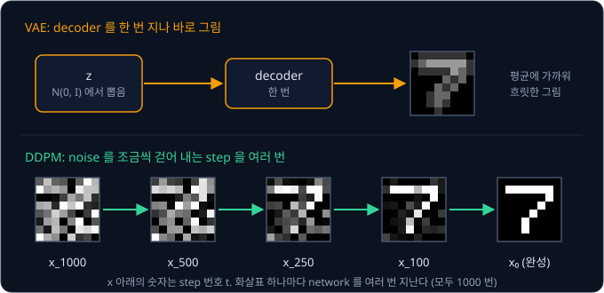

위 그림의 아래 줄에서 $x$ 아래에 붙은 작은 숫자는 몇 번째 step 인지를 나타낸다. $x_0$ 은 noise 가 하나도 없는 원래 데이터이고,
숫자가 클수록 noise 가 많이 섞인 상태다. 데이터를 noise 로 만드는 방향을 forward process(앞으로 가는 과정), noise 를 걷어 내 데이터로
돌아오는 방향을 reverse process(거꾸로 가는 과정)라고 한다. forward process 는 정해진 계산이라 학습할 것이 없고, network 가 배우는
것은 reverse process 쪽이다.

DDPM 은 Denoising Diffusion Probabilistic Model 의 줄임말이다. denoising 은 "noise 를 걷어 냄", probabilistic 은 "확률을 쓰는" 이라는
뜻이다. diffusion 은 확산이라는 뜻으로, 물에 떨어뜨린 잉크 한 방울이 점점 퍼져 결국 물 전체에 고르게 섞이는 현상을 가리킨다.
forward process 가 데이터를 조금씩 흐트러뜨려 noise 로 고르게 퍼뜨리는 모습이 이 현상과 닮아서 붙은 이름이다. 2015 년
Sohl-Dickstein 등이 물리학의 비평형 열역학(nonequilibrium thermodynamics)에서 아이디어를 얻어 처음 제안했고, 2020 년 Ho, Jain,
Abbeel 이 섞인 noise 를 맞히는 단순한 방식으로 학습해 선명한 그림을 만들면서 지금의 형태가 되었다.

**확인 문제.** forward process 와 reverse process 중 network 를 학습시켜야 하는 쪽은 어느 것이고, 그 이유는?

답 보기

reverse process 다. forward process 는 정해진 규칙대로 noise 를 더하는 계산이라 배울 것이 없지만, noise 가 섞인 값에서 원래 값 쪽으로
돌아가는 법은 데이터를 보고 배워야 한다.

**요약**

- VAE 는 decoder 한 번으로 그림 전체를 만들어서, 정답이 갈라지는 자리에서 평균을 내고 흐릿한 그림이 나온다
- DDPM 은 데이터에 noise 를 더해 망가뜨리는 forward process 를 정해 두고, 그 반대인 reverse process 를 배워 noise 에서 데이터까지 여러
  step 에 걸쳐 돌아온다
- forward process 는 계산만 하면 되고, 학습하는 것은 reverse process 다

## forward process

### N(0, 1) 에서 뽑은 noise

이 강의의 모든 noise 는 표준 정규분포 $\mathcal N(0, 1)$ 에서 뽑은 숫자에서 시작하므로, 이 분포의 성질을
먼저 짚는다. $\mathcal N(0, 1)$ 은 평균 0, 표준편차 1 인 종 모양 분포이고, 여기서 숫자를 여덟 번 뽑으면 예를 들어 아래처럼 나온다.

| 뽑은 순서 | 1 | 2 | 3 | 4 | 5 | 6 | 7 | 8 |
| --- | --- | --- | --- | --- | --- | --- | --- | --- |
| 뽑힌 값 | 2.3 | $-0.7$ | 0.4 | 0.1 | 0.8 | $-1.4$ | $-0.4$ | $-0.8$ |

뽑힌 값은 양수도 음수도 있고, 0 근처가 가장 자주 나온다. 많이 뽑으면 값의 약 68% 가 $-1$ ~ 1, 약 95% 가 $-2$ ~ 2, 약 99.7% 가 $-3$ ~ 3
안에 들어간다. 그래서 2.3 처럼 $-2$ ~ 2 밖의 값은 20 번에 한 번 꼴로, 3 보다 크거나 $-3$ 보다 작은 값은 1000 번에 세 번 꼴로만 나온다.

이렇게 뽑은 숫자는 그리스 문자 $\epsilon$("엡실론")으로 적고, 뽑는 일을 $\epsilon \sim \mathcal N(0, 1)$ 로 적는다. 물결표
$\sim$ 는 " ~ 에서 뽑았다" 로 읽는다. 뽑은 숫자에 어떤 수를 곱하면 퍼진 폭이 그만큼 바뀐다. $\epsilon$ 에 0.6 을 곱한 값은 평균 0, 표준편차 0.6 인 정규분포를 따르고, 95% 가
$-1.2$ ~ 1.2 안에 들어간다. 이 강의에서 "noise 의 크기" 는 이렇게 $\epsilon$ 에 곱한 수, 곧 noise 의 표준편차를 뜻한다.

**확인 문제.** $\mathcal N(0, 1)$ 에서 뽑은 $\epsilon$ 에 0.5 를 곱한 noise 가 있다. 이 noise 의 약 95% 는 어느 구간에 들어갈까?

답 보기

$\epsilon$ 의 95% 가 $-2$ ~ 2 에 있으므로, 0.5 를 곱하면 $-1$ ~ 1 이다. 표준편차가 0.5 인 정규분포라서 $\pm 2 \times 0.5$ 로 구해도 같다.

### 숫자 하나에 더하는 noise

그림 대신 숫자 하나로 시작한다. 원래 데이터가 $x_0 = 2$ 이고, 한 step 마다 아래 규칙으로 값을 바꾼다.

- 지금 값에 0.8 을 곱한다
- $\mathcal N(0, 1)$ 에서 숫자 하나를 새로 뽑아 0.6 을 곱한 뒤 더한다

뽑는 $\epsilon$ 은 매번 다르고, 대부분 $-2$ 와 2 사이에 있다. step 1 에서 $\epsilon = 0.5$ 가 뽑혔다면 $0.8 \times 2 + 0.6 \times 0.5 = 1.6 + 0.3 = 1.9$ 이고,
이 값을 $x_1$ 이라고 적는다. 아래첨자 1 은 "step 1 을 마친 값" 이라는 뜻이다. 같은 계산을 다섯 step 이어 가면 아래와 같다. 곱한 결과는
소수 셋째 자리에서 반올림했다.

| step $t$ | 지금 값 $x_{t-1}$ | $0.8 \times x_{t-1}$ | 뽑은 $\epsilon$ | $0.6 \times \epsilon$ | 새 값 $x_t$ |
| --- | --- | --- | --- | --- | --- |
| 1 | 2 | 1.6 | 0.5 | 0.3 | 1.9 |
| 2 | 1.9 | 1.52 | $-1$ | $-0.6$ | 0.92 |
| 3 | 0.92 | 0.74 | 0.2 | 0.12 | 0.86 |
| 4 | 0.86 | 0.69 | 1.5 | 0.9 | 1.59 |
| 5 | 1.59 | 1.27 | $-0.5$ | $-0.3$ | 0.97 |

표의 $t$ 는 몇 번째 step 인지를 나타내는 번호이고, $x_{t-1}$ 은 그 step 직전의 값, $x_t$ 는 그 step 을 마친 값이다. step 4 에서 1.5 라는
큰 $\epsilon$ 이 뽑혀 값이 0.86 에서 1.59 로 뛰어올랐다가, step 5 에서 다시 내려왔다.

같은 $x_0 = 2$ 에서 $\epsilon$ 만 다르게 뽑아 한 번 더 해 보면 전혀 다른 길로 간다.

| step $t$ | 지금 값 $x_{t-1}$ | $0.8 \times x_{t-1}$ | 뽑은 $\epsilon$ | $0.6 \times \epsilon$ | 새 값 $x_t$ |
| --- | --- | --- | --- | --- | --- |
| 1 | 2 | 1.6 | $-0.5$ | $-0.3$ | 1.3 |
| 2 | 1.3 | 1.04 | $-1.2$ | $-0.72$ | 0.32 |
| 3 | 0.32 | 0.26 | 0.4 | 0.24 | 0.5 |
| 4 | 0.5 | 0.4 | $-1$ | $-0.6$ | $-0.2$ |
| 5 | $-0.2$ | $-0.16$ | 0.3 | 0.18 | 0.02 |

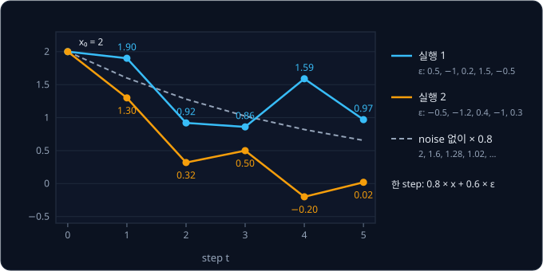

두 실행은 noise 때문에 오르내리지만, 원래 값 2 에서 온 부분은 step 마다 0.8 이 곱해져 점선처럼 줄어든다. 2 에 0.8 을 다섯 번 곱하면
$2 \times 0.8^5 \approx 0.66$ 이다. $0.8^5$ 는 0.8 을 다섯 번 곱한 값이고, $\approx$ 는 "거의 같다" 는 기호다. 열 번 곱하면 약 0.21, 스무 번 곱하면 약 0.023 이라서 step 을 오래 밟을수록 원래 값의 흔적은 거의 사라지고
뽑은 noise 들만 남는다.

**확인 문제.** 지금 값이 $1.5$ 이고 $\epsilon = -0.5$ 가 뽑혔다. 같은 규칙으로 계산한 새 값은?

답 보기

$0.8 \times 1.5 + 0.6 \times (-0.5) = 1.2 - 0.3 = 0.9$ 다.

### 끝이 N(0, 1) 이어야 하는 이유

규칙에 0.8 을 곱하는 단계가 왜 필요한지는 생성할 때를 생각하면 보인다. DDPM 은 새 데이터를 만들 때 forward process 의 끝 상태에서
출발해 거꾸로 돌아온다. 이때 출발점을 뽑으려면 끝 상태가 어떤 분포인지 미리 알아야 하는데, 생성할 때는 원래 데이터 $x_0$ 를 모른다.
그래서 forward process 의 끝은 $x_0$ 가 무엇이었든 언제나 같은 분포, 곧 $\mathcal N(0, 1)$ 이 되도록 만든다. VAE 가 $z$ 를 미리 정한
prior $\mathcal N(0, I)$ 에서 뽑았던 것과 같은 이유다.

0.8 을 곱하지 않고 noise 만 더하면 이렇게 되지 않는다. $x_t = x_{t-1} + 0.6 \times \epsilon$ 으로 바꾸면 원래 값 2 는 줄지 않고 그대로
남아서 끝 상태의 가운데가 늘 2 이고, 출발점이 $x_0$ 에 따라 달라진다. noise 는 step 마다 쌓이기만 해서, 퍼진 정도도 끝없이 커진다.
step 마다 분산이 $0.6^2 = 0.36$ 씩 늘어나 100 step 뒤에는 분산 36, 표준편차 6 이 된다.

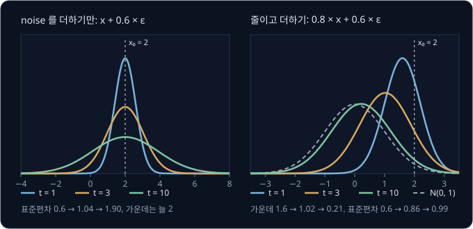

위 그림의 곡선은 같은 $x_0 = 2$ 에서 출발해 $\epsilon$ 을 셀 수 없이 많이 다르게 뽑았을 때 $x_t$ 가 퍼지는 모양이다. 오른쪽처럼 줄이고
더하면 원래 값에서 온 부분은 0 으로, noise 의 표준편차는 1 로 다가가서 10 step 쯤에서 이미 $\mathcal N(0, 1)$ 과 거의 겹친다.

**확인 문제.** 0.8 을 곱하는 규칙에서 $0.8^{20} \approx 0.012$ 다. 원래 값이 $x_0 = 5$ 일 때와 $x_0 = -3$ 일 때, 20 step 뒤 $x_{20}$ 에
남은 원래 값의 몫은 각각 얼마일까?

답 보기

$5 \times 0.012 = 0.06$ 과 $-3 \times 0.012 = -0.036$ 이다. 둘 다 0 에 가까워서 20 step 뒤의 $x_{20}$ 은 $x_0$ 가 무엇이었든 거의 같은
분포를 따른다.

### 분산을 1 로 지키는 계수

곱하는 0.8 과 더하는 0.6 은 아무렇게나 고른 숫자가 아니라 $0.8^2 + 0.6^2 = 0.64 + 0.36 = 1$ 이 되도록 고른 것이다. 분산은 값마다 평균에서
벗어난 양을 제곱해 평균한 값이고, 곱하기와 더하기를 하면 아래처럼 바뀐다.

첫째, 값들에 어떤 수 $a$ 를 곱하면 분산은 $a^2$ 배가 된다. 평균 0, 분산 1 인 값 $-1$, $+1$ 에 0.8 을 곱하면 $-0.8$, $+0.8$ 이 되고,
분산은 $(0.64 + 0.64) \div 2 = 0.64 = 0.8^2$ 이다.

둘째, 서로 영향을 주지 않고 따로 뽑은(독립인) 두 값을 더하면 분산끼리 더해진다. 0.8 을 곱한 값 $-0.8$, $+0.8$ 과 noise 쪽 값
$-0.6$, $+0.6$ 을 모든 짝으로 더해 보면 아래 그림 왼쪽처럼 $-1.4$, $-0.2$, $0.2$, $1.4$ 가 나온다. 네 값의 평균은 0 이고 분산은
$(1.96 + 0.04 + 0.04 + 1.96) \div 4 = 1$ 로, $0.64 + 0.36$ 과 같다.

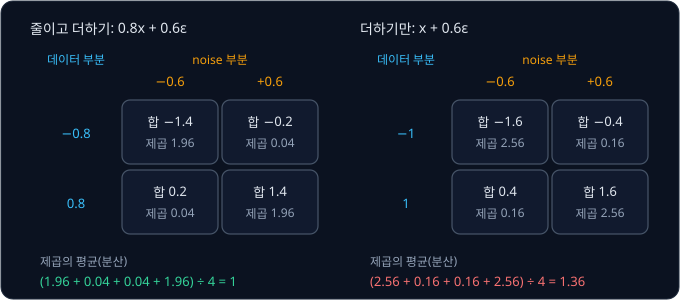

오른쪽처럼 줄이지 않고 더하기만 하면 분산은 $1 + 0.36 = 1.36$ 으로 커진다. 줄이는 쪽에서 분산을 $1 - 0.64 = 0.36$ 만큼 덜어 내고, 그만큼을
noise 로 채워 넣어야 합이 1 로 유지된다. 그래서 $x_{t-1}$ 의 분산이 1 이면 $x_t$ 의 분산도 1 이고, 몇 step 을 밟아도 값들이 퍼진 폭이
늘 같다.

**확인 문제.** 0.9 를 곱하고 $0.3 \times \epsilon$ 을 더하는 규칙이 있다. 분산이 1 인 값에 이 규칙을 쓰면 분산은 얼마가 되고, 1 로
유지될까?

답 보기

$0.9^2 + 0.3^2 = 0.81 + 0.09 = 0.9$ 라서 분산은 0.9 로 줄어든다. 두 계수의 제곱의 합이 1 이 아니므로 1 로 유지되지 않는다.

### 한 step 의 식

지금까지의 규칙을 일반적인 식으로 쓰면 아래와 같다.

$$
x_t = \sqrt{1 - \beta_t}\; x_{t-1} + \sqrt{\beta_t}\; \epsilon, \qquad \epsilon \sim \mathcal N(0, 1)
$$

$\beta_t$ 는 그리스 문자로 "베타(beta)" 라고 읽고, step $t$ 에서 더하는 noise 의 분산이다. $\sqrt{\phantom{x}}$ 는 제곱해서 그 수가 되는
양수(제곱근)다. 식 전체는 "직전 값에
$\sqrt{1 - \beta_t}$ 를 곱하고, 새로 뽑은 $\epsilon$ 에 $\sqrt{\beta_t}$ 를 곱해 더한다" 는 뜻이다.

앞의 예는 $\beta_t = 0.36$ 이었다. $\sqrt{1 - 0.36} = \sqrt{0.64} = 0.8$ 이 곱하는 수, $\sqrt{0.36} = 0.6$ 이 noise 에 곱하는 수다. 두 계수를
제곱해 더하면 $(1 - \beta_t) + \beta_t = 1$ 이라서 어떤 $\beta_t$ 를 고르든 분산이 1 로 지켜진다.

**흔한 오해.** [VAE](../vae/README.md) 에서도 $\beta$ 라는 기호를 썼지만 거기서는 loss 에서 두 분포의 차이를 재는 KL 항에
곱한 무게였다. 이 강의의 $\beta_t$ 는 step $t$ 에서
더하는 noise 의 분산이라 전혀 다른 값이다. 아래첨자 $t$ 가 붙은 것은 step 마다 값이 다를 수 있기 때문이다.

**확인 문제.** $\beta_t = 0.64$ 인 step 에서 $x_{t-1} = 2$, $\epsilon = 0.5$ 이면 $x_t$ 는?

답 보기

$\sqrt{1 - 0.64} = \sqrt{0.36} = 0.6$, $\sqrt{0.64} = 0.8$ 이므로 $x_t = 0.6 \times 2 + 0.8 \times 0.5 = 1.2 + 0.4 = 1.6$ 이다.

**요약**

- forward process 의 한 step 은 직전 값에 $\sqrt{1 - \beta_t}$ 를 곱해 줄이고 $\sqrt{\beta_t}\,\epsilon$ 을 더한다. $\beta_t = 0.36$ 이면
  0.8 을 곱하고 $0.6\,\epsilon$ 을 더한다
- 두 계수의 제곱의 합이 1 이라서 분산이 1 로 유지되고, 원래 값의 몫은 step 마다 줄어든다
- 그래서 step 을 충분히 밟으면 $x_0$ 와 상관없이 $\mathcal N(0, 1)$ 에 닿고, 생성은 이 분포에서 출발할 수 있다

## noise schedule

### step 마다 다른 β

앞에서는 모든 step 에 같은 $\beta = 0.36$ 을 썼지만, DDPM 은 step 마다 $\beta_t$ 를 다르게 정한다. 처음에는 작게 두어 데이터를 조금만
망가뜨리고, 뒤로 갈수록 크게 해서 빠르게 noise 로 만든다. forward process 의 전체 step 수를 $T$ 라고 하고, $\beta_1, \beta_2, \ldots,
\beta_T$ 를 미리 정해 둔 표를 noise schedule 이라고 한다. schedule 은 "일정표" 라는 뜻이다.

손으로 계산할 수 있게 $T = 5$ 로 작게 잡고, $\beta_t$ 를 0.1 씩 늘려 본다. 식에 자주 나오는 $1 - \beta_t$ 는 따로 $\alpha_t$ 라고
부르고, "알파(alpha)" 라고 읽는다.

| step $t$ | 1 | 2 | 3 | 4 | 5 |
| --- | --- | --- | --- | --- | --- |
| $\beta_t$ (더하는 noise 의 분산) | 0.1 | 0.2 | 0.3 | 0.4 | 0.5 |
| $\alpha_t = 1 - \beta_t$ | 0.9 | 0.8 | 0.7 | 0.6 | 0.5 |

$\alpha_t$ 를 쓰면 한 step 의 식은 $x_t = \sqrt{\alpha_t}\, x_{t-1} + \sqrt{\beta_t}\, \epsilon$ 이 된다. step 3 이라면 직전 값에
$\sqrt{0.7} \approx 0.84$ 를 곱하고 $\sqrt{0.3} \approx 0.55$ 를 곱한 noise 를 더한다.

**확인 문제.** $\beta_t = 0.25$ 인 step 의 $\alpha_t$ 와, 직전 값에 곱하는 수 $\sqrt{\alpha_t}$ 는?

답 보기

$\alpha_t = 1 - 0.25 = 0.75$ 이고, $\sqrt{0.75} \approx 0.87$ 이다.

### 원래 값이 남은 몫 ᾱ

식을 펼쳐 보면 step 을 차례로 밟지 않고도 $x_t$ 를 한 번에 구할 수 있다. 계산을 쉽게 하려고 다시 $\beta = 0.36$ 으로 고정하고 두 step 을
펼친다.

$$
\begin{aligned}
x_1 &= 0.8\, x_0 + 0.6\, \epsilon_1 \\
x_2 &= 0.8\, x_1 + 0.6\, \epsilon_2 \\
    &= 0.8\,(0.8\, x_0 + 0.6\, \epsilon_1) + 0.6\, \epsilon_2 \\
    &= 0.64\, x_0 + 0.48\, \epsilon_1 + 0.6\, \epsilon_2
\end{aligned}
$$

$\epsilon_1$, $\epsilon_2$ 는 step 1 과 step 2 에서 따로 뽑은 noise 다. 셋째 줄은 둘째 줄의 $x_1$ 자리에 첫째 줄을 넣은 것이고, 넷째 줄은
괄호를 푼 것이다. 실행 1 의 값 $x_0 = 2$, $\epsilon_1 = 0.5$, $\epsilon_2 = -1$ 을 넣으면 $0.64 \times 2 + 0.48 \times 0.5 + 0.6 \times (-1)
= 1.28 + 0.24 - 0.6 = 0.92$ 로, 표에서 두 step 을 밟아 얻은 $x_2 = 0.92$ 와 같다.

넷째 줄의 noise 부분 $0.48\, \epsilon_1 + 0.6\, \epsilon_2$ 는 독립인 두 값의 합이라 분산이 $0.48^2 + 0.6^2 = 0.2304 + 0.36 = 0.5904$ 다.
정규분포를 따르는 독립인 값끼리 더하면 그 합도 정규분포를 따르므로, 이 부분은 $\epsilon$ 하나를 새로 뽑아 $\sqrt{0.5904} = 0.768$ 을
곱한 것과 같은 분포다. 그래서 $x_2 = 0.64\, x_0 + 0.768\, \epsilon$ 으로 한 번에 쓸 수 있다.

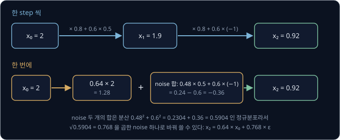

일반적인 schedule 에서도 같은 일이 일어난다. 원래 값에는 step 마다 $\sqrt{\alpha_t}$ 가 곱해지므로 $t$ 번째 step 까지 $\sqrt{\alpha_1}
\times \sqrt{\alpha_2} \times \cdots \times \sqrt{\alpha_t}$ 가 곱해진다. 이 곱은 $\alpha_1 \times \alpha_2 \times \cdots \times \alpha_t$
의 제곱근과 같아서, $\alpha$ 들을 모두 곱한 값을 따로 $\bar\alpha_t$ 라고 적는다. "알파 바(alpha bar)" 라고 읽는다.

$$
\bar\alpha_t = \prod_{s=1}^{t} \alpha_s = \alpha_1 \times \alpha_2 \times \cdots \times \alpha_t
$$

$\prod$ 는 그리스 문자 대문자 "파이(pi)" 로, "1 번째부터 $t$ 번째까지 모두 곱하라" 는 기호다. "모두 더하라" 는 $\sum$ 의 곱하기 판이고,
원주율 3.14 를 뜻하는 소문자 $\pi$ 와는 다른 기호다. $s$ 는 1 부터 $t$ 까지 세는 번호다.

noise 부분의 분산은 $1 - \bar\alpha_t$ 다. 분산이 1 인 $x_0$ 로 시작하면 $x_t$ 의 분산도 1 로 유지되는데, 그중 $\bar\alpha_t$ 가 원래 값에서
온 몫이니 나머지 $1 - \bar\alpha_t$ 가 noise 의 몫이기 때문이다. 이렇게 해서 어느 step 의 값이든 $x_0$ 에서 바로 만드는 식이 나온다.

$$
x_t = \sqrt{\bar\alpha_t}\; x_0 + \sqrt{1 - \bar\alpha_t}\; \epsilon, \qquad \epsilon \sim \mathcal N(0, 1)
$$

이 식은 "원래 값에 $\sqrt{\bar\alpha_t}$ 를 곱하고, 새로 뽑은 $\epsilon$ 하나에 $\sqrt{1 - \bar\alpha_t}$ 를 곱해 더한다" 로 읽는다.
$\beta = 0.36$ 의 두 step 이라면 $\bar\alpha_2 = 0.64 \times 0.64 = 0.4096$ 이라서 $\sqrt{\bar\alpha_2} = 0.64$ 가 앞의 0.64 이고,
$\sqrt{1 - 0.4096} = \sqrt{0.5904} = 0.768$ 이 앞의 0.768 이다.

[VAE](../vae/README.md) 의 reparameterization trick $z = \mu + \sigma \epsilon$ 과 같은 모양이기도 하다. $\mu$ 자리에 $\sqrt{\bar\alpha_t}\,x_0$,
$\sigma$ 자리에 $\sqrt{1 - \bar\alpha_t}$ 가 있으니, $x_t$ 는 평균 $\sqrt{\bar\alpha_t}\,x_0$, 표준편차 $\sqrt{1 - \bar\alpha_t}$ 인 정규분포를
따른다.

$T = 5$ schedule 로 표를 채우면 아래와 같다. $\bar\alpha_t$ 는 바로 위 칸의 $\bar\alpha_{t-1}$ 에 이번 $\alpha_t$ 를 곱해서 구한다.

| step $t$ | $\alpha_t$ | $\bar\alpha_t$ 계산 | $\bar\alpha_t$ | $\sqrt{\bar\alpha_t}$ (원래 값에 곱함) | $\sqrt{1 - \bar\alpha_t}$ (noise 에 곱함) |
| --- | --- | --- | --- | --- | --- |
| 1 | 0.9 | $0.9$ | 0.9 | 0.95 | 0.32 |
| 2 | 0.8 | $0.9 \times 0.8$ | 0.72 | 0.85 | 0.53 |
| 3 | 0.7 | $0.72 \times 0.7$ | 0.504 | 0.71 | 0.70 |
| 4 | 0.6 | $0.504 \times 0.6$ | 0.3024 | 0.55 | 0.84 |
| 5 | 0.5 | $0.3024 \times 0.5$ | 0.1512 | 0.39 | 0.92 |

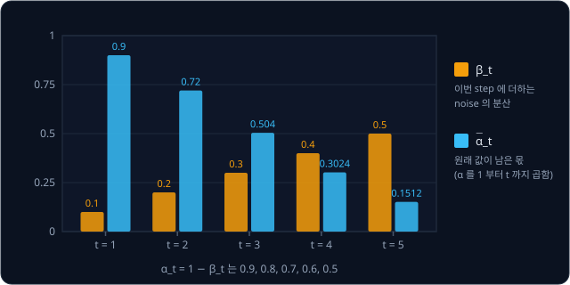

$x_0 = 2$, $t = 3$ 에서 $\epsilon = 0.5$ 가 뽑혔다면 $x_3 = 0.71 \times 2 + 0.70 \times 0.5 = 1.42 + 0.35 = 1.77$ 이다. step 세 개를 밟지
않고 $\epsilon$ 하나로 바로 구했다. $\epsilon$ 을 셀 수 없이 많이 뽑으면 $x_t$ 는 아래 그림처럼 퍼진다.

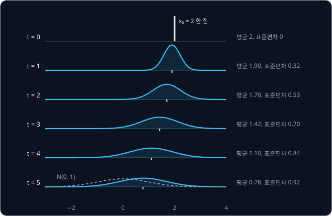

**확인 문제.** $T = 5$ schedule 에서 $x_0 = -2$, $t = 2$, $\epsilon = 1$ 이면 $x_2$ 는?

답 보기

표에서 $\sqrt{\bar\alpha_2} = 0.85$, $\sqrt{1 - \bar\alpha_2} = 0.53$ 이므로 $x_2 = 0.85 \times (-2) + 0.53 \times 1 = -1.70 + 0.53 = -1.17$
이다.

### T 와 β 의 크기

위 표의 마지막 줄을 보면 $\sqrt{\bar\alpha_5} = 0.39$ 라서 $x_5$ 에는 원래 값이 아직 39% 남아 있다. $x_0 = 2$ 라면 $x_5$ 의 가운데가 0.78
이고, $\mathcal N(0, 1)$ 과 꽤 다르다. 5 step 은 손으로 계산하려고 줄인 것이고, 실제로 순수한 noise 에 닿으려면 더 많이 망가뜨려야 한다.

5 step 만에 $\bar\alpha_5$ 를 0.00004 정도로 줄이려면 step 마다 $\beta_t$ 가 약 0.87 이어야 한다. $0.13^5 \approx 0.00004$ 이기 때문이다.
그러면 한 step 에서 직전 값에 $\sqrt{0.13} \approx 0.36$ 만 곱해 남기고, 표준편차 $\sqrt{0.87} \approx 0.93$ 의 noise 를 더한다. 한 step 만에
값이 거의 새로 뽑은 noise 로 바뀐다.

이렇게 한 step 의 변화가 크면 reverse process 가 어려워진다. $x_t$ 를 보고 $x_{t-1}$ 을 맞혀야 하는데, 한 step 에서 값이 크게 바뀌었다면
$x_{t-1}$ 이 될 수 있는 값이 여기저기 흩어져 있어서 한 값으로 맞히기 어렵다.

데이터가 $-2$ 와 $+2$ 두 값이고, $\beta = 0.87$ 인 큰 step 한 번으로 $x_1 = 0.36\,x_0 + 0.93\,\epsilon$ 을 만든다고 하자. $x_1 = 0.2$ 를
받았을 때 $x_0$ 가 $+2$ 였다면 $\epsilon$ 이 약 $-0.56$ 이었던 것이고, $-2$ 였다면 약 $0.99$ 였던 것이다. 둘 다 $\mathcal N(0, 1)$ 에서 흔히
나오는 값이라 어느 쪽인지 가리기 어렵고, 실제로 계산해 보면 $+2$ 쪽이 0.58, $-2$ 쪽이 0.42 다. 아래 그림 왼쪽처럼 가능한 $x_0$ 가 두 무리로
갈라진다. 이 범위를 봉우리 하나짜리 종 모양으로 맞히려 하면 가운데를 두 무리의 평균 0.33 에 둘 수밖에 없는데, 0.33 은 데이터에 없는 값이다.

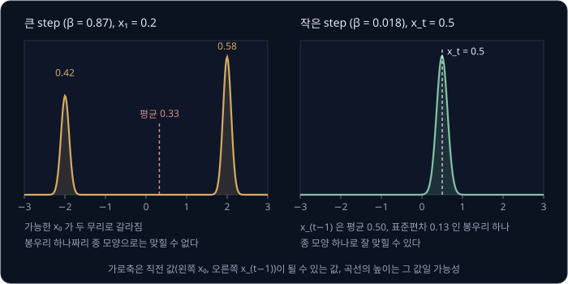

오른쪽은 $\beta_t = 0.018$ 인 작은 step 의 경우다. 한 step 에서 값이 표준편차 $\sqrt{0.018} \approx 0.13$ 정도만 흔들리므로, $x_t = 0.5$ 를
받으면 $x_{t-1}$ 은 0.5 바로 근처에 봉우리 하나로 몰려 있다. 이런 범위는 가운데와 폭만 알면 종 모양 하나로 잘 맞힐 수 있다. 그래서 DDPM 은
step 을 많이 두고 $\beta_t$ 를 작게 잡아서, 모든 reverse step 이 오른쪽 같은 쉬운 문제가 되게 한다.

Ho 등은 $T = 1000$ 으로 두고 $\beta_t$ 를 0.0001 에서 0.02 까지 일정한 간격으로 늘렸다. 직선처럼 고르게 늘린다고 해서 linear schedule
이라고 부른다. $\beta_t$ 가 가장 큰 마지막 step 에서도 직전 값에 $\sqrt{0.98} \approx 0.99$ 를 곱하고 표준편차 $\sqrt{0.02} \approx 0.14$ 의
noise 를 더할 뿐이라 한 step 의 변화가 작고, 1000 step 을 다 밟으면 $\bar\alpha_{1000} \approx 0.00004$, $\sqrt{\bar\alpha_{1000}} \approx 0.006$
이 되어 원래 값이 거의 남지 않는다.

Nichol 과 Dhariwal 은 linear schedule 이 데이터를 너무 일찍 지운다고 보았다. 아래 표에서 linear 는 $t = 500$ 에 원래 값이 28%, $t = 750$ 에
6% 만 남아서 뒤쪽 4 분의 1 은 거의 noise 만 다룬다. 그래서 $\bar\alpha_t$ 가 cos 곡선을 따라 천천히 줄어들게 정한 cosine schedule 을
제안했다. cos 는 각도에 따라 값이 1 에서 0 으로 매끄럽게 내려가는 함수인데, 여기서는 그 곡선 모양만 쓴다.

| $t$ | linear $\sqrt{\bar\alpha_t}$ | linear $\sqrt{1-\bar\alpha_t}$ | cosine $\sqrt{\bar\alpha_t}$ | cosine $\sqrt{1-\bar\alpha_t}$ |
| --- | --- | --- | --- | --- |
| 1 | 1.000 | 0.010 | 1.000 | 0.006 |
| 100 | 0.947 | 0.321 | 0.986 | 0.167 |
| 250 | 0.724 | 0.690 | 0.920 | 0.391 |
| 500 | 0.280 | 0.960 | 0.703 | 0.711 |
| 750 | 0.058 | 0.998 | 0.380 | 0.925 |
| 1000 | 0.006 | 1.000 | 0.000 | 1.000 |

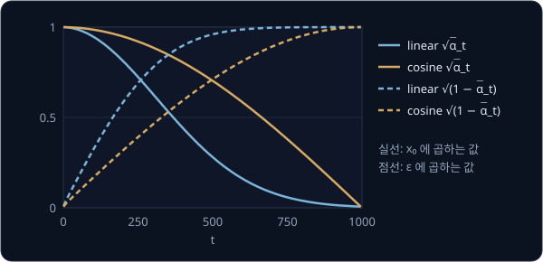

**흔한 오해.** step 이 많을수록 좋다면 $T$ 를 한없이 늘리면 될 것 같다. 그런데 뒤의 sampling 은 step 마다 network 를 한 번씩 쓰므로,
$T$ 를 열 배로 늘리면 sample 하나를 만드는 시간도 열 배가 된다. $T = 1000$ 은 한 step 의 변화를 충분히 작게 하면서 시간도 감당할 만한
값으로 고른 것이다.

**확인 문제.** $\beta_t = 0.04$ 인 step 에서 새로 더하는 noise 의 표준편차는 얼마이고, 이 noise 의 약 95% 는 어느 구간에 들어갈까?

답 보기

표준편차는 $\sqrt{0.04} = 0.2$ 이고, 95% 는 $-2 \times 0.2 = -0.4$ 부터 $0.4$ 까지에 들어간다. 한 step 에 값이 대략 0.4 안쪽에서만 흔들리는
작은 step 이다.

**확인 문제.** $T = 1000$ linear schedule 에서 $x_0 = 2$ 일 때 $x_{500}$ 의 원래 값 몫 $\sqrt{\bar\alpha_{500}} \times x_0$ 는 얼마이고,
cosine schedule 에서는 얼마일까?

답 보기

linear 는 $0.280 \times 2 = 0.56$, cosine 은 $0.703 \times 2 = 1.406$ 이다. 같은 $t = 500$ 에서도 cosine 쪽에 원래 값이 두 배 넘게 남아
있다.

### 이미지의 forward process

그림에도 같은 식을 pixel 마다 쓴다. VAE 강의에서 pixel 의 밝기는 0(검정)부터 1(흰색) 사이였는데, DDPM 은 밝기에 2 를 곱하고 1 을 빼서
$-1$(검정)부터 $+1$(흰색) 사이로 바꿔 쓴다. 0.5 인 회색은 0 이 된다. 이렇게 하면 데이터가 퍼진 폭이 $\mathcal N(0, 1)$ 의 noise 와 비슷한
크기가 된다.

pixel 마다 $\epsilon$ 을 따로 뽑으므로 noise 도 그림과 같은 크기의 vector 다. $32 \times 32$ 그림이면 $\mathcal N(0, 1)$ 에서 숫자
1024 개를 따로 뽑는데, 이 vector 의 분포를 $\mathcal N(0, I)$ 로 적는다.

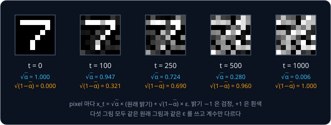

위 그림의 다섯 장은 모두 같은 원래 그림과 같은 noise 를 쓰고, 둘을 섞는 계수만 표의 값으로 바꾼 것이다. $t = 250$ 까지는 숫자 7 의
모양이 보이지만 $t = 500$ 부터는 거의 알아볼 수 없다.

**확인 문제.** $16 \times 16$ 흑백 그림의 forward process 에서 한 번에 $x_t$ 를 만들 때 $\mathcal N(0, 1)$ 에서 숫자를 몇 개 뽑아야 할까?

답 보기

pixel 이 $16 \times 16 = 256$ 개이고 pixel 마다 $\epsilon$ 을 하나씩 뽑으므로 256 개다.

**요약**

- noise schedule 은 step 마다 더할 noise 의 분산 $\beta_t$ 를 정한 표이고, $\alpha_t = 1 - \beta_t$, $\bar\alpha_t$ 는 $\alpha_1$ 부터
  $\alpha_t$ 까지의 곱이다
- 어느 step 이든 $x_t = \sqrt{\bar\alpha_t}\,x_0 + \sqrt{1 - \bar\alpha_t}\,\epsilon$ 으로 한 번에 만들 수 있다. $T = 5$, $x_0 = 2$,
  $t = 3$, $\epsilon = 0.5$ 이면 $x_3 = 1.77$ 이다
- 한 step 의 변화가 작아야 reverse 가 쉬워서, 실제로는 $T = 1000$ 에 $\beta_t$ 를 0.0001 ~ 0.02 로 작게 잡는다

## noise 를 맞히는 학습

### noise 를 알 때의 복원

$x_3 = 1.77$ 이 어디서 왔는지 다시 보자. $x_3 = 0.71 \times x_0 + 0.70 \times \epsilon$ 이었다. 만약 섞인 noise 가 $\epsilon = 0.5$ 라는
것을 안다면, 식을 거꾸로 풀어 $x_0$ 를 되찾을 수 있다.

$$
\begin{aligned}
1.77 &= 0.71 \times x_0 + 0.70 \times 0.5 \\
1.77 - 0.35 &= 0.71 \times x_0 \\
1.42 \div 0.71 &= x_0 \\
2 &= x_0
\end{aligned}
$$

둘째 줄은 양쪽에서 noise 몫 $0.70 \times 0.5 = 0.35$ 를 뺀 것이고, 셋째 줄은 양쪽을 0.71 로 나눈 것이다. 같은 계산을 기호로 쓰면 아래와
같다.

$$
x_0 = \frac{x_t - \sqrt{1 - \bar\alpha_t}\; \epsilon}{\sqrt{\bar\alpha_t}}
$$

"$x_t$ 에서 noise 몫을 빼고, 원래 값이 남은 몫 $\sqrt{\bar\alpha_t}$ 로 나눈다" 로 읽는다.

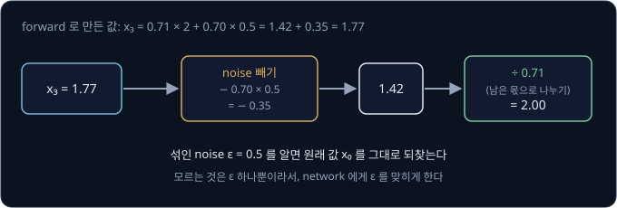

$x_t$ 와 $t$ 는 손에 있으니 모르는 것은 $\epsilon$ 하나뿐이다. 그래서 DDPM 은 network 에게 "$x_t$ 에 섞인 noise 가 무엇이었는가" 를
맞히게 한다.

**확인 문제.** $T = 5$ schedule 에서 $x_3 = 1.41$ 이고 섞인 noise 가 $\epsilon = 1$ 이었다. $x_0$ 는?

답 보기

noise 몫은 $0.70 \times 1 = 0.70$ 이므로 $x_0 = (1.41 - 0.70) \div 0.71 = 0.71 \div 0.71 = 1$ 이다.

### noise 를 맞히는 network

noise 를 맞히는 network 는 $\epsilon_\theta(x_t, t)$ 로 적는다. $\theta$ 는 "세타(theta)" 라고 읽고, network 의 weight 전체를
가리킨다. 괄호 안은 network 가 받는 입력으로, noise 가 섞인 값 $x_t$ 와 step 번호 $t$ 다. 전체는 "weight 가 $\theta$ 인 network 가
$x_t$ 와 $t$ 를 보고 추정한 noise" 로 읽는다.

step 번호 $t$ 를 함께 주는 이유는 같은 $x_t$ 라도 $t$ 에 따라 섞인 noise 가 다르기 때문이다. 원래 값이 $x_0 = 2$ 였다고 하고 $x_t = 1.42$
를 받았다고 하자. $t = 3$ 이면 $1.42 = 0.71 \times 2 + 0.70 \times \epsilon$ 에서 $\epsilon = 0$ 이고, $t = 1$ 이면
$1.42 = 0.95 \times 2 + 0.32 \times \epsilon$ 에서 $\epsilon = (1.42 - 1.90) \div 0.32 = -1.5$ 다. 같은 1.42 를 받아도 몇 step 째인지에 따라
맞혀야 할 noise 가 다르다.

같은 network 라도 $t$ 에 따라 하는 일의 성격이 다르다. $T = 5$ schedule 에서 $t = 5$ 이면 $x_5 = 0.39\,x_0 + 0.92\,\epsilon$ 이라 $x_5$
의 대부분이 noise 이고, network 는 "이 값의 대부분이 noise 이고 원래 값은 어느 쪽에 있었을까" 를 어림한다. $t = 1$ 이면
$x_1 = 0.95\,x_0 + 0.32\,\epsilon$ 이라 $x_1$ 은 원래 값과 거의 같고, network 는 데이터에 살짝 섞인 작은 흔들림을 골라내야 한다. 그림이라면
앞의 일은 흐릿한 얼룩에서 대략의 모양을 정하는 일이고, 뒤의 일은 거의 다 된 그림에서 자잘한 점을 지우는 일이다.

network 의 출력은 언제나 입력 $x_t$ 와 모양이 같다. 숫자 하나면 숫자 하나, 2 차원 점이면 숫자 두 개, 그림이면 pixel 마다 하나씩 noise 를
내야 하기 때문이다.

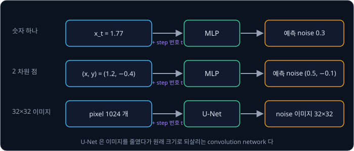

숫자 하나나 2 차원 점처럼 작은 데이터에는 MLP, 곧 weight 를 곱하고 더하는 층을 여러 겹
쌓은 network 를 쓴다. 그림에는 U-Net 이라는 network 를 쓴다. U-Net 은 [CNN](../cnn/README.md) 의 convolution 층으로 그림의 가로세로를
절반씩 줄여 가며 넓은 범위의 모양을 본 뒤, 다시 원래 크기로 키워 pixel 마다 출력을 낸다. 줄이기 전에 계산한 결과를 같은 크기의 키우는
쪽에 그대로 이어 붙여(skip connection) 세밀한 위치 정보를 잃지 않게 한다. 줄였다가 키우는 구조를 그림으로 그리면 U 자 모양이라서 이런
이름이 붙었다.

step 번호 $t$ 는 숫자 하나 그대로 넣지 않고, 정해진 계산으로 숫자 수십 개짜리 vector 로 늘려서 넣는다. 이 vector 를 time embedding
이라고 부르는데, embedding 은 "숫자 하나나 기호를 여러 숫자로 된 vector 로 바꿔 넣은 것" 이라는 뜻이다. 숫자 하나보다 network 가 $t$ 의
차이를 알아보기 쉬워진다.

**확인 문제.** 원래 값이 $x_0 = 2$ 였던 $x_t = 0.78$ 을 받았다. $t = 5$ 라면 섞인 noise 는 얼마일까? ($T = 5$ schedule 의
$\sqrt{\bar\alpha_5} = 0.39$, $\sqrt{1 - \bar\alpha_5} = 0.92$)

답 보기

$0.78 = 0.39 \times 2 + 0.92 \times \epsilon = 0.78 + 0.92 \times \epsilon$ 이므로 $\epsilon = 0$ 이다. 원래 값의 몫이 0.78 그대로
남았으니 noise 가 섞이지 않은 경우다.

### loss

network 가 맞힌 noise 가 얼마나 틀렸는지는 정답 noise 와의 차이를 제곱해서 잰다. 정답이 $\epsilon = 0.5$ 인데 network 가 0.3 을 냈다면
loss 는 $(0.5 - 0.3)^2 = 0.04$ 다. 2 차원 점처럼 noise 가 숫자 여러 개이면 자리마다 차이를 제곱해 모두 더한다. 정답이 $(0.5, -1)$,
예측이 $(0.3, -0.6)$ 이면 $(0.5 - 0.3)^2 + (-1 + 0.6)^2 = 0.04 + 0.16 = 0.2$ 다.

학습 한 번은 아래 순서로 한다.

1. 데이터에서 $x_0$ 하나를 꺼낸다
2. 1 부터 $T$ 까지에서 $t$ 를 무작위로 하나 고른다
3. $\mathcal N(0, 1)$ 에서 $\epsilon$ 을 뽑아 $x_t = \sqrt{\bar\alpha_t}\,x_0 + \sqrt{1 - \bar\alpha_t}\,\epsilon$ 을 만든다
4. network 에 $x_t$ 와 $t$ 를 넣어 noise 를 맞히게 하고, 정답 $\epsilon$ 과의 차이를 제곱해 loss 를 구한다
5. gradient descent 로 loss 가 줄어드는 쪽으로 weight $\theta$ 를 조금 고친다

gradient descent 는 weight 를 조금 바꿨을 때 loss 가 변하는 비율(gradient)을 구해 loss 가 줄어드는 방향으로 weight 를
조금씩 옮기기를 되풀이하는 학습 방법이다.

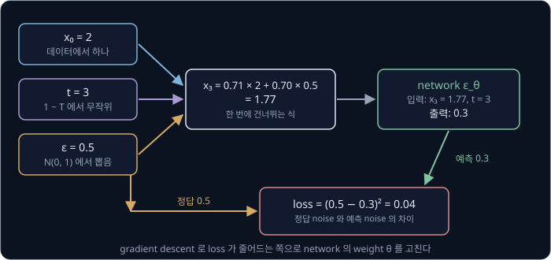

데이터가 $+2$ 와 $-2$ 두 값이고 $T = 5$ schedule 을 쓴다고 하고, 예 세 개를 한꺼번에 계산해 본다. network 의 예측은 학습 도중의 값을
가정한 것이다.

| 예 | $x_0$ | $t$ | $\epsilon$ | $x_t = \sqrt{\bar\alpha_t}\,x_0 + \sqrt{1-\bar\alpha_t}\,\epsilon$ | network 의 예측 | loss |
| --- | --- | --- | --- | --- | --- | --- |
| 1 | 2 | 3 | 0.5 | $0.71 \times 2 + 0.70 \times 0.5 = 1.77$ | 0.3 | $(0.5 - 0.3)^2 = 0.04$ |
| 2 | $-2$ | 1 | $-1$ | $0.95 \times (-2) + 0.32 \times (-1) = -2.22$ | $-0.6$ | $(-1 + 0.6)^2 = 0.16$ |
| 3 | 2 | 5 | 1.2 | $0.39 \times 2 + 0.92 \times 1.2 \approx 1.88$ | 1.0 | $(1.2 - 1.0)^2 = 0.04$ |

여러 예를 한 번에 학습할 때는 예마다의 loss 를 평균한다. 위 세 예라면 $(0.04 + 0.16 + 0.04) \div 3 = 0.08$ 이다. 기호로는 아래처럼 쓴다.

$$
L = \frac{1}{N}\sum_{i=1}^{N} \big\lVert \epsilon_i - \epsilon_\theta(x_{t_i}, t_i) \big\rVert^2,
\qquad x_{t_i} = \sqrt{\bar\alpha_{t_i}}\, x_{0,i} + \sqrt{1 - \bar\alpha_{t_i}}\, \epsilon_i
$$

$N$ 은 예의 개수이고, $\sum$ 은 "1 번째부터 $N$ 번째까지 모두 더하라" 는 기호다. $i$ 번째 예의 원래 값이 $x_{0,i}$, 고른 step 이 $t_i$,
뽑은 noise 가 $\epsilon_i$ 다. $\lVert \cdot \rVert^2$ 은 "자리마다 제곱해 모두 더한 값" 이라서 noise 가 숫자 하나면 그냥 제곱이다. 위 표라면
$N = 3$ 이고, $\lVert \cdot \rVert^2$ 이 0.04, 0.16, 0.04, $L$ 이 0.08 이다.

**흔한 오해.** 학습이 잘 되면 loss 가 0 까지 내려간다고 생각하기 쉽다. 데이터가 $+2$ 와 $-2$ 일 때 $t = 5$ 에서 $x_5 = 0.2$ 를 받았다고
하자. $x_5 = 0.39\,x_0 + 0.92\,\epsilon$ 이므로, 원래 값이 $+2$ 였다면 섞인 noise 는 $(0.2 - 0.78) \div 0.92 \approx -0.63$ 이고, $-2$
였다면 $(0.2 + 0.78) \div 0.92 \approx 1.07$ 이다. 같은 $x_5$ 에 정답이 두 가지라서 network 가 무엇을 내든 둘 중 하나와는 어긋나고, loss 는
0 이 될 수 없다. 이 자리에서 network 가 내는 값이 무엇인지는 뒤의 "봉우리가 여럿인 데이터" 에서 계산한다.

**확인 문제.** 2 차원 점의 정답 noise 가 $(1, -0.5)$ 이고 network 의 예측이 $(0.6, -0.5)$ 다. loss 는?

답 보기

$(1 - 0.6)^2 + (-0.5 + 0.5)^2 = 0.16 + 0 = 0.16$ 이다.

### 한 step 만 보는 학습

학습 순서에는 step 을 차례로 밟는 부분이 없다. $t$ 를 무작위로 하나 고르고, 한 번에 건너뛰는 식으로 $x_t$ 를 바로 만든 뒤, 그 한 자리에서만
noise 를 맞힌다. $t = 700$ 을 골랐다고 forward step 을 700 번 밟을 필요가 없다.

같은 network 가 모든 $t$ 를 맡아야 하므로, 학습을 오래 하는 동안 $t$ 가 1 부터 $T$ 까지 고르게 뽑혀 모든 step 을 연습한다. 반대로 새
데이터를 만들 때는 $T$ 에서 1 까지 모든 step 을 차례로 밟으므로, 학습과 생성은 step 을 다루는 방식이 다르다.

**확인 문제.** $T = 1000$ 이고 학습 예 100 만 개에서 $t$ 를 고르게 뽑았다. $t = 500$ 인 예는 대략 몇 개일까?

답 보기

1000 개의 $t$ 가 같은 확률 $\frac{1}{1000}$ 로 뽑히므로 $1{,}000{,}000 \times \frac{1}{1000} = 1000$ 개쯤이다.

### noise 를 정답으로 고르는 이유

network 에게 $x_0$ 나 $x_{t-1}$ 을 바로 맞히게 할 수도 있었는데 굳이 noise 를 맞히게 하는 데는 이유가 있다.

- **noise 만 알면 나머지는 계산된다** — 앞의 복원 식처럼 $\epsilon$ 을 알면 $x_0$ 가 나오고, 뒤의 sampling 식처럼 $x_{t-1}$ 도 나온다
- **정답이 공짜로 정확하게 있다** — $\epsilon$ 은 학습 순서 3 에서 직접 뽑은 값이라, 사람이 정답을 달아 줄 필요 없이 데이터만 있으면 학습
  예를 끝없이 만들 수 있다. 그림을 줄였다가 되살리는 [VAE](../vae/README.md) 의 autoencoder 가 입력 그림 자신을 정답으로 삼았던 것과
  비슷하다
- **어느 step 이든 정답의 크기가 같다** — 정답 $\epsilon$ 은 $t$ 가 1 이든 1000 이든 $\mathcal N(0, 1)$ 에서 뽑은 숫자라서, 대부분 $-2$ ~ 2
  사이에 있다. 한 network 가 모든 step 을 맡아도 출력의 크기를 $t$ 마다 다르게 맞출 필요가 없다
- **실험 결과가 더 좋았다** — Ho 등은 같은 조건에서 noise 를 맞히게 했을 때 다른 값을 맞히게 했을 때보다 더 좋은 그림이 나왔다고 보고했다

이 loss 는 ELBO, 곧 데이터가 나올 확률의 log 의 아래쪽 경계에서 출발해 유도할 수도 있다. 유도하면 step 마다
다른 무게가 곱해진 식이 나오는데, Ho 등은 그 무게를 떼어 내고 모든 step 을 같은 무게로 더한 단순한 loss 를 썼다. 위의 $L$ 이 그 단순한
형태다.

**흔한 오해.** network 가 $x_t$ 를 받아 깨끗한 $x_0$ 를 바로 그려 낸다고 생각하기 쉽다. network 의 출력은 noise 의 추정이고, 깨끗한 값은
그 추정을 식에 넣어 계산으로 얻는다.

**확인 문제.** 학습할 때는 정답 noise $\epsilon$ 을 알고 있다. 새 데이터를 만들 때도 이 $\epsilon$ 을 쓰면 network 가 필요 없지 않을까?

답 보기

쓸 수 없다. 학습할 때의 $\epsilon$ 은 원래 데이터 $x_0$ 에 noise 를 직접 섞으면서 뽑은 값이다. 새 데이터를 만들 때는 $x_0$ 가 없고 순수한
noise 에서 출발하므로, 섞인 noise 를 알려 줄 것은 학습한 network 뿐이다.

**요약**

- 섞인 noise $\epsilon$ 을 알면 $x_0 = (x_t - \sqrt{1 - \bar\alpha_t}\,\epsilon) \div \sqrt{\bar\alpha_t}$ 로 원래 값을 되찾는다. 그래서
  network $\epsilon_\theta(x_t, t)$ 는 $x_t$ 와 $t$ 를 받아 섞인 noise 를 맞힌다
- loss 는 정답 noise 와 예측 noise 의 차이를 제곱한 값이고, 학습할 때는 $t$ 를 무작위로 골라 그 한 step 만 본다
- noise 를 정답으로 고르면 정답이 공짜로 정확하게 있고, 모든 step 에서 정답의 크기가 같다

## sampling

### reverse 의 한 step

이제 학습한 network 로 새 데이터를 만든다. forward 의 한 step 은 $x_t = \sqrt{\alpha_t}\,x_{t-1} + \sqrt{\beta_t}\,\epsilon$ 이었다.
뒤의 $\sqrt{\beta_t}\,\epsilon$ 을 "이번 step 에 더해진 noise" 라고 부르면, 이 step 을 거꾸로 밟는 계산은 아래와 같다.

$$
x_{t-1} = \frac{x_t - (\text{이번 step 에 더해진 noise})}{\sqrt{\alpha_t}}
$$

이번 step 에 더해진 noise 를 빼고, 곱해서 줄였던 $\sqrt{\alpha_t}$ 로 나눠 되돌린다는 뜻이다.

그런데 network 가 맞히는 것은 이번 step 의 noise 가 아니라 $x_0$ 부터 $x_t$ 까지 쌓인 noise 전체다. 한 번에 건너뛰는 식에서 noise 전체는
$\sqrt{1 - \bar\alpha_t}\,\epsilon$ 이고, 그 분산 $1 - \bar\alpha_t$ 중 이번 step 이 보탠 분산은 $\beta_t$ 다. 그래서 쌓인 noise 중
$\frac{\beta_t}{1 - \bar\alpha_t}$ 만큼을 이번 step 의 몫으로 본다. $T = 5$ schedule 의 step 5 라면 noise 전체의 분산이
$1 - 0.1512 \approx 0.85$, 이번 step 의 분산이 $\beta_5 = 0.5$ 라서 몫은 $0.5 \div 0.85 \approx 0.59$ 다.

이번 step 의 noise 를 식으로 쓰면 아래와 같고, 마지막 줄은 $1 - \bar\alpha_t = \sqrt{1 - \bar\alpha_t} \times \sqrt{1 - \bar\alpha_t}$ 를 써서
한 번 약분한 것이다.

$$
\begin{aligned}
\text{이번 step 에 더해진 noise} &\approx \frac{\beta_t}{1 - \bar\alpha_t} \times \sqrt{1 - \bar\alpha_t}\;\epsilon_\theta(x_t, t) \\
&= \frac{\beta_t}{\sqrt{1 - \bar\alpha_t}}\;\epsilon_\theta(x_t, t)
\end{aligned}
$$

step 5 에서 $\frac{\beta_5}{\sqrt{1 - \bar\alpha_5}} = 0.5 \div 0.92 \approx 0.54$ 로, 몫 0.59 에 noise 전체의 계수 0.92 를 곱한 값과 같다.
이것을 앞의 식에 넣고, 끝에 새 noise 를 조금 더하면 DDPM 의 reverse step 이 된다.

$$
x_{t-1} = \frac{1}{\sqrt{\alpha_t}}\Big(x_t - \frac{\beta_t}{\sqrt{1 - \bar\alpha_t}}\;\epsilon_\theta(x_t, t)\Big) + \sigma_t\, z,
\qquad z \sim \mathcal N(0, 1)
$$

이 식은 "network 가 맞힌 noise 에 이번 step 의 계수를 곱해 $x_t$ 에서 빼고, $\sqrt{\alpha_t}$ 로 나눈 뒤, 새로 뽑은 $z$ 에 $\sigma_t$ 를 곱해
더한다" 로 읽는다. 새 noise 를 더하는 이유는 다음 절에서 다룬다. $T = 5$ schedule 의 계수를 모으면 아래와 같다.

| step $t$ | 1 | 2 | 3 | 4 | 5 |
| --- | --- | --- | --- | --- | --- |
| $\beta_t \div (1 - \bar\alpha_t)$ (쌓인 noise 중 이번 step 의 몫) | 1.00 | 0.71 | 0.60 | 0.57 | 0.59 |
| $1 / \sqrt{\alpha_t}$ (나눠 되돌리는 수) | 1.05 | 1.12 | 1.20 | 1.29 | 1.41 |
| $\beta_t / \sqrt{1 - \bar\alpha_t}$ (이번 step 몫의 계수) | 0.32 | 0.38 | 0.43 | 0.48 | 0.54 |
| $\sigma_t = \sqrt{\beta_t}$ (새 noise 의 크기) | 0.32 | 0.45 | 0.55 | 0.63 | 0.71 |

$\sqrt{\alpha_t}$ 로 나누는 것은 $1 / \sqrt{\alpha_t}$ 를 곱하는 것과 같아서, 표에는 곱할 수를 적었다. 첫 줄의 몫은 step 2 라면
$0.2 \div (1 - 0.72) = 0.2 \div 0.28 \approx 0.71$, step 3 이라면 $0.3 \div (1 - 0.504) = 0.3 \div 0.496 \approx 0.60$ 처럼 구한다. step 1 에서는 몫이
$\beta_1 \div (1 - \bar\alpha_1) = 0.1 \div 0.1 = 1$ 이다. noise 전체가 모두 step 1 에서 더해진 것이니 당연하고, 이때의 식은 forward 한 step
$x_1 = \sqrt{0.9}\,x_0 + \sqrt{0.1}\,\epsilon$ 을 그대로 거꾸로 푼 것과 같다.

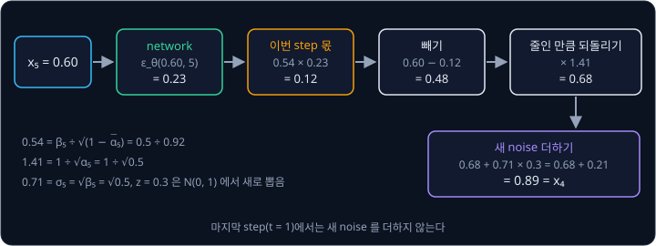

**확인 문제.** $T = 5$ schedule 의 step 2 에서 $x_2 = 1.0$ 이고 network 가 $\epsilon_\theta = 0.5$ 를 냈다. 새 noise 를 더하기 전의 값은?

답 보기

이번 step 몫은 $0.38 \times 0.5 = 0.19$ 이고, $1.0 - 0.19 = 0.81$ 이다. 여기에 1.12 를 곱하면 $0.81 \times 1.12 \approx 0.91$ 이다.

### 새로 더하는 noise

reverse step 끝의 $\sigma_t z$ 는 새로 더하는 noise 다. $z$ 는 $\mathcal N(0, 1)$ 에서 새로 뽑은 숫자이고, VAE 의 latent $z$ 와는 이름만
같은 다른 값이다. $\sigma_t$ 는 "시그마(sigma)" 로, 새 noise 의 표준편차다. 이 강의에서는 $\sigma_t = \sqrt{\beta_t}$ 를 쓰는데, Ho 등은
이것과 조금 더 작은 값 두 가지를 써 보고 결과가 비슷했다고 보고했다.

괄호 안의 계산이 내는 것은 $x_{t-1}$ 이 있을 법한 범위의 가운데다. 같은 $x_t$ 에 이를 수 있는 $x_{t-1}$ 은 하나가 아니라 그 가운데
근처에 종 모양으로 퍼져 있으므로, 가운데에 $\sigma_t z$ 를 더해 그 범위에서 하나를 뽑는다. 가운데 값만 따라가면 매 step 평균 쪽만 고르게
되어, 만들어진 sample 들이 실제 데이터보다 좁게 몰린다.

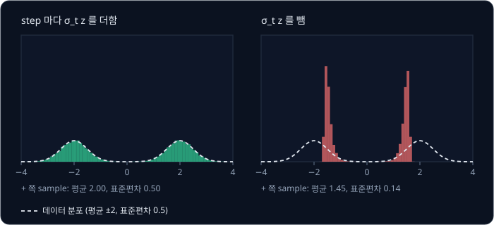

위 그림은 데이터가 $+2$ 와 $-2$ 근처에 표준편차 0.5 로 퍼져 있을 때, noise 를 정확히 맞히는 network 로 sample 을 2 만 개씩 만든 결과다.
막대 하나가 그 구간에 들어간 sample 의 수를 나타내는 histogram 으로 그렸다.
step 마다 $\sigma_t z$ 를 더한 왼쪽은 데이터의 퍼진 모양을 그대로 살렸고, 뺀 오른쪽은 표준편차가 0.5 에서 0.14 로 좁아지면서 가운데도
2 에서 1.45 로 안쪽에 몰렸다.

마지막 step($t = 1$)에서는 $z$ 를 더하지 않는다. 그 결과가 최종 sample $x_0$ 인데, 여기에 noise 를 더하면 깨끗하게 만든 값을 다시
흐트러뜨릴 뿐이기 때문이다.

**흔한 오해.** 새 noise 를 더하면 결과가 부정확해질 것 같지만, 빼면 오히려 데이터와 다른 분포가 나온다. 새 noise 는 같은 $x_t$ 에서도
여러 $x_{t-1}$ 이 가능하다는 사실을 sampling 에 담는 장치다.

**확인 문제.** $T = 5$ schedule 의 step 3 에서 괄호 안 계산을 마친 값이 1.54 이고 $z = 0.2$ 가 뽑혔다. $x_2$ 는?

답 보기

$\sigma_3 = 0.55$ 이므로 $x_2 = 1.54 + 0.55 \times 0.2 = 1.54 + 0.11 = 1.65$ 다.

### T = 5 sampling 계산표

데이터가 $+2$ 와 $-2$ 두 값뿐이고, 이 데이터로 학습을 마친 network 가 있다고 하자. sampling 은 아래 순서로 한다.

1. $\mathcal N(0, 1)$ 에서 $x_T$ 를 뽑는다
2. $t = T, T-1, \ldots, 1$ 순서로 network 에 $x_t$ 와 $t$ 를 넣어 $\epsilon_\theta$ 를 얻고, reverse step 의 식으로 $x_{t-1}$ 을 계산한다.
   $t = 1$ 에서는 $z$ 를 더하지 않는다
3. 마지막에 나온 $x_0$ 가 sample 이다

$x_5 = 0.60$ 이 뽑혔다면 계산은 아래와 같다. $\epsilon_\theta$ 칸은 network 가 낸 값이고, 이 값이 왜 이렇게 나오는지는 다음 큰 절에서
설명한다. 곱한 결과는 소수 셋째 자리에서 반올림했다.

| $t$ | $x_t$ | $\epsilon_\theta$ | 이번 step 몫 | $x_t$ − 몫 | $\times \frac{1}{\sqrt{\alpha_t}}$ | $z$ | $\sigma_t z$ | $x_{t-1}$ |
| --- | --- | --- | --- | --- | --- | --- | --- | --- |
| 5 | 0.60 | 0.23 | $0.54 \times 0.23 = 0.12$ | 0.48 | $1.41 \times 0.48 = 0.68$ | 0.3 | $0.71 \times 0.3 = 0.21$ | 0.89 |
| 4 | 0.89 | $-0.10$ | $0.48 \times (-0.10) = -0.05$ | 0.94 | $1.29 \times 0.94 = 1.21$ | $-0.2$ | $0.63 \times (-0.2) = -0.13$ | 1.08 |
| 3 | 1.08 | $-0.47$ | $0.43 \times (-0.47) = -0.20$ | 1.28 | $1.20 \times 1.28 = 1.54$ | 0.2 | $0.55 \times 0.2 = 0.11$ | 1.65 |
| 2 | 1.65 | $-0.09$ | $0.38 \times (-0.09) = -0.03$ | 1.68 | $1.12 \times 1.68 = 1.88$ | 0.2 | $0.45 \times 0.2 = 0.09$ | 1.97 |
| 1 | 1.97 | 0.23 | $0.32 \times 0.23 = 0.07$ | 1.90 | $1.05 \times 1.90 = 2.00$ | 없음 | 0 | 2.00 |

0.60 에서 출발한 값이 0.89, 1.08, 1.65, 1.97 을 거쳐 데이터 $+2$ 에 닿았다. step 4 부터 step 2 까지 network 가 음수 noise 를 낸 것을
눈여겨볼 만하다. network 는 "$x_t$ 에 음수 noise 가 섞여서 원래 있어야 할 자리보다 작아졌다" 고 추정한 것이고, 음수 몫을 빼면 값이 커지므로
$x_t$ 는 $+2$ 쪽으로 올라간다. 반대로 step 1 의 $x_1 = 1.97$ 은 $+2$ 에서 온 $x_1$ 의 가운데 $0.95 \times 2 = 1.90$ 보다 조금 커서 network 가
양수 0.23 을 냈고, 그 몫을 빼서 1.90 으로 내린 뒤 1.05 를 곱해 2.00 이 되었다. 숫자만 바꿔 $x_5 = -0.40$ 에서 출발하면 아래처럼 $-2$ 에 닿는다.

| $t$ | $x_t$ | $\epsilon_\theta$ | 이번 step 몫 | $x_t$ − 몫 | $\times \frac{1}{\sqrt{\alpha_t}}$ | $z$ | $\sigma_t z$ | $x_{t-1}$ |
| --- | --- | --- | --- | --- | --- | --- | --- | --- |
| 5 | $-0.40$ | $-0.14$ | $0.54 \times (-0.14) = -0.08$ | $-0.32$ | $1.41 \times (-0.32) = -0.45$ | $-0.4$ | $0.71 \times (-0.4) = -0.28$ | $-0.73$ |
| 4 | $-0.73$ | 0.20 | $0.48 \times 0.20 = 0.10$ | $-0.83$ | $1.29 \times (-0.83) = -1.07$ | 0.3 | $0.63 \times 0.3 = 0.19$ | $-0.88$ |
| 3 | $-0.88$ | 0.74 | $0.43 \times 0.74 = 0.32$ | $-1.20$ | $1.20 \times (-1.20) = -1.44$ | 0.2 | $0.55 \times 0.2 = 0.11$ | $-1.33$ |
| 2 | $-1.33$ | 0.69 | $0.38 \times 0.69 = 0.26$ | $-1.59$ | $1.12 \times (-1.59) = -1.78$ | $-0.1$ | $0.45 \times (-0.1) = -0.05$ | $-1.83$ |
| 1 | $-1.83$ | 0.21 | $0.32 \times 0.21 = 0.07$ | $-1.90$ | $1.05 \times (-1.90) = -2.00$ | 없음 | 0 | $-2.00$ |

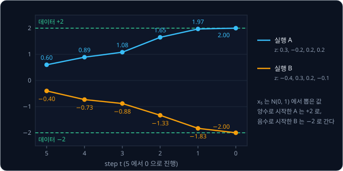

$T = 5$ 라서 network 를 다섯 번 썼다. 실제 DDPM 은 $T = 1000$ 이므로 sample 하나를 만드는 데 network 를 1000 번 쓴다.

두 실행 모두 $x_5$ 를 $\mathcal N(0, 1)$ 에서 뽑았지만, $T = 5$ schedule 에서 실제 $x_5$ 는 원래 값이 39% 남아 평균이 $\pm 0.78$ 인 분포를
따랐다. 출발점의 분포가 forward process 의 끝과 조금 어긋나는 것인데, $T = 1000$ 이면 끝에 원래 값이 0.6% 만 남아 이 차이가 거의 없다.
앞에서 forward process 의 끝이 $\mathcal N(0, 1)$ 에 닿을 만큼 step 을 충분히 밟아야 한다고 한 이유가 여기서도 보인다.

**확인 문제.** 실행 A 의 step 4 를 다시 계산해 보자. $x_4 = 0.89$, $\epsilon_\theta = -0.10$, $z = -0.2$ 일 때 $x_3$ 은?

답 보기

이번 step 몫은 $0.48 \times (-0.10) = -0.048 \approx -0.05$ 이고, $0.89 - (-0.05) = 0.94$ 다. $1.29 \times 0.94 \approx 1.21$ 에
$0.63 \times (-0.2) \approx -0.13$ 을 더하면 $x_3 = 1.08$ 이다.

### 학습과 sampling 의 차이

학습과 sampling 은 같은 network 와 같은 schedule 을 쓰지만 하는 일이 다르다. 둘을 나란히 놓으면 아래와 같다.

| | 학습 | sampling |
| --- | --- | --- |
| 출발점 | 데이터에서 꺼낸 $x_0$ | $\mathcal N(0, 1)$ 에서 뽑은 $x_T$ |
| step 을 다루는 법 | $t$ 를 무작위로 하나 고른다 | $t = T$ 부터 1 까지 모두 차례로 밟는다 |
| 쓰는 식 | 한 번에 건너뛰는 식 $x_t = \sqrt{\bar\alpha_t}\,x_0 + \sqrt{1-\bar\alpha_t}\,\epsilon$ | reverse step 의 식 |
| 정답 noise | 직접 뽑았으니 안다 | 모른다. network 의 추정만 있다 |
| network 를 쓰는 횟수 | 학습 예 하나에 1 번 | sample 하나에 $T$ 번 |
| 결과 | loss 와 weight 의 수정 | 새 sample $x_0$ |

학습은 예 하나마다 계산이 가볍지만 예를 아주 많이 봐야 하고, sampling 은 sample 하나를 얻는 데 network 를 $T$ 번이나 써야 한다. 학습에서
$t$ 하나만 보고도 sampling 의 $T$ 번이 맞게 돌아가는 것은, 학습하는 동안 모든 $t$ 가 고르게 뽑혀 network 가 어느 step 에서든 noise 를
맞히는 법을 배웠기 때문이다.

**확인 문제.** $T = 1000$ 인 DDPM 으로 sample 100 개를 만들려면 network 를 몇 번 써야 할까?

답 보기

sample 하나에 1000 번이므로 $100 \times 1000 = 100{,}000$ 번이다. 여러 sample 을 한꺼번에 묶어 계산하면 시간은 줄일 수 있지만 계산의 양은
같다.

**요약**

- reverse 한 step 은 network 가 맞힌 noise 중 이번 step 의 몫 $\frac{\beta_t}{\sqrt{1 - \bar\alpha_t}}\epsilon_\theta$ 를 빼고
  $\sqrt{\alpha_t}$ 로 나눈 뒤, 새 noise $\sigma_t z$ 를 더한다
- 새 noise 를 빼면 sample 이 데이터보다 좁게 몰리고, 마지막 step 에서만 더하지 않는다
- sampling 은 $\mathcal N(0, 1)$ 에서 출발해 $T$ 번의 reverse step 을 밟으므로 network 를 $T$ 번 쓴다

## 봉우리가 여럿인 데이터

### 1 차원 두 봉우리

앞의 sampling 표에서 network 는 $x_5 = 0.60$ 을 받고 0.23 을 냈다. 데이터가 $+2$ 와 $-2$ 반반일 때 network 가 무엇을 배우는지 따라가면 이
숫자가 나온다.

$x_5 = 0.2$ 를 받았다고 하자. 이 값이 $x_0 = +2$ 에서 왔다면 $x_5$ 는 평균 $0.39 \times 2 = 0.78$, 표준편차 0.92 인 정규분포를 따르고,
$-2$ 에서 왔다면 평균 $-0.78$, 표준편차 0.92 인 정규분포를 따른다. 0.2 자리에서 두 곡선의 높이를 재면 0.36 과 0.25 다. 곡선이 높을수록
그 근처의 값이 자주 나오므로, 데이터가 반반이라면 0.2 가 $+2$ 에서 왔을 가능성과 $-2$ 에서 왔을 가능성의 비는 높이의 비 0.36 : 0.25 와
같다. 합이 1 이 되도록 나누면 $0.36 \div 0.61 \approx 0.59$ 와 $0.25 \div 0.61 \approx 0.41$ 이다.

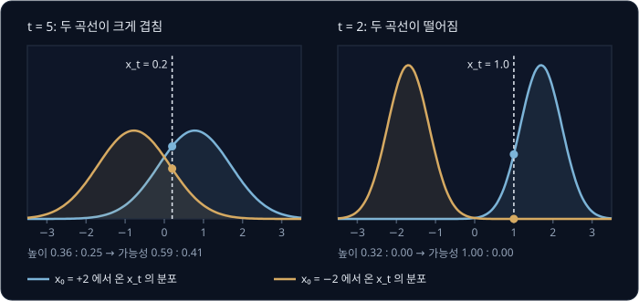

같은 입력에 정답이 여럿이면 MSE 로 학습한 network 는 차이의 제곱 합이 가장 작은 값, 곧 가능한 정답들의 평균을 낸다. 여기서는 가능성을 무게로 둔 평균이라서,
network 는 원래 값을 $0.59 \times 2 + 0.41 \times (-2) = 1.18 - 0.82 = 0.36$ 으로 추정하고 그에 맞는 noise 를 낸다. 같은 계산을 다른
$x_t$ 와 $t$ 에서 하면 아래와 같다.

| $t$ | $x_t$ | $+2$ 에서 왔을 가능성 | $-2$ 에서 왔을 가능성 | 원래 값의 추정 |
| --- | --- | --- | --- | --- |
| 5 | 0.2 | 0.59 | 0.41 | $0.59 \times 2 - 0.41 \times 2 = 0.36$ |
| 5 | 1.0 | 0.86 | 0.14 | $0.86 \times 2 - 0.14 \times 2 = 1.44$ |
| 2 | 0.2 | 0.92 | 0.08 | $0.92 \times 2 - 0.08 \times 2 = 1.68$ |
| 2 | 1.0 | 1.00 | 0.00 | $1.00 \times 2 - 0 = 2.00$ |

그림 오른쪽의 $t = 2$, $x_2 = 1.0$ 도 표준편차로 따져 보면 왜 확신하는지 보인다. $+2$ 에서 온 $x_2$ 는 평균 $0.85 \times 2 = 1.70$,
표준편차 0.53 이라 1.0 은 평균에서 0.7, 곧 표준편차 1.3 개쯤 떨어진 흔한 자리다. $-2$ 에서 온 $x_2$ 는 평균 $-1.70$ 이라 1.0 은 평균에서
2.7, 곧 표준편차 5 개 넘게 떨어진 자리인데, 정규분포에서 표준편차 3 개 밖의 값조차 1000 번에 세 번 꼴이니 이런 값은 거의 나오지 않는다.

$t = 5$ 에서는 두 곡선이 크게 겹쳐서 $x_t$ 를 보고도 어느 쪽에서 왔는지 확신할 수 없고, 추정이 평균 0 쪽으로 끌려간다. $t = 2$ 에서는 원래
값의 몫이 크고 noise 가 작아 두 곡선이 떨어져 있으므로, 같은 0.2 라도 $+2$ 쪽에서 왔다고 거의 확신하고 추정도 2 에 가까워진다.

sampling 표의 첫 줄도 같은 계산이다. $x_5 = 0.60$ 에서 $+2$ 쪽 가능성은 0.75 라서 원래 값의 추정은 $0.75 \times 2 - 0.25 \times 2 = 1.0$ 이고,
섞인 noise 는 $(0.60 - 0.39 \times 1.0) \div 0.92 = 0.21 \div 0.92 \approx 0.23$ 이다.

**흔한 오해.** network 가 평균을 낸다면 DDPM 도 VAE 처럼 봉우리 사이의 값을 낼 것 같다. 평균이 봉우리 사이로 끌려가는 것은 $t$ 가 커서
어차피 noise 가 대부분인 앞쪽 step 뿐이고, 그 값은 최종 sample 이 아니라 다음 step 의 출발점이다. $t$ 가 작아지면 $x_t$ 가 이미 어느 쪽인지
드러내서 평균이 한 봉우리의 값과 같아진다.

**확인 문제.** $x_t$ 가 $+2$ 에서 왔을 가능성이 0.7, $-2$ 에서 왔을 가능성이 0.3 이다. 원래 값의 추정은?

답 보기

$0.7 \times 2 + 0.3 \times (-2) = 1.4 - 0.6 = 0.8$ 이다.

### 봉우리를 고르는 과정

$T = 1000$ 으로 늘려 같은 일을 보면, sample 이 한쪽 봉우리를 고르는 과정이 더 잘 보인다.

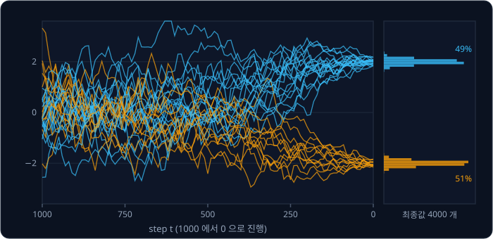

$t$ 가 큰 왼쪽에서는 network 가 어느 쪽인지 확신하지 못해 원래 값을 0 근처로 추정하고, 경로들은 새 noise $\sigma_t z$ 에 따라 위아래로
흔들린다. 그러다 어떤 경로가 우연히 조금 위로 가면 network 의 추정이 $+2$ 쪽으로 기울고, 다음 step 에서는 그쪽으로 조금 더 끌려간다.
이렇게 한쪽으로 기울기 시작한 경로는 점점 확실하게 그 봉우리로 가고, 오른쪽 끝에서는 모든 경로가 $+2$ 나 $-2$ 중 하나에 닿는다. sample
4000 개 중 49% 가 $+2$, 51% 가 $-2$ 로 데이터의 반반과 거의 같고, 둘 사이의 0 근처에서 끝난 sample 은 없다.

MSE 로 정답 하나를 배우는 모델은 같은 데이터에서 언제나 0 을 냈다. DDPM 도 step 마다 평균을 추정하지만, 그 평균으로 한 번에 답을 내지
않고 작은 step 을 밟으며 새 noise 로 한쪽을 고를 기회를 주기 때문에 결과가 봉우리 위에 놓인다.

**확인 문제.** $x_T = 0.01$ 처럼 아주 작은 양수에서 출발한 경로는 반드시 $+2$ 에 닿을까?

답 보기

아니다. $t$ 가 클 때는 network 가 거의 반반으로 추정해 경로를 어느 쪽으로도 세게 당기지 않고, 새 noise $\sigma_t z$ 가 0.01 보다 훨씬 크게
흔들어서 음수 쪽으로 넘어갈 수 있다. 앞의 실행 A 와 B 는 출발점의 부호대로 끝났지만, 짧은 $T = 5$ 예에서 그렇게 되었을 뿐 정해진 규칙은 아니다.

### 2 차원 여덟 봉우리

2 차원에서 비교해 본다. 데이터는 평면 위의 점이고, 반지름 2 인 원 위에 45° 간격으로 놓인 중심 여덟 개 근처에 몰려 있다. 중심마다 표준편차
0.1 인 정규분포라서, 점들은 거의 모두 중심에서 0.3 안쪽에 있다. 봉우리가 여덟 개로 뚜렷이 떨어져 있어서 모델이 봉우리를 잘 살리는지가 눈에
바로 보인다.

비슷한 크기의 MLP 로 latent 가 2 개인 VAE 와 $T = 1000$ 인 DDPM 을 이 데이터에 학습시키고, 각각 sample 2000 개를 뽑아 중심에서 0.3 넘게
벗어난 비율을 세면 아래와 같다.

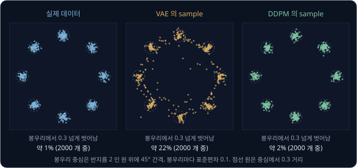

| sample | 봉우리에서 0.3 넘게 벗어난 비율 |
| --- | --- |
| 실제 데이터 | 약 1% |
| VAE | 약 35% |
| DDPM | 약 5% |

VAE 의 sample 은 봉우리 근처에 모이기는 하지만 세 개 중 하나꼴로 봉우리 사이의 원 위로 번졌다. DDPM 의 sample 은 여덟 봉우리에 각각
11 ~ 15% 씩 나뉘어(고르게 나뉘면 12.5%) 데이터와 거의 같은 모습이다.

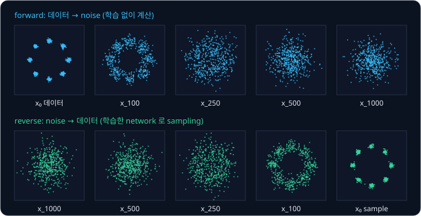

위 그림의 위 줄은 forward process 로 여덟 봉우리가 하나의 둥근 구름으로 흩어지는 모습이고, 아래 줄은 학습한 DDPM 이 그 반대로 구름에서
출발해 $t = 100$ 쯤 원 모양을, $t = 0$ 에서 여덟 봉우리를 되찾는 모습이다.

**확인 문제.** sample 2000 개 중 5% 가 봉우리에서 0.3 넘게 벗어났다면 몇 개이고, 35% 라면 몇 개일까?

답 보기

$2000 \times 0.05 = 100$ 개와 $2000 \times 0.35 = 700$ 개다.

### 봉우리를 살리는 이유

VAE 는 둥근 구름 하나인 $\mathcal N(0, I)$ 에서 $z$ 를 뽑아 decoder 한 번으로 점을 낸다. decoder 는 weight 를 곱하고 더하는 계산이라
$z$ 가 조금 바뀌면 출력도 조금만 바뀌고, 출력이 한 값에서 다른 값으로 건너뛰지 못한다.

1 차원으로 줄여 보면 이 성질이 왜 문제인지 숫자로 보인다. latent 가 숫자 하나이고 데이터가 $-2$ 와 $+2$ 두 봉우리일 때, decoder 가
$z \le -0.25$ 에서는 $-2$ 를, $z \ge 0.25$ 에서는 $+2$ 를 내도록 잘 학습했다고 하자. 그 사이에서 출력은 건너뛰지 못하고 $-2$ 에서 $+2$ 까지
이어져야 하므로, 예를 들어 직선으로 이어진다면 $z = 0$ 에서 0, $z = 0.1$ 에서 $8 \times 0.1 = 0.8$ 을 낸다. $\mathcal N(0, 1)$ 에서 뽑은
$z$ 가 $-0.25$ 와 0.25 사이에 들어갈 확률은 약 20% 라서, sample 의 약 20% 가 두 봉우리 사이에 놓인다.

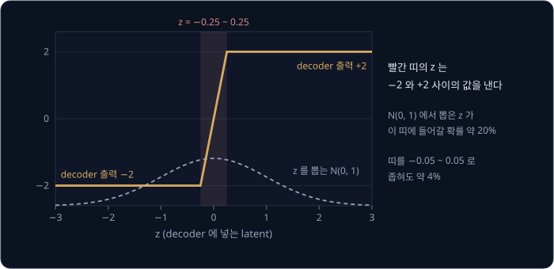

띠를 $-0.05$ ~ 0.05 로 좁혀 decoder 를 더 가파르게 만들어도 약 4% 가 남는다. 이어진 구름 하나를 떨어진 봉우리 여럿으로 옮기는 한 봉우리
사이를 지나는 $z$ 는 반드시 생기고, 2 차원의 여덟 봉우리에서는 이런 길목이 봉우리 사이마다 있다. 게다가 학습하는 동안 두 봉우리의 범위가
겹친 자리의 $z$ 에서는 두 봉우리의 평균을 내도록 배웠으므로, 길목이 가파르게 좁아지기도 어렵다.

DDPM 은 같은 일을 1000 step 에 나눈다. 한 step 의 변화가 작아서 $x_t$ 를 보고 맞혀야 할 $x_{t-1}$ 은 언제나 $x_t$ 근처의 봉우리 하나짜리
좁은 범위이고, 그 범위의 가운데를 맞히는 데는 평균이 정확히 맞는 답이다. 어느 봉우리로 갈지는 한 번에 정하지 않고, 여러 step 에 걸쳐 새
noise 와 network 의 추정이 조금씩 정한다.

| | VAE | DDPM |
| --- | --- | --- |
| sample 을 만드는 방법 | $z$ 를 decoder 에 한 번 넣음 | noise 에서 reverse step 을 $T$ 번 밟음 |
| network 를 쓰는 횟수 | 1 번 | $T$ 번 (보통 1000 번) |
| 평균이 끼어드는 자리 | 최종 출력 | 각 step 의 좁은 범위 안 |
| 봉우리 사이 sample | 많음 (8 봉우리 예에서 약 35%) | 적음 (약 5%) |

**확인 문제.** 1 차원 VAE 의 decoder 가 $z = -1$ 에서 $-2$ 를, $z = 1$ 에서 $+2$ 를 내고 그 사이를 직선으로 잇는다. $\mathcal N(0, 1)$
에서 뽑은 $z$ 로 sample 을 만들면 대략 몇 % 가 두 봉우리 사이에 놓일까?

답 보기

$z$ 가 $-1$ 과 1 사이에 들어갈 확률은 약 68% 라서, sample 의 약 68% 가 $-2$ 와 $+2$ 사이에 놓인다. decoder 가 봉우리 사이를 완만하게 이을수록
봉우리 사이 sample 이 많아진다.

**확인 문제.** DDPM 의 network 도 MSE 로 학습해 평균을 낸다. 그런데도 최종 sample 이 봉우리 사이로 잘 가지 않는 이유로 맞는 것은?
(가) network 가 평균을 내지 않도록 특별한 loss 를 쓴다 (나) 평균은 각 step 의 작은 변화에만 쓰이고, 어느 봉우리로 갈지는 여러 step 의 새
noise 와 추정이 조금씩 정한다

답 보기

(나)다. DDPM 의 loss 도 차이의 제곱이라 평균을 낸다. 다만 그 평균이 최종 출력이 아니라 한 step 의 작은 이동에 쓰이고, 봉우리의 선택은
여러 step 에 나뉘어 일어난다.

**요약**

- network 는 $x_t$ 가 각 봉우리에서 왔을 가능성을 무게로 둔 평균을 추정한다. $t$ 가 크면 추정이 0 쪽으로 끌리고, $t$ 가 작으면 한 봉우리의
  값과 같아진다
- sampling 경로는 새 noise 로 흔들리다 한쪽으로 기울고, 점점 확실하게 그 봉우리로 가서 봉우리 사이에서 끝나지 않는다
- 여덟 봉우리 데이터에서 봉우리를 벗어난 sample 은 VAE 약 35%, DDPM 약 5% 였다

## 로봇 행동 생성과의 연결

### Diffusion Policy

로봇에서 policy 는 지금 상황을 보고 어떤 행동을 할지 정하는 규칙이고, 학습으로 만든 policy 는 카메라 이미지와 로봇의 관절 위치처럼 로봇이 지금
보고 느끼는 정보(관측)를 받아 action 을 내는 network 다. action 은 관절을 얼마나 움직일지, 손끝을 어디로 옮길지 같은 로봇의 동작 명령이다.

[VAE](../vae/README.md) 강의 처음의 로봇처럼, 시연을 따라 하는 policy 는 같은 장면에서 정답 행동이 여러 무리로 갈라지는 문제를 자주
만난다. 상자를 왼쪽으로 비켜 간 시연과 오른쪽으로 비켜 간 시연이 섞여 있으면, MSE 로 학습한 policy 는 둘의 평균인 가운데 길을 내서 상자에
부딪힌다. 이렇게 값이 몰린 봉우리가 여럿인 분포를 multimodal 이라고 한다. 같은 단어가 VLA 나 CLIP 처럼 이미지와 글을 함께 받는 모델에서는
"여러 종류의 입력을 함께 받는다" 는 다른 뜻으로 쓰이지만, 이 강의와 Diffusion Policy 에서는 봉우리가 여럿이라는 뜻이다.

Diffusion Policy 는 DDPM 으로 action 을 만든다. 이미지 대신 action 여러 개를 묶은 덩어리를 데이터 $x_0$ 로 삼는데, 예를 들어 앞으로 16
step 동안 손끝이 갈 평면 위치 $(x, y)$ 16 개다. network 는 noise 가 섞인 action 덩어리와 step 번호 $t$ 에 더해 카메라 이미지와 로봇 상태를
함께 받아 섞인 noise 를 맞힌다. [VAE](../vae/README.md) 강의에서 조건을 붙인 VAE 인 CVAE 가 decoder 에 조건 $c$ 를 함께 넣었던 것과 같은 방식으로, 관측이 조건
역할을 한다.

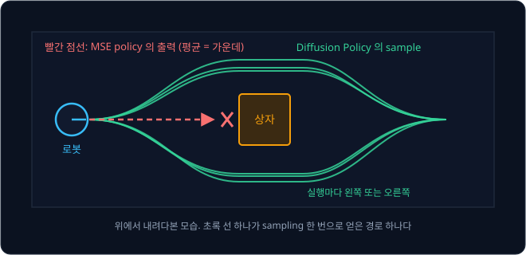

sampling 할 때마다 action 덩어리 하나가 나오는데, 앞의 두 봉우리 예처럼 이 덩어리는 왼쪽 길이나 오른쪽 길 중 하나에 놓이고 가운데 길은
거의 나오지 않는다.

이 강의의 DDPM 과 Diffusion Policy 를 나란히 놓으면 아래와 같다. Chi 등이 2023 년에 발표한 Diffusion Policy 는 평면 위의 T 자 블록을 밀어
제자리에 놓는 PushT 라는 과제에서, 손끝 위치 16 개를 한 덩어리로 만든다.

| 자리 | 이 강의의 DDPM | Diffusion Policy (PushT) |
| --- | --- | --- |
| 데이터 $x_0$ | 숫자 하나, 2 차원 점, 그림 | 앞으로 16 step 동안의 손끝 위치 $(x, y)$, 숫자 32 개 |
| noise $\epsilon$ | $x_0$ 와 같은 모양 | 숫자 32 개, 모두 $\mathcal N(0, 1)$ 에서 따로 뽑음 |
| network 의 입력 | $x_t$, $t$ | noise 가 섞인 action 덩어리, $t$, 최근 카메라 이미지 두 장과 로봇 위치 |
| 데이터의 크기 맞추기 | pixel 밝기를 $-1$ ~ $+1$ 로 | action 을 시연의 최솟값·최댓값으로 $-1$ ~ $+1$ 로 |
| schedule | linear, $T = 1000$ | cosine, $T = 100$ |
| sampling | reverse step 을 $T$ 번 | 실제 로봇에서는 DDIM 으로 10 step |

학습은 시연에서 꺼낸 action 덩어리에 noise 를 섞고 network 가 그 noise 를 맞히게 하는 것으로, 이 강의의 학습 순서와 같다. 다른 점은 network
가 지금 장면의 이미지와 로봇 위치를 함께 받는다는 것 하나다. 그래서 같은 noise 에서 출발해도 장면이 다르면 다른 action 이 나오고, 같은
장면에서도 출발 noise 가 다르면 시연에 있던 여러 방식 중 하나가 고루 나온다.

**확인 문제.** 컵을 집는 시연의 절반은 컵 손잡이를 왼쪽에서, 절반은 오른쪽에서 잡았다. MSE policy 와 Diffusion Policy 는 각각 어떤 손 위치를
낼 가능성이 클까?

답 보기

MSE policy 는 두 위치의 평균인 가운데, 곧 손잡이가 없는 쪽을 낼 가능성이 크다. Diffusion Policy 는 sampling 할 때마다 왼쪽 손잡이 위치나
오른쪽 손잡이 위치 중 하나에 가까운 값을 낸다.

### sampling 의 속도

DDPM 의 약점은 속도다. sample 하나를 만드는 데 network 를 $T$ 번 써야 해서, network 한 번에 0.01 초가 걸린다면 $T = 1000$ 이면 10 초가 걸린다.
1 초에도 여러 번 행동을 정해야 하는 로봇에게는 너무 느리다.

DDPM 의 reverse step 식을 그대로 두고 step 만 10 개씩 건너뛰면 앞의 "T 와 β 의 크기" 에서 본 문제가 다시 생긴다. 한 번에 건너뛰는 변화가
커져서, 맞혀야 할 직전 값의 범위가 봉우리 하나짜리 종 모양이 아니게 되기 때문이다. 그래서 Diffusion Policy 는 실제 로봇에서
DDIM(Denoising Diffusion Implicit Models)이라는 방법으로 10 step 만에 sampling 한다. DDIM 은 Song, Meng, Ermon 이 2020 년에 제안한 방법으로,
DDPM 과 같은 loss 로 학습한 network 를 그대로 쓰면서 step 을 건너뛰어도 맞도록 reverse step 의 식을 바꿔 훨씬 적은 step 으로 sample 을
만든다. 앞의 예라면 network 를 10 번만 쓰니 0.1 초다. noise 에서 데이터까지 가는 길을 처음부터 거의 직선으로 만들어 적은 step
으로 sampling 하는 방법은 [Flow Matching](../flow-matching/README.md) 에서 다룬다.

**확인 문제.** network 한 번에 0.02 초가 걸린다. $T = 100$ 으로 모든 step 을 밟을 때와 10 step 으로 줄였을 때 sample 하나에 걸리는
시간은?

답 보기

$100 \times 0.02 = 2$ 초와 $10 \times 0.02 = 0.2$ 초다.

**요약**

- Diffusion Policy 는 action 덩어리를 데이터로 삼는 DDPM 으로, network 가 noise 가 섞인 action 과 $t$ 에 더해 카메라 이미지와 로봇 위치를
  받아 섞인 noise 를 맞힌다
- 정답 행동이 여럿인(multimodal) 시연에서 평균 대신 시연에 있던 행동 하나를 sample 로 뽑으므로, 상자를 가운데로 들이받지 않는다
- network 를 $T$ 번 써야 하는 sampling 은 로봇에게 느려서, 실제 로봇에서는 DDIM 으로 step 을 10 개로 줄인다

## 정리

- DDPM 은 데이터에 noise 를 조금씩 더하는 forward process 를 정해 두고, 그 반대인 reverse process 를 network 로 배워 순수한 noise 에서
  데이터까지 여러 step 에 걸쳐 돌아온다. decoder 한 번으로 그림 전체를 내는 VAE 와 달리 한 step 의 변화가 작다
- forward 한 step 은 $x_t = \sqrt{1 - \beta_t}\,x_{t-1} + \sqrt{\beta_t}\,\epsilon$ 이고, 두 계수의 제곱의 합이 1 이라 분산이 1 로
  유지되면서 끝이 $\mathcal N(0, 1)$ 에 닿는다. $\beta = 0.36$ 이면 0.8 을 곱하고 $0.6\,\epsilon$ 을 더한다
- $\alpha_t = 1 - \beta_t$, $\bar\alpha_t = \alpha_1 \times \cdots \times \alpha_t$ 로 두면 $x_t = \sqrt{\bar\alpha_t}\,x_0 +
  \sqrt{1 - \bar\alpha_t}\,\epsilon$ 으로 한 번에 건너뛴다. $T = 5$ schedule 에서 $\bar\alpha$ 는 0.9, 0.72, 0.504, 0.3024, 0.1512 이고,
  실제로는 $T = 1000$ 에 작은 $\beta_t$ 를 쓴다
- network $\epsilon_\theta(x_t, t)$ 는 섞인 noise 를 맞히고, loss 는 정답 noise 와의 차이의 제곱이다. noise 를 알면 원래 값이 계산되고,
  정답이 공짜로 정확하게 있으며, 모든 step 에서 정답의 크기가 같다
- sampling 은 $x_{t-1} = \frac{1}{\sqrt{\alpha_t}}\big(x_t - \frac{\beta_t}{\sqrt{1 - \bar\alpha_t}}\epsilon_\theta\big) + \sigma_t z$ 를
  $T$ 번 밟는다. 새 noise $\sigma_t z$ 가 sample 의 퍼진 모양을 살리고, 마지막 step 에서는 더하지 않는다
- 봉우리가 여럿인 데이터에서 network 의 평균은 각 step 의 작은 이동에만 쓰이고 봉우리의 선택은 여러 step 에 나뉘어 일어나서, VAE 보다
  봉우리 사이 sample 이 훨씬 적다. Diffusion Policy 는 이 성질로 정답 행동이 여럿인(multimodal) 시연에서 한 행동을 골라 낸다

DDPM 은 sample 하나에 network 를 수백에서 천 번 써야 해서 느리다는 한계가 있다. 같은 문제를 거의 직선인 경로로 바꿔 적은 step 으로
sampling 하는 방법은 [Flow Matching](../flow-matching/README.md) 에서, 이 강의의 식으로 로봇의 action 덩어리를 만드는 policy 는
[Diffusion Policy](../diffusion-policy/README.md) 에서 다룬다.

## 참고 자료

- Jonathan Ho, Ajay Jain, Pieter Abbeel, [Denoising Diffusion Probabilistic Models](https://arxiv.org/abs/2006.11239) (2020) — DDPM 의 원
  논문. 4쪽의 Algorithm 1(학습)과 Algorithm 2(sampling)가 이 강의의 학습 순서와 sampling 순서이고, 3.2절에 $\sigma_t$ 의 선택이 있다
- Alex Nichol, Prafulla Dhariwal, [Improved Denoising Diffusion Probabilistic Models](https://arxiv.org/abs/2102.09672) (2021) — 3.2절
  식 (17)의 cosine schedule 과, linear schedule 과의 $\bar\alpha_t$ 비교 그림
- Jascha Sohl-Dickstein 등, [Deep Unsupervised Learning using Nonequilibrium Thermodynamics](https://arxiv.org/abs/1503.03585) (2015) —
  데이터를 noise 로 흩뜨렸다가 되돌리는 생성 모델을 처음 제안한 논문
- Jiaming Song, Chenlin Meng, Stefano Ermon, [Denoising Diffusion Implicit Models](https://arxiv.org/abs/2010.02502) (2020) — DDPM 으로
  학습한 network 로 step 을 건너뛰어 빠르게 sampling 하는 DDIM
- Calvin Luo, [Understanding Diffusion Models: A Unified Perspective](https://arxiv.org/abs/2208.11970) — VAE 의 ELBO 에서 출발해 DDPM 의
  loss 와 reverse step 의 계수를 한 줄씩 유도하는 tutorial. 이 강의에서 건너뛴 유도를 보고 싶을 때 읽는다
- Lilian Weng, [What are Diffusion Models?](https://lilianweng.github.io/posts/2021-07-11-diffusion-models/) — forward·reverse 식의 유도와
  DDIM 등 뒤이은 방법을 한 글에 정리한 블로그
- MIT 6.S184, [Flow Matching and Diffusion Models](https://diffusion.csail.mit.edu/) — diffusion 과 flow matching 을 함께 설명하는 강의
  노트([arXiv](https://arxiv.org/abs/2506.02070))와 실습
- Olaf Ronneberger, Philipp Fischer, Thomas Brox, [U-Net: Convolutional Networks for Biomedical Image Segmentation](https://arxiv.org/abs/1505.04597) —
  그림 1 이 줄였다가 키우는 U-Net 구조와 skip connection
- Hugging Face, [The Annotated Diffusion Model](https://huggingface.co/blog/annotated-diffusion) — DDPM 을 U-Net 과 time embedding 까지
  PyTorch 로 구현하며 해설한 글
