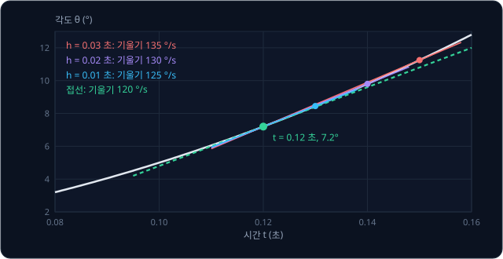
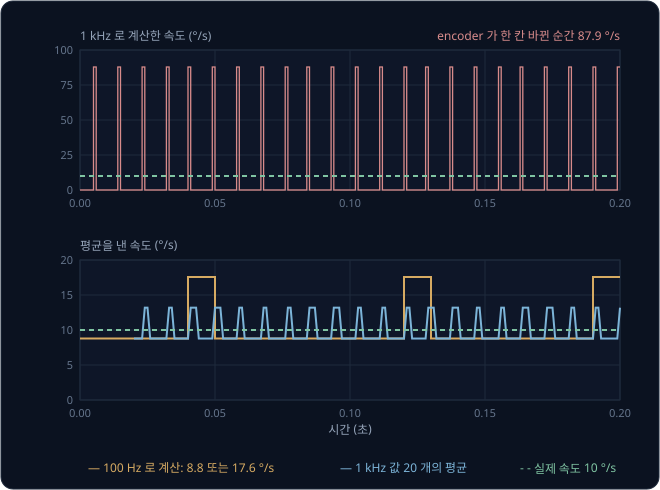
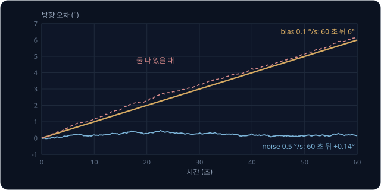
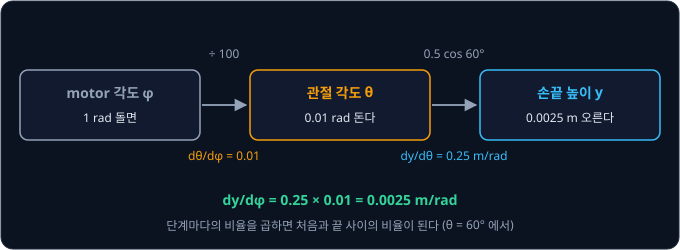
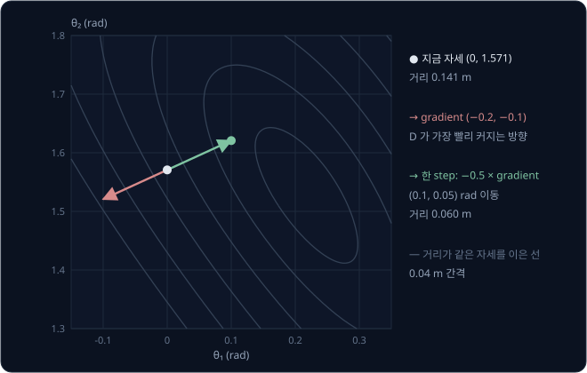
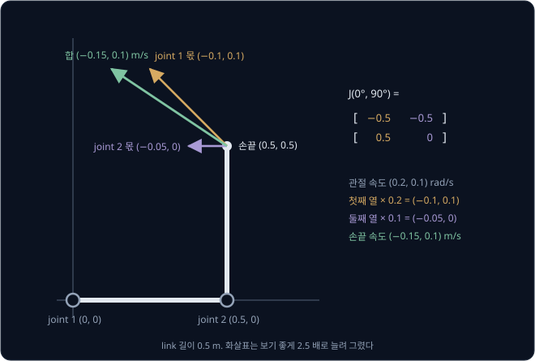

# Derivatives & Gradients

로봇 팔 관절의 encoder 는 각도만 재므로, 속도는 방금 잰 각도와 직전 각도의 차이를 그 사이 시간으로 나눠 구한다. 10 °/s 로 천천히 도는
관절에서 이 계산을 1초에 10 번 하면 9.7 ~ 10.5 °/s 가 나온다. 그런데 1초에 1000 번 하면 값이 0 과 88 °/s 사이를 오간다. 더 자주
쟀는데 속도는 왜 더 엉터리가 될까?

derivative(미분)는 어떤 값을 조금 바꿨을 때 다른 값이 얼마나 빨리 변하는지 나타내는 비율이고, 속도는 각도의 derivative 다. 이 비율을
측정값으로 계산하면 각도에 섞인 작은 오차까지 짧은 시간 간격으로 나누게 되어 오차가 커진다. 바꾸는 값이 여럿이 되면 derivative 는 neural
network 를 학습시키는 gradient 와, 관절의 작은 움직임을 손끝의 움직임으로 바꾸는 Jacobian 이 된다. ROS 의 motion planning framework 인
MoveIt 은 손끝 위치에서 관절 각도를 거꾸로 구하는 IK 계산에 KDL kinematics plugin 을 기본으로 쓰는데, 이 plugin 은 Jacobian 으로 관절
각도를 조금씩 고쳐 가며 손끝을 목표에 맞춘다.

## 학습 목표

- 일정한 간격으로 잰 관절 각도에서 속도와 가속도를 계산하고, 그 값이 derivative 의 근사라는 것을 설명할 수 있다
- encoder 로 계산한 속도가 계산 간격을 줄일수록 더 크게 튀는 이유와, 평균·low-pass filter 로 줄일 때 생기는 대가를 설명할 수 있다
- 속도를 더해 위치를 구하는 적분에서 작은 bias 가 시간에 비례해 쌓이는 이유를 숫자로 설명할 수 있다
- chain rule, gradient, Jacobian 이 각각 무엇의 변화율인지 2 관절 팔의 숫자 예시로 설명할 수 있다

## 변화율과 derivative

관절이 출발해 속도를 높여 가는 동안 각도를 1초에 100 번, 0.01 초 간격으로 읽었다고 하자. 이 간격을 $\Delta t = 0.01$ 초로 쓰는데,
$\Delta$ 는 그리스 문자 delta(델타)로 "변한 양" 을 뜻하고 $\Delta t$ 는 두 측정 사이의 시간이다. 아래 표의 각도는 가속도 1000 °/s² 로
일정하게 빨라지는 관절에서 계산한 값으로, 이 관절의 각도는 $\theta = 500t^2$ 을 따라 커진다. encoder 의 눈금 오차는 다음 절에서 다루고,
여기서는 각도를 정확히 잰다고 가정한다.

| 시간 $t$ (초) | 각도 $\theta$ (°) | 속도 $\Delta\theta / \Delta t$ (°/s) | 가속도 $\Delta(\text{속도}) / \Delta t$ (°/s²) |
| --- | --- | --- | --- |
| 0.10 | 5.00 | | |
| 0.11 | 6.05 | $(6.05 - 5.00) \div 0.01 = 105$ | |
| 0.12 | 7.20 | $(7.20 - 6.05) \div 0.01 = 115$ | $(115 - 105) \div 0.01 = 1000$ |
| 0.13 | 8.45 | 125 | 1000 |
| 0.14 | 9.80 | 135 | 1000 |
| 0.15 | 11.25 | 145 | 1000 |

속도는 각도가 변한 양을 걸린 시간으로 나눈 값이고, 같은 계산을 속도에 한 번 더 하면 가속도가 나온다. 이렇게 일정한 간격의 측정값끼리
뺀 차이를 간격으로 나누는 계산을 **finite difference**(유한 차분)라고 한다. 표의 105 °/s 는 0.10 초와 0.11 초 사이의 평균 속도라서, 어느
한 순간의 속도를 알려면 간격을 더 줄여야 한다.

위 그림은 0.12 초의 점과 $h$ 초 뒤의 점을 이은 직선을 보여 준다. 이 직선의 기울기가 그 구간의 평균 속도인데, $h$ 를 0.03, 0.02, 0.01 초로 줄이면
기울기가 135, 130, 125 °/s 로 줄어 120 °/s 에 다가간다. 간격을 0 에 한없이 가깝게 줄였을 때 비율이 다가가는 값이 그 순간의 변화율이고,
이것을 **derivative**(미분값)라고 한다. 그래프에서 derivative 는 그 점에 살짝 닿고 지나가는 직선(접선)의 기울기다.

derivative 는 $\frac{d\theta}{dt}$ 로 쓰고 "디 세타 디 티" 라고 읽는데, $d$ 는 $\Delta$ 를 0 에 가깝게 줄였다는 표시다. 로봇 문헌에서는
시간에 대한 derivative 를 기호 위에 점을 찍어 $\dot\theta$ 로 쓰는 경우가 많고, 두 번 미분한 가속도는 점 두 개인 $\ddot\theta$ 다. 위치를
미분한 값이 속도이고 속도를 미분한 값이 가속도이며, 가속도를 한 번 더 미분한 값은 **jerk** 라고 부른다. 표의 관절은 가속도가 일정해서
jerk 가 0 인데, 가속도가 0.01 초 만에 0 에서 1000 °/s² 로 뛰면 jerk 는 $1000 \div 0.01 = 100{,}000$ °/s³ 이다. jerk 가 크면 motor 가
내야 할 torque 가 갑자기 바뀌어 팔이 흔들리고 gear 에 충격이 간다. 그래서 로봇 팔의 목표 경로는 jerk 가 작아지도록 설계하는데,
[PID Control](../pid-control/README.md) 에서 본 minimum-jerk 목표가 그런 경로다.

<b>심화: limit 으로 쓰는 derivative 의 정의</b>

위에서 간격을 줄여 간 과정을 기호로 쓰면 아래와 같다.

$$
\frac{d\theta}{dt} = \lim_{h \to 0} \frac{\theta(t + h) - \theta(t)}{h}
$$

$\lim_{h \to 0}$ 은 "$h$ 를 0 에 한없이 가깝게 할 때 다가가는 값" 이라고 읽는다. $\theta = 500t^2$ 을 넣으면 분수는
$\frac{500(t + h)^2 - 500t^2}{h} = \frac{1000th + 500h^2}{h} = 1000t + 500h$ 다. $t = 0.12$ 이면 $120 + 500h$ 라서 $h = 0.01$ 일 때 125,
$h = 0.03$ 일 때 135 로 그림의 기울기와 같다. $h$ 를 0 으로 보내면 120 이 남는데, 어느 $t$ 에서든 $500h$ 가 사라지므로 $\dot\theta = 1000t$
다. 이것을 같은 방식으로 한 번 더 미분하면 $\ddot\theta = 1000$ °/s² 다.

**확인 문제.** 0.01 초 간격으로 읽은 각도가 20.00°, 20.30°, 20.70° 다. 두 구간의 속도와 그 사이의 가속도는?

답 보기

첫 구간의 속도는 $(20.30 - 20.00) \div 0.01 = 30$ °/s, 둘째 구간은 $(20.70 - 20.30) \div 0.01 = 40$ °/s 다. 가속도는 두 속도의 차이를
같은 간격으로 나눈 $(40 - 30) \div 0.01 = 1000$ °/s² 다.

## 수치 미분과 noise

encoder 는 각도를 연속으로 재지 못하고 정해진 눈금 단위로만 잰다. ROBOTIS 의 Dynamixel XM430 servo 는 한 바퀴를 4096 칸으로 나눠 재서
한 칸이 $360 \div 4096 \approx 0.088°$ 다. 실제 각도가 칸과 칸 사이에 있으면 encoder 는 아래 칸의 값을 그대로 내다가, 다음 칸을 넘는 순간
0.088° 를 한 번에 올린다. 이렇게 값을 칸 단위로 끊어 재는 것을 quantization 이라고 하고, 그 때문에 생기는 오차가 quantization error 다.

이 servo 가 10 °/s 로 돌 때 1초에 1000 번(1 kHz) 각도를 읽으면, 0.001 초 동안 실제 각도는 0.01° 만 움직여 한 칸에 한참 못 미친다. 그래서
대부분의 계산에서 각도 차이가 0 이고, 아홉 번에 한 번꼴로 칸이 바뀌는 순간에만 속도가 $0.088 \div 0.001 \approx 88$ °/s 로 튄다. 같은 움직임을
계산 주기만 바꿔 계산하면 아래와 같다.

| 계산 주기 | $\Delta t$ | 한 번에 실제로 움직이는 각도 | 계산한 속도 | 한 칸이 만드는 속도 오차 $0.088 \div \Delta t$ |
| --- | --- | --- | --- | --- |
| 10 Hz | 0.1 초 | 1° (11 ~ 12 칸) | 9.7 또는 10.5 °/s | 0.88 °/s |
| 100 Hz | 0.01 초 | 0.1° (1 ~ 2 칸) | 8.8 또는 17.6 °/s | 8.8 °/s |
| 1 kHz | 0.001 초 | 0.01° (0 ~ 1 칸) | 0 또는 87.9 °/s | 87.9 °/s |

각도에 섞인 오차는 계산 주기와 상관없이 많아야 한 칸이지만, 속도는 그 오차를 $\Delta t$ 로 나눈다. $\Delta t$ 를 10 분의 1 로 줄이면 속도의
오차는 10 배가 되고, 가속도는 한 번 더 나누므로 1 kHz 에서 한 칸이 $0.088 \div 0.001 \div 0.001 \approx 88{,}000$ °/s² 의 가짜 가속도를 만든다.
측정값을 미분하면 짧은 시간에 오르내리는 noise 가 커지고, 여러 번 미분할수록 더 커진다.

1 kHz 로 읽은 값도 최근 속도 20 개를 평균하면 쓸 수 있다. 20 개의 평균은 20 step 전 각도와 지금 각도의 차이를 0.02 초로 나눈 것과
같아서, 위 그림 아래쪽처럼 8.8 ~ 13.2 °/s 에 머문다. 대신 평균은 지난 0.02 초 동안의 속도라서 실제 움직임보다 약 0.01 초 늦게 따라간다.
관절이 갑자기 멈춰도 속도가 0 이 되기까지 0.02 초가 걸린다. 천천히 변하는 값은 통과시키고 빠르게 오르내리는 값은 줄이는 계산을
**low-pass filter** 라고 하며, 평균은 그 가장 간단한 예다. noise 를 많이 줄이는 filter 일수록 더 늦게 반응한다.
[PID Control](../pid-control/README.md) 의 D 항도 오차의 변화율을 계산하므로 같은 문제를 겪고, 그래서 D 항에는 low-pass filter 를 거친
값을 쓰는 경우가 많다.

**흔한 오해.** "각도를 더 자주 읽을수록 속도가 정확해진다." 각도의 quantization error 는 그대로인데 나누는 $\Delta t$ 만 작아져서, 미분한
속도의 오차는 오히려 커진다. 계산 주기를 높일 때는 여러 측정값을 평균하거나 filter 를 거치고, 그 강도는 noise 와 늦어짐 사이에서 알맞게
고른다.

<b>심화: forward difference 와 central difference 의 오차</b>

지금 값과 다음 값의 차이로 계산하는 $\frac{f(t + h) - f(t)}{h}$ 를 forward difference, 앞뒤 값의 차이로 계산하는 $\frac{f(t + h) - f(t - h)}{2h}$
를 central difference 라고 한다. 앞 절의 표에서 0.10 초와 0.11 초로 구한 105 °/s 는 0.10 초의 실제 속도 $1000 \times 0.10 = 100$ 이 아니라
두 측정 가운데인 0.105 초의 속도 $1000 \times 0.105 = 105$ 와 같다. 0.10 초의 속도를 앞뒤 값 $\theta(0.09) = 4.05$ 와 $\theta(0.11) = 6.05$ 로
계산하면 $(6.05 - 4.05) \div 0.02 = 100$ 으로 정확하다.

$f(x) = x^3$ 의 $x = 1$ 에서 derivative 는 3 이다. 두 방법의 오차를 비교하면 아래와 같다.

| $h$ | forward | 오차 | central | 오차 |
| --- | --- | --- | --- | --- |
| 0.1 | 3.31 | 0.31 | 3.01 | 0.01 |
| 0.01 | 3.0301 | 0.0301 | 3.0001 | 0.0001 |

$h$ 를 10 분의 1 로 줄이면 forward 의 오차는 10 분의 1 로 줄고 central 의 오차는 100 분의 1 로 준다. forward 의 오차가 $h$ 에 비례하고
central 의 오차는 $h^2$ 에 비례하기 때문이다. 다만 측정값에 크기 $\varepsilon$ 인 noise 가 있으면 그 noise 가 $\varepsilon / h$ 정도의
오차를 더한다. 그래서 $h$ 를 줄이면 식에서 오는 오차는 줄지만 noise 에서 오는 오차는 커지고, 둘의 합이 가장 작아지는 $h$ 가 따로
있다. central difference 는 다음 측정값이 필요하므로
실시간 제어에서 쓰면 한 step 늦은 속도가 된다.

**확인 문제.** 한 바퀴를 1000 칸으로 재는 encoder(한 칸 0.36°)를 500 Hz 로 읽어 속도를 계산한다. 한 칸이 만드는 속도 오차는 얼마이고, 최근
속도 10 개를 평균하면 얼마로 줄까?

답 보기

500 Hz 의 $\Delta t$ 는 $1 \div 500 = 0.002$ 초라서 한 칸의 속도 오차는 $0.36 \div 0.002 = 180$ °/s 다. 10 개를 평균하면 각도 차이를
$10 \times 0.002 = 0.02$ 초로 나누는 것과 같아서 $0.36 \div 0.02 = 18$ °/s 로 준다. 그 대신 지난 0.02 초 동안의 평균이라 그만큼 늦게 반응한다.

## 적분과 drift

속도에서 위치를 거꾸로 구하려면 속도 × $\Delta t$ 를 차례로 더한다. 첫 절의 표에서 0.10 초의 각도 5.00° 에 첫 구간에서 움직인
$105 \times 0.01 = 1.05°$ 를 더하면 6.05° 가 된다. 여기에 다음 구간의 $115 \times 0.01 = 1.15°$ 를 더하면 7.20° 로, 표의 각도가 그대로
돌아온다. 이렇게 작은 변화량을 쌓아 전체를 구하는 계산을 **적분**(integral)이라고 하고, 그래프에서는 속도 곡선 아래의 넓이다. 미분이
변화를 잘게 쪼개 본다면, 적분은 쪼갠 변화를 다시 모은다.

로봇은 바퀴 encoder 로 잰 회전 속도를 더해 달린 거리를 구하는 것처럼 적분을 자주 쓴다. IMU 안의 gyro 도 각도가 아니라 회전 속도를
재므로, 로봇이 바라보는 방향을 알려면 gyro 값을 더해야 한다. 그런데 이렇게 더하면 측정 오차도 같이 더해진다. 멈춰 있는 gyro 도 0 이
아닌 값을 내는데, 그 오차 가운데 늘 한쪽으로 치우친 부분을 bias, 매번 다르게 오르내리는 부분을 noise 라고 한다.

멈춰 있는 로봇의 gyro 에 0.1 °/s 의 bias 와 그보다 다섯 배 큰 0.5 °/s 크기의 noise 가 섞여 있다고 하고, 1초에 100 번 읽어 더해 보자.

| 시간 | bias 0.1 °/s 가 쌓인 오차 | noise 0.5 °/s 가 쌓인 보통 크기 |
| --- | --- | --- |
| 10 초 | $0.1 \times 10 = 1°$ | 0.16° |
| 60 초 | $0.1 \times 60 = 6°$ | 0.39° |
| 600 초 | $0.1 \times 600 = 60°$ | 1.2° |

bias 는 매번 같은 쪽으로 더해지므로 시간에 비례해 쌓인다. noise 는 더해질 때마다 방향이 달라 서로 상쇄되고, $n$ 번 더한 합은 $n$ 배가 아니라
$\sqrt{n}$ 배 정도로만 커진다. 60 초면 6000 번을 더하므로 $0.5 \times 0.01 \times \sqrt{6000} \approx 0.39°$ 이고, 위 그림의 한 번 실험에서는
0.14° 였다. 이렇게 적분한 값이 시간이 갈수록 실제에서 멀어지는 현상을 **drift** 라고 한다.

미분과 적분이 오차에 미치는 영향은 정반대다.

| 계산 | noise | 일정한 bias |
| --- | --- | --- |
| 미분 | $\Delta t$ 로 나눠 커진다 | 일정한 값은 변화가 없어 사라진다 |
| 적분 | 서로 상쇄되어 천천히 커진다 | 시간에 비례해 쌓인다 |

encoder 의 영점이 3° 어긋나 있어도 미분한 속도는 맞지만, 속도에 섞인 0.1 °/s 의 bias 는 적분하면 1 분에 6° 가 된다. 가속도를 두 번 적분해
위치를 구하면 bias 가 시간의 제곱으로 쌓이므로, IMU 하나로는 위치를 오래 정확하게 구할 수 없다. 이 drift 를 GPS 같은 다른 센서로
바로잡는 방법은 [Kalman Filter](../kalman-filter/README.md) 에서 다룬다.

**확인 문제.** 바닥 청소 로봇의 gyro 에 0.02 °/s 의 bias 가 있다. 이 값을 그대로 적분하면 10 분 뒤 방향 오차는?

답 보기

10 분은 600 초이고, bias 는 시간에 비례해 쌓이므로 $0.02 \times 600 = 12°$ 다.

## 미분 규칙

식을 알면 간격을 줄여 가며 표를 만들 필요 없이 규칙으로 derivative 를 바로 쓸 수 있다. 로봇 계산에 자주 쓰는 규칙은 아래와 같다.

| 함수 | derivative | 예 |
| --- | --- | --- |
| 상수 $c$ | 0 | encoder 영점이 어긋난 양은 속도에 나타나지 않는다 |
| $t^n$ | $n\,t^{n-1}$ | $500t^2$ 의 derivative 는 $500 \times 2t = 1000t$ |
| $\sin\theta$ | $\cos\theta$ | $\theta$ 는 radian |
| $\cos\theta$ | $-\sin\theta$ | $\theta$ 는 radian |

$t^n$ 의 규칙을 power rule 이라고 하고, 상수를 곱한 함수는 derivative 에도 그 상수가 그대로 곱해진다. 그래서 $\theta = 500t^2$ 이면
$\dot\theta = 1000t$ 이고, 0.12 초의 속도 120 °/s 는 앞의 그림에서 간격을 줄여 다가간 값과 같다.

sin 과 cos 의 규칙은 각도를 radian 으로 쟀을 때 성립한다. radian 은 반지름 1 인 원에서 그 각도만큼 돌았을 때 지나간 원둘레의 길이로
각도를 재는 단위로, $180° = \pi \approx 3.14$ rad 이다. $60° \approx 1.0472$ rad 에서 각도를 0.001 rad 늘리면 $\sin$ 은 0.0004996
늘어나므로, 비율 0.4996 이 $\cos 60° = 0.5$ 와 거의 같다.

변화가 여러 단계를 거쳐 전해질 때는 단계마다의 변화율을 곱하면 되는데, 이 규칙을 **chain rule** 이라고 한다. 감속비 100:1 인 gear 로 motor 가
관절을 돌리고, 관절에는 길이 0.5 m 인 link 가 수평에서 $\theta$ 만큼 들려 있다고 하자. motor 각도 $\varphi$ 가 1 rad 돌면 관절은 0.01 rad 돌고,
손끝 높이는 $y = 0.5\sin\theta$ 다.

$$
\frac{dy}{d\varphi} = \frac{dy}{d\theta} \times \frac{d\theta}{d\varphi}
$$

$\theta = 60°$ 에서 $\frac{dy}{d\theta} = 0.5\cos 60° = 0.25$ m/rad 이고 $\frac{d\theta}{d\varphi} = 0.01$ 이라서, motor 1 rad 당 손끝 높이는
$0.25 \times 0.01 = 0.0025$ m 변한다. 속도에도 같은 곱을 쓸 수 있어서, motor 가 3000 rpm($3000 \times 2\pi \div 60 \approx 314$ rad/s)으로
돌면 관절은 3.14 rad/s(180 °/s)로 돈다. 이때 손끝 높이는 $0.25 \times 3.14 \approx 0.79$ m/s 로 오른다. 관절 속도가 같아도 link 가
수평($\theta = 0°$)이면 $\cos 0° = 1$ 이라 손끝 높이가 1.57 m/s 로 오른다. 똑바로 선($\theta = 90°$) 자세에서는 $\cos 90° = 0$ 이라
손끝이 옆으로만 움직이고 높이는 변하지 않는다.

encoder 해상도에도 같은 곱이 적용되어, motor 축에 단 encoder 의 한 칸 0.088° 는 100:1 gear 를 지나면 관절에서 0.00088° 가 된다. 그래서
감속기 앞(motor 축)에 encoder 를 달면 관절 각도를 훨씬 잘게 잴 수 있다. neural network 를 학습시키는 backpropagation 도 층마다의 변화율을
곱해 가는 chain rule 이다.

<b>심화: chain rule 의 유도</b>

$\varphi$ 를 $\Delta\varphi$ 만큼 바꿔 $\theta$ 가 $\Delta\theta$, $y$ 가 $\Delta y$ 만큼 변했다면, $\Delta\theta$ 가 0 이 아닐 때 아래 식은 분수의
약분일 뿐이라 늘 성립한다.

$$
\frac{\Delta y}{\Delta\varphi} = \frac{\Delta y}{\Delta\theta} \times \frac{\Delta\theta}{\Delta\varphi}
$$

$\Delta\varphi$ 를 0 에 가깝게 줄이면 $\Delta\theta$ 도 0 에 가까워지므로, 세 분수가 각각 $\frac{dy}{d\varphi}$, $\frac{dy}{d\theta}$,
$\frac{d\theta}{d\varphi}$ 에 다가가 chain rule 이 된다. $\theta = 60°$ 에서 motor 를 1 rad 돌려 관절이 0.01 rad 돌면 손끝 높이는 실제로
$0.5 \times (\sin 1.0572 - \sin 1.0472) \approx 0.00248$ m 변해서, chain rule 로 구한 0.0025 m 와 거의 같다.

$\cos(\theta_1 + \theta_2)$ 처럼 괄호 안에 다른 식이 든 함수도 같은 규칙으로 미분한다. 바깥 함수의 derivative $-\sin(\theta_1 + \theta_2)$ 에
안쪽 $\theta_1 + \theta_2$ 를 $\theta_1$ 로 미분한 1 을 곱하므로, $\theta_1$ 에 대한 derivative 는 $-\sin(\theta_1 + \theta_2)$ 다.

**확인 문제.** 감속비 50:1 인 gear 에 길이 0.4 m 인 link 가 수평($\theta = 0°$)으로 달려 있다. motor 가 1 rad 돌면 손끝 높이는 얼마나 변할까?

답 보기

$\frac{d\theta}{d\varphi} = 1 \div 50 = 0.02$ 이고, 손끝 높이 $y = 0.4\sin\theta$ 의 $\frac{dy}{d\theta} = 0.4\cos 0° = 0.4$ m/rad 다. chain rule 로
곱하면 $0.4 \times 0.02 = 0.008$ m(8 mm)다.

## partial derivative 와 gradient

지금까지는 바꾸는 값이 하나였지만, 관절이 둘인 팔은 손끝 위치가 두 관절 각도에 함께 달려 있다. 길이 0.5 m 인 link 두 개를 이은 평면 팔이
$(\theta_1, \theta_2) = (0°, 90°)$, radian 으로 $(0, 1.571)$ 자세에 있다고 하자. $\theta_2$ 는 첫째 link 가 뻗은 방향에서 잰 각도다.
[Forward Kinematics](../forward-kinematics/README.md) 에서 다루는 식으로 손끝 위치를 계산하면 $(0.5, 0.5)$ 이고, 컵이 $(0.4, 0.6)$ 에 있을
때 손끝과 컵 사이 거리의 제곱을 $D$ 라고 하자.

$$
D(\theta_1, \theta_2) = (x - 0.4)^2 + (y - 0.6)^2
$$

지금 $D = 0.1^2 + 0.1^2 = 0.02$ 이고, 거리로는 $\sqrt{0.02} \approx 0.141$ m 다. 거리 대신 제곱을 쓰면 $\sqrt{\ }$ 계산이 없어 미분이 쉽고,
가장 작아지는 자세는 같다.

$D$ 를 줄이려면 두 각도를 각각 어느 쪽으로 돌려야 하는지 알아야 한다. 둘을 한꺼번에 바꾸면 어느 쪽 때문에 $D$ 가 변했는지 알 수
없으므로, 하나만 0.01 rad 바꾸고 다른 하나는 그대로 둔다.

| 바꾼 각도 | 바뀐 손끝 | 바뀐 $D$ | $D$ 의 변화 ÷ 0.01 | 0.01 보다 더 작게 바꾸면 |
| --- | --- | --- | --- | --- |
| $\theta_1$ 만 0.01 rad | $(0.4950, 0.5050)$ | 0.01805 | $-0.195$ | $-0.2$ 에 다가간다 |
| $\theta_2$ 만 0.01 rad | $(0.4950, 0.5000)$ | 0.01903 | $-0.097$ | $-0.1$ 에 다가간다 |

다른 값을 고정하고 하나만 바꿔 구한 derivative 를 **partial derivative**(편미분값)라고 하고, $\frac{\partial D}{\partial \theta_1} = -0.2$ 처럼
쓴다. 둥근 $\partial$ 는 "다른 값은 고정했다" 는 표시다. 변수마다 구한 partial derivative 를 묶은 vector 가 **gradient** 이고, $\nabla D$
(nabla D)로 쓴다.

$$
\nabla D = \left(\frac{\partial D}{\partial \theta_1},\ \frac{\partial D}{\partial \theta_2}\right) = (-0.2,\ -0.1)
$$

두 칸이 모두 음수라서 두 각도를 모두 키우면 $D$ 가 준다. 칸의 크기에도 뜻이 있어서, 같은 양을 돌릴 때 $\theta_1$ 쪽이 $\theta_2$ 쪽보다
$D$ 를 두 배 빨리 줄인다. gradient 는 여러 방향 가운데 $D$ 가 가장 빨리 커지는 방향을 가리키고, 그 반대가 가장 빨리 줄어드는 방향이다.
같은 0.01 rad 를 두 관절에 여러 비율로 나눠 돌려 보면 아래와 같다.

| 0.01 rad 를 나눠 돌리는 방향 $(\theta_1, \theta_2)$ | $D$ 의 변화 |
| --- | --- |
| $\theta_1$ 만 $(1, 0)$ | $-0.00195$ |
| $\theta_2$ 만 $(0, 1)$ | $-0.00097$ |
| 둘 다 같게 $(0.71, 0.71)$ | $-0.00205$ |
| gradient 의 반대 $(0.89, 0.45)$ | $-0.00217$ |

$(0.89, 0.45)$ 는 $(0.2, 0.1)$ 을 길이 1 로 줄인 방향으로, 길이가 같은 움직임 가운데 이 gradient 의 반대 방향이 $D$ 를 가장 많이 줄인다.

위 그림의 회색 선은 거리가 같은 자세를 이은 선으로, 지도의 등고선처럼 0.04 m 간격으로 그렸다. gradient(빨강)는 등고선에 직각으로 오르막을
가리킨다. 그 반대 방향으로 gradient 에 $\alpha$ 를 곱한 만큼 각도를 옮기는 계산을 **gradient descent** 라고 하고, $\alpha$ 를 step 크기 또는
learning rate 라고 부른다.

$$
(\theta_1, \theta_2) \leftarrow (\theta_1, \theta_2) - \alpha\,\nabla D
$$

$\alpha = 0.5$ 이면 $-0.5 \times (-0.2, -0.1) = (0.1, 0.05)$ rad 만큼 옮겨 새 자세는 $(0.1, 1.621)$ 이다. 손끝은 $(0.423, 0.544)$ 로 가고
컵까지 거리는 0.141 m 에서 0.060 m 로 준다. $\alpha$ 에 따라 결과는 크게 달라진다.

| $\alpha$ | 옮긴 각도 (rad) | 새 손끝 | 컵까지 거리 |
| --- | --- | --- | --- |
| 0.5 | $(0.1, 0.05)$ | $(0.423, 0.544)$ | 0.060 m |
| 1 | $(0.2, 0.1)$ | $(0.342, 0.577)$ | 0.062 m |
| 2 | $(0.4, 0.2)$ | $(0.178, 0.607)$ | 0.222 m |
| 5 | $(1.0, 0.5)$ | $(-0.229, 0.456)$ | 0.645 m |

gradient 는 지금 자세에서의 기울기일 뿐이라 너무 멀리 가면 오히려 처음(0.141 m)보다 멀어진다. 그래서 작은 step 으로 여러 번 옮기는데,
$\alpha = 0.5$ 로 옮길 때마다 gradient 를 다시 구하면 거리가 0.060, 0.042, 0.036 m 로 계속 준다. neural network 를 학습시킬 때도 같은
계산을 하고, 줄이려는 값이 $D$ 가 아니라 loss 이며 바꾸는 값이 두 각도가 아니라 weight 수억 개일 뿐이다. learning rate 를 고르는 방법과
gradient descent 가 수렴하는 과정은
[Linear Regression](../linear-regression/README.md) 에서 다룬다.

**확인 문제.** 어떤 점에서 $\nabla f = (3, -4)$ 다. $f$ 를 가장 빨리 줄이려면 어느 방향으로 움직여야 하고, $\alpha = 0.1$ 로 한 step 옮기면 각
변수는 얼마나 바뀔까?

답 보기

gradient 의 반대인 $(-3, 4)$ 방향이다. 한 step 은 $-0.1 \times (3, -4) = (-0.3, 0.4)$ 라서 첫째 변수는 0.3 줄이고 둘째 변수는 0.4 늘린다.

## Jacobian 과 선형 근사

gradient 는 값 하나($D$)를 여러 변수로 미분한 vector 다. 손끝 위치처럼 결과가 $x$, $y$ 두 개이면 결과 하나와 변수 하나의 짝마다
partial derivative 가 하나씩 생겨, 2 관절 팔에서는 네 개가 된다. 이 네 값을 결과마다 행(가로 줄) 하나, 관절마다 열(세로 줄) 하나에
늘어놓은 행렬이 **Jacobian** $J$ 다. 이름은 19 세기 독일 수학자 Carl Gustav Jacob Jacobi 의 이름을 딴 것이다.

같은 자세 $(0°, 90°)$ 에서 앞의 표처럼 관절 하나만 0.01 rad 돌려 손끝이 움직인 양을 0.01 로 나누면, $\theta_1$ 만 돌릴 때는
$(-0.502, 0.497)$ 이 나오고 $\theta_2$ 만 돌릴 때는 $(-0.500, -0.0025)$ 가 나온다. 더 작게 돌리면 두 값은 각각 $(-0.5, 0.5)$ 와
$(-0.5, 0)$ 에 다가간다.

$$
J = \begin{bmatrix} \dfrac{\partial x}{\partial \theta_1} & \dfrac{\partial x}{\partial \theta_2} \\[2mm] \dfrac{\partial y}{\partial \theta_1} & \dfrac{\partial y}{\partial \theta_2} \end{bmatrix}
\qquad
J(0°, 90°) = \begin{bmatrix} -0.5 & -0.5 \\ 0.5 & 0 \end{bmatrix}
$$

첫째 열은 joint 1 만 1 rad/s 로 돌 때 손끝이 움직이는 속도(m/s)이고, 둘째 열은 joint 2 만 돌 때의 속도다. 두 관절이 동시에 돌면 열마다
그 관절의 각속도를 곱해 더한 것이 손끝 속도이고, 이것이 행렬과 vector 의 곱 $\dot{\mathbf p} = J\,\dot{\mathbf q}$ 다. 굵은 글씨 $\mathbf q$ 는
관절 각도를, $\mathbf p$ 는 손끝 위치를 묶은 vector 다.

관절 속도가 $(0.2, 0.1)$ rad/s 이면 손끝 속도는 $0.2 \times (-0.5, 0.5) + 0.1 \times (-0.5, 0) = (-0.15, 0.1)$ m/s 다. joint 1 을 돌리면 팔
전체가 원점을 중심으로 돌아 손끝이 왼쪽 위로 간다. joint 2 를 돌리면 둘째 link 만 팔꿈치를 중심으로 돌아 손끝이 왼쪽으로만 간다. Jacobian 은
자세마다 값이 달라서 팔이 움직이면 다시 계산해야 한다.

속도 대신 짧은 시간 동안 움직인 양으로 쓰면 $\Delta\mathbf p \approx J\,\Delta\mathbf q$ 다. 이 식이 근사($\approx$)인 것은 손끝이 실제로는 원을
따라 휘어 가는데 Jacobian 은 지금 방향으로 곧게 간다고 보기 때문이다. 움직임을 키워 가며 forward kinematics 식으로 계산한 실제 이동과
비교하면 아래와 같다.

| $\Delta\mathbf q$ (rad) | 예측 $J\Delta\mathbf q$ | 실제 이동 | 차이 |
| --- | --- | --- | --- |
| $(0.02, 0.01)$ | $(-0.015, 0.010)$ | $(-0.0151, 0.0098)$ | 0.00025 m |
| $(0.2, 0.1)$ | $(-0.15, 0.10)$ | $(-0.158, 0.077)$ | 0.024 m |
| $(0.6, 0.3)$ | $(-0.45, 0.30)$ | $(-0.479, 0.093)$ | 0.21 m |

움직임을 10 배 키우면 차이는 약 100 배가 된다. 휘어진 관계를 한 점 근처에서 직선 관계로 바꿔 보는 것을 **선형 근사**(linearization)라고 하고,
변수가 하나일 때는 $f(x + \Delta x) \approx f(x) + f'(x)\,\Delta x$ 로 쓴다. 이 식을 first-order Taylor 전개라고도 한다. 예를 들어
$\sin(60° + 0.1\text{ rad}) \approx \sin 60° + \cos 60° \times 0.1 = 0.916$ 이고 실제 값은 0.912 다. Jacobian 은 이 식을 변수 여러 개로 넓힌
것이다. 선형 근사는 곡선 도로도 아주 짧게 잘라 보면 직선처럼 보이는 것과 같다.

[Kalman Filter](../kalman-filter/README.md) 의 EKF 는 로봇의 휘어진 움직임을 지금 추정값 근처에서 Jacobian 으로 이렇게 직선으로 바꿔 계산한다.
반대로 손끝을 원하는 만큼 옮기는 데 필요한 관절 회전량은 $J$ 를 거꾸로 풀어 구하는데, 이 계산은
[Inverse Kinematics](../inverse-kinematics/README.md) 에서 다룬다. 서론에서 본 MoveIt 의 KDL plugin 이 하는 일도 이 계산이다.

<b>심화: 2 관절 팔의 Jacobian</b>

link 길이가 $L_1$, $L_2$ 인 평면 팔의 손끝 위치는 아래 식으로 구한다.

$$
x = L_1\cos\theta_1 + L_2\cos(\theta_1 + \theta_2), \qquad y = L_1\sin\theta_1 + L_2\sin(\theta_1 + \theta_2)
$$

[미분 규칙](#미분-규칙) 의 cos → $-\sin$, sin → cos 과 chain rule 을 쓰면 네 칸이 나온다. $\theta_1 + \theta_2$ 를 $\theta_1$ 로 미분해도,
$\theta_2$ 로 미분해도 1 이라 안쪽의 곱은 1 이다.

$$
J = \begin{bmatrix} -L_1\sin\theta_1 - L_2\sin(\theta_1 + \theta_2) & -L_2\sin(\theta_1 + \theta_2) \\ L_1\cos\theta_1 + L_2\cos(\theta_1 + \theta_2) & L_2\cos(\theta_1 + \theta_2) \end{bmatrix}
$$

$L_1 = L_2 = 0.5$, $(\theta_1, \theta_2) = (0°, 90°)$ 를 넣으면 $\sin 0° = 0$, $\sin 90° = 1$, $\cos 0° = 1$, $\cos 90° = 0$ 이라 첫째 열은
$(-0 - 0.5,\ 0.5 + 0) = (-0.5, 0.5)$, 둘째 열은 $(-0.5, 0)$ 으로 숫자로 잰 값과 같다.

앞 절의 gradient 도 이 Jacobian 으로 바로 구할 수 있다. $D = (x - 0.4)^2 + (y - 0.6)^2$ 을 chain rule 로 미분하면
$\frac{\partial D}{\partial \theta_1} = 2(x - 0.4)\frac{\partial x}{\partial \theta_1} + 2(y - 0.6)\frac{\partial y}{\partial \theta_1}
= 2(0.1)(-0.5) + 2(-0.1)(0.5) = -0.2$ 이고, 같은 방식으로 $\frac{\partial D}{\partial \theta_2} = 2(0.1)(-0.5) + 2(-0.1)(0) = -0.1$ 이다.
손끝과 목표의 차이를 $\mathbf e = (x - 0.4,\ y - 0.6)$ 라고 하면 $\nabla D = 2J^\top\mathbf e$ 다. 여기서 $J^\top$ 은 $J$ 의 행과 열을 바꾼
transpose 다.

**확인 문제.** 자세 $(0°, 90°)$ 에서 관절 속도가 $(0.1, -0.1)$ rad/s 이면 손끝은 어느 쪽으로, 얼마나 빨리 움직일까?

답 보기

첫째 열 $(-0.5, 0.5)$ 에 0.1 을, 둘째 열 $(-0.5, 0)$ 에 $-0.1$ 을 곱해 더하면 $(-0.05, 0.05) + (0.05, 0) = (0, 0.05)$ m/s 다. joint 1 이
만드는 왼쪽 위 움직임과 joint 2 가 만드는 오른쪽 움직임의 가로 성분이 서로 상쇄되어, 손끝은 0.05 m/s 로 똑바로 위로 움직인다.

## 정리

- derivative 는 간격을 0 에 가깝게 줄였을 때 "변한 양 ÷ 간격" 이 다가가는 값이고, 일정 간격으로 잰 값에서는 finite difference
  $\Delta\theta / \Delta t$ 로 근사한다. 위치를 한 번 미분하면 속도, 두 번이면 가속도, 세 번이면 jerk 다
- 수치 미분은 측정 오차를 $\Delta t$ 로 나누므로 간격이 짧을수록 noise 가 커진다. 한 칸 0.088° 인 encoder 를 1 kHz 로 미분하면 한 칸
  차이가 88 °/s 로 튀고, 평균이나 low-pass filter 로 줄이면 그만큼 늦게 반응한다. 적분은 반대로 noise 를 상쇄하지만 bias 를 시간에 비례해
  쌓아 drift 를 만든다
- chain rule 은 단계마다의 변화율을 곱한다. gradient 는 값 하나를 여러 변수로 미분해 묶은 vector 로, 값이 가장 빨리 커지는 방향을 가리킨다.
  Jacobian 은 여러 결과를 여러 변수로 미분한 행렬로, 관절의 작은 움직임이 손끝을 얼마나 옮기는지 알려 준다

이 강의에서 gradient 를 따라 한 step 내려간 계산을 수천 번 되풀이하면 데이터를 가장 잘 설명하는 직선이나 neural network 의 weight 를 찾을
수 있다. 다음 강의 [Linear Regression](../linear-regression/README.md) 에서는 측정 데이터에 직선을 맞추며 loss 의 gradient 를 구하고,
learning rate 에 따라 gradient descent 가 수렴하거나 발산하는 과정을 다룬다.

## 참고 자료

- 3Blue1Brown, [The Essence of Calculus](https://www.3blue1brown.com/lessons/essence-of-calculus) — derivative 와 적분을 그림으로 설명하는
  영상 연재의 첫 편. 다음 편 "The paradox of the derivative" 가 [변화율과 derivative](#변화율과-derivative) 절과 같은 내용이다
- 3Blue1Brown, [Visualizing the chain rule and product rule](https://www.3blue1brown.com/lessons/chain-rule-and-product-rule) — chain rule 을
  단계마다 늘어나는 비율의 곱으로 보여 주는 같은 연재의 5 편
- Wikipedia, [Numerical differentiation](https://en.wikipedia.org/wiki/Numerical_differentiation) — forward·central difference 의 오차가 $h$
  와 $h^2$ 에 비례하는 이유와, 반올림 오차 때문에 $h$ 를 무한정 줄일 수 없는 이유를 식으로 정리한 글
- ROBOTIS, [Dynamixel XM430-W350 e-Manual](https://emanual.robotis.com/docs/en/dxl/x/xm430-w350/) — 이 강의에서 쓴 4096 pulse/rev 해상도와
  속도 값의 단위가 적힌 servo 사양과 control table
- Lynch & Park, [Modern Robotics](https://hades.mech.northwestern.edu/index.php/Modern_Robotics) — 5장 Velocity Kinematics and Statics 가
  Jacobian 으로 관절 속도와 손끝 속도를 잇는 방법을 3 차원 팔까지 다룬다. 무료 PDF 와 강의 영상이 있다
- MoveIt, [Kinematics Configuration](https://moveit.picknik.ai/main/doc/examples/kinematics_configuration/kinematics_configuration_tutorial.html) —
  MoveIt 의 기본 kinematics plugin 인 KDL 수치 IK solver 와 그 설정 parameter 를 설명하는 공식 문서
