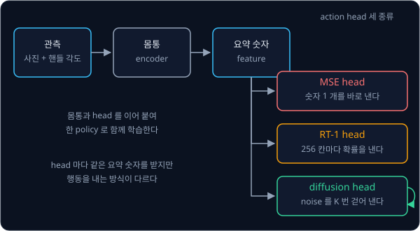
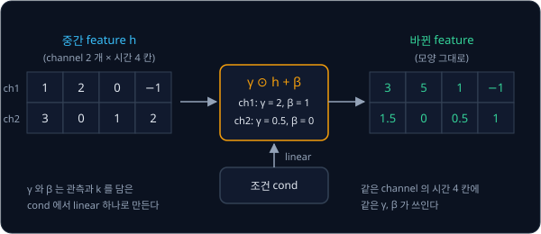

# Diffusion Policy

## 학습 목표

- 같은 장면에 정답 행동이 둘일 때, 숫자 하나를 내는 head, 칸마다 확률을 내는 head, noise 를 걷어 내는 head 가 각각 무엇을 내는지
  숫자로 비교할 수 있다
- 행동 값을 $-1$ ~ $+1$ 로 바꾸는 계산과, 그렇게 바꿔야 하는 이유를 설명할 수 있다
- 카메라 사진과 핸들 각도를 함께 받는 network 로 noise 에서 행동 값을 한 단계씩 걷어 내는 계산을 표로 따라갈 수 있다
- 앞으로 할 행동 16 개를 한꺼번에 만들고 앞 8 개만 실행한 뒤 다시 만드는 실행 방식을 시간축의 숫자로 보이고, ACT 의 실행 방식과
  비교할 수 있다
- 사진을 숫자로 바꾸는 부분, noise 를 맞히는 network, 계산 단계를 줄여 빠르게 만드는 방법이 각각 어떻게 생겼는지 설명할 수 있다
- T 자 블록을 미는 PushT 실험에서 Diffusion Policy 가 다른 방법보다 얼마나 잘했는지 읽을 수 있다

## 정답이 둘인 장면과 action head

### 상자 앞 두 시연

[Behavior Cloning](../behavior-cloning/README.md) 의 장면을 다시 가져온다. 차선 한가운데에 상자가 떨어져 있고, 사람(expert)은 같은
장면에서 시연 10 번 가운데 5 번은 핸들을 왼쪽으로 20° 꺾어 상자의 왼쪽으로, 5 번은 오른쪽으로 20° 꺾어 오른쪽으로 피했다. 오른쪽을
양수로 적으면 정답 action 은 $-20$° 가 5 개, $+20$° 가 5 개다. 두 행동 모두 옳고, 핸들을 $-10$° 에서 $+10$° 사이로 꺾으면 상자에
부딪힌다.

이렇게 같은 관측에 정답 action 이 여럿이라 값이 몰린 봉우리가 여럿인 분포를 multimodal 분포라고 했다. 분포는 값마다 얼마나 자주
나오는지를 나타낸 것이고, 봉우리는 그 값이 많이 몰린 언덕이다. 이 강의의 multimodal 은 언제나 이 뜻이다. 사진과 글을 함께 다루는 CLIP, 사진과 글 명령을 받아 로봇의 action 을 내는
VLA(vision-language-action) 모델에서 "multimodal 모델" 이라고 할 때는 사진·글·관절 각도처럼 여러 종류의 입력을 받는다는 다른
뜻이니 섞어 읽지 않는다.

**확인 문제.** "이 시연은 multimodal 이라 평균을 내면 안 된다" 의 multimodal 은 두 뜻 가운데 어느 쪽일까?

답 보기

같은 관측에 정답 action 이 여럿이라 분포의 봉우리가 여럿이라는 뜻이다. 입력의 종류가 여럿이라는 뜻이 아니다.

### action head

관측을 받아 행동을 정하는 규칙인 policy 는 두 부분으로 나눠 볼 수 있다. 앞부분은 카메라 사진과 지금의 관절 각도 같은
관측을 받아 짧은 숫자 묶음으로 요약하는데, 이 요약 숫자를 feature 라 하고 이 앞부분을 몸통(backbone)이라고 부른다.
뒷부분은 몸통이 만든 요약 숫자를 받아 로봇에 보낼 행동을 내는데, 이 부분이 action head 다. head 는 큰 모델의 끝에 붙어 최종 출력을
내는 작은 부분을 뜻한다.

같은 몸통 뒤에 서로 다른 head 를 붙일 수 있고, 지금까지 두 종류를 보았다.

- **MSE head** — [Behavior Cloning](../behavior-cloning/README.md) 의 MLP head 다. MLP 는 weight 를 곱해 더하는 층을 여러 겹 쌓은
  network 다. 요약 숫자를 받아 각도 숫자 하나를 바로 내고, 시연과의 오차를 제곱해 평균한 값(MSE)을 학습이 줄이려는 값, 곧 loss 로
  삼는다
- **RT-1 head** — [RT-1](../rt1/README.md) 의 head 다. 각도의 범위를 칸 256 개로 나누고 칸마다 "정답이 이 칸에 있을 확률" 을 낸다

Diffusion Policy 는 세 번째 head 를 쓰는데, 이것을 이 강의에서는 diffusion head 라고 부른다. diffusion head 도 action head 의 한
종류라서 몸통이 만든 요약 숫자를 받아 행동을 낸다는 점은 앞의 둘과 같다. 다른 점은 행동을 계산 한 번으로 내지 않는다는 것이다.
[DDPM](../ddpm/README.md) 에서처럼 무작위 숫자, 곧 noise 에서 출발해 network 를 여러 번 써서 noise 를 조금씩 걷어 내고, 그 끝에 남은
값을 행동으로 쓴다. noise 를 걷어 내는 일을 denoising 이라 하고, 이렇게 무작위 출발점에서 결과 하나를 뽑아 내는 과정을 sampling,
그 결과를 sample 이라고 한다. 요약 숫자는 매번 "지금 장면이 어떤지" 를 알려 주는 조건으로 network 에 들어간다.

위 그림은 관측이 몸통을 지나 요약 숫자가 되고, 그 숫자가 세 head 가운데 하나로 들어가는 길을 보여 준다. 어느 head 를 붙이든 몸통과
head 는 이어 붙여 한 policy 로 함께 학습한다. diffusion head 옆의 둥근 화살표는 같은 network 를 여러 번 되풀이해 쓴다는 표시다.

**확인 문제.** 세 head 가운데 network 를 여러 번 써야 행동 하나가 나오는 것은 어느 것일까?

답 보기

diffusion head 다. MSE head 와 RT-1 head 는 계산 한 번으로 숫자나 확률을 내지만, diffusion head 는 noise 를 걷어 내는 계산을
여러 번 되풀이한다.

### MSE head 의 답

MSE head 는 같은 관측에서 언제나 같은 숫자 하나를 낸다. 그 숫자를 $\hat a$ 라고 하면 시연 10 개와의 MSE 는 $\hat a = 0$ 일 때
$(5 \times 20^2 + 5 \times 20^2) \div 10 = 400$ 이고, $\hat a = -20$ 일 때 $(0 + 5 \times 40^2) \div 10 = 800$ 이다. MSE 가 가장 작은
답은 두 정답의 평균 0° 이고, 0° 는 상자로 곧장 가는 행동이다. [Behavior Cloning](../behavior-cloning/README.md) 에서 gradient(값을
조금 바꿨을 때 loss 가 변하는 비율)로 확인했듯이 MSE 를 가장 작게 만드는 출력은 언제나 정답들의 평균이다.

### RT-1 head 의 답

[RT-1](../rt1/README.md) 의 방식으로 핸들 각도의 범위를 $-128$° ~ $+128$° 로 잡고 칸 256 개로 나누면 칸 폭은
$256 \div 256 = 1$° 다. 칸 번호는 "범위의 왼쪽 끝에서 잰 거리 ÷ 칸 폭" 을 내림한 값이고, 되돌릴 때는 칸의 가운데 값을 쓴다.

| 시연의 각도 | 왼쪽 끝에서 잰 거리 | 칸 번호 | 되돌린 각도 |
| --- | --- | --- | --- |
| $-20$° | $-20 + 128 = 108$ | 108 | $-128 + 108.5 = -19.5$° |
| $+20$° | $20 + 128 = 148$ | 148 | $-128 + 148.5 = +20.5$° |

시연 10 개 가운데 108 번 칸이 5 번, 148 번 칸이 5 번 정답이었으니, cross-entropy 를 가장 작게 하는 확률은 108 번 칸에 0.5, 148 번 칸에 0.5, 나머지 칸에 0 이다. cross-entropy 는 정답 칸이 받은 확률의 $-\log$ 로, 정답 칸의 확률이 작을수록
커지는 벌점이다. 확률이 가장 높은 칸을 고르는 argmax 로 실행하면 $-19.5$° 나 $+20.5$° 가
나와서 상자를 피한다. 칸의 가운데 값으로 되돌리기 때문에 시연의 $\pm 20$° 와는 0.5° 씩 어긋난다.

### diffusion head 의 답

diffusion head 는 실행할 때마다 noise 를 새로 뽑아 출발한다. 뒤의 큰 절에서 손으로 계산하겠지만, 같은 상자 장면에서 출발 noise 가
0.60 이면 $+20$° 에, $-0.40$ 이면 $-20$° 에 닿는다. 여러 번 실행하면 대략 절반은 $-20$° 근처, 절반은 $+20$° 근처가 나오고,
가운데 0° 근처에서 끝나는 경우는 거의 없다. 결과는 칸 번호가 아니라 연속된 숫자라서 칸 폭 때문에 생기는 오차도 없다.

### 세 head 의 비교

위 그림의 회색 점은 시연 10 개, 붉은 띠는 상자에 부딪히는 $-10$° ~ $+10$° 구간이다. 세 head 를 같은 상황에 놓고 나란히 적으면
아래와 같다.

| | MSE head | RT-1 head | diffusion head |
| --- | --- | --- | --- |
| 내는 것 | 숫자 1 개 | 256 칸 각각의 확률 | noise 에서 걷어 낸 숫자 |
| 상자 앞에서의 행동 | 0° (충돌) | $-19.5$° 또는 $+20.5$° | $-20$° 근처 또는 $+20$° 근처 |
| 같은 관측으로 다시 실행하면 | 언제나 같은 값 | argmax 면 같은 칸 | 출발 noise 에 따라 다른 봉우리 |
| 값의 정밀도 | 연속값 | 칸 폭의 절반까지 오차 | 연속값 |
| x, y 두 차원의 짝 | 평균끼리 짝 | 차원마다 따로 골라 짝이 깨질 수 있음 | 모든 차원을 함께 만들어 짝을 지킴 |
| 행동 하나에 쓰는 network 계산 | 1 번 | 1 번 | $K$ 번 (뒤에서 줄이는 법을 다룬다) |

표의 다섯째 줄은 [RT-1](../rt1/README.md) 의 "차원마다 따로 고를 때의 문제" 다. 손끝을 왼쪽 위 $(-20, +20)$ 이나 오른쪽 아래
$(+20, -20)$ 로 옮긴 시연이 반반이면, x 와 y 를 따로 고르는 RT-1 head 는 시연에 없던 $(-20, -20)$, $(+20, +20)$ 을 합쳐 0.5 의
확률로 낸다. diffusion head 는 x 와 y 를 한 덩어리로 놓고 noise 를 함께 걷어 내므로 두 숫자가 같은 시연에서 온 짝으로 끝난다.
마지막 줄의 $K$ 는 noise 를 걷어 내는 횟수다.

**흔한 오해.** diffusion head 의 network 도 MSE 로 학습하니 결국 평균을 낼 것이라고 생각하기 쉽다. [DDPM](../ddpm/README.md) 에서
보았듯이 평균이 끼어드는 곳은 한 단계의 작은 이동뿐이고, 어느 봉우리로 갈지는 여러 단계에 걸쳐 새 noise 와 network 의 추정이 조금씩
정한다. 최종 행동이 두 봉우리의 평균이 되지는 않는다.

**확인 문제.** 같은 상자 장면의 시연이 $-20$° 7 개, $+20$° 3 개라면 MSE head 는 몇 도를 내고, 이상적으로 학습한 RT-1 head 는 108 번
칸과 148 번 칸에 각각 얼마의 확률을 줄까?

답 보기

MSE head 는 평균 $\big(7 \times (-20) + 3 \times 20\big) \div 10 = -80 \div 10 = -8$° 를 내서 상자에 부딪힌다. RT-1 head 는 칸마다 정답이
나온 비율대로 108 번 칸에 0.7, 148 번 칸에 0.3 을 준다.

**요약**

- action head 는 몸통이 만든 요약 숫자를 받아 행동을 내는 부분이고, diffusion head 는 noise 를 여러 번 걷어 내 행동을 만드는 action
  head 다
- 정답이 $\pm 20$° 로 갈린 장면에서 MSE head 는 0°, RT-1 head 는 $-19.5$° 나 $+20.5$° 칸, diffusion head 는 $-20$° 근처나 $+20$° 근처의
  값을 낸다
- diffusion head 는 연속값을 내고 모든 차원을 함께 만들지만, network 를 여러 번 써야 해서 느리다

## 행동 값의 정규화

### noise 와 행동의 크기

diffusion head 는 [DDPM](../ddpm/README.md) 의 식을 행동 값에 그대로 쓴다. DDPM 에서 noise 를 섞는 식은 아래와 같았다.

$$
x_k = \sqrt{\bar\alpha_k}\; x_0 + \sqrt{1 - \bar\alpha_k}\; \epsilon, \qquad \epsilon \sim \mathcal N(0, 1)
$$

$x_0$ 는 깨끗한 원래 값, $\epsilon$("엡실론")은 평균 0, 표준편차 1 인 정규분포 $\mathcal N(0, 1)$ 에서 뽑은 noise 다. 정규분포는
가운데가 높은 종 모양 분포이고, 표준편차는 값들이 평균에서 대략 얼마나 떨어져 있는지를 나타내는 거리다. $\bar\alpha_k$("알파
바")는 $k$ 번째 단계까지 원래 값이 얼마나 남는지를 정한 숫자다. 식은 "원래 값에 $\sqrt{\bar\alpha_k}$ 를 곱하고 noise 에
$\sqrt{1 - \bar\alpha_k}$ 를 곱해 더한다" 로 읽는다. DDPM 강의에서는 이 단계 번호를 $t$ 로 적었는데, 이 강의에서는 로봇이 움직이는
시각을 $t$ 로 써야 해서 noise 를 섞는 단계 번호를 $k$ 로 바꿔 적는다.

DDPM 강의의 5 단계짜리 schedule(단계마다 섞을 noise 의 양을 정해 둔 표)에서 마지막 단계는 $\sqrt{\bar\alpha_5} = 0.39$,
$\sqrt{1 - \bar\alpha_5} = 0.92$ 였다. 시연의 각도 $+20$ 을 그대로 $x_0$ 로 넣으면 $x_5 = 0.39 \times 20 + 0.92\,\epsilon = 7.8 + 0.92\,\epsilon$
이다. noise 를 다 섞었는데도 가운데가 7.8 에 머물러서, $\mathcal N(0, 1)$ 과 전혀 다른 곳에 있다. 그런데 행동을 만들 때는
$\mathcal N(0, 1)$ 에서 출발하므로, 학습 때 한 번도 보지 못한 자리에서 noise 를 걷어 내기 시작하게 된다.

DDPM 은 원래 값의 크기가 noise 와 비슷하다고 가정하고 만든 방법이다. 그래서 행동 값을 먼저 $-1$ ~ $+1$ 근처로 바꿔 넣는다. 원래 값이
$+1$ 이면 $x_5$ 의 가운데는 $0.39 \times 1 = 0.39$ 라서 $\mathcal N(0, 1)$ 과 거의 겹친다.

**확인 문제.** 뒤에서 볼 T 자 블록 밀기 과제 PushT 의 action 은 0 ~ 512 pixel 범위의 위치다. pixel 은 사진을 이루는 작은 칸 하나다. 값 400 을 그대로 넣으면 $x_5$ 의 가운데는 얼마일까?

답 보기

$0.39 \times 400 = 156$ 이다. $\mathcal N(0, 1)$ 의 값은 거의 모두 $-3$ ~ 3 안에 있으니 아주 멀리 떨어진 자리다.

### min-max 정규화

시연에 나온 값 가운데 가장 작은 값(최솟값)을 $-1$ 로, 가장 큰 값(최댓값)을 $+1$ 로 옮기고 그 사이를 고르게 늘이거나 줄이는 계산을
min-max 정규화라고 한다. 정규화(normalization)는 값들을 정해 둔 범위로 맞추는 일을 말한다.

$$
\tilde a = \frac{a - a_{\min}}{a_{\max} - a_{\min}} \times 2 - 1
$$

$a$ 는 원래 각도, $a_{\min}$ 과 $a_{\max}$ 는 시연의 최솟값과 최댓값, $\tilde a$("에이 틸드")는 정규화한 값이다. 식은 "최솟값에서
잰 거리를 범위의 폭으로 나눠 0 ~ 1 로 만든 뒤, 2 를 곱하고 1 을 빼서 $-1$ ~ $+1$ 로 옮긴다" 로 읽는다.

상자 시연은 $a_{\min} = -20$, $a_{\max} = 20$ 이라 범위의 폭이 40 이다. 한 줄씩 계산하면 아래와 같다.

| 각도 $a$ | $a - a_{\min}$ | $\div 40$ | $\times 2 - 1$ |
| --- | --- | --- | --- |
| $-20$ | 0 | 0 | $-1$ |
| $-10$ | 10 | 0.25 | $-0.5$ |
| 0 | 20 | 0.5 | 0 |
| $+10$ | 30 | 0.75 | $+0.5$ |
| $+20$ | 40 | 1 | $+1$ |

행동을 다 만든 뒤에는 거꾸로 되돌린다. $\tilde a = \frac{a - a_{\min}}{a_{\max} - a_{\min}} \times 2 - 1$ 을 $a$ 에 대해 풀면 아래와
같다.

$$
\begin{aligned}
\tilde a + 1 &= \frac{a - a_{\min}}{a_{\max} - a_{\min}} \times 2 \\
\frac{\tilde a + 1}{2} &= \frac{a - a_{\min}}{a_{\max} - a_{\min}} \\
\frac{\tilde a + 1}{2} \times (a_{\max} - a_{\min}) + a_{\min} &= a
\end{aligned}
$$

첫째 줄은 양쪽에 1 을 더한 것, 둘째 줄은 양쪽을 2 로 나눈 것, 셋째 줄은 양쪽에 범위의 폭을 곱하고 최솟값을 더한 것이다. 만든 값이
$\tilde a = 0.5$ 라면 $\frac{1.5}{2} \times 40 - 20 = 30 - 20 = 10$° 다.

만든 값이 가끔 $+1.03$ 처럼 범위를 살짝 넘을 수 있어서, 되돌리기 전에 $-1$ 보다 작으면 $-1$ 로, $+1$ 보다 크면 $+1$ 로 잘라 낸다.
이렇게 범위 밖의 값을 끝값으로 자르는 것을 clip 이라고 한다. clip 하지 않으면 시연에 없던 $+20.6$° 같은 각도가 나간다.

PushT 에서는 손끝 위치의 x 와 y, 그리고 관측으로 들어가는 지금 위치까지 숫자마다 따로 최솟값·최댓값을 구해 정규화한다.

**확인 문제.** 시연의 최솟값이 0, 최댓값이 512 일 때 값 384 의 정규화한 값은? 정규화한 값 $-0.5$ 는 원래 몇일까?

답 보기

$384 \div 512 = 0.75$ 이고 $0.75 \times 2 - 1 = 0.5$ 다. 거꾸로 $-0.5$ 는 $\frac{-0.5 + 1}{2} \times 512 + 0 = 0.25 \times 512 = 128$ 이다.

**요약**

- DDPM 은 원래 값의 크기가 noise 와 비슷하다고 가정해서, 각도 $\pm 20$ 이나 위치 0 ~ 512 를 그대로 넣으면 noise 를 다 섞어도
  $\mathcal N(0, 1)$ 에 닿지 않는다
- min-max 정규화로 시연의 최솟값을 $-1$, 최댓값을 $+1$ 로 옮기고, 행동을 만든 뒤에는 clip 하고 거꾸로 되돌린다
- 상자 시연에서는 $-20$°, 0°, $+20$° 가 각각 $-1$, 0, $+1$ 이 된다

## 관측을 조건으로 받는 denoising

### 관측을 함께 받는 network

[DDPM](../ddpm/README.md) 의 network $\epsilon_\theta(x_k, k)$ 는 noise 가 섞인 값과 단계 번호만 받아 섞인 noise 를 맞혔다. $\theta$
("세타")는 network 의 weight 전체다. 그런데 policy 는 장면마다 다른 행동을 내야 한다. 상자 장면이면 $\pm 20$° 가운데 하나를,
곧은 길이면 0° 를 내야 하는데, 장면을 모르는 network 는 둘을 구별할 수 없다.

그래서 Diffusion Policy 의 network 는 관측을 함께 받는다.

$$
\epsilon_\theta(O,\ A^k,\ k)
$$

$O$ 는 관측(observation)으로, 카메라 사진과 로봇의 상태(관절 각도, 차라면 지금의 핸들 각도)다. 사진은 몸통이 요약 숫자로 바꿔서
넣는다. $A^k$ 는 noise 를 $k$ 단계만큼 섞은 행동, $k$ 는 단계 번호다. 식은 "weight 가 $\theta$ 인 network 가 지금 장면 $O$ 를 보고
$A^k$ 에 섞인 noise 를 추정한 값" 으로 읽는다. $A^0$ 은 noise 가 하나도 없는 시연의 행동이다. 관측처럼 생성 결과를 정하는 데 쓰라고
함께 넣어 주는 정보를 조건(condition)이라고 한다.

학습 한 번은 DDPM 과 같은 순서로 하고, 관측을 함께 넣는다는 점만 다르다.

1. 시연에서 (관측 $O$, 행동 $A^0$) 한 쌍을 꺼낸다. 행동은 정규화해 둔다
2. 단계 번호 $k$ 를 1 부터 $K$ 까지에서 무작위로 고른다
3. $\epsilon$ 을 뽑아 $A^k = \sqrt{\bar\alpha_k}\,A^0 + \sqrt{1 - \bar\alpha_k}\,\epsilon$ 을 만든다
4. network 에 $O$, $A^k$, $k$ 를 넣어 noise 를 맞히게 하고, 정답 $\epsilon$ 과의 차이를 제곱해 loss 로 쓴다
5. loss 가 줄어드는 쪽으로 weight 를 조금 고친다. 몸통의 weight 도 이 loss 로 함께 고친다

숫자로 한 번 해 보자. 상자 장면에서 $+20$° 시연을 꺼내면 $A^0 = +1$ 이다. $k = 3$ 이 뽑혔고 DDPM 강의의 5 단계 schedule 에서
$\sqrt{\bar\alpha_3} = 0.71$, $\sqrt{1 - \bar\alpha_3} = 0.70$ 이다. $\epsilon = 0.5$ 가 뽑혔다면
$A^3 = 0.71 \times 1 + 0.70 \times 0.5 = 0.71 + 0.35 = 1.06$ 이다. network 가 0.3 을 냈다면 loss 는 $(0.5 - 0.3)^2 = 0.04$ 다.

**확인 문제.** 곧은 길 시연에서 $A^0 = 0$ 을 꺼냈고 $k = 3$, $\epsilon = -1$ 이 뽑혔다. $A^3$ 은? network 가 $-0.8$ 을 냈다면 loss 는?

답 보기

$A^3 = 0.71 \times 0 + 0.70 \times (-1) = -0.70$ 이다. loss 는 $\big(-1 - (-0.8)\big)^2 = (-0.2)^2 = 0.04$ 다.

### 관측에 따라 달라지는 noise 추정

같은 $A^5 = 0.60$ 을 받아도 장면이 다르면 network 가 내야 할 답이 다르다. DDPM 강의의 schedule 에서 $k = 5$ 의 두 계수는
$\sqrt{\bar\alpha_5} = 0.39$, $\sqrt{1 - \bar\alpha_5} = 0.92$ 다.

**곧은 길 장면.** 시연이 모두 0° 라서 정규화한 $A^0$ 은 늘 0 이다. 그러면 $A^5 = 0.39 \times 0 + 0.92\,\epsilon = 0.92\,\epsilon$ 이라
섞인 noise 는 $\epsilon = A^5 \div 0.92$ 로 정확히 계산된다. $A^5 = 0.60$ 이면 $\epsilon = 0.60 \div 0.92 \approx 0.65$ 다.

**상자 장면.** 시연이 $-1$ 과 $+1$ 반반이라, network 는 [DDPM](../ddpm/README.md) 의 "1 차원 두 봉우리" 에서처럼 $A^5$ 가 어느 쪽에서
왔을지를 따진다. $+1$ 에서 온 $A^5$ 는 평균 $0.39$, $-1$ 에서 온 $A^5$ 는 평균 $-0.39$ 이고 둘 다 표준편차가 0.92 인 종 모양으로
퍼진다. 0.60 자리에서 두 종의 높이를 재면 0.422 와 0.243 이라, $+1$ 쪽일 가능성은 $0.422 \div (0.422 + 0.243) \approx 0.635$,
$-1$ 쪽은 0.365 다. 가능성을 무게로 둔 원래 값의 추정은 $0.635 \times 1 + 0.365 \times (-1) = 0.27$ 이고, 이 추정에 맞는 noise 는

$$
\epsilon = \frac{0.60 - 0.39 \times 0.27}{0.92} = \frac{0.60 - 0.105}{0.92} = \frac{0.495}{0.92} \approx 0.54
$$

다. 분자는 $A^5$ 에서 원래 값의 몫을 뺀 것이고, 분모로 나눠 noise 의 계수를 되돌렸다.

학습을 충분히 한 network 는 바로 이 값들을 낸다. 상자 장면 관측과 함께 0.60 을 받으면 0.54 를, 곧은 길 관측과 함께 0.60 을 받으면
0.65 를 낸다. 관측이 조건으로 들어가 있어서 같은 $A^5$ 에서도 장면에 맞는 noise 를 추정하는 것이다.

**확인 문제.** 곧은 길 장면에서 $k = 5$, $A^5 = -0.46$ 을 받은 network 가 내야 할 noise 는?

답 보기

원래 값이 0 이라 $A^5 = 0.92\,\epsilon$ 이고, $\epsilon = -0.46 \div 0.92 = -0.5$ 다.

### reverse 한 단계의 계산

[DDPM](../ddpm/README.md) 의 reverse step 은 network 가 맞힌 noise 가운데 이번 단계의 몫을 빼고, $\sqrt{\alpha_k}$ 로 나눠 되돌린 뒤, 새
noise 를 조금 더하는 계산이었다. 관측이 조건으로 들어간다는 것만 빼면 식이 같다.

$$
A^{k-1} = \frac{1}{\sqrt{\alpha_k}}\Big(A^k - \frac{\beta_k}{\sqrt{1 - \bar\alpha_k}}\;\epsilon_\theta(O, A^k, k)\Big) + \sigma_k\, z,
\qquad z \sim \mathcal N(0, 1)
$$

$\beta_k$("베타")는 $k$ 번째 단계에서 섞는 noise 의 분산(표준편차의 제곱)이고, $\alpha_k = 1 - \beta_k$ 다. $\frac{\beta_k}{\sqrt{1 - \bar\alpha_k}}$ 는
쌓인 noise 가운데 이번 단계 몫의 계수, $\sigma_k$("시그마")는 새로 더하는 noise 의 크기, $z$ 는 새로 뽑은 noise 다. 식은
"network 가 맞힌 noise 에 이번 단계 몫의 계수를 곱해 빼고, $\sqrt{\alpha_k}$ 로 나눈 뒤, $\sigma_k z$ 를 더한다" 로 읽는다.
마지막 단계($k = 1$)에서는 $z$ 를 더하지 않는다.

DDPM 강의의 5 단계 schedule 에서 계수를 모으면 아래와 같다.

| 단계 $k$ | 1 | 2 | 3 | 4 | 5 |
| --- | --- | --- | --- | --- | --- |
| $\beta_k / \sqrt{1 - \bar\alpha_k}$ (이번 단계 몫의 계수) | 0.32 | 0.38 | 0.43 | 0.48 | 0.54 |
| $1 / \sqrt{\alpha_k}$ (나눠 되돌리는 수) | 1.05 | 1.12 | 1.20 | 1.29 | 1.41 |
| $\sigma_k$ (새 noise 의 크기) | 0.32 | 0.45 | 0.55 | 0.63 | 0.71 |

상자 장면에서 $A^5 = 0.60$, network 의 답이 0.54, 새로 뽑은 $z = 0.3$ 이면 한 단계는 아래처럼 계산한다.

1. 이번 단계 몫: $0.54 \times 0.54 = 0.29$ 이고, $0.60 - 0.29 = 0.31$
2. 되돌리기: $0.31 \times 1.41 = 0.44$
3. 새 noise: $0.71 \times 0.3 = 0.21$ 을 더해 $A^4 = 0.44 + 0.21 = 0.65$

위 그림의 왼쪽 세 상자가 network 의 입력이다. 맨 위의 관측이 바뀌면 network 의 답이 바뀌고, 그 뒤의 계산은 관측과 상관없이 같다.

**확인 문제.** 상자 장면의 $k = 2$ 에서 $A^2 = 0.58$, network 의 답이 $-0.41$, $z = 0.2$ 다. $A^1$ 은?

답 보기

이번 단계 몫은 $0.38 \times (-0.41) \approx -0.16$ 이고, $0.58 - (-0.16) = 0.74$ 다. $0.74 \times 1.12 \approx 0.83$ 에
$0.45 \times 0.2 = 0.09$ 를 더하면 $A^1 = 0.92$ 다.

### 상자 장면의 sampling 계산표

$\mathcal N(0, 1)$ 에서 $A^5$ 를 뽑고 $k = 5, 4, 3, 2, 1$ 순서로 reverse 단계를 밟아 $A^0$ 을 얻는 과정을 sampling 이라고 했다.
상자 장면에서 $A^5 = 0.60$ 이 뽑혔을 때의 전체 계산은 아래와 같다. network 의 답은 앞 절의 방식으로 계산한, 충분히 학습한
network 가 낼 값이다. 곱한 결과는 소수 셋째 자리에서 반올림했다.

| $k$ | $A^k$ | network 의 답 | 이번 단계 몫 | $A^k$ − 몫 | $\times \frac{1}{\sqrt{\alpha_k}}$ | $z$ | $\sigma_k z$ | $A^{k-1}$ |
| --- | --- | --- | --- | --- | --- | --- | --- | --- |
| 5 | 0.60 | 0.54 | $0.54 \times 0.54 = 0.29$ | 0.31 | $1.41 \times 0.31 = 0.44$ | 0.3 | $0.71 \times 0.3 = 0.21$ | 0.65 |
| 4 | 0.65 | 0.47 | $0.48 \times 0.47 = 0.23$ | 0.42 | $1.29 \times 0.42 = 0.54$ | $-0.2$ | $0.63 \times (-0.2) = -0.13$ | 0.41 |
| 3 | 0.41 | 0.05 | $0.43 \times 0.05 = 0.02$ | 0.39 | $1.20 \times 0.39 = 0.47$ | 0.2 | $0.55 \times 0.2 = 0.11$ | 0.58 |
| 2 | 0.58 | $-0.41$ | $0.38 \times (-0.41) = -0.16$ | 0.74 | $1.12 \times 0.74 = 0.83$ | 0.2 | $0.45 \times 0.2 = 0.09$ | 0.92 |
| 1 | 0.92 | $-0.09$ | $0.32 \times (-0.09) = -0.03$ | 0.95 | $1.05 \times 0.95 = 1.00$ | 없음 | 0 | 1.00 |

마지막 값 1.00 을 되돌리면 $\frac{1 + 1}{2} \times 40 - 20 = +20$° 다. $k = 3$ 에서 값이 0.41 로 내려가 잠시 흔들렸지만, $k = 2$ 에서
network 가 "$+1$ 쪽에서 왔다" 고 거의 확신하면서 음수 noise $-0.41$ 을 냈고, 음수 몫을 빼니 값이 0.92 로 올라갔다.

숫자만 바꿔 같은 장면에서 $A^5 = -0.40$ 이 뽑혔다면 아래처럼 된다.

| $k$ | $A^k$ | network 의 답 | 이번 단계 몫 | $A^k$ − 몫 | $\times \frac{1}{\sqrt{\alpha_k}}$ | $z$ | $\sigma_k z$ | $A^{k-1}$ |
| --- | --- | --- | --- | --- | --- | --- | --- | --- |
| 5 | $-0.40$ | $-0.36$ | $0.54 \times (-0.36) = -0.19$ | $-0.21$ | $1.41 \times (-0.21) = -0.30$ | $-0.4$ | $0.71 \times (-0.4) = -0.28$ | $-0.58$ |
| 4 | $-0.58$ | $-0.41$ | $0.48 \times (-0.41) = -0.20$ | $-0.38$ | $1.29 \times (-0.38) = -0.49$ | 0.3 | $0.63 \times 0.3 = 0.19$ | $-0.30$ |
| 3 | $-0.30$ | $-0.02$ | $0.43 \times (-0.02) = -0.01$ | $-0.29$ | $1.20 \times (-0.29) = -0.35$ | 0.2 | $0.55 \times 0.2 = 0.11$ | $-0.24$ |
| 2 | $-0.24$ | 0.54 | $0.38 \times 0.54 = 0.21$ | $-0.45$ | $1.12 \times (-0.45) = -0.50$ | $-0.1$ | $0.45 \times (-0.1) = -0.04$ | $-0.54$ |
| 1 | $-0.54$ | 1.29 | $0.32 \times 1.29 = 0.41$ | $-0.95$ | $1.05 \times (-0.95) = -1.00$ | 없음 | 0 | $-1.00$ |

마지막 값 $-1.00$ 은 $-20$° 다. 같은 장면, 같은 network 인데 출발한 noise 가 달라서 다른 봉우리에 닿았다. 둘 다 시연에 있던 행동이고,
가운데 0° 로 끝나지 않았다.

### 곧은 길 장면의 sampling 계산표

이번에는 출발 noise 를 상자 장면의 첫 실행과 똑같이 $A^5 = 0.60$, $z$ 도 0.3, $-0.2$, 0.2, 0.2 로 같게 두고 관측만 곧은 길로 바꾼다.
곧은 길에서는 원래 값이 0 이라 network 의 답이 $A^k \div \sqrt{1 - \bar\alpha_k}$ 다.

| $k$ | $A^k$ | network 의 답 | 이번 단계 몫 | $A^k$ − 몫 | $\times \frac{1}{\sqrt{\alpha_k}}$ | $z$ | $\sigma_k z$ | $A^{k-1}$ |
| --- | --- | --- | --- | --- | --- | --- | --- | --- |
| 5 | 0.60 | 0.65 | $0.54 \times 0.65 = 0.35$ | 0.25 | $1.41 \times 0.25 = 0.35$ | 0.3 | $0.71 \times 0.3 = 0.21$ | 0.56 |
| 4 | 0.56 | 0.67 | $0.48 \times 0.67 = 0.32$ | 0.24 | $1.29 \times 0.24 = 0.31$ | $-0.2$ | $0.63 \times (-0.2) = -0.13$ | 0.18 |
| 3 | 0.18 | 0.26 | $0.43 \times 0.26 = 0.11$ | 0.07 | $1.20 \times 0.07 = 0.08$ | 0.2 | $0.55 \times 0.2 = 0.11$ | 0.19 |
| 2 | 0.19 | 0.36 | $0.38 \times 0.36 = 0.14$ | 0.05 | $1.12 \times 0.05 = 0.06$ | 0.2 | $0.45 \times 0.2 = 0.09$ | 0.15 |
| 1 | 0.15 | 0.47 | $0.32 \times 0.47 = 0.15$ | 0.00 | $1.05 \times 0.00 = 0.00$ | 없음 | 0 | 0.00 |

마지막 값 0 은 0° 로, 곧은 길에서 시연이 한 행동이다. 상자 장면에서는 피해야 할 0° 가 여기서는 정답인데, network 가 관측을 보고
noise 를 다르게 추정했기 때문에 같은 출발점에서 다른 행동이 나왔다.

위 그림은 세 계산표를 한 그래프에 그린 것이다. 가로축은 단계 번호이고 왼쪽 $k = 5$ 에서 오른쪽 $k = 0$ 으로 noise 를 걷어 낸다.
파랑과 초록은 출발점과 새 noise 가 같고 관측만 다르다.

**흔한 오해.** 출발 noise 가 양수면 언제나 $+20$° 로 간다고 생각하기 쉽다. 단계가 많을 때는 앞쪽 단계의 새 noise $\sigma_k z$ 가 출발점보다
크게 흔들어서 음수 쪽으로 넘어갈 수 있다. 어느 봉우리로 갈지는 출발점 하나가 아니라 여러 단계의 새 noise 와 network 의 추정이 함께 정한다.

**확인 문제.** 곧은 길 장면에서 $k = 1$, $A^1 = 0.32$ 다. network 의 답과 $A^0$ 은? ($\sqrt{1 - \bar\alpha_1} = 0.32$)

답 보기

network 의 답은 $0.32 \div 0.32 = 1$ 이다. 이번 단계 몫은 $0.32 \times 1 = 0.32$ 라서 $0.32 - 0.32 = 0$ 이고, 1.05 를 곱해도 0 이다.
마지막 단계라 $z$ 를 더하지 않으므로 $A^0 = 0$, 곧 0° 다.

**요약**

- Diffusion Policy 의 network $\epsilon_\theta(O, A^k, k)$ 는 관측 $O$ 를 조건으로 받아, noise 가 섞인 행동 $A^k$ 에 섞인 noise 를
  추정한다. 학습은 DDPM 과 같고, 관측을 함께 넣고 몸통까지 같은 loss 로 고친다
- 같은 $A^5 = 0.60$ 이라도 상자 장면에서는 0.54, 곧은 길에서는 0.65 를 내서, sampling 의 끝이 각각 $\pm 20$° 와 0° 가 된다
- 상자 장면에서는 출발 noise 에 따라 $+20$° 나 $-20$° 에 닿고, 가운데 0° 로 끝나지 않는다

## action chunk

### 한 step 씩 고를 때의 흔들림

지금까지는 행동 하나, 곧 다음 순간의 핸들 각도 하나를 만들었다. 차는 1 초에 여러 번 핸들 각도를 받아야 하니, 이 방식이면 매 순간
sampling 을 새로 해야 한다. 로봇이 행동 하나를 실행하는 시간 단위를 제어 step 이라고 하는데, step 마다 따로 sampling 하면 문제가 생긴다.

상자 앞에서 차가 아직 거의 움직이지 않아 관측이 거의 같은 처음 몇 step 동안은, step 마다 $-20$° 와 $+20$° 가 반반으로 나온다. 앞
step 에서 무엇을 골랐는지는 다음 sampling 에 들어가지 않으므로, 어떤 step 에서는 왼쪽, 다음 step 에서는 오른쪽이 나올 수 있다.
가로 위치를 오른쪽 $+1$, 왼쪽 $-1$ 씩 바꾸는 8 step 에서 $+, -, -, +, +, -, +, -$ 가 나오면 가로 위치는 1, 0, $-1$, 0, 1, 0, 1, 0 으로
흔들리고, 결국 가운데에서 상자를 만난다.

8 step 이 모두 같은 쪽으로 나올 확률은 "모두 왼쪽" $0.5^8$ 과 "모두 오른쪽" $0.5^8$ 을 더한 $2 \times 0.5^8 = 2 \div 256 \approx 0.008$
이다. 실제로는 차가 한쪽으로 조금 비키면 관측이 바뀌어 그쪽이 점점 유리해지지만, 처음 몇 step 의 흔들림은 남는다. Diffusion Policy
논문도 행동을 step 마다 따로 뽑는 방법이 두 봉우리 사이를 오가며 떨리는 동작을 보인다고 지적했다.

**확인 문제.** step 마다 $\pm 20$° 를 반반으로 따로 고를 때, 3 step 이 모두 같은 쪽일 확률은?

답 보기

모두 왼쪽 $0.5^3 = 0.125$ 와 모두 오른쪽 0.125 를 더해 0.25 다.

### 여러 step 을 한 번에 만드는 chunk

Diffusion Policy 는 행동 하나가 아니라 앞으로 $T_p$ step 동안의 행동을 한 덩어리로 만든다.

$$
A_t = (a_t,\ a_{t+1},\ \ldots,\ a_{t + T_p - 1})
$$

$t$ 는 지금의 제어 step 번호, $a_t$ 는 step $t$ 에 실행할 행동, $T_p$ 는 덩어리에 든 행동의 개수다. 이렇게 묶은 행동 덩어리를
action chunk 라고 한다. chunk 는 "덩어리" 라는 뜻이고, [ACT](../act/README.md) 에서 같은 이름으로 본 것이다. $T_p$ 의 p 는 예측
(prediction)의 첫 글자로, 논문은 이것을 action prediction horizon 이라고 부른다. horizon 은 "내다보는 범위" 라는 뜻이다.

PushT 에서 행동 하나는 손끝이 갈 목표 위치 $(x, y)$ 두 숫자이고 $T_p = 16$ 이라, chunk 하나는 16 줄 × 2 칸의 표, 곧 숫자 32 개다.
이 모양을 $(16, 2)$ 로 적는다. denoising 은 이 32 개 숫자를 한 덩어리로 다룬다. noise $\epsilon$ 도 숫자 32 개를 $\mathcal N(0, 1)$
에서 따로 뽑아 같은 모양으로 만들고, network 도 32 개짜리 noise 추정을 한 번에 낸다. reverse 단계의 계산은 숫자마다 앞 절의 표와
똑같이 한다.

작게 줄여 행동 3 개짜리 chunk 의 $k = 5$ 단계 하나를 계산해 보자. $A^5 = (0.60, 0.20, -0.30)$, network 의 답이
$(0.54, 0.10, -0.20)$, 새 noise $z = (0.3, 0, -0.1)$ 이다.

| 칸 | $A^5$ | network 의 답 | $0.54 \times$ 답 | $A^5$ − 몫 | $\times 1.41$ | $0.71 \times z$ | $A^4$ |
| --- | --- | --- | --- | --- | --- | --- | --- |
| 1 | 0.60 | 0.54 | 0.29 | 0.31 | 0.44 | 0.21 | 0.65 |
| 2 | 0.20 | 0.10 | 0.05 | 0.15 | 0.21 | 0 | 0.21 |
| 3 | $-0.30$ | $-0.20$ | $-0.11$ | $-0.19$ | $-0.27$ | $-0.07$ | $-0.34$ |

칸마다 계산은 따로 하지만, network 는 세 칸을 한꺼번에 보고 답을 낸다. 그래서 "1 번 칸이 오른쪽 길이면 2, 3 번 칸도 오른쪽 길" 이라는
짝을 network 가 배울 수 있다. 앞의 비교표에서 diffusion head 가 차원 사이의 짝을 지킨다고 한 것도 같은 이유다.

위 그림은 왼쪽과 오른쪽으로 비켜 가는 두 시연 궤적(점선)만 있는 데이터에서, 16 step 의 가로 위치를 한 chunk 로 만든 결과다.
$k = 5$ 에서는 이웃한 step 끼리도 값이 크게 다르지만, 단계를 밟을수록 16 개 값이 함께 한 궤적 쪽으로 모이고 $k = 0$ 에서는 오른쪽
궤적과 겹친다. 16 개 가운데 일부는 왼쪽, 일부는 오른쪽으로 섞여 끝나지 않는다.

**확인 문제.** 행동 하나가 관절 각도 7 개이고 $T_p = 16$ 이면 chunk 하나는 숫자 몇 개이고, noise 는 몇 개를 뽑아야 할까?

답 보기

$16 \times 7 = 112$ 개이고, noise 도 chunk 와 같은 모양이라 112 개를 뽑는다.

### 관측의 길이

관측도 한 순간만 보지 않고 최근 $T_o$ step 의 관측을 함께 넣는다. o 는 관측(observation)의 첫 글자이고, PushT 설정은 $T_o = 2$ 라서
지금 step 과 바로 앞 step 의 사진 두 장과 손끝 위치 두 개가 들어간다. 사진 한 장만으로는 물체가 어느 쪽으로 움직이고 있는지 알 수
없지만, 두 장을 비교하면 움직인 방향과 빠르기를 알 수 있다.

**요약**

- step 마다 따로 sampling 하면 두 봉우리 사이를 오가며 떨릴 수 있다. 8 step 이 모두 같은 쪽일 확률은 $2 \times 0.5^8 \approx 0.008$ 이다
- action chunk 는 앞으로 $T_p$ step 의 행동을 한 덩어리로 만든 것이고, PushT 에서는 $(16, 2)$, 숫자 32 개를 한꺼번에 denoising 한다
- network 가 chunk 전체를 함께 보므로 한 chunk 안의 행동은 같은 봉우리에서 나온다. 관측은 최근 $T_o = 2$ step 을 넣는다

## receding horizon

### 앞부분만 실행하고 다시 만드는 실행

chunk 16 개를 다 실행한 뒤에야 새 관측을 보면, 실행하는 동안 바뀐 상황을 늦게 반영한다. 그래서 Diffusion Policy 는 chunk 의 앞
$T_a$ 개만 실행하고 새 관측으로 다시 chunk 를 만든다. a 는 실행(action execution)의 뜻이고, PushT 설정은 $T_a = 8$ 이다. 이렇게
멀리 내다보는 계획을 세우되 앞부분만 실행하고, 내다보는 구간을 앞으로 밀며 계획을 다시 세우는 방식을 receding horizon 이라고 한다.
receding 은 "물러나는" 이라는 뜻으로, 앞으로 갈수록 내다보는 끝도 함께 물러난다는 데서 왔다. 원래는 제어 이론에서 쓰던 이름이다.

PushT 시연 데이터는 1 초에 10 step(10 Hz)이라 step 하나가 0.1 초다. 시간축에 놓으면 아래와 같다.

| 추론 | 시각 | 보는 관측 | 만드는 chunk | 실행하는 행동 | 버리는 행동 |
| --- | --- | --- | --- | --- | --- |
| 1 | step 0 (0.0 초) | step $-1$, 0 | step 0 ~ 15 | step 0 ~ 7 (0.0 ~ 0.7 초) | step 8 ~ 15 |
| 2 | step 8 (0.8 초) | step 7, 8 | step 8 ~ 23 | step 8 ~ 15 (0.8 ~ 1.5 초) | step 16 ~ 23 |
| 3 | step 16 (1.6 초) | step 15, 16 | step 16 ~ 31 | step 16 ~ 23 (1.6 ~ 2.3 초) | step 24 ~ 31 |

학습이 끝난 모델에 관측을 넣어 출력을 계산하는 일을 추론(inference)이라고 한다. 추론은 8 step 마다, 곧 0.8 초마다 한 번이고, 1
초에는 $10 \div 8 = 1.25$ 번이다. 첫 chunk 가 만든 step 8 ~ 15 는 실행하지 않고 버린다. step 8 에는 그보다 새로운 관측으로 만든 두 번째
chunk 가 있기 때문이다.

위 그림의 한 칸이 제어 step 하나다. 주황 칸이 network 에 들어가는 관측, 밝은 파랑 칸이 실제로 실행하는 행동, 어두운 칸이 만들었지만
버리는 행동이다.

**확인 문제.** 10 Hz 로봇에서 $T_p = 16$, $T_a = 4$ 로 바꾸면 추론은 몇 초마다 하고, chunk 하나에서 버리는 행동은 몇 개일까?

답 보기

4 step 마다 추론하므로 $4 \times 0.1 = 0.4$ 초마다다. 16 개 가운데 4 개만 실행하니 $16 - 4 = 12$ 개를 버린다.

### T_a 의 선택

$T_a$ 는 두 손해 사이에서 고르는 값이다.

- **$T_a$ 가 작을 때** — $T_a = 1$ 이면 step 마다 새 chunk 를 만들고 그 첫 행동만 실행한다. 새 chunk 는 새로 뽑은 noise 에서 출발하니,
  앞 절의 "한 step 씩 고를 때" 처럼 봉우리 사이를 오가며 떨릴 수 있다. 추론도 1 초에 10 번이나 해야 한다
- **$T_a$ 가 클 때** — $T_a = 16$ 이면 1.6 초 동안 새 관측을 보지 않는다. step 2 에 블록이 예상과 다르게 미끄러져도, 다음 추론인 step 16
  까지 14 step(1.4 초) 동안 옛 계획을 그대로 실행한다. $T_a = 8$ 이었다면 step 8 에 반영해서 늦는 시간이 6 step(0.6 초)이다

논문은 $T_a$ 를 바꿔 가며 성능을 재서, 시험한 과제 대부분에서 8 step 이 가장 좋았다고 보고했다. 또 추론하는 동안 생기는 지연을 일부러
늘려 본 실험에서, 지연이 4 step 까지일 때는 가장 좋은 성능을 유지했다. chunk 에 앞으로의 행동이 미리 들어 있어서, 추론이 조금 늦어도
그동안 실행할 행동이 있기 때문이다.

**확인 문제.** 10 Hz 로봇에서 step 3 에 상황이 바뀌었다. $T_a = 8$ 이면 새 관측을 반영하는 추론은 언제이고, 몇 초 늦을까?

답 보기

추론은 step 0, 8, 16 … 에 하므로 step 8 이다. $8 - 3 = 5$ step 늦고, $5 \times 0.1 = 0.5$ 초다.

### ACT 의 chunking 과의 비교

[ACT](../act/README.md) 도 action chunk 를 쓰지만 실행하는 방식이 다르다. ACT 는 50 Hz 로봇에서 길이 100 step(2 초)짜리 chunk 를
내고, 매 step 새 chunk 를 만든다. 그러면 같은 step 에 대한 예측이 여러 chunk 에서 겹치는데, ACT 는 이 예측들을 weight
$w_i = \exp(-m \cdot i)$ 로 가중 평균하는 temporal ensembling 을 썼다. 가중 평균은 값마다 weight 를 곱해 더한 뒤 weight 의 합으로 나눈
값이고, $i$ 는 오래된 예측부터 0, 1, 2 로 센 번호, 논문의 $m$ 은 0.01 이었다.

이 평균을 Diffusion Policy 에 그대로 쓰면 문제가 생긴다. ACT 는 시연마다 다른 움직임 방식을 담는 style 숫자 $z$ 를 실행할 때 0 으로 고정해서 같은 관측이면 같은 chunk
가 나오지만, diffusion head 는 sampling 할 때마다 다른 봉우리의 chunk 가 나올 수 있다. 같은 step 에 대해 세 chunk 가 $+20$°,
$-20$°, $+20$° 를 냈다고 하자.

| 예측을 낸 chunk | 그 step 의 예측 | $i$ | $w_i = \exp(-0.01 \times i)$ | $w_i \times$ 예측 |
| --- | --- | --- | --- | --- |
| step $t - 2$ 의 chunk | $+20$ | 0 | 1 | 20 |
| step $t - 1$ 의 chunk | $-20$ | 1 | 0.990 | $-19.8$ |
| step $t$ 의 chunk | $+20$ | 2 | 0.980 | 19.6 |
| 합 | | | 2.970 | 19.8 |

실행할 각도는 $19.8 \div 2.970 \approx 6.67$° 로, $-10$° ~ $+10$° 사이라 상자에 부딪힌다. 서로 다른 봉우리에서 나온 예측을 평균하면
처음에 피하려던 평균의 함정이 다시 생긴다. Diffusion Policy 의 receding horizon 은 한 번에 chunk 하나만 실행하고 겹친 예측을 섞지
않으므로, 실행 중인 chunk 의 $+20$° 를 그대로 실행한다.

두 방식을 나란히 놓으면 아래와 같다.

| | ACT | Diffusion Policy |
| --- | --- | --- |
| chunk 를 만드는 법 | Transformer decoder 한 번 | noise 에서 $K$ 번 denoising |
| 같은 관측에서의 chunk | 실행 때 $z = 0$ 이라 늘 같음 | sampling 마다 다를 수 있음 |
| chunk 길이 | 100 step (50 Hz 에서 2 초) | 16 step (10 Hz 에서 1.6 초) |
| 새 chunk 를 만드는 간격 | 매 step (temporal ensembling 을 쓸 때) | $T_a = 8$ step 마다 |
| 겹친 예측의 처리 | 가중 평균 | 섞지 않고 앞 8 개만 실행 |
| chunk 경계의 움직임 | 평균으로 부드럽게 이어짐 | 새 chunk 로 바로 바뀜 |

**확인 문제.** 같은 step 에 대한 두 예측이 $+20$° (weight 1) 와 $-20$° (weight 0.990) 다. 가중 평균은 몇 도이고 상자에 부딪힐까?

답 보기

$(1 \times 20 + 0.990 \times (-20)) \div (1 + 0.990) = 0.2 \div 1.99 \approx 0.1$° 다. $-10$° ~ $+10$° 사이라 상자에 부딪힌다.

**요약**

- receding horizon 은 $T_p = 16$ step 을 만들고 앞 $T_a = 8$ step 만 실행한 뒤 새 관측으로 다시 만든다. PushT 의 10 Hz 에서는
  0.8 초마다 추론한다
- $T_a$ 가 작으면 봉우리 사이를 오가며 떨리고, 크면 바뀐 상황에 늦게 반응한다. 논문에서는 8 이 가장 좋았다
- ACT 의 temporal ensembling 처럼 겹친 예측을 평균하면 다른 봉우리의 chunk 끼리 섞여 평균의 함정이 돌아오므로, Diffusion Policy 는
  chunk 하나씩 실행한다

## 관측을 숫자로 바꾸는 image encoder

### 처음부터 학습하는 ResNet-18

사진을 요약 숫자로 바꾸는 몸통을 image encoder 라고 한다. Diffusion Policy 는 [ResNet](../resnet/README.md) 의 ResNet-18 구조를 쓰되,
ImageNet 사진으로 미리 학습한 weight(pretrained weight)를 가져오지 않고 로봇 시연만으로 처음부터 학습한다. weight 는 무작위 값에서
출발하고, diffusion head 의 loss 로 head 와 함께 고친다. 카메라가 여러 대면 카메라마다 encoder 를 따로 두고, step 마다 사진을
따로 요약해 이어 붙인다.

미리 학습한 encoder 가 오히려 불리했다는 실험 결과가 있다. simulation 은 컴퓨터 안에서 물리를 계산해 로봇과 물체를 흉내 내는 것인데,
논문 부록의 robomimic(로봇 조작 simulation 과제 모음) Square 과제, 곧 사각 고리를 막대에 끼우는 과제에서 ResNet-18 의 성공률은 아래와 같았다.

| encoder 의 학습 방식 | 성공률 |
| --- | --- |
| 처음부터 학습 | 0.94 |
| ImageNet pretrained, weight 고정(freeze) | 0.58 |
| ImageNet pretrained 에서 출발해 작은 learning rate 로 고침(fine-tuning) | 0.92 |

learning rate 는 weight 를 한 번에 고치는 크기다. weight 를 고정한 pretrained encoder 는 0.58 로 크게 떨어졌다. 논문은 이 결과를 두고, Diffusion Policy 에 필요한 사진 요약이
흔히 쓰는 사전학습 방법으로 얻는 요약과 다르다고 해석했다. 실물 PushT 에서도 encoder 를 처음부터 학습한 쪽이 가장 좋았고, 그 숫자는 마지막 큰 절에서
본다.

### spatial softmax

ResNet-18 의 마지막에는 global average pooling 이 있다. feature map(사진을 몇 층 거치며 줄인 칸들의 표) 한 장마다 모든 칸의 평균 하나만
남기는 계산이라, "무엇이 있는가" 는 남지만 "어디에 있는가" 는 사라진다. 블록을 밀어야 하는 로봇에게는 블록이 사진의 어디에 있는지가
중요하므로, Diffusion Policy 는 이 자리를 spatial softmax 로 바꾼다.

spatial softmax 는 feature map 한 장마다 값이 큰 칸의 위치 $(x, y)$ 를 뽑는다. 순서는 아래와 같다.

1. feature map 의 모든 칸에 softmax 를 취해 칸마다의 확률을 만든다. softmax 는 점수 $s$ 마다 $e^{s}$ 를
   구해 그 합으로 나누는 계산이라 큰 값일수록 큰 확률을 받고 확률의 합은 1 이다
2. 칸마다 좌표를 정한다. 왼쪽 위 칸을 $(-1, -1)$, 오른쪽 아래 칸을 $(1, 1)$ 로 두고 그 사이를 고르게 나눈다
3. 확률을 weight 로 좌표의 가중 평균을 구한다. 이 값을 기댓값이라고 한다

3×3 feature map 이 오른쪽 위 칸만 2 이고 나머지 여덟 칸이 0 이라면, $e^2 \approx 7.389$, $e^0 = 1$ 이라 합은 $7.389 + 8 = 15.389$
다. 오른쪽 위 칸의 확률은 $7.389 \div 15.389 \approx 0.480$, 나머지 칸은 $1 \div 15.389 \approx 0.065$ 씩이다.

- $x$ 좌표: 오른쪽 열($x = 1$)의 확률 합은 $0.480 + 0.065 + 0.065 = 0.610$, 왼쪽 열($x = -1$)은 $0.065 \times 3 = 0.195$, 가운데
  열은 $x = 0$ 이라 더할 것이 없다. 그래서 $x = 0.610 \times 1 + 0.195 \times (-1) = 0.415$ 다
- $y$ 좌표: 위 줄($y = -1$)의 확률 합이 0.610, 아래 줄($y = 1$)이 0.195 라서 $y = 0.610 \times (-1) + 0.195 \times 1 = -0.415$ 다

위 그림처럼 결과 $(0.415, -0.415)$ 는 값이 가장 큰 오른쪽 위 칸 $(1, -1)$ 쪽으로 끌려간 위치다. feature map 한 장이 이런 위치 하나,
곧 숫자 2 개가 되고, 이 위치를 keypoint 라고 부른다. keypoint 는 사진에서 중요한 지점이라는 뜻이다. LeRobot 의 PushT 설정은
keypoint 32 개를 뽑아 사진 한 장이 숫자 $32 \times 2 = 64$ 개가 된다. 사진에서 keypoint 좌표를 뽑는 이 구조는 Levine 등(2016)의
로봇 연구에서 처음 쓰였다.

**확인 문제.** 3×3 feature map 의 가운데 칸만 2 이고 나머지가 0 이면 spatial softmax 의 결과는?

답 보기

가운데 칸의 확률이 0.480 이고 나머지 여덟 칸이 0.065 씩인데, 나머지 칸은 가운데를 중심으로 좌우·위아래가 똑같이 놓여 있어서 서로
지워진다. 가운데 칸의 좌표가 $(0, 0)$ 이라 결과는 $(0, 0)$ 이다.

### GroupNorm 과 EMA

BatchNorm 은 batch(한 번에 함께 학습하는 시연 묶음)의 평균과 분산으로 값을 정규화하고, 평가할 때는 학습하는
동안 쌓아 둔 평균을 쓴다. Diffusion Policy 는 BatchNorm 을 GroupNorm 으로 바꾼다. GroupNorm 은 사진 한 장 안에서 channel(같은 자리에 겹쳐 쌓인 숫자 층
하나)을 몇 개씩 묶어 그 묶음의 평균과 분산으로 정규화해서, batch 에 무엇이 함께 들어 있든 결과가 같다.

바꾸는 이유는 EMA 에 있다. EMA(exponential moving average, 지수 이동 평균)는 학습하는 weight 와 따로 weight 의 사본을 하나 두고, 학습
한 번마다 사본을 "사본 × 0.9 + 지금 weight × 0.1" 처럼 조금씩만 따라가게 하는 방법이다. 사본이 1.0 이고 지금 weight 가 2.0, 3.0 으로
바뀌면 사본은 $0.9 \times 1.0 + 0.1 \times 2.0 = 1.1$, 이어서 $0.9 \times 1.1 + 0.1 \times 3.0 = 1.29$ 로 천천히 움직인다. 학습 중의 큰
흔들림이 걸러지므로 DDPM 류의 모델은 평가와 실행에 이 사본을 쓰는 경우가 많고, 실제 비율은 0.9 보다 1 에 훨씬 가깝게 잡는다.

BatchNorm 이 쌓아 둔 평균은 학습 중의 weight 로 계산한 값이라, 천천히 따라가는 EMA 사본의 weight 와 짝이 맞지 않는다. 논문은 이
때문에 normalization 층을 EMA 와 함께 쓸 때 GroupNorm 으로 바꾸는 것이 안정된 학습에 중요하다고 적었다.

**확인 문제.** EMA 사본이 2.0 이고 지금 weight 가 4.0 이다. "사본 × 0.9 + 지금 weight × 0.1" 로 한 번 고치면 사본은?

답 보기

$0.9 \times 2.0 + 0.1 \times 4.0 = 1.8 + 0.4 = 2.2$ 다.

**요약**

- image encoder 는 ResNet-18 구조를 사전학습 없이 시연으로 처음부터 학습하고, 카메라와 step 마다 사진을 따로 요약해 이어 붙인다
- global average pooling 대신 spatial softmax 로 feature map 마다 keypoint 위치 $(x, y)$ 를 뽑아 "어디에" 를 남긴다
- BatchNorm 대신 GroupNorm 을 써서, 평가 때 쓰는 EMA 사본의 weight 와 batch 통계가 어긋나는 문제를 피한다

## noise 를 맞히는 network

### 조건 vector 의 크기

network 에 들어가는 조건은 관측과 단계 번호 $k$ 를 이어 붙인 숫자 묶음이고, 이렇게 순서를 정해 늘어놓은 숫자 묶음을 vector 라고 한다. LeRobot 의 PushT 설정으로 세어 보면 아래와 같다.

| 부분 | 계산 | 숫자 개수 |
| --- | --- | --- |
| 사진 한 장의 keypoint | $32 \times 2$ | 64 |
| 손끝의 지금 위치 | $x, y$ | 2 |
| 관측 한 step | $64 + 2$ | 66 |
| 관측 $T_o = 2$ step | $66 \times 2$ | 132 |
| 단계 번호 $k$ 의 embedding | 정해진 계산 + 작은 MLP | 128 |
| 조건 전체 | $132 + 128$ | 260 |

단계 번호 $k$ 는 숫자 하나 그대로 넣지 않고, [DDPM](../ddpm/README.md) 의 time embedding 처럼 정해진 계산으로 숫자 여러 개짜리 vector
로 늘린 뒤 작은 MLP 를 거쳐 128 개로 만든다. embedding 은 숫자 하나나 기호를 여러 숫자로 된 vector 로 바꾼 것을 말한다.

위 그림의 agent_pos 는 PushT 의 손끝 위치, cond 는 조건 vector 다. 그림의 아래 줄이 noise 를 맞히는 network 이고, 다음 두 절에서 그 안을
본다.

### FiLM 으로 넣는 조건

조건 260 개는 FiLM(Feature-wise Linear Modulation)으로 network 에 들어간다. [RT-1](../rt1/README.md) 에서 지시 문장을 사진 처리 도중에
섞을 때 본 방법으로, 조건에서 channel 마다 곱할 수 $\gamma$("감마")와 더할 수 $\beta$ 를 만들어 중간 값에 적용한다. 여기의 $\beta$ 는 앞
절의 noise 분산 $\beta_k$ 와 이름만 같은 다른 값이다.

$$
h' = \gamma \odot h + \beta
$$

$h$ 는 network 안의 중간 값(feature), $h'$ 은 바뀐 값이고, $\odot$ 는 같은 자리끼리 곱한다는 기호다. 식은 "channel 마다 $\gamma$ 를
곱하고 $\beta$ 를 더한다" 로 읽는다.

action chunk 를 다루는 network 의 중간 값은 channel 몇 개 × 시간 칸 몇 개의 표다. channel 2 개, 시간 4 칸인 $h$ 에 channel 1 은
$\gamma = 2$, $\beta = 1$, channel 2 는 $\gamma = 0.5$, $\beta = 0$ 을 적용하면 아래와 같다.

| | 시간 1 | 시간 2 | 시간 3 | 시간 4 |
| --- | --- | --- | --- | --- |
| channel 1 의 $h$ | 1 | 2 | 0 | $-1$ |
| $2 \times h + 1$ | 3 | 5 | 1 | $-1$ |
| channel 2 의 $h$ | 3 | 0 | 1 | 2 |
| $0.5 \times h + 0$ | 1.5 | 0 | 0.5 | 1 |

$\gamma$ 와 $\beta$ 는 조건 vector 를 linear 층(weight 를 곱해 더하는 층) 하나에 넣어 만든다. channel 이 256 개인 층이라면 linear 의
출력은 $256 \times 2 = 512$ 개이고, 앞 256 개가 $\gamma$, 뒤 256 개가 $\beta$ 다. 같은 channel 의 시간 칸에는 모두 같은 $\gamma$, $\beta$ 가
쓰인다. 관측이나 $k$ 가 바뀌면 $\gamma$, $\beta$ 가 바뀌고, 그래서 같은 $A^k$ 라도 network 의 답이 달라진다. 앞 큰 절에서 상자 장면과
곧은 길 장면의 답이 0.54 와 0.65 로 달랐던 것이 이 경로로 일어난다. Diffusion Policy 는 network 의 모든 block 에 FiLM 을 넣는다.

**확인 문제.** channel 하나의 시간 3 칸 값이 $(4, -2, 0)$ 이고 $\gamma = 0.5$, $\beta = -1$ 이면 FiLM 뒤의 값은?

답 보기

$0.5 \times 4 - 1 = 1$, $0.5 \times (-2) - 1 = -2$, $0.5 \times 0 - 1 = -1$ 이라 $(1, -2, -1)$ 이다.

### 시간축 1D convolution

[CNN](../cnn/README.md) 의 convolution 은 작은 weight 묶음(kernel)을 사진 위로 밀며 이웃한 칸들을 곱해 더했다. action chunk 는 사진처럼
가로세로가 있는 표가 아니라 시간 순서로 늘어선 줄이라, kernel 도 시간축 한 방향으로만 민다. 이것을 1D convolution 이라고 한다.

weight 가 $(0.25, 0.5, 0.25)$ 인 kernel 을 시간 6 칸 $(0, 0, 4, 0, 0, 0)$ 에 적용해 보자. 양 끝 칸은 바깥을 0 으로 채워 계산한다.

| 출력 칸 | 계산 | 값 |
| --- | --- | --- |
| 시간 0 | $0.25 \times 0 + 0.5 \times 0 + 0.25 \times 0$ | 0 |
| 시간 1 | $0.25 \times 0 + 0.5 \times 0 + 0.25 \times 4$ | 1 |
| 시간 2 | $0.25 \times 0 + 0.5 \times 4 + 0.25 \times 0$ | 2 |
| 시간 3 | $0.25 \times 4 + 0.5 \times 0 + 0.25 \times 0$ | 1 |
| 시간 4 | $0.25 \times 0 + 0.5 \times 0 + 0.25 \times 0$ | 0 |
| 시간 5 | $0.25 \times 0 + 0.5 \times 0 + 0.25 \times 0$ | 0 |

한 칸에 몰린 4 가 1, 2, 1 로 이웃에 퍼졌다. 이웃한 시간의 값을 섞는 계산이라, 시간축 convolution 을 쌓은 network 는 부드럽게 변하는
행동을 잘 만든다. kernel 의 weight 는 학습으로 정해지지만, 논문은 이런 network 가 급하게 바뀌는 신호보다 천천히 변하는 신호를 더 쉽게
만드는 성질이 있다고 보았다.

**확인 문제.** 같은 kernel $(0.25, 0.5, 0.25)$ 를 $(2, 2, 2, 2)$ 에 적용하면 가운데 두 칸(시간 1, 2)의 출력은?

답 보기

시간 1 은 $0.25 \times 2 + 0.5 \times 2 + 0.25 \times 2 = 2$ 이고 시간 2 도 2 다. 이미 고르게 변하는 값은 그대로 남는다.

### 1D temporal U-Net

Diffusion Policy 의 기본 network 는 시간축 1D convolution 으로 만든 U-Net 이다. U-Net 은 [DDPM](../ddpm/README.md) 에서 사진의 noise 를
맞힐 때 본 구조로, 길이를 절반씩 줄여 가며 넓은 범위를 본 뒤 다시 원래 길이로 키운다. 줄이는 쪽에서 계산한 값을 같은 길이의 키우는
쪽에 그대로 이어 붙이는데, 이 연결을 skip connection 이라고 한다.

PushT 의 chunk 는 시간 16 칸이라 위 구조도의 아래 줄처럼 16 → 8 → 4 로 줄였다가 4 → 8 → 16 으로 키운다. 길이 4 까지 줄이면 kernel
하나가 chunk 의 넓은 범위를 한꺼번에 보므로 "chunk 전체가 왼쪽 길인가 오른쪽 길인가" 같은 큰 모양을 정할 수 있고, skip connection 이
step 하나하나의 세밀한 값을 되살린다. 입력과 출력은 모두 $(16, 2)$ 다. 시간축 U-Net 으로 궤적 전체를 diffusion 으로 만드는 생각은
Janner 등(2022)의 앞선 연구에서 왔고, Diffusion Policy 는 거기에 관측 조건을 FiLM 으로 넣었다.

### transformer denoiser

논문은 같은 자리에 Transformer 를 쓰는 network 도 제안했다. noise 를 맞히는 network 를 denoiser 라고도 부르는데, transformer denoiser 는
아래처럼 생겼다.

- noise 가 섞인 행동 16 개가 token 16 개가 된다. token 은 [Transformer](../transformer/README.md) 에 들어가는 입력 조각이고, 여기서는
  한 step 의 행동이다
- 단계 번호 $k$ 의 embedding 을 맨 앞 token 으로 붙인다
- 관측은 별도의 숫자 묶음으로 만들어 cross-attention 으로 넣는다. attention 은 token 들이 서로를 참고해 값을 고치는 계산이고,
  cross-attention 은 다른 묶음의 정보를 참고하는 attention 이다
- 행동 token 은 자기와 앞 step 의 token 만 참고하도록 막는다(causal attention)
- 출력 token 16 개가 각 step 의 noise 추정이다

논문은 1D convolution U-Net 을 먼저 써 보기를 권했다. U-Net 은 대부분의 과제에서 설정을 거의 바꾸지 않아도 잘 됐지만, 속도 명령처럼
행동이 급하게 바뀌는 과제에서는 앞 절의 부드럽게 만드는 성질 때문에 약했다. transformer 는 그런 과제에서 더 좋았지만 설정값에 민감해서
맞추기가 까다로웠다.

**요약**

- 조건은 관측 132 개와 단계 번호의 embedding 128 개를 이어 붙인 260 개이고, FiLM 이 channel 마다 $\gamma h + \beta$ 로 모든 block 에
  넣는다
- 기본 network 는 시간축 1D convolution U-Net 으로, 길이를 16 → 8 → 4 → 8 → 16 으로 바꾸며 skip connection 으로 세밀한 값을 되살린다
- transformer denoiser 는 행동 step 을 token 으로 삼아 급하게 바뀌는 행동에 강하지만, 설정을 맞추기 더 어렵다

## DDIM 으로 줄이는 sampling 단계

### 단계 수와 걸리는 시간

Diffusion Policy 의 simulation 실험은 [DDPM](../ddpm/README.md) 강의 끝에서 본 cosine schedule 로 $K = 100$ 단계를 썼다. cosine schedule
은 단계 번호에 따라 원래 값이 남는 몫을 코사인 곡선 모양으로 줄여 가는 schedule 이고, 두 계수는 아래처럼 바뀐다.

| $k$ | 1 | 25 | 50 | 75 | 100 |
| --- | --- | --- | --- | --- | --- |
| $\sqrt{\bar\alpha_k}$ (행동의 비중) | 1.000 | 0.920 | 0.703 | 0.380 | 0.000 |
| $\sqrt{1 - \bar\alpha_k}$ (noise 의 비중) | 0.025 | 0.391 | 0.711 | 0.925 | 1.000 |

$k = 100$ 에서 행동의 비중이 0 이라 $A^{100}$ 은 순수한 noise 이고, sampling 은 여기서 출발해 network 를 100 번 쓴다. network 한 번에
0.01 초가 걸린다면 chunk 하나에 1 초다. 0.8 초마다 새 chunk 가 필요한데 1 초가 걸리면 다음 chunk 가 제때 나오지 않는다.

논문은 실물 실험에서 학습은 100 단계로 하고 실행할 때는 DDIM 으로 10 단계만 밟아, Nvidia RTX 3080 GPU(계산용 그래픽 카드)에서 추론 한 번이 0.1 초
걸렸다고 보고했다. network 를 100 번 쓰던 것을 10 번으로 줄였으니 시간도 약 10 분의 1 이다. 논문 부록의 설정표에는 실물 과제의 실행 단계가 16 으로
적혀 있어서, 실제로는 10 ~ 16 단계 정도를 썼다고 보면 된다.

**확인 문제.** network 한 번에 0.02 초가 걸린다. 100 단계와 10 단계의 추론 시간은 각각 얼마이고, 0.8 초마다 새 chunk 가 필요할 때 제때
나오는 것은?

답 보기

100 단계는 $100 \times 0.02 = 2$ 초, 10 단계는 $10 \times 0.02 = 0.2$ 초다. 0.8 초 안에 끝나는 것은 10 단계뿐이다.

### 단계를 건너뛰는 계산

DDPM 의 reverse 식은 한 단계씩 밟도록 만든 식이라, 그대로 두고 단계만 건너뛰면 맞지 않는다. DDIM(Denoising Diffusion Implicit Models)은
Song 등이 2020 년에 제안한 방법으로, DDPM 과 같은 loss 로 학습한 network 를 그대로 쓰면서 단계를 건너뛸 수 있는 식을 쓴다. DDIM 의
한 번은 아래 두 계산으로 되어 있다.

1. network 가 맞힌 noise 로 원래 값을 추정한다. [DDPM](../ddpm/README.md) 의 "noise 를 알 때의 복원" 과 같은 계산이다

$$
\hat A^0 = \frac{A^k - \sqrt{1 - \bar\alpha_k}\;\epsilon_\theta(O, A^k, k)}{\sqrt{\bar\alpha_k}}
$$

2. 추정한 원래 값과 같은 noise 를, 건너뛸 목표 단계 $k'$ 의 비율로 다시 섞는다. DDPM 의 "한 번에 건너뛰는 식" 에 그대로 넣은 것이다

$$
A^{k'} = \sqrt{\bar\alpha_{k'}}\;\hat A^0 + \sqrt{1 - \bar\alpha_{k'}}\;\epsilon_\theta(O, A^k, k)
$$

$\hat A^0$("에이 제로 햇")은 network 의 답으로 추정한 원래 값이고, $k'$("케이 프라임")은 건너뛰어 갈 단계 번호다. 첫 식은 "$A^k$ 에서
noise 몫을 빼고 원래 값의 계수로 나눈다", 둘째 식은 "추정한 원래 값과 noise 를 $k'$ 단계의 비율로 섞는다" 로 읽는다. 새 noise $z$ 를
더하지 않아서, 같은 출발점이면 언제나 같은 결과가 나온다. $k' = 0$ 이면 $\sqrt{\bar\alpha_0} = 1$, $\sqrt{1 - \bar\alpha_0} = 0$ 이라
$\hat A^0$ 이 그대로 결과다.

5 단계 schedule 에서 상자 장면의 $A^5 = 0.60$ 을 5 → 3 → 1 → 0 으로 건너뛰어 보자. $\sqrt{\bar\alpha_k}$ 와 $\sqrt{1 - \bar\alpha_k}$ 는
$k = 5$ 에서 0.39, 0.92, $k = 3$ 에서 0.71, 0.70, $k = 1$ 에서 0.95, 0.32 다.

| 출발 $k$ | $A^k$ | network 의 답 | $\hat A^0$ 계산 | $\hat A^0$ | 목표 $k'$ | $A^{k'}$ 계산 | $A^{k'}$ |
| --- | --- | --- | --- | --- | --- | --- | --- |
| 5 | 0.60 | 0.54 | $(0.60 - 0.92 \times 0.54) \div 0.39$ | 0.26 | 3 | $0.71 \times 0.26 + 0.70 \times 0.54$ | 0.56 |
| 3 | 0.56 | 0.12 | $(0.56 - 0.70 \times 0.12) \div 0.71$ | 0.67 | 1 | $0.95 \times 0.67 + 0.32 \times 0.12$ | 0.67 |
| 1 | 0.67 | $-0.88$ | $(0.67 + 0.32 \times 0.88) \div 0.95$ | 1.00 | 0 | $\hat A^0$ 그대로 | 1.00 |

network 를 세 번만 쓰고 1.00, 곧 $+20$° 에 닿았다. 숫자만 바꿔 5 → 2 → 0 으로 두 번만 쓰면 아래와 같다. $k = 2$ 의 두 계수는 0.85,
0.53 이다.

| 출발 $k$ | $A^k$ | network 의 답 | $\hat A^0$ 계산 | $\hat A^0$ | 목표 $k'$ | $A^{k'}$ 계산 | $A^{k'}$ |
| --- | --- | --- | --- | --- | --- | --- | --- |
| 5 | 0.60 | 0.54 | $(0.60 - 0.92 \times 0.54) \div 0.39$ | 0.26 | 2 | $0.85 \times 0.26 + 0.53 \times 0.54$ | 0.51 |
| 2 | 0.51 | $-0.50$ | $(0.51 + 0.53 \times 0.50) \div 0.85$ | 0.91 | 0 | $\hat A^0$ 그대로 | 0.91 |

결과 0.91 을 되돌리면 $\frac{1.91}{2} \times 40 - 20 = 18.2$° 다. 오른쪽 봉우리 쪽이지만 시연의 20° 에서 1.8° 모자란다. $k = 2$ 에서
network 가 "$+1$ 쪽일 가능성 0.957" 로 아직 완전히 확신하지 못한 채 추정한 원래 값을 그대로 결과로 썼기 때문이다. 단계를 너무 줄이면
이렇게 평균 쪽으로 조금 끌린 값이 남는다.

DDIM 이 주는 것은 단계 수와 정확도 사이에서 고를 수 있는 손잡이다. Diffusion Policy 는 실물 실험에서 100 단계로 학습하고 10 단계로
실행해 이 균형을 맞췄다. noise 에서 행동까지 가는 길을 처음부터 거의 직선으로 만들어 더 적은 단계로 sampling 하는 방법은
[Flow Matching](../flow-matching/README.md) 에서 다룬다.

**흔한 오해.** 단계를 줄이려면 network 를 다시 학습해야 한다고 생각하기 쉽다. DDIM 은 DDPM 과 같은 loss 로 학습한 network 를 그대로
쓰고, 실행할 때 밟는 단계와 계산식만 바꾼다.

**확인 문제.** 5 단계 schedule 에서 $A^5 = -0.40$, network 의 답이 $-0.36$ 이다. DDIM 으로 $k' = 2$ 로 건너뛰면 $\hat A^0$ 과 $A^2$ 는?

답 보기

$\hat A^0 = (-0.40 - 0.92 \times (-0.36)) \div 0.39 = (-0.40 + 0.33) \div 0.39 = -0.07 \div 0.39 \approx -0.18$ 이다.
$A^2 = 0.85 \times (-0.18) + 0.53 \times (-0.36) = -0.153 - 0.191 \approx -0.34$ 다.

**요약**

- $K = 100$ 단계를 모두 밟으면 network 를 100 번 써서 느리다. 논문은 실물에서 DDIM 10 단계로 추론 한 번에 0.1 초를 맞췄다
- DDIM 은 network 의 답으로 원래 값 $\hat A^0$ 을 추정하고, 같은 noise 를 목표 단계의 비율로 다시 섞어 단계를 건너뛴다. 학습은 그대로다
- 5 → 3 → 1 → 0 은 세 번 만에 1.00 에 닿았고, 5 → 2 → 0 은 두 번 만에 0.91 로 조금 모자랐다

## PushT 실험

### T 자 블록 밀기 과제

PushT 는 평면 위의 T 자 블록을 둥근 손끝(agent)으로 밀어, 정해진 목표 자리에 겹치게 놓는 과제다. 손끝은 블록을 점 하나로만 밀 수 있어서,
블록을 원하는 방향으로 돌리고 옮기려면 미는 자리를 계속 바꿔야 한다. Diffusion Policy 는 IBC(Implicit Behavioral Cloning) 논문에서 쓰던
이 과제를 가져와 썼다.

| 항목 | PushT 설정 |
| --- | --- |
| 관측 | 96×96 카메라 사진(학습 때 84×84 로 무작위로 잘라 넣음)과 손끝의 지금 위치 $(x, y)$ |
| action | 손끝이 갈 목표 위치 $(x, y)$, 0 ~ 512 pixel |
| 시연 | 사람이 조종한 200 개 |
| $T_o$, $T_p$, $T_a$ | 2, 16, 8 |
| 평가 | 블록이 목표 자리를 덮은 비율(coverage) |

coverage 는 목표 자리의 넓이 가운데 블록이 덮은 넓이의 비율이다. 목표 자리를 블록이 정확히 덮으면 1, 반만 덮으면 0.5 다.

이 과제에는 정답이 갈리는 장면이 자주 나온다. 블록의 아래쪽을 밀어야 할 때 손끝은 블록의 왼쪽으로도, 오른쪽으로도 돌아갈 수 있다.
상자 앞의 차와 같은 상황이다.

논문은 이런 장면에서 Diffusion Policy 가 왼쪽과 오른쪽을 거의 같은 비율로 고르고, 한 번 고른 뒤에는 그 길을 끝까지 따라간다고
보고했다. 비교한 방법 가운데 LSTM-GMM 과 IBC 는 한쪽으로 치우쳤고, 행동을 step 마다 따로 뽑는 BET(Behavior Transformers)는 한쪽을
정하지 못하고 오갔다. LSTM-GMM 은 행동의 확률을 종 모양 여러 개의 합으로 내는 방법이고, IBC 는 행동마다 점수를 매기는 함수를 배워
점수가 가장 좋은 행동을 찾는 방법이다. BET 는 [RT-1](../rt1/README.md) 에서 본, 행동을 무리로 묶어 분류하는 방법이다.

**확인 문제.** 목표 자리 넓이가 100 이고 블록이 그중 84 를 덮었다면 coverage 는?

답 보기

$84 \div 100 = 0.84$ 다.

### simulation 결과

사진을 관측으로 쓰는 simulation PushT 의 결과는 아래와 같다. 학습 중 가장 좋았던 checkpoint(학습 중간에 저장한 weight)의 coverage 와,
마지막 10 개 checkpoint 의 평균을 함께 적었다. 각 값은 학습을 3 번 따로 하고 시작 상태 50 개씩에서 잰 평균이다.

| 방법 | 가장 좋은 checkpoint | 마지막 10 개의 평균 |
| --- | --- | --- |
| LSTM-GMM | 0.69 | 0.54 |
| IBC | 0.75 | 0.64 |
| Diffusion Policy (1D U-Net) | 0.91 | 0.84 |
| Diffusion Policy (transformer) | 0.78 | 0.66 |

1D U-Net 을 쓴 Diffusion Policy 가 가장 좋았다. 논문은 PushT 를 포함한 4 개 벤치마크(여러 방법을 같은 조건으로 비교하려고 정해 둔 과제
모음)의 15 개 과제에서 Diffusion Policy 가 기존의 가장 좋은 방법보다 성공률을 평균 46.9% 높였다고 보고했다.

### 실물 PushT 결과

실물 실험은 UR5 로봇 팔로 했고, 블록을 목표 자리에 넣은 뒤 손끝을 정해진 끝 구역으로 옮겨야 성공이다. 블록을 미는 단계와 끝 구역으로
가는 단계 사이에서 무엇을 할지가 갈리고, 블록이 목표 자리와 겹친 정도를 episode(과제를 처음부터 끝까지 한 번 해 보는 단위) 전체의
최댓값이 아니라 마지막 순간에 재서 simulation 보다 어렵다.
Diffusion Policy 는 1 초에 10 번 목표 위치를 내고, 그 사이를 이어 1 초에 125 번 로봇에 명령을 보냈다.

| 방법 | 마지막 순간의 IoU | 성공률 |
| --- | --- | --- |
| 사람 시연 | 0.84 | 100% |
| Diffusion Policy, encoder 를 처음부터 학습 | 0.80 | 95% |
| Diffusion Policy, R3M 로 사전학습한 encoder | 0.66 | 80% |
| Diffusion Policy, transformer | 0.53 | 65% |
| Diffusion Policy, ImageNet 으로 사전학습한 encoder | 0.24 | 15% |
| LSTM-GMM | 0.24 ~ 0.25 | 10 ~ 20% |
| IBC | 0.14 ~ 0.19 | 0% |

LSTM-GMM 과 IBC 는 행동을 목표 위치로 줄 때와 움직일 속도로 줄 때를 모두 시험해서, 표에는 두 결과의 범위를 적었다.
IoU(intersection over union)는 두 영역이 겹친 넓이를 둘을 합친 넓이로 나눈 값으로, 여기서는 블록과 목표 자리가 얼마나 겹쳤는지를 잰다.
encoder 를 처음부터 학습한 Diffusion Policy 가 성공률 95% 로 사람 시연에 가까웠고, 같은 Diffusion Policy 라도 ImageNet 사전학습 encoder 를
쓰면 15% 로 크게 떨어졌다. R3M 은 로봇 조작 영상으로 사전학습한 encoder 다.

**확인 문제.** 실물 PushT 에서 encoder 를 처음부터 학습한 Diffusion Policy 와 가장 좋은 LSTM-GMM 의 성공률 차이는 몇 %p 일까?

답 보기

$95 - 20 = 75$ %p 다. %p(퍼센트포인트)는 두 백분율의 차이를 나타내는 단위다.

**요약**

- PushT 는 T 자 블록을 목표 자리에 밀어 넣는 과제이고, 블록의 왼쪽이나 오른쪽으로 돌아가는 두 정답이 자주 생긴다
- simulation 에서 1D U-Net Diffusion Policy 의 coverage 는 0.91 로 LSTM-GMM 0.69, IBC 0.75 보다 높았고, 15 개 과제 평균으로 46.9%
  나아졌다
- 실물 PushT 에서 처음부터 학습한 encoder 의 Diffusion Policy 가 성공률 95% 로, LSTM-GMM 20%, IBC 0% 를 크게 앞섰다

## 정리

- diffusion head 는 몸통이 만든 요약 숫자를 조건으로 받아, noise 에서 출발해 network 를 여러 번 써서 행동을 걷어 내는 action head 다.
  정답이 $\pm 20$° 로 갈린 장면에서 MSE head 는 0° 로 돌진하고, RT-1 head 는 $-19.5$° 나 $+20.5$° 칸을 고르며, diffusion head 는
  $-20$° 근처나 $+20$° 근처의 연속값을 낸다
- 행동은 min-max 정규화로 $-1$ ~ $+1$ 에 맞춰 넣고, 만든 뒤에는 clip 하고 되돌린다. $\pm 20$° 는 $\pm 1$, 0° 는 0 이다
- network $\epsilon_\theta(O, A^k, k)$ 는 관측을 조건으로 noise 를 추정한다. 같은 $A^5 = 0.60$ 에서 상자 장면은 0.54, 곧은 길은
  0.65 를 내고, 5 단계 sampling 이 각각 $+20$° 와 0° 에 닿는다. 출발점이 $-0.40$ 이면 상자 장면에서 $-20$° 에 닿는다
- action chunk 는 앞으로 $T_p = 16$ step 의 행동을 한 덩어리로 만들어 한 chunk 안의 행동이 같은 봉우리에서 나오게 하고, receding
  horizon 은 앞 $T_a = 8$ 개만 실행한 뒤 새 관측으로 다시 만든다. 겹친 chunk 를 평균하는 ACT 의 temporal ensembling 을 쓰면
  $+20$°, $-20$°, $+20$° 가 6.67° 로 섞인다
- image encoder 는 사전학습 없는 ResNet-18 에서 global average pooling 을 spatial softmax 로, BatchNorm 을 GroupNorm 으로 바꾼다.
  noise 를 맞히는 network 는 FiLM 으로 조건을 받는 시간축 1D U-Net 이 기본이고, transformer 도 쓸 수 있다
- DDIM 은 추정한 원래 값과 noise 를 목표 단계의 비율로 다시 섞어 단계를 건너뛴다. 실물에서는 100 단계로 학습하고 10 단계로 실행해
  추론 한 번이 0.1 초였다
- PushT 에서 Diffusion Policy 는 simulation coverage 0.91, 실물 성공률 95% 로 비교한 방법들보다 크게 앞섰다

Diffusion Policy 는 chunk 하나에 network 를 10 번 이상 써야 해서 단순한 방법보다 여전히 느리고, 논문도 이 계산량과 지연을 한계로 적었다.
또 글로 된 지시를 받지 못하고 과제마다 시연으로 처음부터 학습한다. noise 에서 행동까지의 길을 거의 직선으로 만들어 적은 단계로
sampling 하는 방법은 [Flow Matching](../flow-matching/README.md) 에서 다루고, 그 방법으로 action chunk 를 만드는 head 를 사진과 글을
함께 학습한 큰 모델에 붙이는 policy 는 [π0](../pi0/README.md) 에서 다룬다. 실물 로봇 팔에서 시연을 모아 policy 를 돌리는 과정은
[Real Robot](../real-robot/README.md) 에서 다룬다.

## 참고 자료

- Cheng Chi et al., [Diffusion Policy: Visuomotor Policy Learning via Action Diffusion](https://arxiv.org/abs/2303.04137) (2023) —
  Figure 2 의 전체 구조(FiLM, receding horizon), Figure 3 의 PushT 에서 왼쪽·오른쪽을 고르는 모습, 3.2 절의 image encoder,
  3.4 절의 DDIM, Table 6 의 실물 PushT 결과를 읽는다
- [Diffusion Policy project page](https://diffusion-policy.cs.columbia.edu/) — 실물 로봇 영상과 PushT 에서 두 길 가운데 하나를 고르는 그림
- Michael Janner et al., [Planning with Diffusion for Flexible Behavior Synthesis](https://arxiv.org/abs/2205.09991) (2022) —
  궤적 전체를 diffusion 으로 만드는 앞선 연구. 시간축 1D U-Net 이 여기서 나왔다
- Ethan Perez et al., [FiLM: Visual Reasoning with a General Conditioning Layer](https://arxiv.org/abs/1709.07871) (2017) —
  조건 vector 로 channel 마다 곱할 수와 더할 수를 만드는 FiLM 의 원 논문
- Sergey Levine et al., [End-to-End Training of Deep Visuomotor Policies](https://arxiv.org/abs/1504.00702) (2016) — spatial softmax 로
  사진에서 keypoint 좌표를 뽑는 구조가 처음 나온 논문
- Yuxin Wu, Kaiming He, [Group Normalization](https://arxiv.org/abs/1803.08494) (2018) — BatchNorm 과 GroupNorm 의 차이
- Alex Nichol, Prafulla Dhariwal, [Improved Denoising Diffusion Probabilistic Models](https://arxiv.org/abs/2102.09672) (2021) —
  Diffusion Policy 가 쓴 cosine noise schedule 의 출처
- Jiaming Song et al., [Denoising Diffusion Implicit Models](https://arxiv.org/abs/2010.02502) (2020) — 같은 network 로 단계를 건너뛰는
  DDIM sampling
- 공식 구현 [real-stanford/diffusion_policy](https://github.com/real-stanford/diffusion_policy) 의
  [`conditional_unet1d.py`](https://github.com/real-stanford/diffusion_policy/blob/main/diffusion_policy/model/diffusion/conditional_unet1d.py) —
  FiLM 을 넣은 1D U-Net 의 실제 구성
- LeRobot [diffusion policy 구현](https://github.com/huggingface/lerobot/tree/main/src/lerobot/policies/diffusion) — 이 강의의 조건 vector
  크기(keypoint 32 개, 단계 embedding 128)를 셈한 PushT 설정
- [lerobot/diffusion_pusht](https://huggingface.co/lerobot/diffusion_pusht) model card — 공개 학습 결과(500 episode 평가에서 평균 max
  overlap 0.955, 성공률 65.4%)
