# Diffusion Policy

T 자 블록을 밀어 목표 자리에 맞추는 PushT 과제의 시연을 사람이 모으면, 블록 아래쪽을 밀러 갈 때 어떤 시연은 블록의 왼쪽으로 돌아가고 어떤 시연은
오른쪽으로 돌아간다. 이 시연을 MSE 로 따라 배운 policy 는 두 길의 평균인 블록 한가운데로 손끝을 밀어 넣고, 한 step 씩 왼쪽과 오른쪽 중 하나를
따로 뽑는 policy 는 두 길 사이를 오가며 떨린다. 시연에 있던 길 하나를 골라 끝까지 따라가게 하려면 policy 는 무엇을 내야 할까?

이 문제를 푸는 좋은 방법은 앞으로 몇 step 의 action 을 한 덩어리로 묶어 DDPM 으로 만드는 것인데, 이렇게 만든 덩어리는 처음부터
끝까지 한 길을 따른다. 2023 년 Chi 등이 발표한 Diffusion Policy 가
이 방법이다. 논문의 실물 PushT 실험에서 UR5 로봇 팔은 20 번 가운데 19 번(95%) 성공했는데, 종 모양 여러 개를 섞어 action 의 확률을 내는
LSTM-GMM 은 가장 좋은 설정이 20% 였고 action 마다 점수를 매겨 가장 좋은 action 을 찾는 IBC 는 0% 였다.

## 학습 목표

- 관측을 조건으로 받는 network 가 noise 를 걷어 내 action 을 만드는 과정과, 시연이 갈린 장면에서 평균 대신 한 길을 고르는 이유를 설명할 수 있다
- prediction horizon, action horizon, receding horizon 이 각각 무엇이고 action horizon 을 바꾸면 무엇이 달라지는지 시간축의 숫자로 설명할 수 있다
- spatial softmax encoder, 1D convolution U-Net denoiser, transformer denoiser 가 각각 하는 일과 차이를 설명할 수 있다
- DDIM 으로 sampling 단계를 줄이는 이유와 PushT 실험 결과를 읽을 수 있다

## 정답이 둘인 장면과 diffusion head

[Behavior Cloning](../behavior-cloning/README.md) 의 상자 장면을 다시 쓴다. 차선 한가운데에 상자가 놓인 장면에서 시연 10 번 가운데 5 번은
핸들을 왼쪽으로 20° 꺾어 상자의 왼쪽으로 피했고, 나머지 5 번은 오른쪽으로 20° 꺾어 오른쪽으로 피했다. 오른쪽을 양수로 적으면 정답 action 은
$-20$° 5 개와 $+20$° 5 개이고, 그 사이인 $-10$° ~ $+10$° 로 꺾으면 상자에 부딪힌다. 이처럼 같은 관측에 정답 action 이 여럿이어서 값이 몰린
봉우리가 여러 개인 분포를 **multimodal** 분포라고 한다.

policy 에서 사진과 로봇 상태를 요약한 숫자 묶음(feature)을 받아 action 을 내는 뒷부분을 **action head** 라고 한다. 같은 feature 에 head 를
세 종류 붙여 보면 결과가 갈린다.

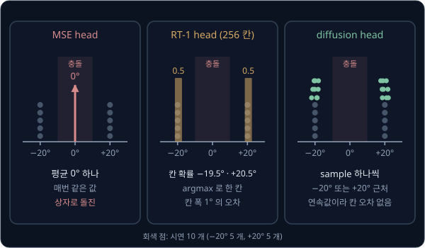

| | MSE head | RT-1 head | diffusion head |
| --- | --- | --- | --- |
| 내는 것 | 각도 숫자 1 개 | 256 칸 각각의 확률 | noise 를 걷어 내고 남은 각도 |
| 상자 앞에서의 행동 | 0° (충돌) | $-19.5$° 또는 $+20.5$° | $-20$° 근처 또는 $+20$° 근처 |
| 같은 관측으로 다시 실행한 결과 | 언제나 같은 값 | argmax 면 같은 칸 | 출발 noise 에 따라 다른 봉우리 |
| x, y 두 차원의 짝 | 평균끼리 짝 | 차원마다 따로 골라 짝이 깨질 수 있음 | 모든 차원을 함께 만들어 짝을 지킴 |
| action 하나당 network 계산 횟수 | 1 번 | 1 번 | $K$ 번 |

오차 제곱의 평균을 가장 작게 만드는 값은 정답들의 평균이라 MSE head 는 0° 를 내고, [RT-1](../rt1/README.md) 의 head 는 시연이 떨어진 두 칸에
확률을 0.5 씩 준다.

**diffusion head** 는 [DDPM](../ddpm/README.md) 의 sampling 으로 action 을 만드는 head 다. 무작위 숫자(noise)에서 출발해 network 를 $K$ 번 써서
noise 를 조금씩 걷어 내고(denoising), 끝에 남은 값을 action 으로 쓴다. 출발 noise 는 실행할 때마다 새로 뽑으므로, 여러 번 실행하면 절반쯤은
$-20$° 근처에서 끝나고 나머지는 $+20$° 근처에서 끝난다. 0° 근처에서 끝나는 경우는 거의 없다.

**흔한 오해.** diffusion head 의 network 도 MSE 로 학습하니 결국 평균을 낼 것이라고 생각하기 쉽다. network 가 MSE 로 맞히는 것은 action 이 아니라
섞인 noise 이고, 이 추정으로는 한 단계에서 조금 움직일 방향만 정해진다. 그 방향을 여러 단계 이어 가는 동안 값이 한쪽 봉우리로 가므로 최종
action 은 두 봉우리의 평균이 되지 않는다.

**확인 문제.** 시연이 $-20$° 7 개와 $+20$° 3 개라면 MSE head 는 몇 도를 낼까? 이상적으로 학습한 RT-1 head 는 $-20$° 가 든 108 번 칸과 $+20$° 가
든 148 번 칸에 각각 확률을 얼마씩 줄까?

답 보기

1. MSE head 는 평균을 낸다: $\big(7 \times (-20) + 3 \times 20\big) \div 10 = -80 \div 10 = -8$°
2. $-8$° 는 $-10$° ~ $+10$° 안이라 상자에 부딪힌다
3. RT-1 head 는 칸마다 정답이 나온 비율대로 확률을 준다: 108 번 칸($-20$°) 0.7, 148 번 칸($+20$°) 0.3

## 행동 값의 정규화

DDPM 은 원래 값의 크기가 noise 와 비슷하다고 가정하고 noise 를 아래 식으로 섞는다.

$$
A^k = \sqrt{\bar\alpha_k}\; A^0 + \sqrt{1 - \bar\alpha_k}\; \epsilon, \qquad \epsilon \sim \mathcal N(0, 1)
$$

$A^0$ 은 noise 가 없는 action 이고 $\epsilon$ 은 $\mathcal N(0, 1)$ 에서 뽑은 noise 다. $\bar\alpha_k$ 는 $k$ 단계까지 남은 원래 값의 비율을
정한다. $t$ 는 로봇의 시각에 써야 해서, [DDPM](../ddpm/README.md) 에서 $t$ 로 적은 단계 번호를 여기서는 $k$ 로 적는다. 이 강의의 손계산에는
단계별 noise 분산 $\beta_k$ 를 0.1, 0.2, 0.3, 0.4, 0.5 로 정한 $K = 5$ 단계 schedule 을 쓴다. 이 schedule 에서 마지막 단계의 두 계수는
$\sqrt{\bar\alpha_5} = 0.39$, $\sqrt{1 - \bar\alpha_5} = 0.92$ 다.

PushT 의 action 은 0 ~ 512 pixel 범위의 손끝 목표 위치라, 400 을 그대로 넣으면 noise 를 다 섞은 $A^5$ 도 평균이 $0.39 \times 400 = 156$ 인
값이 된다. 그런데 action 을 만들 때는 $\mathcal N(0, 1)$ 에서 출발하므로 학습 때 본 적 없는 자리에서 걷어 내기 시작하게 된다. 그래서
action 을 먼저 $-1$ ~ $+1$ 로 바꿔 넣는다.

시연의 최솟값을 $-1$, 최댓값을 $+1$ 로 옮기고 그 사이를 고르게 늘이는 계산을 **min-max 정규화**라고 한다.

$$
\tilde a = \frac{a - a_{\min}}{a_{\max} - a_{\min}} \times 2 - 1
$$

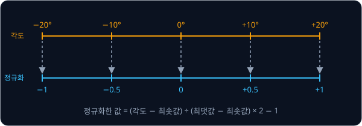

최솟값과 최댓값은 숫자마다 따로 구하는데, LeRobot 의 `lerobot/pusht` dataset 에서 action 의 x 는 12 ~ 511 이고 y 는 25 ~ 511 이다. 만든
값이 $+1.03$ 처럼 범위를 넘으면 시연에 없던 위치가 나가므로 $-1$ ~ $+1$ 로 자른다(clip). LeRobot 은 `clip_sample` 이 기본으로 켜져 있어서
denoising 단계마다 추정한 원래 값을 자른다.

<b>심화: 되돌리는 식</b>

$\tilde a = \frac{a - a_{\min}}{a_{\max} - a_{\min}} \times 2 - 1$ 을 $a$ 에 대해 풀면 아래와 같다.

$$
\begin{aligned}
\tilde a + 1 &= \frac{a - a_{\min}}{a_{\max} - a_{\min}} \times 2 \\
\frac{\tilde a + 1}{2} \times (a_{\max} - a_{\min}) + a_{\min} &= a
\end{aligned}
$$

첫째 줄은 양쪽에 1 을 더한 것이고, 둘째 줄은 양쪽을 2 로 나누고 범위의 폭을 곱한 뒤 최솟값을 더한 것이다. 상자 시연에서 만든 값이
$\tilde a = 0.5$ 라면 $\frac{1.5}{2} \times 40 - 20 = 10$° 다.

**확인 문제.** 시연의 최솟값이 0, 최댓값이 512 일 때 값 384 의 정규화한 값은? 정규화한 값 $-0.5$ 는 원래 몇일까?

답 보기

1. 정규화: $384 \div 512 = 0.75$, $0.75 \times 2 - 1 = 0.5$
2. 되돌리기: $\frac{-0.5 + 1}{2} \times 512 + 0 = 0.25 \times 512 = 128$

## 관측을 조건으로 받는 denoising

DDPM 의 network $\epsilon_\theta(x_k, k)$ 는 noise 가 섞인 값과 단계 번호만 받는다($\theta$ 는 network 의 weight 전체). 그런데 policy 는 상자
장면에서는 $\pm 20$° 가운데 하나를 내야 하고 곧은 길에서는 0° 를 내야 한다. 장면을 모르는 network 는 둘을 구별할 수 없으므로 Diffusion Policy
의 network 는 관측도 함께 받는다.

$$
\epsilon_\theta(O,\ A^k,\ k)
$$

$O$ 는 카메라 사진과 로봇 상태로 이루어진 관측(observation)이고, $A^k$ 는 noise 를 $k$ 단계만큼 섞은 action 이다. 이처럼 무엇을 만들지
정하는 데 쓰도록 함께 넣는 정보를 **조건**(condition)이라고 한다. 학습 한 번의 순서는 DDPM 과 같고, 관측을 함께 넣는 것만 다르다.

1. 시연에서 (관측 $O$, 정규화한 action $A^0$) 한 쌍을 꺼낸다
2. 단계 번호 $k$ 를 1 부터 $K$ 까지에서 무작위로 고른다
3. $\epsilon$ 을 뽑아 $A^k = \sqrt{\bar\alpha_k}\,A^0 + \sqrt{1 - \bar\alpha_k}\,\epsilon$ 을 만든다
4. network 에 $O$, $A^k$, $k$ 를 넣어 noise 를 맞히게 하고, 맞힌 값과 정답 $\epsilon$ 의 차이를 제곱해 loss 로 쓴다
5. loss 가 줄어드는 쪽으로 weight 를 고친다. 사진을 요약하는 encoder 의 weight 도 이 loss 로 함께 고친다

조건이 들어가면 같은 $A^k$ 를 받아도 장면에 따라 맞혀야 할 noise 가 달라진다. 곧은 길 장면은 시연이 모두 0°($A^0 = 0$)라 $A^5 = 0.92\,\epsilon$
이므로, $A^5 = 0.60$ 에 섞인 noise 는 $0.60 \div 0.92 \approx 0.65$ 다. 상자 장면에서는 0.60 이 $+1$ 에서 왔을 가능성과 $-1$ 에서 왔을 가능성을
함께 따져야 해서, 충분히 학습한 network 는 0.54 를 낸다. 이 계산은 아래 심화에서 다룬다.

reverse 한 단계도 DDPM 의 식에 조건만 더하면 된다.

$$
A^{k-1} = \frac{1}{\sqrt{\alpha_k}}\Big(A^k - \frac{\beta_k}{\sqrt{1 - \bar\alpha_k}}\;\epsilon_\theta(O, A^k, k)\Big) + \sigma_k\, z
$$

$\alpha_k = 1 - \beta_k$ 다. $\frac{\beta_k}{\sqrt{1 - \bar\alpha_k}}$ 는 쌓인 noise 가운데 이번 단계에서 뺄 몫을 정하는 계수이고, $\sigma_k$ 는
새로 더하는 noise $z$ 의 크기다. 식은 network 가 맞힌 noise 에 이 계수를 곱해 $A^k$ 에서 빼고, $\sqrt{\alpha_k}$ 로 나눈 뒤 $\sigma_k z$ 를
더하라는 뜻이다. 마지막 단계($k = 1$)에는 $z$ 를 더하지 않는다. 5 단계 schedule 의 $k = 5$ 에서는 뺄 몫의 계수, $1 / \sqrt{\alpha_5}$,
$\sigma_5$ 가 각각 0.54, 1.41, 0.71 이다.

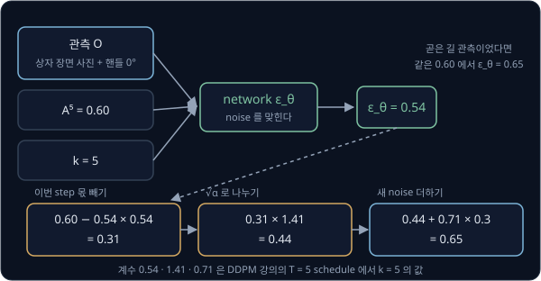

관측이 바뀌면 network 의 답만 바뀌고 그 뒤의 계산은 같다. 이 한 단계를 다섯 번 밟으면 아래처럼 된다.

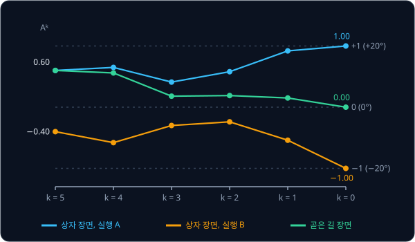

<b>심화: 상자 장면의 noise 추정과 sampling 계산표</b>

5 단계 schedule 의 reverse 계수는 아래와 같다.

| 단계 $k$ | 1 | 2 | 3 | 4 | 5 |
| --- | --- | --- | --- | --- | --- |
| $\beta_k / \sqrt{1 - \bar\alpha_k}$ (뺄 몫의 계수) | 0.32 | 0.38 | 0.43 | 0.48 | 0.54 |
| $1 / \sqrt{\alpha_k}$ (나눠 되돌리는 수) | 1.05 | 1.12 | 1.20 | 1.29 | 1.41 |
| $\sigma_k$ (새 noise 의 크기) | 0.32 | 0.45 | 0.55 | 0.63 | 0.71 |

상자 장면의 시연은 $-1$ 과 $+1$ 이 반반이다. $+1$ 에서 온 $A^5$ 는 평균이 $0.39$ 이고 $-1$ 에서 온 $A^5$ 는 평균이 $-0.39$ 인데, 둘 다
표준편차 0.92 인 종 모양으로 퍼진다. 0.60 자리에서 두 종의 높이는 0.422 와 0.243 이라, $+1$ 쪽일 가능성은 $0.422 \div (0.422 + 0.243) \approx
0.635$ 이고 $-1$ 쪽일 가능성은 0.365 다. 두 가능성으로 가중 평균한 원래 값의 추정은 $0.635 \times 1 + 0.365 \times (-1) = 0.27$ 이고, 이 추정에 맞는 noise 는 아래와 같다.

$$
\epsilon = \frac{0.60 - 0.39 \times 0.27}{0.92} = \frac{0.495}{0.92} \approx 0.54
$$

같은 방법으로 단계마다 network 의 답을 계산해 $A^5 = 0.60$ 에서 sampling 하면 아래 표가 된다. 곱한 결과는 소수 셋째 자리에서 반올림했다.

| $k$ | $A^k$ | network 의 답 | 뺄 몫 | $A^k$ − 몫 | $\times \frac{1}{\sqrt{\alpha_k}}$ | $\sigma_k z$ | $A^{k-1}$ |
| --- | --- | --- | --- | --- | --- | --- | --- |
| 5 | 0.60 | 0.54 | $0.54 \times 0.54 = 0.29$ | 0.31 | $1.41 \times 0.31 = 0.44$ | $0.71 \times 0.3 = 0.21$ | 0.65 |
| 4 | 0.65 | 0.47 | $0.48 \times 0.47 = 0.23$ | 0.42 | $1.29 \times 0.42 = 0.54$ | $0.63 \times (-0.2) = -0.13$ | 0.41 |
| 3 | 0.41 | 0.05 | $0.43 \times 0.05 = 0.02$ | 0.39 | $1.20 \times 0.39 = 0.47$ | $0.55 \times 0.2 = 0.11$ | 0.58 |
| 2 | 0.58 | $-0.41$ | $0.38 \times (-0.41) = -0.16$ | 0.74 | $1.12 \times 0.74 = 0.83$ | $0.45 \times 0.2 = 0.09$ | 0.92 |
| 1 | 0.92 | $-0.09$ | $0.32 \times (-0.09) = -0.03$ | 0.95 | $1.05 \times 0.95 = 1.00$ | 0 | 1.00 |

마지막 1.00 을 되돌리면 $\frac{1 + 1}{2} \times 40 - 20 = +20$° 다. 값은 $A^3 = 0.41$ 로 한 번 내려갔지만, $A^2 = 0.58$ 은 $+1$ 쪽에서 왔을
가능성이 커서 network 가 음수 noise $-0.41$ 을 냈다. 음수 몫을 빼자 값이 0.92 로 올라갔다.

같은 장면에서 $A^5 = -0.40$ 에서 출발하고 새 noise 가 $-0.4$, 0.3, 0.2, $-0.1$ 이면 아래처럼 된다.

| $k$ | $A^k$ | network 의 답 | 뺄 몫 | $A^k$ − 몫 | $\times \frac{1}{\sqrt{\alpha_k}}$ | $\sigma_k z$ | $A^{k-1}$ |
| --- | --- | --- | --- | --- | --- | --- | --- |
| 5 | $-0.40$ | $-0.36$ | $-0.19$ | $-0.21$ | $-0.30$ | $0.71 \times (-0.4) = -0.28$ | $-0.58$ |
| 4 | $-0.58$ | $-0.41$ | $-0.20$ | $-0.38$ | $-0.49$ | $0.63 \times 0.3 = 0.19$ | $-0.30$ |
| 3 | $-0.30$ | $-0.02$ | $-0.01$ | $-0.29$ | $-0.35$ | $0.55 \times 0.2 = 0.11$ | $-0.24$ |
| 2 | $-0.24$ | 0.54 | 0.21 | $-0.45$ | $-0.50$ | $0.45 \times (-0.1) = -0.04$ | $-0.54$ |
| 1 | $-0.54$ | 1.29 | 0.41 | $-0.95$ | $-1.00$ | 0 | $-1.00$ |

마지막 $-1.00$ 은 $-20$° 다. 곧은 길 장면은 원래 값이 0 이라 network 의 답이 $A^k \div \sqrt{1 - \bar\alpha_k}$ 다. 첫 표와 같은 출발점·새
noise 로 계산하면 $A^k$ 가 0.60, 0.56, 0.18, 0.19, 0.15 를 거쳐 0.00(0°)에 닿는다.

**흔한 오해.** 출발 noise 가 양수면 언제나 $+20$° 로 간다고 생각하기 쉽다. 앞쪽 단계에서 더하는 새 noise $\sigma_k z$ 가 출발점보다 크면 값이
음수 쪽으로 넘어갈 수 있으므로, 어느 봉우리로 갈지는 출발점과 여러 단계의 새 noise, network 의 추정이 함께 정한다.

**확인 문제.** 곧은 길 시연에서 $A^0 = 0$ 을 꺼냈고 $k = 3$, $\epsilon = -1$ 이 뽑혔다. $A^3$ 은? network 가 $-0.8$ 을 냈다면 loss 는?

답 보기

1. $k = 3$ 의 계수는 $\sqrt{\bar\alpha_3} = 0.71$, $\sqrt{1 - \bar\alpha_3} = 0.70$ 이다
2. $A^3 = 0.71 \times 0 + 0.70 \times (-1) = -0.70$
3. loss: $\big(-1 - (-0.8)\big)^2 = (-0.2)^2 = 0.04$

## action chunk 와 prediction horizon

지금까지는 다음 제어 step 에 실행할 action 하나만 만들었는데, 제어 step 은 로봇이 action 하나를 실행하는 시간 단위다. step 마다 따로
sampling 하면 관측이 거의 같은 처음 몇 step 동안 $-20$° 와 $+20$° 가 반반으로 나온다. 앞 step 에서 고른 쪽이 다음 sampling 에 들어가지 않기
때문이다.

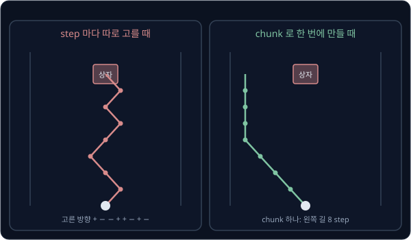

step 마다 따로 뽑을 때 8 step 이 모두 같은 쪽으로 나올 확률은 $2 \times 0.5^8 = 2 \div 256 \approx 0.008$ 뿐이다.

Diffusion Policy 는 앞으로 $T_p$ step 동안의 action 을 한 덩어리로 만든다.

$$
A_t = (a_t,\ a_{t+1},\ \ldots,\ a_{t + T_p - 1})
$$

$t$ 는 지금의 제어 step 번호이고 $a_t$ 는 step $t$ 에 실행할 action 이다. 이 덩어리를 **action chunk** 라고 하는데, [ACT](../act/README.md) 에서
본 action chunk 와 같다. 덩어리에 든 action 의 개수 $T_p$ 는 논문에서 **prediction horizon**(action prediction horizon)이라고 부르며, horizon 은
내다보는 범위라는 뜻이다.

PushT 에서 action 하나는 손끝의 목표 위치 $(x, y)$ 이고 $T_p = 16$ 이라 chunk 하나는 숫자 32 개다. noise 도 같은 모양으로 32 개를 뽑고,
reverse 계산도 숫자마다 앞 절과 똑같이 한다. 다만 network 가 32 개를 한꺼번에 보고 답을 내므로, 첫 step 이 오른쪽 길이면 나머지 step 도
오른쪽 길이라는 짝을 배울 수 있다.

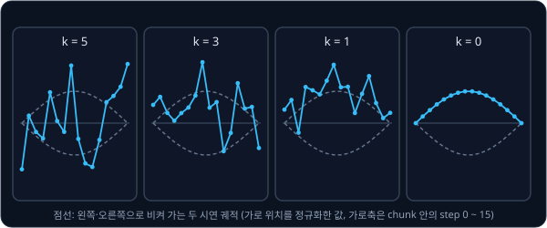

chunk 는 조종하던 사람이 잠깐 손을 멈춰 같은 위치 action 이 여러 step 이어지는 구간(idle action)의 영향도 덜 받는다. 논문에 따르면 step
하나씩 action 을 내는 LSTM-GMM 과 IBC 는 멈춤 구간을 지우지 않은 실물 데이터에서 이 멈춤까지 따라 배워 자주 멈춰 섰는데, chunk 에는 멈춤
뒤에 이어지는 움직임도 함께 들어간다.

관측은 최근 $T_o$ step 의 것을 넣고, $T_o$ 를 observation horizon 이라고 한다. PushT 는 $T_o = 2$ 라서 사진 두 장을 비교해 블록이 움직인 방향을
알 수 있다. 논문의 부록 실험에서도 대부분의 과제에서 $T_o = 2$ 가 알맞았다.

<b>심화: action 세 개짜리 chunk 의 reverse 한 단계</b>

action 3 개짜리 chunk 의 $k = 5$ 단계 하나를 계산한다. $A^5 = (0.60, 0.20, -0.30)$ 이고 network 의 답은 $(0.54, 0.10, -0.20)$, 새 noise 는
$z = (0.3, 0, -0.1)$ 이다.

| action | $A^5$ | network 의 답 | $0.54 \times$ 답 | $A^5$ − 몫 | $\times 1.41$ | $0.71 \times z$ | $A^4$ |
| --- | --- | --- | --- | --- | --- | --- | --- |
| 1 | 0.60 | 0.54 | 0.29 | 0.31 | 0.44 | 0.21 | 0.65 |
| 2 | 0.20 | 0.10 | 0.05 | 0.15 | 0.21 | 0 | 0.21 |
| 3 | $-0.30$ | $-0.20$ | $-0.11$ | $-0.19$ | $-0.27$ | $-0.07$ | $-0.34$ |

action 마다 계산은 따로 하지만, network 의 답 세 개는 세 action 을 모두 보고 낸 값이다.

**확인 문제.** action 하나가 관절 각도 7 개이고 $T_p = 16$ 이면 chunk 하나는 숫자 몇 개이고, noise 는 몇 개를 뽑아야 할까?

답 보기

1. chunk: $16 \times 7 = 112$ 개
2. noise 는 chunk 와 같은 모양이라 112 개를 뽑는다

## receding horizon 과 action horizon

chunk 의 action 16 개를 다 실행한 뒤에야 새 관측을 보면 그동안 바뀐 상황을 늦게 반영하게 된다. 그래서 Diffusion Policy 는 chunk 의 앞
$T_a$ 개만 실행하고 새 관측으로 chunk 를 다시 만든다. $T_a$ 를 **action horizon**(action execution horizon)이라고 하며, simulation PushT 설정의
$T_a$ 는 8 이다. 이처럼 멀리 내다보는 계획을 세우되 앞부분만 실행하고, 내다보는 구간을 앞으로 밀며 계획을 다시 세우는 방식을 **receding
horizon** 이라고 한다. receding 은 '멀어지는' 이라는 뜻인데, 로봇이 나아갈수록 내다보는 범위의 끝도 함께 멀어진다는 데서 온 이름이고 원래는
제어 이론에서 쓰던 말이다.

PushT 시연은 1초에 10 step(10 Hz)이라 step 하나가 0.1 초이고, $T_a = 8$ 이면 추론(inference)은 8 step(0.8 초)마다 한 번 한다.

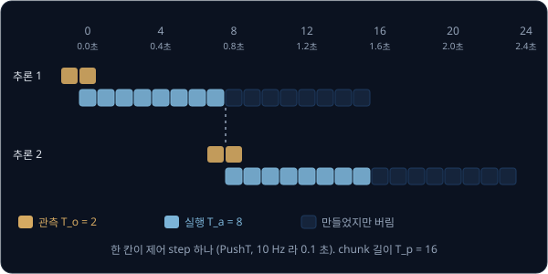

$T_a = 1$ 이면 step 마다 새 noise 에서 출발한 chunk 의 첫 action 만 실행하므로 앞 절처럼 봉우리 사이를 오갈 수 있다. 반대로 $T_a = 16$ 이면
step 2 에 블록이 미끄러져도 다음 추론인 step 16 까지 1.4 초 동안 옛 계획을 실행하는데, $T_a = 8$ 이면 같은 변화를 0.6 초 뒤에 반영한다.

논문 저자들이 시험한 과제 대부분에서는 $T_a = 8$ 이 가장 좋았고, 실물 PushT 실험에서는 $T_p = 16$, $T_a = 6$ 을 썼다.

LeRobot 의 설정 이름으로는 $T_p$ 가 `horizon` 이고 $T_a$ 는 `n_action_steps` 다. 2026 년 5 월 [PR #3202](https://github.com/huggingface/lerobot/pull/3202)
에서 두 기본값이 각각 16 에서 64 로, 8 에서 32 로 바뀌었는데, 16 과 8 은 PushT 에 맞춘 값이라 실제 과제에는 짧다는 이유였다. `n_action_steps`
32 는 10 Hz 에서 3.2 초 동안 새 관측 없이 실행한다는 뜻이라, 블록이 자주 움직이는 과제에서는 다시 줄이는 편이 맞다.

<b>심화: 공식 구현의 chunk 위치</b>

공식 구현과 LeRobot 은 chunk 의 첫 action 을 가장 오래된 관측 step 에 맞춘다. $T_o = 2$, `horizon` 16, `n_action_steps` 8 이면 step $n$ 의 추론이
만드는 chunk 는 step $n - 1$ ~ $n + 14$ 이고, 실행하는 것은 step $n$ ~ $n + 7$ 이다. 그래서 `n_action_steps` ≤ `horizon` − `n_obs_steps` + 1 이어야
하고, 지금부터 내다보는 범위는 16 이 아니라 15 step 이다. 본문의 그림은 이 한 step 을 빼고 step $n$ 부터 16 개로 단순하게 그렸다.

[ACT](../act/README.md) 도 action chunk 를 쓰지만 실행 방식이 다르다. ACT 는 50 Hz 로봇에서 100 step(2 초)짜리 chunk 를 매 step 새로 만들고,
같은 step 에 대한 여러 chunk 의 예측을 오래된 예측일수록 큰 weight 로 가중 평균하는 temporal ensembling 을 쓴다. ACT 는 실행할 때 style
숫자 $z$ 를 0 으로 고정해 같은 관측이면 같은 chunk 를 내지만, diffusion head 는 sampling 마다 다른 봉우리의 chunk 를 낼 수 있다. 서로 다른
봉우리의 예측을 평균하면 피하려던 평균 문제가 다시 생기므로, Diffusion Policy 는 겹친 예측을 섞지 않고 chunk 하나씩 실행한다.

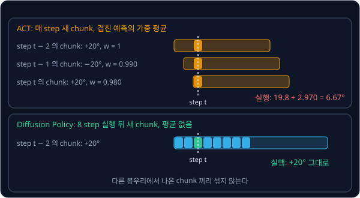

<b>심화: temporal ensembling 계산</b>

ACT 의 weight 는 $w_i = \exp(-m \cdot i)$ 다. $i$ 는 오래된 예측부터 0, 1, 2 로 센 번호이고, ACT 원 구현의 $m$ 은 0.01 이다.

| 예측을 낸 chunk | 그 step 의 예측 | $i$ | $w_i = \exp(-0.01 \times i)$ | $w_i \times$ 예측 |
| --- | --- | --- | --- | --- |
| step $t - 2$ 의 chunk | $+20$ | 0 | 1 | 20 |
| step $t - 1$ 의 chunk | $-20$ | 1 | 0.990 | $-19.8$ |
| step $t$ 의 chunk | $+20$ | 2 | 0.980 | 19.6 |
| 합 | | | 2.970 | 19.8 |

실행할 각도는 $19.8 \div 2.970 \approx 6.67$° 라서 상자에 부딪히는 $-10$° ~ $+10$° 안에 든다.

**확인 문제.** 10 Hz 로봇에서 $T_p = 16$, $T_a = 4$ 로 바꾸면 추론은 몇 초마다 하고, chunk 하나에서 버리는 action 은 몇 개일까? step 3 에 상황이
바뀌면 몇 초 뒤에 반영될까?

답 보기

1. 추론 간격: 4 step 마다라 $4 \times 0.1 = 0.4$ 초
2. 버리는 action: $16 - 4 = 12$ 개
3. 추론은 step 0, 4, 8 … 에 하므로 step 3 의 변화는 step 4 에 반영된다. $4 - 3 = 1$ step 늦으니 0.1 초다

## image encoder 와 spatial softmax

논문의 Diffusion Policy 는 사진을 feature 로 바꾸는 image encoder 로 [ResNet](../resnet/README.md) 에서 본 ResNet-18 을 쓰고, pretrained weight
없이 diffusion head 의 loss 로 처음부터 함께 학습한다. 카메라마다 encoder 를 따로 둔다. ResNet-18 의 BatchNorm 도 GroupNorm 으로 바꾸는데,
그 이유는 [ResNet](../resnet/README.md) 에서 다룬다.

ResNet-18 의 끝에 있는 global average pooling 은 feature map 하나마다 모든 칸의 평균 하나만 남겨서, 무엇이 있는지는 남지만 어디에 있는지는
사라진다. 블록을 밀어야 하는 로봇에게는 블록의 위치가 중요하므로, Diffusion Policy 는 이 층을 **spatial softmax** 로 바꾼다. spatial softmax 는
feature map 하나마다 값이 큰 칸의 위치 $(x, y)$ 를 아래 순서로 뽑는다.

1. 모든 칸에 softmax 를 취해 칸마다 확률을 만든다. 칸의 값 $s$ 마다 $e^{s}$ 를 구해 그 합으로 나누므로, 값이 클수록 확률이 크고 확률의 합은 1 이다
2. 왼쪽 위 칸을 $(-1, -1)$, 오른쪽 아래 칸을 $(1, 1)$ 로 두고 그 사이를 고르게 나눠 칸마다 좌표를 정한다
3. 확률을 weight 로 삼아 좌표의 가중 평균(기댓값)을 구한다

이렇게 뽑은 위치를 keypoint 라고 하는데, 사진에서 keypoint 좌표를 뽑는 이 구조는 Levine 등(2016)의 로봇 연구에서 처음 나왔다. LeRobot 구현은
1×1 convolution 으로 feature map 을 32 개로 줄여 keypoint 32 개를 뽑으므로 사진 한 장이 숫자 $32 \times 2 = 64$ 개가 된다.

<b>심화: spatial softmax 손계산</b>

3×3 feature map 이 오른쪽 위 칸만 2 이고 나머지 여덟 칸이 0 이다.

1. softmax: $e^2 \approx 7.389$, $e^0 = 1$ 이라 합은 $7.389 + 8 = 15.389$ 이고, 오른쪽 위 칸의 확률은 $7.389 \div 15.389 \approx 0.480$, 나머지는
   $1 \div 15.389 \approx 0.065$ 씩이다
2. $x$: 오른쪽 열($x = 1$)의 확률 합은 $0.480 + 0.065 + 0.065 = 0.610$, 왼쪽 열($x = -1$)은 $0.065 \times 3 = 0.195$ 라
   $x = 0.610 \times 1 + 0.195 \times (-1) = 0.415$
3. $y$: 위 줄($y = -1$)의 합이 0.610, 아래 줄($y = 1$)이 0.195 라 $y = 0.610 \times (-1) + 0.195 \times 1 = -0.415$

결과 $(0.415, -0.415)$ 는 값이 가장 큰 칸 $(1, -1)$ 쪽으로 끌려간 위치다.

저자들은 robomimic(로봇 조작 simulation 과제 모음)의 Square 과제에서 encoder 구조와 학습 방식에 따라 성공률이 어떻게 달라지는지 쟀다. Square 는
사각 고리를 막대에 끼우는 과제다. ResNet 은 ImageNet-21k(약 2 만 1 천 종류로 사진을 나눈 dataset)로 pretraining 한 weight 를 썼고, ViT-B/16 은
CLIP 으로 pretraining 한 weight 를 썼다. fine-tuning 할 때는 encoder 의 learning rate 를 policy network 의 10 분의 1 로 두었다.

| encoder | 처음부터 학습 | pretrained, 고정(freeze) | pretrained 에서 fine-tuning |
| --- | --- | --- | --- |
| ResNet-18 (ImageNet-21k) | 0.94 | 0.58 | 0.92 |
| ResNet-34 (ImageNet-21k) | 0.92 | 0.40 | 0.94 |
| ViT-B/16 (CLIP) | 0.22 | 0.70 | 0.98 |

저자들은 고정한 encoder 의 성공률이 크게 떨어진 것을 두고, Diffusion Policy 에 필요한 사진 요약이 흔한 pretraining 방법으로 얻는 요약과 다르다고
해석했다.

LeRobot 에서는 Diffusion Policy 가 PushT 말고는 학습이 잘 안 된다는 사용자 보고가 이어졌고, PR #3202 의 작성자는 그 원인으로 encoder 가 무작위
weight 에서 출발하는 기본값을 짚었다. 그래서 지금 기본값은 torchvision 의 ImageNet weight(`ResNet18_Weights.IMAGENET1K_V1`)에서 출발하고
BatchNorm 을 그대로 둔다. `use_group_norm` 을 켠 채 pretrained weight 를 지정하면 오류가 나는데, pretrained conv weight 는 BatchNorm 이 정규화한
값을 받도록 학습됐기 때문에 GroupNorm 으로 바꾸면 다음 층이 받는 값이 달라진다. 공개 checkpoint `lerobot/diffusion_pusht` 의 설정은 바뀌기
전의 기본값(pretraining 없음, GroupNorm)이다.

**흔한 오해.** Diffusion Policy 논문이 pretrained encoder 는 나쁘다고 결론 내렸다고 생각하기 쉽다. 성공률이 크게 떨어진 것은 pretrained weight 를
고정한 경우였고, 작은 learning rate 로 fine-tuning 하면 처음부터 학습한 것과 비슷하거나 더 좋았다. CLIP 으로 pretraining 한 ViT-B/16 은
fine-tuning 50 epoch 만에 0.98 에 닿았다.

**확인 문제.** 3×3 feature map 의 가운데 칸만 2 이고 나머지가 0 이면 spatial softmax 의 결과는?

답 보기

1. 확률: 가운데 칸 0.480, 나머지 여덟 칸 0.065 씩
2. 나머지 칸은 가운데를 중심으로 좌우·위아래가 똑같이 놓여 있어서 $x$ 와 $y$ 의 기여가 서로 지워진다
3. 가운데 칸의 좌표가 $(0, 0)$ 이라 결과는 $(0, 0)$ 이다

## CNN denoiser 와 transformer denoiser

noise 를 맞히는 network 를 denoiser 라고 하는데, 논문은 denoiser 두 가지를 제안했다. 아래 그림은 `lerobot/diffusion_pusht` 설정에서 관측과
단계 번호가 숫자 260 개짜리 조건 vector 가 되어 denoiser 에 들어가는 과정을 보여 준다.

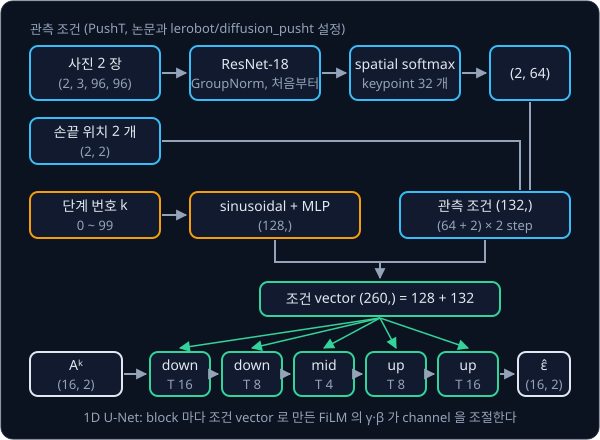

기본 denoiser 는 **1D convolution U-Net** 이다. action chunk 는 시간 순서로 늘어선 값이라 kernel 을 시간축 한 방향으로만 민다(1D convolution).
이 계산은 이웃한 시각의 값을 곱해 더하므로 한 시각에 몰린 변화가 이웃 시각으로 퍼진다. kernel 의 weight 는 학습으로 정해지지만, 저자들은 시간축
convolution 을 쌓은 network 가 천천히 변하는 신호를 더 쉽게 만든다고 보았다.

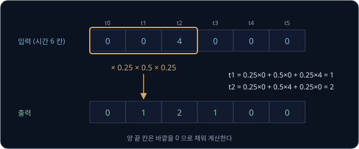

U-Net 은 [DDPM](../ddpm/README.md) 에서 사진의 noise 를 맞힐 때 본 구조다. 여기서는 길이 16 인 시간축을 16 → 8 → 4 로 줄였다가 다시 키우고,
줄이는 쪽의 값을 같은 길이의 키우는 쪽에 이어 붙인다(skip connection). 길이 4 에서는 kernel 하나가 chunk 의 넓은 구간을 보므로 chunk 전체가
어느 길로 가는지 같은 큰 모양이 정해지고, skip connection 은 각 step 의 세밀한 값을 되살린다. 조건 vector 는 [RT-1](../rt1/README.md) 에서 지시
문장을 넣을 때 본 FiLM 으로 모든 block 에 들어간다. FiLM 은 조건 vector 로 channel 마다 곱할 수 $\gamma$ 와 더할 수 $\beta$ 를 만들어 중간 값
$h$ 를 $\gamma h + \beta$ 로 바꾼다. 시간축 U-Net 으로 궤적 전체를 diffusion 으로 만드는 방법은 Janner 등(2022)의 Diffuser 가 먼저 썼고,
Diffusion Policy 는 여기에 관측 조건을 FiLM 으로 넣었다.

**transformer denoiser**(논문의 time-series diffusion transformer)는 같은 자리에 Transformer decoder 를 쓴다. noise 가 섞인 action 16 개가 입력 token
16 개가 되고, 단계 번호 $k$ 의 embedding 이 맨 앞 token 으로 붙는다. 각 action token 은 자기와 앞 step 의 token 만 참고하고(causal attention),
관측 embedding 은 cross-attention 으로 받는다. cross-attention 은 다른 묶음의 정보를 참고하는 attention 이다. 출력 token 16 개는 각 step 의
noise 추정이다.

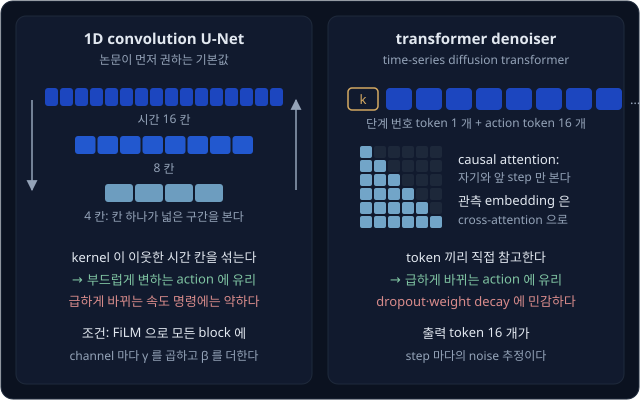

저자들은 새 과제에서는 CNN denoiser 를 먼저 써 보라고 권했는데, 대부분의 과제에서 설정을 거의 바꾸지 않아도 잘 됐기 때문이다. 다만 속도 명령처럼
action 이 급하게 바뀌는 과제에서는 값을 부드럽게 만드는 성질 때문에 성능이 떨어졌다. transformer 는 그런 과제와 상태 숫자만 관측으로 쓰는
과제에서 좋은 결과를 많이 냈지만, attention dropout 과 weight decay 의 알맞은 값이 과제마다 크게 달랐다.

**확인 문제.** kernel $(0.25, 0.5, 0.25)$ 를 $(2, 2, 2, 2)$ 에 적용하면 가운데 두 시각(시간 1, 2)의 출력은?

답 보기

1. 시간 1: $0.25 \times 2 + 0.5 \times 2 + 0.25 \times 2 = 2$
2. 시간 2: 같은 계산이라 2
3. 이미 고른 값은 그대로 남는다

## DDIM 으로 줄이는 sampling 단계

논문의 simulation 실험에서는 원래 값이 남는 몫을 cosine 곡선 모양으로 줄여 가는 cosine schedule 로 $K = 100$ 단계를 학습과 실행에 모두 썼다.
그러면 sampling 할 때 network 를 100 번 써야 해서, 예를 들어 network 한 번에 0.01 초가 걸리면 chunk 하나에 1 초가 걸리고 0.8 초마다 필요한
chunk 가 제때 나오지 않는다. 저자들은 학습은 100 단계로 하고 실행할 때는 DDIM 으로 10 단계만 밟아 Nvidia RTX 3080 에서 추론 한 번에 0.1 초가
걸렸다고 보고했다. 부록의 설정표에는 실물 과제의 실행 단계가 16 으로 적혀 있다.

**DDIM**(Denoising Diffusion Implicit Models)은 Song 등이 2020 년에 제안한 방법으로, DDPM 과 같은 loss 로 학습한 network 를 그대로 쓰면서 단계를
건너뛰는 식을 쓴다. 한 번 건너뛰는 계산은 아래 두 식이다.

$$
\hat A^0 = \frac{A^k - \sqrt{1 - \bar\alpha_k}\;\epsilon_\theta(O, A^k, k)}{\sqrt{\bar\alpha_k}}, \qquad
A^{k'} = \sqrt{\bar\alpha_{k'}}\;\hat A^0 + \sqrt{1 - \bar\alpha_{k'}}\;\epsilon_\theta(O, A^k, k)
$$

첫 식은 $A^k$ 에서 noise 몫을 빼고 원래 값의 계수로 나눠 원래 값 $\hat A^0$ 을 추정하고, 둘째 식은 추정한 원래 값과 같은 noise 를 건너뛸 목표 단계
$k'$ 의 비율로 다시 섞는다. 새 noise 를 더하지 않으므로 같은 출발점에서는 언제나 같은 결과가 나온다. $k' = 0$ 이면 $\hat A^0$ 이 그대로 결과가
된다.

5 단계 schedule 에서 상자 장면의 $A^5 = 0.60$ 을 5 → 3 → 1 → 0 으로 건너뛰면 network 를 세 번만 써서 $+20$° 에 닿지만, 5 → 2 → 0 으로 두 번만
쓰면 18.2° 에 닿는다. $k = 2$ 에서 추정한 원래 값에는 두 봉우리의 가능성이 아직 조금 섞여 있어 1 에 못 미치는데, 그 추정이 그대로 결과가 되기
때문이다. 단계를 너무 줄이면 이렇게 평균 쪽으로 조금 끌린 값이 남는다.

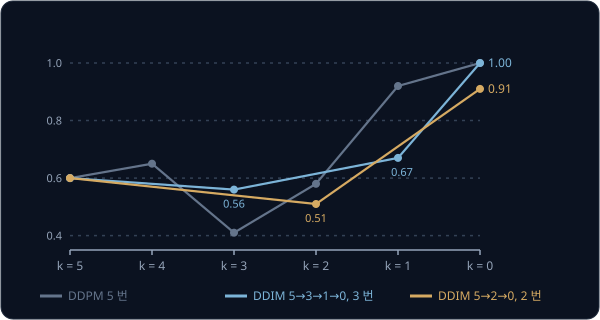

LeRobot 의 `lerobot/diffusion_pusht` checkpoint 설정은 `horizon` 16, `n_action_steps` 8, `n_obs_steps` 2 이고, `squaredcos_cap_v2`(cosine)
schedule 로 학습 단계 100 개를 쓴다. `num_inference_steps` 가 비어 있어서 sampling 때도 학습 단계 수를 따라 DDPM scheduler 로 100 단계를 모두
밟는다.
논문처럼 줄이려면 `noise_scheduler_type` 을 DDIM 으로 바꾸고 `num_inference_steps` 를 10 으로 둔다.

<b>심화: cosine schedule 과 DDIM 건너뛰기 계산표</b>

$K = 100$ cosine schedule 의 두 계수는 아래처럼 바뀐다. $k = 100$ 에서 action 의 비중이 거의 0 이라 sampling 은 순수한 noise 에서 출발한다.

| $k$ | 1 | 25 | 50 | 75 | 100 |
| --- | --- | --- | --- | --- | --- |
| $\sqrt{\bar\alpha_k}$ (action 의 비중) | 1.000 | 0.920 | 0.703 | 0.380 | 0.000 |
| $\sqrt{1 - \bar\alpha_k}$ (noise 의 비중) | 0.025 | 0.391 | 0.711 | 0.925 | 1.000 |

5 단계 schedule 에서 $k = 5, 3, 2, 1$ 의 $(\sqrt{\bar\alpha_k}, \sqrt{1 - \bar\alpha_k})$ 는 각각 (0.39, 0.92), (0.71, 0.70), (0.85, 0.53),
(0.95, 0.32) 다. network 의 답은 [관측을 조건으로 받는 denoising](#관측을-조건으로-받는-denoising) 의 심화와 같은 방법으로 계산한
값이다.

| 출발 $k$ | $A^k$ | network 의 답 | $\hat A^0$ 계산 | $\hat A^0$ | 목표 $k'$ | $A^{k'}$ 계산 | $A^{k'}$ |
| --- | --- | --- | --- | --- | --- | --- | --- |
| 5 | 0.60 | 0.54 | $(0.60 - 0.92 \times 0.54) \div 0.39$ | 0.26 | 3 | $0.71 \times 0.26 + 0.70 \times 0.54$ | 0.56 |
| 3 | 0.56 | 0.12 | $(0.56 - 0.70 \times 0.12) \div 0.71$ | 0.67 | 1 | $0.95 \times 0.67 + 0.32 \times 0.12$ | 0.67 |
| 1 | 0.67 | $-0.88$ | $(0.67 + 0.32 \times 0.88) \div 0.95$ | 1.00 | 0 | $\hat A^0$ 그대로 | 1.00 |

5 → 2 → 0 은 아래와 같다.

| 출발 $k$ | $A^k$ | network 의 답 | $\hat A^0$ 계산 | $\hat A^0$ | 목표 $k'$ | $A^{k'}$ 계산 | $A^{k'}$ |
| --- | --- | --- | --- | --- | --- | --- | --- |
| 5 | 0.60 | 0.54 | $(0.60 - 0.92 \times 0.54) \div 0.39$ | 0.26 | 2 | $0.85 \times 0.26 + 0.53 \times 0.54$ | 0.51 |
| 2 | 0.51 | $-0.50$ | $(0.51 + 0.53 \times 0.50) \div 0.85$ | 0.91 | 0 | $\hat A^0$ 그대로 | 0.91 |

$k = 2$ 에서 $A^2 = 0.51$ 이 $+1$ 쪽에서 왔을 가능성은 약 0.957 이라, 추정한 원래 값은 1 이 아니라 0.91 이다. 0.91 을 되돌리면
$\frac{1.91}{2} \times 40 - 20 = 18.2$° 다.

**흔한 오해.** 단계를 줄이려면 network 를 다시 학습해야 한다고 생각하기 쉽다. DDIM 은 DDPM 과 같은 loss 로 학습한 network 를 그대로 쓰고, 실행할 때
밟는 단계와 계산식만 바꾼다.

**확인 문제.** network 한 번에 0.02 초가 걸린다. 100 단계와 10 단계의 추론 시간은 각각 얼마이고, 0.8 초마다 새 chunk 가 필요할 때 제때 나오는 것은?

답 보기

1. 100 단계: $100 \times 0.02 = 2$ 초
2. 10 단계: $10 \times 0.02 = 0.2$ 초
3. 0.8 초 안에 끝나는 것은 10 단계뿐이다

## PushT 실험

PushT 는 평면 위의 T 자 블록을 둥근 손끝으로 밀어 목표 자리에 겹치게 놓는 과제다. Diffusion Policy 논문은 이 과제를 IBC(Implicit
Behavioral Cloning) 논문에서 가져와 썼다. 손끝이 블록에 닿는 곳은 한 점뿐이라, 블록을 원하는 방향으로 돌리고 옮기려면 미는 자리를 계속 바꿔야 한다.

| 항목 | simulation PushT 설정 |
| --- | --- |
| 관측 | 96×96 카메라 사진(학습 때 84×84 로 무작위로 잘라 넣음)과 손끝의 지금 위치 $(x, y)$ |
| action | 손끝이 갈 목표 위치 $(x, y)$ |
| 시연 | 사람이 조종한 200 개 (`lerobot/pusht` 는 206 episode, 10 Hz) |
| $T_o$, $T_p$, $T_a$ | 2, 16, 8 |
| 평가 | 블록이 목표 자리를 덮은 비율(coverage) |

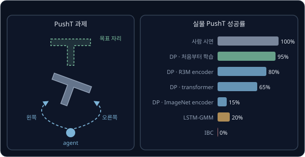

사진을 관측으로 쓰는 simulation PushT 의 coverage 는 아래와 같다. checkpoint 는 학습 도중 저장한 weight 이고, 값은 학습을 3 번 해서 시작 상태
50 개로 평가한 평균이다.

| 방법 | 가장 좋은 checkpoint | 마지막 10 개의 평균 |
| --- | --- | --- |
| LSTM-GMM | 0.69 | 0.54 |
| IBC | 0.75 | 0.64 |
| Diffusion Policy (CNN) | 0.91 | 0.84 |
| Diffusion Policy (transformer) | 0.78 | 0.66 |

논문은 PushT 를 포함한 벤치마크 4 개의 과제 15 개에서 Diffusion Policy 의 성공률이 기존의 가장 좋은 방법보다 평균 46.9% 높았다고 보고했다.

실물 실험에는 UR5 로봇 팔과 숙련된 사람이 모은 시연 136 개를 썼다. 실물 과제는 simulation 보다 어려운데, 블록을 넣은 뒤 손끝을 끝
구역으로 옮겨야 하고 블록이 목표와 겹친 정도(IoU)를 가장 좋았던 순간이 아니라 마지막 순간에 재기 때문이다. IoU 는 겹친 넓이를 두 영역을 합친 넓이로 나눈 값이다. 마지막 IoU 가 사람 시연에서 나온
IoU 의 최솟값보다 크면 성공으로 쳤고, 방법마다 같은 시작 상태 20 개로 평가했다.

| 방법 | 마지막 순간의 IoU | 성공률 |
| --- | --- | --- |
| 사람 시연 | 0.84 | 100% |
| Diffusion Policy (CNN, encoder 처음부터) | 0.80 | 95% |
| Diffusion Policy (CNN, 로봇 조작 영상으로 pretraining 한 R3M encoder) | 0.66 | 80% |
| Diffusion Policy (transformer, encoder 처음부터) | 0.53 | 65% |
| Diffusion Policy (CNN, ImageNet encoder) | 0.24 | 15% |
| LSTM-GMM (위치 / 속도 action) | 0.24 / 0.25 | 20% / 10% |
| IBC (위치 / 속도 action) | 0.14 / 0.19 | 0% / 0% |

비교한 방법들의 실패는 주로 블록 밀기에서 끝 구역으로 넘어가는 순간에 났다. LSTM-GMM 은 20 번 가운데 8 번에서 블록 근처에
멈춰 섰고, IBC 는 6 번에서 블록을 다 넣기 전에 떠났다.

LeRobot 의 `lerobot/diffusion_pusht` checkpoint 를 simulation PushT 500 episode 로 평가하면, episode 마다 가장 많이 겹쳤던 순간의 겹침 비율은
평균 0.955 이고 성공률은 65.4% 다(공식 구현으로 학습한 모델은 0.957 과 64.2%). 성공 기준이
최대 겹침 0.95 이상이라서, 겹침 평균이 0.955 여도 0.95 에 못 미친 episode 가 3 분의 1 쯤 된다.

**확인 문제.** 목표 자리 넓이가 100 이고 episode 동안 블록이 가장 많이 덮었을 때가 84 라면 coverage 는? 이 episode 는 LeRobot 의 성공 기준을 넘을까?

답 보기

1. coverage: $84 \div 100 = 0.84$
2. LeRobot 의 성공 기준은 겹침 0.95 이상이라 0.84 는 넘지 못한다

## 정리

- Diffusion Policy 는 관측을 조건으로 받는 network $\epsilon_\theta(O, A^k, k)$ 로 noise 를 조금씩 걷어 내 action 을 만드는 policy 다. $\pm 20$° 로
  갈린 상자 장면에서 MSE head 는 0° 를 내서 상자에 부딪히지만, diffusion head 는 sampling 할 때마다 $-20$° 근처나 $+20$° 근처의 값 하나를 낸다
- action $T_p = 16$ 개를 chunk 하나로 만들어 chunk 안의 action 이 한 봉우리에서 나오게 하고, receding horizon 으로 앞 $T_a = 8$ 개만 실행한 뒤
  새 관측으로 다시 만든다. 겹친 chunk 의 예측을 평균하면 $+20$°, $-20$°, $+20$° 가 6.67° 로 섞이므로 chunk 하나씩 실행한다
- spatial softmax encoder 와, 조건을 FiLM 으로 넣는 1D convolution U-Net 이 기본 구조이고, transformer denoiser 는 급하게 바뀌는 action 에 강하다.
  실물 실험에서는 DDIM 으로 실행 단계를 10 ~ 16 개로 줄였고, 실물 PushT 성공률은 95% 였다. LeRobot 은 2026 년 5 월부터 ImageNet pretrained
  ResNet-18 과 BatchNorm 을 기본으로 쓴다

Diffusion Policy 는 chunk 하나를 만들 때 network 를 10 번 이상 써서 LSTM-GMM 같은 단순한 방법보다 느린데, 논문도 이 계산량과 지연을 한계로 꼽았다.
또 글로 된 지시를 받지 않으므로 과제마다 시연을 따로 모아 학습한다. noise 에서 action 까지의 길을 거의 직선으로 만들어 적은 단계로 sampling 하는
방법은 [Flow Matching](../flow-matching/README.md) 에서 다룬다. 그 방법으로 action chunk 를 만드는 head 를 사진과 글로 함께 학습한 큰 모델에 붙인
policy 는 [π0](../pi0/README.md) 에서 다루고, 실물 로봇 팔에서 시연을 모아 policy 를 실행하는 과정은 [Real Robot](../real-robot/README.md) 에서 다룬다.

## 참고 자료

- Cheng Chi et al., [Diffusion Policy: Visuomotor Policy Learning via Action Diffusion](https://arxiv.org/abs/2303.04137) (2023) — 3 절의 denoiser·encoder,
  4.3 절의 action sequence, Table 5 의 encoder 비교, Table 6 의 실물 PushT, 부록 Table 7 ~ 8 의 설정값
- [Diffusion Policy project page](https://diffusion-policy.cs.columbia.edu/) — 실물 로봇 영상과 PushT 에서 두 길 가운데 하나를 고르는 그림
- Michael Janner et al., [Planning with Diffusion for Flexible Behavior Synthesis](https://arxiv.org/abs/2205.09991) (2022) — 시간축 1D U-Net 으로
  궤적 전체를 만드는 Diffuser
- Ethan Perez et al., [FiLM: Visual Reasoning with a General Conditioning Layer](https://arxiv.org/abs/1709.07871) (2017) — FiLM 의 원 논문
- Sergey Levine et al., [End-to-End Training of Deep Visuomotor Policies](https://arxiv.org/abs/1504.00702) (2016) — spatial softmax 가 처음 나온
  로봇 논문
- Jiaming Song et al., [Denoising Diffusion Implicit Models](https://arxiv.org/abs/2010.02502) (2020) — 같은 network 로 단계를 건너뛰는 DDIM sampling
- Alex Nichol, Prafulla Dhariwal, [Improved Denoising Diffusion Probabilistic Models](https://arxiv.org/abs/2102.09672) (2021) — Diffusion Policy 가 쓴
  cosine noise schedule 의 출처
- 공식 구현 [real-stanford/diffusion_policy](https://github.com/real-stanford/diffusion_policy) 의
  [`conditional_unet1d.py`](https://github.com/real-stanford/diffusion_policy/blob/main/diffusion_policy/model/diffusion/conditional_unet1d.py) — FiLM 을 넣은
  1D U-Net 구현
- LeRobot [diffusion policy 구현](https://github.com/huggingface/lerobot/tree/main/src/lerobot/policies/diffusion) 과
  [PR #3202](https://github.com/huggingface/lerobot/pull/3202) — 지금의 기본값과 2026 년 5 월에
  바꾼 이유
- [lerobot/diffusion_pusht](https://huggingface.co/lerobot/diffusion_pusht) model card — 바뀌기 전 기본값의 PushT checkpoint 와 500 episode 평가
