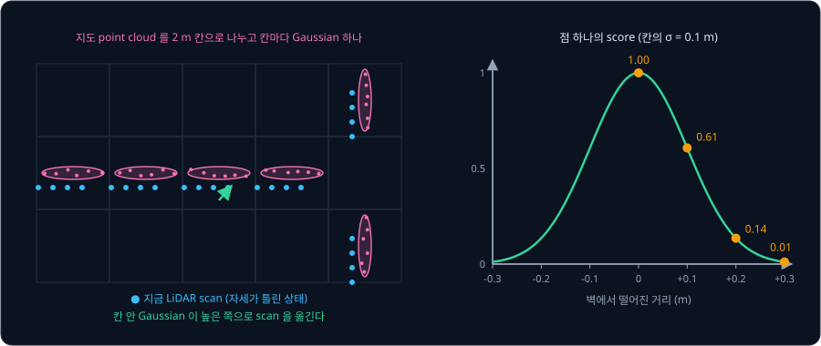
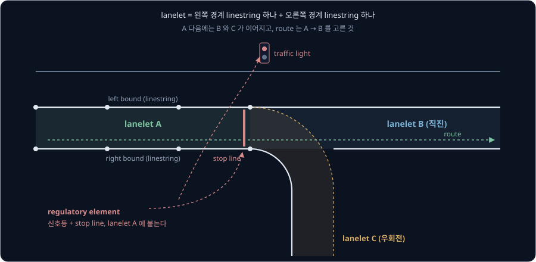
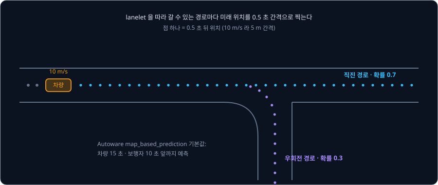
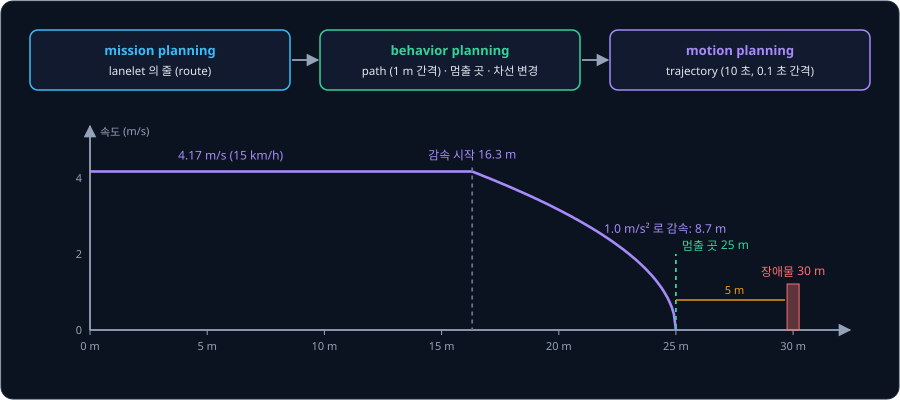
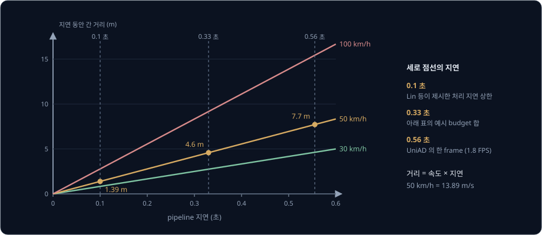

# Autonomous Driving Stack

시속 50 km 로 달리는 차는 1초에 13.9 m 를 가므로, LiDAR 가 앞의 보행자를 잡은 순간부터 브레이크가 걸리기까지 0.3 초만 걸려도 그사이
4 m 넘게 더 나아간다. 그 짧은 시간에 차는 지도 위의 자기 위치, 주변 물체가 갈 곳, 자기가 갈 길과 속도를 모두 정하고 핸들과 브레이크
명령까지 내야 한다. 이 일을 어떻게 나눠야 제때 끝낼 수 있을까?

자율주행차는 이 일을 localization, perception, prediction, planning, control 같은 module 로 나누고, module 마다 정해진 주기로 앞
module 의 결과를 받아 계산한다. 이렇게 나눈 소프트웨어 전체를 **autonomous driving stack** 이라고 부른다. Shinpei Kato 등이 공개한
Autoware 는 localization 부터 control 까지 모든 module 을 갖춘 오픈소스 stack 으로, 지금은 Autoware Foundation 이 ROS 2 위에서 개발한다.

## 학습 목표

- 센서 입력이 localization, perception, prediction, planning, control 을 거쳐 차량 명령이 되는 흐름과, module 마다 주고받는 데이터와
  계산 주기를 설명할 수 있다
- NDT scan matching 으로 point cloud 지도 위에서 차의 위치를 찾는 원리와, Lanelet2 지도가 prediction 과 planning 에 주는 정보를 설명할 수 있다
- pipeline 지연이 정지 거리를 얼마나 늘리는지 계산하고, SAE level 과 ODD 로 자율주행 기능의 책임 범위를 설명할 수 있다
- modular stack 과 UniAD 같은 end-to-end 방식의 장단점을 비교할 수 있다

## 자율주행 stack 의 module

[Autoware 의 설계 문서](https://docs.autoware.org/main/design/autoware-architecture-v1/)는 stack 을 Sensing, Map, Localization,
Perception, Planning, Control, Vehicle Interface 로 나눈다. module 하나는 ROS 2 node 여러 개로 이루어지고, module 사이에서는 메시지
형식이 정해진 topic 으로 결과를 넘긴다. Autoware 는 prediction 을 Perception 안에 두지만, 이 강의에서는 하는 일이 달라서 따로 본다.

module 마다 받는 것, 내는 것, 계산 주기는 아래와 같고, 주기는 Autoware 기본 설정 파일의 값이다.

| module | 받는 것 | 내는 것 | 주기 |
| --- | --- | --- | --- |
| Sensing | LiDAR, camera, IMU, GNSS 의 원본 | 시각을 맞추고 걸러 낸 point cloud, image | 센서마다 다름 |
| Localization | point cloud, point cloud 지도, IMU·바퀴 속도 | 지도 좌표계의 pose, 속도, 가속도와 그 covariance | 50 Hz (`predict_frequency`) |
| Perception | point cloud, image, 자기 위치, 지도 | 주변 물체의 종류·위치·크기·속도, 신호등 색 | 센서 frame 마다 |
| Prediction | 추적한 물체, Lanelet2 지도 | 물체마다 미래 경로 여러 개와 그 확률 | 차량은 15 초 앞까지 |
| Planning | 자기 위치, 물체와 예측, 지도, 목적지 | 10 초 길이의 trajectory (0.1 초 간격) | 10 Hz (`planning_hz`) |
| Control | trajectory, 자기 위치 | steering 각, 목표 속도·가속도 | 0.03 초마다 (`ctrl_period`) |

module 은 앞 module 이 끝나기를 기다리지 않고 각자의 주기로 가장 최근에 받은 입력을 써서 계산한다. LiDAR scan 은 1초에 10 번 안팎인데
localization 이 50 Hz 로 위치를 내는 것은 scan 과 scan 사이를 IMU 와 바퀴 속도로 예측해 채우기 때문이고, 이 예측과 보정은
[Kalman Filter](../kalman-filter/README.md) 에서 본 EKF 가 맡는다. planning 이 10 Hz 로 trajectory 를 내는 사이에 control 이 0.03 초마다
명령을 다시 계산하는 구조는, policy 가 목표를 내면 PID 가 그 목표를 더 자주 따라가는 [PID Control](../pid-control/README.md) 의 두 층
구조와 같다.

module 사이의 메시지가 정해져 있어서, Autoware 는 localization 의 pose 추정 방법을 LiDAR 기반 NDT(기본값)와 camera 기반 YabLoc 등에서
launch 인자 `pose_source` 하나로 바꿔도 나머지 module 은 그대로 둔다. Control 끝의 `vehicle_cmd_gate` 는 비정상적인 명령을 걸러 내고,
고장이 나면 명령의 출처를 trajectory follower 에서 비상 정지용 module 로 바꾼다.

**흔한 오해.** "planning 이 끝나야 control 이 계산을 시작한다." control 은 planning 을 기다리지 않고 0.03 초마다 계산한다. 새 trajectory 가
오기 전까지는 지난번 trajectory 를 따라가고, 새 trajectory 가 0.9 초 넘게 오지 않으면(`cyclic_message_timeout_thr_sec`) 진단 메시지로 오류를 알린다.

**확인 문제.** planning 이 10 Hz, control 이 0.03 초마다 계산한다. trajectory 하나가 새로 올 때까지 control 은 몇 번 계산할까?

답 보기

planning 은 $1 \div 10 = 0.1$ 초마다 trajectory 를 내고 $0.1 \div 0.03 \approx 3.3$ 이라서, 같은 trajectory 로 3 ~ 4 번 계산한다.

## NDT scan matching 과 localization

차가 차로 안에서 달리려면 자기 위치를 수십 cm 안쪽으로 알아야 한다. Autoware 의 localization 문서는 GNSS 만 쓰면 오차가 10 m 쯤이고,
기준국 보정을 받는 RTK-GNSS 나 3D LiDAR 와 point cloud 지도를 쓰면 10 cm 쯤이라고 적는다. 10 m 가 틀리면 옆 차로나 인도 위에 있다고
계산하게 되므로, 건물이 GNSS 신호를 가리는 도심에서는 주로 LiDAR scan 을 지도와 맞춰 본다.

미리 차를 몰며 모은 point cloud 를 지도(point cloud map)로 저장해 두고, 지금 LiDAR 가 본 scan 을 이 지도에 겹쳐 가장 잘 맞는 자세를
찾는 일을 **scan matching** 이라고 한다. [LiDAR SLAM](../lidar-slam/README.md) 에서 본 ICP 는 scan 의 점마다 지도에서 가장 가까운 점을
짝지어 거리를 줄인다. 한편 Autoware 가 기본으로 쓰는 **NDT**(Normal Distributions Transform)는 점을 짝짓지 않고, 지도를 일정한 크기의
칸으로 나눠 칸 안의 지도 점들을 평균과 covariance 로 정한 Gaussian 하나로 바꿔 둔다. 벽이 지나가는 칸의 Gaussian 은 벽을 따라 길고 벽에
수직한 방향으로는 얇은 타원 모양이 된다.

자세 후보가 하나 주어지면 scan 의 점을 모두 그 자세로 옮겨 지도 좌표에 놓고, 점마다 그 점이 들어간 칸의 Gaussian 값을 score 로 받아
더한다. 벽에 수직한 방향의 표준편차가 0.1 m 인 칸이라면, 최댓값을 1 로 맞춘 score 는 점이 벽에서 떨어진 거리에 따라 아래처럼 바뀐다.

| 벽에서 떨어진 거리 | 0.3 m | 0.2 m | 0.1 m | 0 m |
| --- | --- | --- | --- | --- |
| score $e^{-d^2 / (2 \times 0.1^2)}$ | 0.01 | 0.14 | 0.61 | 1.00 |

score 는 자세를 조금 바꿀 때마다 매끄럽게 변하므로, 어느 쪽으로 옮겨야 score 가 커지는지 [미분](../derivatives/README.md) 으로 구할 수
있다. NDT 는 Newton 방법으로 자세를 고치고 score 를 다시 계산하기를 되풀이하다가, 자세가 거의 바뀌지 않으면 멈춘다. σ 가 0.1 m 인
칸에서는 0.5 m 만 틀려도 score 가 $e^{-12.5}$ 로 사실상 0 이고 기울기도 없어서, NDT 를 쓰려면 처음 자세가 어느 정도 맞아야 한다. 칸을
크게 잡으면 Gaussian 이 넓게 퍼져 더 많이 틀린 자세에서도 기울기를 찾지만, 지도의 세밀한 모양은 뭉개진다.

Autoware 의 `ndt_scan_matcher` 기본 설정은 아래와 같다.

| parameter | 기본값 | 뜻 |
| --- | --- | --- |
| `resolution` | 2.0 m | 지도를 나누는 칸의 한 변 |
| `max_iterations` | 30 | 자세를 고치는 최대 횟수 |
| `trans_epsilon` | 0.01 | 연속한 두 자세의 차이가 이보다 작으면 수렴으로 본다 |
| `critical_upper_bound_exe_time_ms` | 100 ms | 계산이 이보다 오래 걸리면 matching 이 잘못됐을 가능성으로 본다 |
| `particles_num` | 200 | 처음 자세를 찾을 때 시험하는 후보 자세 수 |

맨 처음에는 GNSS 나 사람이 RViz 에서 찍어 준 대략의 자세 주변에서 후보 200 개를 시험해 score 가 가장 높은 자세로 시작하고, 그 뒤로는
EKF 가 예측한 자세에서 출발한다. NDT 결과는 표준편차 0.15 m(covariance 0.0225 m²)로 EKF 에 들어가는데, 이 값은 경험으로 정한 고정값이다.

NDT 결과는 scan 을 찍은 시각보다 늦게 나온다. 그래서 Autoware 의 `ekf_localizer` 는 과거 50 step(50 Hz 로 1 초)의 상태를 저장해
두었다가, 늦게 온 결과를 scan 을 찍은 시각의 상태에 맞춰 반영한다. 센서 메시지의 시각(`header.stamp`)에 처리를 마친 시각이 아니라 센서가
측정한 시각을 적어야 하는 것도 이 때문이다.

**흔한 오해.** "score 가 높게 나오면 위치가 맞다." 위 그림에서 가로로 놓인 벽의 Gaussian 은 벽에 수직한 방향의 자세만 잡아 주고, 벽을
따라 미끄러진 자세에서는 score 가 거의 바뀌지 않는다. 그 방향은 그림 오른쪽의 세로 벽이 잡아 준다. 양쪽 벽이 나란히 길게 이어지는 터널이나
고가도로에는 앞뒤 방향을 잡아 줄 모양이 없어서, score 가 높은데도 위치가 차의 진행 방향으로 어긋날 수 있다.

**확인 문제.** σ = 0.1 m 인 칸들 위에 scan 점 세 개가 있다. 자세 A 에서는 점들이 벽에서 0.1, 0.1, 0.2 m, 자세 B 에서는 0, 0.2, 0.3 m
떨어진다. NDT 는 어느 자세를 고를까?

답 보기

위 표의 score 를 더하면 A 는 $0.61 + 0.61 + 0.14 = 1.36$, B 는 $1.00 + 0.14 + 0.01 = 1.15$ 라서 합이 큰 A 를 고른다. B 에는 딱 맞는
점이 하나 있지만 나머지 두 점이 많이 벗어나 있다.

<b>심화: NDT 의 score 와 Newton 방법</b>

칸 $k$ 에 들어간 지도 점 $\mathbf{y}_1, \dots, \mathbf{y}_m$ 으로 평균과 covariance 를 구한다.

$$
\boldsymbol{\mu}_k = \frac{1}{m}\sum_i \mathbf{y}_i, \qquad \Sigma_k = \frac{1}{m - 1}\sum_i (\mathbf{y}_i - \boldsymbol{\mu}_k)(\mathbf{y}_i - \boldsymbol{\mu}_k)^\top
$$

자세 $\mathbf{p}$(위치와 회전)로 scan 점 $\mathbf{x}_j$ 를 옮긴 점을 $T(\mathbf{p}, \mathbf{x}_j)$ 라고 하면, score 는 점마다 그 점이 들어간
칸의 Gaussian 값을 더해 구한다.

$$
s(\mathbf{p}) = \sum_j \exp\!\left(-\tfrac{1}{2}\,(T(\mathbf{p}, \mathbf{x}_j) - \boldsymbol{\mu}_k)^\top \Sigma_k^{-1} (T(\mathbf{p}, \mathbf{x}_j) - \boldsymbol{\mu}_k)\right)
$$

$\Sigma_k^{-1}$ 이 방향마다 다른 무게를 주므로, 벽에 수직한 방향으로 벗어나면 score 가 빨리 떨어지고 벽을 따라 벗어나면 천천히 떨어진다.
Newton 방법은 $s$ 의 gradient $\mathbf{g}$ 와 두 번 미분한 행렬(Hessian) $H$ 로 $H\,\Delta\mathbf{p} = -\mathbf{g}$ 를 풀어 자세를
$\Delta\mathbf{p}$ 만큼 고친다. Biber 와 Straßer 가 2003 년 2D scan 에 이 방법을 제안했고, Magnusson 등이 2007 년 3D point cloud 로 넓혔다.
Autoware 는 3D point cloud 를 matching 하므로 3D 판을 쓴다.

## HD map 과 Lanelet2

localization 이 쓰는 point cloud 지도에는 점만 있을 뿐 "여기가 차로다", "여기서 서야 한다" 같은 뜻은 없다. 차로마다 경계와 연결, 그
차로의 교통 규칙까지 담은 지도를 **HD map**(high-definition map)이라고 부르고, Autoware 는 HD map 형식으로 Lanelet2 를 쓴다.

Lanelet2 는 KIT 의 Poggenhans 등이 2018 년 공개한 지도 형식이자 C++ library 로, 지도를 아래 다섯 가지 요소로 만든다.

- point: 3차원 위치가 적힌 점. 위치는 point 에만 적고, 나머지 요소는 모두 point 를 이어 만든다
- linestring: point 두 개 이상을 순서대로 이은 선. 차선 표시, 연석, 차로의 경계를 나타낸다
- lanelet: 차가 한 방향으로 움직이는 지도의 가장 작은 구간. 왼쪽 경계 linestring 하나와 오른쪽 경계 linestring 하나로 정해지고, 구간
  안에서는 교통 규칙과 다른 lanelet 과의 연결이 바뀌지 않는다
- area: 주차장이나 광장처럼 정해진 진행 방향이 없는 구역
- regulatory element: 속도 제한, 신호등, 정지선, 우선 통행 같은 교통 규칙. 그 규칙을 따라야 하는 lanelet 이 이 요소를 참조한다

이어지는 lanelet 은 경계의 끝점을 공유하므로, 지도를 읽으면 "lanelet A 다음에는 B 와 C 로 갈 수 있다" 는 연결 graph 가 따로 적지 않아도
나온다. 경계 linestring 이 점선인지 실선인지를 보면 옆 lanelet 으로 차로를 바꿔도 되는지 알 수 있다. 위 그림의 lanelet A 를 달리는 차는
끝에 붙은 regulatory element 를 보고, 신호가 빨간색이면 stop line 앞에 서야 한다는 것을 안다.

Autoware 는 두 지도를 함께 쓴다. point cloud 지도(PCD 파일)는 localization 의 NDT 가 쓰고, Lanelet2 지도는 목적지까지의 route 계산,
behavior planning, 다른 차의 경로 예측, 신호등 위치 찾기에 쓴다. Autoware 의 지도 요구 사항에 따르면 lanelet 마다 앞뒤·좌우 lanelet 과의
연결과 속도 제한·신호등·정지선 같은 규칙이 빠짐없이 들어 있어야 하고, 지도는 차가 달릴 지역 전체를 덮어야 한다. 목적지까지의 route 는
lanelet 을 node 로 삼은 graph 위의 최단 경로라서, [Path Planning](../path-planning/README.md) 에서 본 graph 탐색으로 구한다.

HD map 이 있으면 perception 이 매 순간 차선과 규칙을 화면에서 찾아낼 필요가 없지만, 지도를 만들어야 하고 도로 공사나 차선 변경이 있을
때마다 고쳐야 한다. 지도가 없는 지역은 달릴 수 없으므로 HD map 의 범위는 뒤에서 볼 ODD 의 경계가 된다.

## perception 과 prediction

perception 은 LiDAR 와 camera 로 주변 물체를 찾아 종류·위치·크기·속도를 내고, 물체마다 번호(ID)를 붙여 frame 이 바뀌어도 같은 물체로
추적한다. 물체를 찾고 추적하는 방법은 [LiDAR Perception](../lidar-perception/README.md) 에서 다뤘다. Autoware 의 perception 은 분류한
물체 목록과 함께 종류를 몰라도 피해야 할 장애물의 point cloud 를 따로 내서, detector 가 처음 보는 물체를 놓쳐도 planning 은 그 자리에
무언가 있다는 것을 안다.

planning 에 필요한 것은 물체의 지금 위치가 아니라, 내 차가 그곳을 지날 때 그 물체가 있을 위치다. **prediction** 은 추적한 물체마다
앞으로의 경로를 내고, 갈 수 있는 경로가 여럿이면 경로마다 확률을 붙인다. Autoware 의 `map_based_prediction` 은 물체가 올라 있는 lanelet
을 찾은 뒤, 그 lanelet 에서 이어지는 lanelet 마다 경로를 하나씩 만든다.

위 그림에서는 교차로 뒤로 이어지는 lanelet 이 직진과 우회전 둘이라 경로도 둘이고, 두 경로의 확률 0.7 과 0.3 은 설명을 위해 정한 값이다.
Autoware 의 기본값은 차량의 경로를 15 초 앞까지 0.5 초 간격으로 만들어서, 경로 하나에 점이 $15 \div 0.5 = 30$ 개 찍히고 10 m/s
면 $10 \times 15 = 150$ m 앞까지 간다. 보행자는 10 초 앞까지 예측하고, 경로가 차로 중앙에서 좌우로 벗어날 수 있는 정도는 표준편차
0.5 m(`sigma_lateral_offset`)로 둔다.

**흔한 오해.** "prediction 은 물체의 지금 속도로 직선을 그어 늘이면 된다." 교차로나 굽은 길에서 직선으로 늘인 경로는 인도나 건물 쪽으로
뻗는다. 지도의 차로 모양을 따라가야 다른 차가 실제로 갈 수 있는 곳을 예측할 수 있고, 갈 수 있는 길이 여럿이면 경로도 여럿 내야 한다.

**확인 문제.** 보행자가 1.39 m/s 로 걷는다. 10 초 앞까지 0.5 초 간격으로 예측하면 경로 하나에 점이 몇 개 찍히고, 마지막 점은 지금
위치에서 몇 m 떨어져 있을까?

답 보기

점은 $10 \div 0.5 = 20$ 개이고, 마지막 점은 $1.39 \times 10 = 13.9$ m 떨어져 있다.

## behavior planning 과 motion planning

Autoware 의 planning 은 세 층으로 나뉜다. mission planning 은 지금 위치에서 목적지까지 거쳐 갈 lanelet 의 줄(route)을 정한다.
**behavior planning** 은 교통 규칙과 주변 상황을 보고 차로 변경, 교차로 진입, 정지선이나 횡단보도 앞 정지, 길가에 선 차를 피해 돌아가기
같은 행동 중 무엇을 할지 정하고, 1 m 쯤 간격의 점으로 된 path 와 멈출 곳을 낸다. **motion planning** 은 이 path 를 따라 시간마다 위치와
속도를 정한 trajectory 를 만든다. 승차감을 위해 가속도와 jerk(가속도가 변하는 정도)를 제한하고 앞 장애물과 거리를 두며, 결과는 10 초
길이에 0.1 초 간격의 점으로 control 에 넘긴다.

위 그림은 Autoware 기본값으로 계산한 예다. 기본 최고 속도는 4.17 m/s(15 km/h)이고, 감속도는 평소 1.0 m/s² 를 쓰되 꼭 필요하면
2.5 m/s² 까지 허용한다. 장애물 앞에서는 5 m(`stop_margin`)를 두고 서므로, 30 m 앞에 장애물이 있으면 25 m 에 서야 한다. 4.17 m/s 에서
1.0 m/s² 로 서는 데는 $4.17^2 \div (2 \times 1.0) \approx 8.7$ m 가 필요해서, motion planning 은 $25 - 8.7 = 16.3$ m 에서 감속을
시작하는 속도를 trajectory 에 적는다. 정지선에서는 정지선 바로 앞(`stop_margin` 0 m)에 서서 1 초(`required_stop_duration_sec`)를 머문 뒤
출발한다.

| 층 | Autoware 의 구현 | 내는 것 |
| --- | --- | --- |
| mission planning | `mission_planner` | 목적지까지의 lanelet route |
| behavior planning | `behavior_path_planner`, `behavior_velocity_planner` | path 의 모양(차로 변경·회피)과 멈출 곳(정지선·횡단보도·신호등) |
| motion planning | `motion_velocity_planner`, `velocity_smoother` | 장애물 앞 정지와 감속, 가속도·jerk 한계 안의 속도 |

behavior planning 의 결정은 HD map 의 규칙과 prediction 결과에서 나온다. 보행자의 예측 경로가 횡단보도를 지나면 횡단보도 앞에 서고, 옆
차로 차량의 예측 경로가 내 차의 경로와 같은 시각에 겹치면 차로를 바꾸지 않는다.

**흔한 오해.** "planning 은 장애물에 부딪히지 않는 경로 하나를 찾는 일이다." 부딪히지 않는 경로라도 정지선을 넘거나 반대 차로로 가면 안
되고, 다른 차가 움직이므로 같은 경로라도 언제 지나는지에 따라 안전이 달라진다. 그래서 planning 은 경로가 아니라 trajectory 를 낸다.

**확인 문제.** 4.17 m/s 로 가다가 30 m 앞에 장애물이 나타나 2.5 m/s² 로 감속해야 한다. 5 m 를 두고 서려면 몇 m 지점에서 감속을 시작해야 할까?

답 보기

서는 데 $4.17^2 \div (2 \times 2.5) \approx 3.5$ m 가 필요하고, 설 곳은 $30 - 5 = 25$ m 라서 $25 - 3.5 = 21.5$ m 에서 감속을 시작한다.

## control

control 은 trajectory 를 실제 차의 steering 각과 목표 가속도로 바꾼다. Autoware 의 `trajectory_follower` 는 좌우 방향을 맡는 lateral
controller 와 앞뒤 방향을 맡는 longitudinal controller 를 0.03 초마다 계산한다. lateral controller 는 기본이 MPC 이고 pure pursuit 로 바꿀
수 있는데, 두 방법은 [Path Tracking](../path-tracking/README.md) 에서 다뤘다. longitudinal controller 는 목표 속도와 실제 속도의 오차로
가속도를 정하는 PID 다.

| parameter | 기본값 | 뜻 |
| --- | --- | --- |
| `ctrl_period` | 0.03 초 | control 을 계산하는 주기 |
| `mpc_prediction_horizon` × `mpc_prediction_dt` | 50 × 0.1 초 | MPC 가 미래를 예측하는 길이 5 초 |
| `input_delay` | 0.24 초 | steering 명령이 실제 바퀴 각도에 나타나기까지의 지연 |
| PID `kp`, `ki`, `kd` | 1.0, 0.1, 0.0 | 속도 오차에 곱하는 gain |
| `delay_compensation_time` | 0.1 초 | 가속·감속 명령의 지연 |

차의 steering 은 명령을 받자마자 돌지 않는다. 50 km/h(13.89 m/s)에서 0.24 초면 $13.89 \times 0.24 \approx 3.3$ m 를 가므로, 지금 위치로
steering 을 계산하면 그 명령이 3.3 m 앞에서야 바퀴에 나타나 커브마다 바퀴가 늦게 꺾인다. 그래서 Autoware 의 MPC 는 0.24 초 뒤의 상태를 먼저
예측하고, 그 상태에서 출발해 steering 을 계산한다.

## latency budget

센서가 물체를 본 순간부터 그에 맞는 명령이 바퀴에 나타날 때까지 걸리는 시간을 pipeline 의 **latency**(지연)라고 한다. 그동안 차는 원래
속도 그대로 달리므로 지연 동안 간 거리는 속도 × 지연이다.

Lin 등은 2018 년 논문에서 사람 운전자가 가장 빨리 반응해도 100 ~ 150 ms 가 걸린다는 연구를 근거로, 자율주행 system 은 처리 지연을
100 ms 안으로 두고 1초에 10 번 넘게 계산해야 한다고 정리했다. 같은 논문이 인용한 연구에서 사람은 끼어들 상황을 예상하고 있으면 반응에
600 ms, 예상하지 못하면 850 ms 가 걸린다.

지연은 한 단계에서만 생기지 않는다. 브레이크를 밟아야 하는 상황의 지연을 단계별로 나누면 아래와 같다. perception·prediction·planning 의
처리 시간은 실측값이 아니라 Lin 등이 제시한 상한 100 ms 를 그대로 빌린 가정이고, 나머지는 주기와 Autoware 기본값에서 나온다.

| 단계 | 가장 긴 지연 | 근거 |
| --- | --- | --- |
| LiDAR 가 그 방향을 다시 볼 때까지 | 100 ms | 1초에 10 바퀴 도는 LiDAR 라 $1 \div 10$ 초 |
| perception·prediction·planning 처리 | 100 ms | 가정 (Lin 등의 처리 지연 상한을 그대로 씀) |
| control 의 다음 계산까지 | 30 ms | `ctrl_period` |
| 브레이크가 실제로 걸리기까지 | 100 ms | longitudinal controller 의 `delay_compensation_time` |
| 합 | 330 ms | |

50 km/h 에서 330 ms 면 $13.89 \times 0.33 \approx 4.6$ m 를 브레이크 없이 지나간다. 그 뒤 2.5 m/s² 로 감속하면 서는 데
$13.89^2 \div (2 \times 2.5) \approx 38.6$ m 가 더 들어서, 물체를 보고 서기까지 43.2 m 가 필요하다. 속도가 두 배인 100 km/h 에서는 지연
동안 간 거리가 9.2 m 로 두 배가 되고, 감속 거리는 154 m 로 네 배가 된다.

Lin 등은 평균 지연이 아니라 99.99 percentile 같은 꼬리 지연(tail latency)으로 판단해야 한다고 강조한다. 평균이 80 ms 여도 1 만 번에 한 번
300 ms 가 걸리면, 10 Hz 로 1 시간 달리는 동안 36,000 번 계산하므로 그런 일이 3 ~ 4 번 생긴다. 그 논문의 측정에서도 multicore CPU 의
localization 은 평균 지연으로는 기준을 맞췄지만 꼬리 지연으로는 맞추지 못했다.

**흔한 오해.** "LiDAR 가 10 Hz 이고 planning 도 10 Hz 이므로 지연은 0.1 초다." 주기는 결과가 얼마나 자주 나오는지이고, 지연은 그 결과가
얼마나 오래된 정보로 계산됐는지다. 앞 단계가 다음 scan 을 처리하는 동안 뒤 단계가 앞 scan 의 결과를 처리하면 1초에 내는 결과의 수는
그대로인데 지연만 길어져서, 10 Hz 로 나온 planning 결과가 0.3 초 전의 scan 으로 계산한 것일 수 있다.

**확인 문제.** 100 km/h 로 달리는 차의 pipeline 지연이 0.2 초다. 지연 동안 차는 몇 m 를 갈까?

답 보기

100 km/h 는 $100 \div 3.6 \approx 27.78$ m/s 라서 $27.78 \times 0.2 \approx 5.6$ m 다.

## SAE level 과 ODD

SAE International 의 표준 J3016 은 주행 중 사람과 system 이 무엇을 나눠 맡는지에 따라 자율주행 기능을 level 0 ~ 5 로 나눈다. J3016 은 운전 중 해야 하는 일 전체를 DDT(dynamic driving task)라고 부르고, 차를 가속·제동·조향하는 일과 주변 물체와
사건을 알아채고 대응하는 일(OEDR, object and event detection and response)을 DDT 에 넣는다. 무언가 잘못됐을 때 차를 안전하게 처리하는
일은 **fallback** 이라고 따로 부르고, 기능이 동작하도록 설계된 조건은 **ODD**(operational design domain)라고 한다. 아래 표는 카네기멜런
대학 Koopman 의 J3016 해설을 따라 level 마다 맡는 일을 정리했다.

| level | 이름 | system 이 맡는 일 | 사람이 맡는 일 |
| --- | --- | --- | --- |
| 0 | No Driving Automation | 없음 (자동 긴급 제동처럼 잠깐만 개입하는 기능은 level 0 에 든다) | DDT 전체 |
| 1 | Driver Assistance | ODD 안에서 속도와 조향 중 하나 | 나머지 DDT 전부 |
| 2 | Partial Driving Automation | ODD 안에서 속도와 조향 둘 다 (OEDR 은 일부만) | system 이 못 알아채는 사건을 알아채고 직접 운전해 대응 |
| 3 | Conditional Driving Automation | ODD 안에서 DDT 전체 | 개입 요청이나 명백한 고장에 대비하다가 fallback |
| 4 | High Driving Automation | ODD 안에서 DDT 와 fallback 전체 | ODD 안에서는 없음 |
| 5 | Full Driving Automation | 제한 없는 ODD 에서 DDT 와 fallback 전체 | 없음 |

ODD 에는 지역뿐 아니라 도로 종류, 속도 범위, 날씨, 밝기, 차선 상태, HD map 이 있는지 같은 조건이 모두 들어간다. Mercedes-Benz 의 DRIVE
PILOT 은 level 3 기능으로, 독일 아우토반의 오른쪽 차로에서 앞차를 따라 달릴 때 95 km/h 까지 동작한다. 처음에는 정체 구간에서 60 km/h
까지만 동작했는데, 2024 년 12 월 독일 연방자동차청(KBA)이 95 km/h 까지 승인했고, Mercedes 는 이 조건이면 13,191 km 길이의 독일 아우토반
전체에서 쓸 수 있다고 밝혔다. 운전자는 요청을 받으면 바로 운전을 넘겨받아야 하고, 응답이 없으면 system 이 뒤따르는 차가 대응할 수 있게
차를 세운다.

이렇게 ODD 를 벗어나거나 고장이 나서 더 달릴 수 없을 때 차를 세워 사고 위험을 줄인 상태를 J3016 은 MRC(minimal risk condition)라고
부르고, Autoware 에서는 앞에서 본 `vehicle_cmd_gate` 가 차를 이 상태로 만든다.

엔지니어에게 ODD 는 요구 사항의 출발점이다. 최고 속도를 정하면 앞 절의 latency budget 과 센서가 봐야 할 거리가 따라 정해진다. 달릴
지역을 정하면 HD map 을 만들 범위가 정해지고, 비나 밤까지 포함하면 써야 할 센서와 검증할 장면이 늘어난다.

**흔한 오해.** "level 숫자가 높을수록 더 안전한 차다." J3016 은 누가 무엇을 맡는지를 나누는 용어 표준이고 안전 기준이 아니다. Koopman 은
해설에서, 운전자 감시 system 이 허술한 level 2 차는 운전자가 방심하는 탓에 level 1 차보다 사고가 더 많을 수도 있다고 짚는다.

## modular 와 end-to-end

지금까지 본 stack 은 사람이 module 을 나누고 module 사이에 주고받을 것을 정한 **modular** 구조다. 물체 목록, 예측 경로, trajectory 처럼
interface 가 정해져 있어서 module 마다 따로 만들고 시험할 수 있고, 차가 이상하게 움직이면 어느 module 의 출력이 틀렸는지 찾아볼 수 있다.
대신 앞 module 이 버린 정보는 뒤 module 이 쓸 수 없다. perception 이 box 목록만 넘기면 흐릿한 물체나 보행자의 몸 방향처럼 box 로 정리되지
않은 단서는 planning 까지 오지 않고, 앞 module 의 오차는 뒤로 갈수록 쌓인다. 또 module 마다 detection 정확도나 예측 오차 같은 자기 기준으로
학습하므로, 그 기준이 좋아져도 운전이 나아진다는 보장이 없다.

**end-to-end** 방식은 센서 입력에서 경로까지를 network 하나로 잇고, 최종 경로로 계산한 loss 로 전체를 함께 학습한다. Hu 등이 2023 년
CVPR 에서 발표한 UniAD 는 tracking, 지도 그리기(online mapping), 움직임 예측, 점유 예측(occupancy), planning 을 한 network 안에 두고, 사람이
정한 box 목록 대신 학습한 vector(query)로 다음 부분에 정보를 넘긴다.

UniAD 는 camera 영상만으로 위에서 내려다본 feature(BEV, bird's-eye view)를 만들고, HD map 대신 MapFormer 가 차로와 횡단보도를 그 자리에서
그린다. nuScenes dataset 에서 3 초 앞까지의 계획 경로를 사람이 실제로 운전한 경로와 비교한 결과는 아래와 같다. L2 는 1, 2, 3 초 시점에서
잰 두 경로의 위치 차이를 평균한 값이고, 충돌률은 계획한 경로가 다른 물체와 겹친 비율이다.

| 방법 | 평균 L2 | 평균 충돌률 |
| --- | --- | --- |
| ST-P3 (이전 camera 기반 end-to-end) | 2.11 m | 0.71% |
| UniAD | 1.03 m | 0.31% |

대신 UniAD 는 A100 GPU 한 장에서 1초에 1.8 frame 을 처리해 한 frame 에 $1 \div 1.8 \approx 0.56$ 초가 걸린다. Lin 등의 기준 100 ms 보다
다섯 배 넘게 길고, 50 km/h 에서 $13.89 \times 0.56 \approx 7.7$ m 를 가는 시간이다.

**흔한 오해.** "nuScenes 의 L2 가 작으면 운전을 잘하는 것이다." 이 평가는 기록된 주행 장면을 보여 주고 계획 경로를 사람의 경로와 비교할
뿐, 계획대로 차를 움직였을 때 장면이 어떻게 바뀌는지는 보지 않는다(open-loop 평가). Li 등은 2024 년, nuScenes 데이터의 73.9% 가 직진
장면이라서 주변을 거의 보지 않고 내 차의 속도만으로 경로를 늘여도 L2 가 작게 나온다는 것을 보였다. 실제 운전 능력은 계획대로 움직인
결과가 다음 입력으로 돌아오는 closed-loop simulation 이나 실차 시험으로 확인해야 한다.

두 방식의 경계는 뚜렷하지 않다. Autoware 의 detection 도 학습한 network 이고, UniAD 도 network 안에 tracking·mapping·예측 부분을 따로 두고
각각의 정답으로 함께 학습한다. 어디까지를 학습으로 잇고 어디에 사람이 읽을 수 있는 interface 와 규칙을 남길지가 설계에서 고를 문제다.

## 정리

- autonomous driving stack 은 sensing, localization, perception, prediction, planning, control 로 나뉘고, module 마다 정해진 메시지를 각자의
  주기로 주고받는다. Autoware 기본값으로 localization 은 50 Hz, planning 은 10 Hz 로 결과를 내고, control 은 0.03 초마다 계산한다
- localization 은 NDT 로 지도를 2 m 칸의 Gaussian 으로 바꿔 LiDAR scan 의 score 가 가장 큰 자세를 찾고, EKF 로 IMU·바퀴 속도와 합친다.
  Lanelet2 지도는 차로의 경계·연결·교통 규칙을 담아 prediction 과 planning 이 쓴다
- planning 은 route 를 정하는 mission, 무엇을 할지 정하는 behavior, 시간마다 속도를 정하는 motion 의 세 층이다. pipeline 지연은 속도 ×
  지연만큼 정지 거리를 늘려서, 50 km/h 에서 330 ms 면 4.6 m 가 더해진다
- SAE level 은 DDT 와 fallback 을 사람과 system 이 어떻게 나누는지를 정하고, ODD 는 기능이 동작하도록 설계된 조건을 정한다. UniAD 같은
  end-to-end 방식은 module 사이의 정보 손실을 줄이지만 지연과 검증이 과제로 남는다

**면접에서 "자율주행 software stack 을 설명해 보세요" 라고 물으면.** "localization 이 HD map 위의 pose 를 추정하고, perception 이 주변
객체를 detection·tracking 하고, prediction 이 객체별 미래 trajectory 를 여러 개 냅니다. planning 은 route 를 정하는 mission planning, 차로
변경·정지를 결정하는 behavior planning, 가속도·jerk 제약 안에서 trajectory 를 만드는 motion planning 으로 나뉘고, control 이 MPC 로 steering
을, PID 로 가속도를 정합니다. Autoware 에서는 NDT scan matching 결과를 EKF 로 IMU 와 합쳐 50 Hz 로 내고, planning 은 10 Hz, control 은 30 ms
주기입니다. 설계에서는 ODD 로 요구 사항을 정하고, sensing 부터 actuation 까지의 latency 를 tail latency 기준으로 관리하는 것이 중요합니다.
UniAD 같은 end-to-end 방식은 module 사이의 정보 손실을 줄이지만, 추론 지연과 open-loop 평가의 한계가 남아 있습니다."

UniAD 는 사람이 운전한 기록을 정답으로 삼아 network 를 학습한다. 사람의 시연을 정답 삼아 policy 를 학습하는 이 방법을 behavior cloning
이라고 하는데, 1989 년의 ALVINN 이 이미 카메라 영상과 거리 센서 값만으로 차의 핸들 방향을 냈다. 이 방법과, 학습한 policy 가 시연에 없던
상황에서 점점 어긋나는 이유는 robot learning 트리의 [Behavior Cloning](../behavior-cloning/README.md) 에서 다룬다.

## 참고 자료

- Autoware Documentation, [Autoware architecture](https://docs.autoware.org/main/design/autoware-architecture-v1/) — module 구성과
  [Localization](https://docs.autoware.org/main/design/autoware-architecture-v1/components/localization/)·[Planning](https://docs.autoware.org/main/design/autoware-architecture-v1/components/planning/)·[Map](https://docs.autoware.org/main/design/autoware-architecture-v1/components/map/)
  component 의 입출력과 요구 사항
- Autoware, [`ndt_scan_matcher.param.yaml`](https://github.com/autowarefoundation/autoware_core/blob/main/localization/autoware_ndt_scan_matcher/config/ndt_scan_matcher.param.yaml) —
  parameter 마다 뜻을 주석으로 단 NDT 기본 설정 파일
- Kato et al., [Autoware on Board](https://doi.org/10.1109/ICCPS.2018.00035) (2018) — Autoware 의 module 구성과 embedded 보드에서의 실행 지연
- Biber & Straßer, [The Normal Distributions Transform](https://doi.org/10.1109/IROS.2003.1249285) (2003) — 2D scan 을 칸별 Gaussian 으로 바꿔
  점의 짝 없이 matching 하는 NDT 원 논문. 3D 판은 Magnusson 등의 [Scan registration for autonomous mining vehicles using 3D-NDT](https://doi.org/10.1002/rob.20204) (2007)
- Poggenhans et al., [Lanelet2](https://www.mrt.kit.edu/z/publ/download/2018/Poggenhans2018Lanelet2.pdf) (2018) — point·linestring·lanelet·area·regulatory
  element 의 정의와 지도의 층 구조
- Lin et al., [The Architectural Implications of Autonomous Driving](https://doi.org/10.1145/3173162.3173191) (2018) — 2.4 절에 100 ms·10 Hz
  지연 기준의 근거와 사람의 반응 시간, tail latency 로 평가해야 하는 이유가 있다
- Philip Koopman, [SAE J3016 User Guide](https://users.ece.cmu.edu/~koopman/j3016/index.html) — level 표가 따른 해설. J3016 의 level, DDT,
  fallback, ODD, MRC 정의를 원문 조항과 함께 풀고 흔한 오해를 짚는다
- heise, [Autonomous driving: Mercedes is allowed to drive up to 95 km/h](https://heise.de/-10209142) (2024) — DRIVE PILOT 의 95 km/h 승인과
  오른쪽 차로·앞차 조건, 운전자가 응답하지 않을 때의 정지
- electrive, [Mercedes receives approval for new autonomous system in Germany](https://www.electrive.com/2024/12/17/mercedes-receives-approval-for-new-autonomous-system-in-germany) (2024) —
  13,191 km 아우토반 전체라는 사용 범위
- Hu et al., [Planning-oriented Autonomous Driving](https://arxiv.org/abs/2212.10156) (2023) — UniAD 논문. 표 7 이 planning 결과, 부록 표 13 이
  실행 속도다
- Li et al., [Is Ego Status All You Need for Open-Loop End-to-End Autonomous Driving?](https://arxiv.org/abs/2312.03031) (2024) — nuScenes
  open-loop planning 평가의 한계 분석
