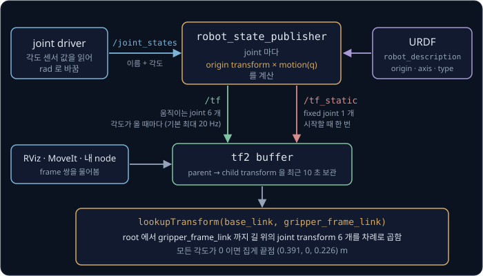
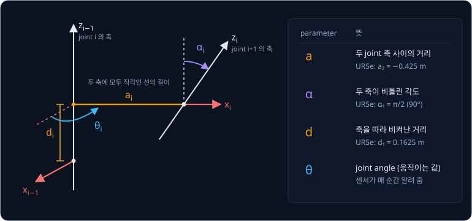

# Forward Kinematics

카메라로 컵을 찾으면 "로봇 base 에서 앞으로 30 cm, 왼쪽으로 10 cm" 처럼 위치가 나오지만, SO-101 같은 로봇 팔의 motor 여섯 개에서
읽을 수 있는 숫자는 저마다 몇 도 돌아가 있는지뿐이다. 각도밖에 모르는 팔은 지금 집게 끝이 컵에서 몇 cm 떨어져 있는지 어떻게 알까?

로봇은 자기 몸의 치수를 적은 파일에서 관절이 어디에 있고 어느 축으로 도는지를 읽고, 지금 각도를 넣어 base 에서 집게 끝까지 관절을 하나씩
거치며 위치를 계산한다. 이 계산이 forward kinematics 다. ROS 2 로봇에서는 `robot_state_publisher` 가 URDF 와 지금의 관절 각도로 joint 마다
transform 을 계산해 tf2 에 보내고, RViz 도 이 결과로 화면에 팔을 그린다.

## 학습 목표

- 앞 link 를 기준으로 잰 joint angle 이 쌓이는 방식을 설명하고, 2 관절 평면 팔의 손끝 pose 를 손으로 계산할 수 있다
- joint 마다 고정된 origin transform 에 joint angle 만큼 움직이는 transform 을 곱해 손끝 pose 를 구하는 과정을 URDF 의 항목과 연결해 설명할 수 있다
- ROS 2 에서 `robot_state_publisher` 와 tf2 가 FK 계산을 나눠 맡는 방식을 설명할 수 있다
- DH parameter 와 product of exponentials 가 URDF 와 다른 점을 설명하고, 계산한 손끝이 실물과 어긋나는 원인을 숫자로 설명할 수 있다

## link 와 joint

로봇 팔은 휘지 않는 막대 몇 개를 돌아가는 마디로 이은 구조다. 막대 하나하나를 **link** 라고 하고, 두 link 를 이어 그 사이에서 돌아가게
하는 마디를 **joint** 라고 한다. 맨 아래 link 는 책상에 고정되어 움직이지 않는데 이 link 를 base 라고 부르고, 팔 끝에서 물건을 집는 집게나
흡착판은 **end-effector** 라고 한다. effector 는 일을 하는 것이라는 뜻으로, end-effector 는 팔 끝에서 실제로 일을 하는 부분이다. 이
강의에서는 end-effector 가 있는 팔 끝 자리를 짧게 손끝이라고도 부른다.

위 그림은 이 강의에서 계속 쓰는 평면 팔로, 종이 위에서만 움직여 위치를 $(x, y)$ 두 숫자로 적는다. link 의 길이는 length 의 첫 글자를 따서
$L_1$, $L_2$ 로 쓴다.

joint 마다 motor 가 하나씩 달려 있고, motor 안의 encoder(회전 각도를 재는 센서)가 joint 가 얼마나 돌았는지를 잰다. 이 각도를 **joint
angle** 이라 하고 $\theta_1$, $\theta_2$ 로 적는다.

## forward kinematics

joint angle 에서 손끝의 위치와 방향을 계산하는 일을 **forward kinematics**(FK)라고 한다. kinematics 는 그리스어 kinēma(움직임)에서 온
말로, 힘은 따지지 않고 무엇이 어디에 있고 어떻게 움직이는지만 다루는 분야를 가리킨다. forward 는 원인인 joint angle 에서 결과인 손끝
쪽으로 계산한다는 뜻이다.

위 그림은 link 길이가 둘 다 1 인 팔에 $\theta_1 = 30°$, $\theta_2 = 60°$ 를 넣으면 손끝이 $(0.866, 1.5)$ 에 온다는 것을 보여 준다. 물건을
집는 목표는 손끝이 갈 위치로 주어지는데 로봇이 직접 아는 것은 joint angle 뿐이라서, 손끝이 목표에서 얼마나 떨어져 있는지 재려면 FK 가 있어야
한다.

거꾸로 손끝을 $(0.8, 1.4)$ 에 두는 joint angle 을 구하는 일은 inverse kinematics(IK)라고 한다. IK 를 반복 계산으로 푸는 방법은 그 안에서
FK 를 여러 번 되풀이하므로 FK 를 먼저 알아야 한다.

**확인 문제.** (가) "joint angle 이 $(10°, 20°)$ 일 때 손끝은 어디 있나?" 와 (나) "손끝을 $(0.5, 0)$ 에 대려면 joint angle 이 얼마여야
하나?" 중 forward kinematics 로 답하는 것은?

답 보기

(가)다. (가)는 joint angle 을 넣어 손끝 위치를 구하므로 FK 이고, (나)는 손끝 위치에서 joint angle 을 구하므로 IK 다.

## 2 관절 평면 팔

길이 $L$ 인 막대를 원점을 중심으로 $\theta$ 만큼 돌리면 막대 끝은 $(L\cos\theta, L\sin\theta)$ 에 온다. 그래서 joint 1 이 원점에 있는 팔에서 link 1
끝에 있는 joint 2 의 자리(사람 팔이라면 팔꿈치)는 $(L_1\cos\theta_1, L_1\sin\theta_1)$ 이다.

joint 2 의 각도 $\theta_2$ 는 바닥의 오른쪽 방향이 아니라 link 1 이 뻗은 방향에서 잰다. joint 2 의 motor 는 link 1 끝에 실려 link 1 과 함께
움직이므로, 이 motor 의 encoder 가 잴 수 있는 것은 link 2 가 link 1 에서 꺾인 각도뿐이다. 앞 link 를 기준으로 잰 이런 각도를 상대
각도라고 하는데, 상대 각도는 joint 를 지날 때마다 쌓이므로 link 2 가 바닥에서 보아 가리키는 방향은 두 각도를 더한 $\theta_1 + \theta_2$ 가 된다.

위 그림의 왼쪽은 $\theta_2$ 를 맞게 읽은 경우다. 점선은 link 1 을 그대로 더 뻗은 방향이고 보라색 $60°$ 는 이 점선에서 잰 각도라서, link 2 는
$30° + 60° = 90°$ 방향인 똑바로 위를 가리킨다. 손끝은 팔꿈치에서 link 2 방향으로 $L_2$ 만큼 더 간 자리라서 아래 표처럼 계산한다.

| 단계 | 계산 | 결과 |
| --- | --- | --- |
| 팔꿈치 | $(1 \times \cos 30°,\ 1 \times \sin 30°)$ | $(0.866, 0.5)$ |
| link 2 의 방향 | $\theta_1 + \theta_2 = 30° + 60°$ | $90°$ |
| 더할 이동량 | $(1 \times \cos 90°,\ 1 \times \sin 90°)$ | $(0, 1)$ |
| 손끝 | $(0.866 + 0,\ 0.5 + 1)$ | $(0.866, 1.5)$ |

표를 기호로 쓰면 아래 두 식이 되는데, 팔꿈치의 위치에 link 2 가 더하는 이동량을 더한다는 뜻이다.

$$
x = L_1\cos\theta_1 + L_2\cos(\theta_1 + \theta_2), \qquad y = L_1\sin\theta_1 + L_2\sin(\theta_1 + \theta_2)
$$

> **오해** $\theta_2$ 는 바닥에서 잰 link 2 의 방향이다.
>
> **사실** $\theta_2$ 를 바닥 기준으로 읽어 link 2 의 방향을 $60°$ 로 놓으면 손끝이 $(0.866 + 0.5,\ 0.5 + 0.866) = (1.366, 1.366)$ 으로 계산되어, 맞는 답 $(0.866, 1.5)$ 와
> 가로로 0.5, 세로로 0.134 어긋난다. $\cos(30° + 60°)$ 를 $\cos 30° + \cos 60° = 1.366$ 으로 나눠 계산해도 틀리고, 각도를 먼저 더한 $\cos 90° = 0$ 이 맞다.

**확인 문제.** $L_1 = L_2 = 1$, $\theta_1 = 60°$, $\theta_2 = 30°$ 일 때 손끝은 어디일까?

답 보기

1. 팔꿈치: $(\cos 60°, \sin 60°) = (0.5, 0.866)$
2. link 2 의 방향: $60° + 30° = 90°$ 라서 더할 이동량은 $(\cos 90°, \sin 90°) = (0, 1)$
3. 손끝: $(0.5 + 0,\ 0.866 + 1) = (0.5, 1.866)$

<b>심화: 숫자를 바꾼 예와 link 가 n 개인 평면 팔</b>

$\theta_2$ 만 $45°$ 로 줄여 다시 계산하면 팔꿈치는 $\theta_1$ 만으로 정해지므로 그대로이고 link 2 가 덜 꺾여 손끝이 오른쪽으로 옮겨 간다.

| 단계 | 계산 | 결과 |
| --- | --- | --- |
| 팔꿈치 | $(\cos 30°, \sin 30°)$ | $(0.866, 0.5)$ |
| link 2 의 방향 | $30° + 45°$ | $75°$ |
| 더할 이동량 | $(\cos 75°, \sin 75°)$ | $(0.259, 0.966)$ |
| 손끝 | $(0.866 + 0.259,\ 0.5 + 0.966)$ | $(1.125, 1.466)$ |

joint 가 하나 늘면 쌓을 각도와 더할 이동량이 하나씩 는다. 길이 1 인 link 세 개를 모두 $30°$ 로 꺾으면 아래와 같다.

| link | 방향 | 더할 이동량 | 그 link 끝의 위치 |
| --- | --- | --- | --- |
| 1 | $30°$ | $(0.866, 0.5)$ | $(0.866, 0.5)$ |
| 2 | $30° + 30° = 60°$ | $(0.5, 0.866)$ | $(1.366, 1.366)$ |
| 3 | $60° + 30° = 90°$ | $(0, 1)$ | $(1.366, 2.366)$ |

link 가 $n$ 개면 $k$ 번째 link 의 방향은 1 번부터 $k$ 번까지의 각도를 모두 더한 값이고, 그 방향으로 길이 $L_k$ 만큼 간 이동량을 모두 더하면
손끝이다.

$$
x = \sum_{k=1}^{n} L_k \cos(\theta_1 + \cdots + \theta_k), \qquad y = \sum_{k=1}^{n} L_k \sin(\theta_1 + \cdots + \theta_k)
$$

$\sum_{k=1}^{n}$ 은 $k$ 를 1 부터 $n$ 까지 바꿔 가며 더한다는 뜻이다. 위 표의 "방향" 열이 $\theta_1 + \cdots + \theta_k$ 이고, "더할 이동량" 열에
길이를 곱한 것이 $L_k\cos(\cdots)$ 와 $L_k\sin(\cdots)$ 다.

## 같은 손끝을 만드는 여러 자세와 pose

joint angle 을 정하면 손끝은 식에 따라 하나로 정해지지만, 거꾸로 서로 다른 joint angle 이 같은 손끝을 만들 수는 있다.

| $(\theta_1, \theta_2)$ | 팔꿈치 | link 2 방향 | 손끝 |
| --- | --- | --- | --- |
| $(0°, 0°)$ | $(1, 0)$ | $0°$ | $(2, 0)$ |
| $(90°, 0°)$ | $(0, 1)$ | $90°$ | $(0, 2)$ |
| $(0°, 90°)$ | $(1, 0)$ | $90°$ | $(1, 1)$ |
| $(90°, -90°)$ | $(0, 1)$ | $0°$ | $(1, 1)$ |

셋째 자세는 팔꿈치가 오른쪽 아래 $(1, 0)$ 에 있고 넷째 자세는 왼쪽 위 $(0, 1)$ 에 있는데, 손끝은 둘 다 $(1, 1)$ 이다. 그래서 FK 는 답이 늘
하나지만 IK 는 답이 여럿일 수 있다. 첫째 자세처럼 두 link 가 일직선으로 펴지면 손끝은 원점에서 $L_1 + L_2 = 2$ 만큼 떨어지는데, 이 팔은
원점에서 2 보다 먼 곳에는 어떤 joint angle 로도 닿지 않는다.

같은 $(1, 1)$ 이라도 두 자세는 물건을 잡는 방향이 다르다. 평면 팔의 집게는 마지막 link 에 붙어 함께 돌므로 집게가 향하는 방향은 link 2 의
방향 $\theta_1 + \theta_2$ 와 같다.

위 그림의 왼쪽 자세는 집게가 $0° + 90° = 90°$ 로 위를 향하고, 오른쪽 자세는 $90° + (-90°) = 0°$ 로 오른쪽을 향한다. 이렇게 위치와 방향을
함께 이르는 말을 **pose** 라고 한다. pose 는 평면에서 위치 두 숫자와 방향 하나로 숫자 3 개이고, 3 차원에서는 위치 세 숫자와 방향 세 숫자로
6 개다. FK 의 결과는 정확히 말하면 손끝의 pose 다.

**확인 문제.** $(\theta_1, \theta_2) = (45°, -45°)$ 일 때 손끝의 위치와 집게 방향은?

답 보기

1. 팔꿈치: $(\cos 45°, \sin 45°) = (0.707, 0.707)$
2. link 2 의 방향: $45° + (-45°) = 0°$ 라서 더할 이동량은 $(1, 0)$
3. 손끝: $(0.707 + 1,\ 0.707 + 0) = (1.707, 0.707)$ 이고, 집게는 $0°$ 로 오른쪽을 향한다

## joint transform 의 곱

앞의 식은 평면 2 관절 팔에만 맞는데, 실제 팔은 joint 가 6 ~ 7 개이고 joint 마다 자리와 축이 제각각이다. 그래서 joint 하나를 transform
하나로 적어 차례로 곱하는 방법을 쓰고, 이렇게 하면 로봇마다 식을 새로 세울 필요가 없다.

먼저 link 마다 frame 을 하나씩 붙인다. link 에 붙은 frame 은 link 와 함께 움직이고 돌아서, link 위의 점은 그 frame 에서 재면 joint angle 이
어떻게 바뀌어도 좌표가 그대로다.

위 그림에서 빨간 화살표가 각 frame 의 $x$ 축이고, frame 1 과 frame 2 의 $x$ 축은 각자의 link 를 따라 놓인다. 손끝은 frame 2 에서 보면
언제나 $x$ 축 방향으로 link 2 의 길이만큼 간 $(1, 0)$ 이고, FK 는 이 좌표를 base frame(frame 0)의 좌표 $(0.866, 1.5)$ 로 바꾸는 일이다.

[Rigid Transforms](../transforms/README.md) 에서 본 homogeneous transform 으로 joint 하나를 적어 보자. 원점은 그대로 두고 $\theta$ 만큼
돌리는 transform 을 $R(\theta)$ 라 하고, 돌리지 않고 $x$ 축 방향으로 $L$ 만큼 옮기는 transform 을 $\mathrm{Tr}(L)$ 이라 하자. 앞 frame 에서
다음 frame 으로 가려면 joint 자리까지 옮긴 뒤 joint angle 만큼 돌린다.

| 단계 | 하는 일 | transform |
| --- | --- | --- |
| base → frame 1 | joint 1 이 원점에 있어 옮기지 않고 $\theta_1$ 만큼 돈다 | $T_{01} = R(\theta_1)$ |
| frame 1 → frame 2 | link 1 을 따라 $L_1$ 만큼 옮겨 팔꿈치에 간 뒤 $\theta_2$ 만큼 돈다 | $T_{12} = \mathrm{Tr}(L_1)\,R(\theta_2)$ |
| frame 2 → 손끝 | link 2 를 따라 $L_2$ 만큼 옮긴다. 손끝에는 joint 가 없다 | $T_{2h} = \mathrm{Tr}(L_2)$ |

$T_{01}$ 은 frame 0 에서 본 frame 1 의 pose 이고, $h$ 는 손끝(hand) frame 이다. 옮기는 $\mathrm{Tr}$ 은 link 길이로 고정되고, 돌리는 $R$ 은 joint
angle 에 따라 바뀐다. base 에서 본 손끝은 이 셋을 base 쪽부터 곱한 것이다.

$$
T_{0h} = T_{01}\,T_{12}\,T_{2h} = R(\theta_1)\ \mathrm{Tr}(L_1)\ R(\theta_2)\ \mathrm{Tr}(L_2)
$$

이 곱을 왼쪽부터 하나씩 적용하면 frame 이 팔을 따라 손끝까지 옮겨 간다. 오른쪽에 $R(\theta)$ 를 곱하면 원점은 그대로이고 축만 $\theta$ 만큼
더 돌고, 오른쪽에 $\mathrm{Tr}(L)$ 을 곱하면 원점이 지금 frame 의 $x$ 축 방향으로 $L$ 만큼 간다.

위 그림은 $\theta_1 = 30°$, $\theta_2 = 60°$, $L_1 = L_2 = 1$ 일 때 이 네 단계를 보여 준다. ① $R(30°)$ 로 축이 $30°$ 를 가리키고, ② $\mathrm{Tr}(1)$ 로
그 방향을 따라 1 만큼 가 팔꿈치 $(0.866, 0.5)$ 에 닿는다. ③ $R(60°)$ 로 축이 $30° + 60° = 90°$ 를 가리키고, ④ $\mathrm{Tr}(1)$ 로 위쪽으로
1 만큼 가 손끝 $(0.866, 1.5)$ 에 닿는다. 마지막 frame 의 $x$ 축 방향 $90°$ 가 집게 방향 $\theta_1 + \theta_2$ 와 같으므로, transform 을 곱하면
손끝의 위치와 방향이 한꺼번에 나온다. ③ 까지 곱한 값은 base 에서 본 link 2 의 pose 라서, 충돌 검사에 쓰는 link 하나하나의 pose 도
같은 곱에서 얻는다.

3 차원에서는 transform 이 $4 \times 4$ 행렬이 되고 joint 마다 축이 다르지만 곱하는 방법은 같아서, joint 가 하나 늘면 곱셈도 하나 는다.

> **오해** joint 의 변환은 아무 순서로나 곱해도 된다.
>
> **사실** $R(30°)\,\mathrm{Tr}(1)$ 을 적용하면 원점이 $(0.866, 0.5)$ 에 닿고 $\mathrm{Tr}(1)\,R(30°)$ 를 적용하면 $(1, 0)$ 에 머문다. joint 는 base 에서 손끝 쪽으로 link
> 가 이어진 순서대로 곱해야 한다.

**확인 문제.** $\theta_1 = 0°$, $\theta_2 = 90°$, $L_1 = L_2 = 1$ 일 때 $R(\theta_1)\,\mathrm{Tr}(1)\,R(\theta_2)\,\mathrm{Tr}(1)$ 을 왼쪽부터
적용하며 원점과 $x$ 축 방향을 적어 보자.

답 보기

| 적용한 transform | 원점 | $x$ 축 방향 |
| --- | --- | --- |
| $R(0°)$ | $(0, 0)$ | $0°$ |
| $\mathrm{Tr}(1)$ | $(1, 0)$ | $0°$ |
| $R(90°)$ | $(1, 0)$ | $90°$ |
| $\mathrm{Tr}(1)$ | $(1, 1)$ | $90°$ |

손끝은 $(1, 1)$ 이고 집게는 $90°$ 를 향하므로 앞 절의 표에서 구한 셋째 자세와 같다.

<b>심화: 점에 오른쪽부터 곱하는 계산</b>

같은 곱을 손끝 frame 의 원점 $(0, 0, 1)$ 에 오른쪽 transform 부터 곱해도 같은 답이 나온다. 점 끝의 1 은 homogeneous 좌표에서 이동을
더하게 하는 성분이고, 식에서 점에 가장 가까운 것이 오른쪽 끝이라 그쪽부터 곱한다.

| 차례 | 곱하는 transform | 계산 | 결과 |
| --- | --- | --- | --- |
| 시작 | | 손끝 frame 의 원점 | $(0, 0)$ |
| 1 | $\mathrm{Tr}(1)$ | 가로로 1 이동 | $(1, 0)$ |
| 2 | $R(60°)$ | $(1 \times 0.5 - 0 \times 0.866,\ 1 \times 0.866 + 0 \times 0.5)$ | $(0.5, 0.866)$ |
| 3 | $\mathrm{Tr}(1)$ | 가로로 1 이동 | $(1.5, 0.866)$ |
| 4 | $R(30°)$ | $(1.5 \times 0.866 - 0.866 \times 0.5,\ 1.5 \times 0.5 + 0.866 \times 0.866)$ | $(0.866, 1.5)$ |

마지막 줄은 가로가 $1.299 - 0.433 = 0.866$ 이고 세로가 $0.75 + 0.75 = 1.5$ 다. 중간 결과의 뜻은 왼쪽부터 곱할 때와 다르다. 1 단계의 $(1, 0)$ 은
손끝을 frame 2 에서 본 좌표이고, 3 단계의 $(1.5, 0.866)$ 은 frame 1 에서 본 좌표다.

앞의 흔한 오해에 나온 두 곱은 $3 \times 3$ 행렬 곱으로 확인할 수 있다. $R(30°)\,\mathrm{Tr}(1)$ 의 위치 열에서 첫 성분은 $R(30°)$ 의 첫 행
$(0.866, -0.5, 0)$ 과 $\mathrm{Tr}(1)$ 의 셋째 열 $(1, 0, 1)$ 을 짝지어 곱해 더한 $0.866$ 이고, 둘째 성분은 둘째 행 $(0.5, 0.866, 0)$ 과
짝지은 $0.5$ 라서 원점이 $(0.866, 0.5)$ 에 간다. $\mathrm{Tr}(1)\,R(30°)$ 의 위치 열에서는 첫 성분이 $\mathrm{Tr}(1)$ 의 첫 행 $(1, 0, 1)$ 과
$R(30°)$ 의 셋째 열 $(0, 0, 1)$ 을 짝지은 $1$ 이고, 둘째 성분이 둘째 행 $(0, 1, 0)$ 과 짝지은 $0$ 이라 원점이 $(1, 0)$ 에 머문다.

## URDF

로봇마다 link 길이, joint 의 자리, 도는 축이 다르므로 이 정보를 정해진 형식의 파일 하나에 적어 둔다. ROS 와 MoveIt, Gazebo, Isaac Sim 이
모두 읽는 형식이 URDF(Unified Robot Description Format)이고, `<joint>` 같은 태그로 항목을 적는 XML 파일이다.

위 그림은 2 관절 팔을 link 네 개와 joint 세 개로 적은 URDF 이고, joint 하나가 앞 절의 transform 하나가 된다. joint 하나에 적는 항목은
아래와 같다.

| 태그·속성 | 뜻 | 2 관절 팔의 joint2 |
| --- | --- | --- |
| `type` | joint 가 움직이는 방식 | `revolute` |
| `<parent>` | joint 의 base 쪽 link | link1 |
| `<child>` | joint 의 손끝 쪽 link | link2 |
| `<origin xyz>` | parent link frame 에서 joint 자리까지 옮기는 양 | `1 0 0` |
| `<origin rpy>` | 옮긴 뒤 joint frame 을 고정으로 돌려 두는 각도 | `0 0 0` |
| `<axis>` | joint frame 에서 본 회전축 방향 | `0 0 1` |
| `<limit>` | joint 가 움직일 수 있는 범위와 속도·힘 한계 | (그림에서는 생략) |

`rpy` 는 roll·pitch·yaw 의 머리글자로 $x$ 축, $y$ 축, $z$ 축을 중심으로 돌리는 세 각도다. URDF 의 joint 하나는 바뀌지 않는 `<origin>`
부분과 `<axis>`·$q$ 로 움직이는 부분으로 나눠 늘 아래 꼴로 계산한다.

$$
T_{\text{parent},\,\text{child}} = T^{\text{origin}}\ T^{\text{motion}}(q)
$$

$T^{\text{origin}}$ 은 `<origin>` 의 xyz 와 rpy 로 만든 고정 transform 이고, $T^{\text{motion}}(q)$ 는 `<axis>` 를 중심으로 $q$ 만큼 돌리는
transform 이다. joint 값을 $\theta$ 대신 $q$ 로 적으면 회전 각도와 이동 거리를 한 기호로 함께 가리킬 수 있다. joint2 에 넣으면 $T^{\text{origin}} = \mathrm{Tr}(1)$, $T^{\text{motion}} = R(\theta_2)$ 라서 앞의 $T_{12}$ 와 같다.

위 그림의 점선이 joint frame 이고, $q = 0$ 이면 joint frame 과 child link frame 이 겹친다.

| type | 움직임 | $T^{\text{motion}}(q)$ | $q$ 의 단위 |
| --- | --- | --- | --- |
| revolute | `lower` ~ `upper` 사이에서 돈다 | 축 회전 | rad |
| continuous | 한계 없이 돈다(바퀴) | 축 회전 | rad |
| prismatic | 축 방향으로 미끄러진다(레일) | 축 방향 이동 | m |
| fixed | 두 link 를 붙여 둔다 | 변화 없음 | 없음 |

URDF 는 각도를 radian 으로 적는다. 반 바퀴 $180°$ 가 $\pi \approx 3.1416$ rad 이라 $90°$ 는 1.5708 rad 이고 $1°$ 는 0.01745 rad 이다. LeRobot 의
`RobotKinematics.forward_kinematics` 는 SO-101 의 joint 값을 도 단위로 받아 `np.deg2rad` 로 radian 으로 바꾼 뒤 URDF 계산에 넘긴다.

> **오해** URDF 의 `upper="1.57"` 은 1.57° 라서 joint 가 거의 움직이지 못한다.
>
> **사실** 이 값은 radian 이라 $1.57 \times 180 \div 3.1416 \approx 90°$ 다.

URDF 에는 joint angle 이 없고, link 가 어떻게 이어지고 joint 가 어디에서 어느 축으로 도는지만 적혀 있다. 지금 joint 가 몇 rad 돌아가
있는지는 encoder 로 매 순간 읽으므로 FK 는 URDF 와 encoder 값을 합쳐야 계산할 수 있다. URDF 에 함께 적힌 mesh, 질량과 관성은 FK 에 쓰지 않는다.

**확인 문제.** URDF 에서 어떤 joint 의 `<origin xyz="0 0 2" rpy="0 0 0"/>` 은 무엇을 뜻할까? 이 값은 로봇이 움직이는 동안 바뀔까?

답 보기

parent link frame 에서 $z$ 방향으로 2 m 옮긴 자리에 joint 가 있고, 고정으로 돌려 두는 각도는 없다는 뜻이다. 로봇을 만들 때 정해진 값이라
움직이는 동안 바뀌지 않고, 바뀌는 것은 그 joint 의 $q$ 뿐이다.

## kinematic tree 와 SO-101

지금까지의 팔은 link 가 한 줄로 이어진 chain 이었지만, 실제 로봇의 집게는 두 손가락으로 갈라지고 humanoid 는 몸통에서 팔과 다리로
갈라진다. link 를 점으로 그리고 joint 를 parent 에서 child 로 가는 화살표로 그리면 나뭇가지 모양이 되는데, 이 구조를 **kinematic tree**
라고 한다. 어떤 joint 의 child 도 아닌 맨 위 link 는 root 라고 부른다. link 의 pose 는 root 에서 그 link 까지 가는 길 위의 joint 만 곱해
구하고, 모든 link 의 pose 를 구할 때는 parent 의 pose 에 joint transform 을 곱하는 일을 가지 끝 쪽으로 되풀이한다.

$$
T_{0,\text{child}} = T_{0,\text{parent}}\ T^{\text{origin}}\ T^{\text{motion}}(q)
$$

TheRobotStudio 가 공개한 저가형 로봇 팔 SO-101 의 URDF(`so101_new_calib.urdf`)에는 link 8 개와 joint 7 개(revolute 6 개, fixed 1 개)가 적혀
있다. 위 그림처럼 tree 는 root 인 `base_link` 에서 어깨·팔꿈치·손목의 revolute joint 다섯 개를 지나 `gripper_link` 에 닿은 뒤,
`gripper_frame_link` 와 움직이는 집게 날 `moving_jaw_so101_v1_link` 두 갈래로 나뉜다. `gripper_frame_link` 는 실제 부품 없이 집게 끝점의
자리만 나타내는 link 다. 이 파일은 joint 를 집게 쪽부터 거꾸로 적어 두었기 때문에, FK 를 계산할 때는 파일에 적힌 순서를 쓰지 않고
parent·child 로 tree 를 세운 뒤 그 순서를 따라 곱한다.

모든 joint angle 이 0 인 자세에서 SO-101 은 위팔이 위로 서고 아래팔부터 앞쪽($+x$)으로 수평하게 뻗는다. 이 URDF 의 origin 과 axis 로 FK 를
직접 계산해 보면 link 원점의 위치는 아래와 같다(단위 m).

| link | x | y | z |
| --- | --- | --- | --- |
| `shoulder_link` | 0.039 | 0.000 | 0.062 |
| `upper_arm_link` | 0.069 | −0.018 | 0.117 |
| `lower_arm_link` | 0.097 | −0.018 | 0.229 |
| `wrist_link` | 0.232 | −0.018 | 0.234 |
| `gripper_link` | 0.293 | 0.000 | 0.234 |
| `gripper_frame_link` | 0.391 | 0.000 | 0.226 |

SO-101 의 joint 는 `<axis>` 가 모두 `0 0 1` 인데도 joint 마다 도는 방향이 다른데, `<origin>` 의 `rpy` 가 joint frame 자체를 돌려 놓았기
때문이다. `shoulder_pan` 의 origin 은 `rpy="3.14159 0 -3.14159"` 라서 joint frame 의 $z$ 축이 base 의 아래쪽($-z$)을 향한다. 그래서
`shoulder_pan` 을 $+90°$ 돌리면 위에서 내려다볼 때 팔이 시계 방향으로 돌고, 집게 끝점은 $(0.391, 0, 0.226)$ 에서 $(0.039, -0.353, 0.226)$
으로 옮겨 간다. 회전축의 실제 방향은 `<axis>` 와 `rpy` 를 함께 봐야 알 수 있다.

**확인 문제.** 손목에서 두 손가락이 갈라지는 로봇에서 왼쪽 손가락 끝의 pose 를 구할 때 오른쪽 손가락 joint 의 transform 도 곱해야 할까?

답 보기

곱하지 않는다. root 에서 왼쪽 손가락 끝까지 내려가는 길에 오른쪽 손가락 joint 가 없기 때문이다. 손목까지는 두 손가락이 같은 길을
지나므로, 손목까지의 transform 은 한 번만 계산해 두 손가락에 같이 쓴다.

## robot_state_publisher 와 tf2

ROS 2 로봇에서는 FK 를 두 프로그램이 나눠 맡는다. `robot_state_publisher` 는 시작할 때 URDF 를 `robot_description` parameter 로 받아 tree 를
세우고, `/joint_states` topic 으로 joint 이름과 각도가 들어올 때마다 joint 하나하나의 $T^{\text{origin}}\,T^{\text{motion}}(q)$ 를 계산해
parent → child transform 으로 보낸다. base 에서 손끝까지 곱하는 일은 transform 을 모아 두는 tf2 가 맡아서, 다른 프로그램이 물어볼 때
계산한다.

`robot_state_publisher` 는 값이 바뀌지 않는 fixed joint 를 시작할 때 한 번 `/tf_static` 에 보내는데, 이 topic 은 마지막 메시지를 남겨
두어서 나중에 구독한 node 도 그 값을 받는다. 움직이는 joint 는 `/joint_states` 가 올 때마다 `/tf` 에 보내고, 1초에 보내는 최대 횟수는
`publish_frequency` parameter 로 정하며 기본값은 20 Hz 다.

tf2 buffer 는 받은 transform 을 frame 쌍마다 시각과 함께 보관하고, 기본으로 최근 10 초 동안의 값을 남겨 둔다. RViz 나 직접 만든 node 가
`lookupTransform("base_link", "gripper_frame_link")` 를 부르면 tf2 가 tree 에서 두 frame 을 잇는 길을 찾아 그 위의 transform 을 곱한다.
SO-101 이라면 revolute joint 5 개와 fixed joint 1 개의 transform 을 곱한다. 시각을 함께 주면 그 시각 앞뒤의 값을 보간해 돌려주므로, 손목 카메라가 찍은
사진의 시각으로 물으면 팔이 움직이는 중에도 사진을 찍던 순간의 집게 pose 를 얻는다.

`/joint_states` 에 joint 하나가 빠지면 그 joint 의 transform 이 tf2 에 없어서 그 아래 link 를 묻는 lookup 이 모두 실패하는데, 실제 로봇 없이
URDF 를 확인할 때 `joint_state_publisher` 로 각도를 대신 보내는 것도 이 때문이다. MoveIt 과 LeRobot 은 tf2 를 거치지 않고 FK 를 직접
계산한다. MoveIt 은 URDF 로 만든 `RobotState` 의 `getGlobalLinkTransform` 을 쓰고, LeRobot 의 `RobotKinematics` 는 pinocchio 위에 만든
placo 라이브러리로 `gripper_frame_link` 의 $4 \times 4$ pose 를 구한다.

**확인 문제.** SO-101 에서 `lookupTransform("base_link", "wrist_link")` 를 부르면 tf2 는 joint transform 을 몇 개 곱할까? 그중 `/tf_static`
에서 온 것은 몇 개일까?

답 보기

1. `base_link` 에서 `wrist_link` 까지 가는 길: `shoulder_pan` → `shoulder_lift` → `elbow_flex` → `wrist_flex`
2. 곱하는 transform 은 4 개다
3. 네 joint 가 모두 revolute 라서 전부 `/tf` 에서 왔고, `/tf_static` 에서 온 것은 0 개다

## DH parameter

URDF 는 joint 마다 origin 을 숫자 6 개(xyz 셋과 rpy 셋)로 적는데, 1955 년 Denavit 과 Hartenberg 는 frame 을 놓는 자리를 규칙으로 정해
joint 하나를 숫자 4 개로 적는 방법을 내놓았다. joint 의 회전축을 늘 $z$ 축으로 두고, 이웃한 두 joint 축에 모두 직각인 선을 $x$ 축으로 두는
규칙이다. frame 의 자리를 규칙이 정하므로 6 개 중 2 개가 필요 없어지고, 남은 4 개를 **DH parameter** 라고 한다.

위 그림에서 $a_i$ 는 두 joint 축 사이의 거리이고 $\alpha_i$(alpha)는 두 축이 서로 비틀린 각도다. $d_i$ 는 축을 따라 비켜난 거리이고,
$\theta_i$ 는 joint angle 이다. 앞의 셋은 로봇을 만들 때 정해지고 $\theta_i$ 만 움직인다. Universal Robots 가 공개한 UR5e 의 DH parameter 는 아래와 같다.

| joint | $a$ (m) | $d$ (m) | $\alpha$ (rad) |
| --- | --- | --- | --- |
| 1 | 0 | 0.1625 | $\pi/2$ |
| 2 | −0.425 | 0 | 0 |
| 3 | −0.3922 | 0 | 0 |
| 4 | 0 | 0.1333 | $\pi/2$ |
| 5 | 0 | 0.0997 | $-\pi/2$ |
| 6 | 0 | 0.0996 | 0 |

$d_1 = 0.1625$ m 는 base 에서 어깨 축까지의 높이이고, $a_2 = -0.425$ m 와 $a_3 = -0.3922$ m 는 위팔과 아래팔의 길이다. 모든 각도를 0 으로
두고 이 표로 직접 계산하면 flange(공구를 다는 마지막 면)는 $(-0.817, -0.233, 0.063)$ m 에 온다. 이 점은 base 의 수직축에서 수평으로
$\sqrt{0.817^2 + 0.233^2} \approx 0.850$ m 떨어져 있어 datasheet 의 reach 850 mm 와 맞는다. UR 의 ROS 2 description package 는 같은 치수를
`default_kinematics.yaml` 에 URDF 처럼 joint 마다 x·y·z·roll·pitch·yaw 로 다시 적어서, shoulder 에는 `z: 0.1625` 가 있고 forearm 에는
`x: -0.425` 가 있다.

DH 에는 UR 이 쓰는 원래 규약과 Franka 가 FR3 의 표에 쓰는 Craig 규약(modified DH)이 있고, 한 규약의 표를 다른 규약의 식에 넣으면 다른 팔이
계산된다.

DH 는 숫자가 적어 손으로 계산하기 편하고, UR 과 Franka 같은 제조사는 지금도 문서에 이 표를 싣는다. 대신 frame 을 규칙이 정한 자리에만 놓을 수 있어서
설계 도면의 좌표를 그대로 옮기기 어렵고, 두 축이 평행에 가까우면 두 축에 모두 직각인 선의 자리가 작은 오차에도 크게 바뀐다. URDF 는
숫자 2 개를 더 쓰는 대신 frame 을 원하는 자리에 놓을 수 있다.

**확인 문제.** 이 강의의 2 관절 평면 팔($L_1 = L_2 = 1$)을 원래 DH 규약으로 적으면 두 joint 의 $(a, d, \alpha)$ 는?

답 보기

1. 두 joint 축이 모두 종이를 뚫고 나오는 방향이라 서로 평행하므로 비틀림 $\alpha$ 는 0 이다
2. 모든 frame 을 종이 평면 위에 두면 축을 따라 비켜난 거리 $d$ 도 0 이다
3. 이웃한 축 사이의 거리 $a$ 는 link 길이라서, 두 joint 모두 $(a, d, \alpha) = (1, 0, 0)$ 이다

이 값을 원래 규약 식에 넣으면 joint 하나가 $R(\theta_i)\,\mathrm{Tr}(1)$ 이 되어 앞 절의 곱 $R(\theta_1)\,\mathrm{Tr}(1)\,R(\theta_2)\,\mathrm{Tr}(1)$ 과 같다.

<b>심화: DH 의 joint transform</b>

원래 규약에서는 $z$ 축으로 $\theta$ 돌리고 $d$ 옮긴 뒤 $x$ 축으로 $a$ 옮기고 $\alpha$ 돌리는 네 동작을 차례로 곱해 joint $i$ 의
transform 을 만든다.

$$
T_{i-1,\,i} = R_z(\theta_i)\ \mathrm{Tr}_z(d_i)\ \mathrm{Tr}_x(a_i)\ R_x(\alpha_i)
$$

$R_z$ 는 $z$ 축을 중심으로 돌리는 transform 이고, $\mathrm{Tr}_z$ 는 $z$ 축을 따라 옮기는 transform 이다. Craig 규약은 $x$ 축 쪽 두 동작을 먼저 한다.

$$
T_{i-1,\,i} = R_x(\alpha_{i-1})\ \mathrm{Tr}_x(a_{i-1})\ R_z(\theta_i)\ \mathrm{Tr}_z(d_i)
$$

Craig 규약에서는 $a$ 와 $\alpha$ 의 아래첨자가 하나 앞이라, 같은 팔이라도 표의 줄이 한 칸씩 밀려 보인다. Franka 표의 joint 4 줄에 있는
$a = 0.0825$ 는 joint 3 축과 joint 4 축 사이의 거리다. datasheet 의 DH 표를 쓸 때는 어느 규약인지부터 확인한다.

FR3 의 표는 $d_1 = 0.333$, $d_3 = 0.316$, $a_4 = 0.0825$, $a_5 = -0.0825$, $d_5 = 0.384$, $a_7 = 0.088$ m 이고 flange 까지 $d = 0.107$ m
가 더 붙으며, $\alpha$ 는 joint 1 이 0 이고 나머지가 $\pm\pi/2$ 다. Craig 규약으로 직접 계산하면 모든 각도가 0 일 때는 팔이 위로 곧게
서고 flange 가 $(0.088, 0, 0.926)$ m 에 온다. libfranka 예제가 시작 자세로 쓰는 $(0, -\pi/4, 0, -3\pi/4, 0, \pi/2, \pi/4)$ 에서는
flange 가 $(0.307, 0, 0.590)$ m 에 오고, flange 의 $z$ 축이 아래를 향한다.

## product of exponentials

1984 년 Brockett 이 내놓은 product of exponentials(PoE)는 link 마다 frame 을 붙이지 않는다. 대신 모든 joint angle 이 0 인 자세(zero
configuration)에서 각 joint 의 회전축이 base frame 의 어디에 있는지를 한 번만 적고, zero configuration 의 손끝 pose 에서 출발해 손끝 쪽
joint 부터 그 축을 중심으로 joint angle 만큼 차례로 돌린다.

2 관절 팔의 zero configuration 은 오른쪽으로 쭉 뻗은 자세다. 이 자세에서 joint 1 축은 $(0, 0)$ 을 지나고 joint 2 축은 $(1, 0)$ 을 지나며,
손끝은 $(2, 0)$ 에 있다.
$\theta_1 = 30°$, $\theta_2 = 60°$ 이면 손끝 $(2, 0)$ 을 먼저 $(1, 0)$ 중심으로 $60°$ 돌리고, 그 결과를 $(0, 0)$ 중심으로 $30°$ 돌려
$(0.866, 1.5)$ 를 얻는다. joint 2 를 돌릴 때는 joint 1 이 아직 움직이지 않았으므로 joint 2 의 축이 적어 둔 $(1, 0)$ 그대로이고, 손끝 쪽부터
돌리는 덕에 축을 한 번만 적으면 된다. Modern Robotics 교과서는 FK 를 이 방법으로 설명하면서, link 마다 frame 을 정할 필요 없이 base
frame 과 손끝 frame 만 있으면 되는 것을 장점으로 꼽는다.

**확인 문제.** PoE 로 2 관절 팔에서 $\theta_1 = 90°$, $\theta_2 = 0°$ 일 때 손끝을 구해 보자.

답 보기

1. 시작: zero configuration 의 손끝 $(2, 0)$
2. $(1, 0)$ 을 중심으로 $0°$ 돌리면 그대로 $(2, 0)$
3. $(0, 0)$ 을 중심으로 $90°$ 돌리면 $(2 \times 0 - 0 \times 1,\ 2 \times 1 + 0 \times 0) = (0, 2)$

앞 절의 표에서 구한 $(\theta_1, \theta_2) = (90°, 0°)$ 의 손끝 $(0, 2)$ 와 같다.

<b>심화: PoE 식</b>

zero configuration 에서 손끝의 pose 를 $M$ 이라 하고, joint $i$ 의 회전축을 base frame 에서 적은 것을 screw axis $\mathcal S_i$ 라고 하면
FK 는 아래와 같다.

$$
T_{0h}(\theta) = e^{[\mathcal S_1]\theta_1}\ e^{[\mathcal S_2]\theta_2} \cdots e^{[\mathcal S_n]\theta_n}\ M
$$

2 관절 팔에 $\theta_1 = 30°$, $\theta_2 = 60°$ 를 넣으면 손끝 쪽 joint 부터 이렇게 돌린다.

| 차례 | 하는 일 | 손끝 위치 |
| --- | --- | --- |
| 시작 | zero configuration 의 손끝 | $(2, 0)$ |
| 1 | $(1, 0)$ 을 중심으로 $60°$ 돌린다 | $(1 + \cos 60°,\ \sin 60°) = (1.5, 0.866)$ |
| 2 | $(0, 0)$ 을 중심으로 $30°$ 돌린다 | $(1.5 \times 0.866 - 0.866 \times 0.5,\ 1.5 \times 0.5 + 0.866 \times 0.866) = (0.866, 1.5)$ |

$e^{[\mathcal S_i]\theta_i}$ 는 축 $\mathcal S_i$ 를 중심으로 $\theta_i$ 만큼 돌리는(prismatic joint 라면 축을 따라 옮기는) transform 이고,
exponential 이라는 이름은 이 transform 을 matrix exponential 로 적는 데서 왔다. 위 표처럼 오른쪽 끝 $M$ 에 가까운 손끝 쪽 joint 부터
적용한다. 2 관절 팔에서 $M$ 은 위치 $(2, 0)$ 에 방향 $0°$ 이고, $\mathcal S_1$ 은 $(0, 0)$ 을 지나는 $z$ 축이며 $\mathcal S_2$ 는
$(1, 0)$ 을 지나는 $z$ 축이다.

## 계산과 실물의 차이

FK 계산이 정확해도 실제 손끝은 계산한 자리에서 조금 어긋난다. FK 는 URDF 의 숫자와 encoder 로 읽은 joint angle 이 정확하다고 보고
계산하지만, 실물은 그 숫자와 조금씩 다르다.

- encoder 의 0 점이 실제 joint 의 0 점과 다르면 joint angle 이 늘 그만큼 틀리고, 이 기준을 실물에 맞추는 작업이 calibration 이다
- link 길이와 joint 자리가 제작 공차만큼 URDF 값과 다르다
- 기어의 틈(backlash) 때문에 motor 가 멈춰도 link 가 틈만큼 흔들린다
- 무거운 물건을 들면 link 와 기어가 조금 휘지만 FK 는 휘지 않는다고 가정한다

joint 하나의 작은 각도 오차는 손끝에서 커진다. 반지름 $r$ 인 원에서 $\theta$ rad 만큼 돈 호의 길이가 $r \times \theta$ 이므로, joint 에서
손끝까지 거리가 $r$ 이면 $\Delta\theta$ rad 의 오차가 손끝을 약 $r\,\Delta\theta$ 만큼 옮긴다.

위 그림은 길이 2 로 편 팔의 joint 1 이 $20°$ 대신 $25°$ 로 돈 경우다. $5° = 5 \times 0.01745 \approx 0.0873$ rad 이라 손끝은 약
$2 \times 0.0873 \approx 0.175$ 만큼 어긋난다. SO-101 의 URDF 로 직접 계산해 보면, 모든 joint angle 이 0 인 자세에서 joint 하나만 $1°$
틀리게 넣었을 때 집게 끝점은 아래 표만큼 옮겨 간다.

| joint | 집게 끝점의 이동 |
| --- | --- |
| `shoulder_pan` | 6.15 mm |
| `shoulder_lift` | 5.94 mm |
| `elbow_flex` | 5.13 mm |
| `wrist_flex` | 2.78 mm |
| `wrist_roll` | 0.14 mm |

`shoulder_pan` 은 축에서 집게 끝점까지의 수평 거리가 0.353 m 라서 오차가 $0.353 \times 0.01745 \approx 0.00615$ m 가 되는데, 이처럼 base 에
가까운 joint 일수록 손끝까지 멀어서 오차가 크다. `wrist_roll` 은 회전축이 집게 끝점을 거의 지나가서, $1°$ 틀려도 집게 끝점이 0.14 mm 만
움직인다. 같은 계산을 UR5e 의 DH 표로 하면, 모든 각도가 0 인 자세에서 base joint 가 $1°$ 틀릴 때 flange 는 $0.850 \times 0.01745 \approx 0.0148$ m,
약 15 mm 어긋난다.

repeatability 는 같은 joint angle 로 다시 보냈을 때 같은 자리에 돌아오는 정도이고, accuracy 는 계산한 자리와 실제 자리가 얼마나 맞는지다.
UR5e datasheet 는 pose repeatability 를 ISO 9283 기준 ±0.03 mm 로 적지만, accuracy 는 URDF 의 숫자가 실물과 얼마나 맞는지에 달려 있다.
그래서 UR 의 ROS 2 driver 문서는 공장에서 로봇마다 잰 kinematics
calibration 을 `ur_calibration` 으로 꺼내 URDF 에 반영하라고 권하면서, 반영하지 않으면 손끝 위치가 cm 단위로 어긋날 수 있다고 적는다.

**확인 문제.** 손끝이 base joint 축에서 0.5 m 떨어진 팔에서 base joint 각도가 $2°$ 틀리면 손끝은 대략 몇 mm 어긋날까?

답 보기

1. 각도를 radian 으로: $2° = 2 \times 0.01745 = 0.0349$ rad
2. 호의 길이: $0.5 \times 0.0349 \approx 0.0175$ m
3. 답: 약 17 mm

## 정리

- FK 는 joint angle 에서 손끝 pose 를 구하는 계산이다. 앞 link 기준의 각도가 쌓이므로 $L_1 = L_2 = 1$, $(\theta_1, \theta_2) = (30°, 60°)$ 인
  팔의 손끝은 $(0.866, 1.5)$ 이고 집게는 $90°$ 를 향한다
- joint 하나는 URDF 의 origin 으로 만든 고정 transform 에 axis 를 중심으로 $q$ 만큼 움직이는 transform 을 곱한 것이고, root 에서 손끝까지
  tree 의 길을 따라 이 transform 을 곱하면 손끝 pose 가 나온다. ROS 2 에서는 `robot_state_publisher` 가 joint 하나하나의 transform 을 계산하고 tf2 가 그 곱을 맡는다
- DH parameter 는 같은 FK 를 joint 마다 숫자 4 개로 적고, PoE 는 zero configuration 의 joint 축으로 적는다
- 실물의 손끝은 calibration 오차·치수 차이·기어 틈·휘어짐 때문에 계산한 자리와 다르다. SO-101 에서 base joint 가 $1°$ 틀리면 집게 끝은 약
  6 mm 어긋난다

물건을 집을 때 정작 필요한 것은 집게 끝을 컵 위 5 cm 에 두는 joint angle 을 구하는 반대 방향의 계산이다. 이 계산은 답이 여럿이거나 아예 없을
수 있는데, FK 와 그 미분을 되풀이해 답을 찾아가는 방법은 [Inverse Kinematics](../inverse-kinematics/README.md) 에서 다룬다. 손목에
단 카메라가 본 물체를 base 좌표로 옮기려면 FK 로 구한 집게 pose 에 집게와 카메라 사이의 transform 을 곱해야 하는데, 그 transform 을 구하는
방법은 [Hand-Eye Calibration](../hand-eye-calibration/README.md) 에서 다룬다.

## 참고 자료

- ROS wiki 의 URDF XML 명세 [`<joint>`](http://wiki.ros.org/urdf/XML/joint) · [`<link>`](http://wiki.ros.org/urdf/XML/link) — `origin`·`axis`·`rpy`·`limit`
  의 정확한 정의
- ROS 2 tutorial, [Building a visual robot model from scratch](https://docs.ros.org/en/rolling/Tutorials/Intermediate/URDF/Building-a-Visual-Robot-Model-with-URDF-from-Scratch.html)
  — link 와 joint 를 하나씩 붙여 가며 URDF 를 쓰는 예제
- [ros/robot_state_publisher README](https://github.com/ros/robot_state_publisher) — `/tf` 와 `/tf_static` 의 구분, `publish_frequency` 같은
  parameter 의 기본값
- MoveIt 2, [Robot Model and Robot State](https://moveit.picknik.ai/main/doc/examples/robot_model_and_robot_state/robot_model_and_robot_state_tutorial.html)
  — `RobotState` 로 FK 계산
- [TheRobotStudio/SO-ARM100](https://github.com/TheRobotStudio/SO-ARM100/tree/main/Simulation/SO101) — SO-101 의 URDF 원본
- Universal Robots, [DH parameters for calculations of kinematics and dynamics](https://www.universal-robots.com/articles/ur/application-installation/dh-parameters-for-calculations-of-kinematics-and-dynamics/)
  — UR 모델별 DH 표
- Franka Robotics, [Robot specifications](https://frankarobotics.github.io/docs/robot_specifications.html) — FR3 의 Craig 규약 DH 표
- [ur_calibration README](https://github.com/UniversalRobots/Universal_Robots_ROS2_Driver/tree/main/ur_calibration) — 공장 calibration 을 URDF 에 반영하는 방법
- Lynch & Park, [Modern Robotics](https://hades.mech.northwestern.edu/index.php/Modern_Robotics) 4장 — product of exponentials 로 적는 FK.
  손으로 따라 하는 예는 강의 영상 [Chapter 4: Forward Kinematics Example](https://www.youtube.com/watch?v=cKHsil0V6Qk) 에 있다
