# Forward Kinematics

## 학습 목표

- 로봇 팔의 관절이 돌아간 각도로 팔 끝(손끝)의 위치를 구하는 문제가 무엇이고, 로봇이 왜 이 계산을 해야 하는지 설명할 수 있다
- 길이가 정해진 막대를 어떤 각도로 돌렸을 때 막대 끝이 어디에 오는지 계산할 수 있다
- 관절 두 개짜리 팔에서 각도가 어떻게 쌓이는지 설명하고, 손끝 위치를 손으로 계산할 수 있다
- 회전과 이동을 숫자 표 하나로 묶고, 관절마다 그 표를 하나씩 곱해 손끝 위치를 구할 수 있다
- 로봇의 모양을 적어 두는 파일에 무엇이 적혀 있고 무엇이 없는지 설명할 수 있다
- 관절이 많아져도 같은 계산을 관절 수만큼 되풀이하면 된다는 것을 설명할 수 있다

## 로봇 팔과 손끝 위치

### link 와 joint

책상 위에 놓인 로봇 팔을 떠올려 보자. 팔은 단단한 막대 몇 개가 돌아가는 마디로 이어진 모양이다. 사람 팔에 빗대면 위팔과
아래팔이 막대이고 어깨와 팔꿈치가 마디다.

로봇에서는 휘지 않는 막대 하나하나를 link 라고 하고, 두 link 를 이어 그 사이에서 돌아가게 해 주는 마디를 joint 라고 한다.
link 는 "잇는 고리", joint 는 "이음매" 라는 뜻의 영어 단어다. 맨 아래 link 는 책상에 고정되어 움직이지 않는데, 이것을
base 라고 부른다. 팔 맨 끝에는 물건을 집는 집게나 흡착판 같은 도구가 달리고, 이 끝부분을 end-effector 라고 한다. effector 는
"일을 하는 것" 이라는 뜻이라서, end-effector 는 "팔 끝에서 실제로 일을 하는 부분" 이다. 이 강의에서는 end-effector 의 위치를
쉽게 "손끝" 이라고도 부른다.

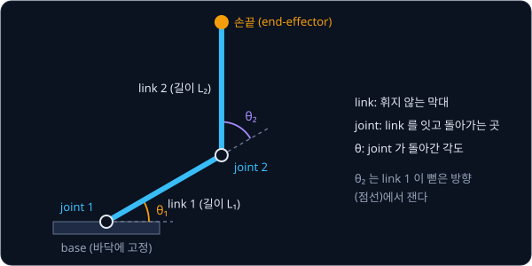

위 그림은 이 강의에서 계속 쓸 가장 단순한 팔을 보여 준다. base 위의 joint 1 에 link 1 이 붙어 있고, link 1 끝의 joint 2 에
link 2 가 붙어 있으며, link 2 끝이 손끝이다. 이 팔은 종이 위에서만 움직이는 평면 팔이라 위치를 $(x, y)$ 두 숫자로 적을 수
있다. link 의 길이는 $L_1$, $L_2$ 로 쓰고, $L$ 은 length(길이)의 첫 글자다. 아래첨자 1, 2 는 몇 번째 link 인지를 나타낸다.

**확인 문제.** 사람 팔에서 어깨부터 손목까지를 위 그림의 부품 이름으로 나누면 link 와 joint 는 각각 몇 개일까? 어깨,
팔꿈치, 손목을 joint 로 본다.

답 보기

joint 는 어깨, 팔꿈치, 손목의 3 개다. 어깨와 팔꿈치 사이(위팔), 팔꿈치와 손목 사이(아래팔)가 link 이므로 이 구간의 link 는
2 개다. 몸통을 base 로, 손을 손목 다음 link 로 보면 link 가 더 늘어난다.

### joint angle

joint 마다 모터가 하나씩 달려 있어서, 모터가 돌면 joint 에 붙은 link 가 돈다. joint 가 얼마나 돌았는지를 나타내는 각도를
joint angle 이라고 한다. 위 그림에서 $\theta_1$ 은 joint 1 의 각도이고 $\theta_2$ 는 joint 2 의 각도다. $\theta$ 는 그리스 문자
theta(세타)이고, 수학에서 각도를 적을 때 흔히 쓰는 글자다.

로봇의 모터에는 지금 몇 도 돌아가 있는지를 재는 센서가 들어 있어서, 로봇은 언제든 자기 joint angle 을 숫자로 안다. 하지만
joint angle 만으로는 손끝이 어디에 있는지 바로 알 수 없다. "$\theta_1 = 30°$, $\theta_2 = 60°$" 라는 두 숫자에서 손끝의 위치
$(x, y)$ 를 얻으려면 계산이 필요하다.

**확인 문제.** joint 가 6 개인 로봇 팔이 있다. 이 팔의 자세를 숫자로 적으려면 joint angle 을 몇 개 알아야 할까?

답 보기

joint 마다 각도가 하나씩이므로 6 개다. 숫자 6 개만 알면 팔 전체의 자세가 정해진다.

### forward kinematics

joint angle 에서 손끝의 위치를 계산하는 일을 forward kinematics 라고 하고, 줄여서 FK 라고 쓴다. kinematics 는 그리스어
kinēma(움직임)에서 온 말로, 힘은 따지지 않고 "어디에 있고 어떻게 움직이는가" 만 다루는 분야를 가리킨다. forward 는
"앞으로" 라는 뜻이며 joint angle 에서 손끝 쪽으로, 원인에서 결과 쪽으로 계산한다는 의미다.

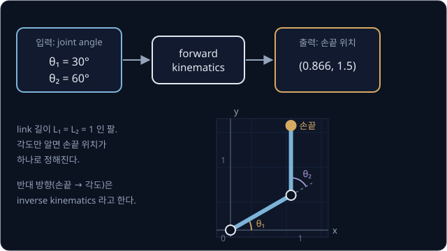

위 그림은 link 길이가 둘 다 1 인 팔에 $\theta_1 = 30°$, $\theta_2 = 60°$ 를 넣으면 손끝이 $(0.866, 1.5)$ 에 온다는 것을 보여
준다. 이 숫자가 어떻게 나오는지가 이 강의의 첫 번째 목표다.

로봇이 이 계산을 해야 하는 이유는 일이 대부분 손끝 위치로 주어지기 때문이다. 카메라가 컵을 찾아 "컵은 $(0.8, 1.4)$ 에 있다"
고 알려 주면, 로봇은 지금 손끝이 컵에서 얼마나 떨어져 있는지 알아야 다음에 어느 쪽으로 움직일지 정할 수 있다. 그런데 로봇이
직접 아는 것은 joint angle 뿐이라서, joint angle 을 손끝 위치로 바꾸는 FK 가 있어야 "지금 손끝은 $(0.866, 1.5)$ 이고 컵보다
조금 오른쪽 위에 있다" 고 판단할 수 있다. 팔이 책상이나 자기 몸에 부딪히지 않는지 검사할 때도 각 link 가 어디 있는지를 FK 로
계산한다.

반대 방향의 계산, 곧 "손끝을 $(0.8, 1.4)$ 에 두려면 joint angle 이 얼마여야 하나" 를 구하는 일은 inverse kinematics(IK)라고
한다. inverse 는 "거꾸로" 라는 뜻이다. IK 는 FK 를 여러 번 되풀이해 계산하므로 FK 를 먼저 알아야 한다.

**확인 문제.** 다음 두 질문 중 forward kinematics 로 답하는 것은 어느 쪽일까? (가) "joint angle 이 $(10°, 20°)$ 일 때 손끝은
어디 있나?" (나) "손끝을 책상 위 $(0.5, 0)$ 에 대려면 joint angle 이 얼마여야 하나?"

답 보기

(가)다. joint angle 에서 손끝 위치를 구하므로 forward kinematics 다. (나)는 손끝 위치에서 joint angle 을 구하므로 inverse
kinematics 다.

**요약**

- 로봇 팔은 단단한 link 가 돌아가는 joint 로 이어진 구조이고, 팔 끝에서 일을 하는 부분이 end-effector(손끝)다
- joint 가 돌아간 각도가 joint angle 이고, 로봇은 모터 센서로 이 값을 직접 안다
- joint angle 에서 손끝 위치를 계산하는 일이 forward kinematics(FK)이고, 반대 방향이 inverse kinematics(IK)다

## 각도와 막대 끝의 위치

### 각도와 회전 방향

각도는 얼마나 돌았는지를 나타내는 숫자다. 한 바퀴를 360 으로 나눈 한 칸을 1 도라 하고 $1°$ 로 쓴다. 그래서 한 바퀴는
$360°$, 반 바퀴는 $180°$, 4 분의 1 바퀴는 $90°$ 다. $90°$ 는 직각이라서, 오른쪽을 가리키던 막대를 $90°$ 돌리면 위를 가리킨다.

좌표평면에서 각도를 잴 때는 오른쪽(가로축 $x$ 의 양의 방향)을 $0°$ 로 두고, 시계 반대 방향으로 돌면 양수, 시계 방향으로
돌면 음수로 센다. 좌표평면은 가로선($x$ 축)과 세로선($y$ 축)을 직각으로 그은 판이고, 점 $(2, 1)$ 은 "오른쪽으로 2 칸, 위로
1 칸" 인 자리다. 이 규칙대로라면 $90°$ 는 위쪽, $180°$ 는 왼쪽, $-90°$ 는 아래쪽이다. $-90°$ 와 $270°$ 는 같은 방향을 가리키는데,
시계 방향으로 4 분의 1 바퀴 도는 것과 시계 반대 방향으로 4 분의 3 바퀴 도는 것이 같은 곳에서 멈추기 때문이다.

**확인 문제.** 오른쪽을 가리키던 막대를 $90°$ 돌린 뒤 다시 $90°$ 더 돌리면 어느 쪽을 가리킬까? $-90°$ 를 한 번 돌리면?

답 보기

$90° + 90° = 180°$ 이므로 왼쪽을 가리킨다. $-90°$ 는 시계 방향으로 4 분의 1 바퀴라서 아래쪽을 가리킨다.

### cos 과 sin

원점(좌표평면의 $(0, 0)$)에 한쪽 끝을 고정한 길이 1 짜리 막대가 처음에 오른쪽을 가리키고 있다고 하자. 막대 끝은 $(1, 0)$
에 있다. 이 막대를 $90°$ 돌리면 끝은 $(0, 1)$ 로 가고, $180°$ 돌리면 $(-1, 0)$ 으로 간다. 이 세 각도는 답이 바로 보이지만,
$30°$ 처럼 비스듬히 돌리면 끝이 어디에 오는지 바로 말하기 어렵다.

수학에서는 이 값에 이름을 붙여 두었다. 길이 1 짜리 막대를 $\theta$ 만큼 돌렸을 때 끝점의 가로 위치를 $\cos\theta$, 세로
위치를 $\sin\theta$ 라고 쓴다. $\cos$ 은 cosine(코사인), $\sin$ 은 sine(사인)을 줄인 것이다. 그래서 끝점은 언제나
$(\cos\theta, \sin\theta)$ 다.

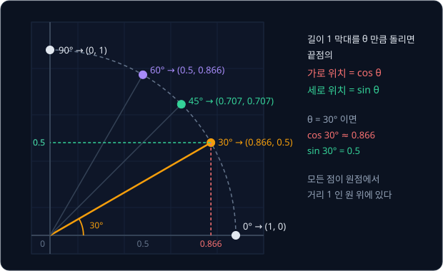

위 그림은 막대를 $0°$, $30°$, $45°$, $60°$, $90°$ 로 돌렸을 때 끝점이 놓이는 자리를 보여 준다. 막대 길이가 늘 1 이므로 끝점은
모두 원점에서 거리 1 인 원 위에 있다. $30°$ 로 돌린 끝점에서 아래로 내린 빨간 점선은 가로축의 0.866 에, 왼쪽으로 그은 초록
점선은 세로축의 0.5 에 닿는다. 그래서 $\cos 30° \approx 0.866$, $\sin 30° = 0.5$ 다. 기호 $\approx$ 는 "약" 이라고 읽고,
값이 소수점 아래로 끝없이 이어져서 반올림했다는 표시다.

이 강의에서 쓰는 각도의 값을 표로 모았다.

| 각도 $\theta$ | $\cos\theta$ (가로) | $\sin\theta$ (세로) |
| --- | --- | --- |
| $0°$ | 1 | 0 |
| $30°$ | 0.866 | 0.5 |
| $45°$ | 0.707 | 0.707 |
| $60°$ | 0.5 | 0.866 |
| $75°$ | 0.259 | 0.966 |
| $90°$ | 0 | 1 |
| $180°$ | $-1$ | 0 |
| $-90°$ | 0 | $-1$ |

$30°$ 와 $60°$ 의 값은 가로와 세로가 서로 바뀌어 있다. $60°$ 로 돌린 막대는 위쪽($90°$)에서 $30°$ 만큼 오른쪽으로 기운 것이라
$30°$ 그림을 대각선으로 뒤집은 모양이기 때문이다. cosine 이라는 이름도 여기서 왔다. co 는 complement(직각을 채우는 나머지 각)를
줄인 것으로, $\theta$ 의 cosine 은 나머지 각 $90° - \theta$ 의 sine 과 같다. $\cos 30° = \sin 60° \approx 0.866$ 이 그 예다.

**확인 문제.** 표를 보고 길이 1 막대를 $60°$ 돌렸을 때 끝점의 위치를 적어 보자. $90°$ 로 돌렸을 때는?

답 보기

$60°$ 는 $(\cos 60°, \sin 60°) = (0.5, 0.866)$ 이고, $90°$ 는 $(\cos 90°, \sin 90°) = (0, 1)$ 이다. $90°$ 면 막대가 똑바로 위를
가리키므로 가로 위치는 0, 세로 위치는 막대 길이 1 그대로다.

### 30° 와 45° 의 값

표의 숫자는 계산기로 얻을 수 있지만, $30°$ 와 $45°$ 는 도형 하나로 직접 확인할 수 있다.

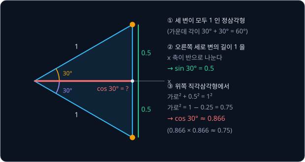

위 그림처럼 길이 1 막대를 $30°$ 로 하나, $-30°$ 로 하나 돌려 두 끝점을 이으면 삼각형이 생긴다. 원점 쪽 각은
$30° + 30° = 60°$ 이고 원점에서 나간 두 변이 모두 1 이다. 두 변의 길이가 같은 삼각형은 나머지 두 각도 같고, 삼각형의 세 각을
더하면 $180°$ 이므로 나머지 두 각은 각각 $(180° - 60°) \div 2 = 60°$ 다. 세 각이 모두 $60°$ 인 삼각형은 세 변의 길이도 모두
같은 정삼각형이라서 오른쪽 세로 변의 길이도 1 이다. 이 세로 변을 가로축이 정확히 반으로 나누므로 위쪽 끝점의 높이는 $1 \div 2 = 0.5$ 이고,
$\sin 30° = 0.5$ 다.

가로 위치는 피타고라스 정리로 구한다. 피타고라스 정리는 직각삼각형에서 "직각을 낀 두 변을 각각 제곱해 더하면 가장 긴 변의
제곱과 같다" 는 규칙이다. 두 변이 3, 4 인 직각삼각형이면 $3^2 + 4^2 = 9 + 16 = 25 = 5^2$ 이라 가장 긴 변이 5 다. 그림 위쪽의
직각삼각형은 가장 긴 변이 1, 세로 변이 0.5 이므로 가로 변을 $a$ 라고 하면 아래와 같다.

$$
a^2 + 0.5^2 = 1^2
$$

$$
a^2 = 1 - 0.25 = 0.75
$$

제곱해서 0.75 가 되는 수를 찾으면 $0.866 \times 0.866 \approx 0.75$ 이므로 $a \approx 0.866$ 이고, 이것이 $\cos 30°$ 다.

$45°$ 는 가로와 세로의 한가운데라서 가로 위치와 세로 위치가 같다. 둘을 $a$ 라고 하면 피타고라스 정리에서 $a^2 + a^2 = 1$,
곧 $a^2 = 0.5$ 이고, $0.707 \times 0.707 \approx 0.5$ 이므로 $\cos 45° = \sin 45° \approx 0.707$ 이다.

**확인 문제.** 끝점이 $(0.6, 0.8)$ 인 막대의 길이가 정말 1 인지 피타고라스 정리로 확인해 보자.

답 보기

$0.6^2 + 0.8^2 = 0.36 + 0.64 = 1 = 1^2$ 이므로 막대 길이는 1 이다. 그래서 이 막대의 각도를 $\theta$ 라고 하면
$\cos\theta = 0.6$, $\sin\theta = 0.8$ 이다.

### 길이가 L 인 막대

막대 길이가 1 이 아니면 끝점의 가로·세로 위치가 길이에 비례해 커진다. 같은 $30°$ 라도 길이 2 짜리 막대는 길이 1 짜리보다
두 배 멀리 나가므로 끝점이 $(2 \times 0.866, 2 \times 0.5) = (1.732, 1)$ 이다. 일반적으로 길이 $L$ 인 막대를 $\theta$ 만큼 돌린
끝점은 아래와 같다.

$$
(x, y) = (L\cos\theta,\ L\sin\theta)
$$

이 식은 "가로 위치는 길이에 $\cos\theta$ 를 곱한 값, 세로 위치는 길이에 $\sin\theta$ 를 곱한 값" 이라는 뜻이다. $L\cos\theta$ 는
$L \times \cos\theta$ 를 줄여 쓴 것이다.

숫자를 바꿔 가며 같은 계산을 표로 정리했다.

| 길이 $L$ | 각도 $\theta$ | $L\cos\theta$ | $L\sin\theta$ | 끝점 |
| --- | --- | --- | --- | --- |
| 2 | $30°$ | $2 \times 0.866 = 1.732$ | $2 \times 0.5 = 1$ | $(1.732, 1)$ |
| 2 | $90°$ | $2 \times 0 = 0$ | $2 \times 1 = 2$ | $(0, 2)$ |
| 3 | $60°$ | $3 \times 0.5 = 1.5$ | $3 \times 0.866 = 2.598$ | $(1.5, 2.598)$ |

**흔한 오해.** $30°$ 는 $90°$ 의 3 분의 1 이니 끝점의 높이도 $90°$ 일 때(높이 1)의 3 분의 1 인 0.333 이라고 생각하기 쉽다.
하지만 $\sin 30° = 0.5$ 다. 끝점은 원을 따라 움직여서 각도가 작을 때는 높이가 빨리 오르고 $90°$ 에 가까워질수록 천천히 오르므로,
각도와 높이는 비례하지 않는다.

**확인 문제.** 길이 4 인 막대를 $30°$ 돌리면 끝점은 어디일까?

답 보기

$(4 \times 0.866, 4 \times 0.5) = (3.464, 2)$ 다.

**요약**

- 각도는 오른쪽을 $0°$ 로 두고 시계 반대 방향을 양수로 센다
- 길이 1 막대를 $\theta$ 만큼 돌린 끝점은 $(\cos\theta, \sin\theta)$ 이고, $30°$ 이면 $(0.866, 0.5)$ 다
- 길이 $L$ 막대의 끝점은 $(L\cos\theta, L\sin\theta)$ 로, 길이를 곱하기만 하면 된다

## 관절 두 개짜리 평면 팔

### 팔꿈치 위치

이제 앞의 팔로 돌아간다. link 길이는 $L_1 = L_2 = 1$ 이고, base 의 joint 1 은 원점 $(0, 0)$ 에 있다. joint 1 이 $\theta_1$ 만큼
돌면 link 1 은 $\theta_1$ 방향을 가리키므로, link 1 의 끝이자 joint 2 가 있는 자리(사람 팔이라면 팔꿈치)는 앞 절의 막대 끝과
같다.

$$
\text{팔꿈치} = (L_1\cos\theta_1,\ L_1\sin\theta_1)
$$

$\theta_1 = 30°$ 이면 팔꿈치는 $(1 \times 0.866, 1 \times 0.5) = (0.866, 0.5)$ 다. 이 강의에서는 joint 2 가 있는 자리를 계속
"팔꿈치" 라고 부른다.

**확인 문제.** $L_1 = 2$, $\theta_1 = 90°$ 이면 팔꿈치는 어디일까?

답 보기

$(2 \times \cos 90°, 2 \times \sin 90°) = (2 \times 0, 2 \times 1) = (0, 2)$ 다. link 1 이 똑바로 위를 가리킨다.

### 상대 각도

joint 2 의 각도 $\theta_2$ 는 바닥의 오른쪽 방향에서 재지 않고 link 1 이 뻗은 방향에서 잰다. joint 2 의 모터는 link 1 끝에 붙어
link 1 과 함께 움직이기 때문이다. 모터가 아는 것은 "link 2 가 link 1 에 대해 몇 도 꺾였는가" 뿐이고, link 1 이 바닥에 대해
어떻게 놓였는지는 모른다. 이렇게 앞 link 를 기준으로 잰 각도를 상대 각도라고 한다.

그래서 link 2 가 바닥에서 보아 가리키는 방향은 두 각도를 더한 $\theta_1 + \theta_2$ 다. $\theta_1 = 30°$, $\theta_2 = 60°$ 이면
link 1 이 이미 $30°$ 기울어 있고 거기서 $60°$ 를 더 꺾으므로, link 2 는 $30° + 60° = 90°$ 방향, 곧 똑바로 위를 가리킨다.

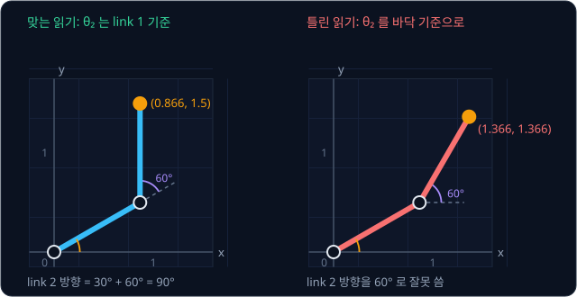

위 그림의 왼쪽은 맞게 읽은 경우다. 점선은 link 1 을 그대로 더 뻗은 방향이고, 보라색 $60°$ 는 이 점선에서 잰 각도다. 오른쪽은
$\theta_2 = 60°$ 를 바닥의 오른쪽 방향에서 잰 것으로 잘못 읽은 경우로, link 2 가 $60°$ 방향을 가리켜 손끝이 엉뚱한 곳에 간다.

**흔한 오해.** $\theta_2$ 를 바닥 기준 각도로 보고 link 2 의 방향을 $60°$ 로 계산하는 실수가 흔하다. 그러면 손끝은 팔꿈치
$(0.866, 0.5)$ 에 $(\cos 60°, \sin 60°) = (0.5, 0.866)$ 을 더한 $(1.366, 1.366)$ 이 되어, 맞는 답 $(0.866, 1.5)$ 와 가로로 0.5
만큼 어긋난다.

사람 팔도 같다. 팔꿈치를 $90°$ 굽힌 채 어깨를 들어 올리면, 팔꿈치 각도는 그대로 $90°$ 지만 아래팔이 가리키는 방향은 어깨를
든 만큼 함께 돈다.

**확인 문제.** $\theta_1 = 45°$, $\theta_2 = 45°$ 이면 link 2 는 바닥에서 보아 몇 도 방향을 가리킬까? $\theta_1 = 90°$,
$\theta_2 = -90°$ 이면?

답 보기

$45° + 45° = 90°$ 이므로 위쪽이다. $90° + (-90°) = 0°$ 이므로 오른쪽이다. 두 번째 경우는 link 1 이 위를 가리키고, link 2 가
거기서 시계 방향으로 $90°$ 꺾여 오른쪽을 가리킨다.

### 손끝 위치 공식

손끝은 팔꿈치에서 link 2 를 따라 $L_2$ 만큼 더 간 자리다. link 2 의 방향이 $\theta_1 + \theta_2$ 이므로, 팔꿈치에서 손끝까지
더해지는 칸은 길이 $L_2$ 막대를 $\theta_1 + \theta_2$ 만큼 돌린 끝점과 같다. 그래서 손끝 위치는 "팔꿈치 + link 2 만큼 더할 칸"
이다.

$\theta_1 = 30°$, $\theta_2 = 60°$, $L_1 = L_2 = 1$ 로 한 단계씩 계산한다.

| 단계 | 계산 | 결과 |
| --- | --- | --- |
| link 1 의 방향 | $\theta_1$ | $30°$ |
| 팔꿈치 | $(1 \times \cos 30°,\ 1 \times \sin 30°)$ | $(0.866, 0.5)$ |
| link 2 의 방향 | $\theta_1 + \theta_2 = 30° + 60°$ | $90°$ |
| 더할 칸 | $(1 \times \cos 90°,\ 1 \times \sin 90°)$ | $(0, 1)$ |
| 손끝 | $(0.866 + 0,\ 0.5 + 1)$ | $(0.866, 1.5)$ |

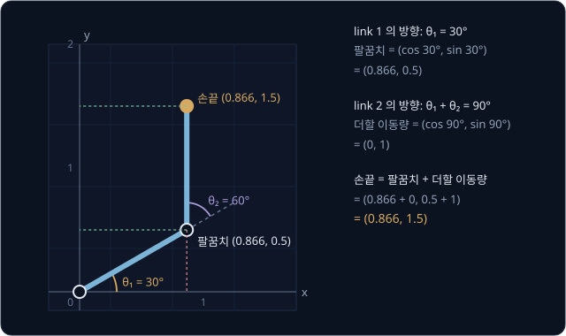

위 그림은 이 계산을 좌표평면에 그린 것이다. 팔꿈치에서 손끝까지는 똑바로 위로 1 만큼 올라가므로, 손끝의 가로 위치는 팔꿈치와
같은 0.866 이고 세로 위치는 $0.5 + 1 = 1.5$ 다.

숫자만 바꿔 $\theta_1 = 30°$, $\theta_2 = 45°$ 로 다시 계산한다.

| 단계 | 계산 | 결과 |
| --- | --- | --- |
| link 1 의 방향 | $\theta_1$ | $30°$ |
| 팔꿈치 | $(1 \times \cos 30°,\ 1 \times \sin 30°)$ | $(0.866, 0.5)$ |
| link 2 의 방향 | $30° + 45°$ | $75°$ |
| 더할 칸 | $(1 \times \cos 75°,\ 1 \times \sin 75°)$ | $(0.259, 0.966)$ |
| 손끝 | $(0.866 + 0.259,\ 0.5 + 0.966)$ | $(1.125, 1.466)$ |

$\theta_2$ 가 $60°$ 에서 $45°$ 로 줄자 link 2 가 덜 꺾여 손끝이 오른쪽으로 옮겨 갔다. 팔꿈치는 $\theta_1$ 만으로 정해지므로 두
계산에서 똑같다.

두 표를 기호로 쓰면 아래 식이 된다.

$$
x = L_1\cos\theta_1 + L_2\cos(\theta_1 + \theta_2)
$$

$$
y = L_1\sin\theta_1 + L_2\sin(\theta_1 + \theta_2)
$$

첫 식은 "손끝의 가로 위치는 팔꿈치의 가로 위치 $L_1\cos\theta_1$ 에 link 2 가 더하는 가로 길이 $L_2\cos(\theta_1 + \theta_2)$
를 더한 값" 이라고 읽는다. 둘째 식은 $\cos$ 대신 $\sin$ 으로 세로 위치를 같은 방식으로 구한다. $\cos(\theta_1 + \theta_2)$ 는
"두 각도를 먼저 더한 뒤 그 각도의 cos" 이라는 뜻이다. 첫 표와 맞춰 보면 $L_1\cos\theta_1$ 은 0.866, $\theta_1 + \theta_2$ 는
$90°$, $L_2\cos(\theta_1 + \theta_2)$ 는 0, $x$ 는 0.866 이다.

**흔한 오해.** $\cos(30° + 60°)$ 를 $\cos 30° + \cos 60°$ 로 나눠 계산하면 안 된다. $\cos 90° = 0$ 인데
$\cos 30° + \cos 60° = 0.866 + 0.5 = 1.366$ 으로 전혀 다르다. 각도를 먼저 더해 link 2 의 방향을 정한 뒤 cos 을 구한다.

**확인 문제.** $L_1 = L_2 = 1$, $\theta_1 = 60°$, $\theta_2 = 30°$ 일 때 손끝은 어디일까?

답 보기

팔꿈치는 $(\cos 60°, \sin 60°) = (0.5, 0.866)$ 이다. link 2 의 방향은 $60° + 30° = 90°$ 라서 더할 칸은 $(0, 1)$ 이다. 손끝은
$(0.5 + 0, 0.866 + 1) = (0.5, 1.866)$ 이다.

**확인 문제.** $L_1 = 2$, $L_2 = 1$, $\theta_1 = 30°$, $\theta_2 = 60°$ 이면 손끝은 어디일까?

답 보기

팔꿈치는 $(2 \times 0.866, 2 \times 0.5) = (1.732, 1)$ 이다. link 2 방향은 $90°$ 라서 더할 칸은 $(1 \times 0, 1 \times 1) = (0, 1)$
이다. 손끝은 $(1.732, 2)$ 다.

### 같은 손끝을 만드는 두 자세

joint angle 을 정하면 손끝 위치는 공식에 따라 딱 하나로 정해진다. 그런데 거꾸로, 서로 다른 joint angle 이 같은 손끝 위치를
만들 수는 있다.

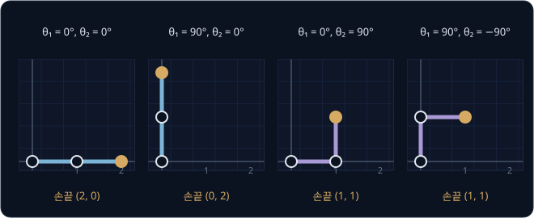

위 그림은 네 가지 자세를 나란히 놓은 것이다. 표로 하나씩 계산해 본다.

| $(\theta_1, \theta_2)$ | 팔꿈치 | link 2 방향 | 더할 칸 | 손끝 |
| --- | --- | --- | --- | --- |
| $(0°, 0°)$ | $(1, 0)$ | $0°$ | $(1, 0)$ | $(2, 0)$ |
| $(90°, 0°)$ | $(0, 1)$ | $90°$ | $(0, 1)$ | $(0, 2)$ |
| $(0°, 90°)$ | $(1, 0)$ | $90°$ | $(0, 1)$ | $(1, 1)$ |
| $(90°, -90°)$ | $(0, 1)$ | $0°$ | $(1, 0)$ | $(1, 1)$ |

셋째 자세는 팔꿈치가 오른쪽 아래 $(1, 0)$ 에 있고, 넷째 자세는 팔꿈치가 왼쪽 위 $(0, 1)$ 에 있다. 팔 모양은 다른데 손끝은 둘
다 $(1, 1)$ 이다. 그래서 FK 는 언제나 답이 하나지만, 손끝 위치에서 joint angle 을 구하는 IK 는 답이 여럿일 수 있다. 사람도
팔꿈치를 아래로 내리거나 옆으로 들어 올린 채 같은 자리에 손을 댈 수 있다.

첫째 자세처럼 두 link 가 일직선으로 펴지면 손끝은 원점에서 $L_1 + L_2 = 2$ 만큼 떨어진다. 이것이 이 팔이 닿을 수 있는 가장
먼 거리라서, 원점에서 2 보다 먼 곳에는 어떤 joint angle 로도 손끝이 닿지 않는다.

**확인 문제.** $(\theta_1, \theta_2) = (45°, -45°)$ 일 때 손끝은 어디일까?

답 보기

팔꿈치는 $(\cos 45°, \sin 45°) = (0.707, 0.707)$ 이다. link 2 방향은 $45° + (-45°) = 0°$ 라서 더할 칸은 $(1, 0)$ 이다. 손끝은
$(1.707, 0.707)$ 이다.

### 손끝의 방향

물건을 집으려면 손끝이 어디 있는지뿐 아니라 집게가 어느 쪽을 향하는지도 알아야 한다. 컵을 옆에서 잡으려면 집게가 옆을 향해야
하고, 위에서 집으려면 아래를 향해야 한다. 평면 팔에서는 집게가 마지막 link 에 붙어 함께 돌므로, 집게가 향하는 방향은 link 2 의
방향 $\theta_1 + \theta_2$ 와 같다.

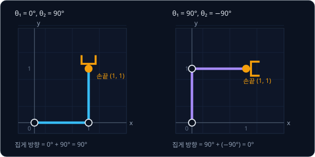

위 그림은 앞 절의 셋째, 넷째 자세에 집게를 그려 넣은 것이다. 손끝 위치는 둘 다 $(1, 1)$ 이지만 왼쪽 자세의 집게는
$0° + 90° = 90°$ 로 위를 향하고, 오른쪽 자세의 집게는 $90° + (-90°) = 0°$ 로 오른쪽을 향한다. 위치만 보면 같은 자세처럼 보여도
물건을 잡는 방향은 전혀 다르다.

| $(\theta_1, \theta_2)$ | 손끝 위치 | 집게 방향 $\theta_1 + \theta_2$ |
| --- | --- | --- |
| $(30°, 60°)$ | $(0.866, 1.5)$ | $90°$ |
| $(0°, 90°)$ | $(1, 1)$ | $90°$ |
| $(90°, -90°)$ | $(1, 1)$ | $0°$ |

이렇게 위치와 방향을 함께 이르는 말을 pose 라고 한다. 평면에서 pose 는 위치 두 숫자 $(x, y)$ 와 방향 하나로 숫자 3 개이고,
3 차원에서는 위치 세 숫자와 방향 세 숫자로 6 개다. 그래서 FK 의 결과는 정확히 말하면 손끝의 위치가 아니라 손끝의 pose 다.

**확인 문제.** $(\theta_1, \theta_2) = (30°, 45°)$ 이면 집게는 몇 도 방향을 향할까? $(45°, -45°)$ 이면?

답 보기

$30° + 45° = 75°$ 방향이다. $45° + (-45°) = 0°$ 이므로 오른쪽을 향한다.

**요약**

- 팔꿈치는 $(L_1\cos\theta_1, L_1\sin\theta_1)$ 이다
- $\theta_2$ 는 link 1 을 기준으로 잰 상대 각도라서, link 2 의 방향은 $\theta_1 + \theta_2$ 다
- 손끝 = 팔꿈치 + 길이 $L_2$ 막대를 $\theta_1 + \theta_2$ 만큼 돌린 칸이고, joint angle 이 같으면 손끝은 하나로 정해진다
- 집게가 향하는 방향도 $\theta_1 + \theta_2$ 이고, 위치와 방향을 함께 묶은 것이 pose 다

## 관절마다 곱하는 transform

앞 절의 공식은 joint 두 개짜리 평면 팔에서는 잘 맞지만, 실제 로봇 팔은 joint 가 6 개쯤 되고 3 차원에서 움직인다. joint 가 link
끝이 아니라 옆으로 비켜난 자리에 붙어 있기도 하고, 도는 축이 joint 마다 다른 쪽을 향하기도 한다. 그때마다 새 공식을 만들 수는
없으므로, joint 하나가 위치를 어떻게 바꾸는지를 숫자 표 하나로 적고 그 표를 차례로 곱하기만 하면 되는 방법을 쓴다. 이렇게 위치를
바꾸는 계산을 transform(변환)이라고 한다. 이 절에서는 그 방법을 앞의 두 joint
팔에 그대로 적용해 같은 답 $(0.866, 1.5)$ 가 나오는 것을 확인한다.

### link 에 붙은 frame

[Rigid Transforms](../transforms/README.md) 에서 다룬 frame 은 원점 하나와 서로 직각인 축들로 이루어진, 좌표를 재는 기준이다.
같은 점이라도 어느 frame 에서 재느냐에 따라 좌표가 달라진다. 평면에서는 축이 $x$, $y$ 두 개다.

FK 에서는 link 마다 frame 을 하나씩 붙인다. link 에 붙은 frame 은 link 와 함께 움직이고 돌아서, link 위의 점은 그 frame
에서 재면 joint angle 이 어떻게 바뀌어도 좌표가 그대로다.

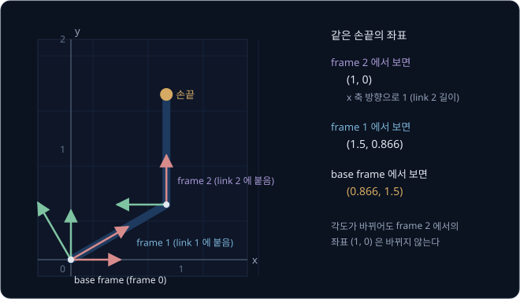

위 그림에서 빨간 화살표는 각 frame 의 $x$ 축, 초록 화살표는 $y$ 축이다. 바닥에 고정된 base frame(frame 0)은 오른쪽이 $x$ 축이다.
frame 1 은 link 1 에 붙어 원점은 joint 1 에 있고 $x$ 축이 link 1 을 따라 $30°$ 방향을 가리킨다. frame 2 는 link 2 에 붙어 원점은
팔꿈치에 있고 $x$ 축이 link 2 를 따라 $90°$ 방향을 가리킨다.

손끝은 link 2 의 끝이라서 frame 2 에서 보면 "$x$ 축 방향으로 link 2 의 길이 1 만큼" 인 $(1, 0)$ 이다. 이 값은 joint angle 이
얼마든 바뀌지 않는다. FK 는 frame 2 에서 $(1, 0)$ 인 점을 base frame 에서 잰 좌표 $(0.866, 1.5)$ 로 바꾸는 일이라고 다시 말할 수
있다.

**확인 문제.** link 2 의 길이가 $L_2 = 3$ 이면 손끝은 frame 2 에서 어떤 좌표일까?

답 보기

frame 2 의 $x$ 축이 link 2 를 따라 놓여 있으므로 손끝은 $x$ 축 방향으로 3 만큼 간 $(3, 0)$ 이다.

### rotation matrix

한 frame 의 좌표를 다른 frame 의 좌표로 바꾸는 데는 두 가지 동작이 필요하다. 하나는 돌리기(회전)이고 다른 하나는 옮기기(이동)
다. 먼저 회전부터 숫자 표로 적는다.

점 $(x, y)$ 를 원점을 중심으로 $\theta$ 만큼 돌린 새 위치는 아래와 같다.

$$
(x\cos\theta - y\sin\theta,\ \ x\sin\theta + y\cos\theta)
$$

$(1, 0)$ 을 $30°$ 돌려 보면 $(1 \times 0.866 - 0 \times 0.5,\ 1 \times 0.5 + 0 \times 0.866) = (0.866, 0.5)$ 로, 길이 1 막대를
$30°$ 돌린 끝점과 같다. 숫자만 바꿔 $(2, 1)$ 을 $90°$ 돌리면 $\cos 90° = 0$, $\sin 90° = 1$ 이라
$(2 \times 0 - 1 \times 1,\ 2 \times 1 + 1 \times 0) = (-1, 2)$ 다. 오른쪽으로 2, 위로 1 인 점이 4 분의 1 바퀴 돌아 왼쪽으로 1,
위로 2 인 점이 되었다.

이 계산에 들어가는 숫자 네 개 $\cos\theta$, $-\sin\theta$, $\sin\theta$, $\cos\theta$ 를 가로 2 줄, 세로 2 줄의 표로 늘어놓은
것을 rotation matrix 라고 한다. 이렇게 숫자를 가로세로로 늘어놓은 표를 행렬(matrix)이라 하고, 가로 줄을 행, 세로 줄을 열이라고
부른다.

$$
R(\theta) = \begin{bmatrix} \cos\theta & -\sin\theta \\ \sin\theta & \cos\theta \end{bmatrix}
$$

$R$ 은 rotation(회전)의 첫 글자이고, $R(\theta)$ 는 "$\theta$ 만큼 돌리는 행렬" 이다. 3 차원에서는 이 회전이 화면을 뚫고
나오는 $z$ 축을 중심으로 도는 것과 같아서, transforms 강의처럼 $R_z(\theta)$ 라고도 쓴다.

행렬에 점을 곱하는 규칙은 "행렬의 각 행과 점의 숫자를 짝지어 곱한 뒤 더한다" 다. 첫 행 $(\cos\theta, -\sin\theta)$ 와
$(x, y)$ 를 짝지어 곱해 더하면 $x\cos\theta - y\sin\theta$ 로 새 $x$ 가 되고, 둘째 행으로 같은 일을 하면 새 $y$ 가 된다.
점처럼 숫자 몇 개를 순서대로 묶은 것을 vector 라고 하므로, 이 계산을 행렬과 vector 의 곱이라고 부른다.

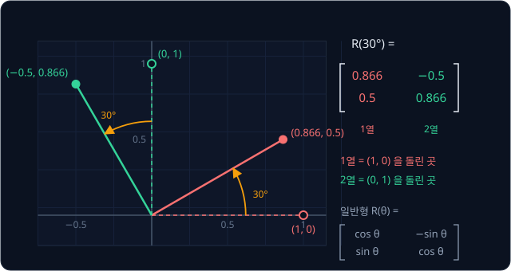

위 그림은 rotation matrix 의 열이 무엇인지 보여 준다. $(1, 0)$ 을 $30°$ 돌리면 $(0.866, 0.5)$ 가 되고, 이것이 $R(30°)$ 의
첫째 열이다. $(0, 1)$ 을 $30°$ 돌리면 $(-0.5, 0.866)$ 이 되고, 이것이 둘째 열이다. 첫째 열은 돌아간 $x$ 축이 가리키는 방향,
둘째 열은 돌아간 $y$ 축이 가리키는 방향이라고 읽어도 된다.

**확인 문제.** $R(90°)$ 를 숫자로 적고, 점 $(0, 1)$ 을 $90°$ 돌린 위치를 구해 보자.

답 보기

$\cos 90° = 0$, $\sin 90° = 1$ 이므로 $R(90°)$ 의 첫 행은 $(0, -1)$, 둘째 행은 $(1, 0)$ 이다. $(0, 1)$ 에 곱하면 새 $x$ 는
$0 \times 0 + (-1) \times 1 = -1$, 새 $y$ 는 $1 \times 0 + 0 \times 1 = 0$ 이라 $(-1, 0)$ 이다. 위쪽을 가리키던 점이 4 분의 1 바퀴
돌아 왼쪽으로 갔다.

### homogeneous transform

이동은 더하기다. 점 $(x, y)$ 를 오른쪽으로 1 옮기면 $(x + 1, y)$ 다. 회전은 행렬 곱, 이동은 더하기로 따로 쓰면 joint 마다 곱하고
더하기를 번갈아 해야 해서 번거롭다. 그래서 점 끝에 숫자 1 을 하나 붙여 $(x, y, 1)$ 로 쓰고, 행렬을 가로 3 줄, 세로 3 줄로 키워
회전과 이동을 한 행렬에 담는다.

$$
T = \begin{bmatrix} \cos\theta & -\sin\theta & p_x \\ \sin\theta & \cos\theta & p_y \\ 0 & 0 & 1 \end{bmatrix}
$$

$T$ 는 transform 의 첫 글자다. 왼쪽 위 2×2 칸은 앞의 rotation matrix 그대로이고, 오른쪽 열의 $(p_x, p_y)$ 는 옮기는 양이다. $p$ 는
position(위치)의 첫 글자다. 맨 아래 줄은 늘 $0, 0, 1$ 이다. 이 행렬에 $(x, y, 1)$ 을 곱하면 첫 행에서
$x\cos\theta - y\sin\theta + p_x \times 1$ 이 나와, 점 끝에 붙인 1 이 이동량 $p_x$ 를 그대로 한 번 더해 준다. 이렇게 1 을 붙여
회전과 이동을 곱셈 하나로 쓰는 행렬을 homogeneous transform 이라고 하고, 이 강의에서는 그냥 transform 이라고도 부른다.
homogeneous 는 "같은 차수의" 라는 뜻으로, 1 을 덧붙인 좌표를 부르는 수학 이름에서 왔다.

이 강의에서는 두 가지 기본 transform 을 쓴다.

- $R(\theta)$ — 원점은 그대로 두고 $\theta$ 만큼 돌리는 transform. 위 행렬에서 $p_x = p_y = 0$ 이다
- $\mathrm{Tr}(L)$ — 돌리지 않고 $x$ 축 방향으로 $L$ 만큼 옮기는 transform. $\theta = 0$, $p_x = L$, $p_y = 0$ 이다. Tr 은
  translation(평행 이동)의 앞 두 글자다

$$
\mathrm{Tr}(1) = \begin{bmatrix} 1 & 0 & 1 \\ 0 & 1 & 0 \\ 0 & 0 & 1 \end{bmatrix}
$$

$\mathrm{Tr}(1)$ 에 $(0.5, 0.866, 1)$ 을 곱하면 첫 행에서 $1 \times 0.5 + 0 \times 0.866 + 1 \times 1 = 1.5$, 둘째 행에서
$0 \times 0.5 + 1 \times 0.866 + 0 \times 1 = 0.866$, 셋째 행에서 1 이 나와 $(1.5, 0.866, 1)$ 이 된다. 가로로 1 만큼 옮겨졌다.

transform 은 frame 하나를 통째로 나타내기도 한다. frame 의 원점이 어디 있고 축이 어느 쪽을 향하는지가 frame 의 pose(위치와
방향)인데, transform 의 오른쪽 열이 위치를, 왼쪽 위 칸이 방향을 담으므로 transform 하나가 pose 하나를 나타낸다.
아래 그림의 $T_{02}$ 는 base frame(0)에서 본 frame 2 의 pose 를 적은 transform 이다. 아래첨자 $02$ 는 "frame 0 에서 본 frame 2"
라는 뜻이다.

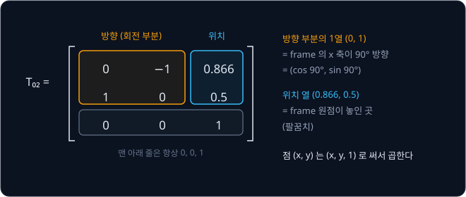

위 그림의 방향 부분 첫째 열 $(0, 1)$ 은 frame 2 의 $x$ 축이 base frame 에서 $90°$ 방향을 가리킨다는 뜻이고, 위치 열
$(0.866, 0.5)$ 는 frame 2 의 원점이 팔꿈치에 있다는 뜻이다. 앞 절 그림의 frame 2 와 같다. 이 행렬에 손끝의 frame 2 좌표
$(1, 0, 1)$ 을 곱하면 첫 행에서 $0 \times 1 + (-1) \times 0 + 0.866 \times 1 = 0.866$, 둘째 행에서
$1 \times 1 + 0 \times 0 + 0.5 \times 1 = 1.5$ 가 나온다. frame 2 의 좌표를 base frame 의 좌표 $(0.866, 1.5)$ 로 바꾼 것이다.

**확인 문제.** 이동만 하는 transform $\mathrm{Tr}(2)$ 에 점 $(1, 3, 1)$ 을 곱하면?

답 보기

$\mathrm{Tr}(2)$ 는 첫 행이 $(1, 0, 2)$, 둘째 행이 $(0, 1, 0)$, 셋째 행이 $(0, 0, 1)$ 이다. 첫 행에서
$1 \times 1 + 0 \times 3 + 2 \times 1 = 3$, 둘째 행에서 $0 \times 1 + 1 \times 3 + 0 \times 1 = 3$ 이 나와 $(3, 3, 1)$ 이다.
가로로 2 만큼 옮겨졌다.

### joint 하나의 transform

이제 팔의 joint 하나하나를 transform 으로 적는다. 앞 frame 에서 다음 frame 으로 가려면 "joint 가 있는 자리까지 옮긴 뒤, joint
angle 만큼 돌린다" 를 하면 된다.

| 단계 | 하는 일 | transform |
| --- | --- | --- |
| base → frame 1 | joint 1 이 원점에 있어 옮길 필요 없이 $\theta_1$ 만큼 돈다 | $T_{01} = R(\theta_1)$ |
| frame 1 → frame 2 | link 1 을 따라 $L_1$ 만큼 옮겨 팔꿈치에 간 뒤 $\theta_2$ 만큼 돈다 | $T_{12} = \mathrm{Tr}(L_1)\,R(\theta_2)$ |
| frame 2 → 손끝 | link 2 를 따라 $L_2$ 만큼 옮긴다. 손끝에는 joint 가 없어 돌지 않는다 | $T_{2h} = \mathrm{Tr}(L_2)$ |

아래첨자 $h$ 는 hand(손)의 첫 글자로 손끝 frame 을 뜻한다. 각 줄에서 "옮기기" 에 해당하는 $\mathrm{Tr}$ 은 link 의 길이로만
정해져 로봇을 만들 때 고정되고, "돌리기" 에 해당하는 $R$ 은 joint angle 에 따라 달라진다. 이 구분은 뒤의 URDF 절에서 그대로
다시 나온다.

**확인 문제.** $L_1 = 2$ 인 팔에서 $T_{12}$ 를 $\mathrm{Tr}$ 과 $R$ 로 적으면?

답 보기

link 1 을 따라 2 만큼 옮긴 뒤 $\theta_2$ 만큼 돌리므로 $T_{12} = \mathrm{Tr}(2)\,R(\theta_2)$ 다.

### 관절마다 곱하기

frame 여러 개를 거치는 변환은 transform 을 차례로 곱해 잇는다. base frame 에서 본 손끝은 아래와 같다.

$$
T_{0h} = T_{01}\,T_{12}\,T_{2h} = R(\theta_1)\ \mathrm{Tr}(L_1)\ R(\theta_2)\ \mathrm{Tr}(L_2)
$$

$T_{01}\,T_{12}$ 처럼 앞 transform 의 오른쪽 아래첨자와 뒤 transform 의 왼쪽 아래첨자가 같도록(여기서는 1) 이으면 순서를 틀리지
않는다. 이 식은 "base 에서 frame 1 로, frame 1 에서 frame 2 로, frame 2 에서 손끝으로 차례로 간다" 로 읽는다.

$\theta_1 = 30°$, $\theta_2 = 60°$, $L_1 = L_2 = 1$ 을 넣고, 손끝 frame 의 원점 $(0, 0, 1)$ 에 오른쪽 transform 부터 하나씩 곱해 본다.
식에서 점에 가장 가까운 것이 오른쪽 끝이기 때문이다.

| 차례 | 곱하는 transform | 계산 | 결과 |
| --- | --- | --- | --- |
| 시작 | | 손끝 frame 의 원점 | $(0, 0)$ |
| 1 | $\mathrm{Tr}(1)$ | 가로로 1 이동 | $(1, 0)$ |
| 2 | $R(60°)$ | $(1 \times 0.5 - 0 \times 0.866,\ 1 \times 0.866 + 0 \times 0.5)$ | $(0.5, 0.866)$ |
| 3 | $\mathrm{Tr}(1)$ | 가로로 1 이동 | $(1.5, 0.866)$ |
| 4 | $R(30°)$ | $(1.5 \times 0.866 - 0.866 \times 0.5,\ 1.5 \times 0.5 + 0.866 \times 0.866)$ | $(0.866, 1.5)$ |

마지막 칸의 계산을 풀어 쓰면 가로는 $1.299 - 0.433 = 0.866$, 세로는 $0.75 + 0.75 = 1.5$ 다. 공식으로 구한 $(0.866, 1.5)$ 와
똑같다. 중간 결과도 뜻이 있다. 1 단계의 $(1, 0)$ 은 손끝을 frame 2 에서 본 좌표이고, 3 단계의 $(1.5, 0.866)$ 은 frame 1 에서 본
좌표다. 앞의 "link 에 붙은 frame" 그림에 적힌 값과 같다.

같은 곱을 왼쪽부터 해 나가면 frame 마다의 위치와 방향이 차례로 나온다. 이때는 두 가지 규칙만 쓰면 된다.

- 오른쪽에 $R(\theta)$ 를 곱하면 원점은 그대로이고 $x$ 축 방향만 $\theta$ 만큼 더 돈다
- 오른쪽에 $\mathrm{Tr}(L)$ 을 곱하면 원점이 지금 frame 의 $x$ 축 방향으로 $L$ 만큼 간다

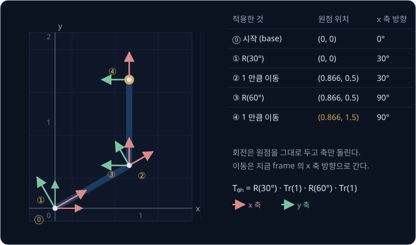

위 그림은 왼쪽부터 곱해 갈 때 frame 이 어떻게 움직이는지 보여 준다. ⓪ base frame 에서 시작해 ① $R(30°)$ 으로 축만 $30°$ 돌고,
② $\mathrm{Tr}(1)$ 로 그 $30°$ 방향을 따라 1 만큼 가 팔꿈치 $(0.866, 0.5)$ 에 닿는다. ③ $R(60°)$ 으로 축이 $30° + 60° = 90°$ 를
가리키고, ④ $\mathrm{Tr}(1)$ 로 위쪽으로 1 만큼 가 손끝 $(0.866, 1.5)$ 에 닿는다. ② 의 결과가 frame 1 을 팔꿈치까지 옮긴 것이고,
③ 의 결과가 앞에서 본 $T_{02}$ 다. 그래서 왼쪽부터 곱하면 손끝만이 아니라 중간 link 의 위치도 함께 얻는다. ④ 의 $x$ 축
방향 $90°$ 는 앞에서 구한 집게 방향 $\theta_1 + \theta_2$ 와 같으므로, transform 을 곱하면 손끝의 위치와 방향, 곧 pose 가
한꺼번에 나온다.

두 행렬을 곱하는 일반 규칙은 "왼쪽 행렬의 행과 오른쪽 행렬의 열을 짝지어 곱해 더한 값이 결과의 한 칸" 이다.
$R(30°)\,\mathrm{Tr}(1)$ 의 위치 열을 이 규칙으로 계산하면, $\mathrm{Tr}(1)$ 의 셋째 열 $(1, 0, 1)$ 과 $R(30°)$ 의 첫 행
$(0.866, -0.5, 0)$ 을 짝지어 $0.866 \times 1 + (-0.5) \times 0 + 0 \times 1 = 0.866$, 둘째 행 $(0.5, 0.866, 0)$ 과 짝지어
$0.5 \times 1 + 0.866 \times 0 + 0 \times 1 = 0.5$ 가 나온다. 원점이 $(0.866, 0.5)$ 로 간 것이 위의 ② 와 같다.

**확인 문제.** $\theta_1 = 0°$, $\theta_2 = 90°$, $L_1 = L_2 = 1$ 일 때 왼쪽부터 곱해 가며 각 단계의 원점 위치와 $x$ 축 방향을
적어 보자.

답 보기

| 단계 | 원점 | $x$ 축 방향 |
| --- | --- | --- |
| $R(0°)$ | $(0, 0)$ | $0°$ |
| $\mathrm{Tr}(1)$ | $(1, 0)$ | $0°$ |
| $R(90°)$ | $(1, 0)$ | $90°$ |
| $\mathrm{Tr}(1)$ | $(1, 1)$ | $90°$ |

손끝은 $(1, 1)$ 로, 공식으로 구한 값과 같다.

### 곱하는 순서

숫자 곱셈은 $2 \times 3 = 3 \times 2$ 처럼 순서를 바꿔도 같지만 transform 의 곱은 순서를 바꾸면 결과가 달라진다.

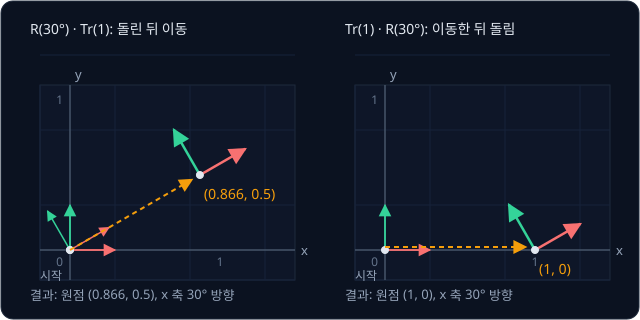

위 그림의 왼쪽은 $R(30°)\,\mathrm{Tr}(1)$ 이다. 먼저 축을 $30°$ 돌린 뒤 돌아간 $x$ 축을 따라 1 만큼 가므로 원점이
$(0.866, 0.5)$ 에 닿는다. 오른쪽은 $\mathrm{Tr}(1)\,R(30°)$ 이다. 먼저 오른쪽으로 1 만큼 간 뒤 그 자리에서 축만 돌리므로 원점은
$(1, 0)$ 에 머문다. 두 결과 모두 $x$ 축은 $30°$ 방향이지만 원점의 위치가 다르다.

행렬 곱 규칙으로도 확인된다. $\mathrm{Tr}(1)\,R(30°)$ 의 위치 열은 $R(30°)$ 의 셋째 열 $(0, 0, 1)$ 과 $\mathrm{Tr}(1)$ 의 첫 행
$(1, 0, 1)$ 을 짝지어 $1 \times 0 + 0 \times 0 + 1 \times 1 = 1$, 둘째 행 $(0, 1, 0)$ 과 짝지어 $0$ 이 나와 $(1, 0)$ 이다.

**흔한 오해.** joint 를 파일에 적힌 순서나 아무 순서로 곱해도 된다고 생각하기 쉽다. 하지만 위처럼 순서가 바뀌면 손끝이 다른
곳에 간다. 곱하는 순서는 base 에서 손끝 쪽으로 link 가 이어진 순서를 따라야 한다.

**확인 문제.** $R(90°)\,\mathrm{Tr}(2)$ 와 $\mathrm{Tr}(2)\,R(90°)$ 에서 원점은 각각 어디로 갈까?

답 보기

$R(90°)\,\mathrm{Tr}(2)$ 는 축을 $90°$ 돌린 뒤 돌아간 $x$ 축(위쪽)을 따라 2 만큼 가므로 원점이 $(0, 2)$ 다.
$\mathrm{Tr}(2)\,R(90°)$ 는 오른쪽으로 2 만큼 간 뒤 축만 돌리므로 원점이 $(2, 0)$ 이다.

### 3 차원 팔

실제 로봇 팔은 3 차원에서 움직이므로 위치가 $(x, y, z)$ 세 숫자이고, 점 끝에 1 을 붙이면 숫자 4 개가 된다. 그래서 transform 은
가로 4 줄, 세로 4 줄의 행렬이 되고, 왼쪽 위 3×3 칸이 회전, 오른쪽 열의 위쪽 세 칸이 위치, 맨 아래 줄이 $0, 0, 0, 1$ 이다.
transforms 강의에서 본 4×4 homogeneous transform 과 같은 모양이다.

3 차원에서는 joint 마다 도는 축이 다를 수 있다. 평면 팔의 joint 는 모두 화면을 뚫고 나오는 $z$ 축을 중심으로 돌았지만, 3 차원
팔에서는 어떤 joint 는 수직축을 중심으로 돌아 팔 전체를 좌우로 돌리고, 어떤 joint 는 수평축을 중심으로 돌아 팔을 위아래로
든다. 축 방향만 다를 뿐, "joint 자리까지 옮기고 그 joint 의 축을 중심으로 joint angle 만큼 돌린다" 를 transform 으로 적어 차례로
곱하는 방법은 평면과 같다.

**확인 문제.** 3 차원 팔의 transform 은 가로 몇 줄, 세로 몇 줄의 행렬이고, 그중 위치를 담는 칸은 몇 개일까?

답 보기

가로 4 줄, 세로 4 줄의 행렬이다. 위치 $(x, y, z)$ 는 오른쪽 열의 위쪽 세 칸에 담긴다.

**요약**

- link 마다 frame 을 붙이면 손끝은 마지막 frame 에서 늘 같은 좌표이고, FK 는 그 좌표를 base frame 좌표로 바꾸는 일이다
- 회전과 이동을 한 행렬에 담은 것이 homogeneous transform 이고, joint 하나는 "옮기기 $\mathrm{Tr}$ 뒤에 돌리기 $R$" 이다
- 손끝의 pose 는 joint 의 transform 을 base 부터 차례로 곱한 것이고, 곱하는 순서를 바꾸면 답이 달라진다

## URDF

### URDF 파일

로봇마다 link 의 길이, joint 의 자리, 도는 축이 다르다. 이 정보를 사람이 FK 계산에 매번 손으로 옮겨 적지 않도록, 로봇의 모양을
정해진 형식의 글자 파일 하나에 적어 둔다. 가장 널리 쓰이는 형식이 URDF(Unified Robot Description Format)이고, 이름은
"로봇을 기술하는 통일된 형식" 이라는 뜻이다. 로봇 프로그램들이 서로 데이터를 주고받게 해 주는 소프트웨어 모음인 ROS(Robot
Operating System)를 비롯해, 대부분의 로봇 소프트웨어가 이 파일로 로봇의 모양을 주고받는다.

URDF 는 XML 이라는 글자 형식으로 쓴다. XML 은 `<joint>` 처럼 꺾쇠 괄호로 감싼 이름(태그)으로 정보의 종류를 표시하고, `<joint>`
로 열어 `</joint>` 로 닫은 사이에 그 joint 의 내용을 적는다. `<link name="base"/>` 처럼 끝에 `/` 를 붙이면 한 줄로 열고 닫는다.
태그 안의 `name="base"` 처럼 `이름="값"` 으로 적은 것을 속성이라고 한다.

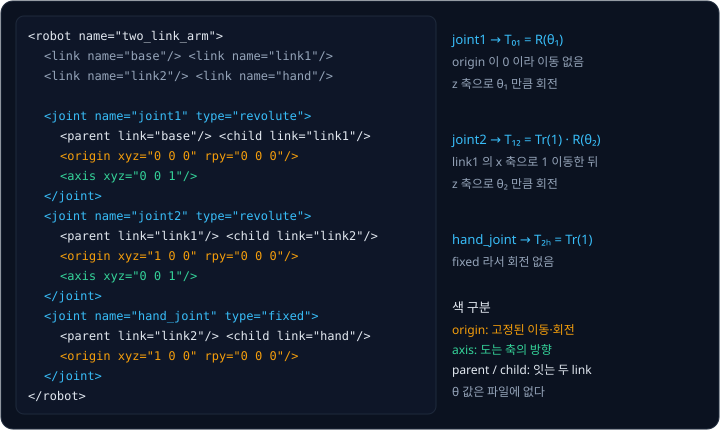

위 그림은 이 강의의 두 joint 팔을 URDF 로 적은 것이다. 먼저 link 네 개(base, link1, link2, hand)의 이름을 적고, 이어서 joint
세 개를 적었다. 오른쪽에는 각 joint 가 앞 절의 어느 transform 이 되는지 적었다. joint1 은 $T_{01} = R(\theta_1)$, joint2 는
$T_{12} = \mathrm{Tr}(1)\,R(\theta_2)$, hand_joint 는 $T_{2h} = \mathrm{Tr}(1)$ 이다.

**확인 문제.** 위 URDF 에서 link 와 joint 는 각각 몇 개일까?

답 보기

link 는 base, link1, link2, hand 의 4 개이고, joint 는 joint1, joint2, hand_joint 의 3 개다.

### joint 에 적는 정보

joint 하나에는 아래 정보를 적는다.

| 태그·속성 | 뜻 | 두 joint 팔의 joint2 |
| --- | --- | --- |
| `type` | joint 가 어떻게 움직이는지 | `revolute` (돈다) |
| `<parent>` | joint 의 앞쪽(base 쪽) link | link1 |
| `<child>` | joint 의 뒤쪽(손끝 쪽) link | link2 |
| `<origin xyz>` | parent link frame 에서 joint 자리까지 옮기는 양 | `1 0 0` ($x$ 로 1) |
| `<origin rpy>` | 옮긴 뒤 joint frame 을 고정으로 돌려 두는 각도 | `0 0 0` (돌리지 않음) |
| `<axis>` | joint 가 도는 축의 방향 | `0 0 1` ($z$ 축) |
| `<limit>` | joint angle 이 움직일 수 있는 범위 | (그림에서는 생략) |

parent 는 "부모", child 는 "자식" 이라는 뜻이다. joint 마다 부모 link 와 자식 link 가 정해져 있어서 base 에서 손끝 쪽으로
이어지는 순서를 알 수 있다. `xyz` 는 $x, y, z$ 세 방향으로 옮기는 양이고, `rpy` 는 roll·pitch·yaw 의 머리글자로 $x$ 축, $y$ 축,
$z$ 축을 중심으로 돌리는 세 각도다. 배의 흔들림을 부르는 말에서 왔는데, roll 은 좌우로 기우는 것, pitch 는 앞뒤로 기우는 것,
yaw 는 뱃머리가 좌우로 도는 것이다.

`<origin>` 은 앞 절의 $\mathrm{Tr}$ 처럼 로봇을 만들 때 정해져 바뀌지 않는 부분이고, `<axis>` 와 joint angle 이 합쳐져 $R$ 처럼
움직이는 부분이 된다. 그래서 URDF 의 joint 하나는 늘 "고정된 origin transform 뒤에 joint angle 만큼의 움직임" 으로 계산한다.

$$
T_{\text{parent},\,\text{child}} = T^{\text{origin}}\ T^{\text{motion}}(q)
$$

$T^{\text{origin}}$ 은 `<origin>` 의 xyz 와 rpy 로 만든 transform 이고, $T^{\text{motion}}(q)$ 는 `<axis>` 를 중심으로 joint
angle $q$ 만큼 돌리는 transform 이다. 로봇 소프트웨어와 교과서는 joint 가 움직인 양을 $\theta$ 대신 $q$ 로 흔히 쓰는데, 뒤에서
볼 prismatic joint 처럼 각도가 아니라 거리만큼 움직이는 joint 도 함께 가리키기 위해서다. 이 식은 "parent
link frame 에서 origin 만큼 옮기고 돌려 joint 자리에 간 뒤, 그 자리에서 axis 를 중심으로 $q$ 만큼 돌면 child link frame 이 된다"
로 읽는다. joint2 에 넣으면 $T^{\text{origin}} = \mathrm{Tr}(1)$, $T^{\text{motion}} = R(\theta_2)$ 라서 앞의 $T_{12}$ 와 같다.

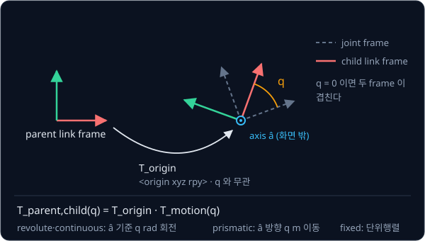

위 그림은 이 두 단계를 frame 으로 그린 것이다. 왼쪽 parent link frame 에서 $T^{\text{origin}}$ 만큼 옮기고 돌린 자리가 점선으로
그린 joint frame 이고, 그 자리에서 axis 를 중심으로 $q$ 만큼 돌린 것이 child link frame 이다. $q = 0$ 이면 두 frame 이 겹친다.
그림의 $\hat a$ 는 axis 를 나타내는 기호로, 길이 1 인 방향을 뜻한다.

**확인 문제.** URDF 에서 joint 의 `<origin xyz="0 0 2" rpy="0 0 0"/>` 은 무엇을 뜻할까? 이 값은 로봇이 움직이는 동안 바뀔까?

답 보기

parent link frame 에서 $z$ 방향으로 2 만큼 옮긴 자리에 joint 가 있고, 고정으로 돌려 두는 각도는 없다는 뜻이다. 로봇을 만들 때
정해진 값이라 움직이는 동안 바뀌지 않는다. 바뀌는 것은 joint angle 뿐이다.

### joint 의 종류와 radian

URDF 는 joint 를 움직이는 방식에 따라 네 종류로 나눈다.

| type | 움직임 | joint 값 $q$ 의 단위 |
| --- | --- | --- |
| revolute | 축을 중심으로 도는데, `<limit>` 의 `lower`·`upper` 사이에서만 돈다 | rad |
| continuous | 축을 중심으로 한계 없이 계속 돈다(바퀴 같은 것) | rad |
| prismatic | 축 방향으로 미끄러지듯 이동한다(서랍 같은 것) | m |
| fixed | 움직이지 않고 두 link 를 붙여 둔다 | 없음 |

revolute 는 "도는", prismatic 은 "각기둥 모양의" 라는 뜻으로, 각기둥 모양 홈을 따라 미끄러지는 부품에서 온 이름이다. prismatic
joint 의 $T^{\text{motion}}(q)$ 는 돌리기가 아니라 축 방향으로 $q$ 만큼 옮기는 transform 이고, fixed joint 는 $T^{\text{motion}}$
이 아무것도 바꾸지 않아 origin 만 남는다. 두 joint 팔의 hand_joint 가 fixed 라서 $T_{2h} = \mathrm{Tr}(1)$ 만 남았다.

URDF 는 각도를 도(°)가 아니라 rad(radian, 라디안)으로 적는다. radian 은 반지름 1 인 원에서 그 각도만큼 돈 원둘레의 길이로 각도를
재는 단위다. 반지름 1 인 원의 둘레는 $2\pi$ 이고, $\pi$ 는 그리스 문자 pi(파이)로 원둘레를 지름으로 나눈 값 3.14159… 이다.
그래서 한 바퀴 $360°$ 가 $2\pi \approx 6.283$ rad 이고, 반 바퀴 $180°$ 가 $\pi \approx 3.1416$ rad 이다.

| 도 | 계산 | rad |
| --- | --- | --- |
| $180°$ | $\pi$ | 3.1416 |
| $90°$ | $\pi \div 2$ | 1.5708 |
| $60°$ | $\pi \div 3$ | 1.0472 |
| $30°$ | $\pi \div 6$ | 0.5236 |
| $1°$ | $\pi \div 180$ | 0.01745 |

도를 rad 으로 바꿀 때는 $\pi \div 180$ 을 곱한다. $30°$ 는 $30 \times 3.1416 \div 180 = 0.5236$ rad 이다.

**흔한 오해.** URDF 의 `upper="1.57"` 을 1.57 도로 읽으면 joint 가 거의 움직이지 못하는 것처럼 보인다. 이 값은 rad 이라
$1.57 \times 180 \div 3.1416 \approx 90°$ 다.

**확인 문제.** $45°$ 는 몇 rad 일까? 반대로 $0.5236$ rad 은 몇 도일까?

답 보기

$45 \times 3.1416 \div 180 = 0.7854$ rad 이다. $0.5236 \times 180 \div 3.1416 \approx 30°$ 다.

### URDF 에 없는 것

URDF 에는 joint angle 이 없다. URDF 는 로봇이 어떻게 생겼는지, 곧 link 가 어떻게 이어지고 joint 가 어디에서 어느 축으로 도는지만
적는다. 지금 joint 가 몇 도 돌아가 있는지는 로봇이 움직이는 동안 모터 센서가 알려 준다.

그래서 FK 는 두 가지를 합쳐야 계산할 수 있다.

| 재료 | 어디서 오나 | 바뀌는가 | 두 joint 팔의 예 |
| --- | --- | --- | --- |
| 로봇의 모양 | URDF 파일 | 로봇을 고치지 않는 한 그대로 | link 길이 1, joint2 는 link1 끝에 있고 $z$ 축으로 돈다 |
| 지금의 joint angle | 모터 센서 | 매 순간 바뀐다 | $\theta_1 = 30°$, $\theta_2 = 60°$ |

URDF 에는 FK 에 쓰지 않는 정보도 있다. 화면에 로봇을 그릴 때 쓰는 3D 모양 파일, 물리 계산에 쓰는 link 의 무게, 모터가 낼 수 있는
힘의 한계 같은 것이다. FK 는 그중 joint 의 parent·child·origin·axis 만 읽는다.

**확인 문제.** 같은 로봇이 같은 URDF 로 오전과 오후에 일을 했다. 손끝 위치가 달랐다면 그 차이는 어디에서 왔을까?

답 보기

URDF 는 같으므로 joint angle 이 달랐기 때문이다. URDF 의 모양과 그 순간의 joint angle 을 합쳐야 손끝 위치가 정해진다.

**요약**

- URDF 는 로봇의 link 와 joint 를 XML 로 적은 파일이고, joint 마다 parent·child·origin·axis·type 이 있다
- joint 하나의 transform 은 고정된 origin transform 뒤에 axis 를 중심으로 joint angle $q$ 만큼 움직이는 transform 을 곱한 것이다
- URDF 의 각도 단위는 rad 이고, joint angle 자체는 URDF 에 없어서 모터 센서 값과 합쳐야 FK 를 계산할 수 있다

## 관절 수가 늘어날 때

### 관절 세 개짜리 팔

두 joint 팔 끝에 joint 하나와 길이 1 인 link 하나를 더 붙여 본다. 세 joint 의 각도를 모두 $30°$ 로 두면 link 방향은 차례로
쌓인다.

| link | 방향 | 더할 칸 $(\cos, \sin)$ | 그 link 끝의 위치 |
| --- | --- | --- | --- |
| 1 | $30°$ | $(0.866, 0.5)$ | $(0.866, 0.5)$ |
| 2 | $30° + 30° = 60°$ | $(0.5, 0.866)$ | $(1.366, 1.366)$ |
| 3 | $60° + 30° = 90°$ | $(0, 1)$ | $(1.366, 2.366)$ |

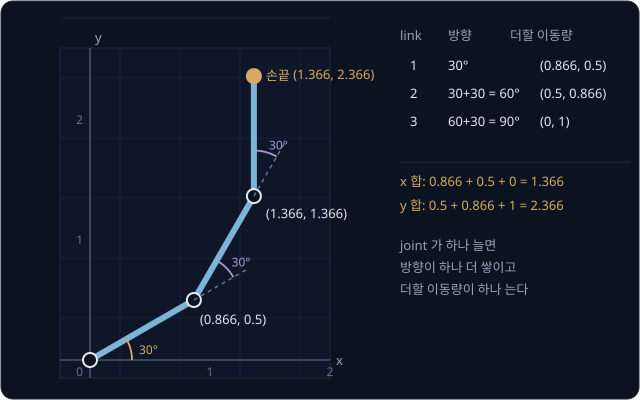

위 그림처럼 joint 가 하나 늘면 방향이 하나 더 쌓이고 더할 칸이 하나 는다. 손끝은 세 칸을 모두 더한
$(0.866 + 0.5 + 0,\ 0.5 + 0.866 + 1) = (1.366, 2.366)$ 이고, 집게는 마지막 link 의 방향 $90°$ 를 향한다.

transform 으로 쓰면 joint 하나에 $\mathrm{Tr}$ 과 $R$ 이 하나씩 더 붙는다.

$$
T_{0h} = R(\theta_1)\ \mathrm{Tr}(L_1)\ R(\theta_2)\ \mathrm{Tr}(L_2)\ R(\theta_3)\ \mathrm{Tr}(L_3)
$$

왼쪽부터 곱해 가는 규칙으로 따라가면 $R(30°)$ 로 $30°$, $\mathrm{Tr}(1)$ 로 $(0.866, 0.5)$, $R(30°)$ 로 $60°$, $\mathrm{Tr}(1)$
로 $(1.366, 1.366)$, $R(30°)$ 로 $90°$, $\mathrm{Tr}(1)$ 로 $(1.366, 2.366)$ 이 나와 위 표와 같다.

**확인 문제.** 세 link 의 길이가 모두 1 이고 joint angle 이 $(90°, -90°, 90°)$ 이면 손끝은 어디일까?

답 보기

link 방향은 $90°$, $90° - 90° = 0°$, $0° + 90° = 90°$ 다. 더할 칸은 $(0, 1)$, $(1, 0)$, $(0, 1)$ 이고, 다 더하면 손끝은
$(1, 2)$ 다.

### n 개 joint 의 일반식

joint 가 $n$ 개면 joint 마다 transform 하나를 차례로 곱한다. $n$ 은 개수를 숫자로 정하지 않고 가리킬 때 쓰는 글자다.

$$
T_{0n} = T_{01}\ T_{12}\ \cdots\ T_{(n-1)n}
$$

가운데 $\cdots$ 는 "같은 꼴이 이어진다" 는 표시다. $T_{(n-1)n}$ 은 $n-1$ 번째 frame 에서 $n$ 번째 frame 으로 가는 마지막 joint 의
transform 이다. 곱셈이 여러 개 이어지는 것을 $\prod$ 기호로 줄여 쓰기도 한다. $\prod$ 는 그리스 문자 pi 의 대문자로
"곱(product)" 의 첫 글자 P 에 해당하고, 여러 개를 더하라는 $\Sigma$(sigma) 기호의 곱셈판이다.

$$
T_{0n} = \prod_{i=1}^{n} T^{\text{origin}}_{i}\ T^{\text{motion}}_{i}(q_i)
$$

이 식은 "$i$ 를 1 부터 $n$ 까지 바꿔 가며 joint $i$ 의 origin transform 과 motion transform 을 차례로 곱한다" 로 읽는다. 두 joint
팔에서는 $n = 2$ 에 손끝의 fixed joint 하나가 더 붙었고, 위의 세 joint 팔에서는 $n = 3$ 이다. 평면 팔이면 같은 내용을 덧셈으로도
쓸 수 있다.

$$
x = \sum_{k=1}^{n} L_k \cos(\theta_1 + \cdots + \theta_k), \qquad y = \sum_{k=1}^{n} L_k \sin(\theta_1 + \cdots + \theta_k)
$$

$\sum_{k=1}^{n}$ 은 "$k$ 를 1 부터 $n$ 까지 바꿔 가며 더한다" 는 뜻이다. $k$ 번째 link 의 방향은 1 번부터 $k$ 번까지의 각도를
모두 더한 값이고, 그 방향으로 길이 $L_k$ 만큼 간 칸을 모두 더하면 손끝이다. 세 joint 팔 표의 "방향" 열이
$\theta_1 + \cdots + \theta_k$, "더할 칸" 열에 길이를 곱한 것이 $L_k\cos(\cdots)$ 와 $L_k\sin(\cdots)$ 다.

joint 가 늘어도 계산량은 joint 수에 비례해 조금씩만 는다.

| joint 수 $n$ | 곱하는 joint transform 수 | 덧셈 식의 더할 칸 수 |
| --- | --- | --- |
| 1 | 1 | 1 |
| 2 | 2 | 2 |
| 3 | 3 | 3 |
| 6 | 6 | 6 |

joint 가 6 개인 로봇 팔도 transform 6 개를 곱하면 끝나므로, 컴퓨터는 FK 를 1 초에 수만 번 이상 계산할 수 있다.

**확인 문제.** joint 가 7 개이고 끝에 fixed joint 하나로 손끝을 단 팔이 있다. base 에서 손끝까지 transform 을 몇 번 곱해야 할까?

답 보기

움직이는 joint 7 개와 fixed joint 1 개로 joint transform 이 8 개다. 8 개를 차례로 곱한다.

### 갈래가 있는 로봇: tree

지금까지의 팔은 base 에서 손끝까지 link 가 한 줄로 이어졌다. 이런 모양을 chain(사슬)이라고 한다. 하지만 실제 로봇에는 갈래가
있다. 집게는 손목에서 두 손가락으로 나뉘고, 사람 모양 로봇은 몸통에서 팔 두 개, 다리 두 개, 머리로 나뉜다.

link 를 점으로, joint 를 parent 에서 child 로 가는 화살표로 그리면 로봇 전체가 나뭇가지 모양이 되고, 이런 구조를 tree(나무)라고
부른다. 어떤 joint 의 child 도 아닌 link, 곧 맨 위에 있는 link 를 tree 의 root(뿌리)라고 하며, 로봇 팔에서는 base 가 root 다.

tree 에서 어떤 link 의 위치를 구하려면 root 에서 그 link 까지 내려가는 길에 있는 joint 의 transform 만 곱하면 된다. 모든 link 의
위치를 한 번에 구할 때는 root 의 transform 을 "아무것도 바꾸지 않는 행렬"(단위행렬, 대각선만 1 이고 나머지가 0)로 두고, 위치가
정해진 link 에서 자식 joint 로 내려가며 아래 식을 되풀이한다.

$$
T_{0,\text{child}} = T_{0,\text{parent}}\ T^{\text{origin}}\ T^{\text{motion}}(q)
$$

부모 link 의 위치에 그 joint 의 transform 을 곱하면 자식 link 의 위치가 된다는 뜻이다. 부모의 위치가 먼저 정해져 있어야 하므로
계산은 root 에서 잎(자식이 없는 link) 쪽으로 내려가는 순서를 따른다.

**확인 문제.** 손목에서 두 손가락이 갈라지는 로봇에서 왼쪽 손가락 끝의 위치를 구할 때 오른쪽 손가락 joint 의 transform 도
곱해야 할까?

답 보기

곱하지 않는다. root 에서 왼쪽 손가락 끝까지 내려가는 길에 오른쪽 손가락 joint 는 없기 때문이다. 손목까지는 두 손가락이 같은
길을 지나므로 손목까지의 transform 은 한 번만 계산해 두 손가락에 같이 쓴다.

### SO-101 의 URDF

실제 로봇 팔 하나를 보자. SO-101 은 TheRobotStudio 가 공개한 작은 로봇 팔로, URDF 에 link 8 개와 joint 7 개가 적혀 있다.
joint 7 개 중 6 개는 revolute 이고 1 개는 fixed 다.

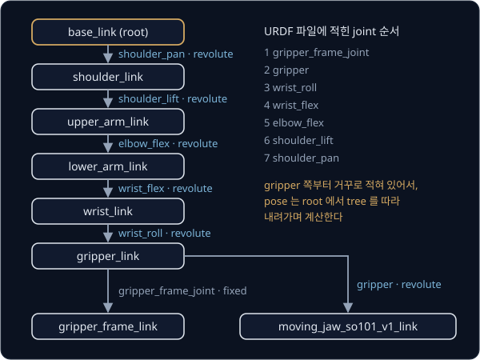

위 그림의 왼쪽은 SO-101 의 tree 다. root 인 `base_link` 에서 `shoulder_pan`(어깨를 좌우로 돌림), `shoulder_lift`(어깨를 위아래로
듦), `elbow_flex`(팔꿈치 굽힘), `wrist_flex`(손목 굽힘), `wrist_roll`(손목 비틀기) 를 지나 `gripper_link` 에 닿는다. 여기서 집게
끝점을 나타내는 `gripper_frame_link` 와 움직이는 집게 날 `moving_jaw_so101_v1_link` 두 갈래로 나뉘므로, 한 줄짜리 chain 이 아니라
tree 다. `gripper_frame_link` 는 실제 부품이 아니라 집게 끝점의 위치를 나타내려고 fixed joint 로 붙여 둔 이름뿐인 link 다.

그림 오른쪽은 이 파일에 joint 가 적힌 순서다. 집게 쪽부터 거꾸로 적혀 있어서 파일 순서대로 곱하면 틀린 답이 나온다. 앞의
"곱하는 순서" 에서 본 것처럼 transform 은 root 에서 손끝 쪽으로 이어지는 순서로 곱해야 하므로, FK 는 파일의 순서가 아니라 각
joint 의 parent·child 를 읽어 tree 를 만든 뒤 그 순서를 따른다.

SO-101 은 모든 joint angle 이 0 일 때 위팔이 위로 서고 아래팔부터 앞쪽($+x$)으로 수평하게 뻗은 자세다. 이때 각 link 원점의
위치는 아래와 같다(pinocchio 로 계산, 단위 m). pinocchio 는 URDF 를 읽어 FK 를 계산해 주는 공개 소프트웨어다.

| link | x | y | z |
| --- | --- | --- | --- |
| `shoulder_link` | 0.039 | 0.000 | 0.062 |
| `upper_arm_link` | 0.069 | −0.018 | 0.117 |
| `lower_arm_link` | 0.097 | −0.018 | 0.229 |
| `wrist_link` | 0.232 | −0.018 | 0.234 |
| `gripper_link` | 0.293 | 0.000 | 0.234 |
| `gripper_frame_link` | 0.391 | 0.000 | 0.226 |

집게 끝점은 base 에서 앞으로 0.391 m(39.1 cm), 위로 0.226 m 에 있다. 표를 위에서 아래로 읽으면 link 원점이 base 에서 손끝 쪽으로
차례로 멀어지고, 위팔이 서 있는 구간(`upper_arm_link` → `lower_arm_link`)에서는 $z$ 가 크게 늘고 아래팔이 수평으로 뻗은
구간(`lower_arm_link` → `wrist_link`)에서는 $x$ 가 크게 는다.

SO-101 의 joint 는 `<axis>` 가 모두 $(0, 0, 1)$, 곧 joint frame 의 $z$ 축이다. 그런데도 joint 마다 도는 방향이 다른 이유는
`<origin>` 의 `rpy` 가 joint frame 자체를 돌려 놓았기 때문이다. 예를 들어 `shoulder_pan` 의 origin 은 `rpy="3.14159 0 -3.14159"`
라서 joint frame 의 $z$ 축이 base 의 아래쪽($-z$)을 향한다. 그래서 `shoulder_pan` 을 $+90°$ 돌리면 위에서 내려다볼 때 팔이 시계
방향으로 돌고, 집게 끝점이 $(0.391, 0, 0.226)$ 에서 $(0.039, -0.353, 0.226)$ 으로 옮겨 간다. 도는 축의 실제 방향은 `<axis>`
하나만 보고 정할 수 없고 `rpy` 까지 함께 봐야 한다.

**확인 문제.** SO-101 의 모든 joint angle 이 0 일 때 집게 끝점은 base 에서 앞쪽으로 몇 cm 에 있을까? URDF 파일에 적힌 joint 순서대로
transform 을 곱하면 안 되는 이유는?

답 보기

$x = 0.391$ m 이므로 39.1 cm 다. 파일에는 joint 가 집게 쪽부터 거꾸로 적혀 있는데, transform 은 base 에서 손끝 쪽으로 이어진
순서로 곱해야 하고 순서를 바꾸면 결과가 달라지기 때문이다.

### DH parameter 와 product of exponentials

URDF 는 joint 마다 origin 을 숫자 6 개(xyz 세 개와 rpy 세 개)로 적는다. 같은 FK 를 다르게 적는 방법도 두 가지 널리 쓰인다.

1955년 Denavit 과 Hartenberg 는 frame 을 놓는 자리를 규칙으로 정해 joint 하나를 숫자 4 개로 적는 방법을 만들었다. joint 의
도는 축을 늘 $z$ 축으로 두고, 이웃한 두 joint 축에 동시에 직각인 선을 $x$ 축으로 두는 규칙이다. frame 을 아무 데나 놓지 않으니
6 개 중 2 개는 규칙이 대신 정해 주고, 남은 4 개 $(a, \alpha, d, \theta)$ 를 DH parameter 라고 부른다. $a$ 는 이웃한 두 joint
축 사이의 거리, $\alpha$(alpha, 알파)는 두 축이 서로 비틀린 각도, $d$ 는 축 방향으로 비켜난 거리, $\theta$ 는 joint angle 이다. 숫자가 적어 손으로 계산하기
편해서 지금도 많은 교과서가 이 방법을 쓴다. 대신 frame 의 자리를 마음대로 고를 수 없어서, 설계 도면의 좌표를 그대로 옮겨 적기
어렵다. URDF 는 숫자 2 개를 더 쓰는 대신 frame 을 원하는 자리에 놓을 수 있어서 도면의 값을 그대로 적을 수 있다.

1984년 Brockett 이 정리한 product of exponentials(PoE)는 모든 joint angle 이 0 인 자세(zero configuration)에서 각 joint 의 도는
축이 base frame 의 어디에 있는지를 한 번만 적어 둔다. 그리고 zero configuration 의 손끝 위치에서 시작해, 손끝 쪽 joint 부터
"그 joint 의 축을 중심으로 joint angle 만큼 돌리기" 를 차례로 적용한다.

두 joint 팔로 해 보면, zero configuration 은 팔이 오른쪽으로 쭉 뻗은 자세라서 joint 1 축은 $(0, 0)$, joint 2 축은 $(1, 0)$,
손끝은 $(2, 0)$ 에 있다. $\theta_1 = 30°$, $\theta_2 = 60°$ 를 넣는다.

| 차례 | 하는 일 | 손끝 위치 |
| --- | --- | --- |
| 시작 | zero configuration 의 손끝 | $(2, 0)$ |
| 1 | $(1, 0)$ 을 중심으로 $60°$ 돌린다 | $(1 + \cos 60°,\ \sin 60°) = (1.5, 0.866)$ |
| 2 | $(0, 0)$ 을 중심으로 $30°$ 돌린다 | $(1.5 \times 0.866 - 0.866 \times 0.5,\ 1.5 \times 0.5 + 0.866 \times 0.866) = (0.866, 1.5)$ |

같은 $(0.866, 1.5)$ 가 나온다. 1 단계에서 joint 2 를 돌릴 때는 joint 1 이 아직 움직이지 않았으므로, joint 2 의 축은 zero
configuration 에 적어 둔 $(1, 0)$ 그대로다. 손끝 쪽 joint 부터 돌리기 때문에 앞쪽 joint 가 나중에 움직여도 이미 적어 둔 축을
고칠 필요가 없고, 이것이 PoE 가 축을 한 번만 적어 두면 되는 이유다. 이름의 exponential(지수)은 "축을 중심으로 돌리기" 를
적는 수식의 모양에서 왔고, Modern Robotics 교과서가 이 방법으로 FK 를 설명한다.

**확인 문제.** PoE 방식으로 두 joint 팔에서 $\theta_1 = 90°$, $\theta_2 = 0°$ 일 때 손끝을 구해 보자.

답 보기

zero configuration 의 손끝 $(2, 0)$ 을 $(1, 0)$ 중심으로 $0°$ 돌리면 그대로 $(2, 0)$ 이다. 이것을 $(0, 0)$ 중심으로 $90°$ 돌리면
$(2 \times 0 - 0 \times 1,\ 2 \times 1 + 0 \times 0) = (0, 2)$ 다. 공식으로 구한 $(0, 2)$ 와 같다.

### 계산과 실물의 차이

FK 계산이 정확해도 실제 로봇의 손끝은 계산한 자리에서 몇 mm 씩 어긋난다. FK 는 URDF 의 숫자와 센서가 알려 준 joint angle 이
정확하다고 믿고 계산하는데, 실물은 그 숫자와 조금씩 다르기 때문이다.

- **각도 센서의 기준 어긋남** — 모터 센서의 0 점이 실제 joint 의 0 점과 조금 다르면 joint angle 이 늘 그만큼 틀린다. 이 0 점을
  맞추는 작업을 calibration(보정)이라고 한다
- **부품 치수 차이** — 만들 때 link 길이가 URDF 값보다 조금 길거나 짧을 수 있다
- **기어의 헐거움** — 모터와 link 사이 기어에 작은 틈이 있어서, 모터가 멈춰도 link 가 틈만큼 흔들린다
- **휘어짐** — 무거운 물건을 들면 link 가 아주 조금 휘지만, FK 는 link 가 휘지 않는다고 가정한다

base 쪽 joint 의 작은 각도 오차가 손끝에서는 크게 커진다. 반지름 $r$ 인 원에서 $\theta$ rad 만큼 돈 원둘레의 길이는
$r \times \theta$ 다. radian 이 반지름 1 인 원의 둘레 길이로 각도를 잰 것이라, 반지름이 $r$ 배면 둘레 길이도 $r$ 배가 되기
때문이다. 팔에서는 $r$ 이 joint 에서 손끝까지의 거리, $\theta$ 가 joint angle 의 오차다.

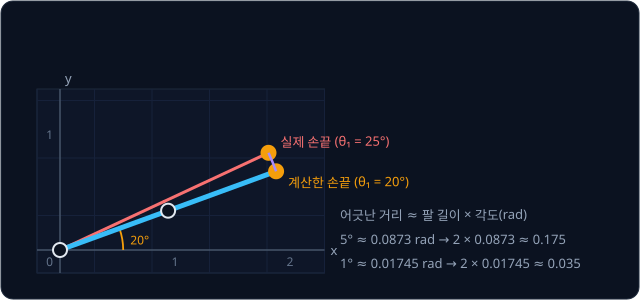

위 그림은 길이 2 인 팔(link 두 개를 펴서 이은 것)의 joint 1 이 $20°$ 대신 $25°$ 로, $5°$ 만큼 더 돈 경우다. $5°$ 는
$5 \times 0.01745 \approx 0.0873$ rad 이므로 손끝은 약 $2 \times 0.0873 \approx 0.175$ 만큼 어긋난다. 오차가 $1°$ 면
$2 \times 0.01745 \approx 0.035$ 다. 뒤에서 볼 SO-101 은 모든 joint angle 이 0 일 때 집게 끝점이 맨 아래 joint 의 회전축에서
수평으로 약 0.35 m 떨어져 있어서, 그 joint 가 $1°$ 틀리면 집게 끝점은 $0.35 \times 0.01745 \approx 0.0061$ m, 곧 약 6 mm
어긋난다.

**확인 문제.** 손끝이 base joint 에서 0.5 m 떨어진 팔에서 base joint 각도가 $2°$ 틀리면 손끝은 대략 몇 mm 어긋날까?

답 보기

$2° = 2 \times 0.01745 = 0.0349$ rad 이므로 $0.5 \times 0.0349 \approx 0.0175$ m, 곧 약 17 mm 다.

**요약**

- joint 가 늘면 joint 마다 transform 하나를 곱하거나 더할 칸 하나를 더하면 되고, 계산량은 joint 수에 비례한다
- 갈래가 있는 로봇은 tree 이고, 각 link 의 위치는 root 에서 그 link 까지의 길을 따라 부모부터 차례로 곱해 구한다
- DH parameter 와 PoE 는 같은 FK 를 다르게 적는 방법이고, 실물의 손끝은 calibration 오차·치수 차이·기어 틈·휘어짐 때문에
  계산한 자리와 조금씩 다르다

## 정리

- forward kinematics(FK)는 joint angle 에서 손끝(end-effector) 위치를 구하는 계산이다. 로봇은 joint angle 만 직접 알기 때문에
  손끝이 어디 있는지 알려면 FK 가 필요하다
- 길이 $L$ 막대를 $\theta$ 만큼 돌린 끝점은 $(L\cos\theta, L\sin\theta)$ 이고, $\cos 30° \approx 0.866$, $\sin 30° = 0.5$ 다
- joint 각도는 앞 link 를 기준으로 잰 상대 각도라서 link 방향이 $\theta_1$, $\theta_1 + \theta_2$, … 로 쌓인다.
  $L_1 = L_2 = 1$, $(\theta_1, \theta_2) = (30°, 60°)$ 이면 손끝은 $(0.866, 1.5)$ 다
- 회전과 이동을 한 행렬에 담은 homogeneous transform 을 joint 마다 하나씩 base 부터 차례로 곱하면 손끝 pose 가 나온다. 곱하는
  순서를 바꾸면 답이 달라진다
- URDF 는 link·joint 의 연결(parent·child), joint 자리(origin), 도는 축(axis), 종류(type)를 적은 파일이고, joint 하나는
  "고정된 origin 뒤에 $q$ 만큼의 움직임" 이다. joint angle 은 URDF 에 없어서 센서 값과 합쳐 FK 를 계산한다
- joint 가 늘어도 transform 을 하나씩 더 곱하면 되고, 갈래가 있는 로봇은 tree 를 따라 부모부터 계산한다

FK 는 joint angle 에서 손끝 위치를 구할 뿐이다. 물건을 집을 때 실제로 필요한 것은 반대 방향, 곧 "컵 위 5 cm 에 손끝을 두려면
joint angle 이 얼마여야 하나" 이고, 앞에서 본 것처럼 이 질문에는 답이 여럿이거나 아예 없을 수도 있다. 이 역문제를 FK 를
되풀이해 풀어 가는 방법은 [Inverse Kinematics](../inverse-kinematics/README.md) 에서 다룬다.

## 참고 자료

- ROS wiki 의 URDF XML 명세 [`<joint>`](http://wiki.ros.org/urdf/XML/joint) · [`<link>`](http://wiki.ros.org/urdf/XML/link) —
  `origin`·`axis`·`rpy`·`limit` 의 정확한 정의. "URDF" 절을 읽은 뒤 표의 항목을 하나씩 대조해 보면 좋다
- ROS 2 tutorial, [Building a visual robot model from scratch](https://docs.ros.org/en/rolling/Tutorials/Intermediate/URDF/Building-a-Visual-Robot-Model-with-URDF-from-Scratch.html)
  — link 와 joint 를 하나씩 붙여 가며 URDF 를 쓰는 예제
- Lynch & Park, [Modern Robotics](https://hades.mech.northwestern.edu/index.php/Modern_Robotics) 4장 forward kinematics —
  product of exponentials 로 FK 를 적는 방법. 손으로 따라 하는 예제는 강의 영상
  [Chapter 4: Forward Kinematics Example](https://www.youtube.com/watch?v=cKHsil0V6Qk) 에 있다
- Russ Tedrake, [Robotic Manipulation — Ch. 3](https://manipulation.csail.mit.edu/pick.html) 의 "Forward kinematics"·"The
  kinematic tree" 절 — 로봇을 tree 로 보고 FK 를 계산하는 방법
- [TheRobotStudio/SO-ARM100](https://github.com/TheRobotStudio/SO-ARM100/tree/main/Simulation/SO101) — SO-101 의 URDF 원본.
  `so101_new_calib.urdf` 를 열어 joint 의 origin·axis 를 직접 볼 수 있다
- [pinocchio 문서](https://stack-of-tasks.github.io/pinocchio/) — URDF 를 읽어 tree 를 만들고 모든 link 의 pose 를 계산하는 공개
  소프트웨어. 실제 로봇 소프트웨어가 FK 를 어떻게 제공하는지 볼 수 있다
