# GPT-2

## 학습 목표

- 앞에 나온 글 조각들을 보고 다음 조각이 무엇일지 확률로 내는 모델이 무엇이고, 사람이 정답을 달지 않은 글만으로 이 모델을
  학습시킬 수 있는 이유를 설명할 수 있다
- Transformer 에서 출력을 쓰는 쪽만 남긴 GPT 의 구조와, 각 위치가 자기보다 뒤의 조각을 보지 못하게 막아야 하는 이유를 설명할 수 있다
- 위치마다 정답 조각의 확률로 loss(모델이 틀린 정도를 나타낸 숫자)를 계산하고, 학습을 시작할 때의 loss 를 어림할 수 있다
- 학습 초반에 parameter 를 한 번에 고치는 크기를 0 에서 서서히 올렸다가 곡선을 따라 내리는 계산을 고칠 때마다 한 칸씩 따라 할 수 있다
- 같은 확률표에서 가장 큰 것만 고르기, 확률을 더 뾰족하게 또는 더 고르게 바꾸기, 상위 몇 개만 남기기로 다음 조각을 고르는
  계산을 손으로 할 수 있다
- GPT-2 의 층 수·vector 길이·parameter 수가 무엇을 뜻하는지, 같은 구조가 로봇 행동을 글 조각처럼 내는 모델에 어떻게 쓰이는지
  설명할 수 있다

## 다음 token 맞히기

### 다음 token 의 확률표

[BPE Tokenizer](../tokenizer/README.md) 에서 tokenizer 는 text(사람이 읽는 글)를 token 이라는 조각으로 자르고, token 마다
vocabulary(쓸 수 있는 token 을 모두 모아 번호를 붙인 목록)의 번호인 token id 를 붙였다. [Transformer](../transformer/README.md)
에서처럼 이 강의에서도 계산을 쉽게 하려고 단어 하나를 token 하나로 자른다.

로봇에게 내린 지시문 10 개를 모았더니 모두 "빨간 컵" 으로 시작하고, 그 뒤에 온 token 이 아래와 같았다고 하자.

| "빨간 컵" 다음 token | 나온 횟수 | 비율 |
| --- | --- | --- |
| 집어 | 6 | $6 \div 10 = 0.6$ |
| 놓아 | 2 | $2 \div 10 = 0.2$ |
| 밀어 | 1 | $1 \div 10 = 0.1$ |
| 던져 | 1 | $1 \div 10 = 0.1$ |

누군가 "빨간 컵" 까지만 말하고 멈췄을 때 다음 말을 짐작해야 한다면 이 표대로 "집어" 일 가능성이 가장 크다고 답할 수 있다.
비율은 모두 0 과 1 사이이고 더하면 1 이다. 이런 값을 확률이라고 하고([PyTorch Training Loop](../pytorch-mlp/README.md) 의
softmax 절), 0.6 은 "10 번 중 6 번쯤" 이라는 정도를 나타낸다.

이 확률을 기호로는 아래처럼 쓴다.

$$
p(\text{집어} \mid \text{빨간 컵}) = 0.6
$$

$p$ 는 probability(확률)의 첫 글자이고, 세로 막대 $\mid$ 는 "~가 주어졌을 때" 라고 읽는다. 그래서 이 식은 "앞에 '빨간 컵' 이
주어졌을 때 다음 token 이 '집어' 일 확률은 0.6 이다" 라는 뜻이다. 막대 오른쪽에 놓인 앞부분을 바꾸면 확률표 전체가 바뀐다.
"빨간 공" 다음이라면 "굴려" 가 높게 나올 것이다.

앞에 나온 token 들을 받아 vocabulary 의 token 하나하나에 "다음에 올 확률" 을 매기는 모델을 language model 이라고 한다. language
model 이 내는 것은 위와 같은 확률표 한 장이고, [PyTorch Training Loop](../pytorch-mlp/README.md) 에서 본 LLM(large language model,
엄청난 양의 text 로 학습시킨 거대한 language model)도 하는 일은 이 표를 내는 것뿐이다. 이 강의의 GPT-2 가 그런 language model 이다.

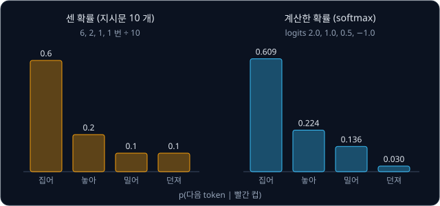

위 그림의 왼쪽은 표의 비율을 막대로 그린 것이다. 오른쪽은 다음 절에서 계산할, 세지 않고 모델이 계산해 낸 확률표다.

**확인 문제.** 지시문 20 개가 모두 "파란 공" 으로 시작하고 그 뒤에 "굴려" 가 12 번, "집어" 가 8 번 왔다.
$p(\text{굴려} \mid \text{파란 공})$ 은?

답 보기

$12 \div 20 = 0.6$ 이다. "집어" 는 $8 \div 20 = 0.4$ 이고 둘을 더하면 1 이다.

### 세어서 만든 확률표의 한계

앞부분마다 다음 token 을 세어 두면 language model 을 만들 수 있을 것 같지만, 이 방법은 금방 막힌다. 데이터에 "빨간 컵 을 천천히"
라는 앞부분이 한 번도 나오지 않았다면 그 뒤에 무엇이 왔는지 센 기록이 없으니 확률표를 만들 수 없다.

이런 빈칸은 드문 일이 아니다. GPT-2 의 vocabulary 에는 token 이 50,257 개 있으므로, token 두 개짜리 앞부분만 해도
$50{,}257 \times 50{,}257 = 2{,}525{,}766{,}049$ 가지, 약 25 억 가지다. 세 개짜리는 약 127 조 가지로 늘어나고, 실제 글의 앞부분은
수백 token 이 넘으니 같은 앞부분이 데이터에 두 번 나오는 일은 거의 없다. 게다가 세는 방법은 "빨간 컵" 과 "빨간 머그컵" 을 서로
아무 관계 없는 앞부분으로 다뤄서, 하나에서 센 결과를 다른 하나에 빌려 쓰지 못한다.

그래서 확률표를 세어서 저장하지 않고 계산으로 만든다. 곱하고 더하는 계산을 여러 층 쌓은 neural network 에 앞부분의 token 들을
넣으면, network 는 vocabulary 의 token 마다 점수 하나를 낸다. 이 점수를 logits 라고 하고, logit 마다 $e^{z}$ 를 구해 그
합으로 나누는 softmax 로 바꾸면 확률표가 된다. "빨간 컵" 을 넣었을 때 네 후보의 logits 가 $[2.0, 1.0, 0.5, -1.0]$ 이었다고 하자. 계산을 줄이려고 vocabulary 의 나머지 token 은 확률이 0
이라고 보고 네 후보만으로 계산한다.

| 후보 token | logit $z$ | $e^{z}$ | $e^{z} \div 12.124$ |
| --- | --- | --- | --- |
| 집어 | 2.0 | 7.389 | 0.609 |
| 놓아 | 1.0 | 2.718 | 0.224 |
| 밀어 | 0.5 | 1.649 | 0.136 |
| 던져 | $-1.0$ | 0.368 | 0.030 |
| 합 | | 12.124 | 1 (반올림 때문에 0.999) |

$e$ 는 약 2.718 인 정해진 수이고, $e^{z}$ 는 $e$ 를 $z$ 번 곱한 값이다. $z$ 가 음수거나 정수가 아니어도 계산기로 값을 구할 수
있고, 이 계산은 [Transformer](../transformer/README.md) 의 softmax 절에서 따라가 본 것과 같다. 결과 $[0.609, 0.224, 0.136, 0.030]$ 은 앞 절에서 센
$[0.6, 0.2, 0.1, 0.1]$ 과 비슷하다.

network 는 처음 보는 앞부분에도 확률표를 낸다. 비슷한 앞부분은 network 안에서 비슷한 숫자 묶음이 되어 비슷한 확률표로 이어지므로,
"빨간 머그컵" 을 한 번도 본 적이 없어도 "빨간 컵" 에서 배운 것이 반영된다. 앞부분을 받아 확률표를 내는 이 network 로 GPT-2 는
[Transformer](../transformer/README.md) 구조를 쓰고, 그 모양은 다음 섹션에서 다룬다.

**확인 문제.** vocabulary 에 token 이 10 개 있다면 token 두 개짜리 앞부분은 몇 가지일까? 세 개짜리는?

답 보기

첫 token 이 10 가지, 둘째 token 이 10 가지라서 $10 \times 10 = 100$ 가지다. 세 개짜리는 $10 \times 10 \times 10 = 1{,}000$ 가지다.
token 이 하나 늘 때마다 10 배가 되므로 세어서 모든 경우를 채우기가 금방 불가능해진다.

### 정답이 이미 들어 있는 text

[PyTorch Training Loop](../pytorch-mlp/README.md) 에서 손글씨 숫자를 분류할 때는 사진마다 사람이 "이것은 7" 이라는 정답(label)을
달아 두어야 했고, [Transformer](../transformer/README.md) 의 번역 모델도 영어 문장과 그 번역문을 쌍으로 모아야 했다. 다음 token
맞히기에는 이런 준비가 필요 없는데, 정답이 text 안에 이미 들어 있기 때문이다.

지시문 "빨간 컵 집어" 한 문장으로 학습 문제를 만들어 보자. 문장 앞에는 "글이 시작된다" 는 표시 `<bos>` 를, 뒤에는 "글이 끝났다"
는 표시 `<eos>` 를 붙인다. 둘은 [Transformer](../transformer/README.md) 에서 본 special token(text 에서 배우지 않고 미리 정해
vocabulary 에 넣어 두는 token)이다. GPT-2 는 두 자리 모두에 [BPE Tokenizer](../tokenizer/README.md) 에서 본 `<|endoftext|>` 하나를
쓰지만, 이 강의에서는 구분하기 쉽게 둘을 따로 적는다.

| 위치 | 1 | 2 | 3 | 4 |
| --- | --- | --- | --- | --- |
| 입력 $x$ | `<bos>` | 빨간 | 컵 | 집어 |
| 정답 $y$ | 빨간 | 컵 | 집어 | `<eos>` |

정답 줄은 입력 줄을 왼쪽으로 한 칸 민 것이다. 위치 3 은 입력의 처음부터 자기 자리까지인 "`<bos>` 빨간 컵" 을 보고 다음 token
"집어" 를 맞혀야 하고, 위치 1 은 `<bos>` 만 보고 "빨간" 을 맞혀야 한다. 위치마다 문제가 하나씩이라 token 4 개짜리 입력 하나에서
문제가 4 개 나온다.

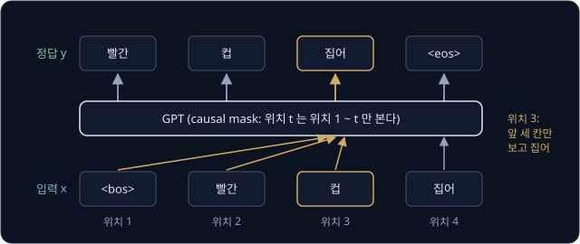

위 그림의 아래 줄이 입력, 위 줄이 정답이다. 강조한 위치 3 은 화살표가 닿는 왼쪽 세 칸만 보고 답한다.

숫자만 바꿔 글자 하나를 token 하나로 쓰는 경우를 보자. text "hello" 에서 앞의 네 글자 "hell" 이 입력, 한 칸 민 "ello" 가 정답이
되어 문제 4 개가 나온다. h 다음 e, he 다음 l, hel 다음 l, hell 다음 o 다. 길이가 $T + 1$ 인 조각을 자르면 입력과 정답이 $T$ 개씩
생기고 문제도 $T$ 개다.

사람이 정답을 달지 않고 데이터 자신에서 정답을 만들어 학습하는 방식을 self-supervised learning 이라고 한다. supervised 는 "정답을
보며 배우는", self 는 "스스로" 라는 뜻이다. 그래서 인터넷에 있는 어떤 글이든 학습 데이터가 된다. GPT-2 는 웹에서 모은 문서 약
800 만 개, 약 40 GB 의 text(WebText)로 학습했다. GB(gigabyte)는 byte 10 억 개이고, byte 는 0 ~ 255 사이의 숫자 하나를 담는
단위였다([BPE Tokenizer](../tokenizer/README.md)).

**확인 문제.** "`<bos>` 공 을 집어 `<eos>`" 는 token 5 개다. 이 조각에서 입력과 정답을 만들면 문제가 몇 개 나올까? 마지막 문제의
입력과 정답은?

답 보기

길이 5 인 조각이라 $T = 4$ 이고 문제는 4 개다. 입력은 "`<bos>` 공 을 집어", 정답은 "공 을 집어 `<eos>`" 이고, 마지막 문제는
"`<bos>` 공 을 집어" 를 보고 `<eos>` 를 맞히는 것이다.

**요약**

- language model 은 앞의 token 들을 받아 vocabulary 의 token 마다 다음에 올 확률을 매긴 확률표를 낸다. $p(\text{집어} \mid \text{빨간 컵}) = 0.6$ 처럼 쓴다
- 앞부분의 가짓수가 너무 많아 세어서 만들 수 없으므로, neural network 가 logits 를 내고 softmax 로 확률표를 만든다
- 정답은 입력을 한 칸 민 것이라서 사람이 label 을 달지 않은 text 만으로 학습할 수 있다(self-supervised learning)

## decoder-only 구조

### decoder 만 남긴 Transformer

[Transformer](../transformer/README.md) 의 번역 모델은 입력 문장을 한꺼번에 읽는 encoder 와 출력 문장을 한 token 씩 쓰는 decoder
로 되어 있었다. decoder layer 에는 sub-layer(층 안의 계산 단계)가 세 개 있었다.

1. 지금까지 쓴 token 끼리 서로를 참고하는 masked self-attention
2. encoder 의 출력을 들여다보는 cross-attention
3. token 마다 따로 vector 를 가공하는 FFN(feed-forward network)

language model 에는 번역할 원문 같은 별도의 입력이 없고, 지금까지 쓴 text 가 곧 입력이다. 그래서 encoder 가 필요 없고, encoder 를
보는 cross-attention 도 필요 없다. 남는 것은 masked self-attention 과 FFN 뿐이고, 이렇게 decoder 만 쌓은 구조를 decoder-only
Transformer 라고 한다.

2018년 Radford 등은 이 구조에 많은 text 로 다음 token 맞히기를 학습시킨 모델을 GPT 라고 불렀다. GPT 는 Generative Pre-trained
Transformer 의 줄임말이다. generative 는 "글을 만들어 내는", pre-trained 는 "특정한 일에 쓰기 전에 많은 데이터로 먼저 학습해 둔"
이라는 뜻이다. 2019년의 GPT-2 는 구조를 조금 고치고 모델과 데이터를 크게 키운 다음 버전이다.

| 항목 | 원래 Transformer (2017) | GPT-2 |
| --- | --- | --- |
| 구성 | encoder + decoder | decoder 만, cross-attention 없음 |
| 위치 정보 | sin·cos 식으로 계산한 위치 vector | 위치마다 한 행씩 두고 학습하는 표 (position embedding) |
| FFN 의 activation (꺾임을 넣는 함수) | ReLU (음수를 0 으로) | GELU (0 근처를 매끄럽게 휜 ReLU) |
| LayerNorm (vector 의 숫자 크기를 맞추는 계산) 위치 | sub-layer 뒤 (Post-LN) | sub-layer 앞 (Pre-LN), 마지막 block 뒤에 하나 더 |
| 출력 층 | 따로 둔 행렬 | 입력의 token embedding 표를 다시 씀 |

학습하는 position embedding 과 GELU 는 GPT-1 에서 바뀐 것이고, LayerNorm 을 sub-layer 앞으로 옮기고 마지막에 하나 더 둔 것은
GPT-2 에서 바뀐 것이다. 표의 항목마다 이 섹션의 뒤쪽 절에서 숫자로 계산해 본다.

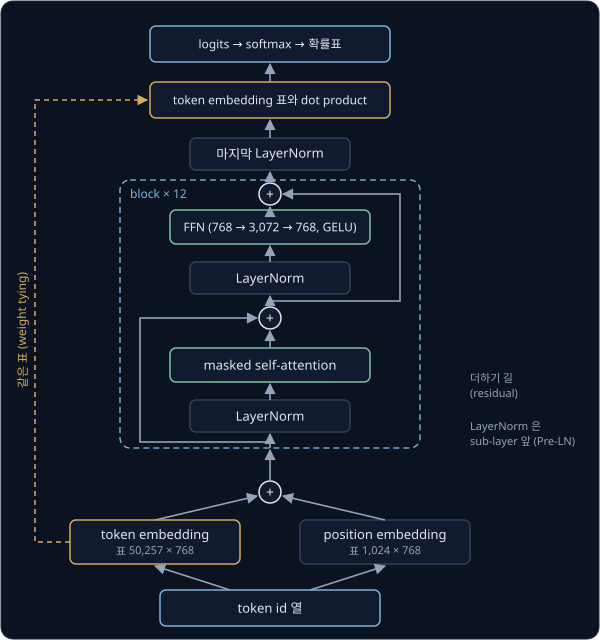

위 그림은 GPT-2 의 계산이 아래에서 위로 흐르는 모습이다. 점선 상자가 block 하나이고, GPT-2 의 가장 작은 모델은 이 block 을
12 번 쌓았다. 맨 위에서 나온 확률표가 앞 섹션의 확률표다.

**확인 문제.** 번역 모델의 decoder layer 에서 GPT 의 block 으로 바뀔 때 빠지는 sub-layer 는 무엇이고, 빠지는 이유는?

답 보기

cross-attention 이 빠진다. cross-attention 은 encoder 가 읽은 별도의 입력 문장을 보는 통로인데, language model 에는 지금까지 쓴
text 말고 다른 입력이 없어서 encoder 가 없기 때문이다.

### token embedding 과 position embedding

모델에 들어가는 첫 계산은 [Transformer](../transformer/README.md) 의 embedding 이다. token 마다 숫자 몇 개짜리 목록(vector)을 적어
둔 표에서 token id 로 행(가로줄) 하나를 꺼낸다. 이 표가 token embedding 표이고, GPT-2 의 가장 작은 모델은 행이 50,257 개, 열이
768 개다. vector 안 숫자의 개수를 그 vector 의 차원이라고 하므로 token 하나가 768 차원 vector 가 된다.

attention 은 token 의 순서를 모르기 때문에 위치 정보도 더해야 한다. 원래 Transformer 는 sin·cos 식으로 위치마다 vector 를 계산했지만,
GPT 는 위치마다 한 행씩 둔 표를 하나 더 만들고 그 숫자도 학습으로 정한다. 이 표를 position embedding 표라고 한다. token embedding
과 position embedding 을 칸끼리 더한 vector 가 첫 block 의 입력이다.

2차원으로 줄여 계산해 보자. 표의 값은 설명을 위해 정한 숫자다.

| 위치 | token | token embedding | position embedding | 더한 값 |
| --- | --- | --- | --- | --- |
| 1 | `<bos>` | $[0, 0]$ | $[0.1, 0.1]$ | $[0.1, 0.1]$ |
| 2 | 빨간 | $[1, 0]$ | $[0.2, -0.1]$ | $[1.2, -0.1]$ |
| 3 | 컵 | $[0, 1]$ | $[0.1, -0.2]$ | $[0.1, 0.8]$ |

"빨간" 이 위치 3 에 왔다면 위치 3 의 행 $[0.1, -0.2]$ 를 더해 $[1.1, -0.2]$ 가 된다. 같은 token 이라도 자리에 따라 다른 vector 가
되므로 모델이 순서를 구분할 수 있다.

position embedding 표의 행 수는 학습 전에 정해 둔다. GPT-2 는 1,024 행이라서 위치 1,024 까지만 vector 가 있고, 1,025 번째 token
에 더할 행은 없다. 모델이 한 번에 볼 수 있는 token 의 최대 개수를 context length 라고 하고, GPT-2 의 context length 는 1,024 다.
context 는 "앞뒤 맥락" 이라는 뜻으로, 다음 token 을 정할 때 참고하는 앞부분 전체를 가리킨다.

**확인 문제.** "컵" 의 token embedding 이 $[0, 1]$ 이고 위치 2 의 position embedding 이 $[0.2, -0.1]$ 이다. "컵" 이 위치 2 에 오면
첫 block 에 들어가는 vector 는? position embedding 표가 4 행이면 context length 는?

답 보기

$[0 + 0.2, 1 - 0.1] = [0.2, 0.9]$ 다. 위치 4 까지만 행이 있으므로 context length 는 4 다.

### Pre-LN block

block 은 [Transformer](../transformer/README.md) 에서 본 부품 네 가지로 만든다.

- **masked self-attention** — token 들이 자기보다 앞의 token 만 참고해 vector 를 고친다. mask 는 다음 섹션에서 다룬다
- **FFN** — token 마다 따로 vector 를 4 배 길이로 늘렸다가 activation 을 거쳐 원래 길이로 되돌린다
- **residual connection** — sub-layer 의 출력에 sub-layer 의 입력을 더해 넘긴다
- **LayerNorm(layer normalization)** — token vector 하나의 숫자들을 평균 0, 표준편차 1 로 맞춘 뒤 학습되는 두 숫자로 다시 조절한다.
  표준편차는 숫자들이 평균에서 대표적으로 얼마나 떨어져 있는지를 나타내는 값이었다

GPT-2 의 block 은 이 부품을 아래 두 줄로 잇는다.

$$
\mathbf{x} \leftarrow \mathbf{x} + \mathrm{Attn}(\mathrm{LN}_1(\mathbf{x})), \qquad
\mathbf{x} \leftarrow \mathbf{x} + \mathrm{FFN}(\mathrm{LN}_2(\mathbf{x}))
$$

$\mathbf{x}$ 는 token 하나의 vector, $\leftarrow$ 는 "오른쪽 값으로 바꾼다" 는 뜻이다. $\mathrm{LN}_1$, $\mathrm{LN}_2$ 는 숫자를 따로
학습하는 LayerNorm 두 개, $\mathrm{Attn}$ 은 masked self-attention 이다. 첫 식은 "$\mathbf{x}$ 를 LayerNorm 으로 맞춰 attention 에
넣고, 그 출력을 원래 $\mathbf{x}$ 에 더한다" 로 읽고, 둘째 식은 같은 일을 FFN 으로 한다.

숫자로 따라가 보자. $\mathbf{x} = [1, 2]$ 이고, LayerNorm 을 거쳐 attention 이 낸 출력이 $[0.5, -0.5]$ 라면 첫 줄 뒤의
$\mathbf{x}$ 는 $[1.5, 1.5]$ 다. 이어서 FFN 의 출력이 $[-0.5, 1]$ 이면 둘째 줄 뒤의 $\mathbf{x}$ 는 $[1, 2.5]$ 다. LayerNorm 은
attention 과 FFN 에 넣는 값에만 적용되고, 더하는 쪽의 $\mathbf{x}$ 는 손대지 않은 채로 남는다.

LayerNorm 을 sub-layer 앞에 두는 이 배치를 Pre-LN 이라고 한다. 원래 Transformer 처럼 더한 뒤에 LayerNorm 을 하면(Post-LN) 첫 block
의 입력에서 마지막 block 의 출력까지 가는 길마다 LayerNorm 이 끼어 있지만, Pre-LN 에서는 더하기만으로 이어진 길이 처음부터 끝까지
남는다. [Transformer](../transformer/README.md) 의 residual connection 절에서 본 것처럼 이 길로 gradient 가 줄지 않고 앞 층까지
전해지므로, 층을 많이 쌓아도 학습이 안정적이다. 대신 마지막 block 을 지난 vector 는 한 번도 정규화되지 않았으므로, GPT-2 는
모든 block 뒤에 LayerNorm 을 하나 더 둔다.

**확인 문제.** $\mathbf{x} = [2, 0]$ 이고 attention 출력이 $[1, 1]$, 그다음 FFN 출력이 $[0, -2]$ 다. block 하나를 지난 $\mathbf{x}$ 는?

답 보기

첫 줄 뒤 $[2 + 1, 0 + 1] = [3, 1]$, 둘째 줄 뒤 $[3 + 0, 1 - 2] = [3, -1]$ 이다.

### GELU

FFN 은 vector 를 늘린 뒤 activation 을 거친다. activation 은 곱하고 더하기만으로는 만들 수 없는 꺾임이나 휨을 넣는 함수다.
함수는 값 하나를 넣으면 값 하나가 정해져 나오는 규칙이다. 원래 Transformer 는 음수를 0 으로 바꾸는 ReLU 를 썼고, GPT 는 GELU
(Gaussian Error Linear Unit)를 쓴다.

$$
\mathrm{GELU}(x) = x \times \Phi(x)
$$

$\Phi$ 는 그리스 문자 phi(파이)의 대문자이고, $\Phi(x)$ 는 $x$ 에 따라 정해지는 0 과 1 사이의 비율이다. $x$ 가 클수록 1 에, 작을수록
0 에 다가가고, $x = 0$ 에서 딱 0.5 다. 식은 "$x$ 에 그 비율을 곱한다" 로 읽는다. 큰 양수는 거의 그대로 통과하고, 큰 음수는 0 에
가까워지며, 0 근처의 값은 일부만 통과한다.

| $x$ | $-2$ | $-1$ | $-0.5$ | $0$ | $0.5$ | $1$ | $2$ |
| --- | --- | --- | --- | --- | --- | --- | --- |
| $\Phi(x)$ | 0.023 | 0.159 | 0.309 | 0.5 | 0.691 | 0.841 | 0.977 |
| $\mathrm{GELU}(x)$ | $-0.046$ | $-0.159$ | $-0.154$ | 0 | 0.346 | 0.841 | 1.954 |
| $\mathrm{ReLU}(x)$ | 0 | 0 | 0 | 0 | 0.5 | 1 | 2 |

$x = 1$ 이면 $1 \times 0.841 = 0.841$, $x = -1$ 이면 $-1 \times 0.159 = -0.159$ 다. ReLU 는 $x = 0$ 에서 갑자기 꺾이지만 GELU 는
매끄럽게 이어지고, 작은 음수도 조금은 음수로 내보낸다. $\Phi$ 는 통계에서 쓰는 종 모양의 곡선(Gaussian 분포, 정규분포)에서 나온
함수라서 이름에 Gaussian 이 붙었다. GPT-2 는 $\Phi$ 를 계산하기 쉬운 근삿값 식으로 바꿔 썼는데, 위 표의 값과 소수 셋째 자리까지
거의 같다.

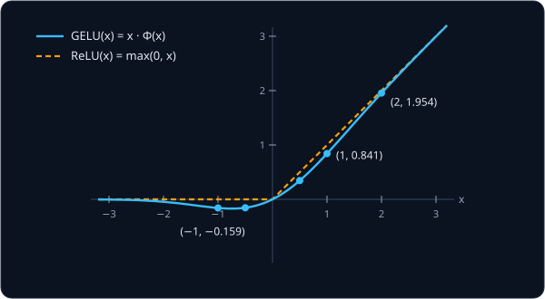

위 그림에서 두 곡선은 $x$ 가 2 보다 크거나 $-2$ 보다 작은 곳에서는 거의 겹치고, 0 근처에서만 다르다.

**확인 문제.** $\Phi(2) = 0.977$ 일 때 $\mathrm{GELU}(2)$ 와 $\mathrm{ReLU}(2)$ 는? $\mathrm{GELU}(-2)$ 는? ($\Phi(-2) = 0.023$)

답 보기

$\mathrm{GELU}(2) = 2 \times 0.977 = 1.954$, $\mathrm{ReLU}(2) = 2$ 다. $\mathrm{GELU}(-2) = -2 \times 0.023 = -0.046$ 으로, ReLU 의
0 과 달리 아주 작은 음수가 나온다.

### 출력 층과 weight tying

마지막 LayerNorm 을 지난 vector 를 $\mathbf{h}$ 라고 하자. h 는 hidden(숨은)의 첫 글자로, 입력과 출력 사이 층에서 나온 vector 를
가리킬 때 흔히 쓰는 이름이다. 확률표를 만들려면 $\mathbf{h}$ 에서 vocabulary 의 token 마다 logit 하나를 뽑아야 한다.

GPT-2 는 이 일에 새 행렬을 만들지 않고, 입력에서 쓴 token embedding 표를 다시 쓴다. token 마다 자기 embedding 과 $\mathbf{h}$ 의
dot product(같은 칸끼리 곱해 모두 더한 값)를 구해 그것을 logit 으로 삼는다. "빨간 컵" 의 마지막 위치에서 $\mathbf{h} = [2, 1]$
이 나왔다고 하자.

| token | token embedding | dot product 계산 | logit |
| --- | --- | --- | --- |
| 집어 | $[1, 0]$ | $2 \times 1 + 1 \times 0$ | 2.0 |
| 놓아 | $[0, 1]$ | $2 \times 0 + 1 \times 1$ | 1.0 |
| 밀어 | $[0.5, -0.5]$ | $2 \times 0.5 + 1 \times (-0.5)$ | 0.5 |
| 던져 | $[-0.5, 0]$ | $2 \times (-0.5) + 1 \times 0$ | $-1.0$ |

이 logits 가 앞에서 softmax 한 $[2.0, 1.0, 0.5, -1.0]$ 이고, 확률표 $[0.609, 0.224, 0.136, 0.030]$ 이 여기서 나온다. 입력의 embedding
표와 출력의 행렬을 같은 숫자로 묶어 쓰는 것을 weight tying 이라고 한다. tie 는 "묶다" 라는 뜻이고, 2016년 Press 와 Wolf 가
제안했다.

![weight tying 의 계산. 마지막 vector h = [2, 1] 을 token embedding 표의 네 행과 dot product 해 logits 2.0, 1.0, 0.5, −1.0 을 얻고, softmax 로 확률 0.609, 0.224, 0.136, 0.030 을 만든다](figures/weight-tying.svg)

위 그림은 $\mathbf{h}$ 가 embedding 표의 행마다 dot product 를 거쳐 logit 이 되는 모습이다.

같은 표를 다시 써도 되는 이유는 두 일이 같은 기준을 쓰기 때문이다. dot product 는 두 vector 가 같은 칸에서 함께 클수록 커지는
관련도 점수였다([Transformer](../transformer/README.md)). 그래서 출력에서는 embedding 이 $\mathbf{h}$ 와 닮은 token 일수록 높은
logit 을 받고, 입력에서는 뜻이 비슷한 token 일수록 닮은 embedding 을 갖도록 학습된다. 마지막 vector 가 "집어 와 닮은 vector" 가 되면
집어 의 확률이 올라가는 것이 자연스럽고, 입력과 출력이 token 의 뜻을 같은 숫자 공간에서 다루게 된다.

parameter(데이터를 보고 학습으로 정하는 숫자)도 크게 준다. GPT-2 의 가장 작은 모델에서 출력 행렬을 따로 두면
$50{,}257 \times 768 = 38{,}597{,}376$ 개, 약 3,860 만 개의 숫자가 더 필요하다. 묶어 쓰면 모델 전체가 124,439,808 개이고, 따로 두면
163,037,184 개라서 약 24% 를 아낀다.

**확인 문제.** 마지막 vector 가 $\mathbf{h} = [1, 3]$ 이면 위 표의 네 token 의 logit 은? 가장 큰 것은?

답 보기

집어 $1 \times 1 + 3 \times 0 = 1$, 놓아 $1 \times 0 + 3 \times 1 = 3$, 밀어 $1 \times 0.5 + 3 \times (-0.5) = -1$, 던져
$1 \times (-0.5) + 3 \times 0 = -0.5$ 다. 놓아 가 3 으로 가장 크다.

**요약**

- GPT 는 Transformer 에서 encoder 와 cross-attention 을 뺀 decoder-only 구조이고, block 은 masked self-attention 과 FFN 두 sub-layer 다
- 입력은 token embedding 과 학습하는 position embedding 의 합이고, position embedding 표의 행 수가 context length(GPT-2 는 1,024)다
- block 은 LayerNorm 을 sub-layer 앞에 두는 Pre-LN 이고, FFN 은 GELU 를 쓴다
- 마지막 vector 와 token embedding 표의 dot product 가 logits 다(weight tying). parameter 가 약 3,860 만 개 준다

## causal mask

### 위치마다 따로 푸는 문제

"`<bos>` 빨간 컵 집어" 를 넣으면 모델은 위치 4 개에서 동시에 확률표를 낸다. 그런데 위치 3 이 맞혀야 할 정답 "집어" 는 위치 4 의
입력으로 들어와 있다. self-attention 은 원래 모든 token 이 모든 token 을 보기 때문에, 막지 않으면 위치 3 은 위치 4 에서 정답을
그대로 가져올 수 있다.

위치 3 ("컵") 의 query 가 네 위치의 key 와 얻은 점수가 $[0, 1, 2, 3]$ 이라고 하자. query·key·value 는 token vector 에 서로 다른
행렬을 곱해 만든 세 vector 로, 점수는 query 와 key 의 dot product 였고 점수를 softmax 한 비율이 weight 였다
([Transformer](../transformer/README.md)).

| 상대 위치 | 점수 | mask 없을 때 weight | mask 후 점수 | $e^{\text{점수}}$ | mask 후 weight |
| --- | --- | --- | --- | --- | --- |
| 1 `<bos>` | 0 | 0.032 | 0 | 1 | 0.090 |
| 2 빨간 | 1 | 0.087 | 1 | 2.718 | 0.245 |
| 3 컵 | 2 | 0.237 | 2 | 7.389 | 0.665 |
| 4 집어 | 3 | 0.644 | $-\infty$ | 0 | 0 |
| 합 | | 1 | | 11.107 | 1 |

mask 가 없으면 위치 3 은 정답이 들어 있는 위치 4 에서 64.4% 를 가져온다. 학습 때는 이렇게 베껴서 loss 가 쉽게 내려가지만, 실제로
글을 쓸 때는 다음 token 이 아직 없으니 베낄 것이 없어서 모델은 아무것도 맞히지 못한다. 그래서 softmax 전에 위치 4 의 점수를
$-\infty$ (음의 무한대, 어떤 수보다도 작은 값)로 바꾼다. $e^{-\infty}$ 는 0 이라서 그 칸의 weight 가 0 이 되고, 남은 세 칸이
$e^{0} + e^{1} + e^{2} = 1 + 2.718 + 7.389 = 11.107$ 로 나눠 합 1 을 다시 나눠 갖는다.

위치마다 볼 수 있는 칸을 표로 그리면 대각선과 그 왼쪽만 열린 계단 모양이 되고, 이 표를 causal mask 라고 한다. causal 은 "원인의"
라는 뜻으로, 앞에 일어난 일만 뒤의 일에 영향을 줄 수 있다는 시간 순서를 지킨다는 의미다. GPT 는 모든 block 의 self-attention
에 이 mask 를 쓴다.

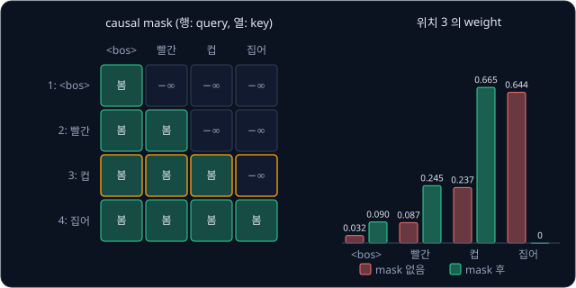

위 그림의 왼쪽이 causal mask 이고, 오른쪽은 위의 표에서 위치 3 의 weight 를 막대로 비교한 것이다.

**확인 문제.** 위치 2 의 점수가 네 위치에 대해 $[1, 3, 0, 2]$ 다. causal mask 를 적용한 weight 는? ($e^{3} \approx 20.086$)

답 보기

위치 2 는 위치 1, 2 만 볼 수 있으므로 셋째와 넷째 점수를 $-\infty$ 로 바꾼다. $e^{1} = 2.718$, $e^{3} = 20.086$, 합 22.804 라서
weight 는 $[0.119, 0.881, 0, 0]$ 이다.

### forward 한 번에 푸는 여러 문제

causal mask 가 있으면 위치 $t$ 의 출력은 위치 1 부터 $t$ 까지의 입력만으로 정해진다. 첫 block 에서 위치 3 의 vector 는 위치 1, 2, 3
만 보고 고쳐지고, 둘째 block 에서 위치 3 이 참고하는 위치 1, 2, 3 의 vector 도 모두 위치 3 까지의 입력만으로 만들어진 것이다.
block 을 몇 번 쌓아도 이 성질이 이어진다.

그래서 "`<bos>` 빨간 컵 집어" 를 한 번 넣어 계산하는 것은 "`<bos>`", "`<bos>` 빨간", "`<bos>` 빨간 컵", "`<bos>` 빨간 컵 집어" 를
따로 네 번 넣어 각각 마지막 위치의 확률표를 얻는 것과 결과가 같다. 입력을 받아 출력까지 한 번 계산하는 것을 forward 라고 하는데,
forward 한 번으로 문제 4 개를 푼다. 정답을 입력으로 한꺼번에 넣어 위치마다 다음 token 을 맞히게 하는 이 학습 방식을
[Transformer](../transformer/README.md) 에서 teacher forcing 이라고 불렀다.

GPT-2 처럼 길이 1,024 인 조각을 넣으면 forward 한 번에 문제 1,024 개를 푼다. 학습 때 실제로 글을 쓸 때와 똑같이 앞의 token 만 보고
맞히면서도, 위치마다 forward 를 따로 하지 않아도 되므로 학습이 훨씬 빠르다.

**확인 문제.** causal mask 를 쓴 모델에 길이 256 인 입력을 넣으면 forward 한 번에 다음 token 맞히기 문제를 몇 개 푸는가? 위치 10 의
확률표는 몇 번째 위치까지의 입력에 따라 달라지는가?

답 보기

위치마다 하나씩 256 개를 푼다. 위치 10 의 확률표는 위치 1 부터 10 까지의 입력에만 따라 달라지고, 위치 11 이후의 token 을 바꿔도
그대로다.

**요약**

- mask 가 없으면 각 위치가 정답이 들어 있는 바로 다음 위치를 보고 베낄 수 있다
- causal mask 는 softmax 전에 자기보다 뒤쪽 위치의 점수를 $-\infty$ 로 바꿔 weight 를 0 으로 만든다
- 그래서 위치 $t$ 의 출력은 위치 $t$ 까지의 입력만으로 정해지고, forward 한 번에 위치 수만큼의 문제를 함께 푼다

## cross-entropy 로 하는 학습

### 위치마다의 loss

학습은 정답 token 의 확률을 높이는 쪽으로 parameter 를 고치는 일이다. [PyTorch Training Loop](../pytorch-mlp/README.md) 에서
분류 문제의 loss 로 쓴 cross-entropy 를 위치마다 그대로 쓴다. cross-entropy 는 정답의 확률 $p$ 에 log 를 씌우고 부호를 바꾼
$-\log p$ 였다. $\log p$ 는 "$e$ 를 몇 제곱해야 $p$ 가 되는가" 의 답이라서 $\log 1 = 0$, $\log 0.5 = -0.693$ 이고, $p$ 가 1 보다
작으면 음수다. 마이너스를 붙이면 loss 는 0 이상이 되고, 정답 확률이 1 에 가까울수록 0 에 가깝다.

"`<bos>` 빨간 컵 집어" 를 넣었을 때 모델이 위치마다 정답 token 에 준 확률이 아래와 같다고 하자. 위치 3 의 0.609 는 앞에서
계산한 확률표의 "집어" 다.

| 위치 | 보는 입력 | 정답 | 정답의 확률 $p$ | loss $-\log p$ |
| --- | --- | --- | --- | --- |
| 1 | `<bos>` | 빨간 | 0.5 | 0.693 |
| 2 | `<bos>` 빨간 | 컵 | 0.8 | 0.223 |
| 3 | `<bos>` 빨간 컵 | 집어 | 0.609 | 0.496 |
| 4 | `<bos>` 빨간 컵 집어 | `<eos>` | 0.9 | 0.105 |

네 loss 를 더하면 $0.693 + 0.223 + 0.496 + 0.105 = 1.517$ 이고, 평균은 $1.517 \div 4 \approx 0.379$ 다. 평균은 모두 더한 뒤 개수로
나눈 값이다. 이 0.379 가 이 조각 하나의 loss 다.

기호로는 아래와 같이 쓴다.

$$
\mathcal{L} = -\frac{1}{T}\sum_{t=1}^{T} \log p(y_t \mid x_1, \dots, x_t)
$$

$\mathcal{L}$ 은 loss 의 첫 글자를 꾸민 글꼴로 쓴 것이고, $T$ 는 위치의 개수, $x_1, \dots, x_t$ 는 위치 1 부터 $t$ 까지의 입력,
$y_t$ 는 위치 $t$ 의 정답이다. $\sum_{t=1}^{T}$ 는 $t$ 를 1 부터 $T$ 까지 바꿔 가며 모두 더하라는 기호이고, $\frac{1}{T}$ 을 곱하는
것은 $T$ 로 나누는 것과 같다. 그래서 식은 "위치마다 앞의 입력이 주어졌을 때 정답 token 의 확률에 log 를 씌우고, 모두 더해
위치 수로 나눈 뒤 마이너스를 붙인다" 로 읽는다. 위 표에서 $T = 4$, $y_3$ 은 "집어", $p(y_3 \mid x_1, x_2, x_3)$ 은 0.609 다.

학습이 진행되어 모델이 네 위치 모두에서 정답에 0.9 를 주게 되면 loss 는 위치마다 $-\log 0.9 = 0.105$ 이고 평균도 0.105 다. 정답
확률이 올라가자 loss 가 0.379 에서 0.105 로 내려갔다.

logits 를 어느 쪽으로 고쳐야 하는지도 [PyTorch Training Loop](../pytorch-mlp/README.md) 의 결과를 그대로 쓴다. logit 의 gradient(조금
바꿨을 때 loss 가 변하는 비율)는 그 token 의 확률에서, 정답이면 1 을, 아니면 0 을 뺀 값이었다. 위치 3 이라면 집어, 놓아, 밀어,
던져 의 gradient 가 $0.609 - 1 = -0.391$, $0.224$, $0.136$, $0.030$ 이다. gradient 의 반대 방향으로 고치므로 정답 "집어" 의 logit
은 올라가고 나머지는 내려간다.

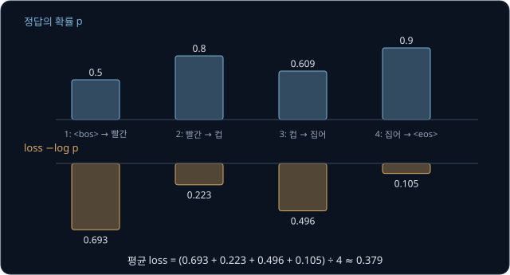

위 그림의 위쪽 막대가 정답의 확률, 아래쪽 막대가 loss 다. 확률이 낮은 위치 1 의 loss 가 가장 크다.

**확인 문제.** token 3 개짜리 조각에서 정답의 확률이 0.5, 0.5, 1 이었다. 이 조각의 loss 는? ($\log 0.5 = -0.693$)

답 보기

위치마다 loss 는 0.693, 0.693, 0 이고 합은 1.386, 평균은 $1.386 \div 3 \approx 0.462$ 다. 정답을 확실히 맞힌 위치의 loss 는
$-\log 1 = 0$ 이다.

### 학습을 시작할 때의 loss

학습 전의 parameter 는 작은 무작위 숫자라서 logits 가 거의 비슷하게 나오고, 그러면 softmax 는 vocabulary 의 모든 token 에 거의
같은 확률을 준다. vocabulary 에 token 이 $V$ 개면 정답의 확률은 약 $1/V$ 이고, 학습을 시작할 때의 loss 는 아래와 같다.

$$
-\log \frac{1}{V} = \log V
$$

$\frac{1}{V}$ 은 1 을 $V$ 로 나눈 값이다. $V = 4$ 로 확인하면 $e^{1.386} \approx 4$ 이고 $e^{-1.386} \approx 1/4 = 0.25$ 라서
$\log 0.25 = -1.386$ 이므로, $-\log(1/4) = 1.386 = \log 4$ 다. 확률 $1/V$ 의 log 는 $V$ 의 log 에 마이너스를 붙인 것이라서,
마이너스를 다시 붙이면 $\log V$ 만 남는다.

| vocabulary | $V$ | 정답 확률 $1/V$ | 처음 loss $\log V$ |
| --- | --- | --- | --- |
| 이 강의의 예 (`<bos>`, `<eos>`, 빨간, 컵, 집어, 놓아, 밀어, 던져) | 8 | 0.125 | 2.079 |
| Shakespeare 희곡의 글자 | 65 | 0.0154 | 4.174 |
| GPT-2 의 BPE token | 50,257 | 0.0000199 | 10.825 |

Shakespeare 희곡을 모은 약 111 만 글자의 text(Tiny Shakespeare)에는 서로 다른 글자가 65 개 있어서, 글자 하나를 token 하나로 쓰는
모델은 loss 4.17 근처에서 학습을 시작한다. 첫 loss 가 이보다 훨씬 크면 처음 weight 가 너무 커서 모델이 처음부터 몇몇 token 에
확률을 몰아주고 있다는 뜻이다. 정답에 0.001 만 주는 위치가 많으면 loss 는 $-\log 0.001 = 6.908$ 근처가 된다. 이 계산은 학습을
돌리기 전에 모델이 제대로 만들어졌는지 확인하는 데 쓴다.

**확인 문제.** vocabulary 가 100 개인 모델이 학습 전에 모든 token 에 같은 확률을 준다면 loss 는? ($\log 0.01 = -4.605$)

답 보기

정답의 확률이 $1/100 = 0.01$ 이라서 loss 는 $-\log 0.01 = 4.605$, 곧 $\log 100$ 이다.

### train loss 와 validation loss

[PyTorch Training Loop](../pytorch-mlp/README.md) 에서처럼 text 를 나눠 앞 90% 는 학습(train set)에 쓰고, 뒤 10% 는 학습에 쓰지
않고 loss 를 재는 데만 쓴다(validation set). validation loss 는 모델이 처음 보는 text 에서 얼마나 잘 맞히는지를 나타낸다.

Tiny Shakespeare 로 글자 단위 GPT(6 block, vector 384 차원, context length 256)를 학습시키면 loss 가 4.17 근처에서 시작해 내려가고,
nanoGPT 라는 공개 구현의 기록으로는 validation loss 가 1.4697 까지 내려간다. 모든 위치에서 정답 글자에 똑같이 0.23 을 줬을 때의
loss 가 $-\log 0.23 \approx 1.47$ 이므로, 65 글자 중 하나를 고르는 일에서 정답에 평균적으로 이 정도 확률을 주는 수준이다.

약 111 만 글자는 6 block 모델에게도 작은 데이터라서, 오래 학습시키면 train loss 는 계속 내려가는데 validation loss 는 어느 순간부터
다시 올라간다. 모델이 일반적인 규칙 대신 학습 text 자체를 외우기 시작했다는 뜻이고, 이것을 overfitting 이라고 한다. 그래서
validation loss 가 가장 낮았던 때의 parameter 를 저장해 두고 그것을 쓴다.

**확인 문제.** 1,000 step 마다 잰 validation loss 가 2.0, 1.6, 1.5, 1.55, 1.6 이었고 train loss 는 그동안 계속 내려갔다. 몇 번째로 잰
때의 parameter 를 쓰는 것이 좋을까?

답 보기

validation loss 가 가장 낮은 1.5 인 세 번째(3,000 step)의 parameter 를 쓴다. 그 뒤로 train loss 는 내려가는데 validation loss 가
오르는 것은 overfitting 이 시작됐다는 신호다.

### 서로 다른 tokenizer 의 loss 비교

loss 는 token 하나당 평균이라서, token 을 자르는 단위가 다른 두 모델의 loss 는 숫자를 그대로 비교할 수 없다. 같은 300 byte 의
영어 text 를 두 모델이 읽는다고 하자. 영어 글자 하나는 1 byte 다.

| 모델 | token 수 | token 하나당 loss | 전체 loss | byte 하나당 loss |
| --- | --- | --- | --- | --- |
| 글자 단위 | 300 | 1.5 | $300 \times 1.5 = 450$ | $450 \div 300 = 1.5$ |
| BPE (token 하나에 3 byte) | 100 | 3.0 | $100 \times 3.0 = 300$ | $300 \div 300 = 1.0$ |

token 하나당 loss 만 보면 글자 단위 모델(1.5)이 BPE 모델(3.0)보다 좋아 보이지만, BPE 모델은 한 번에 3 글자를 맞히므로 문제 하나가
더 어렵다. 같은 text 전체를 맞히는 데 든 loss 를 byte 수로 나누면 BPE 모델이 1.0 으로 더 낮다. 단위가 다른 모델은 이렇게 같은
text 의 byte 하나당 loss 로 바꿔서 비교한다. [BPE Tokenizer](../tokenizer/README.md) 에서 잰 것처럼 GPT-2 의 tokenizer 는 Tiny
Shakespeare 에서 token 하나에 약 3.09 byte 를 담는다.

**확인 문제.** 200 byte 의 text 를 BPE 모델이 token 50 개로 읽고 token 하나당 loss 가 4.0 이었다. byte 하나당 loss 는?

답 보기

전체 loss 가 $50 \times 4.0 = 200$ 이고, byte 200 개로 나누면 $200 \div 200 = 1.0$ 이다.

**요약**

- 위치마다 정답 token 의 확률에 $-\log$ 를 씌우고 위치 수로 평균한 것이 loss 다. 정답 확률 0.5, 0.8, 0.609, 0.9 면 0.379 다
- 학습 전에는 모든 token 의 확률이 비슷해서 loss 가 $\log V$ 에서 시작한다. 65 글자면 4.17, GPT-2 vocabulary 면 10.8 이다
- validation loss 로 overfitting 을 살피고, 자르는 단위가 다른 모델은 byte 하나당 loss 로 바꿔 비교한다

## learning rate schedule

### AdamW 와 weight decay

learning rate 는 gradient 를 보고 parameter 를 한 번에 얼마나 고칠지 정하는 수이고, 그리스 문자 $\eta$ (eta, 에타)로 쓴다.
parameter 를 한 번 고치는 단위를 step 이라고 한다. [PyTorch Training Loop](../pytorch-mlp/README.md) 의 Adam 은 gradient 를 그 크기로
나눠 쓰기 때문에, gradient 가 크든 작든 한 step 에 대략 $\eta$ 씩 parameter 를 움직이는 optimizer(gradient 로 parameter 를 고치는
규칙)였다.

GPT 를 학습시킬 때는 Adam 에 weight decay 를 더한 AdamW 를 흔히 쓴다. weight decay 는 step 마다 parameter 를 자기 크기에 비례해
조금씩 0 쪽으로 줄이는 것이다.

$$
\theta \leftarrow \theta - \eta \lambda \theta
$$

$\theta$ (theta, 세타)는 parameter 하나, $\lambda$ (lambda, 람다)는 얼마나 줄일지 정하는 수다. 식은 "parameter 에서 learning rate
곱하기 $\lambda$ 곱하기 parameter 를 뺀다" 로 읽는다. $\theta = 2$, $\eta = 0.1$, $\lambda = 0.1$ 이면 $2 - 0.1 \times 0.1 \times 2 = 1.98$
이 되고, 여기에 Adam 의 원래 update 가 더해진다. 숫자만 바꿔 $\theta = -5$ 면 $-5 - 0.01 \times (-5) = -4.95$ 로, 음수도 0 쪽으로
줄어든다.

gradient 가 계속 밀어 주지 않는 parameter 는 조금씩 0 쪽으로 돌아가므로, 꼭 필요한 parameter 만 커진다. parameter 가 쓸데없이 큰
모델은 학습 text 의 사소한 차이까지 외우기 쉬워서, weight decay 는 overfitting 을 줄이는 데 쓴다. AdamW 의 W 는 이 줄이기를 Adam 의
gradient 나누기와 따로 한다는 뜻이다. 줄이는 몫을 gradient 에 더해 Adam 에 넣으면 Adam 이 parameter 마다 gradient 크기로 나눠
버려서 줄어드는 정도가 parameter 마다 제각각이 되기 때문에, 2017년 Loshchilov 와 Hutter 가 둘을 떼어 놓은 AdamW 를 제안했다.

**확인 문제.** $\theta = 10$, $\eta = 0.01$, $\lambda = 0.1$ 이면 weight decay 만으로 $\theta$ 는 얼마가 될까?

답 보기

$10 - 0.01 \times 0.1 \times 10 = 10 - 0.01 = 9.99$ 다.

### warmup

GPT 를 학습시킬 때는 learning rate 를 처음부터 정한 값으로 쓰지 않고, 학습의 처음 몇 step 동안 0 근처에서 출발해 직선으로 서서히
올린다. 이것을 warmup 이라고 한다. 운동 전에 몸을 천천히 데우는 준비 운동을 가리키는 말에서 이름이 왔다.

처음부터 큰 learning rate 를 쓰면 위험한 이유를 작은 숫자로 보자. [Linear Regression](../linear-regression/README.md) 에서 본
것처럼 loss 가 $L = a w^2$ 꼴이면 gradient 는 $2aw$ 이고, gradient 의 반대 방향으로 고치는 gradient descent 의 한 step 은
$w \leftarrow w - \eta \times 2aw = (1 - 2a\eta) w$ 다. 곱해지는 수 $1 - 2a\eta$ 의 크기가 1 보다 크면 $w$ 가 부호를 바꾸며 커져 발산한다.

| 자리 | loss | $\eta = 0.3$ 일 때 곱해지는 수 | $\eta = 0.075$ 일 때 곱해지는 수 |
| --- | --- | --- | --- |
| 학습 초반 (가파름) | $5w^2$ | $1 - 2 \times 5 \times 0.3 = -2$ → 발산 | $1 - 2 \times 5 \times 0.075 = 0.25$ → 수렴 |
| 학습이 조금 진행된 뒤 (완만함) | $w^2$ | $1 - 2 \times 1 \times 0.3 = 0.4$ → 수렴 | $1 - 2 \times 1 \times 0.075 = 0.85$ → 느리게 수렴 |

$\eta = 0.3$ 으로 바로 시작하면 $w$ 가 $1 \to -2 \to 4 \to -8$ 로 튀지만, 처음에는 $0.075$ 로 작게 움직이다가 loss 가 완만한 곳에
들어선 뒤 0.3 으로 올리면 빠르면서도 안전하다. 학습을 막 시작한 모델은 parameter 가 무작위라서 loss 가 parameter 에 아주 민감하게
변하는 경우가 많고, Adam 의 moving average(지난 값들을 조금씩 섞어 가며 구하는 평균)도 몇 step 분의 gradient 로만 계산되어 아직
믿을 만하지 않다. warmup 은 이 시기에 큰 step 을 피하게 해 준다. [Transformer](../transformer/README.md) 에서 본 것처럼 Post-LN
은 warmup 없이 학습이 잘 안 되고, Pre-LN 은 덜 민감하지만 GPT 계열 모델도 보통 warmup 을 둔다.

warmup 의 learning rate 는 아래 식으로 정한다. step 은 1 부터 센다.

$$
\eta_t = \eta_{\max} \times \frac{t}{W} \qquad (t \le W)
$$

$\eta_t$ 는 step $t$ 의 learning rate, $\eta_{\max}$ 는 올라갈 최대 learning rate, $W$ 는 warmup 의 step 수다. 식은 "최대 learning rate
에 지금까지 지난 warmup 의 비율 $t/W$ 를 곱한다" 로 읽는다. $\eta_{\max} = 0.001$, $W = 4$ 로 계산한다.

| step $t$ | 계산 | $\eta_t$ |
| --- | --- | --- |
| 1 | $0.001 \times 1/4$ | 0.00025 |
| 2 | $0.001 \times 2/4$ | 0.0005 |
| 3 | $0.001 \times 3/4$ | 0.00075 |
| 4 | $0.001 \times 4/4$ | 0.001 |

step 마다 0.00025 씩 일정하게 올라 step 4 에서 최대에 닿는다. 숫자만 바꿔 nanoGPT 의 Tiny Shakespeare 설정처럼
$\eta_{\max} = 0.001$, $W = 100$ 이면 step 50 에서 $0.001 \times 50/100 = 0.0005$, step 100 에서 0.001 이다.

**흔한 오해.** warmup 을 "learning rate 가 작으니 처음에는 덜 배운다" 로만 보기 쉽다. 위 표처럼 가파른 자리에서 큰 learning rate 는
덜 배우는 정도가 아니라 parameter 를 발산시켜 학습 전체를 망칠 수 있고, warmup 은 이것을 막아 결국 큰 learning rate 를 쓸 수 있게
해 준다.

**확인 문제.** $\eta_{\max} = 0.002$, $W = 5$ 일 때 step 2 의 learning rate 는?

답 보기

$0.002 \times 2/5 = 0.0008$ 이다.

### cosine decay

warmup 이 끝나면 learning rate 를 다시 줄여 간다. 학습 후반에는 parameter 가 loss 가 낮은 바닥 근처에 와 있는데, mini-batch(데이터의
작은 묶음)마다 gradient 가 조금씩 흔들려서 parameter 는 한 step 에 대략 $\eta$ 씩 바닥 주위를 오간다. 바닥이 $w = 0$ 이고 Adam 이
한 step 에 0.001 씩 움직이면 $w$ 는 $\pm 0.001$ 근처에서 흔들리고, learning rate 를 0.0001 로 줄이면 흔들림도 $\pm 0.0001$ 로
10 분의 1 이 된다. 그래서 learning rate 를 끝으로 갈수록 줄여 바닥에 가까이 내려앉게 한다.

GPT 는 learning rate 를 cos 곡선의 모양을 따라 줄이는데, 이것을 cosine decay 라고 한다. decay 는 "줄어듦" 이라는 뜻이다.
cos(코사인)은 [Transformer](../transformer/README.md) 의 positional encoding 에서 본, 넣는 수에 따라 $-1$ 과 1 사이를 오르내리는
함수다. 넣는 수가 0 에서 $\pi$ 까지 커지는 동안 cos 는 1 에서 $-1$ 까지 한 번 내려간다. $\pi$ 는 그리스 문자 pi(파이)이고, 원의
둘레가 지름의 몇 배인지를 나타내는 원주율 약 3.14 다.

| 넣는 수 | $0$ | $\pi/4$ | $\pi/2$ | $3\pi/4$ | $\pi$ |
| --- | --- | --- | --- | --- | --- |
| cos | 1 | 0.7071 | 0 | $-0.7071$ | $-1$ |
| $\frac{1}{2}(1 + \cos)$ | 1 | 0.8536 | 0.5 | 0.1464 | 0 |

cos 에 1 을 더하고 2 로 나누면 1 에서 0 까지 내려가는 값이 된다. 이 값을 비율로 써서 learning rate 를 $\eta_{\max}$ 에서
$\eta_{\min}$ 까지 내린다.

$$
\eta_t = \eta_{\min} + \frac{1}{2}\left(1 + \cos\left(\pi \times \frac{t - W}{D - W}\right)\right)(\eta_{\max} - \eta_{\min})
\qquad (W \le t \le D)
$$

$\eta_{\min}$ 은 내려갈 최소 learning rate, $D$ 는 decay 가 끝나는 step 이다. $\frac{t - W}{D - W}$ 는 warmup 이 끝난 뒤 decay 구간을
얼마나 지났는지의 비율로, 0 에서 1 까지 커진다. 식은 "decay 구간을 지난 비율에 $\pi$ 를 곱해 cos 에 넣고, 그 cos 로 만든 0 ~ 1 의
비율만큼 최대와 최소의 차이를 최소에 더한다" 로 읽는다. $D$ 가 지난 뒤에는 $\eta_{\min}$ 을 그대로 쓴다.

$\eta_{\max} = 0.001$, $\eta_{\min} = 0.0001$, $W = 4$, $D = 8$ 이면 최대와 최소의 차이는 0.0009 이고, 지난 비율은 step 4 부터 8
까지 0, 1/4, 2/4, 3/4, 1 이다.

| step $t$ | 지난 비율 | 넣는 수 | $\frac{1}{2}(1 + \cos)$ | 계산 | $\eta_t$ |
| --- | --- | --- | --- | --- | --- |
| 4 | 0 | $0$ | 1 | $0.0001 + 1 \times 0.0009$ | 0.001 |
| 5 | 1/4 | $\pi/4$ | 0.8536 | $0.0001 + 0.8536 \times 0.0009$ | 0.000868 |
| 6 | 2/4 | $\pi/2$ | 0.5 | $0.0001 + 0.5 \times 0.0009$ | 0.00055 |
| 7 | 3/4 | $3\pi/4$ | 0.1464 | $0.0001 + 0.1464 \times 0.0009$ | 0.000232 |
| 8 | 1 | $\pi$ | 0 | $0.0001 + 0 \times 0.0009$ | 0.0001 |
| 9 이후 | | | | $\eta_{\min}$ 그대로 | 0.0001 |

처음과 끝에서는 조금씩, 가운데서는 많이 줄어든다. 큰 learning rate 를 한동안 유지해 빨리 내려가다가, 끝에서는 부드럽게 작은 값에
내려앉는 모양이다.

숫자만 바꿔 nanoGPT 의 Tiny Shakespeare 설정($\eta_{\max} = 0.001$, $\eta_{\min} = 0.0001$, $W = 100$, $D = 5000$)으로 계산하면
decay 구간은 4,900 step 이고, 그 1/4 지점인 step 1,325, 절반인 step 2,550, 3/4 지점인 step 3,775 의 learning rate 가 위 표와 똑같이
0.000868, 0.00055, 0.000232 다. 구간의 길이가 달라도 지난 비율이 같으면 learning rate 도 같다.

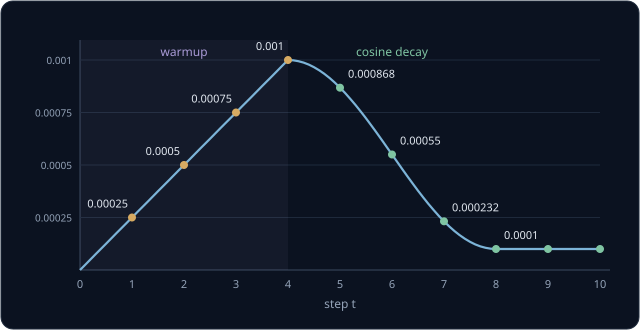

위 그림은 두 표를 이어 그린 것이다. 왼쪽의 직선이 warmup, 오른쪽의 곡선이 cosine decay 다.

**확인 문제.** $\eta_{\max} = 0.002$, $\eta_{\min} = 0.0002$ 일 때 decay 구간의 딱 절반 지점의 learning rate 는?

답 보기

절반 지점은 넣는 수가 $\pi/2$ 라서 $\frac{1}{2}(1 + 0) = 0.5$ 다. $0.0002 + 0.5 \times (0.002 - 0.0002) = 0.0002 + 0.0009 = 0.0011$
이다.

**요약**

- AdamW 는 Adam 에 weight decay($\theta \leftarrow \theta - \eta\lambda\theta$)를 따로 더해 parameter 를 조금씩 0 쪽으로 줄인다
- warmup 은 처음 $W$ step 동안 learning rate 를 $\eta_{\max} \times t / W$ 로 직선처럼 올려, 가파른 초반에 parameter 가 발산하지 않게 한다
- cosine decay 는 $\frac{1}{2}(1 + \cos)$ 를 비율로 써서 learning rate 를 $\eta_{\max}$ 에서 $\eta_{\min}$ 까지 곡선으로 내려 바닥 근처의 흔들림을 줄인다

## 한 token 씩 붙여 가는 생성

### autoregressive 생성

학습을 마친 language model 로 글을 쓸 때는 [Transformer](../transformer/README.md) 의 decoder 처럼 한 token 씩 만든다. 사람이 처음에
넣어 주는 앞부분을 prompt 라고 한다. prompt 를 넣어 마지막 위치의 확률표를 얻고, 그 표에서 token 하나를 골라 입력 끝에 붙인 뒤,
늘어난 입력을 다시 넣는다. 앞에서 만든 출력을 다시 입력으로 넣어 가며 하나씩 만드는 이 방식을 autoregressive 생성이라고 한다.

prompt "`<bos>` 빨간" 으로 시작해, 매번 확률이 가장 큰 token 을 고르면 아래와 같다. 확률은 학습 예에서 쓴 값과 같다.

| 단계 | 넣는 입력 | 마지막 위치에서 확률이 가장 큰 token | 고른 token |
| --- | --- | --- | --- |
| 1 | `<bos>` 빨간 | 컵 (0.8) | 컵 |
| 2 | `<bos>` 빨간 컵 | 집어 (0.609) | 집어 |
| 3 | `<bos>` 빨간 컵 집어 | `<eos>` (0.9) | `<eos>` → 멈춤 |

모델은 위치마다 확률표를 내지만, 생성에 쓰는 것은 마지막 위치의 표 하나뿐이다. `<eos>` 가 나오거나 정해 둔 길이에 닿으면 멈춘다.

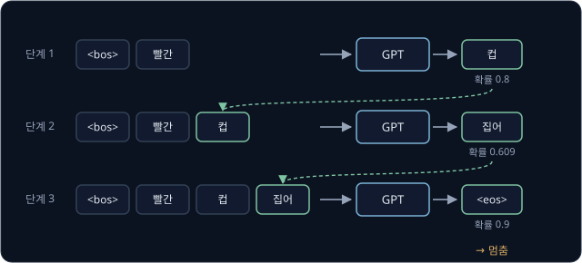

위 그림에서 단계마다 고른 token 이 오른쪽 아래로 내려가 다음 단계 입력의 끝에 붙는다.

입력이 context length 보다 길어지면 position embedding 표에 행이 모자라므로, 가장 최근의 token 들만 context length 만큼 남겨 넣는다.
context length 가 4 인 모델이라면 "`<bos>` 빨간 컵 집어 파란 공" 다음 token 을 고를 때 뒤의 4 개 "컵 집어 파란 공" 만 넣는다. GPT-2
에서는 가장 최근 1,024 token 이다.

**확인 문제.** context length 가 3 인 모델로 token a, b, c, d, e 다음 token 을 고를 때 넣는 입력은? 이 방식으로 100 token 을 새로 쓰려면
forward 를 몇 번 해야 할까?

답 보기

뒤의 3 개 c, d, e 를 넣는다. 한 번의 forward 로 token 하나를 고르므로 100 번 해야 한다. 학습 때는 forward 한 번에 위치 수만큼 문제를
풀었지만, 생성은 앞에서 고른 token 이 있어야 다음을 고를 수 있어서 차례로 할 수밖에 없다.

### greedy decoding

위의 표처럼 매번 확률이 가장 큰 token 을 고르는 방식을 greedy decoding 이라고 한다. greedy 는 "욕심 많은" 이라는 뜻으로, 지금 당장
가장 좋아 보이는 것만 고른다는 데서 이름이 왔다. "빨간 컵" 의 확률표 $[0.609, 0.224, 0.136, 0.030]$ 에서는 언제나 "집어" 를 고른다.

계산이 간단하고 같은 prompt 에서 언제나 같은 결과가 나오지만, 긴 글을 쓰면 문제가 생긴다. 어떤 모델이 "공 집어" 다음에는 "공" 에,
"집어 공" 다음에는 "집어" 에 가장 큰 확률을 준다고 하자.

| 단계 | 입력의 끝부분 | 가장 큰 token | 지금까지 쓴 글 |
| --- | --- | --- | --- |
| 1 | 공 집어 | 공 | 공 집어 공 |
| 2 | 집어 공 | 집어 | 공 집어 공 집어 |
| 3 | 공 집어 | 공 | 공 집어 공 집어 공 |

같은 상황이 되풀이되면 같은 token 을 고르므로 글이 "공 집어 공 집어 …" 로 끝없이 돈다. 게다가 두 번째로 그럴듯한 token 은 확률이
0.4 여도 한 번도 고르지 않으니, 모델이 아는 다양한 표현이 글에 나오지 않는다.

### 확률에 따른 sampling

확률표의 확률대로 token 을 뽑는 방법을 sampling 이라고 한다. 확률이 0.609 인 token 은 100 번 뽑으면 61 번쯤, 0.030 인 token 은
3 번쯤 나오게 뽑는다.

뽑는 데는 random number 를 쓴다. random number 는 0 이상 1 미만의 아무 수가 같은 가능성으로 나오도록 컴퓨터가 만드는 수다. 확률을
차례로 더한 값(누적 확률)으로 0 에서 1 까지를 token 마다 구간으로 나누고, random number 가 떨어진 구간의 token 을 고른다.

| token | 확률 | 누적 확률 | 구간 |
| --- | --- | --- | --- |
| 집어 | 0.609 | 0.609 | 0 이상 0.609 미만 |
| 놓아 | 0.224 | 0.834 | 0.609 이상 0.834 미만 |
| 밀어 | 0.136 | 0.970 | 0.834 이상 0.970 미만 |
| 던져 | 0.030 | 1 | 0.970 이상 1 미만 |

구간의 길이가 곧 확률이라서, random number 가 고르게 나오면 token 도 확률대로 뽑힌다. random number 가 0.35 면 집어, 0.75 면 놓아,
0.9 면 밀어, 0.99 면 던져 를 고른다. 표의 0.609 와 0.224 를 더하면 0.833 인데 누적 확률이 0.834 인 것은, 반올림하기 전의 확률
0.6095 와 0.2242 로 더했기 때문이다.

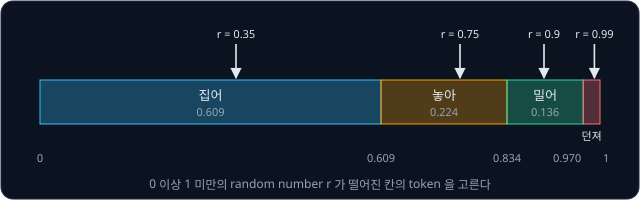

위 그림은 0 에서 1 까지의 막대를 확률의 길이로 나눈 것이다. 화살표가 random number 이고, 화살표가 떨어진 칸의 token 이 뽑힌다.

sampling 은 같은 prompt 에서도 매번 다른 글을 쓰고, greedy decoding 처럼 같은 자리를 맴도는 일이 적다. 대신 확률이 낮은 이상한 token
도 가끔 뽑힌다. "던져" 처럼 확률이 3% 인 token 은 한 번에는 드물지만, 100 token 을 쓰는 동안 매번 3% 짜리 위험이 있다면 한 번도
뽑히지 않을 확률은 0.97 을 100 번 곱한 $0.97^{100} \approx 0.048$ 이다. 긴 글에서는 이상한 token 이 거의 반드시 한 번은 끼어들고,
한 번 끼어든 token 은 뒤의 입력에 남아 다음 확률표까지 흔든다.

**확인 문제.** 위 표에서 random number 가 0.6 이면 어느 token 을 고를까? 0.84 면?

답 보기

0.6 은 0.609 보다 작아 첫 구간이라 집어 다. 0.84 는 0.834 이상 0.970 미만이라 밀어 다.

### temperature

sampling 의 다양함을 조절하려고 softmax 전에 logits 를 temperature $\tau$ (tau, 타우)로 나눈다. $\tau$ 가 1 이면 원래 확률표 그대로다.

| 설정 | 나눈 logits | $e^{z}$ | 합 | 확률 (집어, 놓아, 밀어, 던져) |
| --- | --- | --- | --- | --- |
| $\tau = 1$ | $2.0, 1.0, 0.5, -1.0$ | 7.389, 2.718, 1.649, 0.368 | 12.124 | 0.609, 0.224, 0.136, 0.030 |
| $\tau = 0.5$ | $4.0, 2.0, 1.0, -2.0$ | 54.598, 7.389, 2.718, 0.135 | 64.841 | 0.842, 0.114, 0.042, 0.002 |
| $\tau = 2$ | $1.0, 0.5, 0.25, -0.5$ | 2.718, 1.649, 1.284, 0.607 | 6.258 | 0.434, 0.263, 0.205, 0.097 |

$\tau = 0.5$ 로 나누면 logits 가 두 배가 되어 logits 사이의 차이도 두 배가 된다. softmax 의 weight 를 정하는 것은 점수의 크기가
아니라 점수끼리의 차이였으므로([Transformer](../transformer/README.md) 의 softmax 절), 차이가 커지면 가장 큰 token 에 확률이 더
몰린다. 집어 의 확률이 0.609 에서 0.842 로 올랐다. 반대로 $\tau = 2$ 로 나누면 차이가 절반이 되어 확률이 고르게 퍼지고, 던져 의 확률이
0.030 에서 0.097 로 세 배 넘게 올랐다.

$\tau$ 를 0 에 가깝게 줄이면 가장 큰 token 의 확률이 1 에 다가가서 greedy decoding 과 같아진다. $\tau = 0.25$ 면 집어 가 이미 0.980
이다. $\tau$ 를 아주 크게 하면 logits 가 모두 0 에 가까워져 모든 token 의 확률이 같아진다. temperature 는 물리학의 온도에서 온
이름이다. 온도가 높을수록 입자가 제멋대로 움직이듯 높은 $\tau$ 는 고르는 token 을 더 무작위로 만든다.

**흔한 오해.** temperature 를 바꾸면 가장 그럴듯한 token 이 바뀐다고 생각하기 쉽다. 같은 양수로 나누면 logits 의 크기 순서는 그대로라서,
세 경우 모두 집어 > 놓아 > 밀어 > 던져 이고 greedy decoding 의 결과도 같다. temperature 는 순서가 아니라 확률이 몰린 정도만 바꾼다.

**확인 문제.** logits 가 $[1, 0]$ 이고 $\tau = 0.5$ 다. 두 token 의 확률은? ($e^{2} \approx 7.389$)

답 보기

나누면 $[2, 0]$ 이고 $e^{z}$ 는 7.389, 1, 합 8.389 라서 확률은 $[0.881, 0.119]$ 다. $\tau = 1$ 일 때의 $[0.731, 0.269]$ 보다 첫 token
에 더 몰렸다.

### top-k

top-k sampling 은 logits 가 큰 순서로 $k$ 개만 남기고 나머지 logits 를 $-\infty$ 로 바꾼 뒤 softmax 한다. causal mask 에서 본 것처럼
$-\infty$ 인 칸은 확률이 0 이 되고, 남은 $k$ 개가 합 1 을 다시 나눠 갖는다.

| 설정 | 남는 logits | $e^{z}$ | 확률 (집어, 놓아, 밀어, 던져) |
| --- | --- | --- | --- |
| $k = 4$ (전부) | $2.0, 1.0, 0.5, -1.0$ | 7.389, 2.718, 1.649, 0.368 | 0.609, 0.224, 0.136, 0.030 |
| $k = 3$ | $2.0, 1.0, 0.5, -\infty$ | 7.389, 2.718, 1.649, 0 | 0.629, 0.231, 0.140, 0 |
| $k = 2$ | $2.0, 1.0, -\infty, -\infty$ | 7.389, 2.718, 0, 0 | 0.731, 0.269, 0, 0 |
| $k = 1$ | $2.0, -\infty, -\infty, -\infty$ | 7.389, 0, 0, 0 | 1, 0, 0, 0 |

$k = 3$ 이면 3% 짜리 던져 가 아예 뽑히지 않아 앞 절에서 본 이상한 token 문제가 줄고, 그래도 상위 몇 개 안에서는 다양하게 뽑는다.
$k = 1$ 은 가장 큰 token 하나만 남으므로 greedy decoding 과 같다. GPT-2 논문은 요약 실험에서 greedy decoding 대신 $k = 2$ 인 top-k
sampling 을 써서 같은 말의 되풀이를 줄였다. temperature 와 top-k 는 함께 쓸 수 있는데, 같은 양수로 나눠도 크기 순서는 바뀌지 않으므로
어느 것을 먼저 해도 남는 token 은 같다.

같은 random number 0.75 로 네 설정을 비교하면 고르는 token 이 달라진다.

| 설정 | 누적 확률 | random number 0.75 가 떨어진 구간 | 고른 token |
| --- | --- | --- | --- |
| $\tau = 1$ | 0.609, 0.834, 0.970, 1 | 0.609 이상 0.834 미만 | 놓아 |
| $\tau = 0.5$ | 0.842, 0.956, 0.998, 1 | 0 이상 0.842 미만 | 집어 |
| $\tau = 2$ | 0.434, 0.698, 0.903, 1 | 0.698 이상 0.903 미만 | 밀어 |
| top-k, $k = 2$ | 0.731, 1, 1, 1 | 0.731 이상 1 미만 | 놓아 |

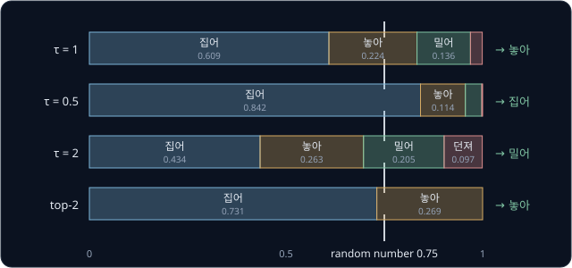

위 그림은 네 설정의 구간을 위아래로 나란히 놓고 random number 0.75 에 세로선을 그은 것이다. $\tau = 0.5$ 는 집어 칸이 넓어졌고,
$\tau = 2$ 는 칸들이 고르게 퍼졌으며, top-2 는 밀어 와 던져 칸이 사라졌다.

**확인 문제.** $k = 3$ 인 top-k sampling 에서 random number 가 0.95 면 어느 token 을 고를까? $k = 1$ 이면?

답 보기

$k = 3$ 의 누적 확률은 0.629, $0.629 + 0.231 = 0.860$, 1 이다. 0.95 는 0.860 이상이라 밀어 를 고른다. $k = 1$ 이면 확률 1 인 집어
만 남으므로 random number 와 상관없이 집어 다.

**요약**

- 생성은 마지막 위치의 확률표에서 token 하나를 골라 입력 끝에 붙이고 다시 넣기를 되풀이하는 autoregressive 방식이다
- greedy decoding 은 언제나 가장 큰 token 을 골라 같은 말을 되풀이하기 쉽고, sampling 은 누적 확률 구간과 random number 로 확률대로 뽑는다
- temperature $\tau$ 로 logits 를 나누면 $\tau < 1$ 은 확률을 몰고 $\tau > 1$ 은 퍼뜨리며, top-k 는 상위 $k$ 개 밖의 logits 를 $-\infty$ 로 막는다

## GPT-2 의 크기

### 네 가지 모델

GPT-2 논문은 같은 구조로 크기만 다른 모델 네 개를 학습시켰다. 모두 vocabulary 50,257 개, context length 1,024 이고, block 수와 token
vector 의 차원만 다르다. token vector 의 차원을 $d_\text{model}$ 이라고 쓴다.

| 모델 | block 수 | $d_\text{model}$ | 논문에 적힌 parameter 수 | 직접 센 parameter 수 |
| --- | --- | --- | --- | --- |
| 가장 작은 모델 | 12 | 768 | 117M | 124,439,808 (124M) |
| 중간 | 24 | 1,024 | 345M | 354,823,168 (355M) |
| 큰 모델 | 36 | 1,280 | 762M | 774,030,080 (774M) |
| 가장 큰 모델 | 48 | 1,600 | 1,542M | 1,557,611,200 (1,558M) |

M 은 million(백만)의 첫 글자라서 124M 은 약 1 억 2,400 만 개다. 가장 큰 모델의 1,542M 은 약 15 억 개이고, 보통 1.5B(billion, 10 억)
로 부른다. 논문의 숫자와 직접 센 숫자가 조금 다른데, 공개된 weight 로 세면 오른쪽 열이 나와서 가장 작은 모델을 흔히 GPT-2 124M 이라고
부른다.

block 수는 모델이 vector 를 몇 번 고쳐 쓰는지를, $d_\text{model}$ 은 token 하나를 숫자 몇 개로 나타내는지를 정한다. 가장 작은 모델의
attention 은 head 12 개로 나뉘므로 head 하나가 $768 \div 12 = 64$ 차원이다. head 는 vector 의 칸을 몇 묶음으로 나눠 묶음마다 따로
하는 attention 계산이었다([Transformer](../transformer/README.md) 의 multi-head attention 절).

### parameter 수 세기

block 하나의 parameter 는 대부분 행렬 숫자다. $d_\text{model}$ 을 $d$ 로 줄여 쓴다.

- **attention** — query·key·value 를 만드는 행렬 세 개와 head 출력을 섞는 행렬 하나가 모두 $d \times d$ 라서 $4d^2$ 개다
- **FFN** — $d$ 를 $4d$ 로 늘리는 행렬 $d \times 4d$ 와 되돌리는 행렬 $4d \times d$ 라서 $4d^2 + 4d^2 = 8d^2$ 개다

둘을 더하면 block 하나에 약 $12d^2$ 개다. $d = 4$ 로 작게 계산하면 attention 이 $4 \times 16 = 64$ 개, FFN 이 $8 \times 16 = 128$ 개,
합이 $192 = 12 \times 16$ 개다. 여기에 행렬을 곱한 뒤 더하는 숫자인 bias 와 LayerNorm 의 숫자가 $13d$ 개 붙는다.

GPT-2 의 가장 작은 모델로 세면 아래와 같다.

| 부분 | 계산 | parameter 수 |
| --- | --- | --- |
| token embedding 표 | $50{,}257 \times 768$ | 38,597,376 |
| position embedding 표 | $1{,}024 \times 768$ | 786,432 |
| block 하나 | $12 \times 768^2 + 13 \times 768 = 7{,}077{,}888 + 9{,}984$ | 7,087,872 |
| block 12 개 | $12 \times 7{,}087{,}872$ | 85,054,464 |
| 마지막 LayerNorm | $2 \times 768$ | 1,536 |
| 출력 층 | token embedding 표를 다시 씀 | 0 |
| 합 | | 124,439,808 |

block 12 개가 약 68%, token embedding 표가 약 31% 다. weight tying 을 하지 않았다면 출력 층에 38,597,376 개가 더 붙어 163,037,184
개가 된다.

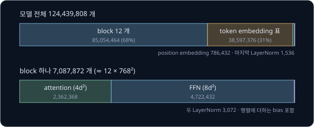

위 그림의 위쪽 막대는 모델 전체, 아래쪽 막대는 block 하나를 나눈 것이다. block 안에서는 FFN 이 attention 의 두 배다.

$d$ 가 두 배가 되면 block 하나의 parameter 는 $d^2$ 에 비례하므로 네 배가 되고, block 수가 두 배가 되면 두 배가 된다. 중간 모델은
가장 작은 모델보다 block 이 두 배, $d$ 가 $1024 \div 768 \approx 1.33$ 배다.

**확인 문제.** $d = 8$ 인 block 하나의 행렬 숫자는 약 몇 개일까? block 을 6 개 쌓으면?

답 보기

$12 \times 8^2 = 12 \times 64 = 768$ 개이고, 6 개면 $768 \times 6 = 4{,}608$ 개다.

### 크기가 뜻하는 것

parameter 하나는 보통 float32 로 저장한다. float32 는 숫자 하나를 bit(0 또는 1 하나를 담는 자리) 32 개, 곧 4 byte 에 담는 방식이었다
([PyTorch Training Loop](../pytorch-mlp/README.md)). 그래서 가장 작은 모델의 weight 는 $124{,}439{,}808 \times 4 = 497{,}759{,}232$
byte, 약 500 MB 이고, 가장 큰 모델은 약 $1{,}557{,}611{,}200 \times 4 \approx 62$ 억 byte, 약 6.2 GB 다. MB(megabyte)는 byte 100 만
개다. 모델을 쓰려면 이만큼을 메모리에 올려야 하고, token 하나를 만들 때마다 이 숫자들이 거의 모두 곱셈에 한 번씩 쓰인다.

GPT-2 논문은 모델이 클수록 같은 text 의 loss 가 낮아지고, 가장 큰 모델도 WebText 의 train loss 와 validation loss 가 함께 내려가는
중이라 아직 데이터를 다 배우지 못했다(underfit)고 보고했다. 같은 다음 token 맞히기라도 parameter 가 많을수록 text 에 담긴 규칙을 더
많이 배운다는 뜻이고, 이 관찰이 뒤의 더 큰 language model 들로 이어졌다.

**확인 문제.** parameter 가 약 355M 인 중간 모델을 float32 로 저장하면 약 몇 GB 일까? (1 GB = byte 10 억 개)

답 보기

$354{,}823{,}168 \times 4 = 1{,}419{,}292{,}672$ byte 라서 약 1.4 GB 다.

**요약**

- GPT-2 는 block 수(12 ~ 48)와 $d_\text{model}$(768 ~ 1,600)만 다른 네 모델이고, 가장 작은 모델은 parameter 124,439,808 개다
- block 하나의 parameter 는 attention $4d^2$ 와 FFN $8d^2$ 를 더한 약 $12d^2$ 개다
- float32 로 parameter 하나에 4 byte 라서 124M 모델은 약 500 MB 이고, 큰 모델일수록 loss 가 낮았다

## 로봇 행동을 token 으로 내는 모델

GPT-2 는 text 를 읽고 쓰지만, 다음 token 을 확률표에서 하나씩 골라 붙이는 방식은 token 이 무엇을 나타내든 그대로 쓸 수 있다.
[BPE Tokenizer](../tokenizer/README.md) 에서 본 action token 이 그 예다. 로봇 집게를 몇 cm 벌릴지 같은 연속된 숫자를 구간(bin)으로
나누고, bin 번호마다 vocabulary 의 token 하나를 짝지어 두면 모델이 글을 쓰듯 행동을 쓸 수 있다.

0 ~ 8 cm 를 1 cm 씩 8 개 bin(bin 0 ~ bin 7)으로 나누면 집게 3.4 cm 는 3 이상 4 미만이라 bin 3 이다. 모델이 bin 3 에 짝지은 token 을
내면, 거꾸로 그 bin 의 가운데 값 3.5 cm 로 되돌려 로봇에게 보낸다.

이미지와 지시문을 받아 로봇 행동을 내는 모델을 VLA(Vision-Language-Action model)라고 한다. vision 은 영상, language 는 지시문,
action 은 행동이다. RT-2(2023)와 OpenVLA(2024)는 행동 숫자 하나를 bin 256 개로 나누고 bin 마다 language model 의 vocabulary
token 하나를 짝지었는데, OpenVLA 는 vocabulary 에서 거의 쓰이지 않는 token 256 개를 골라 썼다. OpenVLA 에서 로봇 팔의 행동 하나는
손끝의 위치 변화 3 개, 방향 변화 3 개, 집게 여닫기 1 개로 숫자 7 개라서 action token 7 개가 된다. RT-2 는 여기에 동작을 끝낼지
나타내는 숫자 하나를 더해 8 개를 쓴다.
카메라 영상은 작은 조각으로 잘라 조각마다 숫자 묶음(vector)으로 바꾼 뒤 지시문 token 앞에 넣는데, 이것을 이미지 token 이라고
부른다([CLIP](../clip/README.md) 과 [RT-2 → OpenVLA](../vla-tokens/README.md) 에서 다룬다).

| 단계 | 넣는 입력 | 고른 token | bin 을 되돌린 값 |
| --- | --- | --- | --- |
| 1 | 이미지 token, 지시문 token | action token 1 | 위치 변화 1 |
| 2 | 위의 입력 + action token 1 | action token 2 | 위치 변화 2 |
| ⋯ | ⋯ | ⋯ | ⋯ |
| 7 | 위의 입력 + action token 1 ~ 6 | action token 7 | 집게 여닫기 |

이 표는 앞 섹션의 autoregressive 생성 표와 모양이 같다. 학습도 같아서, 이미지와 지시문 뒤에 사람이 시연한 행동의 action token 7 개를
정답으로 붙이고 위치마다 cross-entropy 로 맞히게 한다. 고를 때는 action token 256 개 밖의 logits 를 $-\infty$ 로 막아 언제나 bin
하나가 나오게 하는데, top-k 와 causal mask 에서 본 것과 같은 계산이다.

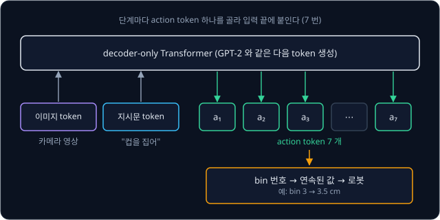

위 그림은 GPT-2 와 같은 decoder 가 이미지와 지시문 token 뒤에 action token 을 하나씩 붙여 가는 모습이다. 바뀐 것은 입력에 이미지
token 이 들어가고, 출력에서 일반 단어 대신 action token 을 고른다는 점뿐이다.

**확인 문제.** 0 ~ 8 cm 를 1 cm 씩 8 개 bin 으로 나눌 때 5.6 cm 는 몇 번 bin 이고, 그 bin 을 되돌리면 몇 cm 가 될까?

답 보기

5.6 은 5 이상 6 미만이라 bin 5 이고, 가운데 값 5.5 cm 로 되돌린다. 0.1 cm 의 차이는 bin 으로 나눌 때 생기는 오차다.

## 정리

- language model 은 앞의 token 들을 받아 다음 token 의 확률표를 낸다. 앞부분의 가짓수가 너무 많아 세어서 만들 수 없으므로 neural
  network 가 logits 를 내고 softmax 로 확률표를 만든다. "빨간 컵" 의 logits $[2.0, 1.0, 0.5, -1.0]$ 은 확률 $[0.609, 0.224, 0.136, 0.030]$ 이 되었다
- 정답은 입력을 왼쪽으로 한 칸 민 것이라서 label 없는 text 만으로 학습할 수 있다(self-supervised learning)
- GPT 는 Transformer 에서 encoder 와 cross-attention 을 뺀 decoder-only 구조다. token embedding 과 학습하는 position embedding 을
  더해 Pre-LN block(masked self-attention, GELU 를 쓰는 FFN)을 거치고, 마지막 vector 와 token embedding 표의 dot product 로 logits
  를 낸다(weight tying)
- causal mask 는 softmax 전에 뒤쪽 위치의 점수를 $-\infty$ 로 막아, 위치 $t$ 가 위치 $t$ 까지만 보게 한다. 그래서 forward 한 번에
  위치 수만큼의 문제를 푼다
- loss 는 위치마다 정답 확률의 $-\log$ 를 평균한 cross-entropy 이고, 학습 전에는 $\log V$ 근처에서 시작한다
- learning rate 는 warmup 으로 $\eta_{\max} \times t/W$ 까지 올렸다가 cosine decay 로 $\eta_{\min}$ 까지 내린다. $\eta_{\max} = 0.001$,
  $W = 4$, $D = 8$ 이면 0.00025, 0.0005, 0.00075, 0.001 로 올라 0.000868, 0.00055, 0.000232, 0.0001 로 내려간다
- 생성은 마지막 위치의 확률표에서 token 하나를 골라 붙이기를 되풀이한다. greedy decoding 은 가장 큰 것을, sampling 은 확률대로 뽑고,
  temperature 는 확률이 몰린 정도를, top-k 는 후보의 수를 조절한다
- GPT-2 는 block 12 ~ 48 개, $d_\text{model}$ 768 ~ 1,600 의 네 모델이고, 가장 작은 모델은 parameter 124,439,808 개(약 500 MB)다.
  block 하나는 약 $12d^2$ 개다
- 같은 다음 token 생성 방식으로 행동 값을 bin 의 token 으로 바꾸면, VLA 가 로봇 행동을 token 7 개로 하나씩 생성한다

GPT-2 는 text 만 읽고 쓰는 모델이라 카메라 영상을 보지 못하고, 그대로는 로봇 행동도 내지 못한다. attention 의 계산량이 token 수의
제곱으로 늘어나서 context length 1,024 를 넘는 긴 입력도 한 번에 보지 못한다. 이미지와 text 를 같은 숫자 공간에 놓아 서로 맞춰
보는 모델은 [CLIP](../clip/README.md), language model 의 vocabulary 에 action token 을 넣어 로봇 행동을 생성하는 VLA 는
[RT-2 → OpenVLA](../vla-tokens/README.md) 에서 다룬다.

## 참고 자료

- Alec Radford 등, [Language Models are Unsupervised Multitask Learners](https://cdn.openai.com/better-language-models/language_models_are_unsupervised_multitask_learners.pdf) —
  GPT-2 논문. 2.1절이 WebText, 2.3절이 GPT-1 에서 바꾼 LayerNorm 위치, 표 2 가 네 가지 모델 크기다
- Alec Radford 등, [Improving Language Understanding by Generative Pre-Training](https://cdn.openai.com/research-covers/language-unsupervised/language_understanding_paper.pdf) —
  GPT-1 논문. 3.1절의 다음 token 맞히기 loss 와 4.1절의 학습 설정(학습하는 position embedding, GELU, warmup 과 cosine schedule)을 본다
- Ofir Press, Lior Wolf, [Using the Output Embedding to Improve Language Models](https://arxiv.org/abs/1608.05859) — 입력 embedding 과
  출력 행렬을 묶는 weight tying 을 제안한 논문
- Dan Hendrycks, Kevin Gimpel, [Gaussian Error Linear Units (GELUs)](https://arxiv.org/abs/1606.08415) — GELU 의 정의와 ReLU 와의 비교.
  그림 1 이 두 함수의 모양을 나란히 그린다
- Andrej Karpathy, [Let's build GPT: from scratch, in code, spelled out.](https://www.youtube.com/watch?v=kCc8FmEb1nY) — Tiny
  Shakespeare 로 글자 단위 GPT 를 처음부터 만들어 학습시키고 글을 생성하는 영상. 입력을 한 칸 밀어 정답을 만드는 대목과 causal mask
  대목이 이 강의의 앞 두 섹션과 같다
- Andrej Karpathy, [Let's reproduce GPT-2 (124M)](https://www.youtube.com/watch?v=l8pRSuU81PU) — GPT-2 124M 을 다시 학습시키며 parameter
  수, weight tying, AdamW, warmup 과 cosine decay 를 다루는 영상
- Jay Alammar, [The Illustrated GPT-2](https://jalammar.github.io/illustrated-gpt2/) — decoder-only 구조와 한 token 씩의 생성을 그림으로
  따라가는 글
- [karpathy/nanoGPT](https://github.com/karpathy/nanoGPT) — README 의 Tiny Shakespeare 결과(validation loss 1.4697)와 GPT-2 크기별
  loss 표를 본다
- Andrej Karpathy, [microgpt](https://karpathy.github.io/2026/02/12/microgpt/) — GPT 의 학습과 sampling 전체를 짧은 글 하나로 따라가는
  글
- Stanford CS336, [assignment1-basics](https://github.com/stanford-cs336/assignment1-basics) — Transformer language model 을 처음부터
  만드는 과제의 handout. learning rate schedule 과 AdamW 를 식으로 정리한 절을 본다
