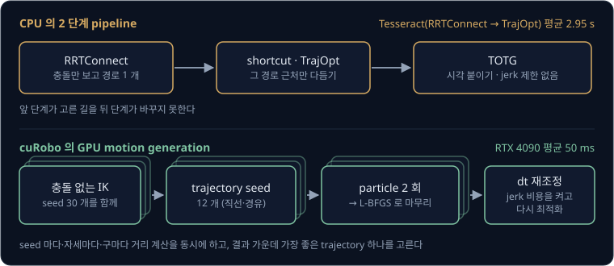
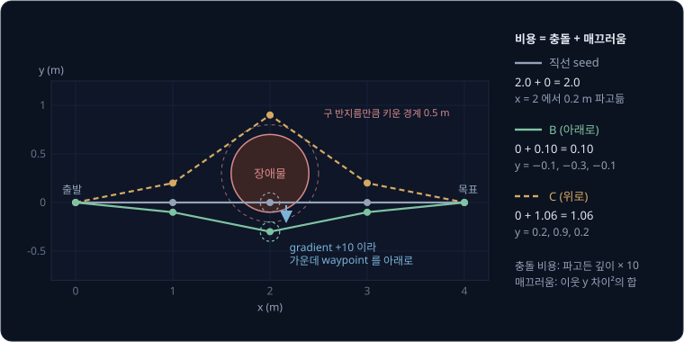
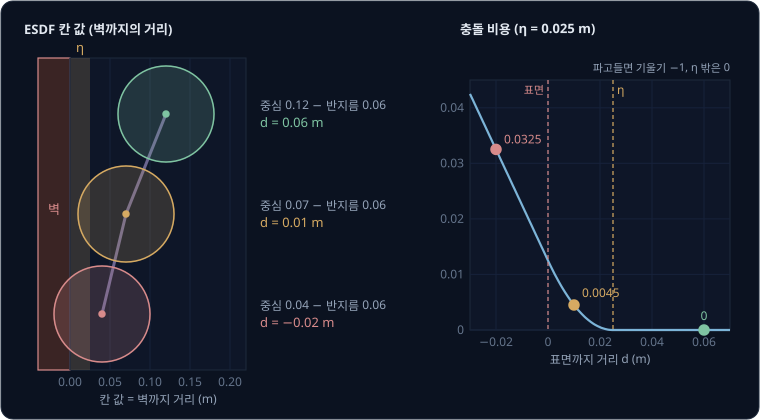
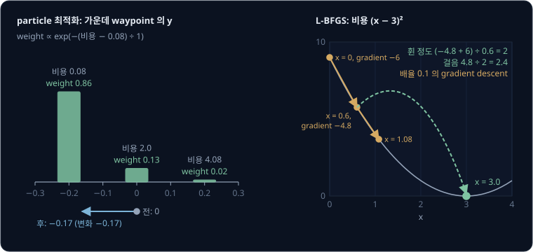
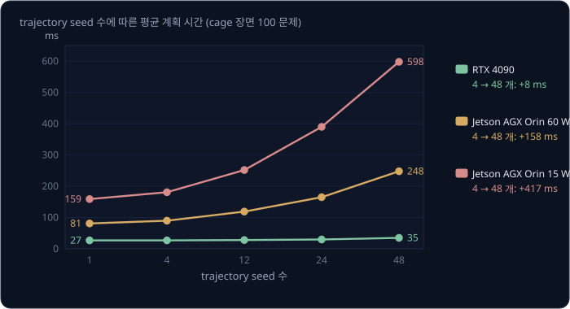
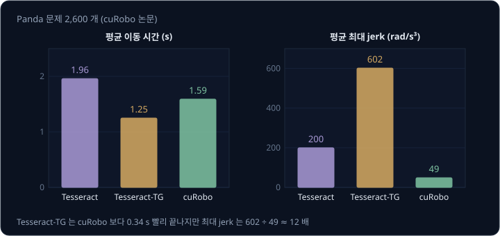
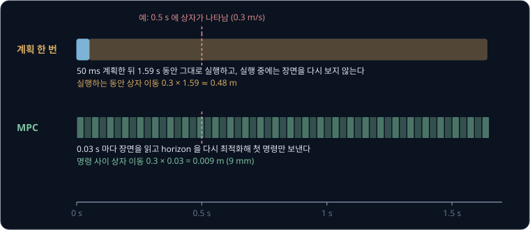
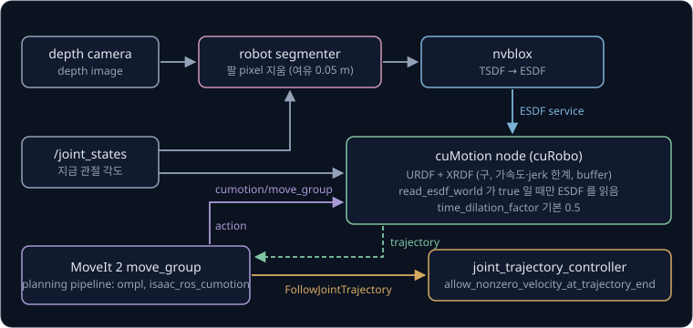

# GPU Motion Generation

선반에서 물건을 꺼내는 7 관절 팔 옆으로 사람이 상자를 밀어 넣으면, 팔은 바뀐 장면에서 경로를 다시 계획해야 한다.
[Motion Planning](../motion-planning/README.md) 에서 본 MoveIt 2 의 기본 pipeline 은 RRTConnect 로 충돌 없는 경로를 찾고, shortcut 으로
그 경로를 펴고, TOTG(time-optimal trajectory generation)로 시각을 붙인다. 이 세 단계에 몇 초가 걸리면 그동안 상자는 또 움직인다. 게다가
무작위 표본에서 나온 경로는 요청마다 모양이 다르고, TOTG 가 붙인 시각에는 jerk 한계가 없다. 장면이 바뀔 때마다 처음부터 다시 계획해도 될 만큼 빠르면서 그대로 로봇에 보내도 될
만큼 매끄러운 trajectory 를 어떻게 얻을까?

이 문제를 푸는 한 가지 방법은 경로 찾기와 다듬기를 나누지 않고, trajectory 전체를 충돌·매끄러움·관절 한계의 비용을 줄이는 최적화 문제
하나로 푸는 것이다. 이때 시작점을 달리한 최적화 수십 개를 GPU 에서 동시에 푼다. NVIDIA 의 cuRobo 논문(2023)에 따르면 Franka Panda 의 계획
문제 2,600 개에서 이 방법은 RTX 4090 으로 평균 50 ms 에 trajectory 를 냈고, 같은 PC 의 CPU 에서 OMPL 의 경로를 최적화 방법인 TrajOpt 로 다듬는
Tesseract 는 평균 2.95 초가 걸렸다. cuRobo 를 안에서 쓰는 Isaac ROS cuMotion 은 MoveIt 2 의 planner plugin 으로 나와 있다.

## 학습 목표

- motion generation 을 충돌·매끄러움·관절 한계 비용의 합을 줄이는 trajectory optimization 으로 쓰고, 로봇을 구로 근사하고 장애물까지의
  거리를 칸마다 적어 둔 signed distance field 로 충돌 비용과 gradient 를 구하는 과정을 숫자로 설명할 수 있다
- 최적화를 시작하는 초기 trajectory(seed)를 여러 개 두는 이유와, cuRobo 가 seed 마다 무작위 후보의 가중 평균(particle 최적화)과 gradient
  이력으로 걸음을 정하는 L-BFGS 를 차례로 GPU 에서 계산하는 흐름을 설명할 수 있다
- time step 을 다시 정해 jerk 를 줄이는 방법과, 벤치마크 숫자(평균 50 ms 대 2.95 초)가 어떤 조건에서 무엇을 잰 것인지 설명할 수 있다
- 장면이 바뀔 때 다시 계획하기와 짧은 앞날을 매 주기 다시 최적화하는 MPC 가운데 무엇을 고를지, MoveIt 2 에 cuMotion 과 depth camera 용 거리 표를
  만드는 nvblox 를 붙일 때 무엇을 설정하는지 설명할 수 있다

## sampling planner 와 후처리

MoveIt 2 의 기본 pipeline 은 일을 세 단계로 나눈다. RRTConnect 는 충돌만 검사하며 무작위 tree 로 경로를 찾고, shortcut 은 꼭짓점을 줄이고,
TOTG 는 관절 속도·가속도 한계 안에서 가장 빨리 지나도록 시각을 붙인다. 뒤 단계는 앞 단계의 결과를 고치기만 해서, Motion Planning 의 2 관절
예시에서도 shortcut 은 RRT-Connect 경로를 451.2° 에서 370.7° 로 줄였을 뿐 위쪽의 약 240° 길로 옮기지 못했다. TOTG 는 가속도를 0 과 최댓값
사이에서 한순간에 바꾸므로 jerk 를 제한하지 않는다.

계획 시간은 장면이 바뀌는 로봇에서 문제가 된다. 예를 들어 상자가 0.3 m/s 로 밀려 들어온다면, Tesseract 의 평균 계획 시간 2.95 초 동안 상자는
$0.3 \times 2.95 = 0.885$ m 를 움직이고 cuRobo 의 평균 50 ms 동안에는 $0.3 \times 0.05 = 0.015$ m 를 움직인다. planner 는 계획을 시작할 때의
장면으로 계산하므로, 상자가 0.885 m 옮겨 간 뒤에 나온 결과는 지난 장면에 대한 답이다. cuRobo 논문은 CPU 계획이 이렇게 느려서 기존 시스템이
초기 경로 하나만 골라 최적화에 넘겨 왔고, 그 하나에 기대는 탓에 더 나은 해를 놓쳤다고 지적한다.

**확인 문제.** 컨베이어 위 물체가 0.5 m/s 로 움직이고 planner 가 계획에 0.4 초를 쓴다. 계획을 시작할 때와 끝났을 때 물체의 위치는 몇 cm
다른가? 계획에 50 ms 를 쓰면?

답 보기

움직인 거리는 속도 × 시간이다. 0.4 초면 $0.5 \times 0.4 = 0.2$ m(20 cm)이고, 50 ms 면 $0.5 \times 0.05 = 0.025$ m(2.5 cm)다.

## trajectory optimization

**trajectory optimization** 은 trajectory 를 숫자의 목록으로 두고 그 숫자를 조금씩 고쳐 비용을 줄이는 방법이다. cuRobo 는 trajectory 를 시간
간격이 같은 자세 32 개로 나타내므로, 7 관절 팔이면 $32 \times 7 = 224$ 개의 관절 각도가 변수다. 비용은 목표 pose 와의 오차, 관절 가속도와 jerk
의 제곱(매끄러움), 관절 위치·속도·가속도·jerk 의 한계, 자기 자신과 주변 물체와의 충돌에 weight 를 곱해 더한 값이다. 속도·가속도·jerk 는
이웃 자세끼리 빼서(finite difference) 구한다. 충돌과 한계는 원래 넘으면 안 되는 제약이지만 cuRobo 는 큰 weight 를 곱한 비용으로 바꿔 푼다.
논문의 벤치마크는 이런 항에 weight 5000 을 썼다.

평면 위를 움직이는 반지름 0.1 m 구 하나로 계산을 따라가 보자. 구는 (0, 0) 에서 (4, 0) 으로 가고, 가운데 waypoint 세 개의 x 를 1, 2, 3 m 로
고정해 y 만 변수로 둔다. 장애물은 중심 (2, 0.3), 반지름 0.4 m 인 원기둥이다. 구 표면에서 장애물 표면까지의 거리 $d$ 는 두 중심 사이 거리에서
0.4 와 0.1 을 뺀 값이고, 구가 파고들면 음수다. 이 예에서는 매끄러움 비용을 이웃 waypoint 의 y 차이를 제곱해 더한 값으로 정하고, 충돌
비용은 waypoint 마다 파고든 깊이에 10 을 곱한 값으로 정한다.

| 후보 | 가운데 waypoint 의 y | 충돌 비용 | 매끄러움 비용 | 합 |
| --- | --- | --- | --- | --- |
| 직선 seed | 0, 0, 0 | $10 \times 0.2 = 2.0$ | 0 | 2.0 |
| B (아래로 돎) | −0.1, −0.3, −0.1 | 0 | $0.01 + 0.04 + 0.04 + 0.01 = 0.10$ | 0.10 |
| C (위로 돎) | 0.2, 0.9, 0.2 | 0 | $0.04 + 0.49 + 0.49 + 0.04 = 1.06$ | 1.06 |

직선 seed 의 가운데 waypoint (2, 0) 은 장애물 중심에서 0.3 m 떨어져 있어 $d = 0.3 - 0.5 = -0.2$ m 다. 이 waypoint 의 y 를 늘리면 구가 중심
(y = 0.3) 쪽으로 다가가 파고든 깊이도 같은 양만큼 늘므로, y 에 대한 충돌 비용의 gradient 는 $+10$ 이다. 부호가 + 라서 y 를 줄이는 쪽(아래)으로
옮겨야 비용이 준다. step 크기 0.01 로 한 번 옮기면 y 는 $0 - 0.01 \times 10 = -0.1$ 이 된다. 그러면 첫째 waypoint 에서 매끄러움 비용의
gradient 가 $2 \times (0 - 0) - 2 \times (-0.1 - 0) = +0.2$ 로 생겨 첫째 waypoint 도 아래로 끌려온다. 장애물에 닿은 점 하나를 밀면 매끄러움
비용이 그 움직임을 이웃 점으로 퍼뜨린다.

이 방식으로 motion planning 을 처음부터 푼 대표 방법이 Ratliff 등의 **CHOMP**(2009)와 Schulman 등의 **TrajOpt**(2013 ~ 2014)다. CHOMP 는
직선 경로에서 출발해 장애물까지의 거리 표로 gradient 를 구하고, 그 gradient 를 trajectory 전체에 매끄럽게 퍼뜨려 경로를 민다. TrajOpt 는 지금
해 근처에서 비용과 제약을 볼록한(convex) 식으로 근사해 풀기를 되풀이하고, 두 시각 사이에 link 가 쓸고 지나간 부피까지 검사한다. PR2 팔(7 관절)
문제 198 개에서 TrajOpt 는 직선 seed 하나로 84.3% 를 평균 0.206 초에 풀었고, 중간 waypoint 를 거치는 seed 네 개를 쓰면 99.0% 를 0.307 초에
풀었다. CHOMP 는 같은 두 조건에서 67.7% 와 83.3% 를 풀었다.

seed 를 더 쓰면 성공률이 오르는 것은 두 방법 모두 seed 근처의 해만 찾기 때문이다. 위 예에서 가운데 waypoint 가 y = 0.5 처럼 장애물 중심보다
위를 지나는 seed 는 같은 계산으로 위로 밀려 비용 1.06 인 C 쪽으로 간다. 비용 0.10 인 B 가 있는데도 더 비싼 골짜기에 멈추는 이런 해를
**local minimum** 이라고 한다.

> **오해** trajectory optimization 도 sampling planner 처럼 시간을 더 주면 결국 길을 찾는다.
>
> **사실** seed 근처의 골짜기로 내려갈 뿐이라 길이 있어도 찾는다는 보장이 없다. TrajOpt 논문도 이 점을 한계로 적었고, 직선 seed 하나로는 198 문제의 84.3% 만 풀었다.

<b>심화: 비용 함수의 일반 식과 CHOMP·TrajOpt 의 update</b>

평면 예의 계산을 cuRobo 논문의 식과 맞추면 아래와 같다.

| 이 예의 값 | 기호로 쓴 값 |
| --- | --- |
| 가운데 waypoint 세 개의 y | 시각 $t = 1, \dots, T$ 의 관절 각도 $\theta_t$ |
| 이웃 y 차이의 제곱 합 | 가속도·jerk 제곱의 합 $\sum_t (w_a \lVert\ddot\theta_t\rVert^2 + w_j \lVert\dddot\theta_t\rVert^2)$ |
| 파고든 깊이 × 10 | 충돌 비용 $C_{\text{self}}(\theta_t) + C_{\text{world}}(\theta_t)$ |
| (없음) | 목표 비용 $C_{\text{goal}}(\theta_T)$, 한계 비용 $C_{\text{limit}}(\theta_t)$ |

$$
\min_{\theta_1, \dots, \theta_T} \; C_{\text{goal}}(\theta_T) + \sum_{t=1}^{T} \Big( w_a \lVert\ddot\theta_t\rVert^2 + w_j \lVert\dddot\theta_t\rVert^2 + C_{\text{limit}}(\theta_t) + C_{\text{self}}(\theta_t) + C_{\text{world}}(\theta_t) \Big)
$$

논문은 마지막 시각의 속도·가속도·jerk 가 0 이라는 조건을 더하는데, 처음과 마지막의 자세 몇 개를 같은 값으로 묶어 이 조건을 맞춘다.

CHOMP 는 매끄러움 비용을 $\tfrac12 \xi^\top A \xi$ 꼴로 쓴다. $\xi$ 는 waypoint 를 모두 이어 붙인 vector 이고, $A$ 는 이웃 waypoint 를 빼는
finite difference 행렬로 만든다. update 는 $\xi_{k+1} = \xi_k - \tfrac{1}{\lambda} A^{-1} g_k$ 이고 $g_k$ 는 비용의 gradient 다. $A^{-1}$ 을
곱하면 한 waypoint 에 걸린 gradient 가 trajectory 전체에 가속도가 작은 모양으로 퍼져서, 장애물에 닿은 점 하나만 튀어나가지 않고 경로 전체가
휘어진다. 저자들은 $A$ 대신 단위 행렬을 쓰는 보통 gradient descent 로는 경로를 장애물 밖으로 끌어내지 못했다고 적었다.

TrajOpt 는 매 반복에서 비용과 제약을 지금 해 근처의 이차식·일차식으로 근사한 quadratic program 을 trust region(한 번에 움직일 수 있는 범위)
안에서 푼다. 충돌은 link 의 볼록한 모양 사이 signed distance sd 로 $\lvert d_{\text{safe}} - \text{sd} \rvert^+$ 꼴의 hinge 벌점을 준다. sd 가
안전 거리 $d_{\text{safe}}$ 보다 크면 0 이고, 작으면 모자란 만큼 벌점이 된다. 제약이 끝까지 지켜지지 않으면 바깥 반복에서 벌점의 계수를 키운다.

**확인 문제.** 위 예에서 가운데 waypoint 의 y 를 −0.1, −0.2, −0.1 로 두면 비용의 합은 얼마인가? 이 후보에서 구는 장애물과 어떤 관계인가?

답 보기

가운데 waypoint (2, −0.2) 와 장애물 중심 (2, 0.3) 의 거리는 0.5 m 라서 $d = 0.5 - 0.4 - 0.1 = 0$ 이고, 파고든 깊이가 0 이라 충돌 비용도 0 이다.
첫째 waypoint (1, −0.1) 은 중심에서 $\sqrt{1^2 + 0.4^2} \approx 1.08$ m 떨어져 있어 충돌하지 않는다. 매끄러움 비용은
$0.1^2 + 0.1^2 + 0.1^2 + 0.1^2 = 0.04$ 라서 합은 0.04 로 B 의 0.10 보다 작다. 대신 구가 장애물 표면에 딱 붙어 지나가므로, 파고든 깊이에만
비용을 주면 최적화는 여유 없이 표면을 스치는 경로를 고른다.

## 구 근사와 signed distance field

충돌 비용과 gradient 를 1 초에 수백만 번 계산하려면 거리 계산이 단순해야 한다. cuRobo 는 collision mesh 대신 로봇 전체를 구 여러 개로 근사하는데,
v0.7.8 소스의 Franka Panda 설정에는 반지름 1.1 ~ 6 cm 인 구가 61 개 있다. 구와 장애물 사이의 거리는 구 중심에서 장애물까지의 거리에서 반지름을
빼면 되고, 자기 충돌은 두 구 중심 사이의 거리에서 두 반지름을 빼면 된다. 논문에 따르면 이웃 link 처럼 닿아도 되거나 관절 한계 때문에 닿을 수
없는 쌍을 빼면, 검사할 구 쌍이 여러 팔에서 절반 정도로 줄었다.

장애물까지의 거리는 **signed distance field**(SDF)에서 읽는다. SDF 는 공간을 작은 정육면체 칸(voxel)으로 나누고, 칸마다 가장 가까운 장애물
표면까지의 거리를 장애물 밖이면 + 로, 안이면 − 로 적어 둔 표다. 구 중심이 든 칸을 읽으면 거리가 나오고, 이웃 칸과 비교하면 거리가 늘어나는
방향(gradient)도 나온다. 카메라로 본 장면은 NVIDIA 의 nvblox 가 이 표로 바꾼다. nvblox 는 depth image 가 들어올 때마다 표면 근처 칸에만 거리를
적는 TSDF(truncated SDF)를 갱신하고, 그것으로 모든 칸에 가장 가까운 표면까지의 거리를 적는 ESDF(Euclidean SDF)를 바뀐 block 만 GPU 에서 다시
계산한다. 논문의 비교에서 ESDF 갱신은 RTX 3090 Ti desktop 에서 평균 1.9 ms 로 CPU 기반 voxblox(58 ms)보다 31 배 빨랐다.

앞 절의 확인 문제처럼 파고든 깊이에만 비용을 주면 최적화는 구를 표면에 딱 붙여 지나가게 만든다. 표면 바로 밖에서는 비용이 0 이라 밀어내는
gradient 가 없고, 32 개 자세 사이를 촘촘히 보간하면 그 사이 자세가 표면 안으로 들어갈 수 있다. 그래서 CHOMP 와 cuRobo 는 표면에서
**activation distance** η 안쪽으로 들어오면 비용이 제곱으로 부드럽게 오르게 한다. cuRobo 벤치마크와 v0.7.8 기본 설정의 η 는 0.025 m 다.
반지름 0.06 m 구 세 개의 비용은 아래와 같다.

| 구 중심의 ESDF 값 | 표면까지 거리 $d$ | 비용 | $d$ 에 대한 기울기 |
| --- | --- | --- | --- |
| 0.12 m | 0.06 m | 0 ($d \ge \eta$) | 0 |
| 0.07 m | 0.01 m | $(0.025 - 0.01)^2 \div (2 \times 0.025) = 0.0045$ | −0.6 |
| 0.04 m | −0.02 m | $0.02 + 0.025 \div 2 = 0.0325$ | −1 |

기울기가 − 라서 $d$ 를 늘리는 쪽, 다시 말해 ESDF 의 gradient 방향으로 구를 옮기면 비용이 준다. 파고든 뒤에는 기울기가 −1 로 일정해서 깊이
들어가도 밀어내는 힘이 폭발하지 않는다. 논문에서 seed 하나와 L-BFGS 만으로 푼 실험에서 η 를 0 에서 2.5 cm 로 바꾸자 성공률이 38% 에서 65% 로
올랐다. 저자들은 η 가 비용을 매끄럽게 만들고, 32 ~ 50 개 자세로 최적화한 trajectory 를 0.025 초 간격으로 보간해 검사할 때 사이 자세가 충돌로
미끄러지는 것을 막는다고 설명한다. 두 자세 사이의 선분을 따라 거리를 다시 조회하는 continuous collision check 와, 충돌 비용에 구의 속도를
곱해 장애물 안을 빠르게 지나가는 해를 막는 speed metric 을 차례로 더하자 성공률은 69%, 71% 가 되었다.

실제 로봇에서는 구를 일부러 키워 여유를 둔다. v0.7.8 의 Franka 설정은 모든 구에 0.004 m 를 더하고(`collision_sphere_buffer`), Isaac ROS
문서의 UR10e 예시는 link 마다 0.01 m 의 `buffer_distance` 를 둔다. Motion Planning 의 padding 과 같은 역할이라 틈보다 크게 잡으면 길이 사라진다.

<b>심화: 충돌 비용 식과 continuous collision check</b>

cuRobo 논문 식 (10)은 파고든 깊이를 + 로 두는 signed distance $s$(위 표의 $d$ 에 − 를 붙인 값)로 비용을 정한다.

$$
c(s) = \begin{cases} s + \tfrac12 \eta & s > 0 \\ \tfrac{1}{2\eta}(s + \eta)^2 & -\eta < s \le 0 \\ 0 & s \le -\eta \end{cases}
$$

$s = 0$ 에서 두 식의 값은 모두 $\eta / 2$ 이고 기울기는 모두 1 이라서 비용과 gradient 가 끊기지 않는다. CHOMP 2009 년 논문의 장애물 potential 도
같은 모양이다. 구 하나의 비용을 관절 각도에 대한 gradient 로 바꿀 때는 [Inverse Kinematics](../inverse-kinematics/README.md) 에서 본 Jacobian
으로 ESDF 의 gradient 를 관절 공간으로 옮긴다.

continuous collision check 는 swept volume 을 만들지 않고 점 하나의 거리 조회만으로 한다. 시각 $t$ 의 구에서 거리 $D$ 를 읽고, 이전 시각의 구
쪽으로 $D$ 만큼 옮겨 다시 읽기를 두 시각의 중간점까지 되풀이하고, 다음 시각 쪽으로도 같은 일을 한다. 반경 $D$ 안에는 장애물이 없으니 그만큼
건너뛰어도 되고, 중간점까지만 보므로 시각마다 다른 시각을 기다리지 않고 병렬로 계산한다. 구가 두 자세 사이를 직선으로 움직인다는 가정은
회전 관절에 붙은 구가 호를 그리므로 근사다. 자기 충돌 비용은 검사할 구 쌍 가운데 가장 깊이 겹친 쌍의 깊이 $\max(0, r_i + r_j - \lVert x_i - x_j \rVert)$
에 weight 를 곱한다.

**확인 문제.** 반지름 0.06 m 구의 중심에서 ESDF 값이 0.08 m 이고 η = 0.025 m 다. 이 구의 비용과 $d$ 에 대한 기울기는?

답 보기

표면까지 거리는 $d = 0.08 - 0.06 = 0.02$ m 로 0 과 η 사이다. 비용은 $(0.025 - 0.02)^2 \div 0.05 = 0.0005$ 이고, 기울기는
$-(0.025 - 0.02) \div 0.025 = -0.2$ 다. − 라서 구를 장애물에서 멀어지는 쪽으로 옮기면 비용이 준다.

## seed 여러 개의 병렬 최적화

local minimum 을 피하는 가장 단순한 방법은 seed 를 여러 개 두고 각각 최적화한 뒤 가장 좋은 결과를 고르는 것이다. CPU 는 seed 를 차례로 풀어
seed 수만큼 시간이 늘지만, GPU 는 수천 개의 계산 core 로 seed 마다, 시각마다, 구마다 거리를 동시에 계산한다. seed 12 개, 자세 32 개, 자세마다
구 65 개(Panda 61 개와 손에 든 물체용 4 개)면 비용 한 번에 $12 \times 32 \times 65 = 24{,}960$ 번의 거리 조회가 필요한데, 이 조회들은 서로를
기다리지 않는다. cuRobo 는 먼저 충돌 없는 IK 를 seed 30 개로 동시에 풀어 목표 자세 여러 개를 얻고, 시작 자세에서 그 자세들까지 직선으로 잇거나
미리 정한 접힌 자세를 거쳐 이어 trajectory seed 를 만든다(세 번 실패하면 GPU graph planner 의 경로를 쓴다). seed 마다 particle 최적화를 두 번
하고 L-BFGS 로 마무리한 뒤, 충돌 없이 끝난 seed 가운데 목표 오차·최대 jerk·이동 시간을 섞은 점수가 가장 좋은 것을 고른다.

particle 최적화는 MPPI(무작위 명령 후보를 비용으로 가중 평균하는 sampling 기반 제어 방법)처럼 후보를 흔들어 비용을 매기고, 비용이 작은 후보에 큰 weight 를 주어 평균한다. 앞 절의 평면 예에서 직선 seed 의 가운데
waypoint 를 −0.2, 0, +0.2 로 흔든 후보 셋의 비용은 0.08, 2.0, 4.08 이다. weight 는 $\exp(-(\text{비용} - \text{가장 작은 비용}) \div \beta)$ 에
비례하게 주는데, $\beta$ 는 비용 차이를 얼마나 크게 볼지 정하는 temperature 로 여기서는 1 로 둔다.

| 후보 y | 비용 | $\exp(-(\text{비용} - 0.08))$ | weight |
| --- | --- | --- | --- |
| −0.2 | 0.08 | 1 | 0.86 |
| 0 | 2.0 | 0.147 | 0.13 |
| +0.2 | 4.08 | 0.018 | 0.02 |

weight 는 세 값을 합 1.165 로 나눈 값이고, 새 y 는 $0.86 \times (-0.2) + 0.13 \times 0 + 0.02 \times 0.2 \approx -0.17$ 이다. gradient 가 필요 없어
끊기는 비용에서도 쓸 수 있고, seed 를 넓은 범위에서 좋은 쪽으로 옮겨 L-BFGS 가 출발하기 좋은 자리를 만든다. 논문에서 particle 최적화 두 번은
계획 시간을 평균 2 ms 늘리면서, seed 하나일 때는 성공률을 71% 에서 76% 로 올렸고 seed 여럿일 때는 82% 에서 85% 로 올렸다.

마무리는 gradient 로 한다. gradient descent 는 gradient 에 정해 둔 배율을 곱해 움직이므로 비용 곡선이 휜 정도를 모르고 걸음이 너무 작거나 크기
쉽다. **L-BFGS** 는 최근 몇 번 동안 변수를 바꾼 양과 그때 gradient 가 바뀐 양을 기억해 두고, 그 비율로 휜 정도를 추정해 걸음을 정한다. 위 그림
오른쪽의 비용 $(x - 3)^2$ 에서 gradient descent 는 남은 거리를 매번 20% 씩만 줄이지만, 두 gradient 의 차이로 휜 정도를 추정한 걸음은 한 번에
바닥에 닿는다. 논문의 비교에서 같은 28 ms 동안 gradient descent 의 성공률은 61% 였고 L-BFGS 는 85% 였다(둘 다 particle 최적화를 먼저 거침).

seed 를 늘리면 성공률이 오르지만 시간도 든다. 아래는 논문이 2,600 문제를 한 번씩 시도한 결과다.

| trajectory seed | 성공률 | 평균 계획 시간 |
| --- | --- | --- |
| 1 | 77% | 25 ms |
| 12 | 84% | 27 ms |
| 48 | 87% | 36 ms |
| 128 | 88% | 66 ms |
| graph planner 경로 12 개 | 96% | 116 ms |

> **오해** GPU 에서는 seed 를 아무리 늘려도 계획 시간이 그대로다.
>
> **사실** GPU 의 계산 core 가 남아 있을 때만 그렇다. 위 그림의 cage 장면에서 seed 를 4 개에서 48 개로 늘리면 RTX 4090 은 27 ms 에서 35 ms 로 8 ms 늘었지만, 15 W 로 묶은 Jetson AGX Orin 은 181 ms 에서 598 ms 로 늘었다.

<b>심화: particle update, L-BFGS 의 걸음, 병렬 line search</b>

particle 최적화는 seed 의 평균 $\Theta_\mu$ 와 분산 $\Theta_\sigma$ 로 후보 $\theta_i$ 를 뽑고, 비용 $C_i$ 로 weight
$w_i = e^{-C_i/\beta} / \sum_k e^{-C_k/\beta}$ 를 만든 뒤 평균을 아래처럼 고친다(cuRobo 논문 식 (12)).

$$
\Theta_\mu \leftarrow (1 - k_\mu)\,\Theta_\mu + k_\mu \sum_i w_i\,\theta_i
$$

$k_\mu$ 는 한 번에 얼마나 옮길지 정하는 비율이고, 본문의 예는 $k_\mu = 1$ 인 경우다. 분산도 weight 를 준 후보들이 평균에서 퍼진 정도로 같은
방식으로 고친다(식 (13)).

그림 오른쪽의 숫자는 아래와 같다. $x = 0$ 에서 gradient 는 $2(0 - 3) = -6$ 이라 배율 0.1 로 $x = 0.6$ 이 되고, 다음 gradient −4.8 로
$x = 1.08$ 이 되어 남은 거리가 3 → 2.4 → 1.92 로 준다. L-BFGS 는 변수 변화 $s = 0.6$ 과 gradient 변화 $y = (-4.8) - (-6) = 1.2$ 를 저장하고,
휜 정도를 $y / s = 2$ 로 추정해 걸음 $-g \cdot s / y = 4.8 \times 0.6 \div 1.2 = 2.4$ 를 고른다. 그래서 $x = 0.6 + 2.4 = 3.0$ 으로 한 번에 바닥에
닿는다. 변수가 여럿이면 최근 $m$ 쌍의 $(s_i, y_i)$ 로 Hessian(휜 정도를 모은 행렬)의 inverse 를 곱한 효과를 내적 몇 번으로 계산하므로, 변수가
224 개여도 $224 \times 224$ 행렬을 만들 필요가 없다. 논문은 history $m$ 을 1 에서 25 까지 바꿔 보았는데, 12 부터 계산
시간이 늘기 시작했고 4 를 넘기면 성공률이 크게 나아지지 않아 4 를 썼다.

걸음의 크기를 고르는 line search 도 병렬로 한다. 보통은 걸음 1 에서 시작해 비용이 충분히 줄었는지 보는 Armijo 조건을 만족할 때까지 하나씩
줄여 보지만, cuRobo 는 0.01, 0.3, 0.7, 1.0 배를 동시에 계산해 조건을 만족하는 가장 큰 걸음을 고르고, 하나도 없으면 0.01 배로 조금 움직인다.
seed 하나로 비교한 성공률은 이 방법이 75.69%, line search 없이 72.31%, 조건을 못 맞추면 멈추는 보통의 Wolfe line search 가 21.73% 였다.

**확인 문제.** 후보 셋의 비용이 1.0, 1.5, 3.0 이고 $\beta = 0.5$ 다. 각 후보의 weight 는? $\beta$ 를 5 로 키우면 weight 는 어떻게 바뀌는가?

답 보기

가장 작은 비용 1.0 을 빼고 0.5 로 나누면 0, 1, 4 라서 $e^0 = 1$, $e^{-1} = 0.368$, $e^{-4} = 0.018$ 이다. 합 1.386 으로 나누면 weight 는
0.72, 0.27, 0.01 이다. $\beta = 5$ 면 0, 0.1, 0.4 를 쓰므로 1, 0.905, 0.670 이고 합 2.575 로 나누면 0.39, 0.35, 0.26 이다. $\beta$ 가 크면
비용 차이를 작게 보아 후보를 고르게 섞는다.

## time step 최적화와 jerk

자세의 개수를 32 개로 정해 두면 자세 사이의 시간 간격 dt 가 trajectory 의 길이와 속도를 정한다. 같은 자세 목록이라도 dt 를 절반으로 줄이면
속도는 2 배가 되고, 가속도는 4 배가 되고, jerk 는 8 배가 된다. 짧은 이동과 긴 이동을 같은 weight 로 풀기 어려워서 cuRobo 는 dt 를 따로 찾는다. 먼저 dt 를
넉넉한 0.25 초(31 구간이라 7.75 초)로 두고 최적화한 뒤, 결과의 최대 속도·가속도·jerk 가운데 하나가 한계에 닿을 때까지 dt 를 줄인다. 그다음
새 dt 로 jerk 비용을 켜고 한 번 더 최적화하고, 마지막으로 dt 를 다시 맞춘다.

예를 들어 첫 최적화 결과의 최대 속도가 0.4 rad/s, 가속도가 0.5 rad/s², jerk 가 2 rad/s³ 이라고 하자. 속도 한계 2 rad/s 는
이 예에서 정한 값이고, 가속도 한계 15 rad/s² 는 논문이 Panda 에 둔 값이며, jerk 한계 500 rad/s³ 는 v0.7.8 의 Panda 설정값이다. dt 를 $s$ 배로
줄이면 속도는 $1/s$ 배가 되고, 가속도는 $1/s^2$ 배가 되고, jerk 는 $1/s^3$ 배가 된다.

| 양 | dt = 0.25 초일 때 | 한계 | 한계 안에 들 조건 |
| --- | --- | --- | --- |
| 속도 | 0.4 rad/s | 2 rad/s | $0.4 \div s \le 2$ 에서 $s \ge 0.2$ |
| 가속도 | 0.5 rad/s² | 15 rad/s² | $0.5 \div s^2 \le 15$ 에서 $s \ge 0.183$ |
| jerk | 2 rad/s³ | 500 rad/s³ | $2 \div s^3 \le 500$ 에서 $s \ge 0.159$ |

세 조건을 모두 만족하는 가장 작은 $s$ 는 0.2 라서 dt 는 0.05 초, 이동 시간은 $31 \times 0.05 = 1.55$ 초다. 이때 속도는 한계 2 rad/s 에 닿고,
가속도는 $0.5 \div 0.04 = 12.5$ rad/s², jerk 는 $2 \div 0.008 = 250$ rad/s³ 로 한계 안이다. 모양은 그대로 두고 시간만 고르게 줄이므로 한계에
가장 먼저 닿는 양(여기서는 속도)이 전체 시간을 정한다.

논문은 Tesseract 의 결과에 TOTG 로 시각을 다시 붙인 Tesseract-TG 와도 비교했다. TOTG 는 가속도를 한계까지 한순간에 올려 cuRobo 보다 평균
$1.59 - 1.25 = 0.34$ 초 빨리 끝났지만, 최대 jerk 는 $602 \div 49 \approx 12$ 배였다. jerk 를 따로 줄이지 않은 TrajOpt 의 결과는 98번째
백분위(가장 나쁜 2% 바로 앞)에서 최대 가속도가 23.9 rad/s² 로 Panda 의 한계 15 rad/s² 를 넘었다.

jerk 의 차이는 실제 로봇의 추종 오차로 나타났다. 저자들은 UR10 에서 가속도만 줄인 trajectory 와 jerk 까지 줄인 trajectory 를 35 번씩 실행했다.
평균 관절 위치 오차는 가속도만 줄인 쪽이 0.00250 rad 로 encoder 정확도 0.0017 rad 보다 컸고, jerk 까지 줄인 쪽은 0.00133 rad 였다. 저자들은
가속도만 줄이면 출발 순간 가속도가 한계까지 뛰는데 로봇이 그만큼 바로 가속하지 못해 오차가 커진다고 보았다. 최적화한 32 개 자세는 보간해
보내는데, 논문의 UR 실험은 0.01 초 간격으로 보간했고 v0.7.8 의 `interpolation_dt` 기본값은 0.02 초다. 그 사이는 [ros2_control](../ros2-control/README.md) 의 joint_trajectory_controller 가 매 주기 다시 보간한다.

자세 하나하나를 변수로 두면 가속도와 jerk 가 매끄럽게 이어진다는 보장이 없다. 2026 년의 cuRoboV2 는 변수를 B-spline 의 control point(곡선
모양을 정하는 점)로 바꿔 속도·가속도·jerk 가 처음부터 매끄럽게 이어지게 하고, 관절 운동에 필요한 torque 를 계산하는 inverse dynamics 로 torque
한계까지 비용에 넣었다. 같은 2,600 문제에 손끝 3 kg 짐을 달고 torque 한계까지 검사하면 cuRoboV2 는 99.7% 를 풀었고 cuRobo 는 77.1% 를 풀었다.
계획 시간의 75번째 백분위는 cuRoboV2 가 48 ms 로 cuRobo 의 36 ms 보다 길었다.

<b>심화: five-point stencil 과 dt 재조정의 식</b>

시각 간격 $h$ 로 뽑은 위치 $q$ 에서 속도를 구하는 세 방법을 $q(t) = t^3$, $t = 1$, $h = 0.1$ 로 비교하면 아래와 같다. 참값은 $3t^2 = 3$ 이다.

| 방법 | 식 | 값 |
| --- | --- | --- |
| backward difference | $(q(t) - q(t-h)) / h$ | $(1 - 0.729) \div 0.1 = 2.71$ |
| central difference | $(q(t+h) - q(t-h)) / 2h$ | $(1.331 - 0.729) \div 0.2 = 3.01$ |
| five-point stencil | $(-q(t+2h) + 8q(t+h) - 8q(t-h) + q(t-2h)) / 12h$ | $(-1.728 + 10.648 - 5.832 + 0.512) \div 1.2 = 3.00$ |

backward difference 의 오차는 $h$ 에 비례하고 five-point stencil 의 오차는 $h^4$ 에 비례한다. 가속도와 jerk 는 이 차분을 거듭해 구하므로 앞
단계의 오차가 커져서 남는다. 저자들은 backward difference 로 구한 속도가 UR 로봇의 빠른 동작에서 진동을 일으켜 five-point stencil 로 바꿨고,
수렴에 드는 반복도 절반으로 줄었다고 보고했다. 그래도 jerk 비용을 켜면 가속도에 잔떨림(aliasing)이 남아, 수렴 뒤 이동 평균 filter 로 다듬는다.

dt 재조정은 최대 속도 $v$, 가속도 $a$, jerk $j$ 와 한계 $v_{\max}$, $a_{\max}$, $j_{\max}$ 로 아래 배율을 구한다.

$$
s = \max\!\left( \frac{v}{v_{\max}},\; \sqrt{\frac{a}{a_{\max}}},\; \sqrt[3]{\frac{j}{j_{\max}}} \right), \qquad dt_{\text{new}} = s \cdot dt
$$

본문 예에서는 $\max(0.2, 0.183, 0.159) = 0.2$ 다. cuRobo 는 새 dt 에 맞춰 속도·가속도·jerk 항의 weight 도 바꾼 뒤 다시 최적화한다.

**확인 문제.** dt = 0.25 초로 최적화한 결과의 최대 속도가 0.3 rad/s, 가속도가 0.6 rad/s², jerk 가 1 rad/s³ 이다. 한계가 2 rad/s, 15 rad/s²,
500 rad/s³ 이면 새 dt 와 이동 시간(자세 32 개)은? 어느 한계가 시간을 정하는가?

답 보기

속도 조건은 $s \ge 0.3 \div 2 = 0.15$, 가속도 조건은 $s \ge \sqrt{0.6 \div 15} = 0.2$, jerk 조건은 $s \ge \sqrt[3]{1 \div 500} \approx 0.126$ 이다.
가장 큰 0.2 를 골라 dt 는 $0.25 \times 0.2 = 0.05$ 초, 이동 시간은 $31 \times 0.05 = 1.55$ 초다. 이번에는 가속도 한계가 시간을 정한다.

## 벤치마크 조건

cuRobo 가 Tesseract 보다 평균 60 배 빠르다는 결과는 아래 조건에서 잰 것이다.

| 항목 | 조건 |
| --- | --- |
| 문제 | MotionBenchMaker 와 MπNets 의 Franka Panda 문제 2,600 개, 장면 12 종류, 목표는 손끝 pose |
| 성공 기준 | 충돌과 관절 한계 위반이 없고, 목표와의 위치 오차가 5 mm 안, 방향 오차가 5% 안 |
| 장치 | 한 PC 의 AMD Ryzen 9 7950X(Tesseract)와 RTX 4090(cuRobo), Jetson AGX Orin 의 60 W·15 W 모드 |
| 비교 대상 | Tesseract: OMPL RRTConnect 의 경로를 TrajOpt 의 seed 로 쓰고 Bullet 으로 충돌 검사 |
| 시간 재기 | 문제마다 60 초 제한, 처음 한 번의 2 초 warm-up 뒤 GPU 와 동기화하고 Python 의 time 으로 잼 |

평균과 백분위를 함께 봐야 한다. cuRobo 의 계획 시간은 평균 50 ms 지만 75번째 백분위는 30 ms 로 평균보다 짧다. 대부분은 직선 seed 로 빨리
풀리고, 세 번 실패한 문제만 graph planner 를 불러서 소수의 느린 문제가 평균을 끌어올린다. 98번째 백분위는 260 ms 이고, 같은 계산을 15 W 의
Orin 에서 하면 평균은 0.48 초가 되고 98번째 백분위는 3.3 초가 된다. 장면이 바뀔 때마다 다시 계획하려면 평균이 아니라 이런 꼬리로
주기를 정해야 한다.

CPU 가 본래 느린 것도 아니다. Thomason 등의 VAMP 는 한 명령으로 숫자 여러 개를 함께 계산하는 CPU 의 SIMD 명령으로 RRTConnect 를 다시 짜서,
같은 기종의 CPU core 하나로 MotionBenchMaker 의 Panda 문제를 중앙값 40 µs 에 풀었다. 같은 논문에서 MoveIt/OMPL 의 RRTConnect 는 평균 23.51 ms
였고, cuRobo 논문에서 Tesseract 의 RRTConnect 단계는 평균 1.5 초였다. cuRoboV2 논문의 비교(75번째 백분위)에서는 VAMP 의 계획 시간이 4 ms 로
cuRobo(36 ms)보다 짧았지만 이동 시간은 5.79 초로 cuRobo(1.37 초)보다 길었다. 같은 알고리즘도 구현에 따라 시간이 수십 배 다르고, 무엇을 재느냐에
따라 순위가 바뀐다.

GPU 는 여러 문제를 한 번에 풀 때 이득이 크다. 논문의 IK 비교에서 pose 하나를 풀 때는 cuRobo 가 2.7 ms 걸렸고
[Inverse Kinematics](../inverse-kinematics/README.md) 에서 본 TRAC-IK 가 0.9 ms 걸려 CPU 쪽이 빨랐다. pose 1,000 개를 한 번에 풀면 cuRobo 는
27 ms 가 걸렸고 TRAC-IK 는 629 ms 가 걸렸다. 충돌까지 피하는 IK 에서는 cuRobo 가 131 ms 걸렸고, TRAC-IK 의 해를 PyBullet 으로 걸러 내는 방법은
10,469 ms 걸렸다. 이 속도로 손이 닿는 범위를 그리는 reachability 계산도 빨라져, 논문에서는 Isaac Sim 과 GPU 를
나눠 쓰면서 pose 500 개를 1 초에 15 번 검사했다.

> **오해** GPU 로 옮기면 IK 하나도 CPU 보다 빨리 풀린다.
>
> **사실** 논문에서 pose 하나를 풀 때 cuRobo 는 2.7 ms 가 걸렸고 TRAC-IK 는 0.9 ms 가 걸렸다. GPU 는 pose 를 10 개 이상 묶어 풀 때부터 앞섰다.

<b>심화: 벤치마크의 세부 설정</b>

표 밖의 설정도 결과에 영향을 준다. 저자들은 Tesseract 가 collision margin 을 −1.5 cm 로 두어야 많은 문제를 풀었고, OMPL 단계에는 −2 cm 를
더 주었다고 적었다. 음수 margin 은 그만큼 파고드는 것을 허용한다는 뜻이다. Tesseract 의 Cartesian 목표 기능은 쓰지 못해서 cuRobo 의 IK 해
20 개를 목표 자세로 넘겼고, 시간 안에 실패하면 처음부터 다시 시도하게 했다. cuRobo 는 장면의 원기둥을 상자로 근사한 collision checker 로
평가했는데, cuRobo 가 실패한 5 문제는 모두 이 근사 때문에 목표나 시작 자세에서 충돌을 피할 수 없는 문제였다.

cuRobo 의 시간에는 Python 에서 문제를 준비하고 seed 의 결과를 고르는 시간(평균 8 ms)이 들어 있다. GPU 에 보낼 계산 순서를 한 번 기록해 두고
다시 재생하는 CUDA graph 를 쓰지 않으면 계획이 10 배 느렸다. CUDA graph 는 기록할 때의 배열 크기를 고정하므로, 관절 수·자세 수·seed 수를
바꾸려면 다시 기록해야 한다.

**확인 문제.** pose 100 개를 한 번에 풀 때 cuRobo 는 4.1 ms 가 걸렸고 TRAC-IK 는 70 ms 가 걸렸다. pose 하나당 시간과 두 방법의 배율은?

답 보기

pose 하나당 시간은 전체 시간을 100 으로 나눈 값이다. cuRobo 는 $4.1 \div 100 = 0.041$ ms(41 µs)가 걸리고 TRAC-IK 는 $70 \div 100 = 0.7$ ms
(700 µs)가 걸린다. 배율은 $70 \div 4.1 \approx 17$ 배다.

## MPC 모드

motion generation 은 정지한 자세에서 출발하는 trajectory 를 한 번에 만든다. cuRobo 문서도 depth camera 예제의 motion generation 은 계획과 계획
사이에만 장면을 갱신하므로 움직이는 도중에 나타난 물체에 부딪힐 수 있다고 적는다. 평균 이동 시간 1.59 초 동안 0.3 m/s 의 상자는
$0.3 \times 1.59 \approx 0.48$ m 를 움직인다. 논문도 정해진 주기로 답을 내야 하는 반응형 동작에는 98번째 백분위 시간이 길다는 점을 한계로 든다.

**MPC**(model predictive control)는 짧은 앞날(horizon)의 명령을 매 주기 새로 최적화하고 그 가운데 첫 명령만 보낸다. cuRobo 의 MPC 는
[Path Tracking](../path-tracking/README.md) 에서 본 MPPI 로, 지금 명령 순서에 noise 를 더한 후보를 GPU 에서 수백 개 만들어 비용으로 가중 평균하는
particle 최적화를 매 주기 되풀이한다. v0.7.8 의 MPC 설정은 horizon 30 step 에 후보 400 개, 주기마다 5 번 반복이다. 문서에 따르면 RTX 4090
에서 1 초에 500 번 명령을 낼 수 있고, NVIDIA 가 2021 년에 낸 GPU MPPI 인 STORM 은 1 초에 125 번이었다. 문서의 예제처럼 0.03 초마다 명령을
내면 0.3 m/s 의 상자는 명령 사이에 $0.3 \times 0.03 = 0.009$ m(9 mm)만 움직인다.

대신 MPC 는 움직임의 질과 안전 보장을 내준다. 문서는 MPC 가 무작위로 뽑은 몇 개의 가속도 후보에서 최적화하므로 trajectory optimization 보다
덜 좋은 움직임을 내고, 이 기능이 실험 단계라 안전을 보장하지 않는다고 적는다. 짧은 horizon 만 보므로 크게 돌아가야 하는 목표에서는 local
minimum 에 갇힐 수 있다. 그래서 큰 이동은 motion generation 으로 계획하고 장면이 계속 바뀌는 짧은 구간에만 MPC 를 쓰는 식으로 나눌 수 있다.

**확인 문제.** MPC 가 1 초에 500 번 명령을 낸다. 명령 사이의 시간은 몇 ms 이고, 1 m/s 로 다가오는 손은 그동안 몇 mm 움직이는가?

답 보기

명령 사이 시간은 $1 \div 500 = 0.002$ 초(2 ms)이고, 손은 $1 \times 0.002 = 0.002$ m(2 mm) 움직인다.

## MoveIt 2 와 Isaac ROS cuMotion

ROS 2 로봇에서는 cuRobo 를 안에서 쓰는 Isaac ROS 의 cuMotion 을 MoveIt 2 의 planning pipeline 으로 붙인다. 문서에 따르면 cuMotion 은 Jetson
Thor 에서는 1 초 안에 trajectory 를 내고, RTX 6000 Ada 같은 discrete GPU 에서는 수십 ms 에 낸다.

- move_group 의 `planning_pipelines` 에 `isaac_ros_cumotion` 을 더하면 RViz 에서 OMPL 과 cuMotion 을 골라 쓸 수 있다. plugin 은 요청을
  `cumotion/move_group` action 으로 별도의 cuMotion node 에 넘긴다
- cuMotion 은 URDF 와 함께 XRDF 를 요구한다. XRDF 는 collision 구, 관절별 가속도·jerk 한계(UR10e 예시는 12 rad/s², 500 rad/s³), 장애물과의
  여유(`buffer_distance`), 검사하지 않을 link 쌍(`ignore`)을 적는 YAML 파일이고, Isaac Sim 4.0 이후의 Robot Description Editor 로 만들 수 있다
- 기본값(`read_esdf_world: false`)에서는 MoveIt 의 planning scene 물체만 본다. depth camera 로 본 장애물을 쓰려면 nvblox 를 따로 띄우고 이 값을
  true 로 바꾸는데, nvblox 의 ESDF service 가 30 초 안에 뜨지 않으면 cuMotion node 가 종료된다
- depth image 에 찍힌 팔이 장애물로 들어가지 않도록 robot segmenter node 가 지금 관절 각도로 팔이 차지하는 pixel 을 지운다. 팔 둘레에 더하는
  여유(`distance_threshold`)의 기본값은 0.05 m 다
- 문서는 cuMotion trajectory 의 마지막 점 속도가 0 이 아닐 수 있다며 joint_trajectory_controller 의 `allow_nonzero_velocity_at_trajectory_end`
  를 true 로 바꾸라고 적는다. 기본값 false 를 그대로 두면 controller 가 goal 을 거절한다
- node 의 `time_dilation_factor`(기본 0.5)는 시각을 다시 붙일 때 쓰는 속도 배율이다. cuRobo v0.7.8 의 같은 이름 parameter 는 dt 를
  $1 \div 0.5 = 2$ 배로 늘려 속도를 절반으로 만든다. 소스 주석은 한계를 줄이는 `velocity_scale` 은 비용 weight 를 다시 맞춰야 하니 느리게 하려면
  이 배율을 쓰라고 권한다

cuRobo 문서는 카메라로 본 장면에서의 계획을 열린 연구 문제로 두고, 장애물이 빽빽하면 가려진 영역 때문에 실패가 많아졌다고 적는다. 1 cm 보다 작은
voxel 은 GPU memory 를 빠르게 채운다는 경고도 있다.

**확인 문제.** XRDF 의 self-collision 설정에서 `shoulder_link` 의 buffer 가 0.07 m, `tool0` 의 buffer 가 0.05 m 다. 문서에 따르면 두 link 의
buffer 는 더해서 쓴다. 두 link 의 구가 서로 몇 m 안으로 다가오면 충돌로 보는가?

답 보기

두 buffer 를 더한 $0.07 + 0.05 = 0.12$ m 안으로 다가오면 충돌로 본다. 구 표면 사이의 거리가 0.12 m 보다 작아지면 self-collision 비용이 생긴다.

## 정리

- trajectory optimization 은 자세 32 개 × 관절 7 개 = 224 개의 숫자를 고쳐 목표·매끄러움·한계·충돌 비용의 합을 줄인다. 평면 예의 직선 seed
  (비용 2.0)는 아래로 도는 경로(0.10)로 가지만, 위를 지나는 seed 는 더 비싼 local minimum(1.06)에 멈춘다
- 로봇을 구로 근사하고 ESDF 에서 거리를 읽으면 충돌 비용과 gradient 가 조회 한 번에 나온다. η = 2.5 cm 의 activation distance 는 seed 하나의
  성공률을 38% 에서 65% 로 올렸다
- cuRobo 는 seed 수십 개를 GPU 에서 particle 최적화와 L-BFGS 로 함께 풀고 dt 를 다시 정해 Panda 문제를 평균 50 ms 에 풀었다. 이 값은 같은 PC
  의 Tesseract(2.95 초)와 비교한 것이다. SIMD 로 다시 짠 CPU 의 RRTConnect 는 중앙값 40 µs 에 경로를 찾으므로 배율은 비교 대상에 따라 달라진다
- 실행 중에 바뀌는 장면은 0.03 초마다 명령을 고치는 MPC 로 다룰 수 있지만 움직임의 질과 안전 보장이 약하다

이 강의는 목표 pose 가 주어졌다고 보았다. 물체를 어떤 자세로 잡을지 정하는 방법은 [Grasp Planning](../grasping/README.md) 에서 다루고, 계획 대신
시연에서 배운 policy 가 매 순간 action 을 내는 방법은 [Diffusion Policy](../diffusion-policy/README.md) 에서 다룬다.

## 참고 자료

- Sundaralingam et al., [cuRobo](https://arxiv.org/abs/2310.17274) (2023) — 비용 항과 구 근사(3 절), particle 최적화와 L-BFGS(4 절), dt 재조정
  (부록 A.4), 벤치마크 조건(부록 B), 구성 요소별 성공률 비교(7 절)
- [cuRobo 문서](https://curobo.org/) — MotionGen·IK·MPC 예제, depth camera 와 nvblox 예제, known issues
- NVlabs, [cuRobo 소스 v0.7.8](https://github.com/NVlabs/curobo/tree/v0.7.8) — 구 개수, η, MPC 설정, `time_dilation_factor` 의 기본값
- Sundaralingam, Murali & Birchfield, [cuRoboV2](https://arxiv.org/abs/2603.05493) (2026) — B-spline 변수, torque 한계, VAMP 와의 비교
- Ratliff et al., [CHOMP](https://www.ri.cmu.edu/pub_files/2009/5/icra09-chomp.pdf) (2009) — covariant gradient update, 거리 표로 구한 장애물
  potential, WAM 팔 실험
- Schulman et al., [Motion Planning with Sequential Convex Optimization and Convex Collision Checking](https://rll.berkeley.edu/~sachin/papers/Schulman-IJRR2014.pdf)
  (2014) — TrajOpt 의 hinge 벌점과 swept volume, PR2 벤치마크
- Millane et al., [nvblox](https://arxiv.org/abs/2311.00626) (2023) — TSDF 에서 ESDF 를 GPU 로 갱신하는 과정과 voxblox 와의 시간 비교
- Williams, Aldrich & Theodorou, [MPPI](https://arxiv.org/abs/1509.01149) (2015) — 비용의 지수로 weight 를 주는 MPPI update
- Bhardwaj et al., [STORM](https://arxiv.org/abs/2104.13542) (2021) — 관절 공간 MPPI 로 Franka 를 125 Hz 로 제어한 cuRobo MPC 의 전신
- Thomason, Kingston & Kavraki, [VAMP](https://arxiv.org/abs/2309.14545) (2023) — SIMD 로 다시 짠 RRTConnect 와 MoveIt/OMPL 의 시간 비교(Table I)
- Isaac ROS, [Manipulation](https://nvidia-isaac-ros.github.io/concepts/manipulation/index.html),
  [cuMotion MoveIt plugin](https://nvidia-isaac-ros.github.io/repositories_and_packages/isaac_ros_cumotion/isaac_ros_cumotion_moveit/index.html),
  [cuMotion node](https://nvidia-isaac-ros.github.io/repositories_and_packages/isaac_ros_cumotion/isaac_ros_cumotion/index.html),
  [robot segmenter](https://nvidia-isaac-ros.github.io/repositories_and_packages/isaac_ros_cumotion/isaac_ros_cumotion_robot_segmenter/index.html),
  [XRDF](https://nvidia-isaac-ros.github.io/concepts/manipulation/xrdf.html) — cuMotion 설정과 기본값
- ros2_controllers, [joint_trajectory_controller parameter](https://github.com/ros-controls/ros2_controllers/blob/master/joint_trajectory_controller/src/joint_trajectory_controller_parameters.yaml)
  — `allow_nonzero_velocity_at_trajectory_end` 의 기본값 false
