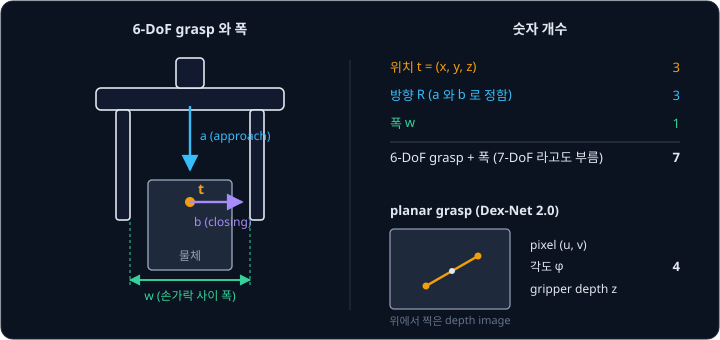
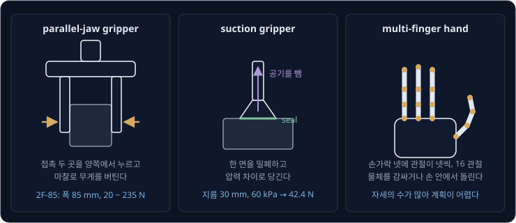
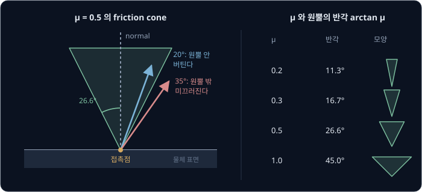
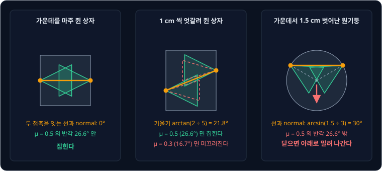
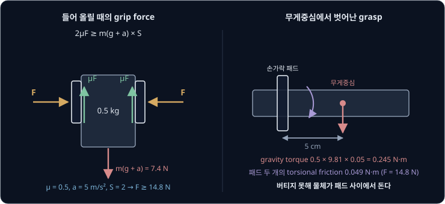
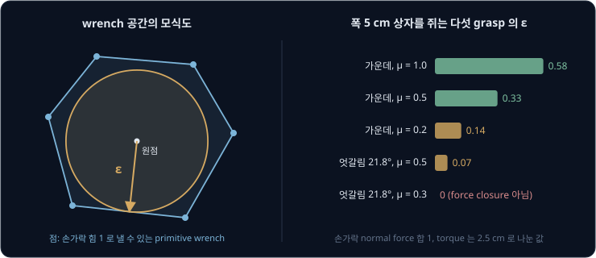
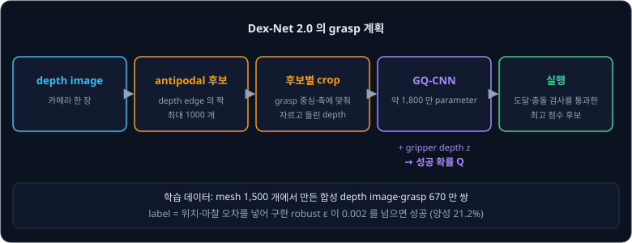
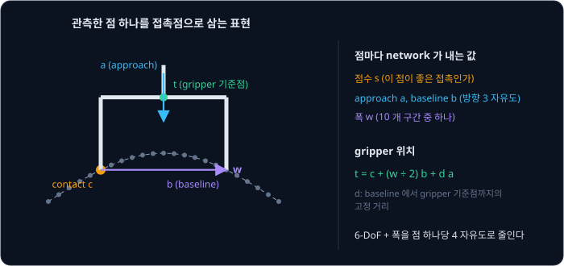
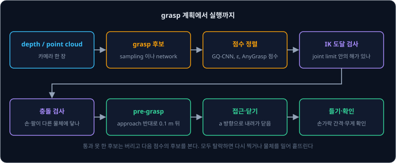

# Grasp Planning

한 변 5 cm 상자는 위에서 내려가 마주 보는 두 면을 쥐면 집히지만, 같은 규칙으로 둥근 과일이나 옆으로 누운 컵을 쥐면 손가락이 닫히는 순간
물체가 옆으로 밀려 빠져나가거나, 들어 올리는 동안 손가락 사이에서 돌아 떨어진다. 처음 보는 물체를 앞에 두고 손가락을 어디에 어느
방향으로 대야 미끄러지지 않을지, 쥐어 보기 전에 계산으로 알 수 있을까?

이 계산을 **grasp planning** 이라고 한다. 처음에는 접촉점의 마찰로 grasp 가 버틸 수 있는지를 식으로 따졌고, 지금은 그 계산으로 만든
대량의 데이터로 network 를 학습해 depth image 한 장에서 바로 grasp 를 고른다. UC Berkeley 의 Dex-Net 2.0 은 합성 데이터 670 만 개로
학습한 network 로 0.8 초 만에 grasp 를 골라, 쥐기 까다로운 모양의 물체 8 개에서 93% 를 집었다(2017).

## 학습 목표

- grasp 를 위치·방향·폭의 숫자 7 개로 적고, parallel-jaw gripper·suction gripper·multi-finger hand 가 물체를 붙잡는 방식의 차이를 설명할 수 있다
- friction cone 의 반각 arctan μ 로 antipodal grasp 와 force closure 를 판단하고, 무게·가속도·안전율에서 필요한 grip force 를 계산할 수 있다
- Ferrari-Canny 의 ε 이 무엇을 재는지, Dex-Net·GraspNet-1Billion·Contact-GraspNet·AnyGrasp 가 그 계산과 데이터를 어떻게 쓰는지 설명할 수 있다
- depth image 에서 후보·점수·IK·충돌 검사를 거쳐 실행하는 pipeline 과, 투명한 물체·depth noise·clutter 에서 실패하는 이유를 설명할 수 있다

## grasp 표현

[Classical Pick & Place](../classical-pick/README.md) 에서 본 grasp pose 는 손끝 위치와 gripper 방향이었다. grasp planning 에서는 손가락을
얼마나 벌릴지까지 함께 정하고, 두 손가락짜리 parallel-jaw gripper 의 grasp 를 아래 네 가지로 적는다.

- grasp 중심 $t$: 두 손가락 끝 사이의 가운데 위치
- approach vector $a$: 손이 물체로 다가가는 방향
- closing vector $b$: 두 손가락이 닫히는 방향으로, $a$ 와 직각이다. baseline vector 라고도 부른다
- 폭 $w$: 손가락 사이를 벌린 거리

$a$ 와 $b$ 를 정하면 둘에 모두 직각인 셋째 축도 따라 나오므로 gripper 의 rotation 이 하나로 정해진다. rotation 은
[Transforms](../transforms/README.md) 에서 본 것처럼 숫자 3 개로 적을 수 있어서, grasp 하나는 위치 3 개, 방향 3 개, 폭 1 개를 합친 숫자
7 개다. 독립적으로 정하는 숫자의 개수를 DoF(degree of freedom, 자유도)라고 하며, 위치와 방향이 6-DoF 라서 이 표현을 6-DoF grasp 라고 부른다.
GraspNet-1Billion 은 이를 $G = [R \; t \; w]$ 로 적고, AnyGrasp 는 폭까지 세어 7-DoF grasp 라고 부른다.

classical-pick 의 첫째 cube 를 쥔 top-down grasp 를 이 표현으로 옮기면 아래와 같다.

| 숫자 | 값 | 뜻 |
| --- | --- | --- |
| $t$ | $(0.20, 0, 0.025)$ m | cube 가운데 |
| $a$ | $(0, 0, -1)$ | 수직 아래로 다가감 |
| $b$ | $(\cos 10°, \sin 10°, 0)$ | 수평면에서 cube 의 yaw 10° 방향으로 닫음 |
| $w$ | 7 cm 로 벌렸다가 5 cm 에서 멈춤 | cube 폭 5 cm |

카메라가 위에서 내려다보고 물체가 책상 위에 있으면 $a$ 를 늘 수직 아래로 고정할 수 있어서 숫자가 줄어든다. Dex-Net 2.0 은 depth image
위의 pixel $(u, v)$, image 평면에서의 각도 $\varphi$, 카메라에서 gripper 까지의 depth $z$ 숫자 4 개로 grasp 를 적었다. 이런 grasp 를 planar
grasp 라고 하는데, 숫자가 적어 학습이 쉽지만 선반 안의 책이나 통 벽에 기댄 물체처럼 옆에서 쥐어야 하는 물체는 표현하지 못한다.
GraspNet-1Billion 논문도 이 제한을 들어 6-DoF grasp 를 다룬다.

**확인 문제.** planar grasp 는 숫자 4 개만 정한다. 6-DoF grasp 와 폭을 합친 숫자 7 개 가운데 정하지 않는 숫자 3 개는 무엇일까?

답 보기

pixel $(u, v)$ 와 depth $z$ 가 위치 3 개를 정하고, 각도 $\varphi$ 가 수직축을 도는 rotation 1 개를 정한다. 남는 3 개는 수직 아래로 고정해
따로 정하지 않는 $a$ 의 기울기 2 개와 폭 $w$ 다.

## gripper 종류

Dex-Net 3.0 논문은 접촉 한 곳만으로 물체를 들 수 있는 vacuum 방식이 산업 현장에서 널리
쓰이고, parallel-jaw gripper 나 multi-finger hand 보다 먼저 고르는 경우가 많다고 적었다.

| | parallel-jaw gripper | suction gripper | multi-finger hand |
| --- | --- | --- | --- |
| 붙잡는 방식 | 접촉 두 곳을 양쪽에서 눌러 마찰로 버팀 | 한 면을 밀폐하고 압력 차이로 당김 | 여러 손가락으로 감싸거나 손끝으로 쥠 |
| 잘 집는 물체 | 손가락 폭 안에 마주 보는 두 면이 있는 물체 | 평평하고 공기가 새지 않는 면 | 모양이 복잡한 물체, 손 안에서 돌려야 하는 작업 |
| 못 집는 물체 | 손가락보다 넓거나 책상에 납작하게 붙은 물체 | 구멍이 났거나 거칠고 울퉁불퉁한 면 | 계획과 제어가 어려워 아직 연구 단계가 많음 |
| 예 | Robotiq 2F-85: 폭 85 mm, grip force 20 ~ 235 N | Dex-Net 3.0: 지름 15 mm 실리콘 컵, 최대 약 0.9 kg | Allegro Hand V3(MuJoCo Menagerie 모델): 손가락 4 개 × 관절 4 개 = 16 관절 |

suction gripper 가 당기는 힘은 컵 안팎의 압력 차이 $\Delta P$ 에 컵 입구의 넓이 $A$ 를 곱한 값이다. 예를 들어 지름 30 mm 컵 안의 압력을
대기압보다 60 kPa 낮춘다고 하면, $A = \pi \times 0.015^2 = 7.07 \times 10^{-4}$ m² 이므로 $60{,}000 \times 7.07 \times 10^{-4} = 42.4$ N 으로 당긴다. 컵 테두리가
면에 빈틈없이 붙어 공기가 새지 않는 상태를 seal 이라고 하는데, seal 이 깨지면 압력 차이가 사라져 힘도 사라진다. 그래서 Dex-Net 3.0 은
물체를 단단하고 구멍이 없는(non-porous) 재질로 가정하고, seal 이 생기는지부터 계산한다.

컵을 어느 면에 대느냐에 따라 필요한 힘도 달라진다. Schmalz 의 계산 안내에 따르면 윗면에 수평으로 댄 컵으로 물체를 수직으로 들어 올릴
때 필요한 힘은 $m(g + a) \times S$ 다. 옆면에 세로로 댄 컵은 마찰로 버텨야 해서 $\frac{m}{\mu}(g + a) \times S$ 가 필요하다. $S$ 는
안전율(safety factor)로, Schmalz 는 매끈하고 치밀한 물체에는 최소 1.5 를, 거칠거나 기름 묻은 물체에는 2 이상을 권한다. 1 kg 물체를
5 m/s² 로 들어 올리는 예에서 윗면에 대면 $1 \times 14.81 \times 1.5 = 22.2$ N 이라 앞의 42.4 N 컵으로 충분하다. 옆면에 대고 $\mu = 0.5$,
$S = 2$ 로 두면 $\frac{1}{0.5} \times 14.81 \times 2 = 59.2$ N 이 필요해 같은 컵으로는 들 수 없다.

**확인 문제.** 지름 20 mm 컵에 압력 차이 50 kPa 를 만들면 당기는 힘은 몇 N 일까? 윗면에 대고 1 kg 물체를 천천히($a = 0$) 들 때 안전율 1.5 를
지킬 수 있을까?

답 보기

넓이는 $\pi \times 0.01^2 = 3.14 \times 10^{-4}$ m² 이고 힘은 $50{,}000 \times 3.14 \times 10^{-4} = 15.7$ N 이다. 필요한 힘은
$m(g + a) \times S = 1 \times 9.81 \times 1.5 = 14.7$ N 이라 15.7 N 으로 겨우 지킨다.

## friction cone

[MuJoCo Simulation](../mujoco-sim/README.md) 에서 본 Coulomb friction 은 마찰 힘이 normal force 의 $\mu$ 배를 넘지 못한다는 규칙이었다.
손가락이 물체를 누르는 힘을 표면에 수직인 normal 성분 $N$ 과 표면을 따라가는 성분 $T$ 로 나누면, 미끄러지지 않는 조건 $T \le \mu N$ 은 힘이
normal 에서 기운 각도의 조건으로 바뀐다. 기운 각도를 $\theta$ 라 하면 $T \div N = \tan\theta$ 이므로 아래와 같다.

$$
\tan\theta \le \mu \quad \Longleftrightarrow \quad \theta \le \arctan\mu
$$

미끄러지지 않고 낼 수 있는 힘의 방향은 접촉점에서 normal 을 축으로 반각이 $\arctan\mu$ 인 원뿔 안에 모두 들어간다. 이 원뿔을 **friction
cone** 이라고 한다.

$\mu = 0.5$ 이면 반각은 $\arctan 0.5 = 26.6°$ 다. normal 에서 20° 기운 힘은 $\tan 20° = 0.36 \le 0.5$ 라서 버티고, 35° 기운 힘은
$\tan 35° = 0.70 > 0.5$ 라서 미끄러진다. friction cone 은 힘의 크기가 아니라 방향을 제한하므로, 원뿔 밖을 향한 힘은 아무리 세게 눌러도
미끄러진다.

| $\mu$ | 0.2 | 0.3 | 0.5 | 1.0 |
| --- | --- | --- | --- | --- |
| 반각 $\arctan\mu$ | 11.3° | 16.7° | 26.6° | 45° |

$\mu$ 는 재질과 표면 상태에 따라 달라지는데, Schmalz 의 참고값은 젖은 면 0.2 ~ 0.3, 나무·금속·유리·돌 0.5, 거친 면 0.6 이다. 정확한
값을 알기 어려워서 grasp 연구는 $\mu$ 를 한 값으로 두지 않고, Dex-Net 2.0 은 논문 표기로 $\mathcal{N}(0.5, 0.1)$ 인 Gaussian 을 0 ~ 1 로
자른 분포에서 $\mu$ 를 뽑았다.

3차원 원뿔은 다루기 불편해서 옆면 몇 개짜리 각뿔로 바꿔 계산하는 경우가 많다. Ferrari 와 Canny 도 원뿔을 각뿔로 근사했고, MuJoCo 의
`cone` 옵션도 기본값이 각뿔(`pyramidal`)이며 원뿔(`elliptic`)을 고를 수 있다. 접촉점 하나가 friction cone 안의 힘만 내는 모델을 point
contact with friction 이라고 하고, 고무 패드처럼 접촉면이 넓어 normal 축을 도는 torque 까지 마찰로 버티는 모델을 soft finger contact 라고
한다.

## antipodal grasp

parallel-jaw gripper 의 두 손가락은 서로를 향해 미는데, 다른 힘 없이 두 힘만으로 물체가 가만히 있으려면 두 힘은 크기가 같고 방향이
반대이며 두 접촉점을 잇는 같은 선 위에 있어야 한다. 그렇지 않으면 남는 힘이나 torque 가 물체를 움직인다. 따라서 각 손가락의 힘은 두
접촉점을 잇는 선을 따라야 하고, 이 방향이 양쪽 접촉점의 friction cone 안에 들어야 한다. 이 조건을 만족하는 grasp 를 **antipodal grasp**
라고 한다. antipodal 은 "정반대편" 이라는 뜻이고, 선과 양쪽 normal 의 각도가 모두 $\arctan\mu$ 이하인지로
판단한다.

폭 5 cm 상자의 마주 보는 두 면 가운데를 쥐면 선과 normal 이 나란해서 0° 다. 한쪽 손가락은 1 cm 아래를 쥐고 다른 쪽은 1 cm 위를 쥐면 선이
$\arctan(2 \div 5) = 21.8°$ 기울어서 $\mu = 0.5$(26.6°)에서는 집히고 $\mu = 0.3$(16.7°)에서는 미끄러진다.

둥근 물체에서는 normal 이 늘 중심을 향한다. 반지름 3 cm 원기둥을 중심에서 1.5 cm 벗어난 선을 따라 쥐면 선과 normal 의 각도가
$\arcsin(1.5 \div 3) = 30°$ 라서, $\mu = 0.5$ 의 반각 26.6° 를 넘는다. 손가락을 닫으면 물체가 밀려 나가는데, 서론에서 둥근 과일이
옆으로 빠져나간 것이 이 경우다. 같은 원기둥에서 중심과의 거리 $d$ 마다 필요한 $\mu$ 는
아래와 같다.

| 중심에서 벗어난 거리 $d$ | 0.5 cm | 1 cm | 1.5 cm | 2 cm |
| --- | --- | --- | --- | --- |
| 선과 normal 의 각도 $\arcsin(d \div 3)$ | 9.6° | 19.5° | 30° | 41.8° |
| 필요한 $\mu$ 의 최솟값 $\tan$(각도) | 0.17 | 0.35 | 0.58 | 0.89 |

antipodal 조건은 계산이 가벼워서 후보를 만드는 데 많이 쓴다. Dex-Net 2.0 은 depth image 에서 깊이가 급하게 바뀌는 edge pixel 두 개를 무작위로
골라 antipodal 인지 검사하는 일을 되풀이해 후보를 최대 1000 개 만들었다. GraspNet-1Billion 은 grasp 마다 $\mu$ 를 1.0 에서 0.1 씩 낮추며 antipodal
이 깨지는 값을 찾고, 가장 낮은 $\mu$ 에서도 버티는 grasp 일수록 높은 점수 $s = 1.1 - \mu$ 를 주었다. 실제 로봇으로 검증한 결과 물체 10 개에서
$s = 1$ 인 grasp 는 평균 96% 성공했고, $s = 0.1$ 인 grasp 는 물체마다 5 ~ 23% 만 성공했다.

**확인 문제.** 반지름 4 cm 원기둥을 중심에서 2 cm 벗어난 선을 따라 쥔다. 미끄러지지 않으려면 $\mu$ 가 얼마 이상이어야 할까?

답 보기

선과 normal 의 각도는 $\arcsin(2 \div 4) = \arcsin 0.5 = 30°$ 다. 이 각도가 반각 $\arctan\mu$ 이하여야 하므로 $\mu \ge \tan 30° = 0.58$ 이다.

## force closure

antipodal grasp 는 두 손가락의 힘이 서로를 받친다는 뜻일 뿐이고, 실제로는 들어 올릴 때의 gravity, 팔이 움직일 때의 관성력, 다른 물체와
부딪힐 때의 충격이 물체에 더해진다. 물체에 작용하는 힘 3 개와 torque 3 개를 묶은 숫자 6 개를 wrench 라고 한다. 손가락 위치는 그대로 두고
접촉력만 friction cone 안에서 조절해 어떤 방향의 외부 wrench 든 상쇄할 수 있는 grasp 를 **force closure** grasp 라고 한다.

판단은 wrench 공간에서 한다. 각 접촉점의 friction cone 을 모서리 방향 몇 개로 근사하고, 모서리 방향의 힘이 물체에 주는 wrench 를 primitive
wrench 라고 하자. 손가락이 낼 수 있는 wrench 는 primitive wrench 를 양수 비율로 섞은 것이다. 점들을 모두 감싸는 가장 작은 볼록한 도형을
convex hull 이라고 하는데, primitive wrench 의 convex hull 이 원점을 안쪽에 품으면 모든 방향의 wrench 를 낼 수 있다. Ferrari 와 Canny 의 논문은 force closure 가 이
조건과 같다는 결과를 grasp 품질의 바탕으로 썼다.

평면에서는 마찰 있는 두 손가락으로 antipodal 하게 쥐면 force closure 지만, 3차원에서는 그렇지 않다. point contact 두 개의 힘은 모두 두
접촉점을 지나는 축 위에 있어서 그 축을 도는 외부 torque 를 버티지 못하기 때문이다. 그래서 실제 gripper 는 고무 패드의 soft finger contact 로 그 torque 를 버티게 하거나 손가락을 셋 이상 쓴다.

**흔한 오해.** "antipodal 이면 어떤 흔들림에도 버틴다." 두 접촉점을 잇는 축을 도는 torque 는 point contact 로 막지 못한다.
길쭉한 물체의 끝을 쥐면 물체가 그 축을 중심으로 돌며 늘어지는 것도 이 때문인데, 이 torque 를 얼마나 버틸지는 다음 절에서 볼 패드
마찰로 정해진다.

## grip force

classical-pick 에서는 두 손가락이 각각 $F$ 로 누를 때 $2\mu F \ge mg$ 이면 물체가 미끄러지지 않는다고 했다. 실제로는 팔이 물체를 가속하고
비상 정지 때는 크게 감속하며, $\mu$ 도 정확히 모른다. 그래서 가속도 $a$ 와 안전율 $S$ 를 넣은 아래 식으로 grip force 를 정한다.

$$
2\mu F \ge m(g + a) \times S
$$

Robotiq 의 2F-85 설명서는 같은 식을 들 수 있는 무게 $W = 2 F C_f \div S_f$ 로 적고, $F = 200$ N, $C_f = 0.3$, $S_f = 2.4$ 로 50 N(약 5 kg)을
계산한다. 같은 설명서는 로봇이 2g 로 가속하면 5 kg 물체가 100 N 처럼 무거워져 떨어진다고 경고한다.

예로 든 0.5 kg 물체에서 $\mu$·$a$·$S$ 를 바꿔 가며 $F = m(g + a) \times S \div (2\mu)$ 를 계산하면 아래와 같다.

| $\mu$ | $a$ (m/s²) | $S$ | 필요한 $F$ |
| --- | --- | --- | --- |
| 0.5 | 0 | 1 | $0.5 \times 9.81 \div 1 = 4.9$ N |
| 0.5 | 5 | 2 | $0.5 \times 14.81 \times 2 \div 1 = 14.8$ N |
| 0.3 | 5 | 2 | $7.41 \times 2 \div 0.6 = 24.7$ N |
| 1.0 | 5 | 2 | $7.41 \times 2 \div 2 = 7.4$ N |

$\mu$ 가 0.5 에서 0.3 으로 내려가면 필요한 힘이 1.7 배가 된다. 2F-85 는 grip force 를 20 ~ 235 N 사이에서 정하므로, 20 N 보다 약하게
쥐어야 하는 물렁한 물체에는 다른 손이 필요하다.

물체를 무게중심에서 벗어나 쥐면 위 식만으로는 부족한데, 0.5 kg 물체를 무게중심에서 5 cm 떨어진 곳에서 쥐면 gravity 가 grasp 축을
중심으로 $0.5 \times 9.81 \times 0.05 = 0.245$ N·m 의 torque 를 만든다. point contact 로는 이 torque 를 막지 못하므로 패드가 접촉면
안에서 내는 마찰 torque 인 torsional friction 만 버틴다. 반지름 $R$ 인 둥근 패드 전체에 압력이 고르게 퍼진다고
가정하면, 패드 하나가 낼 수 있는 torsional friction 의 최댓값은 $\frac{2}{3}\mu F R$ 이다. 패드 반지름을 5 mm 로 잡고 위 표의 $F = 14.8$ N,
$\mu = 0.5$ 를 넣으면 패드 하나가 $\frac{2}{3} \times 0.5 \times 14.8 \times 0.005 = 0.0247$ N·m 를 버티고, 두 개를 합쳐도 0.049 N·m 다.
0.245 N·m 의 5 분의 1 밖에 안 되므로 물체가 패드 사이에서 돈다. 이 torque 를 grip force 만으로 버티려면
$F = 0.245 \div (2 \times \frac{2}{3} \times 0.5 \times 0.005) = 73.6$ N 이 필요하다.

그래서 grasp 는 무게중심 가까이를 고른다. AnyGrasp 는 gripper 가 지나는 평면과 무게중심 사이의 거리를 grasp 점수에 반영했고, 길고 무거운
물체를 25 번씩 집는 실험에서 손 안의 미끄러짐이 16 번에서 11 번으로 줄었다.

<b>심화: 둥근 패드의 torsional friction</b>

반지름 $R$ 인 둥근 패드에 힘 $F$ 가 고르게 퍼지면 단위 넓이당 압력은 $p = F \div (\pi R^2)$ 다. 중심에서 $r$ 떨어진 폭 $dr$ 의 고리는 넓이가
$2\pi r \, dr$ 이므로 이 고리가 낼 수 있는 마찰 힘은 $\mu p \times 2\pi r \, dr$ 이고, 그 힘이 중심에 주는 torque 는 여기에 $r$ 을 곱한 값이다.
패드 전체를 더하면 아래와 같다.

$$
\tau_{\max} = \int_0^R \mu \frac{F}{\pi R^2} 2\pi r^2 \, dr = \frac{2\mu F}{R^2} \times \frac{R^3}{3} = \frac{2}{3}\mu F R
$$

마찰 힘이 모두 패드 가장자리에서 생긴다고 보면 $\mu F R$ 인데, 압력이 고르면 안쪽 고리의 팔 길이가 짧아서 그 $\frac{2}{3}$ 가 된다. 패드를
넓히거나 부드러운 재질로 바꿔 접촉면을 키우면 $R$ 이 커져 이 torque 가 커진다. 압력 분포가 고르지 않으면 계수가 달라지므로 실제 값은
재 보아야 한다.

**확인 문제.** 1 kg 물체를 $\mu = 0.4$ 인 패드로 천천히($a = 0$) 들어 올린다. 안전율 2 를 지키려면 손가락 하나가 몇 N 이상으로 눌러야 할까?

답 보기

$F = m(g + a) \times S \div (2\mu) = 1 \times 9.81 \times 2 \div (2 \times 0.4) = 19.62 \div 0.8 = 24.5$ N 이다.

## grasp quality metric

force closure 는 버티는지 아닌지만 알려 주는데, 같은 물체에도 force closure grasp 는 무수히 많아서 어느 것이 더 잘 버티는지 비교할
숫자가 필요하다. Ferrari 와 Canny 는 손가락 힘을 1 로 제한했을 때 낼 수 있는 primitive wrench 의 convex hull 안에 원점을 중심으로 넣을 수
있는 가장 큰 공의 반지름을 grasp 의 품질로 정했다. 이 반지름을 ε(epsilon)이라 부르고, 이 기준을 Ferrari-Canny metric 또는 epsilon quality 라고
한다.

convex hull 이 어느 한 방향으로 납작하면 그 방향의 외부 wrench 에 약하고, ε 은 그 가장 약한 방향에서 버틸 수 있는 외부 wrench 의 크기를
손가락 힘 1 당으로 잰 값이다. 손가락마다 normal force 가 1 을 넘지 않게 제한하는 것을 L∞ 기준이라고 하고, 모든 손가락의 합이 1 을 넘지 않게
제한하는 것을 L1 기준이라고 한다.

폭 5 cm 상자를 쥐는 grasp 다섯 개를 평면에서 L1 기준으로 직접 계산하면 아래와 같다. torque 는 힘과 단위를 맞추려고 상자 반폭 2.5 cm 로
나눴다.

| grasp | $\mu$ | 선과 normal 의 각도 | ε |
| --- | --- | --- | --- |
| 가운데를 마주 쥠 | 1.0 | 0° | 0.58 |
| 가운데를 마주 쥠 | 0.5 | 0° | 0.33 |
| 가운데를 마주 쥠 | 0.2 | 0° | 0.14 |
| 1 cm 씩 엇갈려 쥠 | 0.5 | 21.8° | 0.07 |
| 1 cm 씩 엇갈려 쥠 | 0.3 | 21.8° | 0 |

같은 $\mu = 0.5$ 에서도 엇갈려 쥔 grasp 는 가운데를 쥔 grasp 의 약 5 분의 1 만 버틴다. $\mu = 0.3$ 에서 엇갈려 쥐면 antipodal 조건이
깨져 force closure 가 아니므로 ε 이 0 이다. ε 이 0 보다 크면 force closure 이므로, ε 하나로 force closure 판단과 품질 비교를 함께 한다.

<b>심화: 가운데를 마주 쥔 grasp 의 ε 손계산</b>

상자의 왼쪽 면 $(-0.025, 0)$ 과 오른쪽 면 $(0.025, 0)$ 을 $\mu = 0.5$ 로 쥔다. 평면의 wrench 는 $(f_x, f_y, \tau / \rho)$ 숫자 3 개이고
$\rho = 0.025$ m 다. 왼쪽 손가락의 normal force 를 1 로 두면 friction cone 의 두 모서리 힘은 $(1, \pm 0.5)$ 이고, torque $\tau = x f_y - y f_x$
는 $-0.025 \times (\pm 0.5) = \mp 0.0125$ 라서 primitive wrench 는 $A = (1, 0.5, -0.5)$, $B = (1, -0.5, 0.5)$ 다. 오른쪽 손가락에서도 같은
방법으로 $C = (-1, -0.5, -0.5)$, $D = (-1, 0.5, 0.5)$ 가 나온다.

L1 기준에서 낼 수 있는 wrench 의 집합은 네 점의 convex hull 인 사면체다. $A + B + C + D = 0$ 이라 원점이 사면체의 무게중심에 있으므로
force closure 다. 면 $ABC$ 의 normal 은 $(B - A) \times (C - A) = (0, -1, 1) \times (-2, -1, 0) = (1, -2, -2)$ 이고 길이가 3 이다. 원점에서 이
면까지의 거리는 $|(1, -2, -2) \cdot A| \div 3 = |1 - 1 + 1| \div 3 = \frac{1}{3}$ 이고, 대칭이라 네 면의 거리가 모두 같아서 $\varepsilon = 0.33$
이다. 3차원 물체에서는 wrench 가 숫자 6 개라 같은 계산을 6차원에서 하고, 보통 convex hull 을 계산하는 library 에 맡긴다.

ε 은 물체의 모양과 접촉점이 정확히 알려져 있다고 가정한다. 실제로는 카메라가 물체의 한쪽 면만 보고, 위치에 몇 mm 의 오차가 있으며,
$\mu$ 도 알 수 없다. 그래서 Dex-Net 은 물체 pose, gripper pose, $\mu$ 를 무작위로 흔들어 가며 ε 의 기댓값을 구하고, 이를 robust epsilon quality 라고
불렀다. 오차가 조금 생겨도 ε 이 크게 남는 grasp 가 robust 한 grasp 다.

## analytic 과 data-driven

물리 모델로 grasp 의 품질을 계산하는 방법을 analytic 방법이라고 하고, 데이터에서 품질을 배우는 방법을 data-driven 방법이라고 한다. Dex-Net 2.0 논문도
grasp 계획 방법을 이 둘로 나눈다.

analytic 방법을 실제 로봇에 쓰려면 카메라로 본 point cloud 를 database 의 물체 mesh 에 맞춰(registration) pose 를 구하고, 그 mesh 에 미리
계산해 둔 grasp 를 꺼내야 한다. Dex-Net 2.0 의 비교 실험에서 이 방법은 아는 물체 8 개에서 95% 로 가장 높았지만 2.6 초가 걸렸고, 처음 보는
물체 10 개에서는 52% 로 떨어졌다. data-driven 방법은 물체를 알아볼 필요 없이 depth image 의 모양에서 바로 grasp 를 고른다. Dex-Net 2.0 과
GraspNet-1Billion 은 학습 데이터의 label 을 analytic 계산으로 만들어서 두 방법을 함께 쓴다.

### Dex-Net 2.0 과 GQ-CNN

Dex-Net 2.0 은 mesh 1,500 개를 무작위 자세로 책상 위에 놓고, 각 물체에 antipodal grasp 를 최대 100 개 뽑아 robust epsilon quality 를 계산했다.
같은 장면의 depth image 를 렌더링해 depth 에 비례하는 noise 를 넣고 grasp 와 짝지어 670 만 쌍을 만들었고, robust epsilon quality 가 0.002 를
넘는 grasp 를 성공으로 표시했다(양성 21.2%). 3차원 grasp 를 Dex-Net 의 방식으로 잰 값이라 앞의 평면 예시 ε 과
크기를 견줄 수 없다. 논문이 비교한 Levine 등의 연구는 로봇 최대 14 대를 2 달 넘게 움직여 grasp 데이터 80 만 개를 모았다.

이 데이터로 학습한 network 가 GQ-CNN(Grasp Quality Convolutional Neural Network)이다. 입력은 후보 grasp 의 중심 pixel 을 가운데에 두고 grasp
축이 가로가 되도록 돌린 depth image 조각과 gripper depth $z$ 이고, 출력은 그 grasp 의 성공 확률이다. 조각을 grasp 방향에 맞춰 돌려 넣으므로
network 는 회전마다 따로 배울 필요가 없다. [CNN](../cnn/README.md) 에서 본 convolution 층 넷과 fully connected 층 셋으로 되어 있고 parameter
는 약 1,800 만 개다. 계획할 때는 후보를 모두 GQ-CNN 에 넣어 점수를 매기고, 팔이 닿고 책상과 부딪히지 않는 후보 가운데 가장 높은 것을
실행한다. 논문은 성공 확률만 학습하고 grasp 를 고르는 정책은 따로 두었기 때문에, 충돌·도달 같은 조건을 바꿔도 network 를 다시 학습할 필요가 없다고
적었다.

| 실험(ABB YuMi, 물체를 하나씩 놓음) | 성공률 | 계획 시간 |
| --- | --- | --- |
| 아는 물체 8 개, GQ-CNN | 93% | 0.8 초 |
| 아는 물체 8 개, registration 으로 미리 계산한 grasp 꺼내기 | 95% | 2.6 초 |
| 처음 보는 물체 10 개, GQ-CNN | 80% | 0.8 초 |
| 처음 보는 가정용품 40 개, GQ-CNN + 반복 sampling | 94% (robust 판정 69 번 중 68 번 성공) | 2.5 초 |

실패는 주로 depth 카메라가 물체의 얇은 부분을 재지 못해 비어 보이는 자리를 손가락이 들어갈 곳으로 착각했을 때와, 좁은 틈에서 손가락이
물체와 부딪히는 grasp 를 좋다고 판정했을 때 났다.

### Dex-Net 3.0 의 suction

Dex-Net 3.0 은 같은 방법을 suction 에 써서, 컵 테두리를 스프링으로 연결한 모델로 컵이 표면에 seal 을 만들 수 있는지 먼저 계산하고, seal 이
생기면 그 접촉이 gravity 의 wrench 를 버틸 수 있는지 계산했다. mesh 1,500 개에서 point cloud 280 만 개와 suction grasp, robust 판정을 만들어
GQ-CNN 을 학습했고, 지름 15 mm 컵을 단 ABB YuMi 로 350 번 실험했다. 단순한 모양에서 98%, 평범한 물체에서 82%, 컵을 댈 곳이 적은 물체에서
58% 를 집었고, grasp 하나를 고르는 데 평균 3.0 초가 걸렸다. 가장 흔한 실패는 표면이 굽어 seal 이 생기지 않는 자리에 컵을 댄 경우였다.

### 6-DoF grasp detection

여러 물체가 섞인 장면(clutter)에서 옆으로도 쥐려면 Dex-Net 2.0 의 planar grasp 대신 6-DoF grasp 를 바로 내야 하고, 그러려면
더 큰 데이터가 필요하다.

GraspNet-1Billion 은 실제 카메라로 찍은 dataset 이다. 물체 88 개 가운데 10 개 정도를 섞어 놓은 장면 190 개를, 로봇 팔에 단 RealSense D435
와 Kinect Azure 카메라 두 대로 256 곳에서 찍어 RGB-D image 97,280 장을 모았다. 장면마다 첫 frame 에서만 물체의 6D pose 를 사람이 맞추고, 나머지
frame 은 기록한 카메라 pose 로 옮겼다. grasp label 은 물체 mesh 마다 analytic 하게 계산한 grasp 를 장면에 옮기고 충돌을 걸러 만들었는데,
장면마다 300 만 ~ 900 만 개, 모두 11 억 개가 넘는다.

Contact-GraspNet 은 관측한 point cloud 의 점 하나를 손가락이 닿을 접촉점으로 삼아 6-DoF grasp 를 표현한다.

접촉점 $c$ 가 정해져 있으므로 network 는 점마다 그 점이 좋은 접촉점인지를 나타내는 점수, 방향 $a$ 와 $b$, 폭 $w$ 만 내면 되고,
gripper 위치는 $t = c + \frac{w}{2} b + d a$ 로 계산한다. $d$ 는 baseline 에서 gripper 기준점까지의 고정 거리다. 점 위에서 4 자유도만 맞히면
되므로 숫자 7 개를 모두 맞히는 것보다 학습이 쉽다. 학습에는 simulation 으로 만든 ACRONYM dataset 의 mesh 8,872 개, grasp 1,770 만 개를 썼다.
장면 하나를 처리하는 데 0.28 초가 걸리고, Franka Panda 로 처음 보는 물체 51 개를 9 개 장면에서 집는 실험에서 성공률 90.2%, 첫 시도 성공률 84.3% 를
기록했다. 비교한 기존 방법은 80.4% 와 68.6% 였다.

AnyGrasp 는 값싼 depth 카메라의 noise 를 simulation 이 그대로 흉내 내기 어렵다고 보고 실제 카메라 데이터로 학습했다. 같은 장면을 100 번 찍은
평균과 비교하면 D435 의 depth 는 ±5 mm 까지 벗어났는데, AnyGrasp 는 그 noise 에서도 잘 집었다. 앞에서 본 무게중심 점수와
여러 frame 의 grasp 를 이어 붙이는 기능을 더해 헤엄치는 로봇 물고기를 잡는 데도 썼다. grasp 예측은 100 ms 안에 끝나고 충돌 검사를
포함한 결정도 200 ms 가 안 걸려서, UR5 한 대로 1 시간에 900 번 넘게 집었다.

논문마다 물체·카메라·gripper 가 달라서 위의 성공률을 서로 바로 비교할 수 없다. AnyGrasp 논문은 처음
보는 물체 300 여 개를 통에서 집어 옮기는 같은 실험에서 AnyGrasp 93.3%, Dex-Net 4.0 72.2%, 같은 모양의 집게를 손에 든 사람 93.9% 를 얻었다.

## 실행까지의 pipeline

grasp 를 고르는 network 는 pipeline 의 한 단계일 뿐이라, 점수가 가장 높은 grasp 라도 팔이 그 pose 에 닿지 않거나 다가가는 길에 다른 물체와
부딪히면 쓸 수 없다.

특정 물체만 집으려면 segmentation mask 로 그 물체 주변의 점만 남긴다. 후보는 antipodal sampling 으로 뽑거나 Contact-GraspNet·AnyGrasp
처럼 network 가 바로 내고, 점수 순서대로 검사하다 통과하지 못한 후보는 버리고 다음 후보를 본다.

카메라 image 에서 고른 grasp 는 camera frame 의 pose 라서, IK 를 풀기 전에 robot base frame 으로 옮겨야 한다. AnyGrasp 는 grasp 를 approach
반대 방향으로 10 cm 옮긴 waypoint 를 먼저 UR5 에 보내고 이어서 grasp pose 를 보냈는데, 이 waypoint 가 classical-pick 에서 본 pre-grasp 에
해당한다.

MoveIt 2 의 MoveIt Task Constructor 는 이 과정을 stage 로 나눠 둔다. `GenerateGraspPose` stage 는 물체 축을 중심으로 `angle_delta` 마다
grasp pose 후보를 만든다. `angle_delta` 의 기본값은 0.1 rad 이고, 공식 예제는 이를 $\pi / 12$(15°)로 둬서 한 바퀴에 $2\pi \div (\pi / 12) = 24$
개를 만든다. 이 stage 를 감싼 `ComputeIK` stage 가 후보마다 IK 를 풀고, IK 를 풀지 못한 후보는 버린다. 후보 하나당 구할 IK 해의 수
`max_ik_solutions` 는 기본값이 1 이고 예제에서는 8 이다. 예제는 grasp 직전에 손을 0.10 ~ 0.15 m 다가가게 하고, 쥔 뒤에는 0.1 ~ 0.3 m
들어 올린다.

**확인 문제.** `GenerateGraspPose` 의 `angle_delta` 를 기본값 0.1 rad 로 두면 물체 축을 한 바퀴 도는 동안 후보가 대략 몇 개 생길까?

답 보기

한 바퀴는 $2\pi \approx 6.28$ rad 이므로 $6.28 \div 0.1 \approx 63$ 개다. 예제의 $\pi / 12$ 보다 촘촘해서 후보는 많아지지만 IK 를 그만큼 더
많이 푼다.

## 실패 원인

실패는 grasp 계산보다 앞 단계인 depth 에서 시작하기도 하는데, Dex-Net 2.0 이 꼽은 얇은 부분의 실패가 그런 경우다.

| 상황 | 일어나는 일 | 대응 |
| --- | --- | --- |
| 투명하거나 반짝이는 물체 | depth 카메라가 물체 표면이 아닌 뒤의 배경을 재거나 값이 빔 | 투명한 물체의 depth 를 고쳐 주는 network(ClearGrasp), 여러 각도의 촬영 |
| 얇은 부분 | depth 에서 빠져 빈 곳으로 보여 손가락이 부딪힘 | 고해상도 카메라, analytic 충돌 검사 추가 |
| depth noise | D435 는 같은 점이 ±5 mm 까지 흔들려 접촉점이 틀림 | 실제 noise 를 넣은 학습, 실제 데이터로 한 학습 |
| clutter | 물체가 서로 가려 한쪽 면만 보이고, 손가락이 이웃 물체와 부딪힘 | 6-DoF grasp, 충돌 검사, 물체를 밀어 흩뜨리는 동작 |
| 낮은 마찰 | 물에 젖은 물체가 좋은 grasp 에서도 미끄러짐 | 안전율 증가, 패드 재질 교체 |

ClearGrasp 논문은 투명한 물체가 일반 3D 센서에서 그 뒤에 있는 면의 noise 섞인 모양으로 보인다고 적었다. AnyGrasp 의 물고기 잡기
실험에서는 실패의 절반 가까이가 grasp pose 는 맞았는데 물속의 낮은 마찰로 미끄러진 경우였다.

**흔한 오해.** "grasp network 의 성공률이 90% 면 로봇이 열 번에 아홉 번 집는다." 논문의 성공률은 그 논문의 물체, 카메라, gripper, 손가락 패드에서
잰 값이다. AnyGrasp 의 실험에서도 물체 종류에 따라 철물은 81.5%, 과자와 인형은 100% 로 달랐다. 내 로봇의 카메라 calibration 이
몇 mm 틀리거나 패드의 $\mu$ 가 다르면 같은 network 로도 성공률이 크게 달라진다.

## 정리

- grasp 는 중심 $t$, approach $a$, closing $b$, 폭 $w$ 의 숫자 7 개이고, planar grasp 는 $a$ 를 수직으로 고정해 4 개로 줄인다. suction 은
  압력 차이 × 넓이로 당기고, 예로 든 지름 30 mm·60 kPa 컵은 42.4 N 이다
- 미끄러지지 않는 힘은 반각 $\arctan\mu$ 의 friction cone 안에 있다($\mu = 0.5$ 에서 26.6°). 두 접촉을 잇는 선이 양쪽 원뿔 안이면
  antipodal 이고, 어떤 외부 wrench 든 버티면 force closure 다. 반지름 3 cm 원기둥을 1.5 cm 벗어나 쥐면 30° 라 밀려 나간다
- grip force 는 $2\mu F \ge m(g + a) \times S$ 로 정하고(0.5 kg, $\mu = 0.5$, $a = 5$, $S = 2$ 에서 14.8 N), 무게중심에서 벗어난 torque 는
  패드의 torsional friction 만 버티므로 무게중심 가까이를 쥔다
- Ferrari-Canny 의 ε 은 primitive wrench 의 convex hull 에 원점을 중심으로 들어가는 가장 큰 공의 반지름이다. Dex-Net 은 오차를 넣은 robust ε 으로 합성 데이터의
  label 을 만들어 GQ-CNN 을 학습했고, Contact-GraspNet·AnyGrasp 는 clutter 에서 6-DoF grasp 를 바로 낸다
- 후보 → 점수 → IK → 충돌 검사 → pre-grasp → 닫기 → 확인으로 실행하고, 실패는 투명한 물체·얇은 부분·depth noise 에서 많이 생긴다

camera frame 에서 고른 grasp 를 로봇이 실행하려면 카메라가 로봇 base 에서 어디에 어떤 방향으로 달려 있는지 알아야 하고, 그 변환의 회전이 1° 만 틀려도
0.5 m 앞의 grasp 가 $0.5 \times \tan 1° \approx 8.7$ mm 어긋난다. 이 변환을 재는 방법은 [Hand-Eye Calibration](../hand-eye-calibration/README.md) 에서 다룬다. pre-grasp
까지 다른 물체를 피해 가는 경로를 찾는 방법은 [Motion Planning](../motion-planning/README.md) 에서 다룬다.

## 참고 자료

- C. Ferrari, J. Canny, [Planning Optimal Grasps](https://doi.org/10.1109/ROBOT.1992.219918) (ICRA 1992) — ε 을 정의한 논문. 4절의 grasp quality
  measure 를 읽는다
- J. Mahler 외, [Dex-Net 2.0](https://arxiv.org/abs/1703.09312) (RSS 2017) — 합성 데이터와 GQ-CNN. Fig. 1, Table V·VI,
  부록의 antipodal sampling 알고리즘을 본다
- J. Mahler 외, [Dex-Net 3.0](https://arxiv.org/abs/1709.06670) (ICRA 2018) — suction 의 seal 과 wrench 모델. 4절을 읽는다
- H.-S. Fang 외, [GraspNet-1Billion](https://openaccess.thecvf.com/content_CVPR_2020/html/Fang_GraspNet-1Billion_A_Large-Scale_Benchmark_for_General_Object_Grasping_CVPR_2020_paper.html)
  (CVPR 2020) — 3절의 annotation pipeline 과 Table 2 의 실제 검증을 본다
- M. Sundermeyer 외, [Contact-GraspNet](https://arxiv.org/abs/2103.14127) (ICRA 2021) — Fig. 3 과 식 (1)·(2) 의 접촉점 표현을 본다
- H.-S. Fang 외, [AnyGrasp](https://arxiv.org/abs/2212.08333) (T-RO 2023) — Table I 의 사람과의 비교와 depth noise 실험을 읽는다
- S. Sajjan 외, [ClearGrasp](https://arxiv.org/abs/1910.02550) (2019) — 투명한 물체의 depth 를 고치는 방법
- Robotiq, [2F-85 / 2F-140 설명서의 Specifications](https://assets.robotiq.com/website-assets/support_documents/document/online/2F-85_2F-140_TM_InstructionManual_HTML5_20190503.zip/2F-85_2F-140_TM_InstructionManual_HTML5/Content/6.%20Specifications.htm)
  — 마찰·안전율로 들 수 있는 무게를 계산하는 예
- Schmalz, [Theoretical holding force of a suction cup](https://www.schmalz.com/en/vacuum-knowledge/the-vacuum-system-and-its-components/system-design-calculation-example/theoretical-holding-force-of-a-suction-cup)
  — suction 컵의 방향별 필요 힘과 안전율
- MoveIt Task Constructor, [pick_place_task.cpp](https://github.com/moveit/moveit_task_constructor/blob/ros2/demo/src/pick_place_task.cpp) — grasp 후보, IK, 접근·닫기·들기를 이은 예제
- Russ Tedrake, [Robotic Manipulation — Ch. 5 Bin Picking](https://manipulation.csail.mit.edu/clutter.html) — friction cone 과 antipodal
  grasp sampling 을 코드로 설명하는 MIT 교재
