# GR00T N1

팔 하나짜리 로봇은 조종기 하나로 시연을 모을 수 있다. 하지만 손가락이 달린 두 손에 허리와 목까지 움직이는 humanoid 는 사람이 손목에
tracker 를 차고 손에 장갑을 껴서 손 동작을 그대로 옮겨야 조종할 수 있어서, 시연 한 건을 모으는 품이 훨씬 많이 든다. NVIDIA 가 Fourier GR-1 humanoid 를
이렇게 조종해 모은 데이터는 88 시간으로, π0 가 pretraining 에 쓴 로봇 데이터 약 10,000 시간의 100 분의 1 도 안 된다. 직접 조종한 데이터가
100 시간도 안 되는 humanoid 에게 처음 보는 물건을 그릇에 옮기는 일을 어떻게 가르칠 수 있을까?

NVIDIA 가 2025 년에 공개한 GR00T N1 은 사람 영상, 영상 생성 모델이 만든 로봇 영상, simulation 기록을 실물 데이터 아래에 층층이 쌓아 한
모델로 함께 학습하는 VLA 다. 논문에 따르면 GR-1 실물 작업에서 시연을 10% 만 써서 post-training 한 GR00T N1 이 시연 전체로 학습한
Diffusion Policy 와 성공률 3.8%p 차이까지 다가갔다. Hugging Face 의 LeRobot 공식 문서에는 GR00T N1.7 을 `groot` policy 로 불러 SO-101 팔의
데이터로 fine-tuning 하는 방법이 실려 있다.

## 학습 목표

- humanoid 데이터가 모자란 이유와, data pyramid 의 세 층이 각각 무엇을 주고 무엇이 모자란지 설명할 수 있다
- VLM(System 2)과 diffusion transformer(System 1)를 cross-attention 으로 이은 구조와 로봇마다 따로 둔 encoder·decoder 를 π0 와 비교해
  설명할 수 있다
- flow matching 4 step 으로 action 16 개를 만드는 과정을 따라가고, 덩어리를 실행하는 동안 다음 덩어리 계산이 끝나는지 따질 수 있다
- action 이 없는 영상에 latent action 과 IDM pseudo-action 을 붙이는 방법과, 결과표에서 pretraining 이 적은 데이터에 주는 효과를 설명할 수 있다

## humanoid 데이터와 data pyramid

글과 사진은 인터넷에 쌓여 있어서 언어 모델과 VLM(Vision-Language Model, 사진과 글을 함께 읽는 모델)은 그것을 모아 학습하지만,
humanoid 가 일한 기록은 인터넷에 없다. 로봇 데이터는 사람이 로봇을 조종(teleoperation)해 한 건씩 모아야 하는데, 저자들은 GR-1 을
조종하며 1 초에 20 번(20 Hz) 관절 명령과 머리 카메라 사진을 기록했다. 여러 연구실의 로봇 데이터를 모은 Open X-Embodiment 같은 공개 데이터도
있지만 로봇마다 관절 수·카메라 위치·제어 방식이 달라서 하나로 합치기 어렵다. 논문은 이렇게 서로 이어지지 않은 데이터를 "data islands" 라고 불렀다.

GR00T N1 은 성격이 다른 데이터를 양이 얼마나 많은지와 실제 로봇의 몸에 얼마나 가까운지에 따라 세 층으로 나눠 함께 학습한다. 이 구성이 **data pyramid** 다.

- 바닥: VLM 이 미리 배운 인터넷 사진·글과 사람이 머리에 카메라를 달고 찍은 egocentric(1 인칭 시점) 영상. 물체를 다루는 넓은 경험을 주지만
  로봇의 관절 값은 없다
- 가운데: simulation 으로 만든 로봇 기록과 영상 생성 모델이 만든 로봇 영상. 사람이 조종하지 않아도 GPU 시간만 들이면 늘어난다
- 꼭대기: GR-1 을 직접 조종한 기록과 다른 로봇의 공개 데이터. 양은 적지만 실제 몸이 실제 세상에서 움직인 기록이다

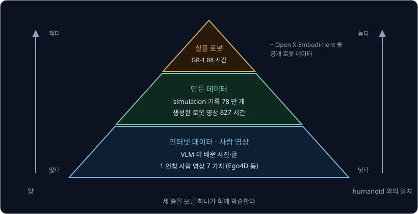

논문의 부록 표 7 에 적힌 pretraining 데이터의 시간을 층별로 더하면 아래와 같다.

| 층 | 데이터 | pretraining 에 쓴 시간 |
| --- | --- | --- |
| 꼭대기: 실물 로봇 | GR-1 조종 88.4 시간, AgiBot-Alpha 1,979.4 시간, DROID 428.3 시간 등 | 3,288.8 시간 |
| 가운데: 만든 데이터 | simulation 1,742.6 시간, 생성한 로봇 영상 827.3 시간 | 2,569.9 시간 |
| 바닥: 사람 영상 | Ego4D 2,144.7 시간 등 7 가지 | 2,517.0 시간 |
| 합 | | 8,375.7 시간 |

꼭대기의 시간이 표에서 가장 긴 것은 다른 로봇의 데이터가 섞여 있기 때문이고, humanoid GR-1 의 데이터는 그중 88.4 시간뿐이다. 바닥에는 표의
사람 영상 아래에 VLM 이 미리 배운 인터넷 사진·글이 더 깔려 있어서, 그것까지 치면 아래로 갈수록 양이 많다.

**확인 문제.** GR-1 조종 데이터 88.4 시간을 20 Hz 로 기록했다면 기록된 frame 은 몇 개일까? 논문의 표 7 은 이 데이터를 640 만(6.4M) frame 으로 적었다.

답 보기

1 시간은 3600 초이고, 1 초마다 frame 이 20 개다.

$$
88.4 \times 3600 \times 20 = 6{,}364{,}800
$$

답: 약 636 만 frame 으로, 표 7 의 6.4M 과 맞는다. π0 의 약 10,000 시간과 비교하면 시간으로 $10{,}000 \div 88.4 \approx 113$ 배 적다.

## System 2 와 System 1

GR00T N1 도 π0 처럼 큰 VLM 과 action 을 만드는 작은 network 로 되어 있는데, VLM 쪽은 System 2 라고 하고 action 쪽은 System 1 이라고
한다.

- System 2 는 NVIDIA 의 VLM 인 Eagle-2 다. 카메라 사진과 지시문을 읽어 장면과 목표를 숫자 묶음으로 정리하고, NVIDIA L40 GPU 에서 1 초에
  10 번(10 Hz) 계산한다
- System 1 은 flow matching 으로 학습한 **diffusion transformer** 다. VLM 이 정리한 숫자와 로봇의 지금 관절 상태를 보고 action 덩어리(action
  chunk)를 만드는데, 논문에 따르면 1 초에 120 번(120 Hz) action 을 낸다

공개한 GR00T-N1-2B 모델은 parameter 가 모두 22 억(2.2B) 개이고 그중 13.4 억(1.34B) 개가 VLM 이다. action 16 개짜리
덩어리 하나를 만드는 데 L40 GPU 에서 63.9 ms 가 걸렸다.

| 부분 | 하는 일 | parameter | 논문의 주기 |
| --- | --- | --- | --- |
| System 2 (Eagle-2 VLM) | 사진·지시문 읽기 | 13.4 억 | 10 Hz |
| System 1 (diffusion transformer, 로봇별 encoder·decoder) | action 덩어리 만들기 | $22 - 13.4 = 8.6$ 억 | 120 Hz |

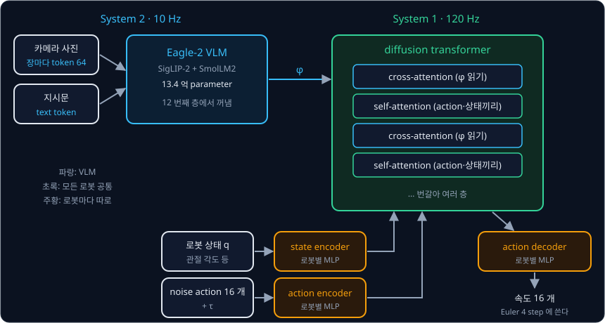

위 그림에서 파란 쪽은 System 2 이고 초록 쪽은 System 1 이며, 주황 상자는 로봇마다 따로 있는 부분이다. 논문의 기호로 VLM 출력은 $\phi_t$ 이고,
로봇 상태는 $q_t$ 이며, noise 가 섞인 action 덩어리는 $A_t^\tau$ 다. 두 이름은 심리학자 Daniel Kahneman 이 사람의 생각을 천천히 따져 보는
System 2 와 빠르게 반응하는 System 1 로 나눈 데서 왔다.

Eagle-2 는 [ViT](../vit/README.md) 계열의 image encoder SigLIP-2 와 작은 언어 모델 SmolLM2 를 이어 인터넷의 사진·글로 학습한 VLM 이다.
GR00T N1 은 사진을 $224 \times 224$ 로 줄여 넣고 이웃한 token 넷을 하나로 합치는 pixel shuffle 로 사진 한 장을 image token 64 개로 만든다.
π0 의 PaliGemma 가 사진 한 장을 token 256 개로 넘기는 것의 4 분의 1 이다.

언어 모델은 transformer 층을 여러 개 쌓은 구조라서 층을 하나 지날 때마다 새 숫자 묶음이 나오는데, GR00T N1 은 맨 마지막 층이 아니라 12 번째
층의 출력을 $\phi_t$ 로 쓴다. 논문에 따르면 이렇게 하자 추론이 빨라지고 성공률도 올랐다. 공개 구현은 모델을 불러올 때 12 번째 층 위를 아예
지워서 위 층은 계산하지도 메모리에 올리지도 않는다.

> **오해** System 2 와 System 1 은 따로 학습한 두 모델이다.
>
> **사실** 논문은 두 부분을 하나로 이어 end-to-end 로 함께 학습하고, 언어 모델의 weight 만 얼려 둔다. action 의 loss 에서 나온 gradient 는 diffusion transformer 와 얼려 둔 언어 모델 층을
> 거쳐 image encoder 까지 전해져서 image encoder 의 weight 도 고친다.

<b>심화: pixel shuffle 로 token 을 4 분의 1 로 줄이는 계산</b>

pixel shuffle 은 이웃한 token 넷($2 \times 2$)을 하나로 합친다. 합친 token 은 네 token 의 숫자를 이어 붙여 길이가 네 배가 되므로, 숫자는 하나도
버리지 않으면서 token 의 개수만 4 분의 1 로 준다. 아래 표의 token 하나의 숫자 수 1024 는 계산을 보이려고 정한 예다.

| 단계 | token 배치 | token 수 | token 하나의 숫자 수(예) |
| --- | --- | --- | --- |
| 합치기 전 | $16 \times 16$ | 256 | 1024 |
| $2 \times 2$ 씩 합친 뒤 | $8 \times 8$ | 64 | $4 \times 1024 = 4096$ |

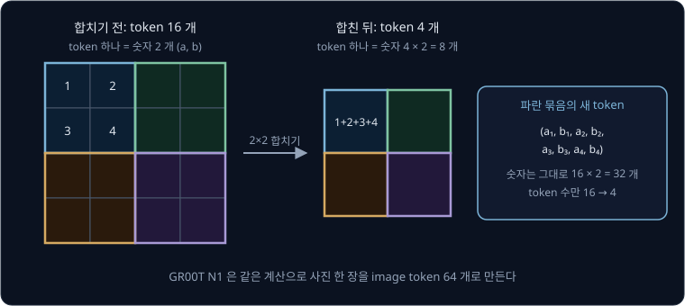

위 그림은 token 16 개를 4 개로 줄이는 작은 예이고, 숫자는 $16 \times 2 = 32$ 개에서 $4 \times 8 = 32$ 개로 그대로다. 언어 모델이 볼 token 이
줄면 attention 계산이 줄어 추론이 빨라진다. 카메라 두 대의 사진을 넣으면 GR00T N1 은 $2 \times 64 = 128$ 개를 넘기고, 장마다 256 개인
방식은 $2 \times 256 = 512$ 개를 넘긴다.

## cross-attention 으로 읽는 VLM 출력

[π0](../pi0/README.md) 는 사진·지시문 token 과 로봇 상태·action token 을 한 줄로 이어 같은 self-attention 에 넣고 attention mask 로 누가 누구를
볼지 정했다. 두 부분이 층마다 같은 attention 계산 안에서 만나므로 action expert 의 층 수가 VLM 과 같아야 했다.

GR00T N1 의 diffusion transformer 는 [Transformer](../transformer/README.md) 의 decoder 에서 본 cross-attention 으로 VLM 출력을 읽는다. query 는
action·상태 token 에서 만들고 key 와 value 는 VLM 출력 $\phi_t$ 에서 만든다. diffusion transformer 는 아래 두 종류의 block 을 번갈아 쌓는다.

- cross-attention block 에서는 action·상태 token 이 $\phi_t$ 를 보고 필요한 내용을 가져온다. VLM 쪽은 action 을 보지 않는다
- self-attention block 에서는 로봇 상태 token 과 noise 가 섞인 action token 16 개가 서로를 보며 덩어리 안의 action 들을 서로 이어지게 맞춘다

| | π0 | GR00T N1 |
| --- | --- | --- |
| VLM 과 만나는 곳 | 같은 self-attention 층 안 | 따로 둔 cross-attention block |
| 읽는 VLM 출력 | 층마다 그 층의 key·value | 12 번째 층 출력 $\phi_t$ 하나 |
| 두 부분의 층 수 | 같아야 한다 | 맞출 필요가 없다 |
| VLM 이 action 을 보는지 | attention mask 로 막는다 | 볼 연결이 없다 |

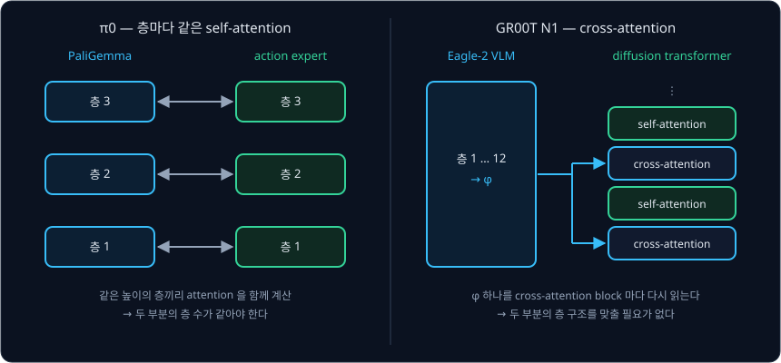

저자들은 이 방식이 VLM 과 action 모델의 구조를 서로 맞출 필요가 없어 둘을 바꿔 끼우기 쉽다고 적었고, 실제로 뒤의 N1.6 과 N1.7 은 VLM 을
다른 모델로 바꿨다. diffusion transformer 의 층 수는 논문에 없지만, 공개한 GR00T-N1-2B 의 설정 파일에는 16 층(`num_layers: 16`)으로 적혀 있다.

noise 를 얼마나 걷어 냈는지를 나타내는 시각 $\tau$ 는 두 번 들어간다. action encoder 가 π0 처럼 $\tau$ 를 noise 섞인 action 과 함께 받고,
이미지 생성용 DiT(Diffusion Transformer)에서 가져온 **adaptive layer norm** 이 층마다 $\tau$ 로 숫자의 크기를 다시 조절한다. 같은 값이라도
$\tau$ 에 따라 알맞은 속도가 달라서, 층마다 $\tau$ 를 넣어 모든 층이 noise 를 얼마나 걷어 낸 단계인지 알게 한다.

<b>심화: adaptive layer norm 의 계산</b>

LayerNorm 은 token 하나의 숫자들을 평균 0, 표준편차 1 로 맞춘 뒤 학습되는 두 숫자 $\gamma$(곱하는 수)와 $\beta$(더하는 수)로 다시 조절하는
층이다. adaptive layer norm 은 $\gamma$ 와 $\beta$ 를 고정된 숫자로 두지 않고, $\tau$ 를 넣은 작은 network 가 그때그때 만든다.

$$
\mathrm{adaLN}(x, \tau) = \gamma(\tau) \times \mathrm{LN}(x) + \beta(\tau)
$$

$\mathrm{LN}(x)$ 는 LayerNorm 으로 맞춘 숫자이고, $\gamma(\tau)$ 와 $\beta(\tau)$ 는 $\tau$ 를 넣어 만든 $\gamma$ 와 $\beta$ 다. 맞춘 숫자가
$(1,\ -1)$ 일 때 작은 network 가 아래처럼 냈다고 하자. $\gamma$ 와 $\beta$ 의 값은 계산을 보이려고 정한 예다.

| $\tau$ | $\gamma$ | $\beta$ | $\gamma \times (1,\ -1) + \beta$ |
| --- | --- | --- | --- |
| 0.25 (noise 가 많다) | 1.5 | 0.2 | $(1.5 + 0.2,\ -1.5 + 0.2) = (1.7,\ -1.3)$ |
| 0.75 (거의 다 걷어 냈다) | 0.5 | $-0.1$ | $(0.5 - 0.1,\ -0.5 - 0.1) = (0.4,\ -0.6)$ |

같은 입력 $(1,\ -1)$ 이 $\tau$ 에 따라 다른 값이 되어 다음 계산으로 넘어간다. 맞춘 숫자가 $(2,\ 0)$ 이고 $\gamma = 0.5$, $\beta = 1$ 이면
$0.5 \times (2,\ 0) + 1 = (2,\ 1)$ 이다.

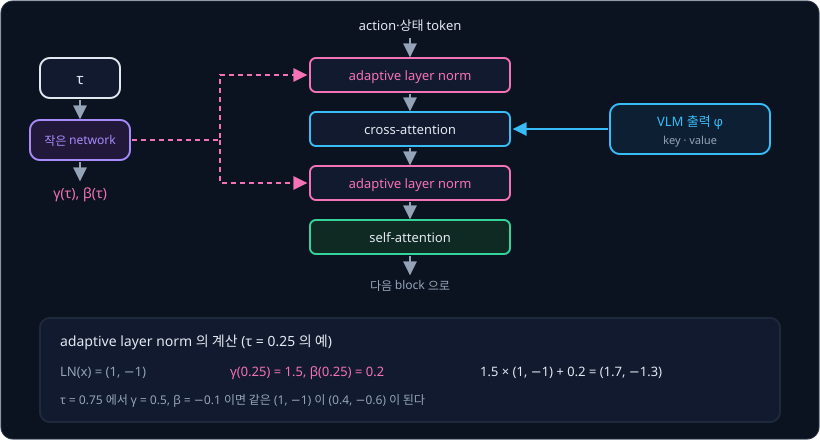

**확인 문제.** cross-attention block 에서 action token 하나가 VLM token 세 개를 본다. attention weight 가 0.5, 0.3, 0.2 이고 value 가 6, 2, 1 이면
가져오는 값은 얼마일까?

답 보기

weight 대로 value 를 섞는다.

$$
0.5 \times 6 + 0.3 \times 2 + 0.2 \times 1 = 3 + 0.6 + 0.2 = 3.8
$$

답: 3.8 이다. query 를 action token 에서 만들고 key 와 value 를 VLM 출력에서 만든다는 것만 self-attention 과 다르고 섞는 계산은 같다.

## 로봇마다 다른 encoder 와 decoder

로봇마다 상태와 action 의 숫자 개수가 다르다. SO-101 팔은 관절 5 개와 집게 하나라서 6 개이고, 두 팔과 두 손에 허리·목까지 움직이는 GR-1 은
훨씬 많다. transformer 는 모든 token 의 길이가 같아야 하므로 길이를 맞추는 방법이 필요하다.

GR00T N1 은 로봇마다 작은 MLP 를 하나씩 둬서, 그 로봇의 숫자를 공통 길이의 token 으로 바꾼다. 상태를 바꾸는 state encoder, noise 가 섞인 action 을 바꾸는 action encoder, 마지막 출력을 그 로봇의 숫자로 되돌리는 action decoder
가 로봇마다 하나씩 있고, 논문은 이것을 embodiment-specific(몸마다 따로 둔) encoder·decoder 라고 불렀다.

아래 표의 공통 길이 4 와 팔 둘 로봇의 숫자 14 개는 계산을 보이려고 정한 값이다. encoder 가 층 하나짜리 Linear layer 라면 입력 수가 $n$ 일 때
parameter 는 입력 수 × 출력 수에 bias 4 개를 더한 $n \times 4 + 4$ 개다.

| 로봇 | 상태 숫자 수 | 자기 state encoder | encoder parameter | 나오는 token 길이 |
| --- | --- | --- | --- | --- |
| SO-101 (관절 5 + 집게 1) | 6 | Linear $6 \to 4$ | $6 \times 4 + 4 = 28$ | 4 |
| 팔 둘 로봇 (관절 12 + 집게 2, 예) | 14 | Linear $14 \to 4$ | $14 \times 4 + 4 = 60$ | 4 |

길이가 6 과 14 로 다른 숫자가 각자의 encoder 를 지나면 둘 다 길이 4 의 token 이 되어 같은 diffusion transformer 에 들어가고, 나올 때는 각자의
action decoder 가 다시 6 개 또는 14 개의 숫자로 되돌린다.

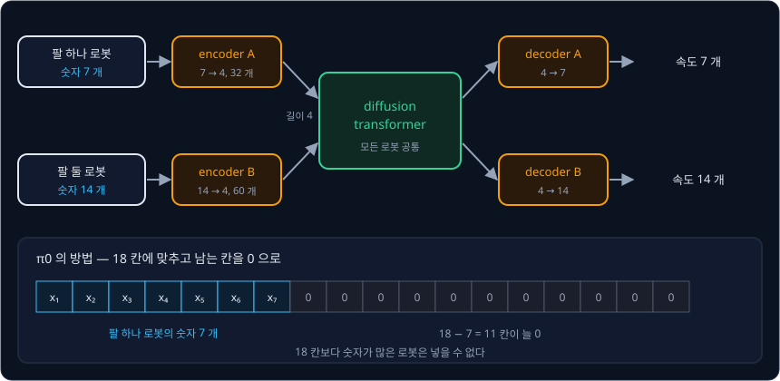

공개 구현에는 0 을 채우는 단계도 있다. 상태는 64 칸까지 0 을 채우고 action 은 32 칸까지 0 을 채운 뒤, 로봇 번호(embodiment id)마다
따로 둔 weight 묶음 가운데 그 로봇의 것을 골라 곱한다. loss 는 0 을 채운 칸을 빼고 잰다. 논문 부록에 따르면 숫자의 범위도 로봇마다 최솟값과 최댓값으로 맞춘다
(min-max normalization).

| | π0 | GR00T N1 공개 구현 |
| --- | --- | --- |
| 길이 맞추기 | 상태·action 모두 18 칸 (남는 칸은 0) | 상태 64 칸 · action 32 칸 (남는 칸은 0) |
| 칸에 곱하는 weight | 모든 로봇이 같은 weight | 로봇 번호마다 다른 weight (최대 32 대) |
| 새 로봇 | 같은 weight 로 그대로 학습 | 비어 있는 번호의 weight 를 새로 학습 |

LeRobot 의 GR00T 문서는 SO-101 처럼 pretraining 에 없던 로봇에 `new_embodiment` 번호를 쓰도록 안내한다.

> **오해** 로봇마다 encoder 가 따로 있으니 로봇마다 모델을 따로 학습한다.
>
> **사실** 따로 있는 것은 입력과 출력 쪽의 작은 MLP 뿐이고, 22 억 parameter 의 대부분인 VLM 과 diffusion transformer 는 모든 로봇의 데이터로 함께 학습한다.

**확인 문제.** 상태 숫자가 20 개인 로봇을 새로 붙인다. 위 예처럼 공통 길이 4 의 Linear layer 하나로 state encoder 를 만들면 parameter 는 몇
개이고, π0 처럼 18 칸으로 맞추는 방법에서는 무엇이 문제일까?

답 보기

① parameter 는 입력 수 × 출력 수 + bias 다.

$$
20 \times 4 + 4 = 84
$$

② 숫자 20 개는 18 칸에 들어가지 않는다.

답: 84 개다. 18 칸 방식은 칸 수를 늘리고 다시 학습해야 하지만, GR00T N1 공개 구현의 상태 64 칸에는 20 개가 들어가고 빈 로봇 번호의 weight
만 새로 학습하면 된다.

## flow matching 으로 만드는 action chunk

GR00T N1 도 π0 처럼 [Flow Matching](../flow-matching/README.md) 으로 action 을 만든다. 아래 식에서 $A_t$ 는 시연의 action
덩어리이고, $\epsilon$ 은 noise 이며, $\tau$ 는 섞는 시각이다. 세 식은 위에서부터 섞은 점, 학습의 loss, 만들 때의 Euler step 이다.

$$
A_t^\tau = \tau\,A_t + (1 - \tau)\,\epsilon
$$

$$
L = \big\lVert V_\theta(\phi_t,\ A_t^\tau,\ q_t) - (A_t - \epsilon) \big\rVert^2
$$

$$
A_t^{\tau + 1/K} = A_t^\tau + \frac{1}{K}\,V_\theta(\phi_t,\ A_t^\tau,\ q_t)
$$

첫 식은 시연 덩어리에 $\tau$ 를 곱한 값과 noise 에 $1 - \tau$ 를 곱한 값을 더한 점이라서, $\tau = 0$ 이면 noise 이고 $\tau = 1$ 이면 시연이다. 둘째 식의 $V_\theta$ 는
weight 가 $\theta$ 인 diffusion transformer 가 낸 속도이고, 이 속도와 정답 속도 $A_t - \epsilon$ 의 차이를 성분마다 제곱해 더한 값이 loss 다.
셋째 식은 지금 값에 속도의 $\frac{1}{K}$ 배를 더해 한 step 나아가는 Euler step 이고, $K$ 는 step 의 개수다.

| | π0 | GR00T N1 |
| --- | --- | --- |
| 덩어리 길이 $H$ | 50 | 16 |
| Euler step 수 | 10 (한 step 길이 0.1) | $K = 4$ (한 step 길이 $\frac{1}{4} = 0.25$) |
| 속도를 내는 부분 | action expert | diffusion transformer $V_\theta$ |
| 학습에서 $\tau$ 를 뽑는 분포 | noise 쪽을 더 자주 뽑는 beta 분포 | π0 와 같은 분포 |

논문에 따르면 $K = 4$ 로 실험한 모든 로봇에서 잘 동작했다.

> **오해** 논문의 식 (1) 대로 정답 속도는 $\epsilon - A_t$ 다.
>
> **사실** 같은 논문의 Euler 식은 $\tau = 0$ 의 noise 에서 출발해 $+\frac{1}{K} V_\theta$ 를 더해 가므로, 시연 쪽으로 가려면 속도가 $A_t - \epsilon$ 이어야 한다. 섞는 식에서 $\tau$ 가
> 1 늘 때 $A_t^\tau$ 가 변하는 양도 $A_t - \epsilon$ 이고 공개 구현의 학습 코드도 정답 속도를 `actions - noise` 로 계산하니, 다른 구현을 읽을 때는 noise 가 $\tau = 0$ 쪽인지 1 쪽인지부터
> 확인한다.

<b>심화: Euler 4 step 의 손 계산</b>

덩어리의 숫자를 다 적을 수는 없으니 두 칸만 떼어 계산한다. 첫째 칸은 step $t$ 의 관절 1 이고 둘째 칸은 step $t + 1$ 의 관절 1 이다.
예로 든 시연 값은 $A = (1.0,\ -0.5)$ 이고, 뽑은 noise 는 $\epsilon = (-1.0,\ 0.5)$ 다. 학습이 잘 된 $V_\theta$ 가 정답 속도를 그대로 낸다고 하면
속도는 $A - \epsilon = (1.0 - (-1.0),\ -0.5 - 0.5) = (2.0,\ -1.0)$ 이고, 한 step 의 길이가 0.25 라서 step 마다
$0.25 \times (2.0,\ -1.0) = (0.5,\ -0.25)$ 씩 움직인다.

| step | $\tau$ | 지금 값 | 속도 $V$ | $0.25 \times V$ | 새 값 |
| --- | --- | --- | --- | --- | --- |
| 1 | 0 | $(-1.0,\ 0.5)$ | $(2.0,\ -1.0)$ | $(0.5,\ -0.25)$ | $(-0.5,\ 0.25)$ |
| 2 | 0.25 | $(-0.5,\ 0.25)$ | $(2.0,\ -1.0)$ | $(0.5,\ -0.25)$ | $(0,\ 0)$ |
| 3 | 0.5 | $(0,\ 0)$ | $(2.0,\ -1.0)$ | $(0.5,\ -0.25)$ | $(0.5,\ -0.25)$ |
| 4 | 0.75 | $(0.5,\ -0.25)$ | $(2.0,\ -1.0)$ | $(0.5,\ -0.25)$ | $(1.0,\ -0.5)$ |

4 step 뒤에 시연 값 $(1.0,\ -0.5)$ 에 정확히 닿는다. 3 번째 step 이 시작할 때의 값 $(0,\ 0)$ 은 섞는 식에 $\tau = 0.5$ 를 넣은
$0.5 \times (1.0,\ -0.5) + 0.5 \times (-1.0,\ 0.5) = (0,\ 0)$ 과 같다.

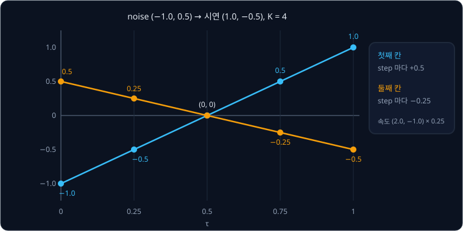

정답이 하나뿐인 이 예에서는 속도가 줄곧 같아서 4 step 으로도 정확히 닿았다. 정답이 여럿으로 갈리는 장면에서는 step 수가 너무 적으면 두 정답의
평균 쪽으로 끌릴 수 있지만, 저자들은 실험해 보고 4 step 이면 충분하다고 판단했다.

**확인 문제.** $\epsilon = (2.0,\ 0)$, $A = (0,\ 1.0)$ 이고 network 가 정답 속도를 낸다. Euler 4 step 중 2 step 뒤의 값은?

답 보기

① 속도는 $A - \epsilon$ 이다.

$$
(0 - 2.0,\ 1.0 - 0) = (-2.0,\ 1.0)
$$

② step 마다 $0.25 \times (-2.0,\ 1.0) = (-0.5,\ 0.25)$ 씩 움직인다.

| step | 지금 값 | 더하는 양 | 새 값 |
| --- | --- | --- | --- |
| 1 | $(2.0,\ 0)$ | $(-0.5,\ 0.25)$ | $(1.5,\ 0.25)$ |
| 2 | $(1.5,\ 0.25)$ | $(-0.5,\ 0.25)$ | $(1.0,\ 0.5)$ |

답: $(1.0,\ 0.5)$ 다. 섞는 식에 $\tau = 0.5$ 를 넣은 $0.5 \times (0,\ 1.0) + 0.5 \times (2.0,\ 0) = (1.0,\ 0.5)$ 와 같다.

## 덩어리 실행과 추론 시간

덩어리 길이 $H = 16$ 은 [ACT](../act/README.md) 에서 본 action chunking 을 따른 것으로, 로봇 step $t$ 에서 앞으로의 action 16 개
$A_t = [a_t,\ a_{t+1},\ \ldots,\ a_{t+15}]$ 를 한꺼번에 만든다. 이 16 개가 몇 초 분량인지는 로봇이 1 초에 명령을 몇 번 새로 보내는지에 달려 있다.

| 로봇의 제어 주기 | action 하나의 시간 | 덩어리 16 개 | 앞 8 개만 실행할 때 |
| --- | --- | --- | --- |
| 20 Hz | $1 \div 20 = 0.05$ 초 | $16 \times 0.05 = 0.8$ 초 | $8 \times 0.05 = 0.4$ 초 |
| 30 Hz | $1 \div 30 \approx 0.033$ 초 | $16 \div 30 \approx 0.53$ 초 | $8 \div 30 \approx 0.27$ 초 |

공개 구현은 덩어리의 앞부분만 실행한 뒤 새 사진으로 다음 덩어리를 만든다. N1.6 의 예시 명령은 16 개 가운데 8 개를 실행하고, 덩어리가 40 개로
늘어난 N1.7 의 예시 명령도 8 개를 실행한다. 실행하는 개수가 적을수록 새 사진을 자주 보지만, 그 시간 안에 다음 덩어리의 계산이 끝나야 로봇이
멈추지 않는다.

N1.6 의 공개 구현 설명에는 denoising 4 step, 카메라 한 대 기준으로 덩어리 하나를 만드는 시간이 기기별로 적혀 있다.

| 기기 | VLM 계산 | action 계산 | 전체 |
| --- | --- | --- | --- |
| H100 | 23 ms | 11 ms | 38 ms |
| RTX 4090 | 25 ms | 17 ms | 44 ms |
| Jetson AGX Thor (로봇에 싣는 컴퓨터) | 39 ms | 61 ms | 105 ms |

전체 시간에는 데이터를 준비하는 몇 ms 가 더 들어 있다. 30 Hz 로봇이 앞 8 개를 실행하는 약 267 ms 동안 Thor 는 105 ms 만에 다음 덩어리를 끝내지만,
앞 2 개만 실행하면 $2 \div 30 \approx 67$ ms 안에 끝나지 않는다.

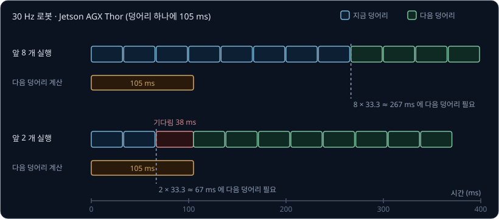

**확인 문제.** RTX 4090(덩어리 하나에 44 ms)으로 20 Hz 로봇을 움직이며, 실행하는 동안 다음 덩어리를 계산한다. 덩어리마다 몇 개까지 줄여
실행해도 계산이 제때 끝날까?

답 보기

① 20 Hz 에서 action 하나는 $1000 \div 20 = 50$ ms 다.

② 실행하는 시간이 44 ms 보다 길어야 한다.

③ 하나만 실행해도 $1 \times 50 = 50$ ms 로 44 ms 보다 길다.

답: action 하나만 실행하고 다시 만들어도 계산이 제때 끝난다. 같은 기기라도 30 Hz 로봇에서는 하나가 약 33 ms 라서 둘 이상($2 \times 1000 \div 30 \approx 67$ ms)을
실행해야 한다.

## action 이 없는 데이터

flow matching 의 loss 는 정답 action 덩어리 $A_t$ 가 있어야 계산되는데, data pyramid 의 바닥인 사람 영상과 가운데의 생성 영상에는 관절 값이
적혀 있지 않다. GR00T N1 은 두 가지 방법으로 영상에 action 비슷한 숫자를 붙여 정답으로 쓴다.

### latent action

첫째 방법은 LAPA(Latent Action Pretraining) 연구에서 가져온 **latent action** 이다. latent 는 '겉으로 드러나지 않은' 이라는 뜻인데, 여기서는
사람이 정한 관절 값이 아니라 모델이 영상에서 찾은 숫자를 가리킨다. latent action 은 영상의 두 장면으로 학습한 autoencoder 에서 나온다.

- encoder 는 지금 장면 $x_t$ 와 $H$ step 뒤의 장면 $x_{t+H}$ 를 함께 보고 숫자 묶음 $z_t$ 를 낸다
- decoder 는 지금 장면 $x_t$ 와 $z_t$ 만 보고 $H$ step 뒤의 장면 $x_{t+H}$ 를 되살린다

decoder 가 지금 장면을 이미 받았으므로, 학습하면 $z_t$ 에는 두 장면 사이의 움직임이 담긴다. 다만 $z_t$ 에 제한이 없으면 encoder
가 미래 장면 전체를 $z_t$ 에 담아 넘길 수도 있어서, [VAE](../vae/README.md) 를 바꾼 VQ-VAE(vector quantized VAE)로 $z_t$ 가 가질 수 있는 값을
제한한다. VQ-VAE 는 미리 정한 개수의 vector 를 담은 표인 codebook 을 두고, encoder 가 낸 숫자 묶음을 codebook 에서 가장 가까운 vector 로 바꿔
decoder 에 넘긴다.

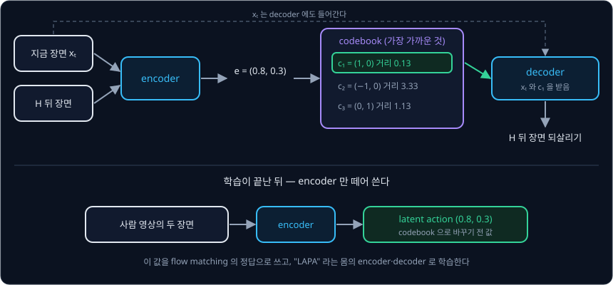

위 그림의 예에서 encoder 가 $e = (0.8,\ 0.3)$ 을 내면, codebook 의 세 vector 가운데 거리가 0.13 으로 가장 가까운 $c_1 = (1,\ 0)$ 이 decoder 로
간다. 학습이 끝나면 encoder 만 떼어 쓰는데, 영상의 두 장면을 넣고 codebook 으로 바꾸기 전의 숫자 $e$ 를 그 구간의 latent action 으로 삼는다.
저자들은 사람 영상과 로봇 영상을 모두 섞어 VQ-VAE 를 학습했다. 논문의 그림 4 에는 사람과 로봇 8 가지 몸이 "오른팔을 왼쪽으로" 움직이는
장면이 비슷한 latent action 으로 묶인 예가 있다.

<b>심화: codebook 에서 가장 가까운 vector 찾기</b>

가까운 정도는 성분마다 차이를 제곱해 더한 값으로 잰다. 아래 codebook vector 와 그 뜻은 계산을 보이려고 정한 예다.

| codebook vector | 뜻(예) | $e = (0.8,\ 0.3)$ 과의 거리 |
| --- | --- | --- |
| $c_1 = (1,\ 0)$ | 손이 오른쪽으로 | $(0.8 - 1)^2 + (0.3 - 0)^2 = 0.04 + 0.09 = 0.13$ |
| $c_2 = (-1,\ 0)$ | 손이 왼쪽으로 | $(0.8 + 1)^2 + (0.3 - 0)^2 = 3.24 + 0.09 = 3.33$ |
| $c_3 = (0,\ 1)$ | 손이 위로 | $(0.8 - 0)^2 + (0.3 - 1)^2 = 0.64 + 0.49 = 1.13$ |

encoder 가 $e = (-0.6,\ 0.6)$ 을 내면 $c_1$ 까지의 거리는 $(-1.6)^2 + 0.6^2 = 2.92$ 이고, $c_2$ 까지는 $0.4^2 + 0.6^2 = 0.52$ 이며,
$c_3$ 까지도 $0.6^2 + (-0.4)^2 = 0.52$ 다. 이렇게 거리가 같으면 실제 구현은 정해 둔 규칙(예: 먼저 나온 번호)으로 하나를 고른다.

GR00T N1 은 latent action 을 flow matching 의 정답 $A_t$ 처럼 쓰되, "LAPA" 라는 몸 하나로 취급해 자기 encoder·decoder 를 따로 둔다. latent
action 은 영상의 움직임을 요약한 숫자일 뿐 어느 로봇의 관절 값도 아니라서, 실제 로봇의 action 은 그 로봇의 데이터로 학습한 decoder 가 낸다.

### inverse dynamics model

둘째 방법은 실물 로봇 데이터로 학습한 **inverse dynamics model**(IDM)이다. 지금 상태와 action 을 받아 다음 상태를 맞히는 모델을 dynamics
model 이라고 하는데, IDM 은 반대로 지금 장면과 나중 장면을 받아 그사이의 action 을 맞힌다. 논문 부록에 따르면 저자들은 System 1 과 같은
diffusion transformer 에 SigLIP-2 image encoder 를 붙인 IDM 을 flow matching 으로 학습했다. 실물 데이터에는 장면과 action 이 함께 있어
IDM 에 정답을 줄 수 있다. 학습한 IDM 을 action 이 없는 영상에 대면 두 장면 사이에 들어갈 그럴듯한 action 이 나오는데, 이것을 pseudo-action
이라고 한다.

| | latent action | IDM pseudo-action |
| --- | --- | --- |
| 학습에 필요한 것 | 영상만 | 장면과 action 이 함께 있는 로봇 데이터 |
| 나오는 숫자 | 어느 로봇의 action 도 아닌 움직임 요약 | 그 로봇의 action 형식 |
| 붙이는 데이터 | 사람 영상, 생성 영상, 로봇 영상 | 생성한 로봇 영상 |

저자들은 RoboCasa simulation 에서 두 방법을 비교했다. 작업마다 시연이 30 개일 때는 latent action 이 조금 나았고, 100 개와 300 개로 늘면 IDM
이 더 나았다. 저자들은 IDM 을 학습할 로봇 데이터가 많을수록 pseudo-action 이 실제 action 에 가까워지기 때문이라고 설명했다.

**확인 문제.** 사람이 컵을 옮기는 영상에 GR-1 로봇 데이터로 학습한 IDM 을 대면 어떤 문제가 생길 수 있을까?

답 보기

IDM 이 학습 때 본 것은 GR-1 의 몸이 찍힌 장면과 그 action 뿐이라서, 사람 손이 찍힌 장면에는 엉뚱한 action 을 낼 수 있다.
GR00T N1 도 사람 영상에는 latent action 만 붙이고, IDM 은 로봇이 찍힌 생성 영상에 썼다.

## 만든 데이터

### neural trajectory 와 DreamGen

data pyramid 의 가운데 층을 이루는 데이터 하나는 영상 생성 모델로 만든 로봇 영상이고, 논문은 이것을 **neural trajectory**(neural network 가 만든
기록)라고 불렀다. 저자들은 사진 한 장과 지시문을 받아 그다음 영상을 만드는 image-to-video 모델을 GR-1 조종 데이터 88 시간으로 fine-tuning
한 뒤, 기록의 첫 장면과 새 지시문을 넣어 실제로 찍지 않은 경우의 영상을 만들었다. 논문 부록에 따르면 영상 모델로는 WAN2.1-I2V-14B 를 LoRA 로
fine-tuning 해서 썼다.

| 단계 | 하는 일 |
| --- | --- |
| ① 지시문 늘리기 | multimodal LLM 이 첫 장면의 물체를 찾고, 물리적으로 가능한 "pick up {물체} from {A} to {B}" 조합을 만든다 |
| ② 영상 만들기 | fine-tuning 한 image-to-video 모델이 첫 장면과 새 지시문으로 영상을 만든다 |
| ③ 걸러 내기 | multimodal LLM 이 영상에서 뽑은 8 장을 보고 지시문대로 했는지 판정해 맞지 않는 영상을 거른다 |
| ④ action 붙이기 | 남은 영상에 latent action 과 IDM pseudo-action 을 붙인다 |

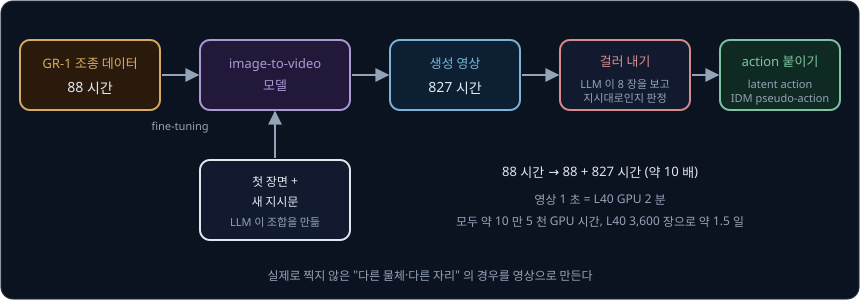

생성 영상 827 시간을 만드는 데는 영상 1 초마다 L40 GPU 로 2 분씩 걸려서 모두 약 10 만 5 천 GPU 시간이 들었고, 저자들은 L40 3,600 장으로
약 1.5 일에 만들었다.

같은 연구진은 이 과정을 따로 정리한 DreamGen 을 2025 년 5 월에 발표했다. DreamGen 은 영상 모델 fine-tuning → 영상 생성 →
pseudo-action 붙이기 → policy 학습의 4 단계로 이루어진다. DreamGen 논문에 따르면 pick-and-place 시연만으로 학습한
GR00T N1 은 새 동작 14 가지의 평균 성공률이 11.2% 였고 처음 보는 환경의 작업 13 가지에서는 0% 였는데, DreamGen 이 만든 영상으로 학습하자
각각 43.2% 와 28.5% 가 됐다. SO-100 팔의 작업 둘에서는 작업마다 실물 시연 10 ~ 13 개에 생성 영상을 더하자 평균 성공률이 21% 에서 45.5% 로
올랐다.

**확인 문제.** 827 시간은 88 시간의 몇 배일까? 영상 1 초에 GPU 2 분이 걸린다면, 영상 827 시간을 만드는 데는 GPU 몇 시간이 걸릴까?

답 보기

① 배수는 $827 \div 88 \approx 9.4$ 다.

② 영상 1 시간은 3600 초이고 1 초마다 2 분이다.

$$
3600 \times 2 = 7200 \text{ 분} = 120 \text{ 시간}
$$

③ 827 시간이면 $827 \times 120 = 99{,}240$ GPU 시간이다.

답: 약 9.4 배이고, 약 10 만 GPU 시간이다. 논문이 적은 약 10 만 5 천 시간과 크기가 비슷하다.

### DexMimicGen 으로 늘린 simulation 시연

가운데 층의 다른 하나는 simulation 기록이다. 저자들은 DexMimicGen 으로 사람이 simulation 안에서 조종한 시연 수십 개를 수십만 개로 늘렸다.

1. 사람의 시연을 물체 하나씩을 다루는 작은 구간("사과를 집는다", "접시 위에 놓는다")으로 나눈다
2. 새 환경에서 물체가 놓인 위치에 맞춰 구간을 옮긴다. 손끝과 물체의 상대 위치는 그대로 두므로, 사과가 10 cm 오른쪽에 있으면 집는 동작 전체가
   10 cm 오른쪽으로 옮겨 간다
3. 지금 자세에서 옮긴 구간의 시작까지는 그 사이를 이어 주는 움직임을 끼워 넣는다
4. simulation 에서 끝까지 실행해 작업에 성공한 기록만 남긴다

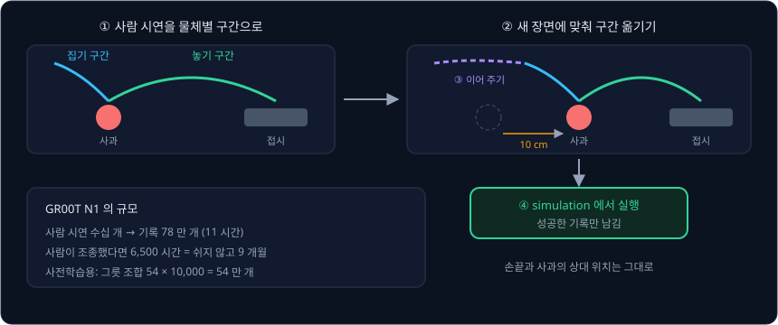

DexMimicGen 의 저자들은 사람 시연 60 개로 기록 21,000 개를 만들었다. GR00T N1 의 저자들은 pretraining 과 post-training 용을 합쳐 simulation
기록 78 만 개를 11 시간 만에 만들었는데, 논문에 따르면 사람이 조종했다면 6,500 시간, 쉬지 않고 9 개월이 걸렸을 양이다. pretraining 용으로는 출발
그릇과 도착 그릇 종류의 조합 54 가지마다 10,000 개씩 54 만 개를 만들었다.

## pretraining 과 post-training

pretraining 에서는 data pyramid 의 세 층을 모두 섞어 flow matching loss 로 학습하는데, 데이터마다 정답으로 쓰는 값이 다르다.

| 데이터 | flow matching 의 정답 |
| --- | --- |
| 사람 영상 | latent action |
| GR-1·Open X-Embodiment 같은 로봇 데이터 | 실제 action 과 latent action 둘 다 |
| 생성한 로봇 영상 | latent action 과 IDM pseudo-action |
| simulation 기록 | 실제 action |

post-training 은 로봇 하나의 데이터로 한다. 논문의 부록 표 6 에 따르면 두 단계는 대부분의 설정이 같고, post-training 에서는 한 step 에 묶는
예시 수(batch size)와 step 수가 훨씬 작다.

| | pretraining | post-training |
| --- | --- | --- |
| 데이터 | 세 층을 모두 섞음 | 로봇 하나 |
| batch size | 16,384 | 128 또는 1,024 |
| step 수 | 200,000 | 20,000 ~ 60,000 |
| 얼려 두는 부분 | VLM 의 언어 모델 | VLM 의 언어 모델 |

pretraining 에는 H100 GPU 를 최대 1,024 장까지 써서 GPU 시간이 약 5 만 시간 들었지만, post-training 은 GPU 한 장(A6000)으로도 할 수 있다.
저자들에 따르면 로봇별 encoder·decoder 와 diffusion transformer 만 학습하면 batch size 를 200 까지 쓸 수 있었고, image encoder 까지 학습하면 16 까지 쓸 수 있었다.

<b>심화: 물체 위치를 맞히는 보조 loss</b>

부록에 따르면 학습에는 flow matching loss 말고 loss 가 하나 더 있다. 물체 검출 모델 OWL-v2 로 지시문이 가리키는 물체의 상자를 frame 마다
표시하고, 상자 가운데의 좌표를 사진의 가로·세로 길이로 나눠 0 ~ 1 사이의 정답 $x_{gt}$ 로 둔다. VLM 출력 위에 붙인 Linear layer 는 이 좌표를
$x_{pred}$ 로 맞히고, 전체 loss 는 두 loss 를 더한 값이다.

$$
L_{det} = \lVert x_{pred} - x_{gt} \rVert^2, \qquad L = L_{fm} + L_{det}
$$

예를 들어 $640 \times 480$ 사진에서 컵 상자의 가운데가 $(320,\ 120)$ 이면 정답은 $(320 \div 640,\ 120 \div 480) = (0.5,\ 0.25)$ 다. 지시문이
"컵" 을 말할 때 VLM 출력이 컵의 위치를 담도록 학습시키는 loss 다.

**확인 문제.** pretraining 한 step 에 예시 16,384 개, 모두 200,000 step 이면 학습에 쓴 예시는 모두 몇 개일까? 같은 예시가 여러 번 쓰여도 따로 센다.

답 보기

$$
16{,}384 \times 200{,}000 = 3{,}276{,}800{,}000
$$

답: 약 33 억 개다.

## 결과

저자들은 GR-1 실물 작업에서 GR00T N1 과, pretraining 없이 그 작업 데이터로만 처음부터 학습한 [Diffusion Policy](../diffusion-policy/README.md)
를 비교했다. 데이터는 작업마다 모은 시연 전체를 쓴 경우와 그중 10% 만 쓴 경우로 나눴고, 작업은 물건을 그릇에 옮기기, 물건을 서랍·상자에 넣고
닫기, 공장 물건 다루기, 두 로봇의 협동 네 종류다.

| 모델 | 데이터 10% | 데이터 전체 |
| --- | --- | --- |
| Diffusion Policy | 10.2% | 46.4% |
| GR00T-N1-2B | 42.6% | 76.8% |

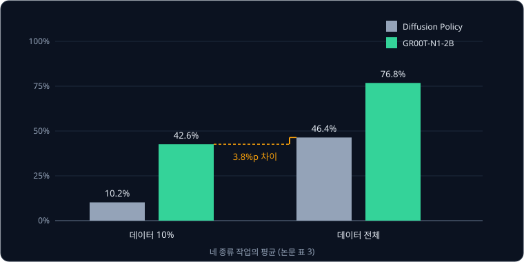

위 표는 논문 표 3 의 네 종류 작업 평균이다. GR00T N1 은 데이터 10% 만으로 42.6% 를 내서, 데이터 전체를 쓴 Diffusion Policy 의 46.4% 와
$46.4 - 42.6 = 3.8$%p 차이밖에 나지 않았다. %p(퍼센트포인트)는 두 % 값의 차이를 뺄셈으로 잰 단위다. simulation 세 곳에서도 작업마다 시연
100 개로 학습했을 때 Diffusion Policy 의 평균 성공률은 33.4% 였고 GR00T N1 은 45.0% 였다. 저자들은 post-training 데이터가 아주 많아지면
pretraining 의 효과가 줄어드는 것이 자연스럽다고도 적었다.

생성 영상을 post-training 에 실물 데이터와 1 : 1 로 섞자 GR-1 실물 작업 8 가지의 평균 성공률이 5.8%p 올랐다.

<b>심화: pretraining 만 마친 모델과 생성 영상의 효과</b>

post-training 없이 pretraining 만 마친 모델도 GR-1 에서 왼손으로 집어 오른손에 건네야 하는 작업에서 성공률 76.6%(15 번 중 11.5 번)를 냈고,
처음 보는 물체를 처음 보는 그릇에 넣는 작업에서는 73.3%(15 번 중 11 번)를 냈다. 물체를 집었지만 그릇에 넣지 못하면 0.5 번으로 셌다.

생성 영상을 post-training 에 섞은 효과는 아래와 같다. RoboCasa 에서는 latent action 과 IDM pseudo-action 을 모두 써 봤고, 실물에서는 IDM
pseudo-action 만 썼다.

| 실험 | 작업당 실물 시연 | 성공률이 오른 폭(평균) |
| --- | --- | --- |
| RoboCasa | 30 개 | 4.2%p |
| RoboCasa | 100 개 | 8.8%p |
| RoboCasa | 300 개 | 6.8%p |
| GR-1 실물 8 가지 | 시연의 10% | 5.8%p |

post-training 을 하면 pretraining 에서 배운 행동이 사라지기도 한다. 저자들은 "빨간 사과를 집어 바구니에 넣어라" 를 시키면서 사과를 일부러
왼손 쪽에 두었다. pretraining 만 마친 모델은 움직임이 덜 매끄러워도 왼손으로 사과를 집어 오른손에 건넨 뒤 바구니에 넣었다. 반면 같은 작업으로
post-training 한 모델은 이 상황에서 실패했는데, post-training 데이터에서는 모두 오른손만 써서 손을 바꿔 건네는 장면이 없었다.

**확인 문제.** 데이터 10% 에서 전체로 늘렸을 때 성공률이 오른 폭은 두 모델이 각각 몇 %p 일까?

답 보기

| 모델 | 전체 − 10% |
| --- | --- |
| Diffusion Policy | $46.4 - 10.2 = 36.2$%p |
| GR00T-N1-2B | $76.8 - 42.6 = 34.2$%p |

답: 오른 폭은 비슷하지만 GR00T N1 은 출발점(10% 의 42.6%)이 이미 훨씬 높다. pretraining 의 효과는 데이터가 적을 때 크게 보인다.

## N1.5 이후의 변화

NVIDIA 는 GR00T N1 뒤에 N1.5, N1.6, N1.7 을 차례로 공개했다. VLM 과 flow matching diffusion transformer, 로봇별 encoder·decoder 라는 큰 틀은
그대로 두고 부분마다 바꿨다.

N1.5 연구 페이지에 따르면 N1.5 의 VLM 은 Eagle 2.5 에서 출발해 사진 속에서 지시문이 가리키는 물체를 찾는 능력(grounding)을 더 학습한
모델이고, pretraining 과 fine-tuning 내내 얼려 둔다. image encoder 와 언어 모델 사이의 MLP 연결부도 단순하게 바꿨다. flow matching loss 에는
미래 장면의 embedding(장면을 요약한 숫자 묶음)에 모델의 내부 숫자를 맞추게 하는 FLARE loss 를 더했고, pretraining 데이터에는 DreamGen 의
neural trajectory 를 넣었다. 실물 GR-1 에서 지시문대로 움직이는 비율
(language following)은 N1 의 46.6% 에서 93.3% 로 올랐고, 전체 성공률은 43.3% 에서 83.0% 로 올랐다.

N1.6 의 공개 구현 설명(n1d6 branch 의 README)에 따르면 VLM 은 NVIDIA 내부의 Cosmos-Reason-2B 변형으로 바뀌었고, diffusion transformer 는
N1.5 의 16 층에서 32 층으로 커졌다. VLM 뒤에 있던 4 층짜리 연결부는 없애고, 그 대신
pretraining 동안 VLM 의 맨 위 4 층을 학습하도록 풀었다. 또 대부분의 로봇에서 관절 각도나 손끝 위치의 절댓값 대신 지금 상태에서의 차이
(state-relative action)로 덩어리를 낸다. 예를 들어 지금 30° 인 관절을 32° 로 보내는 경우와 지금 50° 인 관절을 52° 로 보내는 경우는 같은 움직임인데, 절댓값으로는 32° 와 52° 라는
다른 숫자가 되고 state-relative 로는 둘 다 $+2°$ 가 된다.

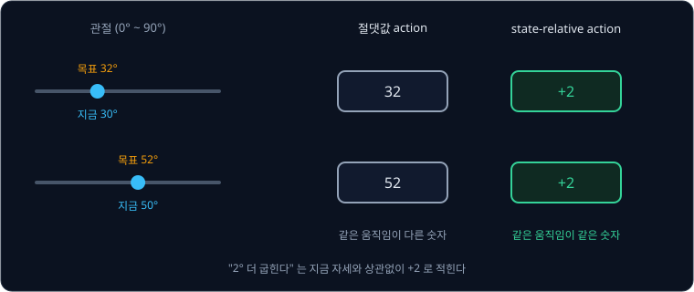

같은 움직임이 같은 숫자로 나타나므로, 자세가 조금 다른 상황에서 배운 움직임을 옮겨 쓰기 쉽다.

N1.7 의 공개 구현 설명(main branch 의 README)에 따르면 VLM 은 Qwen3-VL 구조의 Cosmos-Reason2-2B 로 바뀌었고 덩어리 길이는 40 으로 늘었다.
손끝(end-effector, EEF)의 위치와 방향도 지금
자세에서의 차이로 적는 relative EEF action 을 로봇과 사람에 같은 형식으로 쓰고, 사람 영상 데이터 EgoScale 2 만 시간을 pretraining 에 넣었다.

| 버전 | VLM | diffusion transformer | 덩어리 길이 | 바뀐 점 |
| --- | --- | --- | --- | --- |
| N1 | Eagle-2, 12 번째 층 출력 | 논문에 없음 (공개 설정 16 층) | 16 | data pyramid, latent action, 로봇별 MLP |
| N1.5 | Eagle 2.5 에서 출발, 얼림 | 16 층 | 16 | FLARE loss, 연결부 단순화 |
| N1.6 | Cosmos-Reason-2B 변형, 맨 위 4 층 학습 | 32 층 | 16 | state-relative action |
| N1.7 | Cosmos-Reason2-2B | 16 층 | 40 | relative EEF action, 사람 영상 2 만 시간 |

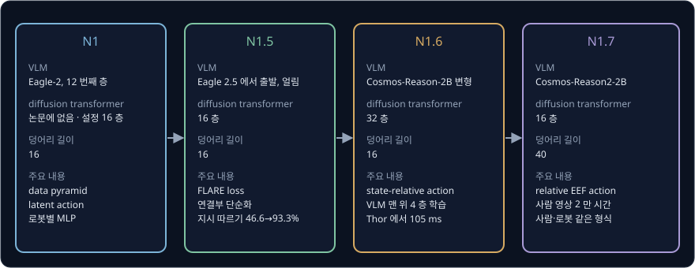

**확인 문제.** 30 Hz 로봇에서 덩어리 길이가 16 에서 40 으로 늘면, 덩어리 하나가 덮는 시간은 몇 초에서 몇 초가 될까?

답 보기

$16 \div 30 \approx 0.53$ 초에서 $40 \div 30 \approx 1.33$ 초가 된다. 덩어리 전체를 다 실행하지 않고 앞부분만 실행하는 것은 그대로다.

## 정리

- humanoid 조종 데이터는 사람이 한 건씩 모아야 해서 적고(GR-1 88 시간), GR00T N1 은 사람 영상(바닥), simulation 과 생성 영상(가운데),
  실물 로봇 데이터(꼭대기)를 data pyramid 로 쌓아 한 모델로 학습한다. action 이 없는 영상에는 VQ-VAE 로 만든 latent action 이나 IDM 의
  pseudo-action 을 붙인다
- Eagle-2 VLM(System 2, 13.4 억)의 12 번째 층 출력을 diffusion transformer(System 1)가 cross-attention 으로 읽고, 로봇마다 따로 둔
  encoder·decoder 가 숫자 개수가 다른 로봇을 공통 길이의 token 으로 바꾼다. 덩어리 16 개를 flow matching 4 step 으로 만들고, 정답 속도는
  $A_t - \epsilon$ 이다
- GR-1 실물 작업에서 데이터 10% 의 GR00T N1(42.6%)이 데이터 전체의 Diffusion Policy(46.4%)에 가까웠지만, post-training 데이터에 없는 행동
  (손 바꿔 건네기)은 post-training 뒤에 사라질 수 있다

GR00T 도 π0 처럼 시연과 만든 데이터를 따라 하도록 학습하므로, 직접 시도해 받은 reward 로 더 나아지지는 않는다. 성공 여부를 reward 로 삼아
VLA 를 더 학습하는 방법은 [VLA + RL](../vla-rl/README.md) 에서 다룬다. neural trajectory 를 만든 영상 생성 모델처럼 다음 장면을
예측하는 모델을 데이터 생성뿐 아니라 행동을 고르는 planning 에도 쓰는 방법은 [World Model](../world-model/README.md) 에서 다룬다.

## 참고 자료

- NVIDIA, [GR00T N1: An Open Foundation Model for Generalist Humanoid Robots](https://arxiv.org/abs/2503.14734) (2025) — 구조와 flow matching 식
  (2.1 절), latent action·neural trajectory·simulation 기록(2.2 절), 결과(4.4 절의 표 2·3), 학습 설정(부록 D), 데이터별 시간(표 7)을 본다
- S. Ye 외, [Latent Action Pretraining from Videos](https://arxiv.org/abs/2410.11758) (2024) — 두 장면 사이의 움직임을 VQ-VAE 로 latent action
  으로 만드는 LAPA
- Z. Jiang 외, [DexMimicGen](https://arxiv.org/abs/2410.24185) (2024) — 사람 시연 60 개를 물체별 구간으로 나눠 옮겨 21,000 개로 늘린 방법
- J. Jang 외, [DreamGen](https://arxiv.org/abs/2505.12705) (2025) — 영상 생성 모델로 neural trajectory 를 만드는 4 단계와 새 동작·새 환경 실험
- NVIDIA GEAR, [GR00T N1.5](https://research.nvidia.com/labs/gear/gr00t-n1_5/) — 얼린 VLM, FLARE, language following 46.6% → 93.3% 의 실물 결과
- NVIDIA, [Isaac-GR00T](https://github.com/NVIDIA/Isaac-GR00T) — 공식 구현. main 의 README 에서 N1.7 의 변화를,
  [n1d6 branch](https://github.com/NVIDIA/Isaac-GR00T/tree/n1d6) 의 README 에서 N1.6 의 변화와 기기별 추론 시간을 보고,
  [n1-release](https://github.com/NVIDIA/Isaac-GR00T/tree/n1-release) 의 `flow_matching_action_head.py` 에서 로봇별 weight 와 정답 속도 계산을 본다
- Hugging Face, [LeRobot GR00T 문서](https://github.com/huggingface/lerobot/blob/main/docs/source/groot.mdx) — GR00T N1.7 을 `groot` policy
  로 불러 SO-101 데이터로 fine-tuning 하는 명령
