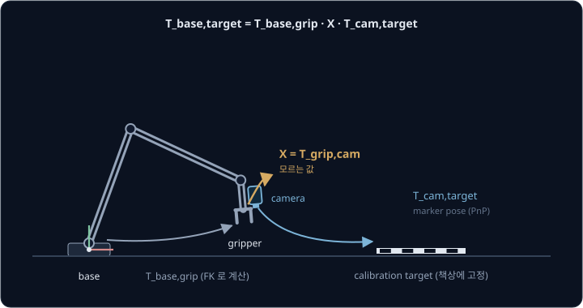
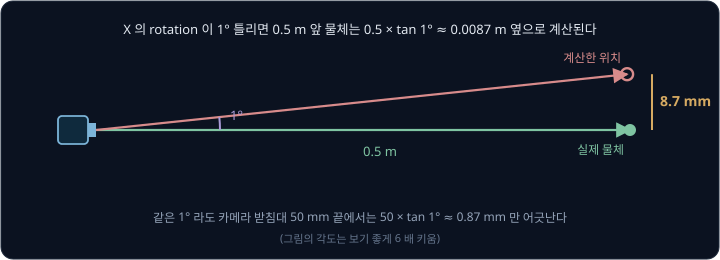
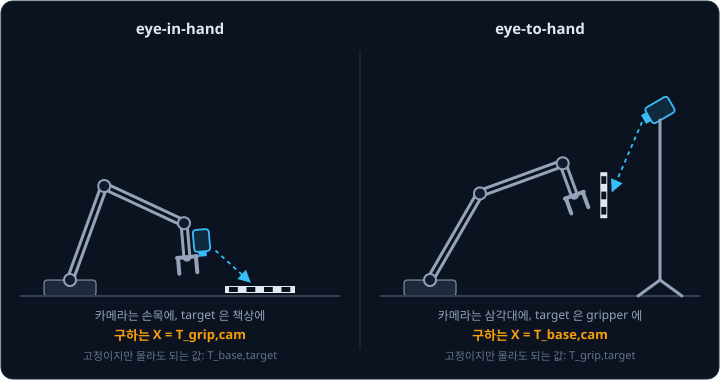
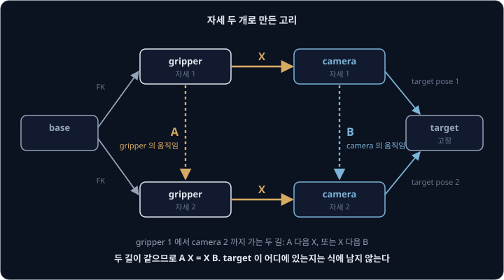
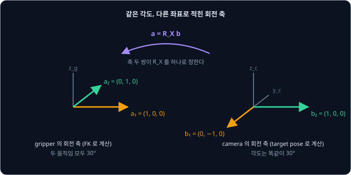
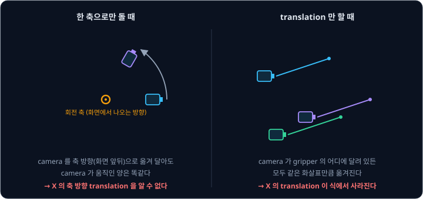
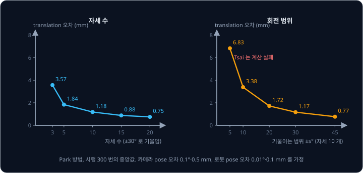
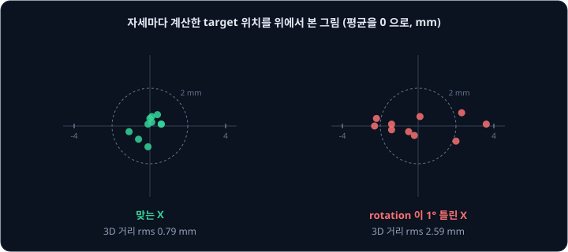

# Hand-Eye Calibration

손목에 단 카메라로 책상 위 marker 를 찍으면 camera frame 에서 잰 위치는 1 mm 안에서 맞고, 관절 각도로 계산한 gripper 위치도 1 mm
안에서 맞는다. 그런데 두 값을 이어 gripper 를 marker 자리로 보내면 손가락은 marker 에서 1 cm 가까이 옆에 내려앉는다. 카메라도 맞고 관절
계산도 맞는데, 1 cm 는 어디서 생긴 걸까?

틀린 곳은 두 계산을 잇는 값인 gripper 에서 본 카메라의 pose 다. 렌즈 중심은 카메라 몸체 안쪽에 있어서 자로 잴 수 없기 때문에, 고정해 둔
marker 를 여러 자세에서 찍고 그때마다 관절 각도로 구한 gripper pose 와 맞춰 보며 이 값을 계산한다. 이 일을 **hand-eye calibration** 이라고
한다. Tsai 와 Lenz 가 1989 년 IBM 에서 발표한 방법은 지금도 OpenCV `calibrateHandEye` 의 기본 solver 다. ROS 2 에서 쓰는 MoveIt Calibration
과 easy_handeye2 도 이 함수로 계산해 결과를 tf 로 내보낸다.

## 학습 목표

- 카메라와 로봇 사이의 rotation 이 1° 틀릴 때 위치 오차가 거리에 비례해 커지는 이유와, eye-in-hand 와 eye-to-hand 에서 각각 무엇을 구하는지
  설명할 수 있다
- 로봇 pose(FK)와 marker pose 로 AX = XB 를 세우고, 회전 축이 다른 움직임이 두 개 이상 필요한 이유와 translation 만 하는 움직임으로는
  translation 을 구할 수 없는 이유를 설명할 수 있다
- 자세 수, 회전 범위, target 까지의 거리가 오차에 주는 영향을 숫자로 보이고 Tsai-Lenz, Park-Martin, Daniilidis solver 의 차이를 설명할 수 있다
- 결과를 target 위치의 퍼짐과 touch test 로 검증하고, MoveIt Calibration 이나 easy_handeye2 로 결과를 tf 에 올리는 흐름을 설명할 수 있다

## 카메라와 gripper 사이의 transform

[Camera Geometry](../camera-geometry/README.md) 에서는 marker 의 pose 를 camera frame 에서 구한 뒤 base 에서 본 카메라의 pose 를 곱해 base
frame 위치로 옮겼다. 카메라를 손목에 달면 팔이 움직일 때마다 base 에서 본 카메라의 pose 가 바뀌므로, 이 pose 를 base 에서 gripper 까지와
gripper 에서 camera 까지의 두 단계로 나눠 쓴다.

$$
T_{\text{base,target}} = T_{\text{base,grip}}\; X \; T_{\text{cam,target}}
$$

"base 에서 본 target 은 base 에서 본 gripper, gripper 에서 본 camera, camera 에서 본 target 을 차례로 곱한 것" 이라고 읽는다. 여기서
target 은 크기를 아는 marker 여러 개나 checkerboard 를 인쇄한 판이고, calibration 하는 동안 움직이지 않게 둔다. $T_{\text{base,grip}}$ 는
관절 각도로 [Forward Kinematics](../forward-kinematics/README.md) 계산을 해서 얻고, $T_{\text{cam,target}}$ 은 Camera Geometry 에서 본
marker pose 계산(PnP)으로 얻는다. 가운데의 $X = T_{\text{grip,cam}}$ 은 FK 로도 PnP 로도 구할 수 없다.

$X$ 의 translation 이 3 mm 틀리면 계산한 물체 위치도 3 mm 틀리지만, rotation 오차는 카메라에서 물체까지의 거리를 곱한 만큼의 위치 오차가
된다. 1° 틀린 $X$ 로 0.5 m 앞 물체를 계산하면 $0.5 \times \tan 1° = 0.5 \times 0.01746 \approx 0.0087$ m 라서, 물체가 약 8.7 mm 옆에 있는
것으로 계산된다.
[Classical Pick & Place](../classical-pick/README.md) 의 error budget 에서 카메라가 2° 기울자 cube 위치가 1.7 cm 틀린 것과 같은 계산이다.

| $X$ 의 rotation 오차 | 물체까지 0.3 m | 0.5 m | 1.0 m |
| --- | --- | --- | --- |
| 0.5° | 2.6 mm | 4.4 mm | 8.7 mm |
| 1° | 5.2 mm | 8.7 mm | 17.5 mm |
| 2° | 10.5 mm | 17.5 mm | 34.9 mm |

CAD 도면이나 자로 $X$ 를 정하기 어려운 것도 이 때문이다. 카메라 받침대가 1° 기울어도 50 mm 받침대 끝은 $50 \times \tan 1° \approx 0.87$ mm
만 움직이는데, 그 기울기가 0.5 m 앞에서는 8.7 mm 가 된다. 게다가 계산에 쓰는 camera frame 의 원점은 렌즈 안쪽의 투영 중심이라 몸체 겉면
어디에서도 찾을 수 없다. 그래서 도면 값은 첫 추측으로만 쓰고, 실제 값은 로봇을 움직여 계산한다.

**확인 문제.** $X$ 의 rotation 이 0.5° 틀렸고 물체는 카메라에서 0.8 m 떨어져 있다. 위치는 약 몇 mm 틀릴까?

답 보기

rotation 오차는 거리를 곱한 만큼의 위치 오차가 되므로 $0.8 \times \tan 0.5° = 0.8 \times 0.00873 \approx 0.0070$ m, 약 7 mm 다. 같은 0.5° 라도
물체가 0.3 m 앞이면 2.6 mm 라서, 멀리 있는 물체를 볼수록 rotation 을 정확히 구해야 한다.

## Eye-in-hand 와 eye-to-hand

카메라를 손목에 달고 책상에 놓은 target 을 보는 설치를 **eye-in-hand** 라고 하고, 카메라를 삼각대나 천장에 고정하고
gripper 에 단 target 을 보는 설치를 **eye-to-hand** 라고 한다. easy_handeye2 는 eye-to-hand 를 eye-on-base 라고 부른다.

| | eye-in-hand | eye-to-hand |
| --- | --- | --- |
| 카메라 | 손목이나 gripper | 로봇 밖(삼각대, 천장) |
| target | 책상처럼 base 에 고정된 곳 | gripper |
| 구하는 $X$ | $T_{\text{grip,cam}}$ | $T_{\text{base,cam}}$ |
| 고정이지만 몰라도 되는 값 | $T_{\text{base,target}}$ | $T_{\text{grip,target}}$ |
| 장점 | 물체에 다가가 가까이서 찍을 수 있다 | 카메라가 움직이지 않아 작업 공간 전체를 늘 본다 |
| 약점 | 사진마다 그 순간의 FK 가 정확해야 한다 | 물체가 멀고, 팔이 시야를 가릴 수 있다 |

어느 설치든 구하려는 $X$ 말고도 모르는 값이 하나 더 있는데, eye-in-hand 에서는 base 에서 본 target 의 pose 다. 뒤에서 세울 AX = XB 에서는
이 값이 지워지므로, target 을 책상 위 아무 데나 놓아도 되고 그 위치를 잴 필요도 없다.

Camera Geometry 에서 본 pinhole 계산으로는 pixel 하나가 camera frame 에서 $Z \div f$ 만큼의 좌우 거리라서, $f = 500$ pixel 이면 0.5 m
에서는 1 mm, 0.25 m 에서는 0.5 mm 다. 가까이서 찍을수록 pixel 하나가 덮는 거리가 줄어드므로, eye-in-hand 는 집기 직전에 물체 바로 위에서
다시 찍어 오차를 줄일 수 있다. 한편 eye-to-hand 는 한 번 calibration 하면 카메라가 움직이지 않으므로, MoveIt 이 장애물을 피하는 데 쓰는
point cloud 처럼 작업 공간 전체를 계속 지켜봐야 하는 일에 맞는다. easy_handeye2 README 도 로봇 옆에 둔 RGB-D 카메라로 MoveIt 의 충돌 회피를
하는 경우를 eye-on-base 의 대표 예로 든다.

## AX = XB

eye-in-hand 에서 target 은 base 에 고정되어 있으므로, 자세 1 과 자세 2 에서 계산한 $T_{\text{base,target}}$ 은 같아야 한다.

$$
T_{\text{base,grip}}^{(1)}\, X\, T_{\text{cam,target}}^{(1)} = T_{\text{base,grip}}^{(2)}\, X\, T_{\text{cam,target}}^{(2)}
$$

양변의 왼쪽에 $\big(T_{\text{base,grip}}^{(2)}\big)^{-1}$ 을 곱하고 오른쪽에 $\big(T_{\text{cam,target}}^{(1)}\big)^{-1}$ 을 곱해 정리하면
아래 꼴이 된다.

$$
A\,X = X\,B, \qquad A = \big(T_{\text{base,grip}}^{(2)}\big)^{-1} T_{\text{base,grip}}^{(1)}, \qquad B = T_{\text{cam,target}}^{(2)} \big(T_{\text{cam,target}}^{(1)}\big)^{-1}
$$

$A$ 는 gripper 가 자세 1 에서 자세 2 로 움직인 양이고 FK 두 번으로 계산한다. $B$ 는 그동안 camera 가 움직인 양이고, 두 장의 사진에서 잰
target pose 로 계산한다. 식에 $T_{\text{base,target}}$ 이 남지 않으므로 target 이 어디에 있는지 몰라도 된다.

위 그림은 이 식의 뜻을 보여 준다. gripper 자세 1 에서 camera 자세 2 까지 가는 길은 gripper 가 먼저 움직인 뒤 $X$ 를 거치는 길($AX$)과, $X$
를 거친 뒤 camera 가 움직이는 길($XB$) 두 가지인데, 카메라가 gripper 에 단단히 붙어 있으므로 두 길은 같은 곳에 닿는다. 이 식은 Shiu 와
Ahmad 가 1989 년에 손목에 단 센서의 calibration 문제로 처음 세웠고, 같은 해 Tsai 와 Lenz 가 빠른 풀이를 냈다.

eye-to-hand 도 같은 꼴이다. 고정된 값이 $T_{\text{grip,target}}$ 이 되므로 $T_{\text{base,grip}}$ 자리에 그 역행렬 $T_{\text{grip,base}}$ 를
넣으면 $X = T_{\text{base,cam}}$ 을 미지수로 하는 $AX = XB$ 가 나온다. OpenCV 문서도 eye-to-hand 에서는 gripper→base 대신 base→gripper
transform 을 넣으라고 적고, MoveIt Calibration 의 solver 는 eye-to-hand 를 고르면 FK 결과를 뒤집어서 같은 함수에 넣는다.

$X$ 를 rotation $R_X$ 와 translation $t_X$ 로 나누면 식 하나가 둘로 나뉜다.

$$
R_A R_X = R_X R_B, \qquad R_A\, t_X + t_A = R_X\, t_B + t_X
$$

첫 식에는 $t_X$ 가 없어서 rotation 을 먼저 구하고, 그 $R_X$ 를 둘째 식에 넣어 translation 을 구할 수 있다. 자세가 $N$ 개면 두 자세씩 짝지은
움직임이 $N(N-1)/2$ 개 나오고, OpenCV 구현은 이 짝을 모두 쓴다. 자세 10 개면 움직임은 45 개다.

$A$ 는 FK 로 계산하므로 로봇의 kinematics 오차도 그대로 들어간다. Forward Kinematics 에서 본 것처럼 URDF 의 link 길이가 실제 팔과 다르면
FK 결과가 틀리는데, Tsai 와 Lenz 는 결과 $X$ 의 rotation 오차가 자세마다 로봇 pose 의 rotation 이 틀린 정도에 비례해 커진다고 정리했다.

## 회전 축의 짝

rotation 식을 $R_B = R_X^\top R_A R_X$ 로 바꿔 쓰면, $R_B$ 는 gripper 의 회전 $R_A$ 를 camera frame 의 좌표로 옮겨 적은 rotation 이다.
카메라는 gripper 에 단단히 붙어 있어서 gripper 가 30° 돌면 카메라도 30° 돌고, 달라지는 것은 그 회전 축을 적는 좌표뿐이다. 그래서 gripper
frame 에서 잰 축 $a$ 와 camera frame 에서 잰 축 $b$ 사이에 $a = R_X\,b$ 가 성립한다.

camera 의 $x$ 축이 gripper 의 $y$ 축 방향을 향하도록 달린 경우를 예로 들면, $R_X$ 는 $z$ 축으로 90° 돈 rotation 이다.

| 움직임 | gripper 에서 잰 축 $a$ | camera 에서 잰 축 $b = R_X^\top a$ | 각도 |
| --- | --- | --- | --- |
| 1 | $(1, 0, 0)$ | $(0, -1, 0)$ | 둘 다 30° |
| 2 | $(0, 1, 0)$ | $(1, 0, 0)$ | 둘 다 30° |

calibration 에서는 거꾸로 $a$ 는 FK 로 알고 $b$ 는 target pose 로 알지만 $R_X$ 는 모른다. 움직임 2 의 짝에서는 camera 의 $(1, 0, 0)$ 축과
gripper 의 $(0, 1, 0)$ 축이 같은 축이므로, camera 의 $x$ 축이 gripper 의 $y$ 축 방향이라는 것을 바로 알 수 있다.

짝이 하나뿐이면 $R_X$ 가 하나로 정해지지 않는다. 축 $b$ 를 $a$ 로 보내는 rotation 을 하나 찾았다면, 거기에 $a$ 축으로 아무 각도나 더 돌린
rotation 도 같은 짝을 만족하기 때문이다. Park 와 Martin 은 짝 하나로는 그 축을 중심으로 돈 각도가 정해지지 않고, 회전 축이 평행하지 않은
움직임이 두 개 있어야 해가 하나로 정해진다는 것을 증명했다. 움직임 두 개는 자세 세 개에서 나오므로, OpenCV 문서도 자세가 적어도 3 개
필요하다고 하면서 실제로는 훨씬 많이 쓰라고 권한다. Tsai 와 Lenz 의 논문에서도 최소 자세 수는 3 개다.

> **오해** 로봇을 여러 번 움직이기만 하면 된다.
>
> **사실** 손목의 마지막 관절 하나만 돌려 자세 10 개를 모으면 움직임은 45 개지만 회전 축이 모두 같아서 해가 하나로 정해지지 않는다. [자세 수집](#자세-수집) 절의 simulation 과 같은 가정에서 한 축으로만 돌린 자세 10 개를
> 넣으면, Tsai 와 Park 모두 rotation 이 약 90°, translation 이 1 ~ 1.4 m 틀린 답을 낸다.

**확인 문제.** 두 자세 사이에서 FK 로 계산한 gripper 의 회전은 40° 인데, 두 장의 target pose 로 계산한 camera 의 회전은 37° 다. 무엇을 의심해야
할까?

답 보기

카메라가 gripper 에 단단히 붙어 있으면 두 회전 각도는 같아야 하므로, 3° 차이는 둘 중 하나를 잘못 쟀다는 뜻이다. target pose 가 흐린 사진이나 작은 marker
때문에 틀렸는지, 팔이 아직 움직이는 중에 찍어 사진과 FK 의 시각이 어긋났는지, 카메라 받침대가 흔들리는지를 확인한다.

<b>심화: 축 두 쌍으로 구하는 R_X 와 least squares</b>

rotation 을 축 방향에 각도(radian)를 곱한 rotation vector 로 적는다. 움직임 $i$ 에서 gripper 의 rotation vector 를 $\alpha_i$, camera 의
rotation vector 를 $\beta_i$ 라고 하면 $\alpha_i = R_X \beta_i$ 다. 움직임이 둘이면 두 vector 의 cross product 도 같은 관계를 만족하므로, 세
vector 를 열로 세운 행렬로 $R_X$ 를 한 번에 쓸 수 있다(Park & Martin 1994).

$$
R_X = \big[\,\alpha_1\ \ \alpha_2\ \ \alpha_1 \times \alpha_2\,\big]\,\big[\,\beta_1\ \ \beta_2\ \ \beta_1 \times \beta_2\,\big]^{-1}
$$

위 표의 예에서 축만 쓰면 $\alpha_1 \times \alpha_2 = (0, 0, 1)$, $\beta_1 \times \beta_2 = (0, -1, 0) \times (1, 0, 0) = (0, 0, 1)$ 이다. 왼쪽
행렬은 단위 행렬이고 오른쪽 행렬은 열이 $(0, -1, 0)$, $(1, 0, 0)$, $(0, 0, 1)$ 인 rotation 이라 역행렬이 transpose 다. 그래서 $R_X$ 로 행이
$(0, -1, 0)$, $(1, 0, 0)$, $(0, 0, 1)$ 인 행렬이 나오는데, $z$ 축으로 90° 돈 rotation 이다.

측정에 noise 가 있으면 움직임마다 이 관계가 조금씩 어긋난다. Park 와 Martin 은 $M = \sum_i \beta_i \alpha_i^\top$ 을 만들어
$R_X = (M^\top M)^{-1/2} M^\top$ 로 모든 움직임에 가장 잘 맞는 rotation 을 closed form 으로 구했다. $M$ 의 역행렬이 존재하려면 움직임이 적어도
셋 필요하다. translation 은 그다음에 $R_X$ 를 넣은 선형 식들을 least squares 로 푼다.

## translation 이 정해지는 조건

translation 식을 정리하면 아래와 같다.

$$
(R_A - I)\, t_X = R_X\, t_B - t_A
$$

$R_X$ 를 구한 뒤에는 오른쪽을 모두 알고, 왼쪽의 $t_X$ 앞에 붙은 행렬 $R_A - I$ 는 gripper 의 회전으로만 정해진다. gripper 가 $z$ 축으로
90° 돌았다면 $R_A - I$ 의 셋째 행과 셋째 열이 모두 0 이어서, $t_X = (x, y, z)$ 에 곱한 결과가 $(-x - y,\ x - y,\ 0)$ 이 된다. $z$ 가
결과 어디에도 나타나지 않으므로, 이 움직임으로는 $t_X$ 의 $z$ 성분을 알 수 없다.

그림 왼쪽처럼 회전 축 방향으로 카메라를 조금 옮겨 달아도 카메라가 그리는 움직임은 똑같다. 축 방향 성분을 정하려면 다른 축으로 도는 움직임이
하나 더 있어야 한다. Park 와 Martin 은 축이 평행하지 않은 두 움직임의 $R_A - I$ 를 위아래로 쌓으면 rank 3 인 행렬이 되어 $t_X$ 가 하나로
정해진다는 것을 보였다.

translation 만 하는 움직임은 더 나쁘다. $R_A = I$ 이면 왼쪽이 통째로 0 이 되고 식에는 $t_A = R_X t_B$ 만 남는데, 이 식은 카메라도 gripper 와
같은 화살표만큼 움직였다는 내용뿐이다. 그림 오른쪽처럼 카메라가 gripper 의 어디에 달려 있든 같은 화살표만큼 옮겨지므로 $t_X$ 를 알 수 없다.
OpenCV 의 solver 들은 rotation 도 회전 축의 짝으로 구하기 때문에 이런 자세로는 rotation 마저 제대로 구하지 못한다. [자세 수집](#자세-수집) 절과
같은 가정의 simulation 에서 translation 만 한 자세 10 개를 넣으면, Tsai 는 계산에 실패하고 Park 는 rotation 이 100° 넘게 틀린 답을 낸다.

> **오해** 로봇을 멀리 옮길수록 translation 이 정확해진다.
>
> **사실** $t_X$ 는 회전이 있어야 정해진다. Tsai 와 Lenz 는 오히려 자세 사이에 gripper 가 옮겨 가는 거리가 길수록 로봇의 위치 오차가 translation 오차로 더 많이 들어온다며 그 거리를 줄이라고 권했고,
> easy_handeye2 README 도 각 축으로 양쪽 방향 최대 90° 까지 크게 돌리라고 하면서 translation 은 꼭 필요하지 않다고 적는다.

**확인 문제.** 모든 자세를 gripper 의 $z$ 축 회전으로만 만들었다. $X$ 의 어느 부분을 알 수 없을까?

답 보기

translation 은 $R_A - I$ 의 셋째 열이 늘 0 이라 $z$ 성분을 알 수 없다. rotation 도 회전 축의 짝이 하나뿐이라 그 축으로 얼마나 더 돌았는지를
알 수 없다. $x$ 나 $y$ 축으로 크게 도는 자세를 더해야 한다.

## 자세 수집

Tsai 와 Lenz 는 오차 식을 분석해 정확도를 좌우하는 조건을 정리했다.

- 움직임마다 회전 각도가 클수록 rotation 오차와 translation 오차가 모두 줄어든다(각도에 반비례)
- 서로 다른 움직임의 회전 축 사이 각도가 클수록 rotation 오차가 줄어든다(그 각도의 sine 에 반비례)
- 카메라와 target 사이 거리가 짧을수록 translation 오차가 줄어든다. 논문이 든 예에서는 거리가 5 inch(127 mm)일 때 회전 측정이 3 mrad
  틀리면 $127 \times 0.003 \approx 0.38$ mm 의 translation 오차가 생기는데, 이 항이 다른 항보다 크다
- 자세 사이에 gripper 가 옮겨 가는 거리가 짧을수록 translation 오차가 줄어든다
- 움직임을 많이 쓸수록 rotation 오차가 $1/\sqrt{N}$ 에 비례해 줄어든다

아래 표는 이 조건들이 몇 mm 차이를 만드는지 simulation 으로 계산한 값이다. simulation 에서는 camera 가 gripper 원점에서 $y$ 방향으로 7 cm,
$z$ 방향으로 5 cm 떨어진 곳에 $z$ 축으로 90° 돌아 달려 있다고 둔다. target 을 0.4 m 아래에서 내려다보는 자세를 기준으로, target 중심을 축으로
카메라를 세 축 각각 ±s° 범위에서 무작위로 기울여 자세를 만든다. 사진으로 잰 target pose 에는 rotation 0.1°, translation 0.5 mm 의 Gaussian
noise 가 있고 FK 에는 rotation 0.01°, translation 0.1 mm 의 Gaussian noise 가 있다고 가정한 뒤, OpenCV 4.14 의 `calibrateHandEye` 로 300 번씩
풀어 오차의 중앙값을 냈다. 실제 카메라와 로봇의 noise 는 이 가정과 다를 수 있으므로, 표의 숫자는 이 가정에서 조건 사이의 차이를 보는 데 쓴다.

| 자세 수 (±30°) | Tsai | Park | Daniilidis |
| --- | --- | --- | --- |
| 3 | 0.37°, 3.27 mm | 0.37°, 3.57 mm | 0.35°, 3.32 mm |
| 5 | 0.22°, 1.98 mm | 0.20°, 1.84 mm | 0.22°, 2.08 mm |
| 10 | 0.13°, 1.17 mm | 0.13°, 1.18 mm | 0.14°, 1.30 mm |
| 20 | 0.10°, 0.75 mm | 0.08°, 0.75 mm | 0.10°, 0.85 mm |

| 기울이는 범위 (자세 10 개) | 자세 짝 회전 각도의 중앙값 | Tsai | Park | Daniilidis |
| --- | --- | --- | --- | --- |
| ±5° | 6.5° | 계산 실패 | 0.74°, 6.83 mm | 0.81°, 7.55 mm |
| ±10° | 13.2° | 0.45°, 4.09 mm | 0.35°, 3.38 mm | 0.41°, 3.52 mm |
| ±20° | 26.4° | 0.20°, 1.72 mm | 0.19°, 1.72 mm | 0.20°, 1.96 mm |
| ±45° | 58.3° | 0.09°, 0.81 mm | 0.09°, 0.77 mm | 0.09°, 0.80 mm |

이 simulation 에서 자세를 3 개에서 10 개로 늘리면 translation 오차가 약 3 분의 1 로 줄고, 그 뒤로는 천천히 준다. 회전 범위가 ±5° 이면
자세를 10 개 모아도 translation 이 7 mm 가까이 틀리므로, 자세 수보다 회전 범위를 먼저 챙겨야 한다. 세 solver 사이의 차이는 자세 수나 회전
범위를 바꿀 때 생기는 차이보다 훨씬 작다.

±5° 에서 Tsai 가 실패한 것은 OpenCV 구현 때문이다. OpenCV 4.10(2024 년)부터 Tsai 구현은 gripper 와 camera 가운데 한쪽이라도 회전이 약
17° 보다 작거나 약 116° 보다 큰 짝을 버린다. source 주석에 따르면 작은 회전은 담긴 정보가 적고, 큰 회전은 이 조건을 넣은 기여자가 답을 아는
데이터로 시험했을 때 논문의 식을 만족하지 않았다. 남은 짝이 2 개보다 적으면 오류를 log 로만 남기고 단위 rotation 과 0 translation 을
돌려준다. 이 결과를 그대로 쓰면 카메라가 gripper 원점에 gripper 와 같은 방향으로 붙어 있는 것으로 계산되므로, rotation 이 단위 행렬이고
translation 이 0 인 결과가 나오면 자세를 다시 모아야 한다.

calibration 도구들의 권장값도 같은 방향이다. MoveIt Calibration 은 자세 5 개부터 계산을 시작하는데, tutorial 에 따르면 몇 개 더 모으면 결과가
크게 좋아지다가 보통 12 ~ 15 개에서 더 나아지지 않는다. easy_handeye2 가 MoveIt 으로 자세를 자동 생성할 때는 기본으로
±25°(`rotation_delta_degrees`)씩 돌리고 0.1 m(`translation_delta_meters`)씩 옮긴다.

target pose 의 오차도 $B$ 에 그대로 들어간다. Camera Geometry 에서 계산한 것처럼 0.5 m 앞의 5 cm marker 하나는 한 변의 길이가 1 pixel 틀리면
거리가 1 cm 틀린다. 그래서 calibration 에는 marker 여러 개를 배열한 board 를 쓰고, MoveIt Calibration 의 기본 target 도 ArUco marker 3 × 4 개를
배열한 판(`DICT_5X5_250`)이다. intrinsics 가 틀리면 모든 target pose 가 같은 방향으로 틀리므로, calibration 전에 Camera Geometry 에서 본
방법으로 intrinsics 부터 구해 둔다. 팔이 움직이는 중에 찍으면 사진을 찍은 순간과 FK 를 읽은 순간이 달라 짝이 어긋나므로, 사진은 팔이 완전히
멈춘 뒤 찍는다.

**확인 문제.** 자세를 12 개 모았다. OpenCV 구현이 쓰는 자세 짝(움직임)은 몇 개인가?

답 보기

12 개에서 두 개씩 고르는 경우의 수라서 $12 \times 11 \div 2 = 66$ 개다. 다만 OpenCV 4.10 이상의 Tsai 는 이 가운데 회전이 약 17° 보다 작거나
약 116° 보다 큰 짝을 버린다.

## Tsai-Lenz·Park-Martin·Daniilidis solver

AX = XB 를 푸는 방법은 rotation 을 먼저 구하고 translation 을 나중에 구하는 쪽(separable)과, 둘을 한 번에 구하는 쪽(simultaneous)으로 나뉜다.
OpenCV `calibrateHandEye` 에는 separable 방법으로 Tsai-Lenz, Park-Martin, Horaud-Dornaika 가 있고, simultaneous 방법으로 Andreff 와
Daniilidis 가 있다.

| solver | 방식 | OpenCV method | 기본으로 쓰는 곳 |
| --- | --- | --- | --- |
| Tsai-Lenz (1989) | rotation 을 축·각도 vector 의 선형 식으로 구한 뒤 translation | `CALIB_HAND_EYE_TSAI` | OpenCV, easy_handeye2 |
| Park-Martin (1994) | rotation vector 의 least squares 를 closed form 으로 구한 뒤 translation | `CALIB_HAND_EYE_PARK` | |
| Daniilidis (1999) | dual quaternion 으로 rotation 과 translation 을 함께, SVD 로 | `CALIB_HAND_EYE_DANIILIDIS` | MoveIt Calibration |

Tsai 와 Lenz 는 IBM 의 Cartesian 로봇(Clean Room Robot) 손목에 카메라를 달아 실험했다. 자세마다 사진을 받아 target 의 점들을 찾고 카메라
pose 를 계산하는 데 90 ms 가 걸렸고, 모든 자세를 모은 뒤 $X$ 를 계산하는 데는 몇 ms 가 걸렸다. 논문은 당시 표준 해상도 카메라를 쓴 방법들보다
rotation 이 10 배 정확하다고 보고했고, 계산이 빨라서 로봇이 카메라를 집었다 놓을 때마다 다시 calibration 할 수 있다는 것도 장점으로 들었다.

Park 와 Martin 은 rotation 을 rotation vector 로 바꿔서, 회전 축의 짝을 맞추는 일을 vector 두 묶음을 가장 잘 겹치는 rotation 을 찾는 문제로
만들고 이 문제를 closed form 으로 풀었다. 논문의 simulation 에서는 측정 수가 10 개에 가까워질 때까지 오차가 빠르게 줄었다.

Daniilidis 는 rotation 과 그 축을 따른 translation 을 함께 나타내는 screw 를 dual quaternion 으로 적었다. 이렇게 적으면 rotation 과
translation 을 따로 풀 필요 없이 SVD(singular value decomposition) 로 둘을 함께 구할 수 있다. separable 방식에서는 먼저 구한 rotation 을
translation 식에 넣으므로 rotation 의 오차가 translation 에 그대로 넘어가는데, 이 방법은 둘을 한꺼번에 구한다는 점이 다르다. 논문은 기존
방법들이 rotation 과 translation 을 하나로 묶어 다루지 않았다고 지적했고, 실제 실험과 합성 실험 모두에서 비교한 다른 두 방법보다 나았다고
보고했다.

실제 로봇으로 비교한 연구도 있다. Enebuse 등(2022)은 UR5e 손목에 Azure Kinect 를 달고 자세 101 개를 모아 여러 solver 를 비교했는데,
rotation 은 Park 가 가장 정확했고 translation 은 Daniilidis 가 가장 정확했다. 같은 논문에 따르면 회전 범위를 넓히면 separable 방법은
정확해지지만 simultaneous 방법은 오히려 나빠진다. translation 범위를 넓히면 반대로 simultaneous 방법이 정확해지고 separable 방법이 나빠진다.

> **오해** solver 를 바꾸면 결과가 크게 좋아진다.
>
> **사실** 앞의 simulation 에서 자세를 잘 모았을 때 세 solver 의 차이는 0.1 mm 단위였지만, 회전 범위를 ±5° 에서 ±30° 로 넓히면 translation 오차가 약 6 mm 줄어든다. solver 를 바꾸기 전에
> 자세부터 다시 모으고, solver 마다 결과가 크게 다르면 데이터가 나쁘다는 신호로 본다.

<b>심화: Tsai-Lenz 의 계산 순서</b>

회전 각도 $\theta$, 단위 축 $n$ 인 rotation 을 $P = 2\sin(\theta/2)\, n$ 으로 적는다. 움직임 $i$ 에서 gripper 의 $P_g$ 와 camera 의 $P_c$ 를
구한 뒤, 모든 움직임의 아래 선형 식을 쌓아 least squares 로 $P'$ 을 구한다.

$$
\operatorname{skew}(P_g + P_c)\, P' = P_c - P_g
$$

$\operatorname{skew}(v)$ 는 $v \times$ (다른 vector) 를 행렬 곱으로 쓴 3 × 3 행렬이다. $P = 2P' / \sqrt{1 + |P'|^2}$ 로 바꾸면 $R_X$ 의 축과
각도가 나온다. 그다음 모든 움직임의 $(R_A - I)\, t_X = R_X t_B - t_A$ 를 쌓아 least squares 로 $t_X$ 를 푼다. 미지수가 3 개인 작은 선형
식을 두 번 풀 뿐이라 계산이 빠르다. OpenCV 4.10 이상은 gripper 와 camera 의 $|P| = 2\sin(\theta/2)$ 가운데 하나라도 0.3 보다 작거나 1.7 보다
큰 짝을 버리는데, 각도로는 약 17.3° 와 116.4° 다.

## 검증

calibration 이 끝나면 숫자가 맞는지 따로 확인한다. 장비가 따로 필요 없는 방법은 target 위치의 퍼짐을 보는 것이다. target 은 움직이지
않았으므로 자세마다 $T_{\text{base,grip}}\, X\, T_{\text{cam,target}}$ 을 계산하면 모두 같은 자리가 나와야 하지만, 실제로는 측정 noise 만큼
퍼진다. easy_handeye2 의 evaluator 도 이 방법을 쓰는데, 자세마다 robot frame 에서 본 target 위치를 모아 평균에서 벗어난 양의 최댓값을 보여 준다.

앞의 simulation 과 같은 가정으로 자세 10 개를 새로 만들어 계산하면, 맞는 $X$ 에서는 target 위치가 평균에서 rms 0.79 mm 퍼진다. $X$ 의
rotation 을 1° 틀리게 넣으면 퍼짐이 2.59 mm 로 커지고, translation 을 5 mm 틀리게 넣으면 1.96 mm 로 커진다. 퍼짐이 noise 수준보다 크면 $X$ 가
틀렸다는 뜻이다. 다만 0.4 m 거리에서 1° 는 $0.4 \times \tan 1° \approx 7.0$ mm 의 오차인데도 퍼짐은 2.59 mm 로만 늘어난다. 오차 가운데 자세가
바뀌어도 같은 방향으로 남는 부분은 퍼짐에 나타나지 않기 때문이다. 게다가 calibration 에 쓴 자세로 검사하면 결과가 좋게 나오기 쉬우므로,
퍼짐 검사는 calibration 에 쓰지 않은 새 자세로 한다.

그래서 마지막에는 실제 점을 tool 로 짚어 보는 touch test 를 한다. target 이나 marker 를 새 자리에 놓고 카메라로 위치를 계산한 뒤, 끝이 뾰족한
tool 을 단 로봇을 그 위 몇 cm 까지 천천히 보낸다. tool 끝과 실제 점 사이의 거리를 자로 재면 calibration, FK, tool 길이의 오차를 모두 더한 값이
나온다. 이 값은 [Classical Pick & Place](../classical-pick/README.md) 의 error budget 에서 calibration 몫으로 나눠 준 여유 안에 들어야 한다.

depth camera 라면 overlay 로도 확인할 수 있다. RViz 에 로봇 model 과 카메라의 point cloud 를 함께 띄우면, 맞는 $X$ 에서는 gripper 를 찍은 점들이
gripper mesh 위에 겹치고 틀린 $X$ 에서는 옆으로 떠 있다. pixel 로 확인하려면 URDF 와 FK 로 아는 gripper 의 한 점을 $X$ 와 intrinsics 로 사진에
투영해, 실제로 찍힌 자리와 몇 pixel 떨어졌는지 본다.

카메라를 다시 달았거나 받침대를 건드렸다면 calibration 도 다시 해야 하는데, MoveIt Calibration 에서는 사용한 관절 자세를 파일로 저장해
두었다가 같은 자세로 다시 calibration 할 수 있다.

**확인 문제.** $f = 600$ pixel 인 카메라로 0.3 m 앞 gripper 끝을 투영했더니 실제로 찍힌 자리와 2 pixel 떨어졌다. 좌우 위치로는 약 몇 mm 인가?

답 보기

pixel 하나는 $Z \div f = 0.3 \div 600 = 0.0005$ m 라서 2 pixel 은 $2 \times 0.5 = 1$ mm 다.

## MoveIt Calibration 과 easy_handeye2

ROS 2 에서는 두 도구가 자세 수집부터 결과 저장까지를 맡는다. 둘 다 계산은 OpenCV `calibrateHandEye` 로 하고, 결과를 gripper(또는 base)와
camera frame 사이의 static transform 으로 tf 에 올린다.

| | MoveIt Calibration | easy_handeye2 |
| --- | --- | --- |
| 화면 | RViz 의 HandEyeCalibration panel (Target, Context, Calibrate 탭) | rqt 화면(sample 추가·삭제, 계산, 저장) |
| 설치 설정 | Eye-in-hand / Eye-to-hand | `calibration_type`: `eye_in_hand` / `eye_on_base` |
| target | 직접 만들어 인쇄하는 ArUco board, 기본 3 × 4 개 | tf 로 나오는 tracking 결과면 무엇이든 |
| 기본 solver | Daniilidis | Tsai-Lenz |
| 결과 | static transform publisher 를 담은 launch file | yaml 로 저장하고 `publish.launch.py` 가 tf 로 올림 |

MoveIt Calibration 에서는 Target 탭에서 board 를 만들어 인쇄한 뒤, 인쇄된 marker 한 변의 길이와 marker 사이 간격을 재어 m 단위로 넣는다. Context 탭에서는
sensor frame, object frame(기본 `handeye_target`), end-effector frame, robot base frame 을 고르는데, sensor frame 은 REP 103 의 optical frame
(x 오른쪽, y 아래, z 앞)이어야 한다. Calibrate 탭에서 자세마다 "Take sample" 을 누르면 base→end-effector 와 camera→target 의 짝이 쌓인다.
sample 이 5 개가 되면 결과가 나오고, 그 뒤로는 sample 을 더할 때마다 결과가 갱신된다.

easy_handeye2 는 `robot_base_frame`, `robot_effector_frame`, `tracking_base_frame`, `tracking_marker_frame` 네 frame 이름을 받아 tf 에서 두
transform 을 읽는다. ArUco 를 찾는 node 든 optical tracker 든 marker pose 를 tf 로 내기만 하면 된다. 계산이 끝나면 결과를 이름 붙여 저장하고,
`publish.launch.py` 를 로봇의 launch file 에 넣어 두면 로봇을 켤 때마다 마지막으로 저장한 결과가 tf 로 올라간다.

어느 도구든 틀리기 쉬운 곳은 비슷하다.

- frame 선택: 카메라 driver 는 몸체 기준 frame(흔히 `camera_link`)과 optical frame 을 따로 내는 경우가 많은데, OpenCV 로 구한 marker pose
  는 optical frame 기준이다. 두 frame 은 축 방향이 다르므로 잘못 고르면 결과가 90° 단위로 틀어질 수 있다
- 방향: OpenCV 의 결과는 camera 에서 gripper 로 점을 옮기는 transform($T_{\text{grip,cam}}$)이다. tf 에 parent 와 child 를 바꿔 넣으면 $X$ 대신
  $X$ 의 역행렬이 올라간다
- 단위와 표기: 로봇 controller 에 따라 pose 를 mm 와 Euler angle 로 주기도 하는데, 이런 값은 OpenCV 에 넣기 전에 m 와 rotation 행렬로 바꾼다

## 정리

- 카메라와 gripper(eye-in-hand) 또는 카메라와 base(eye-to-hand) 사이의 transform $X$ 는 자로 잴 수 없고, rotation 오차는 거리를 곱한 만큼 위치
  오차가 된다. 1° 는 0.5 m 앞에서 $0.5 \times \tan 1° \approx 8.7$ mm 다
- 두 자세에서 같은 target 을 보면 $AX = XB$ 가 나오고, target 의 위치는 식에서 사라진다. $A$ 는 FK 로 계산하고 $B$ 는 target pose 로 계산한다
- gripper 와 camera 의 회전 각도는 같고 축만 $a = R_X b$ 로 다르다. 축이 평행하지 않은 움직임이 두 개(자세 세 개) 이상 있어야 $R_X$ 와 $t_X$
  가 정해지고, translation 만 하는 움직임으로는 $t_X$ 를 구할 수 없다. 회전을 크게 하고 target 을 가까이 두고 자세를 10 ~ 15 개 모으는 것이
  solver 선택보다 중요하다

이제 카메라로 찾은 물체의 위치를 base frame 에서 mm 단위로 믿을 수 있게 되었다. 다음 강의 [Grasp Planning](../grasping/README.md) 에서는 그 물체를
어떤 자세와 너비로 잡아야 미끄러지지 않는지를 friction cone 과 force closure 부터 Dex-Net 같은 학습 기반 grasp 까지 다룬다.

## 참고 자료

- Tsai & Lenz, [A New Technique for Fully Autonomous and Efficient 3D Robotics Hand/Eye Calibration](https://doi.org/10.1109/70.34770) (1989) —
  III-B 절의 정확도 조건(Observation 1 ~ 5)과 III-C 절의 정확도를 높이는 순서를 읽는다
- Park & Martin, [Robot Sensor Calibration: Solving AX = XB on the Euclidean Group](https://doi.org/10.1109/70.326576) (1994) — 다섯 쪽
  분량이다. 해가 하나로 정해지는 조건(Theorem 2)과 least squares 식을 읽는다
- Daniilidis, [Hand-Eye Calibration Using Dual Quaternions](https://doi.org/10.1177/02783649922066213) (1999) — rotation 과 translation 을
  함께 구하는 simultaneous 방법의 원 논문
- OpenCV, [`calibrateHandEye` 선언과 설명 (calib3d.hpp)](https://github.com/opencv/opencv/blob/4.x/modules/calib3d/include/opencv2/calib3d.hpp) —
  입력 transform 의 방향, eye-to-hand 에서 넣을 값, 최소 자세 수. 구현은 [calibration_handeye.cpp](https://github.com/opencv/opencv/blob/4.x/modules/calib3d/src/calibration_handeye.cpp)
- MoveIt, [Hand-Eye Calibration tutorial](https://github.com/moveit/moveit2_tutorials/blob/main/doc/examples/hand_eye_calibration/hand_eye_calibration_tutorial.rst) —
  RViz panel 의 세 탭과 sample 수에 따른 결과 변화. 패키지는 [moveit_calibration](https://github.com/moveit/moveit_calibration)
- [easy_handeye2 README](https://github.com/marcoesposito1988/easy_handeye2) — eye-in-hand·eye-on-base launch 설정, 자세를 고르는 요령, 결과를 tf
  로 올리는 방법
- Enebuse et al., [Accuracy evaluation of hand-eye calibration techniques for vision-guided robots](https://pmc.ncbi.nlm.nih.gov/articles/PMC9581431/)
  (2022) — UR5e 와 Azure Kinect 로 separable·simultaneous solver 를 비교하고, 회전·translation 범위의 영향을 정리한 논문
