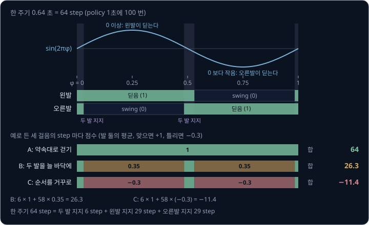
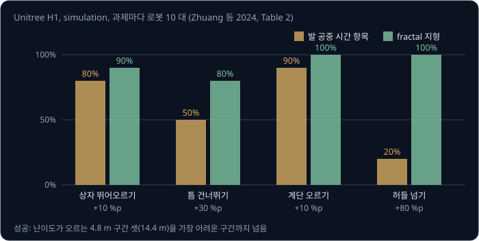
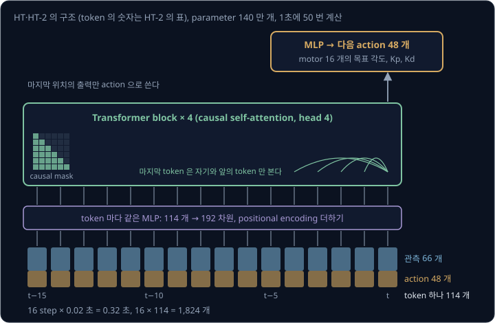
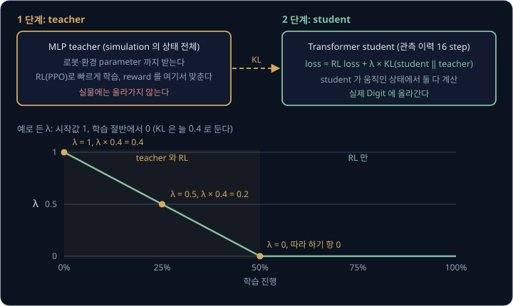
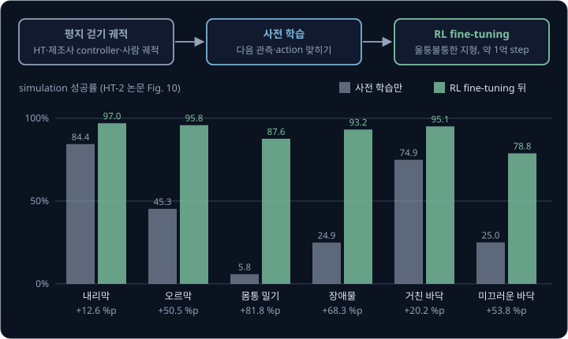
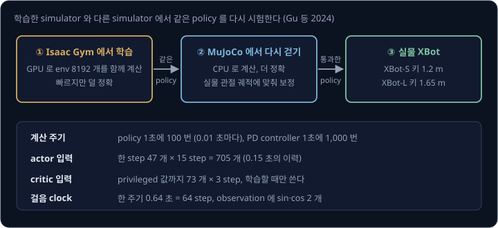
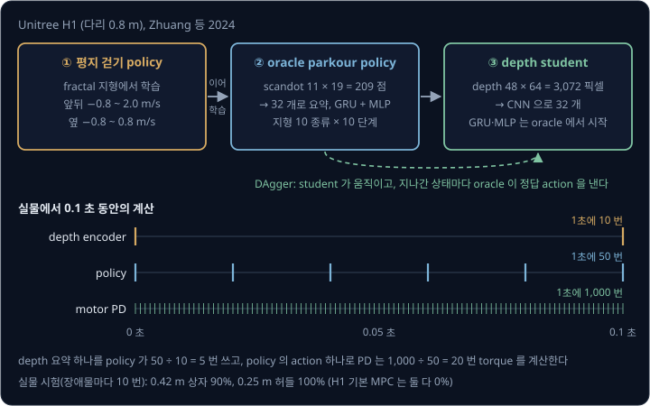

# Humanoid Locomotion

[Sim-to-Real Locomotion](../sim2real-locomotion/README.md) 에서 본 Rudin 등의 4족 보행 policy 는 걸음 모양을 정해 주지 않았는데도 대각선 두
다리를 함께 딛는 trot 으로 수렴했다. 두 다리로 걷는 humanoid 에서는 이런 일이 잘 일어나지 않는다. Radosavovic 등(2024)의 비교 실험에서
Agility Robotics 의 humanoid Digit 을 여러 지형에서 처음부터 reinforcement learning(RL)으로 학습한 policy 는 왼다리를 덜 들어 바닥에 끌었고, 좌우가
크게 다른 걸음을 배웠다. 쉽게 넘어지는 두 발 로봇에게 발을 언제 들고 언제 디딜지를 무엇으로 알려 주고, simulation 에서만 학습한 policy 로
산길과 장애물을 넘게 하려면 무엇을 더해야 할까?

최근 연구는 이 물음에 걸음 주기를 clock 신호로 알려 주는 reward, 최근의 관측과 action 이력을 읽어 지형에 맞게 걸음을 바꾸는 Transformer policy,
지형을 미리 보는 depth 카메라(픽셀마다 거리를 재는 카메라)로 답한다. 같은 연구진이 simulation 에서만 학습한 Transformer policy 를 올린 Digit
은 일주일 동안 날마다 야외를 걸으며 한 번도 넘어지지 않았고, 후속 policy 는 카메라 없이 버클리의 산길 약 4.3 마일(약 6.9 km)을 걸었다.

## 학습 목표

- 2족 보행이 4족보다 RL 로 배우기 어려운 이유를 설명하고, clock(걸음 한 주기 안의 위치를 알려 주는 신호)에 맞춘 periodic reward 를 계산할 수 있다
- 관측·action 이력을 token 으로 받는 causal Transformer policy 가 weight 를 고치지 않고 이력만으로 걸음을 바꾸는 in-context adaptation 을
  설명할 수 있다
- 이 policy 를 teacher 와 RL 을 섞어 학습하거나, 사전 학습한 뒤 RL 로 fine-tuning 하는 이유를 설명할 수 있다
- sim-to-sim 검증과 depth 카메라로 장애물을 넘는 parkour policy 의 학습 과정을 설명할 수 있다

## 2족 보행이 어려운 이유

4족 보행의 observation·action·reward 와 domain randomization 은 humanoid 에도 그대로 쓰이지만, 두 다리에서는 4족에서 드러나지 않던 문제가 넷
생긴다.

첫째, 바닥을 딛는 넓이가 좁다. [Humanoid Whole-Body Control](../humanoid-wbc/README.md#humanoid-의-균형) 에서 예로 든 무게중심 높이와 발 크기로
계산하면, 35 kg G1 은 한 발로 서서 옆으로 밀릴 때 $343.4 \times 0.05 \div 0.6 \approx 28.6$ N 에 넘어가고 12 kg 4족 로봇은
$117.7 \times 0.2 \div 0.3 \approx 78.5$ N 까지 버틴다. 발 디딜 자리로 균형을 잡는 계산은 [Legged Balance](../legged-balance/README.md) 에서
다룬다.

둘째, 몸통을 직접 미는 motor 가 없다. 몸통의 위치 3 개와 자세 3 개(floating base)는 어떤 관절로도 바로 정할 수 없고, 발과 바닥 사이의 힘으로만
바뀐다. 움직일 수 있는 자유도보다 motor 가 적은 이런 구조를 **underactuation** 이라고 한다. Digit 의 다리에는 spring 과 4절 링크(막대 넷을
고리로 이은 링크)로 이어진 수동 관절까지 있다. Radosavovic 등의 두 논문에 적힌 Digit 의 자유도를 정리하면 아래와 같다.

| 묶음 | 개수 | policy 가 정하는가 |
| --- | --- | --- |
| 몸통의 위치·자세 | 6 | 정하지 못한다. 발과 바닥 사이의 힘으로만 바뀐다 |
| 팔 관절 | 2 × 4 = 8 | 정한다 |
| 다리의 motor 관절 (발가락 제외) | 2 × 4 = 8 | 정한다 |
| 발가락 motor | 2 × 2 = 4 | 정하지 않는다. 기본 위치에 고정한다 |
| 다리의 수동 관절 | 2 × 5 = 10 | 정하지 못한다 |
| 합 | 36 | 16 |

셋째, 넘어지면 episode 가 끝나는데, 학습 초기의 humanoid 는 거의 서자마자 넘어진다. Gu 등(2024)의 Humanoid-Gym 에서는 policy 가 1초에 100 번
action 을 내고 걸음 한 주기가 0.64 초라서, 예를 들어 0.3 초 만에 넘어진 episode 는 30 step 으로 끝나 한 주기의 절반도 담지 못한다. 그래서
Radosavovic 등의 후속 연구처럼 버틴 step 마다 점수를 주는 alive 항목을 넣는다. Wang 등(2025)의 BeamDojo 는 징검다리처럼 디딜 곳이 드문 지형을
배울 때, 먼저 평평한 바닥 위에서 그 지형을 관측으로만 보여 주며 헛디뎌도 episode 를 끝내지 않고 penalty 만 주었다.

넷째, 정해진 걸음이 없다. Zhuang 등(2024)은 humanoid 를 학습할 때는 발을 들게 하고 바닥에 끌지 않게 하는 reward 항목이 필요하다고 적었고,
Siekmann 등(2021)은 앞으로 가는 속도 정도만 적은 reward 로는 학습할 때마다 걸음이 크게 달라진다고 보았다.

> **오해** humanoid 는 관절이 많아서 4족 로봇보다 몸을 더 자유롭게 제어할 수 있다.
>
> **사실** Digit 의 자유도 36 개 가운데 policy 가 직접 정하는 것은 16 개이고, 몸통의 위치·자세 6 개는 발과 바닥 사이의 힘으로만 바뀐다. 한 발로 서는 동안에는 그 힘을 낼 접점도 발 하나뿐이다.

**확인 문제.** Humanoid-Gym 처럼 1초에 100 번 action 을 내는 policy 가 24 초 episode 를 다 채우면 몇 step 일까? 학습 초기에 0.2 초 만에 넘어지면
몇 step 에서 끝나고, 0.64 초인 걸음 한 주기의 몇 % 를 겪을까?

답 보기

1. 다 채운 episode: $100 \times 24 = 2400$ step
2. 0.2 초에 넘어진 episode: $100 \times 0.2 = 20$ step
3. 겪은 비율: $0.2 \div 0.64 = 0.3125$, 약 31% 다

답: 2400 step 과 20 step 이고, 걸음 한 주기의 약 31% 만 겪는다.

## clock 과 periodic reward

걸음은 같은 동작이 일정한 주기로 되풀이되는 운동이다. 한 주기 안에서 지금이 어디쯤인지를 0 에서 1 사이 숫자로 센 값을 **phase** $\varphi$ 라고
하고, phase 는 1 에 이르면 다시 0 으로 돌아간다. 발이 바닥을 딛고 있는 구간을 **stance**, 발이 공중에서 앞으로 옮겨 가는 구간을 **swing**
이라고 한다. Siekmann 등(2021)의 **periodic reward** 는 phase 구간마다 발이 지킬 약속을 정해 두고, 어기면 penalty 를 준다. swing 구간에는 발이
바닥을 누르는 힘에 penalty 를 주고, stance 구간에는 발이 움직이는 속도에 penalty 를 준다.

왼발과 오른발에는 같은 구간 배치를 주고 시작 phase 만 어긋나게 한다. 반 주기(0.5) 어긋나면 번갈아 딛는 걸음이 되고, 어긋남이 0 이면 두 발을
함께 드는 깡충뛰기(hopping)가 된다. 반 주기 어긋난 걸음에서는 발이 공중에 있는 비율(swing 비율)이 걷기와 달리기를 가른다. 아래 표의 0.4 와 0.6
은 예로 든 비율이다.

| swing 비율 | 왼발 swing | 오른발 swing (0.5 어긋남) | 두 발이 겹치는 구간 | 걸음 |
| --- | --- | --- | --- | --- |
| 0.4 | 0 ~ 0.4 | 0.5 ~ 0.9 | 0.4 ~ 0.5 와 0.9 ~ 1.0 에 두 발 다 바닥 (20%) | 걷기 |
| 0.6 | 0 ~ 0.6 | 0.5 ~ 1.0 과 0 ~ 0.1 | 0 ~ 0.1 과 0.5 ~ 0.6 에 두 발 다 공중 (20%) | 달리기 |

Siekmann 등은 reference 동작 없이 이 parameter 만 바꿔 Agility Robotics 의 2족 로봇 Cassie 에게 서기, 걷기, 깡충뛰기, 달리기를 학습시켰다.

periodic reward 로 학습하는 policy 는 지금의 phase 를 알아야 한다. 위 걷기 표에서 phase 가 0.2 이면 왼발을 들어야 하고 0.7 이면 오른발을 들어야
해서, phase 를 모르면 같은 자세에 정답이 둘인 문제를 풀게 된다. 그래서 phase 를 $\sin(2\pi\varphi)$ 같은 **clock** 신호로 바꿔 observation 에
넣는다.

Humanoid-Gym 의 코드는 이를 더 단순하게 구현한다. 한 주기는 0.64 초이고 policy 가 1초에 100 번 계산하므로 64 step 이다. $\sin(2\pi\varphi)$ 가
0 이상이면 왼발이 딛고, 0 보다 작으면 오른발이 딛고, 0 에서 ±0.1 안쪽이면 두 발이 다 딛기로 약속한다. 발마다 실제 접촉(바닥을 5 N 넘게
누르는지)이 약속과 맞으면 +1, 틀리면 −0.3 을 주고 두 발의 평균을 낸다. 예로 든 세 걸음의 한 주기 점수는 아래와 같다. 접촉 칸의 1 은 딛는 발을
뜻하고, 0 은 공중의 발을 뜻한다.

| 구간 | step 수 | 약속한 접촉 (왼발, 오른발) | A: 약속대로 걷기 | B: 두 발을 늘 바닥에 | C: 순서를 거꾸로 |
| --- | --- | --- | --- | --- | --- |
| 두 발 지지 | 6 | (1, 1) | 1 | 1 | 1 |
| 왼발 지지 | 29 | (1, 0) | 1 | $(1 - 0.3) \div 2 = 0.35$ | $-0.3$ |
| 오른발 지지 | 29 | (0, 1) | 1 | 0.35 | $-0.3$ |
| 한 주기의 합 | 64 | | 64 | $6 + 58 \times 0.35 = 26.3$ | $6 - 58 \times 0.3 = -11.4$ |

B 는 발을 끌며 미끄러지듯 가는 걸음이고, C 는 걸음 모양은 멀쩡하지만 clock 과 반대 순서로 발을 든다. C 가 B 보다도 낮은 점수를 받으므로
policy 는 clock 에 박자를 맞춰 걷게 된다. Humanoid-Gym 은 여기에 swing 하는 발을 6 cm 높이까지 들게 하는 항목 등을 더한다.

<b>심화: periodic reward 의 일반 식</b>

Siekmann 등은 항목 $i$ 마다 세 숫자를 곱한 값을 모두 더해 reward 를 만든다. phase 0.2 에서 swing 중이어야 할 왼발이 바닥을 5 N 으로 누르는
경우를 기호와 맞추면 아래와 같다. 발 힘 항목의 값은 논문 부록의 식 $1 - e^{-\lVert F \rVert^2 / 100}$ 으로 계산한다.

| 이 예의 값 | 기호로 쓴 값 |
| --- | --- |
| 한 주기 안의 위치 0.2 | $\varphi$ |
| swing 구간의 발 힘 항목에 붙인 계수 $-1$ (stance 구간의 발 힘 계수는 0) | $c_i$ |
| 0.2 가 왼발 swing 구간 0 ~ 0.4 안이라 1 | $I_i(\varphi)$ |
| $1 - e^{-5^2/100} = 1 - e^{-0.25} \approx 0.221$ | $q_i(s)$ |
| $-1 \times 1 \times 0.221 = -0.221$ | $c_i \cdot I_i(\varphi) \cdot q_i(s)$ |
| 모든 항목을 더하고 상수 $\beta$ 를 더한 값 | $R(s, \varphi) = \beta + \sum_i c_i \, I_i(\varphi) \, q_i(s)$ |

$q_i$ 는 0 이상 1 미만이라서 발 힘이 50 N 이면 $1 - e^{-25}$ 로 거의 1 이 된다. stance 구간의 발 속도 항목은 $1 - e^{-2 \lVert v \rVert^2}$ 이라서,
디딘 발이 0.3 m/s 로 미끄러지면 $1 - e^{-0.18} \approx 0.165$ 만큼 penalty 를 받는다.

저자들은 구간의 시작과 끝을 von Mises 분포(원 위에서 정의한 종 모양 분포)에서 뽑는 확률값으로 보고 $I_i$ 대신 그 기댓값을 써서, 경계 근처에서는
계수가 0 과 $-1$ 사이의 값을 갖게 했다. 저자들은 경계를 이렇게 매끄럽게 하면 학습이 더 안정된다고 적었다.

clock 은 $\sin$ 하나로는 모자라다. $\varphi = 0.1$ 과 $\varphi = 0.4$ 는 $\sin(0.2\pi) = \sin(0.8\pi) \approx 0.588$ 로 같지만, Humanoid-Gym 의
약속으로는 앞은 왼발 stance 가 막 시작된 때이고 뒤는 끝나 가는 때다. $\cos$ 를 함께 넣으면 $\cos(0.2\pi) \approx 0.809$ 와
$\cos(0.8\pi) \approx -0.809$ 로 갈려서, Humanoid-Gym 은 observation 에 $\sin$ 과 $\cos$ 를 함께 넣는다.

**확인 문제.** 두 발이 반 주기 어긋나고 swing 비율이 0.3 인 걸음에서, 두 발이 함께 바닥을 딛는 구간은 한 주기의 몇 % 일까?

답 보기

1. 왼발: swing 0 ~ 0.3, stance 0.3 ~ 1.0
2. 오른발: 0.5 어긋나므로 swing 0.5 ~ 0.8, stance 0.8 ~ 1.0 과 0 ~ 0.5
3. 두 stance 가 겹치는 구간: 0.3 ~ 0.5 와 0.8 ~ 1.0 이라서 $0.2 + 0.2 = 0.4$

답: 40% 다. swing 비율이 0.4 일 때의 20% 보다 두 발 지지가 길다.

## 발 공중 시간 reward 와 fractal 지형

clock 은 박자를 정해 주는 만큼 박자를 바꿔야 하는 동작을 막는다. 상자 위로 뛰어오르거나 틈을 건너뛸 때는 0.64 초마다 발을 번갈아 드는 박자가
맞지 않는다. 박자 없이 발만 들게 하는 방법으로는 [Sim-to-Real Locomotion](../sim2real-locomotion/README.md#보행-reward) 의 reward 표에 있던 발
공중 시간(feet air time) 항목이 있다. 발이 바닥에 닿는 순간, 그 발이 공중에 있던 시간에서 0.5 초를 뺀 값에 weight 1.0 을 곱해 준다.

| 발이 공중에 있던 시간 | 닿는 순간의 점수 |
| --- | --- |
| 0.2 초 | $0.2 - 0.5 = -0.3$ |
| 0.5 초 | 0 |
| 0.7 초 | $0.7 - 0.5 = +0.2$ |

발을 끄는 짧은 걸음은 점수를 잃으므로 policy 는 발을 오래 드는 쪽으로 간다. 그런데 이 항목은 모든 걸음을 0.5 초보다 길게 만들려고 해서, 짧고
정확한 걸음이 필요한 과제와 부딪칠 수 있다. Zhuang 등(2024)은 이 항목이 일부 과제와 충돌한다고 보고, 대신 4족 로봇 학습에서 쓰이던 **fractal
noise** 를 지형 높이에 더했다. fractal noise 는 크고 작은 굴곡을 여러 크기로 겹친 울퉁불퉁한 높이라서 끄는 발이 걸리기 쉽고, 그래서 policy 는
reward 항목 없이도 발을 들게 된다. 저자들이 Unitree H1 으로 simulation 에서 과제마다 로봇 10 대를 놓고, 난이도가 오르는 14.4 m 길을 끝까지 넘은
비율을 비교한 결과는 아래 그림과 같다. 네 과제 모두 fractal 지형 쪽이 높았다.

reward 가 걸음 모양을 덜 정할수록 policy 가 스스로 찾는 동작도 는다. Radosavovic 등(2024)은 팔에 아무 reward 나 reference 도 주지 않았는데,
Digit 은 사람처럼 왼다리를 들 때 오른팔을 앞으로 흔들며 걸었다. 다만 후속 논문의 저자들은 simulation 이 배터리 소모와 하드웨어 손상을 흉내 내지
못한다는 이유로 에너지, 발 공중 시간, 좌우 대칭 같은 항목을 더했다.

> **오해** 발을 들게 하는 reward 항목을 넣으면 어떤 과제에서든 걸음이 좋아진다.
>
> **사실** Zhuang 등의 simulation 비교에서 발 공중 시간 항목으로 학습한 H1 policy 는 허들을 로봇 10 대 가운데 2 대만 넘었고, 그 항목 없이 fractal 지형에서 학습한 policy 는 10 대가 모두 넘었다.

**확인 문제.** 발 공중 시간 항목(0.5 초 기준, weight 1.0)으로 학습한다. 예를 들어 상자에 오르기 직전에 0.3 초 만에 발을 디뎌 자세를 고쳐야 한다면
이 걸음은 몇 점을 받고, policy 는 이 걸음을 어떻게 바꾸려 할까?

답 보기

닿는 순간의 점수는 $0.3 - 0.5 = -0.2$ 다. penalty 를 받으므로 policy 는 발을 더 오래 공중에 두려 하고, 과제에 필요한 짧은 걸음이 줄어든다.

## 이력을 읽는 causal Transformer

[Sim-to-Real Locomotion](../sim2real-locomotion/README.md#teacher-student-학습) 의 student 는 최근 2 초의 센서 이력으로 지금 바닥이 미끄러운지를
짐작했다. Radosavovic 등(2024)은 이 이력을 [Transformer](../transformer/README.md) 로 읽는 policy 를 만들었고, 후속 논문은 이 policy 를
HT(Humanoid Transformer)라고 부른다. HT 는 step 하나의 observation 과 action 을 이어 붙인 숫자 묶음을 **token** 하나로 보고, 최근 16 step 의
token 을 받아 다음 action 을 낸다.

action 까지 넣는 것은 policy 가 낸 목표 관절 각도와 실제로 도달한 각도의 차이에 지형의 성질이 담기기 때문이다. 후속 논문(HT-2)의 표로 token
하나의 숫자를 세면 아래와 같다.

| token 의 묶음 | 개수 |
| --- | --- |
| 몸통의 속도, 몸통의 회전 속도 | 3 + 3 |
| 관절 각도, 관절 속도 (수동 관절 포함) | 26 + 26 |
| 몸통에서 본 중력 방향 | 3 |
| clock | 2 |
| 속도 명령 (앞뒤, 옆, 회전) | 3 |
| action: motor 16 개의 목표 각도, $K_p$, $K_d$ | $16 \times 3 = 48$ |
| 합 | $66 + 48 = 114$ |

$K_p$ 와 $K_d$ 는 관절 PD controller 의 gain 이고, HT-2 의 policy 는 목표 각도와 함께 이 gain 도 step 마다 정한다. policy 는 1초에 50 번
계산하므로 16 step 의 이력은 $16 \times 0.02 = 0.32$ 초이고, 한 번에 들어가는 숫자는 $16 \times 114 = 1{,}824$ 개다.

token 마다 같은 MLP 가 114 개 숫자를 192 차원 vector 로 바꾸고 positional encoding 을 더한다. 그 뒤 Transformer block 4 개를 지난 마지막 위치의
출력을 작은 MLP 가 action 으로 바꾸며, parameter 는 모두 140 만 개다. attention 에는 [causal mask](../transformer/README.md#causal-mask) 를 써서
token 마다 자기와 앞선 token 만 보게 하고, 매 step 새 token 이 맨 뒤에 붙고 가장 오래된 token 이 빠진다.

Radosavovic 등이 같은 학습 방법에서 student 의 network 만 바꿔 비교하니, 그래프에서 읽은 성공률은 Transformer 약 97%, LSTM 약 89%, TCN 약
87%, MLP 약 76% 였다. 한 번에 보는 token 수(context)를 1, 8, 16 step 으로 바꿔 25° 경사를 1 m/s 명령으로 오르게 하면 평균 속도가 약 0.62,
0.71, 0.75 m/s 로, context 가 길수록 명령에 가까웠다.

<b>심화: 이력의 길이와 이어 붙인 입력</b>

이력의 길이와 그 이력을 읽는 network 는 연구마다 다르다.

| policy | 이력 | 계산 주기 | 이력이 덮는 시간 | network |
| --- | --- | --- | --- | --- |
| Lee 등(2020) 4족 student | 100 step | 50 Hz | 2 초 | TCN |
| Li 등(2024) Cassie | 66 step + 최근 4 step | 33 Hz | 2 초 | 1D CNN + MLP |
| Humanoid-Gym actor | 15 step | 100 Hz | 0.15 초 | 이어 붙인 705 개를 받는 MLP |
| HT (Digit) | 16 step | 50 Hz | 0.32 초 | causal Transformer |

이력을 MLP 에 넣으려면 모든 step 을 한 줄로 이어 붙여야 한다. HT 의 token 을 이어 붙여 첫 층의 출력이 512 개인 MLP 에 넣는 경우와, HT 처럼
token 마다 같은 MLP(첫 층 출력 512 개)를 쓰는 경우의 첫 층 weight 수를 비교하면 아래와 같다.

| 이 예의 값 | 기호로 쓴 값 |
| --- | --- |
| context 16 step | $k$ |
| token 하나의 숫자 114 개 | $d$ |
| 첫 층의 출력 512 개 | $h$ |
| 이어 붙인 입력: $16 \times 114 \times 512 = 933{,}888$ | $k \cdot d \cdot h$ |
| token 입력: $114 \times 512 = 58{,}368$ | $d \cdot h$ |

context 를 32 step 으로 늘리면 이어 붙인 입력의 첫 층은 $1{,}867{,}776$ 개로 두 배가 되지만, token 입력의 첫 층은 그대로다. Humanoid-Gym 의
actor 는 이어 붙이는 쪽이라서 $47 \times 15 = 705$ 개를 첫 층 512 개에 넣고, weight 는 $705 \times 512 = 360{,}960$ 개다.

대신 attention 은 token 쌍마다 점수를 매긴다. 16 token 이면 $16 \times 16 = 256$ 쌍이고, causal mask 가 앞쪽만 남기면
$16 \times 17 \div 2 = 136$ 쌍을 계산한다. 32 token 이면 $32 \times 33 \div 2 = 528$ 쌍이라서, context 를 두 배로 늘리면 attention 계산은 네 배
가까이 는다.

**확인 문제.** HT-2 의 policy 처럼 token 하나가 114 개이고 1초에 50 번 계산한다. context 를 16 step 에서 32 step 으로 늘리면 Transformer 에
들어가는 숫자는 몇 개이고, 몇 초의 이력을 볼까?

답 보기

1. 숫자: $32 \times 114 = 3{,}648$ 개
2. 이력: 한 step 이 $1 \div 50 = 0.02$ 초라서 $32 \times 0.02 = 0.64$ 초

답: 3,648 개와 0.64 초다.

## in-context adaptation

GPT-3 같은 language model 이 prompt 의 예시만 보고 weight 를 고치지 않은 채 답을 바꾸는 성질을 in-context learning 이라고 한다. Radosavovic
등은 HT 도 관측과 action 이력이라는 문맥으로 같은 일을 한다고 보고, 이를 **in-context adaptation** 이라고 불렀다. 실제 로봇에 올라간 뒤
weight 는 그대로이고, 바뀌는 것은 최근 16 step 의 token 뿐이다.

저자들이 든 근거는 셋이다.

- 평지, 내리막, 평지로 이어진 길을 걷게 하면 내리막에서는 발을 덜 들고 보폭을 줄였다가 평지에서 원래 걸음으로 돌아왔다. 마지막 층의 192 차원
  출력(hidden state)을 2 차원으로 줄여 그리면 점들이 지형별로 무리를 이룬다
- 학습에 없던 계단 턱에 발이 걸리면, 다음 시도에서 다리를 더 높고 빠르게 들어 넘어갔다
- HT-2 는 단단한 흙길과 모래에서 엉덩이 관절의 궤적이 같았는데, 모래에서는 같은 궤적을 만들려고 torque 를 더 냈다

4족의 RMA 는 마찰·짐 무게를 요약한 8 개 값을 추정하는 module 을 따로 학습했지만, HT 에서는 지형을 알아채는 일과 걸음을 바꾸는 일이 한 network
안에서 함께 일어난다.

> **오해** in-context adaptation 을 하는 policy 는 로봇 위에서 계속 학습해 weight 를 고친다.
>
> **사실** 실제 Digit 에 올린 HT 의 weight 는 바뀌지 않는다. 최근 16 step(0.32 초)의 관측과 action 이 바뀌면 같은 weight 로도 다른 action 이 나오고, 그 차이가 지형마다 다른 걸음으로 보인다.

**확인 문제.** HT 가 1초에 50 번 계산하며 걷다가 모래에 들어섰다. 0.1 초 뒤 context 의 16 token 가운데 모래 위에서 만든 token 은 몇 개일까? 16 개
모두가 모래 위의 token 이 되는 것은 들어선 지 몇 초 뒤일까?

답 보기

1. 0.1 초 동안 새로 붙은 token: $0.1 \div 0.02 = 5$ 개라서 모래 위 token 은 5 개, 단단한 바닥의 token 은 $16 - 5 = 11$ 개
2. 16 개가 모두 바뀌는 때: $16 \times 0.02 = 0.32$ 초

답: 5 개와 0.32 초다. 그 0.32 초 동안 policy 의 입력이 점점 모래 쪽으로 옮겨 간다.

## teacher 와 RL 을 섞는 학습

관측만 받는 Transformer 를 처음부터 RL 로 학습하면 느리다. Radosavovic 등은 관측 공간에서 RL 로 바로 최적화하면 sample 이 많이 들어 실험을
되풀이하기 어렵다고 보고, 학습을 두 단계로 나눴다.

1. teacher: simulation 의 상태 전체(로봇과 환경의 parameter 포함)를 받는 MLP policy 를 RL 로 학습한다. 빨리 학습되므로 걸음 parameter 같은
   reward 설정을 이 단계에서 맞춘다
2. student: 관측 이력만 받는 Transformer 를 RL loss 와 teacher 를 따라 하는 항을 더한 loss 로 학습한다

student 가 따라 하는 정도는 KL divergence 로 잰다. KL divergence 는 두 확률분포가 얼마나 다른지 재는 값으로, 두 분포가 같으면 0 이고 다를수록
커진다. 여기서는 같은 상태에서 student 가 action 을 고르는 분포와 teacher 가 고르는 분포를 비교한다. 그 앞에 곱하는 weight $\lambda$ 는 학습하면서
줄이는데, 학습 기간의 절반쯤에서 0 이 된다. 예를 들어 $\lambda$ 의 시작값을 1 로 두고 일정하게 줄이며, KL divergence 가 늘 0.4 라고 하자.

| 학습 진행 | $\lambda$ | loss 에 더해지는 따라 하기 항 $\lambda \times 0.4$ | student 를 움직이는 것 |
| --- | --- | --- | --- |
| 0% | 1 | 0.4 | teacher 와 RL |
| 25% | 0.5 | 0.2 | teacher 와 RL |
| 50% 이후 | 0 | 0 | RL 만 |

학습 초반에는 teacher 가 빠르게 길을 알려 주고, 후반에는 student 가 RL 만으로 teacher 를 넘어설 수 있다. 따라 하기만 하면 student 는 teacher 의
action 을 맞히는 데 그친다. teacher 는 상태 전체를 보고 student 는 관측만 받아서, teacher 에게 최선인 action 이 student 에게는 최선이 아닐 수 있다.
저자들이 25° 경사를 1 m/s 명령으로 오르게 비교하니, 그래프에서 읽은 평균 속도는 RL 만 쓰면 약 0.15 m/s, 따라 하기만 쓰면 약 0.63 m/s, 둘을
섞으면 약 0.75 m/s 였다. 두 항 모두 student 가 직접 움직여 모은 상태에서 계산하므로, [DAgger](../dagger/README.md) 처럼 student 가 실수로
들어간 상태에서도 teacher 의 정답을 배운다.

학습은 GPU 로 수천 개의 env 를 함께 계산하는 simulator 인 Isaac Gym 에서 했고, Isaac Gym 이 계산하지 못하는 다리의 닫힌 링크는 아주 단단한 가상
spring 으로 바꿨다. 실제 Digit 에서 policy 는 1초에 50 번 action 을 내고 관절 PD controller 는 1,000 번 torque 를 계산했다. 학습 지형의 경사는
10% grade(수평 100 m 에 10 m 오르는 기울기, 약 5.7°)까지였다.

<b>심화: 두 Gaussian 사이의 KL divergence</b>

action 이 숫자 하나이고 student 와 teacher 의 분포가 퍼진 정도(standard deviation)가 같은 Gaussian 이면 KL divergence 는 간단해진다. student 의
평균이 0.30, teacher 의 평균이 0.20, 두 분포의 standard deviation 이 0.1 이라고 하자.

| 이 예의 값 | 기호로 쓴 값 |
| --- | --- |
| student 평균 0.30 | $\mu_o$ |
| teacher 평균 0.20 | $\mu_s$ |
| standard deviation 0.1 | $\sigma$ |
| $(0.30 - 0.20)^2 \div (2 \times 0.1^2) = 0.01 \div 0.02 = 0.5$ | $D_{KL} = (\mu_o - \mu_s)^2 \div (2\sigma^2)$ |
| RL loss 에 더하는 값 $\lambda \times 0.5$ | $L(\pi_o) = L_{RL}(\pi_o) + \lambda \, D_{KL}(\pi_o \,\|\, \pi_s)$ |

평균의 차이가 같아도 $\sigma$ 가 작을수록 KL divergence 가 커진다. 분포가 좁으면 같은 차이도 크게 어긋난 것으로 본다는 뜻이다. 실제 action 은
숫자 여러 개라서, 숫자마다 이 값을 계산해 더한다.

**확인 문제.** $\lambda$ 의 시작값을 2 로 두고 학습 기간의 절반에서 0 이 되도록 일정하게 줄인다. 학습의 20% 지점에서 $\lambda$ 는 얼마이고, 그때 KL
divergence 가 0.5 라면 loss 에 더해지는 따라 하기 항은 얼마일까?

답 보기

1. 20% 지점은 0 이 되는 50% 지점까지의 $20 \div 50 = 0.4$ 만큼 온 곳이라서 $\lambda = 2 \times (1 - 0.4) = 1.2$
2. 따라 하기 항: $1.2 \times 0.5 = 0.6$

답: $\lambda$ 는 1.2 이고, 따라 하기 항은 0.6 이다.

## 사전 학습과 RL fine-tuning

teacher 를 거쳐도 HT 는 10억 step 넘게 RL 로 학습했다. Radosavovic 등(2024)은 language model 처럼 걷기 궤적을 문장으로 보고, 다음 관측과 action
을 맞히도록 Transformer 를 먼저 학습(pretraining)했다. 데이터로는 HT 를 simulation 에서 돌린 궤적(10 초짜리 1만 개)에 더해, 제조사 controller 의
궤적과 사람의 motion capture·YouTube 영상을 Digit 관절로 옮긴 궤적도 썼다. 뒤의 두 가지에는 action 이 없어서 그 자리를 학습하는 mask token 으로
채우고 loss 를 주지 않았다. 이렇게만 학습한 모델로도 Digit 은 샌프란시스코 거리를 걸었다. 저자들은 걷기 데이터 27 시간만으로도 실물에 옮겨졌다고
보고했는데, HT 궤적 1만 개가 $10{,}000 \times 10 = 100{,}000$ 초, 약 27.8 시간이다.

후속 HT-2 는 평지 궤적으로 이렇게 사전 학습한 모델을 거친 바닥, 경사(2 ~ 20% grade), 장애물(0.5 ~ 5 cm), 언덕 같은 지형에서 PPO 로
fine-tuning 했다. 사전 학습한 걸음을 망가뜨리지 않도록 탐색 noise 의 크기(standard deviation)는 0.135 로 작게 시작했다. 학습에는 env 2048 개 × 24
step × 2000 iteration = 98,304,000, 약 1억 step 이 들어 HT 의 10억 step 의 약 10 분의 1 이었다. 아래 그림처럼 simulation 에서 몸통 밀기의 성공률은
5.8% 에서 87.6% 로 올랐고, 오르막의 성공률은 45.3% 에서 95.8% 로 올랐다.

실제 Digit 은 카메라 없이 버클리의 산길 다섯 곳, 모두 약 4.3 마일을 완주했고, 샌프란시스코의 31% grade(약 17°) 길을 오르내렸다. 진흙, 물,
모래처럼 학습에 없던 바닥도 지났다.

카메라가 없는 policy 에는 한계가 있다. 저자들은 연석 같은 턱은 부딪혀 봐야 알아채고, 계단과 징검다리는 시각이 있어야 다룰 수 있다고 적었다.
Siekmann 등은 계단 논문(2021)에서 reward 는 그대로 두고 학습 지형만 높이 10 ~ 21 cm 의 계단으로 바꿔, 카메라 없는 Cassie 가 실외 계단을 10 번
가운데 8 번 오르고 10 번 모두 내려가게 했다. depth 카메라로 지형을 미리 보는 4족 policy 는
[Perceptive Locomotion](../perceptive-locomotion/README.md) 에서 다룬다.

> **오해** 사전 학습한 모델에 RL 을 이어 하면, 처음부터 RL 로 학습한 것과 같은 곳에 더 빨리 이를 뿐이다.
>
> **사실** HT-2 의 비교에서 fine-tuning 한 policy 는 약 1억 step 으로, 처음부터 2 억 step 까지 학습한 policy 보다 성능이 높았다. 처음부터 학습한 policy 는 한쪽 다리를 끄는 걸음에 머물렀다.

**확인 문제.** HT-2 처럼 env 2048 개가 iteration 마다 24 step 씩 모은다. 1000 iteration 이면 몇 step 이고, HT 의 10억 step 의 몇 분의 1 일까?

답 보기

1. iteration 하나: $2048 \times 24 = 49{,}152$ step
2. 1000 iteration: $49{,}152 \times 1000 = 49{,}152{,}000$ step
3. 비율: $1{,}000{,}000{,}000 \div 49{,}152{,}000 \approx 20.3$

답: 약 4,900만 step 으로, 10억 step 의 약 20 분의 1 이다.

## sim-to-sim 검증

simulator 마다 접촉과 관절을 계산하는 방식이 달라서, 한 simulator 의 계산 방식에만 맞춘 걸음은 다른 simulator 에서 무너진다. Gu 등(2024)의
Humanoid-Gym 은 GPU 로 수천 개 env 를 함께 계산하는 Isaac Gym 에서 policy 를 학습하고, 같은 policy 를 CPU 로 더 정확하게 계산하는 MuJoCo 에서
다시 걷게 한 뒤에 실물에 올린다. 학습한 simulator 와 다른 simulator 에서 policy 를 다시 시험하는 이 단계를 **sim-to-sim** 검증이라고 한다.

MuJoCo 가 실물을 잘 흉내 내야 이 시험이 의미가 있어서, 저자들은 RobotEra 의 XBot 다리 관절이 사인파를 따라가게 하고 실물과 MuJoCo 의 관절
궤적이 거의 같아지도록 MuJoCo 를 보정했다. 저자들은 이 덕분에 로봇이 없는 연구자도 MuJoCo 에서 policy 를 검증할 수 있다고 보았다.

| 항목 | Humanoid-Gym 의 값 |
| --- | --- |
| 로봇 | XBot-S(키 1.2 m), XBot-L(키 1.65 m) |
| actor 의 한 step 입력 | clock 2 + 속도 명령 3 + 관절 각도 12 + 관절 속도 12 + 몸통 회전 속도 3 + 몸통 자세 3 + 직전 action 12 = 47 |
| actor 입력 | $47 \times 15$ step $= 705$ 개, 0.15 초 |
| critic 입력 | 마찰·질량·몸통 속도 같은 privileged 값까지 73 개 × 3 step |

critic 에만 privileged 값을 주는 이 구성을 asymmetric actor-critic 이라고 한다. 실물에는 actor 만 올라가므로 teacher 를 student 로 옮기는 단계가
없다. 앞의 HT 도 Isaac Gym 에서 학습한 policy 를 제조사의 정밀 simulator 로 걸렀고, HT-2 는 sample 이 적게 드는 덕분에 처음부터 MuJoCo 에서
학습했다.

> **오해** MuJoCo 에서 다시 시험하는 것은 같은 policy 를 한 번 더 돌려 보는 것일 뿐이다.
>
> **사실** 두 simulator 는 접촉과 관절을 다른 방식으로 계산해서, Isaac Gym 의 계산 방식에만 기대어 배운 걸음은 MuJoCo 에서 무너진다. Gu 등이 0.5 m/s 로 걸을 때 무릎·발목 관절의 위상 그림(각도와 각속도를 함께 그린 그림)을 비교하니, 보정한 MuJoCo 가 Isaac Gym 보다 실물에 가까웠다.

**확인 문제.** Humanoid-Gym 에서 actor 가 쌓는 step 을 15 개에서 10 개로 줄이면 actor 입력은 몇 개이고, 몇 초의 이력일까?

답 보기

1. 입력: $47 \times 10 = 470$ 개
2. 이력: 1초에 100 번이라 한 step 이 0.01 초이므로 $10 \times 0.01 = 0.1$ 초

답: 470 개와 0.1 초다.

## depth 카메라 parkour

카메라가 없는 policy 는 발이 걸려야 턱을 알아채서, 0.42 m 상자에 뛰어오르거나 0.8 m 틈을 건너뛰는 parkour 는 하기 어렵다. Zhuang 등(2024)은
Unitree H1(키 약 1.8 m, 무게 약 47 kg, 관절 19 개)의 머리에 단 depth 카메라로 이 일을 했다. depth student 를 학습하는 4족의 방법은
[Perceptive Locomotion](../perceptive-locomotion/README.md) 에서 다루고, 여기서는 humanoid 의 학습 단계를 본다.

1. 평지 걷기 policy: fractal 지형에서 앞뒤 −0.8 ~ 2.0 m/s, 옆 −0.8 ~ 0.8 m/s, 회전 −1 ~ 1 rad/s 의 명령을 따르게 학습한다
2. oracle parkour policy: 1 단계 policy 에서 이어 학습한다. 로봇 주변 11 × 19 = 209 점의 지형 높이(scandot)를 32 개 숫자로 요약해 받고, 이전 정보를
   기억하는 GRU 와 MLP 로 action 을 낸다. 지형은 10 종류 × 난이도 10 단계이고, 길의 3/4 이상 가면 어려운 단계로 옮기고 1/2 도 못 가고 실패하면
   쉬운 단계로 옮긴다
3. depth student: scandot 대신 48 × 64 = 3,072 픽셀의 depth 이미지를 CNN 으로 32 개 숫자로 바꾸고, GRU 와 MLP 는 oracle 의 weight 에서 시작한다.
   student 가 움직이고 oracle 이 정답 action 을 내는 [DAgger](../dagger/README.md) 로, oracle 의 행동을 student 에게 옮긴다. 이렇게 한
   network 의 행동을 다른 network 로 옮기는 학습을 distillation 이라고 한다

simulation 의 depth 이미지에는 실제 카메라처럼 noise 와 무작위 잡티를 넣는다. 24 시간 동안 학습한 student 의 상자 뛰어오르기 성공률은 GPU 4 장으로
데이터를 모으면 85% 였고 한 장이면 40% 였으며, oracle 의 weight 없이 처음부터 학습하면 0% 였다.

실물에서는 depth encoder 가 1초에 10 번, policy 가 50 번, motor 안의 PD controller 가 1,000 번 계산해서, depth 요약 하나를 policy 가
$50 \div 10 = 5$ 번 쓴다. 장애물마다 10 번씩 시험한 그래프를 읽으면, 0.42 m 상자 뛰어오르기는 depth policy 가 90% 였고 카메라 없는 걷기 policy 와
H1 에 기본으로 들어 있는 MPC(앞으로의 움직임을 예측해 명령을 고르는 제어) controller 는 0% 였다. 0.25 m 허들에서는 depth policy 가 100% 였고 MPC
는 0% 였다.

H1 의 허벅지와 정강이는 제조사 사양으로 각각 0.4 m 라서 다리는 0.8 m 이고, 장애물 크기를 이 다리 길이와 비교하면 아래와 같다.

| 장애물 | 크기 | 다리 길이 0.8 m 에 대한 비율 |
| --- | --- | --- |
| 상자 (jump up) | 0.42 m | $0.42 \div 0.8 \approx 0.53$ |
| 허들 | 0.25 m | $0.25 \div 0.8 \approx 0.31$ |
| 틈 (leap) | 0.8 m | $0.8 \div 0.8 = 1$ |

0.8 m 틈은 다리 길이만큼 넓고, 저자들은 이 틈을 두 발이 모두 공중에 뜨는 도약(leap)으로 넘는 과제로 두었다. 공중에서는 발이 바닥을 밀 수 없어
몸통이 날아가는 궤적을 바꿀 수 없으므로, 도약하기 전에 본 depth 로 도약을 정해야 한다.

<b>심화: 뛰어오르는 속도와 공중 시간</b>

예를 들어 무게중심을 상자 높이 0.42 m 만큼 올려야 한다고 하자. 실제로는 무릎을 접어 발만 상자 위로 올리므로 무게중심은 이보다 덜 올라가도 된다.
도약 속도는 위로 올라가는 동안 중력이 줄이는 속도와 같아야 한다.

| 이 예의 값 | 기호로 쓴 값 |
| --- | --- |
| 올릴 높이 0.42 m | $h$ |
| 중력 가속도 9.81 m/s² | $g$ |
| 도약 속도 $\sqrt{2 \times 9.81 \times 0.42} \approx 2.87$ m/s | $v = \sqrt{2 g h}$ |
| 꼭대기까지 $2.87 \div 9.81 \approx 0.29$ 초 | $t = v \div g$ |

0.29 초 동안 policy 는 $0.29 \div 0.02 \approx 15$ 번 계산하지만, 그사이 새 depth 요약은 $0.29 \div 0.1 \approx 3$ 번만 온다. 공중의 15 번 계산으로는
다리를 접고 펴 착지를 준비할 수 있을 뿐이고, 무게중심이 날아가는 궤적은 땅을 박차는 순간에 정해진다. 무게 47 kg 인 H1 의 무게중심을 0.42 m 올리는 데 드는
에너지는 $47 \times 9.81 \times 0.42 \approx 194$ J 이다.

**확인 문제.** depth encoder 는 1초에 10 번, policy 는 50 번 계산한다. H1 이 2 m/s 로 달릴 때, 새 depth 요약이 오는 사이에 몇 cm 를 가고 policy 는
몇 번 계산할까?

답 보기

1. depth 요약 사이의 시간: $1 \div 10 = 0.1$ 초
2. 그동안 가는 거리: $2 \times 0.1 = 0.2$ m, 20 cm
3. policy 계산: $0.1 \div 0.02 = 5$ 번

답: 20 cm 를 가고 policy 는 같은 depth 요약으로 5 번 계산한다. 그사이의 변화는 1초에 50 번 들어오는 관절과 IMU 값으로 따라간다.

## locomotion 과 whole-body control

[Humanoid Whole-Body Control](../humanoid-wbc/README.md) 의 motion tracking policy 는 사람 동작을 frame 마다 따라 했고, 이 강의의 locomotion
policy 는 속도 명령을 따라 걷는다. 상자를 들고 걷는 일처럼 둘이 함께 필요한 작업에서는 다리를 locomotion policy 에 맡기고 팔은 따로 정하는 구성을
여러 연구가 쓴다. 팔이 움직이면 무게중심도 옮겨 가므로, 이때 locomotion policy 는 팔이 어떻게 움직여도 버티도록 학습해야 한다.

| 연구 | 로봇 | locomotion policy 가 맡는 일 | 팔을 정하는 쪽 |
| --- | --- | --- | --- |
| HOMIE (Ben 등 2025) | Unitree G1 | 발판으로 받은 속도·몸통 높이에 맞춰 걷고 쪼그려 앉는다. 1초에 50 번 | 외골격으로 읽은 사람의 팔 관절 각도 |
| GR00T N1.5·N1.6 의 Decoupled WBC | 주로 Unitree G1 | 하체를 RL policy 로 제어한다 | inverse kinematics |
| Humanoid Parkour (Zhuang 등 2024) | Unitree H1 | 전신 parkour policy 가 걷고 뛴다 | 시험에서 팔 action 만 원격 조종으로 덮어씀 |

HOMIE 의 저자들은 학습할 때 팔 목표 자세를 1 초마다 새로 뽑아 그사이를 고르게 잇고 그 범위를 차츰 넓혔는데, 팔을 이렇게 이어 움직이지 않으면
로봇이 균형을 잡지 못했다고 한다.

VLA(사진과 지시문을 받아 action 을 내는 모델)가 이 위에 놓이면, VLA 가 몸의 목표를 정하고 그 아래에서 locomotion policy 가 균형을 지키는 구성이
된다. GR00T N1.5 와 N1.6 이 쓴 Decoupled WBC 가 하체 RL policy 와 상체 inverse kinematics 로 이 아래층을 맡았다. 이 자리를 전신 tracking
controller 로 바꾼 SONIC 은 [VLA 아래의 whole-body controller](../humanoid-wbc/README.md#vla-아래의-whole-body-controller) 에서 다룬다.

**확인 문제.** HOMIE 처럼 policy 가 1초에 50 번 계산하고, 팔 목표를 1 초마다 새로 뽑아 고르게 이어 간다. 어깨 목표가 0.3 rad 에서 1.3 rad 로
바뀌면 policy step 마다 목표는 몇 rad 씩 바뀔까? 목표를 0.5 초마다 새로 뽑으면?

답 보기

1. 바뀌는 양: $1.3 - 0.3 = 1.0$ rad
2. 1 초에 이으면 step 이 50 개라서 $1.0 \div 50 = 0.02$ rad 씩 바뀐다
3. 0.5 초에 이으면 step 이 $50 \times 0.5 = 25$ 개라서 $1.0 \div 25 = 0.04$ rad 씩 바뀐다

답: 0.02 rad 와 0.04 rad 다. 같은 변화를 짧은 시간에 몰수록 무게중심도 빨리 옮겨 간다.

## 정리

- humanoid 는 딛는 넓이가 좁고, 몸통을 직접 미는 motor 가 없고(Digit 은 자유도 36 개 가운데 policy 가 16 개를 정한다), 넘어지면 episode 가
  끝나고, 정해진 걸음이 없다. clock 에 맞춘 periodic reward 는 한 주기 64 step 에서 약속대로 걷는 걸음에 64 점, 순서를 거꾸로 한 걸음에 −11.4 점을
  주고, fractal 지형은 reward 항목 없이 발을 들게 해 H1 의 허들 성공률을 20% 에서 100% 로 올렸다
- HT 는 관측과 action 을 이은 token 16 개(0.32 초)를 causal Transformer 로 읽어, weight 를 고치지 않고 내리막·계단 턱·모래에 맞춰 걸음을 바꾼다
- HT 는 teacher 를 따라 하는 항을 학습 절반까지 줄이며 RL 과 섞어 학습했고, HT-2 는 사전 학습 뒤 약 1억 step 의 RL fine-tuning 으로 산길 약
  4.3 마일을 걸었다
- Humanoid-Gym 은 학습한 policy 를 보정한 MuJoCo 에서 다시 시험한다. Zhuang 등의 parkour policy 는 depth student 로 distillation 해 0.42 m
  상자를 10 번 가운데 9 번 뛰어올랐다

이 강의의 policy 는 속도 명령을 따라 걷는다. 사람 동작을 frame 마다 따라 하는 전신 controller 는 [Humanoid Whole-Body Control](../humanoid-wbc/README.md)
에서 다루고, 발 디딜 자리를 계산하는 model-based 균형 제어는 [Legged Balance](../legged-balance/README.md) 에서 다룬다.

## 참고 자료

- Jonah Siekmann 외, [Sim-to-Real Learning of All Common Bipedal Gaits via Periodic Reward Composition](https://arxiv.org/abs/2011.01387) (2021) —
  periodic reward 식과 걸음별 구간 그림(Fig. 4)
- Jonah Siekmann 외, [Blind Bipedal Stair Traversal via Sim-to-Real Reinforcement Learning](https://arxiv.org/abs/2105.08328) (2021) — 카메라
  없는 계단 학습
- Ilija Radosavovic 외, [Real-World Humanoid Locomotion with Reinforcement Learning](https://arxiv.org/abs/2303.03381) (2024) — HT 의 구조와
  loss(식 2), in-context adaptation(Fig. 5·6), 비교 실험(Fig. 8)
- Ilija Radosavovic 외, [Humanoid Locomotion as Next Token Prediction](https://arxiv.org/abs/2402.19469) (2024) — 궤적의 다음 token 맞히기
- Ilija Radosavovic 외, [Learning Humanoid Locomotion over Challenging Terrain](https://arxiv.org/abs/2410.03654) (2024) — HT-2, 부록의
  observation·action 표, 사전 학습 모델과의 비교(Fig. 10)
- Zhongyu Li 외, [Reinforcement Learning for Versatile, Dynamic, and Robust Bipedal Locomotion Control](https://arxiv.org/abs/2401.16889) (2024) —
  Cassie 의 dual-history policy(Fig. 3)
- Xinyang Gu 외, [Humanoid-Gym](https://arxiv.org/abs/2404.05695) (2024) 과 [코드](https://github.com/roboterax/humanoid-gym) — sim-to-sim 검증,
  `humanoid_env.py` 의 stance mask 와 `feet_contact_number`
- Ziwen Zhuang 외, [Humanoid Parkour Learning](https://arxiv.org/abs/2406.10759) (2024) — 세 단계 학습, fractal 지형 비교(Table 2), 실물 시험(Fig. 5)
- Huayi Wang 외, [BeamDojo](https://arxiv.org/abs/2502.10363) (2025) — 헛디뎌도 episode 를 끝내지 않는 두 단계 학습
- Qingwei Ben 외, [HOMIE](https://arxiv.org/abs/2502.13013) (2025) — 팔 자세 curriculum 으로 학습한 하체 locomotion policy
- NVIDIA, [GR00T-WholeBodyControl](https://github.com/NVlabs/GR00T-WholeBodyControl) — Decoupled WBC(하체 RL, 상체 IK)
- Unitree, [H1](https://www.unitree.com/h1/) 제품 사양 — 키·무게, 허벅지와 정강이 길이
