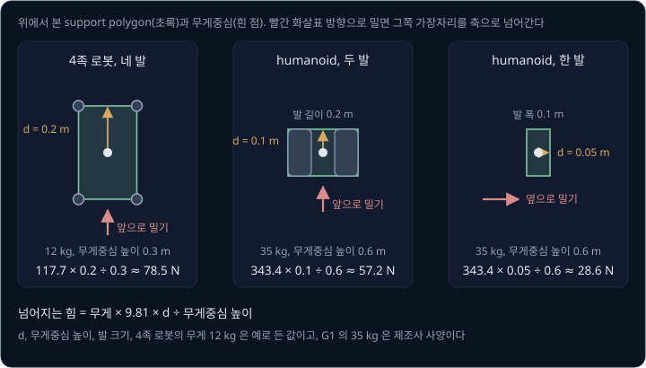
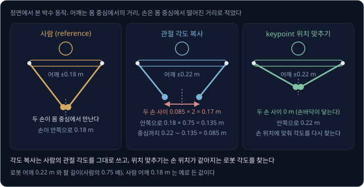
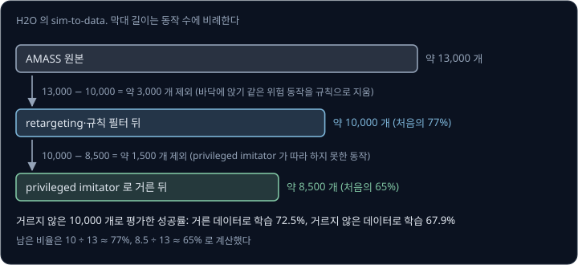
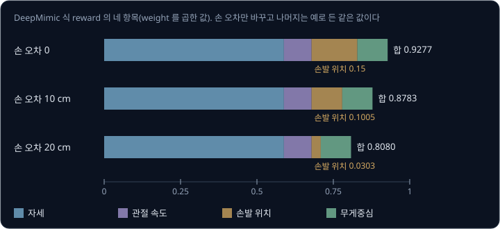
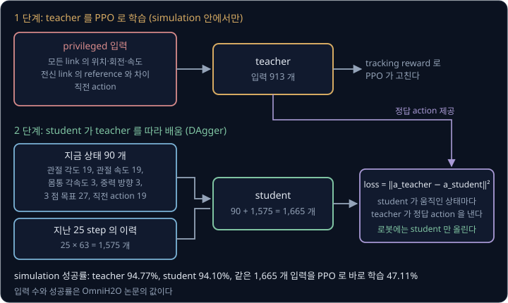
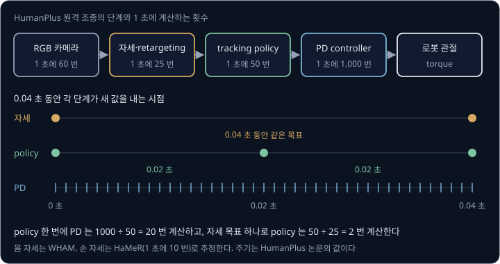
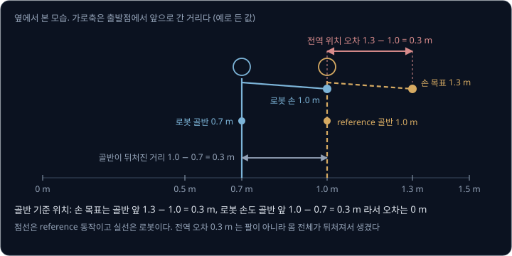
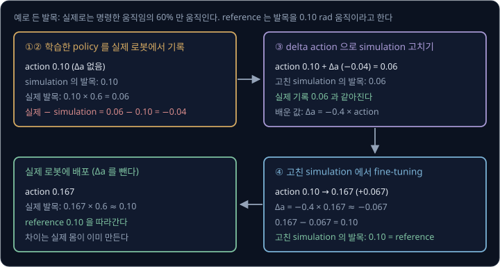
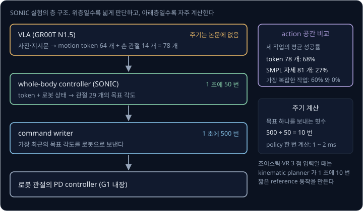

# Humanoid Whole-Body Control

[Sim-to-Real Locomotion](../sim2real-locomotion/README.md) 의 4족 보행 policy 는 앞뒤·옆·회전 속도 명령 세 개를 받아 다리 관절 12 개를 움직인다.
humanoid 에게 바닥의 상자를 집어 선반에 올리게 하려면 이런 명령으로는 모자란다. 무릎을 굽혀 쪼그려 앉고 허리를 숙이고 두 팔을 뻗는 동안에도
두 발로 버텨야 하는데, 이 자세를 속도 세 개로 적을 수는 없다. 관절이 23 개인 Unitree G1 에게 사람이 하는 동작을 그대로 시키면서 넘어지지
않게 하려면 policy 에 무엇을 목표로 주고 무엇으로 reward 를 줘야 할까?

최근 humanoid 연구가 이 물음에 내놓은 답은 사람의 motion capture 데이터(카메라로 기록한 몸의 움직임)를 로봇 관절로 옮겨 목표 동작으로 주고, 그 동작을 매 순간 따라 하도록
reinforcement learning 으로 학습하는 motion tracking 이다. policy 하나가 팔·다리·허리를 함께 움직이므로 이런 controller 를
**whole-body controller**(WBC)라고 부른다. He 등(2024)은 이렇게 학습한 policy(H2O)에 웹캠 한 대로 읽은 사람의 자세를 실시간으로 넣어,
Unitree H1 humanoid 가 사람을 따라 옆걸음으로 공을 차고 유모차를 밀게 했다.

## 학습 목표

- humanoid 가 4족 로봇보다 균형을 잃기 쉬운 이유를 support polygon(발이 바닥에 닿은 곳을 감싼 영역)과 넘어지는 힘의 계산으로 설명할 수 있다
- 사람 동작을 로봇 관절로 옮기는 retargeting 과, 로봇이 따라 할 수 없는 동작을 simulation 으로 걸러 내는 방법을 설명할 수 있다
- 동작을 얼마나 닮게 따라 했는지로 주는 motion tracking policy 의 imitation reward 와, simulation 에만 있는 정보로 학습한 teacher 를 실제 센서만 쓰는 student 로 옮기는 과정을 설명할 수 있다
- 실제 로봇의 기록으로 학습한 delta action model(action 에 더할 보정값을 내는 모델)이 simulation 과 실물의 차이를 메우는 방법과, whole-body controller 가 VLA(사진과 지시문을 받아 action 을 내는 모델) 아래에서 맡는 일을 설명할 수 있다

## humanoid 의 균형

humanoid 는 4족 로봇보다 관절이 많다. 팔과 허리까지 움직여야 해서, 제조사 사양과 논문에 적힌 관절 수는 아래처럼 19 개에서 33 개다.

| 로봇 | 관절 수 | 구성 |
| --- | --- | --- |
| Unitree A1 (4족) | 12 | 다리 4 개 × 3 |
| Unitree H1 | 19 | 다리 2 개 × 5, 팔 2 개 × 4, 몸통 1 |
| Unitree G1 (기본형) | 23 | 다리 2 개 × 6, 허리 1, 팔 2 개 × 5 |
| HumanPlus 로봇 (H1 개조) | 33 | 몸 19, 손목 2 개 × 1, 손 2 개 × 6 |

H1 은 키 약 180 cm 에 무게 약 47 kg 이고, G1 은 서 있을 때 키 1,320 mm 에 무게 약 35 kg 이다(제조사 사양). 관절 수보다 더 큰 차이는 바닥을
딛는 넓이다. 바닥에 닿은 점들을 고무줄로 감쌌을 때 생기는 영역을 **support polygon**(지지 다각형)이라고 한다. 서 있는 로봇은 무게중심(center of
mass, CoM)을 바닥으로 수직으로 내린 점이 support polygon 안에 있어야 쓰러지지 않는다. 4족 로봇은 네 발이 넓은 사각형을 만들지만, humanoid 는 두
발바닥이 만드는 좁은 영역 위에 서 있고 걸을 때는 걸음마다 한 발로만 서는 순간이 있다.

몸통을 밀 때 넘어지는 힘으로 비교해 보자. 무게중심 높이에서 미는 힘이 몸을 발 가장자리 축으로 돌리려는 효과는 힘 × 높이이고, 무게가 반대로
돌리려는 효과는 무게 × (무게중심에서 가장자리까지의 거리)다. 미는 힘의 효과가 더 크면 로봇이 가장자리를 축으로 기울어 쓰러진다. 4족 로봇의 무게는
[Sim-to-Real Locomotion](../sim2real-locomotion/README.md) 의 마찰 예처럼 12 kg 으로 두고, G1 은 사양의 35 kg 을 쓴다. 무게중심의 높이와 가장자리까지의
거리는 예로 든 값이다.

| 로봇과 자세 | 무게 × 9.81 | 가장자리까지 | 무게중심 높이 | 넘어지는 힘 |
| --- | --- | --- | --- | --- |
| 4족, 네 발 | $12 \times 9.81 \approx 117.7$ N | 0.2 m | 0.3 m | $117.7 \times 0.2 \div 0.3 \approx 78.5$ N |
| humanoid, 두 발 (앞으로 밀기) | $35 \times 9.81 \approx 343.4$ N | 0.1 m | 0.6 m | $343.4 \times 0.1 \div 0.6 \approx 57.2$ N |
| humanoid, 한 발 (옆으로 밀기) | $343.4$ N | 0.05 m | 0.6 m | $343.4 \times 0.05 \div 0.6 \approx 28.6$ N |

humanoid 는 4족 로봇보다 세 배 가까이 무거운데도 더 작은 힘에 넘어진다. 무게중심이 높아 미는 힘이 큰 지렛대를 얻고, 발이 좁아 무게가 버티는
지렛대는 짧기 때문이다. 그래서 humanoid 는 제자리에서 버티기보다 발을 내디뎌 support polygon 을 무게중심 아래로 옮겨야 한다. HumanPlus 의 저자들이
H1 의 골반을 밀어 보니, 제조사의 기본 controller 를 쓴 로봇은 앞으로 24 N 에서 균형을 잃었고, 학습한 policy 를 쓴 로봇은 32 N 까지 버텼다.

팔을 움직여도 균형이 바뀐다. 예를 들어 G1 의 팔이 들 수 있는 최대 무게인 약 2 kg(사양)짜리 상자를 몸 앞 0.4 m 에 들면 로봇과 상자를 합친 무게중심은
$2 \times 0.4 \div (35 + 2) \approx 0.022$ m, 약 2.2 cm 앞으로 옮겨 간다. 앞쪽 여유가 10 cm 였다면 그 22% 가 사라지므로, 다리와 허리가 무게를 그만큼
뒤로 옮겨야 한다. OmniH2O 의 저자들도 조작과 보행을 함께 안정하게 하려면 controller 가 상체와 하체를 한꺼번에 조율해야 한다고 보았다.

<b>심화: 넘어지는 힘의 식</b>

발 가장자리를 축으로 두 힘이 몸을 돌리려는 효과(moment)를 비교한다. 위 표의 두 발 humanoid 를 기호와 맞추면 아래와 같다.

| 이 예의 값 | 기호로 쓴 값 |
| --- | --- |
| 무게 35 kg | $m$ |
| 중력 가속도 9.81 m/s² | $g$ |
| 무게중심에서 가장자리까지 0.1 m | $d$ |
| 무게중심 높이 0.6 m | $h$ |
| 미는 힘의 효과 $F \times 0.6$ | $F h$ |
| 무게의 효과 $343.4 \times 0.1$ | $m g d$ |
| 넘어지는 힘 57.2 N | $F = m g d \div h$ |

$$
F h > m g d \quad\Longrightarrow\quad \text{가장자리를 축으로 쓰러진다}
$$

이 식은 로봇이 한 덩어리처럼 기울고, 발이 미끄러지지 않고, 발을 내딛지 않는다고 가정한 정적인 계산이다. 실제 policy 는 발목과 엉덩이를 움직이고
발을 내디뎌 이 한계를 넘는 힘도 버틴다. $d$ 가 반이 되면 $F$ 도 반이 되고, $h$ 가 두 배가 되면 $F$ 는 반이 된다.

**확인 문제.** 예로 든 G1(35 kg)이 두 발로 서서 앞쪽 여유가 0.1 m 인데, 2 kg 상자를 몸 앞 0.5 m 에 든다. 합친 무게중심은 얼마나 앞으로 옮겨 가고,
앞쪽 여유는 얼마나 남을까?

답 보기

1. 무게중심이 옮겨 가는 거리: $2 \times 0.5 \div (35 + 2) = 1 \div 37 \approx 0.027$ m
2. 남은 앞쪽 여유: $0.1 - 0.027 = 0.073$ m

답: 약 2.7 cm 앞으로 옮겨 가서 여유는 약 7.3 cm 가 남는다. 다리와 허리로 무게를 뒤로 옮기지 않으면, 넘어지는 힘 $m g d \div h$ 도 $d$ 가 줄어든
만큼 작아진다.

## motion capture 와 retargeting

사람의 움직임은 motion capture(mocap)로 기록한다. motion capture 는 몸에 붙인 표식(marker)을 여러 대의 카메라로 찍어 관절의 위치와 회전을 짧은
간격으로 기록하는 방법이다. 여러 연구실의 mocap 기록을 한 형식으로 모은 dataset 이 **AMASS** 인데, 논문 기준으로 346 명이 움직인 동작 11,451 개, 42 시간 분량이다.
AMASS 는 사람 몸을 숫자로 적는 **SMPL** 모델 형식을 쓴다. H2O 논문의 설명에 따르면 SMPL 은 체형을 숫자 10 개($\beta$)로 적고 자세를 관절 24 개의
회전($24 \times 3$ 개의 숫자, $\theta$)으로 적은 뒤, 이 둘로 꼭짓점 6,890 개의 몸 표면을 만든다.

사람과 로봇은 팔다리 길이도 관절 수도 다르다. 사람 동작을 로봇이 할 수 있는 관절 값으로 바꾸는 일을 **retargeting** 이라고 하며, 방법은 크게 두 가지다.

- 관절 각도 복사: 사람의 엉덩이·무릎·어깨·팔꿈치 각도를 로봇의 같은 관절에 그대로 넣는다. H1 의 엉덩이와 어깨는 서로 수직인 회전 관절 3 개라서
  사람의 공 모양 관절 하나로 볼 수 있다. ExBody 와 HumanPlus 가 이 방법을 썼다
- keypoint 위치 맞추기: 사람과 로봇에서 서로 대응하는 점(H2O 에서는 발목·팔꿈치·손목 등 12 개)을 고르고, 로봇의 그 점들이 사람의 점들에 가까워지도록
  로봇 관절 각도를 gradient descent 로 찾는다. H2O 와 ASAP 이 이 방법을 썼다

H2O 의 저자들은 각도를 복사하면 두 몸의 뼈대가 달라서 손발 위치가 크게 어긋날 수 있다고 적었다. 예를 들어 사람이 가슴 앞에서 두 손바닥을 붙여 박수를
친다. 사람의 어깨가 몸 중심에서 0.18 m 떨어져 있으면 손은 어깨보다 0.18 m 안쪽에 있다. 로봇의 어깨는 중심에서 0.22 m 이고 팔 길이는
사람의 0.75 배라고 하자(예로 든 값).

| | 관절 각도 복사 | keypoint 위치 맞추기 |
| --- | --- | --- |
| 손이 안쪽으로 가는 거리 | 각도가 같아 팔 길이에 비례: $0.18 \times 0.75 = 0.135$ m | 손이 몸 중심에 닿도록 각도를 다시 찾음: 0.22 m |
| 손이 몸 중심에서 떨어진 거리 | $0.22 - 0.135 = 0.085$ m | 0 m |
| 두 손 사이 | $0.085 \times 2 = 0.17$ m | 0 m (손바닥이 닿는다) |

각도를 복사하면 자세는 비슷해 보여도 박수는 허공을 친다. 물건을 잡거나 발을 정확한 곳에 디뎌야 하는 동작에서는 위치를 맞추는 쪽이 낫지만,
frame 마다 최적화 계산이 따로 든다.

위치를 맞출 때는 사람의 체형도 문제가 된다. H2O 의 저자들에 따르면 H1 은 기본 자세에서 두 발 사이가 넓어서, 평균 체형 사람의 발 위치를 그대로
맞추면 다리가 안쪽으로 모이는 불안정한 자세가 나왔다. 그래서 저자들은 먼저 기본 자세에서 대응점 12 개의 거리가 가장 가까워지는 사람 체형 $\beta'$ 을 찾고,
동작마다 체형만 $\beta'$ 로 바꾼 사람의 점들에 로봇을 맞췄다. ASAP 도 같은 두 단계를 썼다.

<b>심화: 두 단계 최적화의 목표</b>

대응점 $j$ 마다 로봇의 점 위치를 $p_j^{\text{robot}}$, 사람의 점 위치를 $p_j^{\text{human}}$ 이라고 하면 두 단계는 같은 꼴의 거리 합을 줄인다.

| 단계 | 바꾸는 값 | 고정하는 값 | 줄이는 값 |
| --- | --- | --- | --- |
| ① 체형 맞추기 (한 번) | 사람 체형 $\beta'$ | 두 몸 모두 기본 자세 | $\sum_{j=1}^{12} \lVert p_j^{\text{robot}} - p_j^{\text{human}}(\beta') \rVert^2$ |
| ② 동작 옮기기 (frame 마다) | 로봇 관절 각도 $q$ | 사람의 $\beta'$, 자세 $\theta$, 이동 | $\sum_{j=1}^{12} \lVert p_j^{\text{robot}}(q) - p_j^{\text{human}}(\beta', \theta) \rVert^2$ |

$\lVert \cdot \rVert^2$ 은 두 점 사이 거리의 제곱이다. H2O 는 ② 에 Adam optimizer 를 썼다. ExBody 는 관절 각도를 복사할 때도 계산을 하나
거쳤는데, 사람의 공 모양 관절 회전을 축과 각도(axis-angle)로 바꾼 뒤 축 방향 성분마다 각도를 곱해 로봇의 회전 관절 3 개 값으로 나눴다. 팔꿈치·무릎처럼
회전축이 하나인 관절에는 그 축 방향 성분만 넣었다.

**확인 문제.** 위 박수 예에서 로봇의 팔 길이가 사람의 0.6 배라면, 관절 각도를 복사했을 때 두 손 사이는 얼마나 떨어질까? 어깨 위치는 그대로다.

답 보기

1. 손이 안쪽으로 가는 거리: $0.18 \times 0.6 = 0.108$ m
2. 손이 몸 중심에서 떨어진 거리: $0.22 - 0.108 = 0.112$ m
3. 두 손 사이: $0.112 \times 2 = 0.224$ m

답: 약 22 cm 떨어진다. 팔이 짧을수록 각도 복사의 위치 오차가 커진다.

## sim-to-data 선별

retargeting 을 거친 동작 가운데는 로봇이 할 수 없는 것이 섞여 있다. H2O 의 저자들은 옆돌기와 다리 길이보다 넓은 보폭을 예로 들고, 이런 동작이
데이터에 남아 있으면 policy 가 그 동작을 따라 하려고 학습을 낭비한다고 보았다. 바닥에 앉는 동작처럼 위험한 것은 규칙으로 먼저 지웠지만, 수천 개의
동작을 사람이 하나씩 고를 수는 없어서 simulation 으로 동작을 거르는 **sim-to-data** 과정을 만들었다.

1. 물리값을 무작위로 바꾸는 domain randomization 없이, 실제 로봇에서는 얻을 수 없는 모든 link(관절 사이의 몸 마디)의 위치·속도를
   받는 privileged imitator 를 학습한다. 실제 로봇에 올릴 수는
   없지만 따라 하기 성능의 상한이라서, 이 policy 가 실패한 동작은 로봇이 할 수 없는 동작으로 본다
2. privileged imitator 가 따라 하지 못한 동작을 데이터에서 지운다
3. 남은 동작으로 실제 로봇에 올릴 policy 를 다시 학습한다

| 단계 | 동작 수 | 남은 비율 |
| --- | --- | --- |
| AMASS 원본 | 약 13,000 | |
| retargeting 과 규칙 필터 뒤 | 약 10,000 | $10 \div 13 \approx 77\%$ |
| privileged imitator 로 거른 뒤 | 약 8,500 | 처음의 $8.5 \div 13 \approx 65\%$ |

거르지 않은 동작 10,000 개 전체로 평가했을 때, 거른 데이터로 학습한 H2O 의 성공률은 72.5% 였고 거르지 않은 10,000 개로 학습한 policy 의 성공률은 67.9% 였다.
데이터가 더 적은데도 성공률이 4.6%p(두 % 값의 차이) 높았다. 여기서 성공은 로봇이 따라 할 목표 동작(reference)과 몸 link 들의 평균 거리가 한 번도
0.5 m 를 넘지 않은 경우다.

선별이 너무 엄격해도 문제다. ExBody2 의 저자들은 동작마다 하체의 추적 오차를 재서 기준값 이하인 동작만 남겼다. 기준값이 너무 작으면 쉬운 동작만
남아 일반화하지 못했고, 너무 크면 할 수 없는 동작이 섞여 학습이 흔들렸다. 그래서 중간 기준값이 가장 좋았다. 오차를 하체에서만 잰 것은 균형을 무너뜨리는
하체 동작만 지우고 상체 동작의 다양성은 남기기 위해서다.

> **오해** mocap 데이터는 많을수록 좋으니 retargeting 한 동작을 모두 학습에 넣는다.
>
> **사실** H2O 에서는 따라 할 수 없는 동작을 지운 약 8,500 개로 학습한 policy 가 10,000 개 전체로 학습한 policy 보다 성공률이 4.6%p 높았다(72.5% 와 67.9%).

**확인 문제.** 동작 10,000 개로 평가했을 때 성공률 72.5% 와 67.9% 는 성공한 동작 수로 각각 몇 개이고, 몇 개 차이일까?

답 보기

1. 거른 데이터로 학습: $10{,}000 \times 0.725 = 7{,}250$ 개
2. 거르지 않은 데이터로 학습: $10{,}000 \times 0.679 = 6{,}790$ 개
3. 차이: $7{,}250 - 6{,}790 = 460$ 개

답: 460 개 차이다. 평가에는 지운 동작도 들어 있으므로, 거른 데이터로 학습한 policy 는 학습 때 보지 못한 동작에서도 더 잘 버텼다.

## motion tracking reward

motion tracking policy 도 보행 policy 처럼 관절 상태와 몸통 IMU(회전 속도와 가속도를 재는 센서) 값을 받아 관절의 목표 각도를 내고, 관절의 PD
controller 가 그 목표를 torque 로 바꾼다. 다만 motion tracking policy 는 속도 명령 대신 reference 동작의 다음
frame(다음 순간의 목표 자세)을 받는다. 이 형식은 컴퓨터 그래픽스에서 simulation 속 사람 캐릭터에게 mocap 동작을 따라 하게 한 Peng
등(2018)의 DeepMimic 에서 왔다. DeepMimic 은 동작이 어디까지 진행됐는지를 나타내는 0 ~ 1 사이의 phase 값도 policy 에 넣었고, ASAP 은 동작 하나를
따라 할 때 이 phase 값만 목표로 준다.

reward 는 reference 와 얼마나 가까운지를 항목마다 0 ~ 1 사이 점수로 바꾼 뒤 weight 를 곱해 더한 값이다. 점수는 오차의 제곱에 계수 $k$ 를 곱해
$e^{-k \times \text{오차}^2}$ 로 계산하는데, 보행 reward 의 속도 추종 점수와 같은 꼴이다. DeepMimic 의 네 항목은 아래와 같다.

| 항목 | 오차 | $k$ | weight |
| --- | --- | --- | --- |
| 자세 | 관절마다 회전 차이(rad)의 제곱 합 | 2 | 0.65 |
| 관절 속도 | 관절마다 각속도 차이의 제곱 합 | 0.1 | 0.1 |
| 손발 위치 | 두 손·두 발 위치 차이(m)의 제곱 합 | 40 | 0.15 |
| 무게중심 | 무게중심 위치 차이(m)의 제곱 | 10 | 0.1 |

로봇이 자세를 거의 따라 하는데 오른손만 reference 에서 벗어난 경우를 계산한다. 자세 오차의 제곱 합 0.05, 속도 오차의 제곱 합 1.0, 무게중심
오차 0.03 m 는 예로 든 값이다.

| 항목 | 손 오차 0 | 손 오차 10 cm | 손 오차 20 cm |
| --- | --- | --- | --- |
| 자세 $0.65 \times e^{-2 \times 0.05}$ | 0.5881 | 0.5881 | 0.5881 |
| 관절 속도 $0.1 \times e^{-0.1 \times 1.0}$ | 0.0905 | 0.0905 | 0.0905 |
| 손발 위치 $0.15 \times e^{-40 \times \text{오차}^2}$ | $0.15 \times 1 = 0.15$ | $0.15 \times e^{-0.4} = 0.1005$ | $0.15 \times e^{-1.6} = 0.0303$ |
| 무게중심 $0.1 \times e^{-10 \times 0.0009}$ | 0.0991 | 0.0991 | 0.0991 |
| reward | 0.9277 | 0.8783 | 0.8080 |

손 오차가 10 cm 에서 20 cm 로 두 배가 되면 제곱한 오차는 네 배가 되어, 손발 점수는 0.1005 에서 0.0303 으로 3 분의 1 이하가 된다. m 단위의 손발
오차는 작은 숫자라서, 손발 위치의 $k$ 가 40 처럼 크지 않으면 몇 cm 차이로는 점수가 거의 줄지 않는다. 실제 로봇용 reward 에는 보행 reward 의 penalty 도
들어간다. H2O 는 관절과 몸 link 를 따라 하는 항목 6 개에 torque 한계, action 변화, 발 미끄러짐 같은 penalty 를 더했다.

정해 둔 실패 조건에 걸리면 episode 를 바로 끝내는 조기 종료(early termination)도 학습 결과를 크게 바꾼다. DeepMimic 의 저자들은 몸통이나 머리가 바닥에 닿으면
episode 를 끝냈고, 조기 종료를 빼면 쓰러진 채 바닥에서 동작을 흉내 내는 policy 가 나왔다고 보고했다. H2O 는 reference 와 link 들의 평균 거리가 0.5 m 를 넘으면 episode 를 끝냈고, ASAP 은 이 거리 기준을 처음에
1.5 m 로 넉넉히 두었다가 학습이 진행될수록 0.3 m 까지 좁혔다. 점프를 따라 하는 policy 가 학습 초반에 착지 penalty 를 피하려고 바닥에 머무는 것을 막기
위해서다.

episode 를 어디서 시작하느냐도 결과를 바꾼다. 뒤공중제비를 따라 하는 policy 는 착지를 할 줄 알아야 점프에서 높은 return 을 받지만, 늘 동작의 처음에서 시작하면
착지 장면에 가 볼 기회가 거의 없다. DeepMimic 은 episode 마다 reference 의 무작위 시점을 골라 로봇을 그 시점의 자세와 속도로 놓고 시작하는
**reference state initialization**(RSI)을 썼다. RSI 없이 학습한 policy 는 뒤공중제비 대신 뒤로 작게 뛰기만 했다. ASAP 과 ExBody 도 RSI 를 썼다.

<b>심화: DeepMimic 의 imitation reward 식</b>

위 표의 손 오차 10 cm 경우를 기호와 맞추면 아래와 같다. $\ominus$ 는 두 회전의 차이를 회전각(rad)으로 잰 값이고, $\hat{\ }$ 이 붙은 값은 reference 다.

| 이 예의 값 | 기호로 쓴 값 |
| --- | --- |
| 관절 회전 차이의 제곱 합 0.05 | $\sum_j \lVert \hat q_t^j \ominus q_t^j \rVert^2$ |
| 각속도 차이의 제곱 합 1.0 | $\sum_j \lVert \hat{\dot q}_t^j - \dot q_t^j \rVert^2$ |
| 손발 위치 차이의 제곱 합 $0.1^2 = 0.01$ | $\sum_e \lVert \hat p_t^e - p_t^e \rVert^2$ |
| 무게중심 차이의 제곱 $0.03^2 = 0.0009$ | $\lVert \hat p_t^c - p_t^c \rVert^2$ |
| 점수 0.9048, 0.9048, 0.6703, 0.9910 | $r_t^p,\ r_t^v,\ r_t^e,\ r_t^c$ |
| reward 0.8783 | $r_t^I = 0.65\,r_t^p + 0.1\,r_t^v + 0.15\,r_t^e + 0.1\,r_t^c$ |

$$
r_t^p = \exp\Big[-2 \sum_j \lVert \hat q_t^j \ominus q_t^j \rVert^2\Big], \qquad
r_t^e = \exp\Big[-40 \sum_e \lVert \hat p_t^e - p_t^e \rVert^2\Big]
$$

$r_t^v$ 와 $r_t^c$ 도 같은 꼴이고 계수만 0.1 과 10 이다. 공을 목표로 던지기처럼 과제가 따로 있으면 DeepMimic 은 이 imitation reward 에 weight 0.7 을 곱하고
과제 reward 에 weight 0.3 을 곱해 더했다.

**확인 문제.** 위 예에서 오른손 오차가 5 cm 이고 나머지는 그대로라면 손발 점수와 reward 는 얼마일까? $e^{-0.1} \approx 0.9048$ 이다.

답 보기

1. 손발 오차의 제곱 합: $0.05^2 = 0.0025$
2. 손발 점수: $0.15 \times e^{-40 \times 0.0025} = 0.15 \times e^{-0.1} \approx 0.15 \times 0.9048 = 0.1357$
3. reward: $0.5881 + 0.0905 + 0.1357 + 0.0991 = 0.9134$

답: 손발 점수는 약 0.1357 이고 reward 는 약 0.9134 다. 오차 0 의 0.9277 과 10 cm 의 0.8783 사이에 온다.

## privileged teacher 와 student

simulation 에서는 로봇의 모든 link 가 어디에 있고 얼마나 빠른지 정확히 알지만, 실제 로봇에는 몸통 IMU 와 관절 각도를 재는 encoder 뿐이다. 특히 몸통이 땅 위를
얼마나 빠르게 움직이는지(linear velocity)는 재기 어렵다. H2O 의 저자들은 이 값을 policy 에 넣었기 때문에 실제 로봇에서도 mocap 시스템으로 로봇의 속도를 재야
했다. 원격 조종 장비가 주는 목표도 적어서, VR 헤드셋으로는 사람의 머리와 두 손이라는 세 점의 위치만 잴 수 있다.

OmniH2O 는 [Sim-to-Real Locomotion](../sim2real-locomotion/README.md#teacher-student-학습) 에서 본 teacher-student 학습으로 이 문제를 풀었다.
teacher 는 모든 link 의 상태와 전신의 reference 를 받아 PPO 로 학습하고, student 는 실제 로봇과 VR 에서 얻을 수 있는 값만 받는다.

| | teacher | student |
| --- | --- | --- |
| 몸 상태 | 모든 link 의 위치·회전·속도, 직전 action | 관절 각도 19, 관절 속도 19, 몸통 각속도 3, 중력 방향 3, 직전 action 19 |
| 목표 | 전신 link 의 reference 와 그 차이 | 머리·두 손 3 점의 위치·차이·속도 27 |
| 이력 | 없음 | 지난 25 step 의 몸 상태 (step 마다 63 개) |
| 입력 수 | 913 | $90 + 25 \times 63 = 1{,}665$ |
| 학습 | PPO | DAgger: $\lVert a^{\text{teacher}} - a^{\text{student}} \rVert^2$ 을 줄임 |

[DAgger](../dagger/README.md) 처럼 student 가 simulation 에서 직접 움직이고, student 가 지나간 상태마다 teacher 가 낼 action 을 정답으로 삼는다. student
의 입력에는 몸통의 linear velocity 가 없어서, student 는 지난 25 step 의 관절과 IMU 값 변화에서 그 속도를 짐작한다. 1 만 4 천 개 동작으로
simulation 에서 잰 성공률은 아래와 같다.

| policy | 학습 | 성공률 |
| --- | --- | --- |
| teacher | PPO, privileged 입력 | 94.77% |
| student, 이력 25 step | DAgger | 94.10% |
| 같은 입력을 PPO 로 바로 학습 | PPO | 47.11% |
| 이력 없이 PPO 로 바로 학습 | PPO | 90.62% |

같은 1,665 개 입력을 PPO 로 바로 학습하면 47.11% 에 그쳤다. 저자들은 입력이 길어지면 PPO 가 그 복잡함을 감당하지 못하고, 정답 action 을 바로 주는
supervised learning 은 긴 이력을 잘 쓴다고 설명했다. 이력이 없으면 PPO 로도 90.62% 가 나와서 simulation 에서는 이력의 효과가 작아 보인다. 하지만 실제
로봇에서 서 있는 동작 20 개를 따라 할 때의 전역 위치 오차는 이력이 없는 student 가 83.26 mm 였고, 25 step 이력이 있는 student 가 47.94 mm 였다.

ASAP 과 SONIC 은 teacher 대신 asymmetric actor-critic 을 썼다. PPO 의 critic(상태의 가치를 맞히는 network)에만 privileged 정보를 주고 actor(action 을
내는 network)에는 실제 로봇에서 얻을 수 있는 값만 주는 방식이다. 로봇에는 actor 만 올라가므로 teacher 를 student 로 옮기는 단계가 필요 없다.

> **오해** student 는 정보가 적으니 teacher 보다 훨씬 못하다.
>
> **사실** OmniH2O 의 student 는 입력의 종류가 적지만 지난 25 step 의 이력으로 빠진 정보를 짐작해, simulation 성공률이 teacher 의 94.77% 와 거의 같은 94.10% 였다.

**확인 문제.** OmniH2O 의 student 가 이력을 5 step 만 받으면 입력은 몇 개일까? 50 step 이면?

답 보기

1. 지금 step: 관절 각도 19 + 관절 속도 19 + 몸통 각속도 3 + 중력 방향 3 + 3 점 목표 27 + 직전 action 19 = 90
2. 이력 한 step: $19 + 19 + 3 + 3 + 19 = 63$
3. 5 step: $90 + 5 \times 63 = 405$, 50 step: $90 + 50 \times 63 = 3{,}240$

답: 405 개와 3,240 개로, 논문의 이력 비교 표에 적힌 입력 수와 같다. 저자들은 이 가운데 25 step 이 성능과 학습 효율의 균형이 가장 좋다고 보았다.

## 전신 원격 조종

motion tracking policy 는 목표 자세만 받으면 그 자세가 어디서 왔든 같은 계산을 한다. 그래서 mocap 데이터로 학습했어도, 실행할 때 사람의 자세를
실시간으로 재서 넣으면 로봇이 사람을 따라 움직인다. 사람이 로봇의 전신을 직접 조종하는 이 방식을 whole-body teleoperation 이라고 한다.

| | H2O | HumanPlus | OmniH2O |
| --- | --- | --- | --- |
| 사람의 자세를 재는 장비 | 웹캠 1 대 | RGB 카메라 1 대 | VR 헤드셋 (머리·두 손) |
| 자세 추정 | HybrIK, 1 초에 30 번 | 몸 WHAM 25 번, 손 HaMeR 10 번 | VR 기기의 추적값 |
| tracking policy | 1 초에 50 번 | 1 초에 50 번, 직전 8 step 을 보는 transformer | 1 초에 50 번 |
| PD controller | 1 초에 200 번 | 1 초에 1,000 번 | 1 초에 200 번 |

HumanPlus 에서는 주기가 다른 단계가 겹쳐 있다. 몸 자세는 0.04 초마다 새로 오고 policy 는 0.02 초마다 action 을 내므로, policy 는 같은 목표로 두 번
계산한다. PD controller 는 policy 의 action 하나를 받아 $1000 \div 50 = 20$ 번 torque 를 다시 계산한다.

원격 조종은 시연 데이터를 모으는 데 쓰인다. HumanPlus 의 저자들은 원격 조종하는 동안 로봇 머리의 카메라 영상과 목표 자세를 기록해, 영상을 보고 목표
자세 덩어리를 내는 imitation policy 를 학습했다. 작업마다 시연을 최대 40 개만 써서 신발을 신고 일어나 걷기, 옷 개기 같은 작업을 60 ~ 100% 성공했다.
OmniH2O 의 imitation policy 는 관절 값이 아니라 머리와 두 손의 목표를 내고, 그 목표를 tracking policy 가 관절 action 으로 바꾼다. 저자들은 저수준
동작을 이렇게 tracking policy 에 맡기면 필요한 시연 수가 크게 준다고 적었다.

**확인 문제.** H2O 처럼 tracking policy 가 1 초에 50 번 계산하고 자세 추정이 1 초에 30 번 새 목표를 낸다. 1 초 동안 policy 가 새 목표 없이 이전
목표로 계산하는 횟수는 몇 번일까? PD controller 가 1 초에 200 번이면 policy 한 번에 PD 는 몇 번 계산할까?

답 보기

1. policy 50 번 가운데 새 목표가 있는 것은 많아야 30 번이라서 $50 - 30 = 20$ 번은 이전 목표를 다시 쓴다
2. PD: $200 \div 50 = 4$ 번

답: 20 번과 4 번이다. 목표가 늦게 바뀌어도 policy 는 0.02 초마다 균형을 다시 잡는다.

## 범용 motion tracking controller

동작마다 policy 를 따로 학습하면 policy 가 수천 개 필요하다. 2024 ~ 2025 년의 연구는 policy 하나로 수천 개의 동작을 따라 하는 controller 를 만드는
쪽으로 나아갔다.

| 방법 | 로봇 | 따라 하는 범위 | 학습 | 학습 동작 |
| --- | --- | --- | --- | --- |
| ExBody (2024) | H1 | 상체 관절 9 개·keypoint 6 개 + 몸통 속도 | PPO | CMU mocap 780 개, 3.7 시간 |
| ExBody2 (2024) | G1, 관절 23 | 전신, 골반 기준 keypoint + 몸통 속도 | teacher → student | 하체 오차로 자동 선별 |
| GMT (2025) | G1, 관절 23 | 전신, 앞으로 약 2 초의 목표 | teacher → student | 8,925 개, 33.12 시간 |
| SONIC (2025) | G1, 관절 29 | 전신, 여러 입력을 공통 token 으로 | PPO, asymmetric actor-critic | 611 시간 (원본 약 700 시간) |

ExBody 의 저자들은 사람의 다리 동작까지 맞추게 하면 제약이 지나쳐 policy 가 불안정해진다고 보고, 상체만 reference 를 따라 하고 다리는 몸통 속도
명령만 따르게 했다. 그 대가로 다리 동작은 따라 하지 못해서, ExBody2 의 비교 실험에서 ExBody 의 하체 관절 평균 오차는 0.2952 rad 로 ExBody2 의
0.1253 rad 의 두 배가 넘었다.

ExBody2 는 전신을 따라 하면서 keypoint 의 기준을 바꿨다. H2O 와 OmniH2O 는 손·발 같은 keypoint 의 목표로 reference 의 전역 위치(출발점 기준 위치)를
썼다. 이 방식에서는 로봇이 한 번 미끄러지면 몸 전체가 reference 에서 어긋나, 자세가 맞아도 목표 오차가 남는다. 예를 들어 reference 의 골반이 출발점에서 1.0 m 앞에
있고 손은 골반보다 0.3 m 앞(1.3 m)에 있다고 하자. 로봇의 골반은 미끄러져 0.7 m 에 있고, 손은 골반보다 정확히 0.3 m 앞(1.0 m)에 있다(예로 든 값).

| | 손 목표 | 로봇 손 | 손 오차 |
| --- | --- | --- | --- |
| 전역 위치 | 1.3 m | 1.0 m | $1.3 - 1.0 = 0.3$ m |
| 골반 기준 위치 | 골반 앞 0.3 m | 골반 앞 0.3 m | 0 m |

전역 위치의 0.3 m 오차는 팔이 아니라 몸 전체가 뒤처져서 생겼지만, policy 는 이 오차를 줄이려고 팔을 앞으로 내뻗을 수 있다. ExBody2 는 keypoint 를
로봇 골반 기준으로 바꿔 자세만 따라 하게 하고, 몸 전체의 위치는 몸통 속도를 따라 하는 항목에 맡겼다. GMT 도 같은 기준을 쓰면서 앞으로 약 2 초
분량의 frame 을 목표로 주어 다가오는 동작에 미리 대비하게 했다. 또 걷기 동작의 비중이 큰 AMASS 에서는 추적 오차가 큰 동작을 더 자주 뽑았다.

SONIC 을 만든 NVIDIA 의 저자들은 규모를 키웠다. network 를 parameter 120 만 개에서 4,200 만 개까지 늘렸고, mocap 약 700 시간에서 계단 오르기나
앉은 동작처럼 로봇이 할 수 없는 동작을 거른 611 시간(1 초에 50 frame 으로 1 억 frame 이상)으로 학습했다. 학습에는 GPU 128 장으로 7 일,
$128 \times 24 \times 7 = 21{,}504$ GPU 시간이 들었다. 저자들은 학습에 없던 182 개 하위 범주의 동작에서도 성공률이 높게 유지되어, motion tracking 을
크게 키우면 처음 보는 동작으로 일반화된다고 보고했다.

**확인 문제.** reference 골반이 2.0 m, 손이 골반 앞 0.4 m 에 있고, 로봇 골반은 1.8 m, 로봇 손은 골반 앞 0.3 m 에 있다. 전역 위치와 골반 기준 위치의 손
오차는 각각 얼마일까?

답 보기

1. 전역 위치: 목표 $2.0 + 0.4 = 2.4$ m, 로봇 손 $1.8 + 0.3 = 2.1$ m, 오차 $2.4 - 2.1 = 0.3$ m
2. 골반 기준: 목표 0.4 m, 로봇 손 0.3 m, 오차 $0.4 - 0.3 = 0.1$ m

답: 0.3 m 와 0.1 m 다. 전역 위치 오차 0.3 m 가운데 0.2 m 는 골반이 뒤처진 몫이고, 팔 자세의 오차는 0.1 m 뿐이다.

## delta action model

[Sim-to-Real Locomotion](../sim2real-locomotion/README.md#domain-randomization) 에서 본 것처럼 domain randomization 의 범위를 넓힐수록 policy 는 조심스러운
동작을 배운다. H2O 의 저자들은 마찰 계수(0.2 ~ 1.1), link 질량(기본값의 0.7 ~ 1.3 배), PD gain(기본값의
0.75 ~ 1.25 배), 제어 지연(20 ~ 60 ms)을 범위 안에서 무작위로 뽑아 걷기와 공 차기를 실제 H1 으로 옮겼다. 하지만 ASAP 의 저자들은 이런 randomization 이
지나치게 조심스러운 policy 를 만들어 멀리뛰기나 한 발 서기 같은 민첩한 동작을 막는다고 보았다.
질량이나 PD gain 같은 parameter 를 실측으로 맞추는 system identification(SysID)은 미리 정해 둔 parameter 밖의 차이를 잡지 못한다.

ASAP(He 등 2025)은 실제 로봇의 기록으로 simulation 을 고친다. 차이를 parameter 로 설명하는 대신, simulation 에서 실제와 같은 결과가 나오려면 action 에
얼마를 더해야 하는지를 배우는 network 를 둔다. 이 network 가 **delta action model** $\Delta a = \pi^\Delta(s, a)$ 이고, ASAP 은 네 단계로 학습한다.

1. simulation 에서 motion tracking policy 를 학습한다
2. 그 policy 를 실제 G1 에 올려 동작을 시키고, 관절 값과 mocap 으로 잰 몸통 위치·속도를 기록한다
3. simulation 을 실제 기록의 상태에서 시작해, 기록한 action 에 $\Delta a$ 를 더해 진행한다. 다음 상태가 실제 기록과 가까울수록 reward 를 주어 delta
   action model 을 PPO 로 학습한다
4. delta action model 을 고정해 simulation 에 넣고 policy 를 fine-tuning 한 뒤, 실제 로봇에는 delta action model 없이 policy 만 올린다

예를 들어 실제 발목은 명령한 움직임의 60% 만 움직이고, reference 의 발목 움직임은 0.10 rad 라고 하자(예로 든 값). 이 발목에서 delta action
model 이 배우는 값은 action 의 −0.4 배($\Delta a = -0.4 \times a$)다.

| 단계 | policy 의 action | 더해지는 $\Delta a$ | 발목의 움직임 |
| --- | --- | --- | --- |
| ① simulation 에서 학습한 policy | 0.10 | 없음 | simulation 0.10, 실제 $0.10 \times 0.6 = 0.06$ |
| ③ 실제 기록을 맞추는 delta action | 0.10 | $0.06 - 0.10 = -0.04$ | 고친 simulation 0.06 (실제와 같다) |
| ④ 고친 simulation 에서 fine-tuning | $0.10 \div 0.6 \approx 0.167$ | $-0.4 \times 0.167 \approx -0.067$ | 고친 simulation 0.10 |
| 실제 로봇에 배포 | 0.167 | 없음 | 실제 $0.167 \times 0.6 \approx 0.10$ |

배포할 때 delta action model 을 빼는 것은 실제 로봇이 그 차이를 이미 몸으로 만들기 때문이다.

저자들은 delta action 을 SysID 와 비교하고, 다음 상태에 더할 차이를 배우는 delta dynamics 와도 비교했다. 방법마다 훈련용 simulator(IsaacGym)를 다른 simulator(IsaacSim)의
기록에 맞추고 그 기록의 action 을 1 초 동안 그대로 재생했다. 전역 관절 위치 오차는 고치지 않았을 때 80.8 mm 였고 SysID 로 고쳤을 때 77.6 mm 였다.
delta dynamics 로 고쳤을 때는 68.1 mm 였고, delta action 으로 고쳤을 때는 37.9 mm 였다. 실제 G1 에서는 공 차기의 전역 위치 오차가 61.2 mm 에서 50.2 mm 로 줄었고, delta action 학습에 쓰지 않은 동작에서도 159 mm
에서 112 mm 로 줄었다.

실제 데이터는 비싸다. 23 개 관절 전체의 delta action 을 학습하려면 동작 기록이 400 개 넘게 필요했다. 그런데 격한 동작에 motor 가 빨리 과열되어, 기록하는
동안 G1 두 대가 망가졌다. 그래서 저자들은 링크 구조 때문에 simulation 과 차이가 크게 나는 두 발목의 관절 4 개만 고쳤고, 그러자 기록 100 개로 충분했다.

<b>심화: delta action 을 빼서 쓰지 않는 이유</b>

$\pi^\Delta$ 가 실제 로봇을 잘 흉내 낸다면 $f^{\text{sim}}(s,\ a + \pi^\Delta(s, a)) \approx f^{\text{real}}(s, a)$ 다. 여기서 $f$ 는 상태와 action 으로
다음 상태를 내는 계산이다. simulation 에서 잘 따라 하던 policy $\hat\pi$ 의 action 이 실제로 같은 결과를 내려면 한 step 만 보고 아래 관계를
맞추면 될 것 같다.

$$
\pi(s) = \hat\pi(s) - \pi^\Delta\big(s,\ \pi(s)\big)
$$

위 발목 예에서 $\pi^\Delta(s, a) = -0.4a$ 라면 $a = 0.10 + 0.4a$ 라서 $a = 0.10 \div 0.6 \approx 0.167$ 로, fine-tuning 결과와 같다. 하지만 실제
$\pi^\Delta$ 는 상태와 action 에 따라 복잡하게 바뀌는 network 라서, 저자들은 이 관계를 반복 대입(fixed-point iteration)이나 gradient 로 푸는 방법도
시험했다. 두 방법 모두 한 step 앞만 보고, 학습 때 보지 못한 상태와 action 에서 $\pi^\Delta$ 를 불러 고치기 전보다 오차가 컸다. 고친 simulation 에서
PPO 로 fine-tuning 하면 policy 가 여러 step 뒤의 결과까지 보고 action 을 고친다.

**확인 문제.** 실제 발목이 명령의 80% 만 움직인다. reference 가 0.12 rad 를 요구할 때, 처음 policy 가 0.12 를 냈다면 delta action model 이 맞춰야 하는
값은 얼마일까? 고친 simulation 에서 fine-tuning 한 policy 는 얼마를 내야 할까?

답 보기

1. 처음 policy 의 실제 움직임: $0.12 \times 0.8 = 0.096$ rad 라서 delta action 은 $0.096 - 0.12 = -0.024$
2. fine-tuning 한 policy 의 action: $0.12 \div 0.8 = 0.15$
3. 확인: 실제 로봇에서 $0.15 \times 0.8 = 0.12$ rad

답: 처음 delta action 은 $-0.024$ 이고, fine-tuning 한 policy 는 0.15 를 낸다.

## VLA 아래의 whole-body controller

[GR00T N1](../groot/README.md#system-2-와-system-1) 은 사진과 지시문을 읽는 VLM(System 2)과 action 덩어리를 만드는 diffusion transformer(System 1)로
되어 있다. 걷는 humanoid 에서는 그 아래에 한 층이 더 있다. VLA 가 손과 몸이 어디로 가야 할지를 정하면, whole-body controller 가 그 목표를 따라가면서
1 초에 50 번 균형을 다시 잡아 관절 목표를 낸다. VLA 가 수십 ms 걸려 action 덩어리를 만드는 동안에도 몸은 밀리거나 미끄러질 수 있기 때문이다.

GR00T-WholeBodyControl 저장소의 설명에 따르면 GR00T N1.5 와 N1.6 이 쓴 Decoupled WBC 는 하체를 reinforcement learning policy 로 제어하고, 상체를
inverse kinematics 로 따로 제어한다. SONIC 은 이 자리를 전신 motion tracking 으로 바꿨다. SONIC 의 encoder 가 사람 자세, 로봇 동작, VR 의 3 점 목표 같은
서로 다른 입력을 같은 공간으로 바꾼 숫자 묶음을 motion token 이라고 한다. SONIC 의 저자들은 G1 원격 조종 데이터로 GR00T N1.5 를 fine-tuning 하고, VLA 가
64 개 숫자로 된 motion token 과 손가락 관절 14 개를 합친 78 개의 숫자를 내게 했다. SONIC 은 이 token 을 관절 목표로 바꾼다.

| 층 | 하는 일 | SONIC 시스템의 주기 |
| --- | --- | --- |
| VLA (GR00T N1.5) | 사진·지시문으로 motion token 과 손 관절을 낸다 | 논문에 적히지 않음 |
| kinematic planner (조이스틱·3 점 입력일 때) | 짧은 reference 동작을 만든다 | 1 초에 10 번 |
| whole-body controller | token 과 로봇 상태로 관절 29 개의 목표 각도를 낸다 | 1 초에 50 번 |
| command writer | 최신 목표 각도를 로봇의 관절 PD 로 보낸다 | 1 초에 500 번 |

저자들이 같은 VLA 에게 SMPL 사람 자세(손 관절 포함 81 개 숫자)를 직접 내게 하고 비교하니, 세 작업의 평균 성공률은 token 이 68% 였고 SMPL 자세가 27% 였다. 캔을
집어 들고 쓰레기통까지 걸어가 페달을 밟아 뚜껑을 열고 던져 넣는 가장 복잡한 작업에서는 60% 와 0% 였다. 저자들은 연속값으로 된 큰 자세 공간에서는
작은 예측 오차가 큰 추적 실패로 번지고, 정해진 값만 갖는 token 공간은 VLA 가 배우기 쉽다고 설명했다. SONIC 의 policy 는 로봇에 실린 Jetson Orin 에서
한 번 계산하는 데 1 ~ 2 ms 가 걸렸다.

[PID Control](../pid-control/README.md#학습한-policy-아래의-pid) 에서 본 policy 와 PID 의 역할 분담이 humanoid 에서는 한 층 더 늘어나, 위층일수록 느리게
넓은 범위를 판단하고 아래층일수록 자주 계산하며 몸을 지킨다.

> **오해** humanoid 용 VLA 는 관절 29 개의 목표 각도를 직접 낸다.
>
> **사실** SONIC 실험에서 GR00T N1.5 는 64 개 숫자의 motion token 과 손 관절만 냈고, 관절 목표와 균형은 1 초에 50 번 계산하는 whole-body controller 가 맡았다.
> 전신 자세를 직접 내게 하면 평균 성공률이 68% 에서 27% 로 떨어졌다.

**확인 문제.** whole-body controller 가 1 초에 50 번, command writer 가 1 초에 500 번 계산한다. controller 의 목표 하나를 command writer 는 몇 번 보낼까?
VLA 가 덩어리 하나를 만드는 데 0.2 초가 걸린다면 그동안 controller 는 몇 번 계산할까?

답 보기

1. command writer: $500 \div 50 = 10$ 번
2. controller: 한 번에 $1 \div 50 = 0.02$ 초라서 $0.2 \div 0.02 = 10$ 번

답: 10 번과 10 번이다. VLA 의 새 출력을 기다리는 동안에도 controller 는 마지막 token 으로 균형을 계속 잡는다.

## 정리

- humanoid 는 무게중심이 높고 support polygon 이 좁아서, 예로 든 35 kg G1 은 한 발로 설 때 28.6 N 의 옆 힘에도 넘어갈 수 있다. 그래서 팔과 다리를
  함께 움직이는 whole-body controller 가 발을 내디디며 균형을 잡는다
- 사람 mocap 을 retargeting 으로 로봇 관절에 옮기는데, 관절 각도를 복사하면 손발 위치가 어긋난다(예의 박수에서 0.17 m). H2O 는 따라 할 수 없는 동작을
  privileged imitator 로 걸러 약 10,000 개에서 8,500 개를 남겼다
- tracking policy 는 $e^{-k \times \text{오차}^2}$ 점수의 합을 reward 로 받고 조기 종료와 RSI 로 학습한다. OmniH2O 의 student 는 1,665 개 입력과 DAgger
  로 teacher(94.77%)에 가까운 성공률 94.10% 를 냈다
- ASAP 의 delta action 은 1 초 재생 오차를 80.8 mm 에서 37.9 mm 로 줄였다. SONIC 은 GR00T N1.5 가 낸 64 개 숫자의 token 을 1 초에 50 번 관절 목표로
  바꾸는 whole-body controller 가 되었다

이 강의의 policy 는 reference 동작을 따라 하도록 학습했을 뿐, 주어진 작업의 성공 여부로 reward 를 받지는 않는다. 시연으로 학습한 VLA 를 작업 성공
reward 로 다시 학습하는 방법은 [VLA + RL](../vla-rl/README.md) 에서 다루고, 다음 장면을 예측하는 model 을 배워 행동을 미리 비교해 보는 방법은
[World Model](../world-model/README.md) 에서 다룬다.

## 참고 자료

- Xue Bin Peng 외, [DeepMimic](https://arxiv.org/abs/1804.02717) (2018) — imitation reward 네 항목의 식(5.3 절), RSI 와 조기 종료(6 절), 둘을 뺀
  ablation(10.4 절)
- Naureen Mahmood 외, [AMASS](https://arxiv.org/abs/1904.03278) (2019) — 여러 mocap dataset 을 SMPL 형식으로 모은 방법과 dataset 규모
- Tairan He 외, [H2O](https://arxiv.org/abs/2403.04436) (2024) — 체형 맞추기와 keypoint retargeting(4 절), sim-to-data 결과(Table III), reward·domain
  randomization 표(Table I·II), 원격 조종의 주기(Fig. 4)
- Tairan He 외, [OmniH2O](https://arxiv.org/abs/2406.08858) (2024) — teacher 와 student 의 입력 구성(부록 C), DAgger 와 이력 길이 비교(Table 1),
  실제 로봇 오차(Table 2)
- Zipeng Fu 외, [HumanPlus](https://arxiv.org/abs/2406.10454) (2024) — RGB 카메라 원격 조종의 주기, 관절 각도 복사 retargeting, 밀기 실험(Table 4)
- Xuxin Cheng 외, [ExBody](https://arxiv.org/abs/2402.16796) (2024) — 상체만 따라 하고 다리는 속도를 따르는 설계, axis-angle retargeting, reward 표
- Mazeyu Ji 외, [ExBody2](https://arxiv.org/abs/2412.13196) (2024) — 하체 오차로 동작을 고르는 기준값, 골반 기준 keypoint, teacher-student, 비교 표(Table II)
- Zixuan Chen 외, [GMT](https://arxiv.org/abs/2506.14770) (2025) — 추적 오차로 동작을 뽑는 Adaptive Sampling, 약 2 초의 미래 목표, 데이터 선별
- Tairan He 외, [ASAP](https://arxiv.org/abs/2502.01143) (2025) — delta action model 의 학습과 fine-tuning(3 절), SysID·delta dynamics 비교(Table III),
  실제 G1 결과(Table V)와 발목 4 관절로 줄인 이유
- Zhengyi Luo 외, [SONIC](https://arxiv.org/abs/2511.07820) (2025) — motion tracking 의 규모 확대, universal token, GR00T N1.5 연결과 token·SMPL 비교
  (Table 1), 부록의 다중 주기 배포 구조
- NVIDIA, [GR00T-WholeBodyControl](https://github.com/NVlabs/GR00T-WholeBodyControl) — SONIC 의 학습·배포 코드와, GR00T N1.5·N1.6 이 쓴 Decoupled WBC 의 설명
- Unitree, [G1](https://www.unitree.com/g1/) · [H1](https://www.unitree.com/h1/) 제품 사양 — 키·무게·관절 구성, G1 팔의 최대 하중
