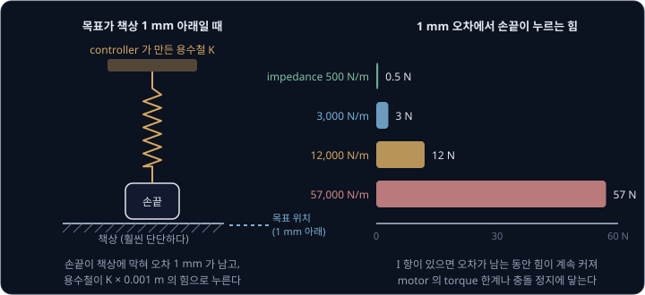
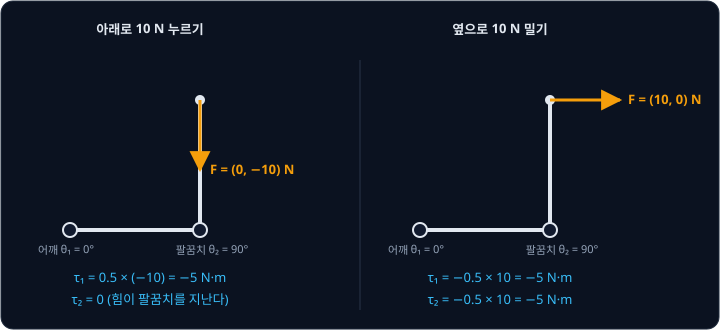
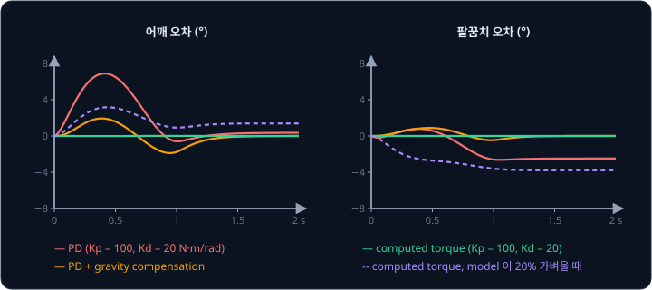
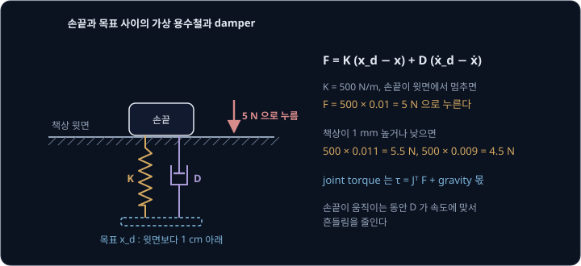
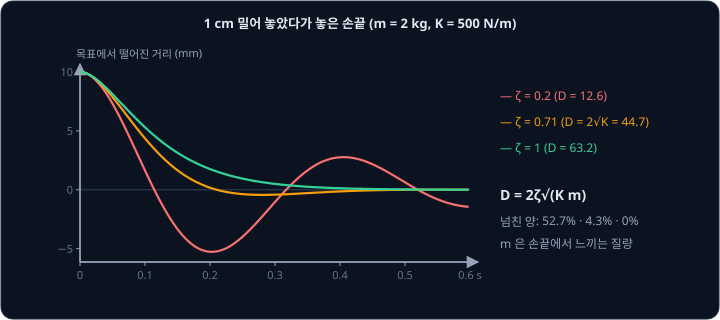
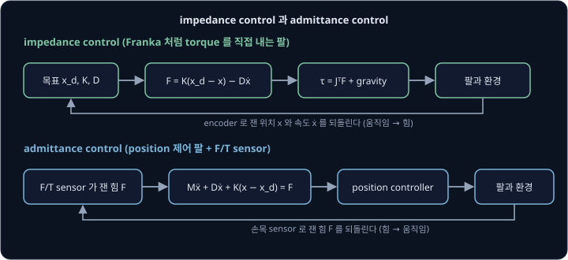
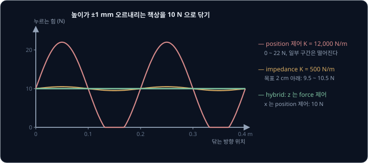
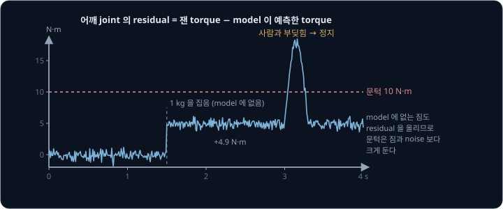
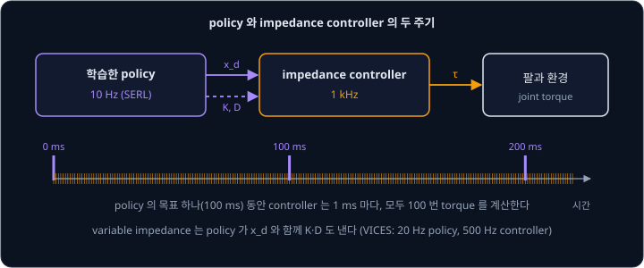

# Force & Impedance Control

position 제어로 움직이는 팔로 책상을 닦게 하면, 책상이 프로그램이 아는 높이보다 1 mm 만 높아도 손끝이 책상을 수십 N 으로 짓누르거나 팔이
충돌로 판단해 멈추고, 1 mm 낮으면 허공을 닦는다. 카메라로 잰 책상 높이는 mm 단위로 틀리기 마련인데, 높이를 정확히 모르는 채로 일정한 힘으로
닦게 하려면 motor 에 무엇을 명령해야 할까?

이 문제를 푸는 좋은 방법은 목표와 손끝 사이에 가상의 용수철과 damper 가 달린 것처럼 팔을 움직이게 하는 것이다. 목표를 책상보다 조금
아래에 두면 손끝은 책상 윗면에서 멈추고 용수철이 늘어난 만큼의 힘으로 누르므로, 책상 높이를 정확히 몰라도 된다. 이 방법이 Neville Hogan 이
1985 년 정리한 impedance control 이다. Franka 로봇 팔은 joint torque 명령을 1초에 1000 번 받을 수 있고, 공식 예제에 손끝 stiffness 가 150 N/m 인
Cartesian impedance controller 가 들어 있다.

## 학습 목표

- 단단한 position 제어가 물체에 닿을 때 내는 큰 힘을 손끝 stiffness 로 계산할 수 있다
- 손끝 힘을 joint torque 로 바꾸는 $\tau = J^\top F$ 와, model 로 dynamics 를 지우는 computed-torque control 을 설명할 수 있다
- impedance control 의 $K$·$D$ 로 접촉 힘과 damping ratio 를 계산하고, admittance control·hybrid force/position control 과 쓰임새를 비교할 수 있다
- torque residual 로 충돌을 감지하는 원리와, 학습한 policy 가 impedance controller 위에서 목표와 stiffness 를 내는 구조를 설명할 수 있다

## 접촉과 position 제어

[PID Control](../pid-control/README.md) 에서 본 PD 제어는 오차에 $K_p$ 를 곱해 힘을 내는데, 오차 1 m 에 $K_p$ N 을 내므로 손끝에서 보면
목표 위치에 묶인 용수철과 같다. 용수철을 1 m 늘이는 데 드는 힘을 **stiffness** 라고 하는데, 여기서는 $K_p$ 가 stiffness 다. 허공에서는 손끝이 목표까지 움직여 오차가 0 이 되지만, 목표가
책상 안쪽에 있으면 손끝은 책상에 막혀 멈추고 오차가 그대로 남는다. 손끝은 남은 오차에 stiffness 를 곱한 힘으로 책상을 누른다.

joint 하나의 P gain $K_p$ (N·m/rad)가 손끝에서 어떤 stiffness 가 되는지는 팔 길이로 정해진다. 손끝까지 $l$ 인 joint 가 $\Delta\theta$ 만큼
돌면 손끝은 $l\,\Delta\theta$ 움직이고, joint 의 torque $K_p\,\Delta\theta$ 는 손끝에서 $K_p\,\Delta\theta / l$ 의 힘이 된다. 이 힘을 움직인
거리로 나누면 손끝 stiffness 는 $K_p / l^2$ 이다. Franka 의 libfranka 예제는 로봇 안쪽 joint 제어의 stiffness 를 1 ~ 3 번 joint 에서
3000 N·m/rad 로 두는데, 설정할 수 있는 최댓값은 14,250 N·m/rad 다.

| 손끝 stiffness | 값의 출처 | 1 mm 오차에서 누르는 힘 |
| --- | --- | --- |
| 500 N/m | 이 강의의 impedance 예 | 0.5 N |
| 3,000 N/m | libfranka 예제가 로봇 안쪽 Cartesian 제어에 두는 값(설정 범위 10 ~ 3000 의 최댓값) | 3 N |
| 12,000 N/m | joint 3000 N·m/rad, 팔 길이 0.5 m: $3000 \div 0.5^2$ | 12 N |
| 57,000 N/m | joint 14,250 N·m/rad, 팔 길이 0.5 m: $14250 \div 0.5^2$ | 57 N |

오차가 5 mm 면 마지막 줄은 285 N 이 된다. 여기에 I 항까지 있으면 막혀서 남은 오차가 I 항에 계속 쌓이므로 힘이 끝없이 커진다. 힘은 motor 가
낼 수 있는 torque 의 한계에 닿아서야 더 커지지 않는데, Franka FR3 의 1 ~ 4 번 joint 한계인 87 N·m 를 0.5 m 팔 끝에서 힘으로 바꾸면
$87 \div 0.5 = 174$ N 이다. Raibert 와 Craig 는 1981 년 논문 첫머리에서 적당히 단단한 부품끼리 닿을 때는 상대 위치가 조금만 달라져도 큰 접촉 힘이 생긴다고 적었다.

<b>심화: 직렬로 이은 두 용수철</b>

손끝을 누르는 controller 의 용수철 $K_r$ 과 눌리는 책상의 용수철 $K_e$ 는 한 줄로 이어져 있다. 목표를 책상 윗면에서 $d$ 만큼 아래에 두면 두
용수철이 $d$ 를 나눠 가지며, 힘은 아래와 같다.

$$
F = \frac{K_r K_e}{K_r + K_e}\, d
$$

예로 책상의 stiffness 를 $K_e = 10^6$ N/m 로 잡으면, $K_r = 500$ N/m 일 때 $F = 499.75\,d$ 로 거의 $K_r d$ 이고, $K_r = 57000$ 이면 $F = 53900\,d$ 로 역시
$K_r$ 에 가깝다. 두 용수철 가운데 무른 쪽이 힘을 정한다. impedance control 은 로봇 쪽 용수철을 일부러 무르게 만들어 원하는 힘을 정하는 방법이다.

**확인 문제.** joint P gain 이 2000 N·m/rad 이고 손끝까지 0.4 m 다. 목표가 책상 2 mm 아래에 있으면 손끝은 몇 N 으로 누를까?

답 보기

손끝 stiffness 는 $K_p / l^2 = 2000 \div 0.4^2 = 2000 \div 0.16 = 12500$ N/m 다. 남은 오차 2 mm 를 곱하면 $12500 \times 0.002 = 25$ N 이다.

## 손끝 힘과 joint torque

손끝으로 책상을 10 N 으로 누르려면 각 joint 의 motor 가 몇 N·m 를 내야 할까? 손끝 힘 $F$ 를 joint torque $\tau$ 로 바꿀 때는 [Inverse
Kinematics](../inverse-kinematics/README.md) 에서 본 Jacobian 의 transpose 를 곱한다.

$$
\tau = J^\top F
$$

[MuJoCo Simulation](../mujoco-sim/README.md) 의 두 joint 팔(위팔과 아래팔이 0.5 m)을 어깨 $\theta_1 = 0°$, 팔꿈치 $\theta_2 = 90°$ 로 두면, 손끝은
어깨에서 가로 0.5 m, 세로 0.5 m 에 있고 Jacobian 은 $J = \begin{bmatrix} -0.5 & -0.5 \\ 0.5 & 0 \end{bmatrix}$ 이다.

| 손끝 힘 $F$ | $\tau_1$ ($J$ 첫째 열과 $F$) | $\tau_2$ ($J$ 둘째 열과 $F$) |
| --- | --- | --- |
| 아래로 10 N, $(0, -10)$ | $(-0.5)(0) + (0.5)(-10) = -5$ | $(-0.5)(0) + (0)(-10) = 0$ |
| 옆으로 10 N, $(10, 0)$ | $(-0.5)(10) + (0.5)(0) = -5$ | $(-0.5)(10) + (0)(0) = -5$ |

아래로 누를 때 팔꿈치 torque 가 0 인 것은 손끝이 팔꿈치 바로 위에 있어서 수직인 힘의 작용선이 팔꿈치를 지나기 때문이다. 어깨는 손끝에서 가로로
0.5 m 떨어져 있어 $0.5 \times 10 = 5$ N·m 가 필요하고, 음수 부호는 시계 방향을 뜻한다. 이 강의의 controller 는 모두 손끝 힘 $F$ 를
먼저 정하고 $J^\top$ 를 곱해 torque 로 바꾼다.

거꾸로 joint torque 를 재서 손끝 힘을 추정할 수도 있는데, $J^\top$ 의 역행렬을 곱해 $F = J^{-\top}\tau$ 로 계산한다. 팔을 쭉 편 singularity
에서는 팔을 따라 미는 힘을 구조가 그대로 받아 내서 joint torque 가 생기지 않는다. 이때는 $J^\top$ 의 역행렬이 없어서 그 방향의 힘을 torque 로
알아낼 수 없다. Franka 의 libfranka 는 손끝에 걸린 외력의 추정값 `O_F_ext_hat_K` 를 주는데, 문서에 따르면 singularity 근처에서는 이 값이 0 이
된다.

<b>심화: virtual work 와 joint stiffness</b>

멈춘 팔에서 motor 가 joint 에 넣는 일률 $\tau^\top \dot q$ 와 손끝이 환경에 하는 일률 $F^\top v$ 는 같아야 한다. 손끝 속도는 $v = J\dot q$ 이므로
$F^\top J \dot q = \tau^\top \dot q$ 가 모든 $\dot q$ 에서 맞아야 하고, 그래서 $\tau = J^\top F$ 다(Lynch & Park, Modern Robotics 5장).

joint 마다 stiffness $K_q$ 를 걸면 손끝 stiffness 는 $K_x = J^{-\top} K_q J^{-1}$ 이다. 위 자세에서 $J^{-1} = \begin{bmatrix} 0 & 2 \\ -2 & -2 \end{bmatrix}$
이고 $K_q$ 가 두 joint 모두 3000 N·m/rad 이면 $K_x = 3000 \begin{bmatrix} 4 & 4 \\ 4 & 8 \end{bmatrix}$ 이라서, 손끝 stiffness 는 가로
12,000 N/m 이고 세로 24,000 N/m 다. joint 의 gain 이 같아도 손끝 stiffness 는 방향과 자세에 따라 다르다.

**확인 문제.** 같은 자세에서 손끝으로 위쪽 20 N, $F = (0, 20)$ 을 내려면 두 joint torque 는?

답 보기

$\tau_1 = (-0.5)(0) + (0.5)(20) = 10$ N·m, $\tau_2 = (-0.5)(0) + (0)(20) = 0$ 이다. 위쪽 힘의 작용선도 팔꿈치를 지나므로 팔꿈치는 0 이다.

## computed-torque control

손끝 힘을 $\tau = J^\top F$ 로 내려면 motor 는 gravity 를 버티고 팔 자체의 관성과 joint 끼리 주고받는 힘을 처리하는 일도 함께 해야 한다. MuJoCo
Simulation 에서 본 equation of motion $M(q)\ddot q + c(q, \dot q) = \tau$ 의 $M$ 과 $c$ 를 controller 가 알고 있으면, 원하는 가속도를 내는
torque 를 거꾸로 계산할 수 있다.

$$
\tau = M(q)\left(\ddot q_d + K_d\,\dot e + K_p\,e\right) + c(q, \dot q)
$$

$e = q_d - q$ 는 목표 각도와의 오차이고, 괄호 안은 목표 가속도에 PD 로 오차를 줄일 가속도를 더한 값이다. 여기에 $M$ 을 곱해 그 가속도를 내는 torque 로 바꾸고,
gravity 와 속도에 따른 torque $c$ 를 더해 그 몫을 미리 상쇄한다. 이렇게 하면 joint 마다 $\ddot e + K_d \dot e + K_p e = 0$ 이 되어, 모든 joint 가 질량 1 인
독립된 PD 처럼 움직인다. 이 방법을 **computed-torque control**(inverse dynamics control)이라고 한다.

MuJoCo Simulation 에서는 팔을 편 자세에서 어깨에만 1 N·m 를 주자 팔꿈치가 −8 rad/s² 로 꺾였다. computed torque 로 어깨만 4 rad/s² 로 돌리고
싶으면 $\tau = M \times (4, 0) = (1.25 \times 4,\ 0.5 \times 4) = (5, 2)$ 를 내야 한다. 이 가운데 팔꿈치 motor 의 2 N·m 는 팔꿈치가 꺾이지 않게 붙잡는 몫이다.

위 그림과 아래 표는 같은 팔을 세워 gravity 를 받게 한 뒤, 어깨를 1 초 동안 0° 에서 60° 로 minimum-jerk 목표를 따라 옮기고 팔꿈치는 90° 에
두라고 명령하고 직접 simulation 한 결과다.

| controller | 어깨 최대 오차 | 팔꿈치 최대 오차 |
| --- | --- | --- |
| PD ($K_p = 100$ N·m/rad, $K_d = 20$ N·m·s/rad) | 6.9° | 2.6° |
| PD + gravity compensation | 1.9° | 0.9° |
| computed torque ($K_p = 100$, $K_d = 20$) | 0° | 0° |
| computed torque, model 질량이 실제보다 20% 가벼움 | 3.2° | 3.8° |

computed torque 의 $K_p$ 와 $K_d$ 는 torque 가 아니라 가속도에 곱하는 gain 이라서, 질량 1 에서의 critical damping $K_d = 2\sqrt{K_p} = 2\sqrt{100}
= 20$ 을 바로 쓸 수 있다. model 이 정확하면 오차가 0 이지만, 질량이 20% 틀리면 지우지 못한 gravity 와 관성이 남아 어깨가 3.2°, 팔꿈치가 3.8° 까지
벗어난다. 뒤에서 볼 Franka 의 Cartesian impedance 예제는 $M$ 으로 가속도를 torque 로 바꾸는 부분 없이 Coriolis torque 만 더하고, gravity 는
로봇이 따로 보상한다.

**확인 문제.** 팔을 편 자세($M = \begin{bmatrix} 1.25 & 0.5 \\ 0.5 & 0.25 \end{bmatrix}$)에서 gravity 없이, 팔꿈치만 $+4$ rad/s² 로 돌리고 어깨는
멈춰 두려면 두 torque 는?

답 보기

$\tau = M \times (0, 4)$ 라서 $\tau_1 = 1.25 \times 0 + 0.5 \times 4 = 2$ N·m, $\tau_2 = 0.5 \times 0 + 0.25 \times 4 = 1$ N·m 다. 어깨도 2 N·m 를 내야
팔꿈치의 움직임에 끌려가지 않는다.

## impedance control

computed torque 는 손끝을 목표에 최대한 정확히 붙이는 방법이라서, 목표가 책상 안쪽에 있으면 단단한 position 제어와 같은 문제가 생긴다.
Hogan 은 1985 년 논문에서, 물체를 다루려면 팔이 물체와 기계적으로 이어져야 하므로 위치나 힘 하나만 제어해서는 부족하고 팔의 dynamic
behavior 까지 제어해야 한다고 주장했다. 이때 제어하는 것은 움직임과 힘 사이의 관계다. 손끝이 밀린 만큼 얼마나 세게 되밀지를 정하는 관계를 **impedance** 라고 하고, 거꾸로 받은 힘으로 얼마나 움직일지를 정하는 관계를
admittance 라고 한다.

**impedance control** 은 손끝이 목표 $x_d$ 에 용수철 $K$ 와 damper $D$ 로 매달린 것처럼 힘을 낸다.

$$
F = K\,(x_d - x) + D\,(\dot x_d - \dot x), \qquad \tau = J^\top F + g(q)
$$

$g(q)$ 는 gravity 를 버티는 torque 다. 용수철은 위치가 어긋난 만큼 힘을 내고 damper 는 속도가 어긋난 만큼 힘을 내며, 그 합에 $J^\top$ 를 곱해 joint
torque 로 바꾼다.

$K = 500$ N/m 로 두고 목표를 책상 윗면보다 1 cm 아래에 두면, 손끝은 윗면에서 멈추고 $500 \times 0.01 = 5$ N 으로 누른다. 책상이 프로그램이 아는
것보다 1 mm 높으면 용수철이 11 mm 늘어나 5.5 N 이 되고, 1 mm 낮으면 9 mm 늘어나 4.5 N 이 된다. 같은 1 mm 차이가 손끝 stiffness 12,000 N/m 인 position 제어에서는
12 N 의 차이를 만든다. 누르는 힘은 목표를 얼마나 깊이 두느냐로 정하고, $K$ 를 작게 두면 높이 오차가 힘을 크게 바꾸지 못한다.

구멍에 핀을 꽂는 peg-in-hole 작업도 같은 이유로 impedance 를 쓴다. 예로 카메라로 잰 구멍 위치가 옆으로 0.5 mm 틀렸다고 하자. 옆 방향 stiffness 가 12,000 N/m 이면 핀이 구멍 가장자리에 걸린 채
$12000 \times 0.0005 = 6$ N 으로 옆을 밀어서 끼이거나 긁힌다. Franka 예제의 150 N/m 이면 옆으로 미는 힘이 $150 \times 0.0005 = 0.075$ N
뿐이라서, 핀이 구멍 입구의 경사면을 따라 옆으로 밀리며 들어간다. 꽂는 방향은 누르는 힘이 필요하니 단단하게 두고 옆 방향은 무르게 두는 식으로,
축마다 다른 $K$ 를 쓴다.

> **오해** impedance control 은 힘을 제어하는 방법이다.
>
> **사실** 직접 정하는 것은 위치 오차와 힘의 비율 $K$ 이고, 누르는 힘은 목표를 얼마나 깊이 두었느냐와 환경의 위치로 정해진다. 책상이 없으면 손끝은 목표까지 내려가고 힘은 0 이 된다.

## damping ratio 와 effective mass

$D$ 는 [PID Control](../pid-control/README.md) 에서 본 critical damping 과 같은 방식으로 고른다. 손끝에서 느끼는 질량을 $m$ 이라 하면
$D = 2\zeta\sqrt{K m}$ 으로 쓰고, 여기서 $\zeta$ 를 **damping ratio** 라고 한다. $\zeta = 1$ 이 넘치지 않으면서 가장 빨리 자리 잡는 값이다.

손끝에서 느끼는 질량은 팔의 자세와 미는 방향에 따라 다르다. MuJoCo Simulation 의 두 joint 팔은 팔꿈치와 손끝에 1 kg 추를 하나씩 단 예다. 이
팔의 $\theta_1 = 0°$, $\theta_2 = 90°$ 자세에서 손끝을 가로로 밀면 팔꿈치만 돌아서 손끝 추 1 kg 만 움직이고, 세로로 밀면 어깨가 돌아서 두 추가
함께 움직이므로 2 kg 이 된다. 이 값을 **effective mass** 라고 한다. 세로 방향에 $K = 500$ N/m 를 걸면 $D$ 와 넘친 양은 아래와 같다.

| $\zeta$ | $D = 2\zeta\sqrt{500 \times 2}$ (N·s/m) | 1 cm 밀었다 놓았을 때 넘친 양 |
| --- | --- | --- |
| 0.2 | 12.6 | 52.7% (5.3 mm) |
| 0.71 | 44.7 | 4.3% (0.43 mm) |
| 1 | 63.2 | 0% |

가운데 줄의 44.7 은 Franka 예제가 쓰는 식 $D = 2\sqrt{K}$ 에 $K = 500$ 을 넣은 값이다. 이 식은 effective mass 가 1 kg 일 때 $\zeta = 1$ 이 되도록
만든 식이라서, 가로 방향(1 kg)에서는 critical damping 이지만 세로 방향(2 kg)에서는 $\zeta$ 가 $44.7 \div 63.2 = 0.71$ 이 된다.

<b>심화: operational space formulation</b>

Khatib 은 1987 년 논문에서 손끝의 움직임을 직접 equation of motion 으로 쓰는 operational space formulation 으로 운동과 힘의 제어를 한 틀에서
다뤘다. 이 formulation 에서 joint 공간의 $M(q)$ 에 해당하는 손끝 공간의 질량 행렬은 아래와 같다.

$$
\Lambda(q) = \left(J M^{-1} J^\top\right)^{-1}
$$

위 자세에서 $M = \begin{bmatrix} 0.75 & 0.25 \\ 0.25 & 0.25 \end{bmatrix}$ 이면 $M^{-1} = \begin{bmatrix} 2 & -2 \\ -2 & 6 \end{bmatrix}$,
$J M^{-1} J^\top = \begin{bmatrix} 1 & 0 \\ 0 & 0.5 \end{bmatrix}$ 이라서 $\Lambda = \begin{bmatrix} 1 & 0 \\ 0 & 2 \end{bmatrix}$ kg 이다. 본문의 가로
1 kg, 세로 2 kg 이 이 대각선 값이다.

손끝의 원하는 가속도 $a$ 에 $\Lambda$ 를 곱해 힘으로 바꾸면 $F = \Lambda a + \mu + p$ ($\mu$ 는 속도에 따른 힘, $p$ 는 gravity)가 되는데, 이는 computed
torque 를 손끝 공간에서 한 것과 같다. 이렇게 하면 모든 방향의 effective mass 를 원하는 값으로 바꿀 수 있는데, 이것을 inertia shaping 이라고 한다.
libfranka 의 Cartesian impedance 예제 주석에는 inertia shaping 을 하지 않는 단순한 controller 라고 적혀 있다.

**확인 문제.** effective mass 가 4 kg 인 방향에 $K = 400$ N/m 를 걸었다. critical damping 이 되는 $D$ 는? 이 방향에 $D = 2\sqrt{K}$ 를 쓰면 $\zeta$ 는?

답 보기

$D = 2 \times 1 \times \sqrt{400 \times 4} = 2 \times 40 = 80$ N·s/m 다. $D = 2\sqrt{400} = 40$ 을 쓰면 $\zeta = 40 \div 80 = 0.5$ 다.

## Franka 의 torque interface

impedance control 은 motor 에 torque 를 직접 명령할 수 있어야 쓸 수 있다. Franka 로봇의 FCI(Franka Control Interface) 문서는 다섯 가지 제어
방식으로 1 kHz 실시간 명령을 보낼 수 있다고 적는데, 그중 하나가 gravity 와 마찰을 로봇이 보상한 joint torque 명령이다. 1 kHz 는 1초에 1000 번이라
controller 는 1 ms 안에 다음 torque 를 계산해 돌려줘야 한다. 낼 수 있는 torque 는 1 ~ 4 번 joint 가 87 N·m 이고 5 ~ 7 번 joint 가 12 N·m 이며,
torque 가 1초에 바뀔 수 있는 양은 1000 N·m/s 로 제한된다.

libfranka 의 `cartesian_impedance_control` 예제는 이 강의의 식을 거의 그대로 쓴다.

- stiffness 는 위치 방향이 150 N/m 이고 회전 방향이 10 N·m/rad 다. damping 은 $2\sqrt{K}$ 라서 150 N/m 에서는 $2\sqrt{150} \approx 24.5$ N·s/m 다
- 1 ms 마다 손끝 위치·자세 오차와 손끝 속도 $J\dot q$ 로 $F = -K e - D J \dot q$ 를 계산하고, $\tau = J^\top F$ 에 Coriolis torque 를 더해 보낸다
- 손끝을 2 cm 밀면 $150 \times 0.02 = 3$ N 으로 되밀고, 손끝을 0.1 rad 비틀면 $10 \times 0.1 = 1$ N·m 로 되돌린다

ROS 2 의 franka_ros2 에도 같은 계산을 하는 `cartesian_impedance_example_controller` 가 있다. parameter 기본값은 `translational_stiffness` 150,
`rotational_stiffness` 10, `nullspace_stiffness` 20 이다. 이 controller 는 1초에 1000 번 계산해 joint 마다 `effort` command interface 로 torque 를
보낸다. 목표 자세는 `~/equilibrium_pose` topic 으로 바꾸고, stiffness 는 `~/set_cartesian_stiffness` service 로 실행 중에 바꾼다. stiffness 가 새
값으로 한 번에 뛰지 않도록 controller 는 1 ms 마다 남은 차이의 0.5% 씩 새 값 쪽으로 옮겨 간다.

Franka 는 joint 가 7 개인데 손끝의 위치와 자세는 숫자 6 개라서, 손끝을 고정해도 팔꿈치가 돌 수 있는 방향이 하나 남는다. 이 방향을 null space
라고 한다. `nullspace_stiffness` 는 손끝에 영향을 주지 않는 이 방향으로만 joint 를 처음 자세 쪽으로 당겨서, 팔꿈치가 떠돌지 않게 한다.

## admittance control

많은 산업용 팔은 controller 가 position 이나 velocity 명령만 받아서 torque 를 직접 줄 수 없다. 이런 팔은 손목에 F/T(force/torque) sensor 를
달아 손끝 힘을 재고, 그 힘으로 움직일 위치를 계산해 position controller 에 넘긴다. 이 방법이 **admittance control** 이다.

$$
M_a\,\ddot x + D_a\,\dot x + K_a\,(x - x_d) = F_{\text{잰 힘}}
$$

$M_a$, $D_a$, $K_a$ 는 손끝이 따라 하게 만들 가상의 질량·damping·stiffness 다. 제어 주기마다 잰 힘을 넣어 이 식에서 $\ddot x$ 를 구하고, 이를
적분해 얻은 속도와 위치를 명령으로 보낸다.

사람이 손끝을 잡고 끄는 hand guiding 을 예로 들어 $K_a = 0$, $D_a = 50$ N·s/m, $M_a = 2$ kg 으로 두자. 사람이 5 N 으로 밀면 손끝은 결국
$5 \div 50 = 0.1$ m/s 로 움직이고, 속도가 0.1 m/s 의 63% 에 닿는 시간(time constant)은 $M_a / D_a = 0.04$ 초다. sensor 의 정확도도 같이 봐야
한다. UR5e 의 tool flange 에 들어 있는 F/T sensor 는 datasheet 에 따르면 힘의 범위가 ±50 N 이고 정확도가 ±4.0 N 이다. $D_a = 50$ 이면 4 N 의
오차가 0.08 m/s 의 움직임이 되므로, 아무도 손대지 않은 팔이 흘러가지 않도록 시작할 때 sensor 를 0 으로 맞추고 작은 힘은 무시하는 구간을 둔다.

admittance control 은 단단한 물체에 닿으면 불안정해지기 쉽다. 잰 힘으로 속도를 정하는데($\dot x = F / D_a$), 단단한 벽은 조금만 밀어도 큰 힘을
내기 때문이다. 예로 벽의 stiffness 를 $K_e = 10^5$ N/m 로 두고 제어 주기를 $\Delta t = 0.002$ 초로 잡자. position controller 가 명령을 바로
따라간다고 보면, 벽을 $x$ 만큼 누른 손끝은 한 주기 뒤에 $x\,(1 - \Delta t\,K_e / D_a)$ 만큼 눌린 자리에 있다.

| $D_a$ (N·s/m) | $\Delta t\,K_e / D_a$ | 한 주기 뒤 누른 깊이 | 결과 |
| --- | --- | --- | --- |
| 50 | 4 | $-3x$ | 벽에서 튕겨 나갔다 다시 박히며 흔들림이 커진다 |
| 200 | 1 | 0 | 한 주기 만에 벽 표면에 선다 |
| 400 | 0.5 | $0.5x$ | 매끄럽게 줄어든다 |

$\Delta t\,K_e / D_a$ 가 2 를 넘으면 발산한다. [PID Control](../pid-control/README.md) 의 계산 주기와 gain 표에서 본 것과 같은 관계라서, 환경이
단단할수록 큰 damping 이나 짧은 주기가 필요하다. Lynch & Park 의 Modern Robotics 는 impedance control 이 가볍고 backdrivable 한 팔에 어울리고
admittance control 은 기어비가 큰 팔에 어울린다고 정리한다. backdrivable 은 바깥에서 밀면 motor 가 쉽게 돌아간다는 뜻이다. ros2_controllers 에는
F/T sensor 값을 받아 joint 명령을 내는 `admittance_controller` 가 있는데, 이 controller 는 축마다 `admittance.mass`, `admittance.damping_ratio`, `admittance.stiffness` 를 parameter 로 받는다.

**확인 문제.** admittance control 에서 $K_a = 0$, $D_a = 80$ N·s/m 이다. 손목 sensor 가 사람이 미는 힘 12 N 을 재면 손끝은 결국 몇 m/s 로 움직일까?

답 보기

$K_a = 0$ 이고 속도가 일정해지면 $\ddot x = 0$ 이라 $D_a \dot x = F$ 다. $\dot x = 12 \div 80 = 0.15$ m/s 다.

## hybrid force/position control

책상 닦기에서 손끝은 책상 면을 따라 정해진 경로를 지나야 하고(x, y), 책상을 누르는 방향(z)으로는 정한 힘을 내야 한다. Raibert 와 Craig 는 1981 년
작업 좌표의 축마다 위치를 제어할지 힘을 제어할지 고르는 **hybrid force/position control** 을 발표했다. 축마다 0 과 1 로 고르는 대각 행렬을
compliance selection matrix $S$ 라고 하는데, 닦기에서는 x·y 를 position 축으로 두고 z 를 force 축으로 둔다. force 축에서는 원하는 힘과 잰 힘의 차이로
PI 제어를 한다.

위 그림은 높이가 ±1 mm 오르내리는 책상을 예로 정해 두고, 손끝이 천천히 움직인다고 보아 10 N 으로 닦을 때 누르는 힘을 계산한 결과다. 손끝 stiffness 12,000
N/m 인 position 제어로 10 N 을 내려면 목표를 $10 \div 12000 \approx 0.83$ mm 아래에 둬야 하는데, 책상이 1 mm 낮은 곳에서는 손끝이 책상에서 떨어지고
1 mm 높은 곳에서는 22 N 이 된다. $K = 500$ N/m 의 impedance 로 목표를 2 cm 아래에 두면 힘이 9.5 ~ 10.5 N 사이에 머물고, z 축을 force 로 제어하면 10 N 을 지킨다.

Modern Robotics 에 따르면 force 제어 중에 밀 대상이 없으면 팔이 힘을 만들려고 계속 가속하므로, 속도에 비례하는 damping 을 더해야 한다. 같은
책은 힘의 측정값에 noise 가 많아서 force 축에는 D 항을 잘 쓰지 않는다고 설명한다. libfranka 의 `force_control` 예제는 손끝이 1 kg 의 무게(9.81 N)로
아래를 누르게 하는 PI controller 다. joint torque 오차에 P gain 1 과 I gain 2 를 곱하고, 손끝이 처음 위치에서 1 cm 넘게 움직이면 멈춘다.

UR 로봇의 URScript `force_mode` 도 같은 구조다. `selection_vector` 에서 1 로 둔 축은 정한 힘이 나오도록 위치를 고치고, 0 으로 둔 축은 프로그램의
위치를 따른다. `limits` 는 force 축의 최대 속도를 정해 밀 대상이 사라졌을 때 팔이 끝없이 가속하지 않게 한다.

**확인 문제.** 문을 손잡이로 잡고 여는 작업에서 hybrid control 의 selection 을 정하면, 경첩을 중심으로 도는 방향과 문짝을 밀어 붙이는 방향은 각각
무엇으로 제어할까?

답 보기

문은 경첩을 중심으로 도는 방향으로만 움직일 수 있으므로 그 방향은 position(정해진 각도로 열기)으로 제어한다. 문짝을 밀어 붙이는 방향은 문이
막고 있어 움직일 수 없으니 force 로 제어하고, 문틀을 비틀지 않도록 원하는 힘을 0 근처로 둔다.

## torque residual 과 충돌 감지

joint torque 를 재는 팔은 같은 정보로 충돌도 감지한다. model 이 지금의 $q$, $\dot q$, $\ddot q$ 로 예측한 torque 와 실제로 잰 torque 의 차이를
**residual** 이라고 한다. 팔이 허공에서 움직이면 residual 은 0 근처에 있고, 무언가에 닿으면 그 힘이 $J^\top F$ 만큼 joint torque 에 더해져
residual 이 커진다.

위 그림의 noise 와 충돌 신호는 원리를 보이려고 만든 값이다. Franka 가 주는 `tau_ext_hat_filtered` 가 이 residual 인데, 문서는 이를 잰 joint
torque 와 로봇 model 이 기대한 torque 의 차이에 low-pass filter 를 거친 값으로 설명한다. `setCollisionBehavior` 로는 joint 마다 문턱을 두 개
정한다. 낮은 문턱을 넘으면 접촉으로 표시만 하고 계속 움직이고, 높은 문턱을 넘으면 충돌로 보고 팔을 세운다. libfranka 예제의
`setDefaultBehavior` 는 등속으로 움직이는 구간의 문턱을 10 N·m 로 두고, 가속·감속 구간의 문턱은 20 N·m 로 둔다. 가속하는 동안에는 관성 model 의 오차가 residual 에 더해지기 쉬워서 문턱을 높여 둔다.

model 에 없는 짐도 residual 을 올린다. 1 kg 을 어깨에서 0.5 m 앞에 들면 $1 \times 9.81 \times 0.5 = 4.9$ N·m 가 더해져 문턱 10 N·m 의 절반을 쓰고, 2.5 kg
이면 $2.5 \times 9.81 \times 0.5 \approx 12.3$ N·m 가 되어 아무것도 부딪히지 않았는데도 팔이 멈춘다. 그래서 gripper 와 짐의 질량을 model 에 넣어 두고, 문턱은
noise 와 남은 model 오차보다 크게 잡는다. 앞에서 본 Cartesian impedance 예제는 사람에게 손끝을 밀어 보라고 안내하면서 문턱을 모두 100 으로 올리고, 비상 정지
버튼을 손에 쥐고 있으라고 경고한다.

residual 을 $\ddot q$ 로 계산하면 각도를 두 번 미분한 값을 쓰게 되어 noise 가 크다. generalized momentum $M(q)\dot q$ 를 쓰는 observer 는
가속도 없이 residual 을 구할 수 있어서 이 문제를 피한다. De Luca 등은 2006 년 total energy 와 generalized momentum 을 바탕으로 로봇 안의 sensor
만 쓰는 충돌 감지 방법을 DLR-III 경량 팔에서 실험했다. Haddadin, De Luca, Albu-Schäffer 의 2017 년 survey 는 이런 model 기반 충돌 감지 방법들을
정리하고 실험으로 평가했다.

**확인 문제.** 충돌 문턱이 10 N·m 인 joint 에서 손끝까지의 수평 거리가 0.4 m 다. model 에 넣지 않은 짐이 몇 kg 을 넘으면 가만히 들고만 있어도 충돌로
판단될까?

답 보기

짐의 torque 는 $m \times 9.81 \times 0.4 = 3.924\,m$ N·m 다. $3.924\,m > 10$ 에서 $m > 10 \div 3.924 \approx 2.55$ kg 이다.

## variable impedance 와 학습

지금까지는 $K$ 와 $D$ 를 사람이 정했지만, 작업 도중에 바꿔야 할 때가 많다. 핀을 구멍 위로 옮기는 동안에는 stiffness 가 커야 빠르고 정확하게 가고, 꽂는 순간에는
옆 방향이 물러야 끼이지 않는다. 시간에 따라 $K$ 와 $D$ 를 바꾸는 것을 **variable impedance** 라고 하고, 학습한 policy 가 그 값을 정하게 하는 연구가
이어지고 있다.

Franka 로 강화학습을 하는 SERL(Luo 등, 2024)은 policy 가 10 Hz 로 손끝 목표를 내고 impedance controller 가 1 kHz 로 따라가는 구조를 쓴다. policy 가 목표를
하나 내는 동안 controller 는 torque 를 100 번 계산한다. policy 가 책상 안쪽 깊숙이 목표를 찍으면 용수철이 큰 힘을 내므로, SERL 은 목표와 손끝의
거리를 $\Delta$ 이하로 자른다. 예로 $K = 500$ N/m, $\Delta = 1$ cm 면 용수철의 힘은 5 N 을 넘지 않는다. 논문은 PCB 에 부품을 꽂는 작업에서 너무 단단한
controller 는 가는 핀을 휘게 하고 너무 무른 controller 는 부품을 제자리까지 빨리 옮기지 못한다고 적었다. 이 작업에서 SERL 은 시연 20 개와 20 분의 학습으로 성공률
100% 를 보고했다.

VICES(Martín-Martín 등, 2019)는 policy 가 손끝 목표와 함께 stiffness 와 damping 까지 내게 했다. policy 는 20 Hz 로 계산하고 controller 는 500 Hz 로
계산한다. 경로 따라가기·문 열기·표면 닦기 세 작업으로 비교했더니, 손끝이 계속 닿아 있어야 하는 표면 닦기에서 이 방식이 다른 action space 보다 높은
reward 를 얻었다. franka_ros2 예제의
`~/set_cartesian_stiffness` 처럼 실행 중에 stiffness 를 바꾸는 service 가 있으면 상위의 policy 나 프로그램이 이 값을 controller 에 보낼 수 있다.

## 정리

- 단단한 position 제어는 손끝 stiffness 에 남은 오차를 곱한 힘으로 누른다. joint gain $K_p$ 는 손끝에서 $K_p / l^2$ 이라서 3000 N·m/rad,
  0.5 m 면 12,000 N/m 가 되어 1 mm 에 12 N 을 내고, I 항이 있으면 힘이 torque 한계까지 커진다
- 손끝 힘은 $\tau = J^\top F$ 로 joint torque 가 된다. computed torque 는 model $M$, $c$ 로 dynamics 를 지워 joint 마다 독립된 PD 로 만들지만, model
  이 틀린 만큼 오차가 남는다
- impedance control 은 손끝을 목표에 $K$, $D$ 로 매단다($K = 500$ N/m 에서 1 cm 면 5 N). $D = 2\zeta\sqrt{Km}$ 의 $m$ 은 자세와 방향에 따라 다른
  effective mass 다. admittance control 은 F/T sensor 로 잰 힘으로 position 명령을 만들고, hybrid control 은 축마다 위치와 힘 가운데 하나를 고른다
- torque residual 이 문턱(libfranka 예제는 10 ~ 20 N·m)을 넘으면 충돌로 보고, 학습한 policy 는 impedance controller 위에서 목표와 stiffness 를 낸다

이 강의의 controller 는 Franka 에서 1 ms 마다 각 joint 의 `effort` command interface 로 torque 를 보냈다. [ros2_control](../ros2-control/README.md)
강의에서는 controller 가 이런 command interface 와 state interface 를 hardware 에서 받아 쓰는 구조와, controller_manager 가 실시간 loop 안에서 controller
를 부르는 방식을 다룬다.

## 참고 자료

- Neville Hogan, [Impedance Control: An Approach to Manipulation: Part I—Theory](https://doi.org/10.1115/1.3140702) (1985) — 위치나 힘 하나만
  제어해서는 부족하고 dynamic behavior 까지 제어해야 하며, impedance 와 admittance 를 구분해 manipulator 는 impedance 로 다뤄야 한다고 주장한 3 부작의 첫 편
- M. H. Raibert, J. J. Craig, [Hybrid Position/Force Control of Manipulators](https://fab.cba.mit.edu/classes/865.15/classes/measurement/hybrid-position-force.pdf)
  (1981) — compliance selection matrix 로 축마다 위치와 힘을 나누는 원 논문. Mason 의 natural·artificial constraint 설명 부분을 먼저 읽는다
- Oussama Khatib, [A unified approach for motion and force control of robot manipulators](https://doi.org/10.1109/JRA.1987.1087068) (1987) — 손끝
  공간의 질량 행렬 $\Lambda$ 와 운동·힘 제어를 한 틀로 쓴 operational space formulation
- Lynch & Park, [Modern Robotics](https://hades.mech.northwestern.edu/index.php/Modern_Robotics) — 5.2 절의 $\tau = J^\top F$, 11.4 절의 computed
  torque, 11.5 ~ 11.7 절의 force·hybrid·impedance·admittance control 을 같은 기호로 정리한 교재
- Franka Robotics, [FCI documentation](https://frankarobotics.github.io/docs/) — 1 kHz 제어 방식, joint torque 와 torque 변화율 한계, 외력 추정과
  충돌 감지 항목
- Franka Robotics, [libfranka examples](https://github.com/frankaemika/libfranka/tree/main/examples) — `cartesian_impedance_control.cpp`,
  `joint_impedance_control.cpp`, `force_control.cpp` 가 이 강의의 식을 수십 줄로 구현한다
- Franka Robotics, [franka_ros2 example controllers](https://github.com/frankaemika/franka_ros2/tree/main/franka_example_controllers) —
  `cartesian_impedance_example_controller` 의 parameter, null space torque, 실행 중 stiffness 변경
- Universal Robots, [Script Manual e-Series](https://docs.universal-robots.com/PolyScopeX_SDK_Documentation/build/SDK-v0.13/_static/pdf/scriptManualG5.pdf) —
  `force_mode` 의 selection vector 와 limits 설명
- Jianlan Luo et al., [SERL: A Software Suite for Sample-Efficient Robotic Reinforcement Learning](https://arxiv.org/abs/2401.16013) (2024) — 4.5 절에서 10 Hz
  policy 아래의 1 kHz impedance controller 와 목표 제한을 설명한다
- Roberto Martín-Martín et al., [Variable Impedance Control in End-Effector Space](https://arxiv.org/abs/1906.08880) (2019) — stiffness 를 policy 의 출력으로
  넣은 action space 와 세 작업의 비교
