# Inverse Kinematics

카메라로 컵을 찾아 "로봇 앞 25 cm, 높이 5 cm" 라는 위치를 얻어도, 로봇 팔의 motor 가 받을 수 있는 명령은 관절 하나하나의 각도뿐이다.
관절 각도를 넣으면 손끝 위치가 하나로 나오는 forward kinematics 식은 이미 있는데, 그 식을 거꾸로 풀어 손끝을 컵에 두는 관절 각도를 구하려면
어떻게 해야 할까?

손끝 위치에서 관절 각도를 거꾸로 구하는 계산이 inverse kinematics(IK)다. 관절이 두 개인 평면 팔이면 삼각형 하나로 답이 바로 나오고, 관절이
6 ~ 7 개인 팔이면 관절 각도를 조금씩 고쳐 가며 손끝을 목표에 맞추는 반복 계산으로 답을 찾는다. ROS 2 의 motion planning framework 인
MoveIt 2 는 이런 반복 계산을 하는 KDL plugin 을 기본 IK plugin 으로 쓰고, 설정 도구 MoveIt Setup Assistant 가 만드는 설정 파일에는 IK 한 번에
쓸 시간이 5 ms 로 들어간다.

## 학습 목표

- 2 관절 평면 팔에서 목표 위치에 닿는 elbow-up·elbow-down 두 답을 코사인 법칙으로 계산하고, 팔이 닿지 않는 목표를 판정할 수 있다
- Jacobian 의 열을 joint 에서 손끝까지의 vector 로 구하고, pseudo-inverse 와 Jacobian transpose 로 반복 IK 를 한 step 씩 따라갈 수 있다
- singularity 근처에서 pseudo-inverse 가 관절을 크게 돌리라는 답을 내는 이유와, damped least squares 가 그 큰 움직임을 막는 방식을 숫자로 설명할 수 있다
- joint limit 에 막힐 때 쓰는 random restart 와, MoveIt 2 의 KDL·TRAC-IK·pick_ik·IKFast plugin 이 푸는 방식과 기본 설정을 설명할 수 있다

## FK 와 IK

이 강의는 [Forward Kinematics](../forward-kinematics/README.md) 의 평면 팔을 그대로 쓴다. 원점의 joint 1 에서 길이 $L_1 = 1$ 인 link 1 이
뻗고, 그 끝의 joint 2(팔꿈치)에서 길이 $L_2 = 1$ 인 link 2 가 뻗는다. $\theta_1$ 은 바닥에서 잰 각도이고 $\theta_2$ 는 link 1 이 뻗은
방향에서 잰 각도라서, 손끝 위치는 아래와 같다.

$$
x = L_1\cos\theta_1 + L_2\cos(\theta_1 + \theta_2), \qquad y = L_1\sin\theta_1 + L_2\sin(\theta_1 + \theta_2)
$$

$(30°, 60°)$ 를 넣으면 손끝은 $(0.866, 1.5)$ 에 온다. 이렇게 joint angle 에서 손끝을 구하는 forward kinematics(FK)는 답이 언제나 하나인데, 거꾸로
손끝에서 joint angle 을 구하는 IK 는 답의 개수가 정해져 있지 않다.

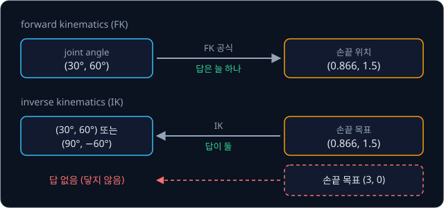

| 목표 손끝 | IK 의 답 | 이유 |
| --- | --- | --- |
| $(0.866, 1.5)$ | 둘: $(30°, 60°)$, $(90°, -60°)$ | 팔꿈치를 어느 쪽으로 꺾어도 닿는다 |
| $(2, 0)$ | 하나: $(0°, 0°)$ | 팔을 일직선으로 펴야만 닿는다 |
| $(3, 0)$ | 없음 | 원점에서 $L_1 + L_2 = 2$ 보다 멀다 |
| 3 관절 팔의 손끝 위치 | 끝없이 많음 | 맞출 숫자 2 개보다 joint 가 많다 |

식을 정리해 공식으로 답을 바로 구하는 **해석적 풀이**(analytic solution)는 모든 답을 정확히 내지만 로봇 구조마다 식을 따로 유도해야 한다.
한편 Jacobian 으로 joint angle 을 조금씩 고치는 **반복 계산**(numerical IK)은 어떤 팔에도 쓸 수 있지만, 시작 자세에 따라 답이 달라지고
실패하기도 한다.

## 2 관절 팔의 해석적 풀이

원점, 팔꿈치, 손끝을 이으면 세 변이 $L_1$, $L_2$ 와 원점에서 목표까지의 거리 $d$ 인 삼각형이 생긴다. joint 1 을 돌리면 이 삼각형이
통째로 돌 뿐이라서 $d$ 는 팔꿈치가 접힌 정도($\theta_2$)만으로 정해지는데, 이 관계를 적은 식이 코사인 법칙이다.

$$
d^2 = L_1^2 + L_2^2 + 2L_1L_2\cos\theta_2
$$

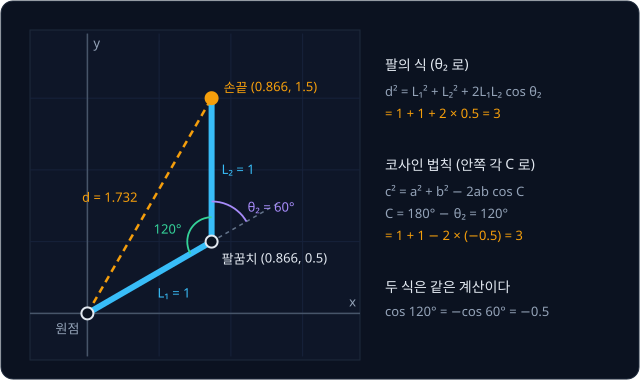

목표 $(0.866, 1.5)$ 에서는 $d^2 = 0.75 + 2.25 = 3$ 이라서 $\cos\theta_2 = (3 - 1 - 1) \div (2 \times 1 \times 1) = 0.5$ 다. cos 이 0.5 인
각도는 $60°$ 와 $-60°$ 둘인데, 위로 꺾은 팔과 아래로 꺾은 팔은 팔꿈치가 접힌 정도가 같아서 $d$ 도 같다.

$\theta_2$ 로 팔의 모양이 정해지면 이제 팔 전체를 얼마나 돌릴지만 정하면 된다. 원점에서 본 목표의 방향 $\varphi$(phi)에서
$\theta_1 = 0°$ 인 팔의 손끝이 놓인 방향 $\beta$(beta)를 빼면 된다. 점 $(x, y)$ 의 방향 각도는 프로그램에서 $\mathrm{atan2}(y, x)$ 로 구한다.

| 단계 | $\theta_2 = 60°$ | $\theta_2 = -60°$ |
| --- | --- | --- |
| 목표의 방향 $\varphi = \mathrm{atan2}(1.5, 0.866)$ | $60°$ | $60°$ |
| $\theta_1 = 0°$ 일 때 손끝 $(1 + \cos\theta_2,\ \sin\theta_2)$ | $(1.5, 0.866)$ | $(1.5, -0.866)$ |
| 그 손끝의 방향 $\beta$ | $30°$ | $-30°$ |
| $\theta_1 = \varphi - \beta$ | $30°$ | $90°$ |

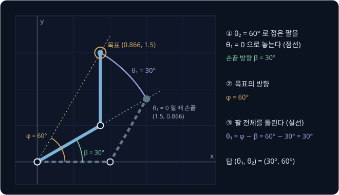

$$
\cos\theta_2 = \frac{x^2 + y^2 - L_1^2 - L_2^2}{2L_1L_2}, \qquad \theta_1 = \mathrm{atan2}(y, x) - \mathrm{atan2}(L_2\sin\theta_2,\ L_1 + L_2\cos\theta_2)
$$

원점과 목표를 잇는 선보다 팔꿈치가 위로 솟은 $(90°, -60°)$ 를 **elbow-up** 이라 하고, 아래로 처진 $(30°, 60°)$ 를 **elbow-down** 이라고
한다.

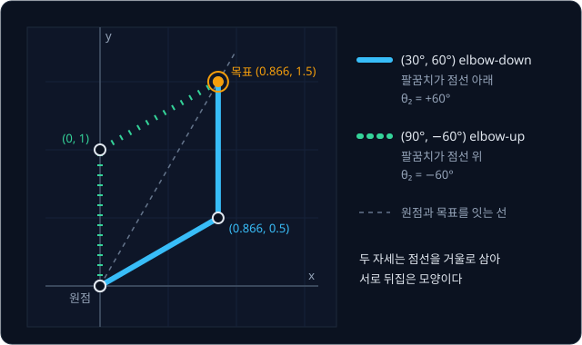

둘 중 무엇을 쓸지는 joint 범위, 장애물, 지금 자세를 보고 정한다. 지금 자세가 $(30°, 50°)$ 라면 $(30°, 60°)$ 로는 $\theta_2$ 만 $10°$
돌리면 되지만, $(90°, -60°)$ 로 가려면 $\theta_1$ 을 $60°$ 돌리고 $\theta_2$ 도 $110°$ 돌려야 한다. 그래서 보통은 지금 자세에 가까운 답을 고른다.

> **오해** IK 의 답이 둘이면 하나는 틀린 답이다.
>
> **사실** 두 답 모두 FK 에 넣으면 손끝이 정확히 목표에 오므로 둘 다 맞는 답이다.

<b>심화: 코사인 법칙의 유도</b>

$\theta_1 = 0°$ 인 팔은 팔꿈치가 $(L_1, 0)$ 이고 손끝이 $(L_1 + L_2\cos\theta_2,\ L_2\sin\theta_2)$ 다. 피타고라스 정리로 한 줄씩 정리한다.

1. $d^2 = (L_1 + L_2\cos\theta_2)^2 + (L_2\sin\theta_2)^2$
2. 앞 괄호를 $(a + b)^2 = a^2 + 2ab + b^2$ 으로 풀면 $L_1^2 + 2L_1L_2\cos\theta_2 + L_2^2\cos^2\theta_2$ 다
3. 둘을 더하면 $d^2 = L_1^2 + 2L_1L_2\cos\theta_2 + L_2^2(\cos^2\theta_2 + \sin^2\theta_2)$ 다
4. 점 $(\cos\theta_2, \sin\theta_2)$ 는 반지름 1 인 원 위에 있어서 $\cos^2\theta_2 + \sin^2\theta_2 = 1$ 이므로 $d^2 = L_1^2 + L_2^2 + 2L_1L_2\cos\theta_2$ 다

$L_1 = L_2 = 1$ 에서 $\theta_2$ 를 바꿔 가며 계산하면 팔꿈치를 접을수록 손끝이 원점에 다가온다.

| $\theta_2$ | 손끝 $(1 + \cos\theta_2,\ \sin\theta_2)$ | $d^2$ |
| --- | --- | --- |
| $0°$ | $(2, 0)$ | 4 |
| $60°$ | $(1.5, 0.866)$ | 3 |
| $90°$ | $(1, 1)$ | 2 |
| $120°$ | $(0.5, 0.866)$ | 1 |
| $180°$ | $(0, 0)$ | 0 |

수학책의 코사인 법칙은 두 변 $a$, $b$ 와 그 사이의 각 $C$ 로 $c^2 = a^2 + b^2 - 2ab\cos C$ 라고 적는다. 팔꿈치의 안쪽 각은
$C = 180° - \theta_2$ 이고 $\cos(180° - \theta_2) = -\cos\theta_2$ 라서 부호만 바뀐다. $\theta_2 = 60°$ 면 $C = 120°$ 이고 $\cos 120° = -0.5$ 라서,
$1 + 1 - 2 \times (-0.5) = 3$ 으로 값이 같다.

**확인 문제.** 목표가 $(1, 1)$ 이면 두 답은?

답 보기

1. 거리: $d^2 = 1^2 + 1^2 = 2$
2. $\cos\theta_2 = (2 - 1 - 1) \div (2 \times 1 \times 1) = 0$ 이고, cos 이 0 인 각도는 $90°$ 와 $-90°$ 다
3. 목표 방향은 $\varphi = \mathrm{atan2}(1, 1) = 45°$ 다
4. $\theta_2 = 90°$: $\theta_1 = 0°$ 일 때 손끝은 $(1 + 0,\ 1) = (1, 1)$ 이라 $\beta = 45°$, $\theta_1 = 45° - 45° = 0°$
5. $\theta_2 = -90°$: 손끝은 $(1, -1)$ 이라 $\beta = -45°$, $\theta_1 = 45° - (-45°) = 90°$

답은 elbow-down $(0°, 90°)$ 와 elbow-up $(90°, -90°)$ 다.

## workspace

$\cos\theta_2$ 는 반지름 1 인 원 위 점의 가로 위치라서 $-1$ 과 $1$ 사이에만 있다. 공식으로 구한 값이 이 범위를 벗어나면 그런 각도가
없고, 팔이 목표에 닿지 않는다.

| 목표 | $d^2$ | $\cos\theta_2 = (d^2 - 2) \div 2$ | 판정 |
| --- | --- | --- | --- |
| $(0.866, 1.5)$ | 3 | 0.5 | 답 둘 ($\pm 60°$) |
| $(2, 0)$ | 4 | 1 | 답 하나 ($0°$, 두 답이 겹침) |
| $(2, 1)$ | 5 | 1.5 | 답 없음 |
| $(3, 0)$ | 9 | 3.5 | 답 없음 |

손끝이 닿을 수 있는 곳 전체를 **workspace** 라고 한다. $L_1 = L_2 = 1$ 인 팔은 반지름 2 인 원 안이 모두 workspace 다. 반면 $L_1 = 2$,
$L_2 = 1$ 인 팔은 link 2 를 완전히 접어도 손끝이 원점에서 $2 - 1 = 1$ 떨어져 있어서, 원점에 너무 가까운 목표에도 닿지 않는다. 목표가
$(0.5, 0)$ 이면 $\cos\theta_2 = (0.25 - 4 - 1) \div (2 \times 2 \times 1) = -1.1875$ 로 $-1$ 보다 작다.

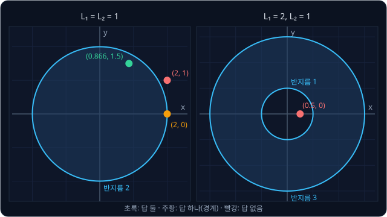

IK 프로그램은 반복 계산을 시작하기 전에 이 판정을 먼저 해서, 닿지 않는 목표면 바로 실패를 돌려줄 수 있다.

## Jacobian

반복 계산을 하려면 지금 자세에서 joint 를 조금 돌렸을 때 손끝이 어디로 가는지 알아야 한다. joint 하나만 조금 돌렸을 때 손끝 $x$, $y$ 가
변하는 비율을 joint 마다 열 하나로 늘어놓은 행렬이 Jacobian $J$ 다. FK 식을 미분해 구하는 방법은
[Derivatives & Gradients](../derivatives/README.md) 에서 다뤘고, 평면 팔에서는 그림으로도 바로 구할 수 있다.

joint 1 만 돌리면 손끝은 원점을 중심으로 원을 그리고, joint 2 만 돌리면 팔꿈치를 중심으로 원을 그린다. 원 위의 점은 중심에서 그 점으로 그은 선에 직각으로
움직이고, 반지름이 $r$ 이면 $\Delta\theta$ rad 돌 때 $r\Delta\theta$ 만큼 움직인다. 그래서 Jacobian 에서 joint 하나의 열은 그 joint 에서
손끝까지의 vector 를 시계 반대 방향으로 $90°$ 돌린 vector 다. $(a, b)$ 를 $90°$ 돌리면 $(-b, a)$ 가 된다. 자세 $(0°, 90°)$ 에서는 팔꿈치가
$(1, 0)$ 에 있고 손끝이 $(1, 1)$ 에 있다.

| joint | 회전 중심 | 중심에서 손끝까지 | $90°$ 돌린 vector = $J$ 의 열 |
| --- | --- | --- | --- |
| joint 1 | 원점 $(0, 0)$ | $(1, 1)$ | $(-1, 1)$ |
| joint 2 | 팔꿈치 $(1, 0)$ | $(0, 1)$ | $(-1, 0)$ |

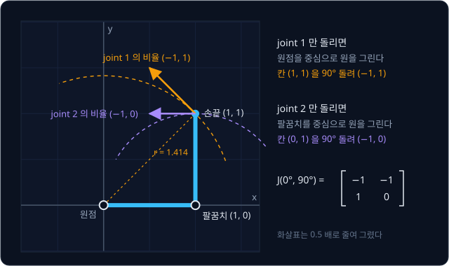

$$
J(0°, 90°) = \begin{bmatrix} -1 & -1 \\ 1 & 0 \end{bmatrix}, \qquad \Delta\mathbf p \approx J\,\Delta\mathbf q
$$

$\Delta\mathbf q$ 는 joint angle 의 변화이고 $\Delta\mathbf p$ 는 손끝 위치의 변화다. $\Delta\mathbf q = (0.01, 0.02)$ rad 이면 첫째 열 × 0.01 과
둘째 열 × 0.02 를 더한 $(-0.03, 0.01)$ 이 예측이고, FK 로 직접 구한 변화는 $(-0.0300, 0.0095)$ 다. 손끝은 실제로 원을 따라 휘어 가는데
Jacobian 은 지금 방향으로 곧게 간다고 보기 때문에, 이 식은 조금 움직일 때만 맞는다. 움직임을 10 배 키우면 차이는 약 100 배가 된다. Jacobian 은
자세마다 값도 달라서 $(30°, 60°)$ 에서는 첫째 열이 $(-1.5, 0.866)$ 이 된다. 반복 IK 가 조금씩만 움직이고 그때마다 Jacobian 을 다시 구하는 것은
이 때문이다.

<b>심화: 선형 근사의 범위와 3 차원 팔의 Jacobian</b>

자세 $(0°, 90°)$ 에서 $\Delta\mathbf q$ 를 키워 가며 $J\Delta\mathbf q$ 와 FK 로 구한 실제 이동을 비교하면 아래와 같다.

| $\Delta\mathbf q$ (rad) | 예측 $J\Delta\mathbf q$ | 실제 (FK) | 차이 |
| --- | --- | --- | --- |
| $(0.01, 0.02)$ | $(-0.03, 0.01)$ | $(-0.0300, 0.0095)$ | 0.00045 |
| $(0.1, 0.2)$ | $(-0.3, 0.1)$ | $(-0.3005, 0.0552)$ | 0.045 |
| $(0.5, 0.5)$ | $(-1, 0.5)$ | $(-0.964, 0.020)$ | 0.48 |

3 차원 팔은 joint 마다 도는 축 방향이 달라서 "$90°$ 돌리기" 대신 두 vector 에 모두 직각인 vector 를 만드는 cross product 를 쓴다.
joint $i$ 의 축 방향을 가리키는 길이 1 인 vector 를 $\hat\omega_i$ 라 하자. 축 위의 한 점을 $\mathbf p_i$ 라 하고 손끝을 $\mathbf p_e$ 라 하면
joint $i$ 의 열은 아래와 같다.

$$
J_i = \begin{bmatrix} \hat\omega_i \times (\mathbf p_e - \mathbf p_i) \\ \hat\omega_i \end{bmatrix}
$$

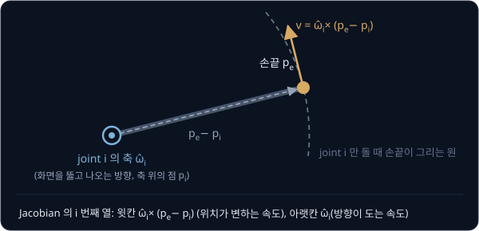

윗칸 세 숫자는 손끝 위치가 변하는 속도이고, 아랫칸 세 숫자는 손끝 방향이 도는 속도다. 평면 팔은 모든 축이 $(0, 0, 1)$ 이고
$(0, 0, 1) \times (1, 1, 0) = (-1, 1, 0)$ 이라 $90°$ 돌리기와 같다. [Forward Kinematics](../forward-kinematics/README.md) 의 SO-101 을 모든
joint angle 이 0 인 자세에 두면 `shoulder_pan` 의 축은 $(0, 0, -1)$ 이고 축 위의 점은 $(0.039, 0, 0.062)$ m 이며, 집게 끝점은
$(0.391, 0, 0.226)$ m 에 있다.
반올림 전 값으로 빼면 $\mathbf p_e - \mathbf p_i = (0.353, 0, 0.164)$ 이고 $(0, 0, -1) \times (0.353, 0, 0.164) = (0, -0.353, 0)$ 이라, 이 열은
$(0, -0.353, 0, 0, 0, -1)$ 이다. `shoulder_pan` 을 1 rad/s 로 돌리면 집게 끝이 $-y$ 방향으로 0.353 m/s 로 움직인다는 뜻이다. 위치 3 개와
방향 3 개를 함께 다루면 행이 6 개라서, joint 가 $n$ 개인 팔의 Jacobian 은 $6 \times n$ 행렬이다.

**확인 문제.** 어떤 자세에서 팔꿈치가 $(1, 1)$, 손끝이 $(2, 1)$ 에 있다. joint 2 의 열은?

답 보기

팔꿈치에서 손끝까지의 vector 는 $(2 - 1,\ 1 - 1) = (1, 0)$ 이다. $(a, b) \to (-b, a)$ 로 $90°$ 돌리면 $(0, 1)$ 이라, joint 2 를 돌리면
손끝은 처음에 똑바로 위로 움직인다.

## 반복 계산으로 푸는 IK

목표 손끝 $\mathbf p_d$(아래첨자 $d$ 는 desired)와 지금 손끝 $\mathbf p$ 의 차이 $\mathbf e = \mathbf p_d - \mathbf p$ 를 오차 vector 로 둔다.
손끝을 $\mathbf e$ 만큼 옮기려면 $J\Delta\mathbf q = \mathbf e$ 인 $\Delta\mathbf q$ 를 찾으면 되고, $J$ 가 정사각이고 inverse 가 있으면
$\Delta\mathbf q = J^{-1}\mathbf e$ 다. inverse 를 구하는 법은 [Vectors & Matrices](../vectors-matrices/README.md) 에서 다뤘다.

자세 $(0°, 90°)$ 의 손끝 $(1, 1)$ 을 목표 $(0.5, 1.5)$ 로 보내면 $\mathbf e = (-0.5, 0.5)$ 이고 남은 거리는 $\lVert\mathbf e\rVert \approx 0.707$
이다.

$$
\Delta\mathbf q = J^{-1}\mathbf e = \begin{bmatrix} 0 & 1 \\ -1 & -1 \end{bmatrix}\begin{bmatrix} -0.5 \\ 0.5 \end{bmatrix} = \begin{bmatrix} 0.5 \\ 0 \end{bmatrix}
$$

joint 1 만 0.5 rad($28.65°$) 돌리라는 답인데, 0.5 rad 은 작은 움직임이 아니라서 손끝은 예측한 $(0.5, 1.5)$ 가 아니라 $(0.398, 1.357)$ 에
간다. 그래도 남은 거리가 0.176 으로 줄었으므로, 이 자리에서 오차와 Jacobian 을 다시 구해 같은 계산을 되풀이한다. 이렇게 joint angle 을 한 번
고치는 계산을 step 이라고 부른다.

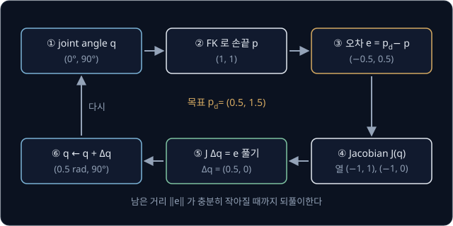

| step | $\theta_1$ | $\theta_2$ | 손끝 | 남은 거리 |
| --- | --- | --- | --- | --- |
| 0 | $0°$ | $90°$ | $(1, 1)$ | 0.707 |
| 1 | $28.65°$ | $90°$ | $(0.398, 1.357)$ | 0.176 |
| 2 | $33.04°$ | $76.56°$ | $(0.503, 1.487)$ | 0.013 |
| 3 | $33.80°$ | $75.53°$ | $(0.4999, 1.4999)$ | 0.00009 |

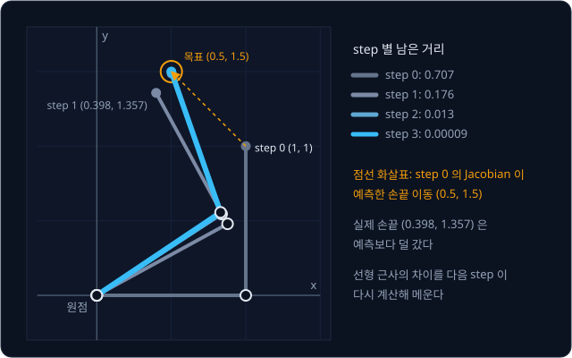

목표에 가까울수록 선형 근사가 정확해져서 남은 거리는 끝으로 갈수록 빨리 준다. link 길이 1 을 1 m 로 보면 step 3 에서는 0.1 mm 안쪽이다.
해석적 풀이로 확인하면 목표의 $d^2 = 0.25 + 2.25 = 2.5$ 에서 $\cos\theta_2 = (2.5 - 2) \div 2 = 0.25$ 이고 $\theta_2 = 75.52°$ 라서, 반복
계산이 도착한 자세는 elbow-down 답이다. 식을 한 점에서 직선으로 근사해 풀고 그 자리에서 다시 근사하기를 되풀이하는 이 방법을 Newton 법이라고
한다. 원하는 손끝 속도에서 Jacobian 의 inverse 로 joint 속도를 구하는 방법은 1969 년 Whitney 가 resolved motion rate control 이라는 이름으로
발표했다.

반복 계산은 시작 자세 근처에서 오차를 줄이는 쪽으로만 움직이므로 어느 답에 도착할지는 시작 자세가 정한다. 같은 목표를 $(90°, -90°)$ 에서
시작하면 남은 거리가 똑같이 줄며 elbow-up 답 $(109.33°, -75.52°)$ 에 도착한다. 그래서 움직이는 로봇에서는 지금 자세를 시작 자세(seed)로
넘겨 가까운 답을 얻는데, MoveIt 2 의 IK 호출도 seed 를 받는다.

joint 수와 맞출 숫자의 수가 다르면 $J$ 가 정사각이 아니라서 inverse 가 없다. 이때 쓰는 **pseudo-inverse** $J^+$ 는 $J\Delta\mathbf q$ 와
$\mathbf e$ 사이 차이의 제곱이 가장 작은 $\Delta\mathbf q$ 를 찾고, 그런 $\Delta\mathbf q$ 가 여럿이면 길이가 가장 짧아 joint 를 가장 적게
돌리는 것을 고른다. $J$ 가 정사각이고 inverse 가 있으면 $J^+ = J^{-1}$ 이라서 위 계산표는 pseudo-inverse 로 푼 결과이기도 하다.

<b>심화: pseudo-inverse 공식과 손계산</b>

joint 가 맞출 숫자보다 많아 $J$ 가 가로로 넓을 때(예: 3 관절 평면 팔의 $2 \times 3$)의 pseudo-inverse 는 아래와 같다.

$$
J^+ = J^\top\left(JJ^\top\right)^{-1}
$$

$J^\top$ 는 행과 열을 맞바꾼 transpose 다. 정사각인 $J(0°, 90°)$ 로 계산해 $J^{-1}$ 과 같은지 확인한다.

| 단계 | 계산 | 결과 |
| --- | --- | --- |
| $J^\top$ | 행과 열 맞바꾸기 | $\begin{bmatrix} -1 & 1 \\ -1 & 0 \end{bmatrix}$ |
| $JJ^\top$ 첫 행 | $(-1)(-1) + (-1)(-1)$, $(-1)(1) + (-1)(0)$ | $(2, -1)$ |
| $JJ^\top$ 둘째 행 | $(1)(-1) + (0)(-1)$, $(1)(1) + (0)(0)$ | $(-1, 1)$ |
| $(JJ^\top)^{-1}$ | $\det = 2 - 1 = 1$, 대각선 맞바꾸고 나머지 부호 바꾸기 | $\begin{bmatrix} 1 & 1 \\ 1 & 2 \end{bmatrix}$ |
| $J^\top(JJ^\top)^{-1}$ | 첫 행 $(-1 + 1,\ -1 + 2)$, 둘째 행 $(-1 + 0,\ -1 + 0)$ | $\begin{bmatrix} 0 & 1 \\ -1 & -1 \end{bmatrix}$ |

결과가 $J^{-1}$ 과 같다. 행이 열보다 많을 때(joint 5 개로 pose 의 숫자 6 개를 맞출 때)는 $J^+ = (J^\top J)^{-1}J^\top$ 이고, 오차를 완전히 없앨 수
없어서 제곱 합이 가장 작은 타협점을 낸다. 1920 년 Moore 와 1955 년 Penrose 가 각각 정의해 Moore–Penrose pseudo-inverse 라고도 부른다.

elbow-up 답의 $\theta_1$ 은 해석적 풀이로 $\varphi = \mathrm{atan2}(1.5, 0.5) = 71.57°$, $\beta = \mathrm{atan2}(\sin(-75.52°),\ 1 + \cos(-75.52°))
= -37.76°$ 라서 $109.33°$ 다. $(90°, -90°)$ 에서 시작한 반복은 $\theta_1$ 이 $90° \to 118.65° \to 109.60° \to 109.33°$ 로 움직인다.

**확인 문제.** $J(0°, 90°)$ 에서 $\mathbf e = (-1, 0.5)$ 이면 $\Delta\mathbf q = J^{-1}\mathbf e$ 는?

답 보기

$J^{-1} = \begin{bmatrix} 0 & 1 \\ -1 & -1 \end{bmatrix}$ 의 각 행과 $\mathbf e$ 를 같은 자리끼리 곱해 더한다.

1. 첫째 칸: $0 \times (-1) + 1 \times 0.5 = 0.5$
2. 둘째 칸: $(-1) \times (-1) + (-1) \times 0.5 = 1 - 0.5 = 0.5$

$\Delta\mathbf q = (0.5, 0.5)$ 다. 검산하면 $J\Delta\mathbf q = (-0.5 - 0.5,\ 0.5 + 0) = (-1, 0.5)$ 로 $\mathbf e$ 와 같다.

## Jacobian transpose

inverse 를 구하지 않고 $J$ 의 transpose 만 곱하는 방법도 있다.

$$
\Delta\mathbf q = \alpha\, J^\top\mathbf e
$$

$\alpha$(alpha)는 한 번에 얼마나 움직일지 정하는 작은 양수다. 남은 거리를 제곱해 반으로 나눈 $\frac{1}{2}\lVert\mathbf e\rVert^2$ 을 loss 로 두면
그 gradient 가 $-J^\top\mathbf e$ 라서, 이 식은 joint angle 을 gradient 의 반대 방향으로 고치는 gradient descent 와 같다.

$(0°, 90°)$, $\mathbf e = (-0.5, 0.5)$ 에서는 $J^\top\mathbf e = (1, 0.5)$ 라서 $\alpha = 0.5$ 면 $\Delta\mathbf q = (0.5, 0.25)$ 다.
pseudo-inverse 의 $(0.5, 0)$ 과 방향이 다르다. transpose 는 loss 를 가장 빨리 줄이는 방향으로 가고, pseudo-inverse 는 선형 근사로 오차가 0 이
되는 곳으로 가기 때문이다.

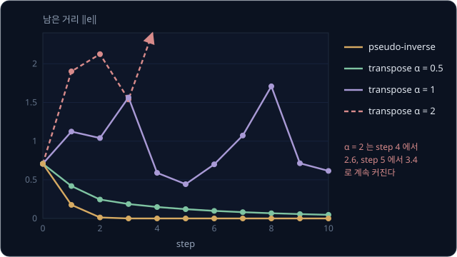

위 그림은 같은 목표 $(0.5, 1.5)$ 를 향해 반복할 때 step 마다 남은 거리를 보여 준다. $\alpha = 0.5$ 에서는 남은 거리가 꾸준히 줄지만 step 40
에야 0.0004 가 될 만큼 느리다. 오차가 작아지면 $J^\top\mathbf e$ 도 작아져 걸음이 함께 줄기 때문이다. transpose 법은 inverse 가 필요 없어 계산이 싸고 singularity 근처에서도 움직임이
끝없이 커지지 않지만, 같은 정확도까지 가는 데 step 이 훨씬 많이 든다.

> **오해** $\alpha$ 를 크게 잡으면 빨리 수렴한다.
>
> **사실** $\alpha = 1$ 이면 첫 걸음 $(1, 0.5)$ rad 이 너무 커서 손끝이 목표를 지나쳐 $(-0.457, 0.912)$ 로 가고, 그 뒤로도 남은 거리가 0.4 와 1.7 사이를 오간다. learning rate 가 큰
> gradient descent 처럼 한 걸음이 선형 근사가 맞는 범위를 넘어 목표를 지나치기를 되풀이한다.

<b>심화: step 별 남은 거리와 gradient 가 −Jᵀe 인 이유</b>

그림의 값을 표로 옮기면 아래와 같다. $\alpha = 0.5$ 의 step 20 은 0.009 다.

| step | pseudo-inverse | transpose $\alpha = 0.5$ | transpose $\alpha = 1$ | transpose $\alpha = 2$ |
| --- | --- | --- | --- | --- |
| 0 | 0.707 | 0.707 | 0.707 | 0.707 |
| 1 | 0.176 | 0.419 | 1.123 | 1.90 |
| 2 | 0.013 | 0.245 | 1.039 | 2.12 |
| 3 | 0.00009 | 0.186 | 1.564 | 1.54 |
| 10 | 0 | 0.047 | 0.615 | 1.74 |

loss $L = \frac{1}{2}(e_x^2 + e_y^2)$ 를 chain rule 로 $\theta_1$ 에 대해 미분하면 gradient 가 나온다.

1. $\theta_1$ 을 1 늘리면 손끝 $x$ 는 $\frac{\partial x}{\partial \theta_1}$ 만큼 늘고 $e_x = x_d - x$ 는 그만큼 줄어서, $e_x$ 가 변하는 비율은 $-\frac{\partial x}{\partial \theta_1}$ 이다
2. $\frac{1}{2}e_x^2$ 을 $e_x$ 로 미분하면 $e_x$ 다
3. 두 비율을 곱하고 $y$ 쪽도 더하면 $\frac{\partial L}{\partial \theta_1} = -\left(e_x\frac{\partial x}{\partial \theta_1} + e_y\frac{\partial y}{\partial \theta_1}\right)$ 다

괄호 안은 $J$ 첫째 열과 $\mathbf e$ 를 곱해 더한 값이라 $J^\top\mathbf e$ 의 첫째 칸과 같다. 그래서 gradient 는 $-J^\top\mathbf e$ 이고, update
$\mathbf q \leftarrow \mathbf q - \alpha(-J^\top\mathbf e)$ 를 정리하면 $\mathbf q \leftarrow \mathbf q + \alpha J^\top\mathbf e$ 다. 위 예에서
$\theta_1$ 을 양쪽으로 0.01 씩 옮겨 central difference 로 잰 $\frac{\partial L}{\partial \theta_1}$ 도 $-1.000$ 으로 $-(J^\top\mathbf e)_1 = -1$ 과 같다.

**확인 문제.** $J = \begin{bmatrix} -1 & -1 \\ 1 & 0 \end{bmatrix}$, $\mathbf e = (0.2, 0.4)$, $\alpha = 0.5$ 일 때 Jacobian transpose 의 $\Delta\mathbf q$ 는?

답 보기

1. $J^\top\mathbf e$ 첫째 칸: 첫째 열 $(-1, 1)$ 과 $\mathbf e$ 로 $(-1)(0.2) + 1 \times 0.4 = 0.2$
2. 둘째 칸: 둘째 열 $(-1, 0)$ 과 $\mathbf e$ 로 $(-1)(0.2) + 0 \times 0.4 = -0.2$
3. $\Delta\mathbf q = 0.5 \times (0.2, -0.2) = (0.1, -0.1)$

## singularity

팔을 쭉 편 자세 $(0°, 0°)$ 에서는 팔꿈치가 $(1, 0)$ 에 있고 손끝이 $(2, 0)$ 에 있다. joint 1 의 vector $(2, 0)$ 을 $90°$ 돌리면 $(0, 2)$ 이고 joint 2 의
vector $(1, 0)$ 을 돌리면 $(0, 1)$ 이라서, 두 열이 모두 세로 방향이다.

$$
J(0°, 0°) = \begin{bmatrix} 0 & 0 \\ 2 & 1 \end{bmatrix}, \qquad \det J = 0 \times 1 - 0 \times 2 = 0
$$

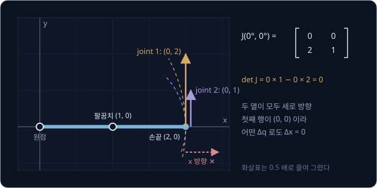

첫째 행이 $(0, 0)$ 이라 어떤 $\Delta\mathbf q$ 로도 $\Delta x$ 는 0 이다. 이렇게 Jacobian 의 determinant 가 0 이 되어 손끝을 움직일 수 없는
방향이 생기는 자세가 **singularity** 다. 2 관절 팔은 $\det J = L_1L_2\sin\theta_2$ 라서 팔을 쭉 편 $\theta_2 = 0°$ 와 완전히 접은 $180°$ 가
singularity 다. Lynch 와 Park 의 Modern Robotics 5.3 절은 6 관절 팔의 예로 두 joint 축이 일직선이 되는 자세(손목), 평행한 세 축이 한 평면에
놓이는 자세(팔꿈치를 쭉 폄), 네 축이 한 점에서 만나는 자세(손목 중심이 joint 1 축 위)를 든다.

쭉 편 팔에서 joint 를 $(2, 1)$ 방향으로 돌리면 손끝이 $(0, 5)$ 만큼 움직여 배율이 $5 \div \sqrt 5 \approx 2.236$ 인데, $(1, -2)$ 방향이면
$J\Delta\mathbf q = (0, 0)$ 이라 배율이 0 이다. joint 1 이 손끝을 올리는 만큼 joint 2 가 내려서 두 움직임이 서로 지워진다. Jacobian 이 방향마다 늘리는
이 배율을 **singular value** $\sigma$(sigma)라 하고, 행렬을 배율과 방향으로 나누는 계산을 SVD(singular value decomposition)라고 한다. 배율이
0 인 방향이 생기면 Jacobian 의 rank(독립인 열의 수)가 2 에서 1 로 줄어든다.

로봇이 정확히 singularity 자세에 놓일 일은 드물지만, 문제는 그 근처에서 생긴다. $\theta_2 = s$ 가 작은, 거의 펴진 팔에서 손끝을 원점 쪽으로
0.01 만 당기는 오차 $\mathbf e = (-0.01, 0)$ 을 pseudo-inverse 로 풀면 아래와 같다.

| $\theta_2 = s$ (rad) | $\det J$ | $\Delta\mathbf q = J^{-1}\mathbf e$ | $\lVert\Delta\mathbf q\rVert$ | 실제 손끝 $x$ 변화 |
| --- | --- | --- | --- | --- |
| 0.5 ($28.6°$) | 0.479 | $(-0.018, 0.039)$ | 0.043 | $-0.0104$ |
| 0.1 ($5.7°$) | 0.0998 | $(-0.100, 0.200)$ | 0.223 | $-0.0199$ |
| 0.01 ($0.57°$) | 0.0100 | $(-1.00, 2.00)$ | 2.236 | $-0.928$ |
| 0.001 ($0.057°$) | 0.0010 | $(-10.0, 20.0)$ | 22.36 | $-3.68$ |

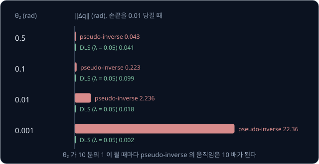

$\theta_2$ 가 10 분의 1 이 될 때마다 $\Delta\mathbf q$ 는 10 배 커진다. $s = 0.001$ 이면 pseudo-inverse 는 손끝을 0.01 당기려고
joint 2 를 20 rad, 세 바퀴 넘게 돌리라고 한다. 실제로 필요한 팔꿈치 각도는 약 0.2 rad 인데, 이 명령을 그대로 보내면 손끝이 $x = -1.68$ 까지 간다. pseudo-inverse 는 방향마다
오차 $e$ 를 배율 $\sigma$ 로 나눈 $e \div \sigma$ 만큼 joint 를 돌리므로, $\sigma$ 가 0 에 가까우면 아주 작은 오차도 아주 큰 움직임이 된다. MoveIt 2 의 KDL plugin 은 SVD 로 pseudo-inverse 를 계산하면서 0.001 보다
작은 singular value 의 역수를 0 으로 두어, 그 방향으로는 joint 를 아예 움직이지 않는다.

> **오해** singularity 에서는 손끝이 그 방향으로 전혀 못 움직인다.
>
> **사실** 쭉 편 팔도 팔꿈치를 굽히면 손끝이 원점 쪽으로 당겨지는데, 움직이기 시작하는 순간의 비율이 0 이라 Jacobian 의 선형 근사에 보이지 않을 뿐이다. 문제는 로봇이 아니라 Jacobian 으로 하는 계산에서 생긴다.

**확인 문제.** 어떤 방향의 배율이 $\sigma = 0.02$ 이고 그 방향 오차가 $e = 0.01$ 이면 pseudo-inverse 의 joint 움직임은? $\sigma = 0.002$ 이면?

답 보기

$0.01 \div 0.02 = 0.5$ 와 $0.01 \div 0.002 = 5$ 다. 배율이 10 분의 1 이 되자 움직임이 10 배가 되었다.

## damped least squares

pseudo-inverse 는 오차만 줄일 뿐 joint 를 얼마나 돌리는지는 따지지 않는다. joint 움직임의 크기에도 벌점을 매기는 방법이 **damped
least squares**(DLS)이고, 1986 년 Wampler 와 Nakamura·Hanafusa 가 각각 IK 에 처음 썼다. 배율 $\sigma$ 인 한 방향에서 joint 를 $\Delta$ 만큼 돌릴 때
아래 값을 가장 작게 하는 $\Delta$ 를 찾는다.

$$
f(\Delta) = (\sigma\Delta - e)^2 + \lambda^2\Delta^2 \quad\Rightarrow\quad \Delta = \frac{\sigma\,e}{\sigma^2 + \lambda^2}
$$

앞 항은 손끝이 $\sigma\Delta$ 만큼 움직인 뒤에도 남는 오차의 제곱이고, 뒤 항은 joint 를 돌린 양의 제곱에 $\lambda^2$ 을 곱한 벌점이다.
$\lambda$(lambda)는 벌점의 세기로 damping 이라고도 부른다. $\lambda = 0$ 이면 pseudo-inverse 의 $e \div \sigma$ 와 같고, $\lambda > 0$ 이면
$\sigma$ 가 0 에 가까워도 분모가 $\lambda^2$ 아래로 내려가지 않는다. $e = 0.01$, $\lambda = 0.05$ 로 비교하면 아래와 같다.

| $\sigma$ | pseudo-inverse $e / \sigma$ | DLS $\sigma e / (\sigma^2 + \lambda^2)$ |
| --- | --- | --- |
| 1 | 0.01 | 0.00998 |
| 0.1 | 0.1 | 0.08 |
| 0.05 | 0.2 | 0.1 |
| 0.01 | 1 | 0.0385 |
| 0.001 | 10 | 0.0040 |

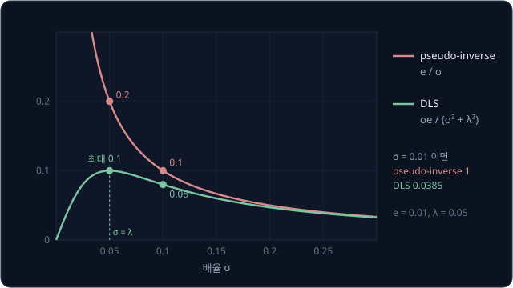

$\sigma$ 가 $\lambda$ 보다 충분히 크면 두 방법이 거의 같다. DLS 의 움직임은 $\sigma = \lambda$ 에서 가장 크지만 그래도 $e \div (2\lambda) = 0.1$
을 넘지 않는다. joint 가 여럿이면 pseudo-inverse 공식의 $JJ^\top$ 대각선에 $\lambda^2$ 을 더한 $\Delta\mathbf q = J^\top(JJ^\top + \lambda^2 I)^{-1}\mathbf e$
를 쓰는데, 대각선에 양수가 더해지면 determinant 가 0 이 되지 않아 inverse 를 언제나 구할 수 있다.

거의 펴진 팔 $(0°, 0.001\ \text{rad})$ 에서 손끝을 $(1.99, 0)$ 으로 당겨 보자. pseudo-inverse 는 결국 손끝을 맞추지만, 첫 step 에 joint 를
22.36 rad 돌린 탓에 $(-725.73°, 1451.46°)$ 에 도착한다. joint 1 이 두 바퀴를 더 돌고 joint 2 가 네 바퀴를 더 돈 자세라서, 실제 로봇이라면
케이블이 감기거나 joint 범위를 벗어난다. $\lambda = 0.05$ 인 DLS 는 한 step 에 0.08 rad 을 넘지 않고 가까운 답 $(-5.73°, 11.46°)$ 근처에 닿는다.

다만 $\lambda$ 를 키울수록 수렴이 느려진다. 목표 $(0.5, 1.5)$ 에서 step 3 의 남은 거리는 pseudo-inverse 가 0.00009 이고, $\lambda = 0.5$
에서는 0.038 이며 $\lambda = 1$ 에서는 0.141 이다. Buss 도 damping 이 singularity 근처의 답을 안정시킬 만큼 커야 하지만 너무 크면 수렴이 지나치게 느려진다고 적는다.

<b>심화: DLS 식의 유도, 행렬 손계산, λ 에 따른 반복</b>

가장 작은 점에서는 $f$ 의 derivative 가 0 이다. $f$ 를 $\Delta$ 로 미분해 0 으로 놓고 한 줄씩 푼다.

1. $(\sigma\Delta - e)^2$ 의 derivative 는 chain rule 로 $2(\sigma\Delta - e) \times \sigma$ 이고, $\lambda^2\Delta^2$ 의 derivative 는 $2\lambda^2\Delta$ 다
2. 둘을 더해 0 으로 놓고 2 로 나누면 $\sigma^2\Delta - \sigma e + \lambda^2\Delta = 0$ 이다
3. $(\sigma^2 + \lambda^2)\Delta = \sigma e$ 라서 $\Delta = \sigma e / (\sigma^2 + \lambda^2)$ 다

$\sigma = 2$, $e = 1$, $\lambda = 1$ 이면 pseudo-inverse 는 $0.5$ 이고 DLS 는 $2 \div 5 = 0.4$ 다. $f(0.5) = 0 + 0.25 = 0.25$ 이고
$f(0.4) = (0.8 - 1)^2 + 0.16 = 0.2$ 로 DLS 쪽이 더 작아서, DLS 는 오차를 조금 남기는 대신 joint 를 덜 돌려 둘의 합을 줄인다.

행렬 식은 $J(0°, 90°)$, $\mathbf e = (-0.5, 0.5)$, $\lambda = 1$ 로 계산하면 아래와 같다.

| 단계 | 계산 | 결과 |
| --- | --- | --- |
| $JJ^\top + I$ | $\begin{bmatrix} 2 & -1 \\ -1 & 1 \end{bmatrix}$ 의 대각선에 1 더하기 | $\begin{bmatrix} 3 & -1 \\ -1 & 2 \end{bmatrix}$ |
| 그 inverse | $\det = 6 - 1 = 5$, 대각선 맞바꾸고 부호 바꿔 5 로 나누기 | $\frac{1}{5}\begin{bmatrix} 2 & 1 \\ 1 & 3 \end{bmatrix}$ |
| inverse $\times\ \mathbf e$ | $\frac{1}{5}(2(-0.5) + 1(0.5),\ 1(-0.5) + 3(0.5))$ | $(-0.1, 0.2)$ |
| $J^\top \times$ 앞 결과 | $((-1)(-0.1) + 1(0.2),\ (-1)(-0.1) + 0(0.2))$ | $(0.3, 0.1)$ |

DLS 의 $(0.3, 0.1)$ 은 pseudo-inverse 의 $(0.5, 0)$ 보다 짧고, 방향은 pseudo-inverse 와 Jacobian transpose 의 $(1, 0.5)$ 사이쯤이다. 쭉 편 팔
$J(0°, 0°)$ 에서는 $JJ^\top = \begin{bmatrix} 0 & 0 \\ 0 & 5 \end{bmatrix}$ 라서 $\det = 0$ 이고 inverse 가 없는데, $\lambda = 1$ 을 더하면
$\begin{bmatrix} 1 & 0 \\ 0 & 6 \end{bmatrix}$ 이 되어 $\det = 6$ 이고 inverse $\begin{bmatrix} 1 & 0 \\ 0 & 0.167 \end{bmatrix}$ 을 구할 수 있다.

SVD 로 쓰면 $J^\top(JJ^\top + \lambda^2 I)^{-1}$ 은 singular value $\sigma_i$ 마다 $\sigma_i / (\sigma_i^2 + \lambda^2)$ 를 곱하는 행렬이라, 한
방향 식이 방향마다 따로 적용된다(Buss, 6 절). $\lambda^2$ 이 $\sigma^2$ 보다 훨씬 크면 이 값이 $\sigma / \lambda^2$ 에 가까워져, 한 방향에서
$\alpha\sigma e$ 를 내는 Jacobian transpose 에 $\alpha = 1 / \lambda^2$ 을 넣은 것과 같아진다.

본문의 두 반복 계산을 표로 옮기면 아래와 같다. 첫째 표는 $(0°, 0.001\ \text{rad})$ 에서 손끝을 $(1.99, 0)$ 으로 당긴 결과이고, 해석적
풀이로는 $\theta_2 = \arccos((1.99^2 - 2) \div 2) = 11.46°$, $\theta_1 = -5.73°$ 다.

| 방법 | step 0 의 $\lVert\Delta\mathbf q\rVert$ | 남은 거리가 0.0001 보다 작아진 step | 도착한 자세 |
| --- | --- | --- | --- |
| pseudo-inverse | 22.36 rad | 7 | $(-725.73°, 1451.46°)$ |
| DLS $\lambda = 0.05$ | 0.0018 rad | 9 | $(-5.73°, 11.46°)$ 근처 |

둘째 표는 목표 $(0.5, 1.5)$ 에 $(0°, 90°)$ 에서 출발해 $\lambda$ 만 바꾼 남은 거리다.

| 방법 | step 1 | step 3 | step 10 |
| --- | --- | --- | --- |
| pseudo-inverse ($\lambda = 0$) | 0.176 | 0.00009 | 0 |
| DLS $\lambda = 0.1$ | 0.178 | 0.0006 | 0 |
| DLS $\lambda = 0.5$ | 0.218 | 0.038 | 0.0002 |
| DLS $\lambda = 1$ | 0.291 | 0.141 | 0.019 |

**확인 문제.** $\sigma = 0.5$, $e = 1$, $\lambda = 1$ 일 때 pseudo-inverse 와 DLS 의 joint 움직임은?

답 보기

1. pseudo-inverse: $e \div \sigma = 1 \div 0.5 = 2$
2. DLS: $\sigma e \div (\sigma^2 + \lambda^2) = 0.5 \times 1 \div (0.25 + 1) = 0.5 \div 1.25 = 0.4$

DLS 가 움직임을 5 분의 1 로 줄인다.

## 닿지 않는 목표

반복 계산에는 답이 있는지 판단하는 단계가 없어서, 목표가 닿지 않는 곳에 있어도 오차를 줄이는 쪽으로 계속 움직인다. 아래 그림은 $(0°, 90°)$
에서 시작해 workspace 밖의 $(3, 0)$ 을 향해 반복할 때 손끝이 지나간 자리를 보여 준다.

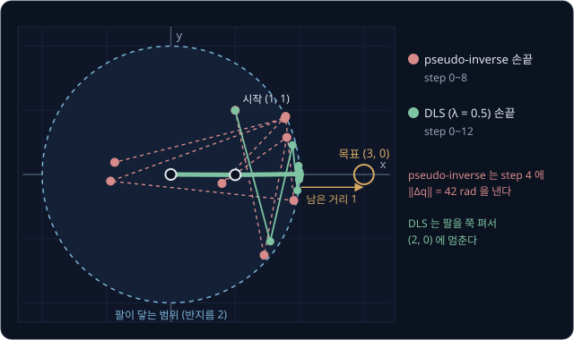

닿지 않는 목표를 쫓으면 팔은 그 방향으로 쭉 펴지는데, 쭉 편 팔은 singularity 다. pseudo-inverse 는 팔을 펴다가 singularity 근처인 step 4 에서
joint 를 42 rad(약 7 바퀴) 돌리라는 값을 내고, 그 뒤로도 남은 거리가 1.5 와 2.2 사이를 오간다. $\lambda = 0.5$ 인 DLS 는 손끝을 $(2, 0)$ 에 두고
멈추는데, 남은 거리 $3 - 2 = 1$ 은 이 팔이 목표에 가장 가까이 갈 수 있는 거리다. $\lambda = 0.1$ 이면 벌점이 약해서 오차가 큰 동안 한 step 에
24 rad 까지 움직이므로, 오차가 클 때 $\lambda$ 가 너무 작으면 DLS 도 안전하지 않다.

Buss 는 한 step 에 쓰는 오차의 길이에 상한 $D_{\max}$ 를 두면 목표가 닿지 않는 곳에 있을 때 흔들림이 줄고, 그만큼 작은 $\lambda$ 를 써서
빨리 수렴할 수 있다고 적는다.

<b>심화: step 별 남은 거리</b>

| step | pseudo-inverse 남은 거리 | pseudo-inverse $\lVert\Delta\mathbf q\rVert$ | DLS $\lambda = 0.5$ 남은 거리 | DLS $\lVert\Delta\mathbf q\rVert$ |
| --- | --- | --- | --- | --- |
| 0 | 2.236 | 1.41 | 2.236 | 1.27 |
| 1 | 1.996 | 2.05 | 1.791 | 1.01 |
| 2 | 1.330 | 3.57 | 1.200 | 0.74 |
| 3 | 2.210 | 2.97 | 1.063 | 0.48 |
| 4 | 1.516 | 42.01 | 1.024 | 0.37 |
| 10 | 2.028 | 2.87 | 1.000 | 0.06 |

**확인 문제.** $L_1 = L_2 = 1$ 인 팔에 목표 $(0, 2.5)$ 를 주고 DLS 로 반복하면 손끝은 어디에 멈출까?

답 보기

$d = 2.5$ 는 최대 거리 2 보다 커서 닿지 않는다. 팔이 목표 방향($90°$)으로 쭉 펴져 손끝이 $(0, 2)$ 에 멈추고, 남은 거리는 $2.5 - 2 = 0.5$ 다.

## pose 와 joint 수

물건을 집으려면 손끝 위치와 함께 집게가 향하는 방향도 맞춰야 한다. 위치와 방향을 합친 pose 는 3 차원에서 숫자 6 개라서 오차 vector 도 6 칸이다.

$$
\mathbf e = \begin{bmatrix} \mathbf p_d - \mathbf p \\ \log(R_d R^\top) \end{bmatrix}
$$

아랫칸은 지금 방향 $R$ 에서 목표 방향 $R_d$ 까지 더 돌아야 하는 회전 $R_dR^\top$ 을 rotation vector 로 바꾼 값이다. rotation vector 는
회전축 방향을 가리키고 길이가 회전 각도인 숫자 3 개인데, 회전 행렬에서 이 vector 를 구하는 방법은 [Rigid Transforms](../transforms/README.md)
에서 다뤘다. 이 오차에 $6 \times n$ Jacobian 을 써서 같은 반복을 한다. 위치 오차의 단위는 m 이고 방향 오차의 단위는 rad 이라서, 그대로 두면 1 cm 와 $0.57°$(0.01 rad)가 같은 크기로 계산된다. 그래서 두
칸에 다른 무게를 곱하기도 하는데, MoveIt 2 의 KDL plugin 은 이 무게를 `orientation_vs_position`(기본 1.0)으로 정하고 `position_only_ik` 를
켜면 위치만 맞춘다.

joint 가 맞출 숫자보다 많으면 답이 끝없이 많다. link 길이가 모두 1 인 3 관절 평면 팔은 $(30°, 30°, 30°)$, $(60°, -30°, 60°)$,
$(90°, -60°, 30°)$ 가 모두 손끝 $(1.366, 2.366)$ 에 닿는다. 세 자세 모두 $30°$, $60°$, $90°$ 방향을 가리키는 길이 1 인 vector 세 개를 순서만
바꿔 더한 꼴이라서 끝점이 같다.

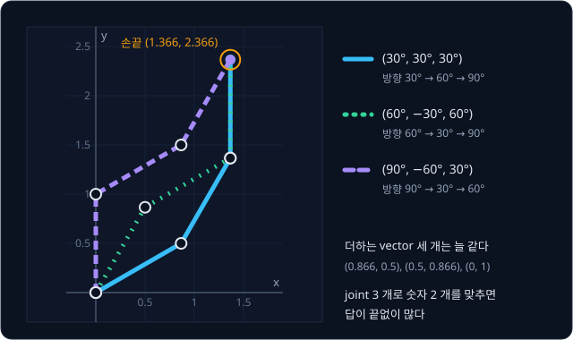

$\theta_1$ 을 $30°$ 와 $90°$ 사이 어느 값으로 정해도 나머지 두 joint 로 손끝을 맞출 수 있다. 이런 팔을 **redundant** 하다고 하는데, 7 관절 팔인
Franka Panda 나 KUKA iiwa 로 숫자 6 개인 pose 를 맞출 때가 그렇다. 남는 joint 로는 장애물을 피하거나 joint 범위 한가운데에 머무는 자세를 고를 수
있다. MoveIt 2 문서는 `kinematics_solver_search_resolution` 을 7 관절 팔에서 남는 joint 하나의 값을 바꿔 가며 답을 찾을 때 쓰는 간격이라고
설명한다. 반대로 집게를 뺀 joint 가 5 개인 SO-101 은 임의로 고른 pose 에 대부분 정확히 닿지 못해서, IK 는 위치와 방향 사이의 타협점을 낸다.

**확인 문제.** joint 가 7 개인 팔로 손끝의 위치와 방향을 맞출 때 Jacobian 의 크기는? $J\Delta\mathbf q = \mathbf e$ 의 해는 하나일까?

답 보기

행은 위치 3 개와 방향 3 개로 6 개, 열은 joint 마다 하나씩 7 개라서 $6 \times 7$ 이다. 식 6 개에 모르는 값이 7 개라서 해가 여럿이고,
pseudo-inverse 는 그중 joint 를 가장 적게 돌리는 해를 고른다.

## joint limit 과 IK solver

실제 joint 는 URDF 의 `<limit>` 에 적힌 범위 안에서만 돈다. 반복 계산이 이 joint limit 밖의 값을 내면 로봇이 갈 수 없으므로 step 마다 joint
angle 을 범위 안으로 자르는데(clip), 그러면 계산이 limit 에 걸려 목표에 닿지 못한 채 멈추기도 한다. $\theta_1$ 의 범위가 $-90°$ ~ $90°$ 인
팔로 목표 $(0.5, 1.5)$ 를 pseudo-inverse 로 풀어 보자. $(90°, -90°)$ 에서 출발하면 첫 step 의 $\theta_1 = 118.65°$ 가 $90°$ 로 잘려 제자리로
돌아오고, 이를 되풀이하다 남은 거리 0.707 에서 멈춘다. 같은 팔도 $(0°, 90°)$ 에서 출발하면 elbow-down 답 $(33.80°, 75.52°)$ 에 닿기 때문에, joint
limit 안에서 무작위로 고른 자세에서 다시 푸는 **random restart** 를 쓴다.

MoveIt 2 에서는 IK solver 를 plugin 으로 바꿔 끼울 수 있다. 어떤 plugin 을 쓸지와 IK 한 번에 쓸 시간 `kinematics_solver_timeout` 은 로봇 설정
package 의 `kinematics.yaml` 에 적는다. timeout 은 값이 없으면 0.05 초이고, Setup Assistant 가 만든 파일에는 0.005 초가 들어간다.

| plugin | 푸는 방식 | 기본 설정 (MoveIt 2 / ROS 2 Jazzy 소스와 문서) |
| --- | --- | --- |
| KDL | SVD pseudo-inverse 의 Newton 반복, random restart | 한 번에 최대 500 step, 오차 1e-5 이하에서 성공 |
| TRAC-IK | KDL 식 반복과 SQP 최적화를 동시에 실행 | 오차 1e-5, `solve_type` 기본 Distance |
| pick_ik | bio_ik 를 다시 구현한 gradient descent 와 evolutionary algorithm | 튜토리얼 예시: 위치 0.001 m, 방향 0.01 rad |
| IKFast | OpenRAVE 가 로봇마다 생성한 해석적 풀이 C++ 코드 | 몇 microsecond, 6·7 관절 팔에서 시험 |

KDL plugin 은 위치 오차와 방향 오차 중 큰 쪽이 1e-5(위치로는 0.01 mm) 아래로 내려가면 성공으로 보고, 오차가 커지면 걸음을 줄인다. joint limit 을
넘으려는 joint 는 limit 까지만 움직이게 자르고 다음 step 에서 그 joint 의 무게를 0.01 로 낮춰 덜 움직이게 한다. 첫 시도가 실패하면 무작위 시작
자세로 timeout 까지 다시 푼다. TRAC-IK 는 joint limit 이 있는 팔에서 KDL 의 Newton 반복이 자주 수렴하지 못하는 문제를 고치려고 만든 solver 다. limit 에 막히면
무작위로 건너뛰는 KDL-RR 과, joint limit 을 제약으로 다루는 SQP(sequential quadratic programming) 최적화를 동시에 실행한다. ROS 2 Jazzy 용 plugin 의 기본
`solve_type` 인 Distance 는 timeout 을 다 쓴 뒤 seed 에 가장 가까운 답을 돌려준다.

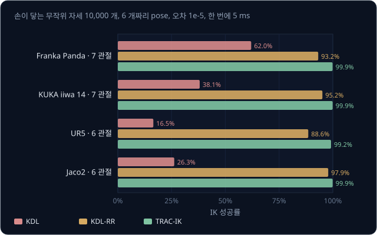

TRAC-IK README 의 비교에서는 팔마다 손이 닿는 무작위 자세 10,000 개를 만들고, joint limit 한가운데의 자세에서 출발해 pose 를 오차 1e-5 로
5 ms 안에 풀게 했다. 이때 TRAC-IK 는 첫 답을 찾자마자 돌려주는 Speed 모드였다. 위 그림의 KDL 은 KDL library 의 joint limit 을 지키는 Newton
solver 이고, MoveIt 의 KDL plugin 은 여기에 joint 무게 조절과 random restart 를 더한 별도 구현이다. README 에 따르면 두 solver 모두 mesh 를 보지
않으므로, IK 답이 로봇 자신이나 주변 물체와 부딪히는지는 MoveIt 같은 상위 프로그램이 따로 검사한다.

**확인 문제.** $\theta_1$ 의 범위가 $-90°$ ~ $90°$ 일 때 반복 계산이 $\theta_1 = 109.33°$ 를 냈다. clip 하면 몇 도가 되고, 목표 $(0.5, 1.5)$ 에는
어떤 답을 써야 할까?

답 보기

$90°$ 로 잘린다. elbow-up 답 $(109.33°, -75.52°)$ 는 $\theta_1$ 이 범위 밖이라 쓸 수 없으므로 범위 안의 elbow-down 답 $(33.80°, 75.52°)$ 를
써야 한다. 계산이 $90°$ 에 막혀 멈추면 다른 시작 자세에서 다시 푼다.

## 정리

- IK 는 손끝 목표에서 joint angle 을 구하는 계산이고, 답이 둘이거나 끝없이 많거나 없을 수 있다. 2 관절 팔은 코사인 법칙으로 $\cos\theta_2$
  를 구하면 $\pm\theta_2$ 두 답(elbow-down·elbow-up)이 나오고, $\cos\theta_2$ 가 $-1$ 과 $1$ 사이를 벗어나면 목표가 workspace 밖이다
- 반복 IK 는 오차를 재고 $J\Delta\mathbf q = \mathbf e$ 를 풀어 joint angle 을 고치기를 되풀이한다. pseudo-inverse 로 풀면 남은 거리가
  $0.707 \to 0.176 \to 0.013 \to 0.00009$ 로 빠르게 줄고, Jacobian transpose 는 inverse 없이 gradient 의 반대 방향으로 가서 느리며 $\alpha$ 가
  크면 발산한다.
  어느 답에 도착할지는 시작 자세가 정한다
- singularity 근처에서 pseudo-inverse 는 오차를 작은 singular value 로 나눠 joint 를 크게 돌리라고 한다. DLS 는 움직임을
  $\sigma e / (\sigma^2 + \lambda^2)$ 로 줄여 이를 막고, MoveIt 2 의 KDL plugin 은 0.001 보다 작은 singular value 를 버린다. joint limit 에
  막히면 random restart 로 다시 풀고, TRAC-IK 는 SQP 최적화를 함께 실행해 이런 실패를 줄인다

IK 로 구하는 것은 목표 자세의 joint angle 뿐이다. 지금 자세에서 그 각도까지 joint limit 안에서 시간에 맞춰 가는 계산은
[Trajectory Generation](../trajectory-generation/README.md) 에서 다루고, 가는 동안 주변 물체에 부딪히지 않는 경로를 찾는 계산은
[Motion Planning](../motion-planning/README.md) 에서 다룬다. 무게와 gravity 가 있는 팔을 motor 의 torque 로 그 자세까지 움직이는 일은
[MuJoCo Simulation](../mujoco-sim/README.md) 에서 다룬다.

## 참고 자료

- Samuel R. Buss, [Introduction to Inverse Kinematics with Jacobian Transpose, Pseudoinverse and Damped Least Squares methods](https://mathweb.ucsd.edu/~sbuss/ResearchWeb/ikmethods/iksurvey.pdf)
  — Jacobian transpose·pseudo-inverse·DLS 를 한 문서에서 비교한다. 5 절(DLS)과 6 절(SVD)에서 이 강의의 $\sigma$ 표처럼 방향마다 나눠서 본다
- Lynch & Park, [Modern Robotics](https://hades.mech.northwestern.edu/index.php/Modern_Robotics) 5 장·6 장 — 3 차원 팔의 Jacobian,
  singularity 의 종류(5.3 절), Newton 법 IK 를 수식으로 정리한다
- Russ Tedrake, [Robotic Manipulation — Ch. 3](https://manipulation.csail.mit.edu/pick.html) 의 "Differential inverse kinematics"·"Are
  kinematic singularities real?" 절 — pseudo-inverse 가 singularity 근처에서 어떻게 되는지 그림으로 보여 준다
- MoveIt 2, [Kinematics Configuration](https://moveit.picknik.ai/main/doc/examples/kinematics_configuration/kinematics_configuration_tutorial.html)
  — `kinematics.yaml` 의 parameter 와 KDL·TRAC-IK plugin 설정. [pick_ik](https://moveit.picknik.ai/main/doc/how_to_guides/pick_ik/pick_ik_tutorial.html)·[IKFast](https://moveit.picknik.ai/main/doc/examples/ikfast/ikfast_tutorial.html)
  튜토리얼도 같은 문서에 있다
- MoveIt 2 소스, [kdl_kinematics_plugin.cpp](https://github.com/moveit/moveit2/blob/main/moveit_kinematics/kdl_kinematics_plugin/src/kdl_kinematics_plugin.cpp)
  — `searchPositionIK` 에는 random restart 가 있고, `CartToJnt` 에서는 걸음 줄이기와 joint limit 자르기를 볼 수 있다
- TRACLabs, [trac_ik](https://github.com/traclabs/trac_ik) — README 에 팔 25 개 chain 의 KDL·KDL-RR·TRAC-IK 성공률과 평균 시간 표가 있다
- [mink](https://github.com/kevinzakka/mink) — MuJoCo 위에서 반복 IK 를 푸는 Python library. joint 위치·속도 한계와 충돌 회피를 IK 의 제약으로
  함께 다룬다
