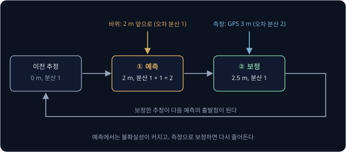
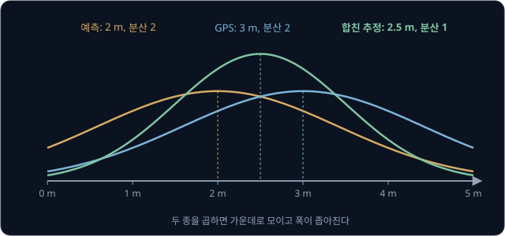
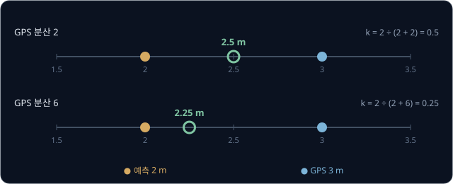
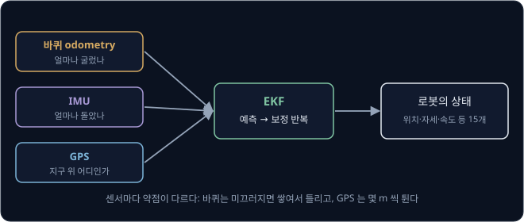

# Kalman Filter

GPS 는 잴 때마다 몇 m 씩 틀리고, 바퀴가 몇 바퀴 굴렀는지 세서 구한 거리는 바퀴가 조금씩 미끄러져서 달릴수록 어긋난다. 둘 다 틀린 값인데,
이 둘을 섞으면 어느 쪽보다도 정확한 위치가 나오는 방법이 있다면 믿겠는가?

1960 년 Rudolf Kalman 이 발표한 Kalman filter 가 바로 그런 방법이다. 메모리가 1 MB 도 안 되던 Apollo 11 의 컴퓨터가 이 filter 로
달까지 가는 궤도를 추정했고, 지금은 ROS 로봇이 자기 위치를 계산할 때 많이 쓰는 `robot_localization` package 에도 들어 있다.

## 학습 목표

- Kalman filter 가 "예측" 과 "보정" 을 번갈아 되풀이하며 위치와 그 불확실성을 함께 고친다는 것을 설명할 수 있다
- Kalman gain 이 예측과 측정 중 어느 쪽을 더 믿을지 정하는 비율이라는 것을 숫자 예시로 설명할 수 있다
- 로봇이 직선이 아닌 움직임을 다룰 때 EKF 를 쓰는 이유와, 실제 로봇에서 여러 센서를 합치는 방식을 설명할 수 있다

## 위치와 불확실성

Kalman filter 는 위치를 숫자 하나로 기억하지 않는다. "아마 2 m 쯤인데, 1 ~ 3 m 사이일 수도 있다" 처럼 가장 그럴듯한 값과 그 값이 얼마나
흔들릴 수 있는지를 함께 기억한다. 흔들림의 크기는 **분산**(variance)이라는 숫자로 적는데, 클수록 덜 확실하다는 뜻이다. 그래프로 그리면
가운데가 가장 그럴듯한 값이고, 분산이 클수록 옆으로 넓게 퍼진 종 모양이 된다. 이 종 모양을 Gaussian(정규분포)이라고 부른다.

불확실성을 함께 기억해 두면, 새 정보가 들어올 때 그 정보를 얼마나 믿을지 계산으로 정할 수 있다.

## 예측과 보정

Kalman filter 는 두 단계를 번갈아 되풀이한다.

**① 예측(predict).** 공원 길을 달리는 배달 로봇이 0 m(분산 1)에 있다고 알고 있는 상태에서 바퀴를 굴려 2 m 앞으로 갔다면 이제 2 m 에 있을 것이다. 다만
바퀴가 미끄러졌을 수 있으니 불확실성은 커진다. 바퀴 움직임 자체의 오차 분산이 1 이라면, 예측의 분산은 원래 분산 1 에 1 을 더한 2 가 된다.
움직이기만 하고 밖을 보지 않으면 불확실성은 계속 커진다.

**② 보정(update).** 이때 오차 분산이 2 인 GPS 가 "3 m" 라고 알려 준다. 예측은 2 m, 측정은 3 m 로 서로 다르니 둘 사이 어딘가가
답일 텐데, 두 정보의 분산이 2 로 같아서 가운데인 2.5 m 를 고른다. 보정한 결과의 분산은 1 로, 예측(2)과 측정(2) 어느 쪽보다도 작다.
서로 다른 출처의 정보 두 개를 합치면 하나만 볼 때보다 확실해지기 때문이다.

보정한 2.5 m(분산 1)는 다음 예측의 출발점이 되고, 로봇이 움직이는 동안 이 두 단계가 1초에 수십 번씩 되풀이된다.

## Kalman gain

방금은 두 정보의 분산이 같아서 가운데를 골랐지만, 분산이 다르면 더 확실한 쪽으로 더 가깝게 간다. 얼마나 가까이 갈지 정하는 비율이
**Kalman gain** $k$ 다.

$$
k = \frac{\text{예측의 분산}}{\text{예측의 분산} + \text{측정의 분산}}
$$

새 위치는 예측에서 출발해 "측정 − 예측" 의 $k$ 배만큼 측정 쪽으로 옮긴 곳이다. 위 예에서는 $k = 2 \div (2 + 2) = 0.5$ 라서
$2 + 0.5 \times (3 - 2) = 2.5$ m 였다. 나무가 많은 곳이라 GPS 가 더 튀어서 측정의 분산이 6 이라면 어떨까?

$k = 2 \div (2 + 6) = 0.25$ 라서 새 위치는 $2 + 0.25 \times 1 = 2.25$ m 로, 믿기 어려운 GPS 보다 예측 쪽에 가깝게 남는다. $k$ 가 상황에
따라 어떻게 바뀌는지는 아래와 같다.

| 상황 | $k$ | 결과 |
| --- | --- | --- |
| 센서가 아주 정확하다 (측정의 분산 → 0) | 1 에 가까움 | 측정값을 거의 그대로 믿는다 |
| 예측이 아주 정확하다 (예측의 분산 → 0) | 0 에 가까움 | 측정을 거의 무시한다 |
| 둘이 비슷하다 | 0.5 근처 | 가운데쯤을 고른다 |

낯선 길에서는 표지판을 많이 믿고 매일 다니는 길에서는 내 감을 더 믿는 것과 같다.

> **오해** Kalman filter 는 측정값의 noise 를 평균 내서 지우는 필터다.
>
> **사실** Kalman filter 는 측정만 다듬지 않고, 움직임으로 예측한 값과 측정을 불확실성에 따라 섞는다. 그래서 GPS 가 몇 초 끊겨도 예측만으로 위치를 이어 갈 수 있고, 그동안 분산이 커져서 GPS 가 돌아오면 그 측정을 더 크게
> 믿는다.

**확인 문제.** 예측은 10 m(분산 3), 측정은 14 m(분산 1)다. 보정한 위치는?

답 보기

$k = 3 \div (3 + 1) = 0.75$ 이고, 새 위치는 $10 + 0.75 \times (14 - 10) = 13$ m 다. 측정의 분산이 더 작아서(더 정확해서) 측정 쪽에
가깝게 간다.

<b>심화: 여러 숫자를 함께 추정하는 Kalman filter 의 식</b>

실제 로봇은 위치 하나가 아니라 위치와 속도처럼 여러 숫자를 함께 추정한다. 이 숫자들을 묶은 것을 상태 $\mathbf{x}$ 라고 하고, 불확실성은
분산 대신 숫자들 사이의 관계까지 담은 표(공분산 행렬) $P$ 로 적는다. 1차원 예시의 각 계산이 아래 식의 한 줄에 대응한다.

| 단계 | 1차원 예시 | 일반 식 |
| --- | --- | --- |
| 예측: 위치 | $0 + 2 = 2$ | $\mathbf{x}^- = F\mathbf{x} + B\mathbf{u}$ |
| 예측: 불확실성 | $1 + 1 = 2$ | $P^- = FPF^\top + Q$ |
| Kalman gain | $2 \div (2 + 2) = 0.5$ | $K = P^-H^\top(HP^-H^\top + R)^{-1}$ |
| 보정: 위치 | $2 + 0.5 \times (3 - 2) = 2.5$ | $\mathbf{x} = \mathbf{x}^- + K(\mathbf{z} - H\mathbf{x}^-)$ |
| 보정: 불확실성 | $(1 - 0.5) \times 2 = 1$ | $P = (I - KH)P^-$ |

- $F$ 는 지금 상태로 다음 상태를 계산하는 움직임 모델이고, $\mathbf{u}$ 는 "2 m 앞으로" 같은 명령, $B$ 는 명령이 상태를 바꾸는 방식이다
- $Q$ 는 움직임의 오차(바퀴 미끄러짐), $R$ 은 센서의 오차(GPS 의 튐)다
- $\mathbf{z}$ 는 측정값이고, $H$ 는 상태에서 센서가 볼 값을 꺼내는 방식이다. GPS 는 속도는 못 보고 위치만 보는데, 그것을 $H$ 가 정한다
- $(\cdot)^{-1}$ 은 숫자 하나일 때의 "나누기" 를 행렬로 넓힌 것이라서, $K$ 의 식은 1차원의 "예측 분산 ÷ (예측 분산 + 측정 분산)" 과 같은 꼴이다

이 식은 움직임과 측정이 모두 직선 관계(선형)이고 오차가 Gaussian 이라는 가정에서 가장 좋은 추정을 준다.

## Q 와 R

예측 단계에서 매번 더하는 움직임의 오차 분산(바퀴 미끄러짐)을 $Q$, 센서의 오차 분산을 $R$ 이라고 부른다. 위 예시의 1 과 2 가 각각 $Q$ 와 $R$
이었다. 실제 로봇에서는 이 두 값을 사람이 정해 넣어야 하고, 그 값이 filter 의 성격을 정한다.

로봇이 계속 움직이며 예측과 보정을 되풀이하면 Kalman gain 은 몇 step 만에 일정한 값으로 수렴한다. $R = 2$ 로 두고 $Q$ 만 바꿔 수렴한 gain 을
구하면 아래와 같다.

| $Q$ (움직임 오차) | $R$ (센서 오차) | 수렴한 Kalman gain | 동작 |
| --- | --- | --- | --- |
| 0.1 | 2 | 0.2 | 측정을 조금씩만 반영해 매끄럽지만, 로봇이 갑자기 미끄러지면 늦게 따라간다 |
| 1 | 2 | 0.5 | 예측과 측정을 반씩 섞는다 |
| 4 | 2 | 0.73 | 측정을 크게 반영해 빠르게 따라가지만, GPS 의 튐도 그대로 따라 흔들린다 |

$Q$ 를 키우는 것과 $R$ 을 줄이는 것은 같은 쪽으로 움직이고, gain 을 정하는 것은 둘의 비율이다. 그래서 filter 의 출력이 너무 흔들리면 $R$ 을
키우거나 $Q$ 를 줄이고, 실제 움직임을 늦게 따라가면 반대로 한다. 값을 정하는 출발점은 센서 데이터시트의 noise 값이나, 로봇을 세워 둔 채 센서
값을 모아 잰 분산이다.

<b>심화: 수렴한 gain 구하기</b>

수렴하면 보정 뒤 분산 $P$ 가 매 cycle 같아진다. 예측 분산을 $x = P + Q$ 라고 하면 보정 뒤 분산은 $x R / (x + R)$ 이고, 이것이 다시 $P = x - Q$
와 같아야 한다.

$$
(x - Q)(x + R) = x R
$$

$Q = 1$, $R = 2$ 이면 $(x - 1)(x + 2) = 2x$, 곧 $x^2 - x - 2 = 0$ 이라 $x = 2$ 이고 gain 은 $2 \div (2 + 2) = 0.5$ 다. $Q = 0.1$ 이면
$x^2 - 0.1x - 0.2 = 0$ 에서 $x = 0.5$, gain 은 $0.5 \div 2.5 = 0.2$ 다. $Q = 4$ 이면 $x^2 - 4x - 8 = 0$ 에서 $x \approx 5.46$, gain 은
$5.46 \div 7.46 \approx 0.73$ 이다.

## 직선이 아닌 움직임과 EKF

위 계산은 "2 m 앞으로 가면 2 m 더해진다" 처럼 움직임이 단순한 더하기·곱하기(직선 관계)일 때 성립한다. 그런데 바닥 위를 도는 로봇은 바라보는
방향에 따라 같은 "1 m 앞으로" 가 x 쪽 이동이 되기도 하고 y 쪽 이동이 되기도 해서, 움직임이 각도의 sin·cos 에 따라 휘어진다. 휘어진 관계에
그대로 넣으면 종 모양이 찌그러져 Kalman filter 의 계산이 맞지 않는다.

**EKF**(Extended Kalman Filter)는 지금 추정한 값 바로 근처에서만 휘어진 관계를 직선으로 근사해 같은 계산을 한다. 곡선 도로도 아주 짧게
잘라 보면 직선처럼 보이는 것과 같다. 근사하는 만큼 오차가 생길 수 있어서, 휘어진 관계를 점 몇 개로 직접 통과시켜 보는 **UKF**(Unscented
Kalman Filter)도 쓴다. UKF 는 더 정확한 대신 계산이 더 많다.

## 실제 로봇의 센서 퓨전

ROS 로봇에서 많이 쓰는 위치 추정 package 인 `robot_localization` 이 이 방법을 그대로 쓴다. 이 package 의 `ekf_localization_node` 는
EKF, `ukf_localization_node` 는 UKF 이고, 로봇의 위치·자세·속도·가속도를 묶은 15 개의 숫자를 추정한다. 바퀴 odometry, IMU, GPS 처럼
센서를 몇 개든 받아 하나의 추정으로 합치는데, 이것을 **sensor fusion** 이라고 한다.

센서마다 약점이 달라서 합치는 의미가 있다. 바퀴 odometry 와 IMU 는 짧은 시간에는 매끄럽고 정확하지만 오차가 쌓여 점점 멀어지고, GPS 는
오차가 쌓이지 않는 대신 순간순간 튄다. IMU 로 위치를 구하려면 가속도를 두 번 쌓아야 해서, 가속도에 작은 치우침(bias)만 있어도 위치 오차가
시간의 제곱으로 커진다.

| 가속도 bias | 10 초 뒤 위치 오차 | 60 초 뒤 위치 오차 |
| --- | --- | --- |
| 0.01 m/s² | $\frac12 \times 0.01 \times 10^2 = 0.5$ m | $\frac12 \times 0.01 \times 60^2 = 18$ m |
| 0.05 m/s² | 2.5 m | 90 m |

0.01 m/s² 는 중력 가속도의 1000 분의 1 정도인데도 1 분이면 18 m 가 어긋난다. 그래서 IMU 는 혼자 위치를 내지 않고, 회전과 짧은 시간의 움직임을
매끄럽게 이어 주는 역할로 다른 센서와 합친다. 그래서 `robot_localization` 문서도 오차가 쌓이지만 매끄러운 추정(`odom` frame)과 튈 수 있지만 전체적으로
정확한 추정(`map` frame)을 나눠 두 개의 filter 로 돌리는 구성을 권한다. 이 frame 들은 [Rigid Transforms](../transforms/README.md) 에서 다룬
좌표계다.

**확인 문제.** 터널에 들어가 GPS 가 30 초 동안 끊겼다. 그동안 Kalman filter 의 추정과 불확실성은 어떻게 될까?

답 보기

보정 단계 없이 예측만 되풀이하므로 위치는 바퀴와 IMU 로 계속 이어 가지만, 예측할 때마다 분산이 더해져 불확실성이 계속 커진다. 터널을 나와
GPS 가 돌아오면 예측의 분산이 커진 만큼 Kalman gain 이 1 에 가까워져서 GPS 측정을 크게 믿고 위치를 크게 고친다.

## 센서 퓨전 설정

filter 의 식이 맞아도 센서 데이터가 잘못 들어가면 추정이 틀린다. `robot_localization` 의
[센서 데이터 준비 문서](https://github.com/cra-ros-pkg/robot_localization/blob/ros2/doc/preparing_sensor_data.rst)는 filter 를 처음 붙일 때 자주
틀리는 부분을 아래처럼 정리해 두었다.

- 공분산은 실제 값으로 채운다. filter 는 센서 메시지에 적힌 공분산으로 gain 을 정하므로, 대충 넣은 값이면 엉뚱한 센서를 믿는다. 어떤 값을
  무시하고 싶을 때 공분산을 아주 크게 넣는 꼼수 대신, 설정에서 그 값을 fusion 하지 않도록 끈다
- 바퀴 odometry 는 위치보다 속도를 넣는다. 바퀴 driver 가 속도와 함께 적분한 위치도 주는 경우가 많은데, 그 위치는 이미 오차가 쌓인 값이라
  속도를 넣고 적분은 filter 에 맡기는 편이 낫다
- 부호와 좌표계를 먼저 확인한다. ROS 규약(REP-103)에서는 로봇을 반시계 방향으로 돌리면 yaw 가 커져야 하고, 평평한 곳에 바로 놓인 IMU 는 z 축
  가속도로 +9.81 m/s² 를 내야 한다. 부호가 하나만 뒤집혀도 오류 메시지 없이 틀린 추정이 나온다
- 바닥만 다니는 로봇은 `two_d_mode` 를 켜서 높이·roll·pitch 를 0 으로 두어야, 쓰지 않는 값의 불확실성이 끝없이
  커지지 않는다
- outlier 를 거른다. 예측과 너무 다른 측정은 gain 만큼 그대로 추정을 끌고 가므로, 예측과의 차이가 그 불확실성에 비해 지나치게 크면 그 측정을
  버리는 문턱(gating)을 둔다

## 정리

- Kalman filter 는 위치를 "가장 그럴듯한 값 + 불확실성(분산)" 으로 들고 다니며, 움직임으로 예측해 불확실성을 키우고 측정으로 보정해 불확실성을
  줄이는 일을 되풀이한다
- Kalman gain 은 예측의 분산 ÷ (예측의 분산 + 측정의 분산)으로, 더 확실한 쪽으로 얼마나 다가갈지를 정한다. 두 정보를 합친 결과는 어느 하나보다
  확실하다
- 로봇의 움직임은 회전 때문에 직선 관계가 아니라서, 추정값 근처에서 직선으로 근사하는 EKF 나 점 몇 개로 통과시켜 보는 UKF 를 쓴다.
  `robot_localization` 은 바퀴·IMU·GPS 를 EKF 로 합친다

Kalman filter 는 위치에 대한 믿음이 늘 종 하나의 모양이라고 가정한다. 똑같이 생긴 복도가 두 개 있는 건물에서 로봇이 길을 잃으면 "왼쪽
복도 아니면 오른쪽 복도" 처럼 봉우리가 두 개인 믿음이 필요한데, 종 하나로는 이것을 나타낼 수 없다. 다음 강의에서는 점 수천 개로 어떤 모양의
믿음이든 나타내는 particle filter 를 다룬다.

## 참고 자료

- Tim Babb, [How a Kalman filter works, in pictures](https://www.bzarg.com/p/how-a-kalman-filter-works-in-pictures/) — 숲속 로봇 예시와 종 모양
  그림으로 예측·보정을 설명하는 글. 이 강의의 [예측과 보정](#예측과-보정) 절과 같은 흐름이다
- Roger Labbe, [Kalman and Bayesian Filters in Python](https://github.com/rlabbe/Kalman-and-Bayesian-Filters-in-Python) — 수식보다 직관과
  예제로 Kalman filter, EKF, UKF, particle filter 를 차례로 쌓아 가는 무료 책. 문제마다 풀이가 있다
- `robot_localization`, [State Estimation Nodes](https://github.com/cra-ros-pkg/robot_localization/blob/ros2/doc/state_estimation_nodes.rst) —
  EKF·UKF node 의 parameter 와 `odom`·`map` frame 을 나누는 구성을 설명하는 공식 문서
- Aerospace America, [Honoring a legacy algorithm](https://aerospaceamerica.aiaa.org/departments/honoring-a-legacy-algorithm/) — Kalman 의
  1960 년 논문이 NASA Ames 를 거쳐 Apollo 의 궤도 추정에 쓰이기까지의 이야기
- R. E. Kalman, [A New Approach to Linear Filtering and Prediction Problems](https://doi.org/10.1115/1.3662552) (1960) — Kalman filter 를 처음
  제안한 원 논문
