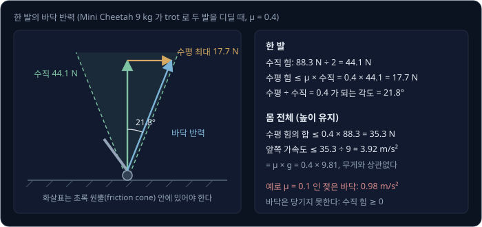
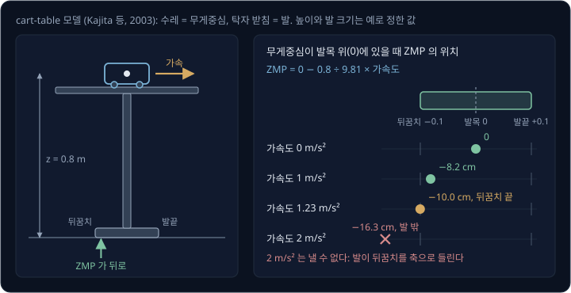
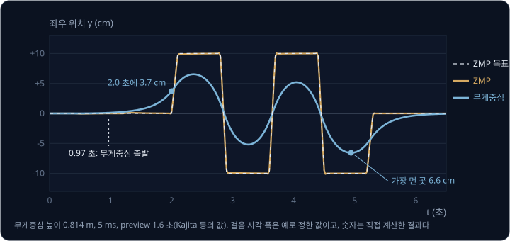
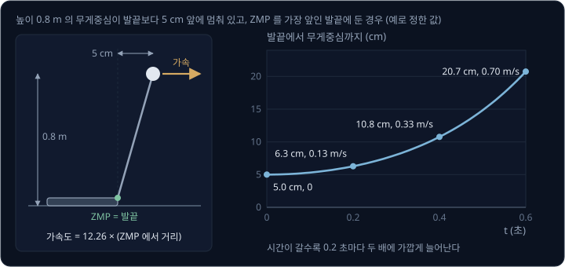
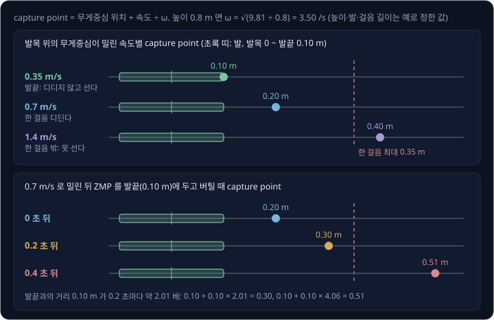
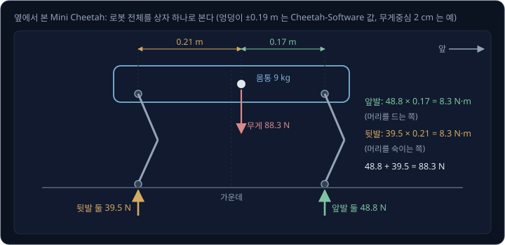
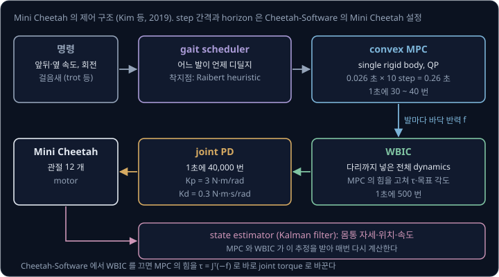
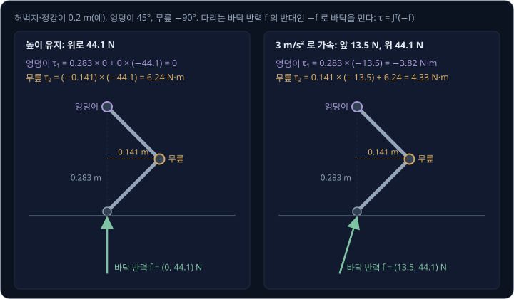

# ZMP → Convex MPC

로봇 팔은 받침대에 볼트로 고정되어 있어서, 팔이 어떤 자세를 잡든 받침대가 팔을 붙잡아 준다. 다리 로봇의 몸통은 어디에도 고정되어 있지
않아서, 몸통을 움직이는 바깥 힘은 gravity 와 바닥이 발을 되미는 힘뿐이다. 바닥은 발을 밀어 올릴 수는 있어도 끌어당기지는 못하고, 옆으로는
마찰이 버티는 만큼만 민다. 걸을 때는 무게중심이 딛고 있는 발보다 앞으로 나가는 순간도 있다. 이런 조건에서 넘어지지 않고 걷거나 뛰려면,
발을 언제 어디에 딛고 바닥을 어느 방향으로 얼마나 세게 밀어야 할까?

이 물음에 답하는 고전적인 방법은 로봇 전체를 무게중심 하나나 몸통 하나로 줄인 단순한 모델로 바닥이 밀어 줄 힘을 먼저 계산하고, 그 힘을
[Force & Impedance Control](../impedance-control/README.md) 에서 본 $\tau = J^\top F$ 로 joint torque 로 바꾸는 것이다. 두 발 로봇에서는 바닥
반력이 걸려야 하는 점을 발바닥 안에 두도록 무게중심의 경로를 미리 계획해 왔다. MIT 의 4족 로봇 Mini Cheetah 는 네 발이 낼 힘을 1초에 30 ~ 40 번
최적화 문제로 풀고 그 힘을 1초에 500 번 계산하는 controller 로 다듬어 3.7 m/s 로 달렸다(Kim 등, 2019). 보행 policy 를 reinforcement learning
으로 학습하는 최근 논문에서도 이런 model 기반 controller 를 비교 대상으로 쓴다(Jenelten 등, 2024).

## 학습 목표

- 바닥은 밀기만 하고 마찰 안에서만 옆으로 민다는 제약으로, 바닥 반력이 걸려야 하는 점(ZMP)이 발이 닿은 영역 밖으로 나갈 수 없는 이유를 설명하고
  무게중심 가속도의 한계를 계산할 수 있다
- preview control(앞으로의 목표를 미리 보고 지금의 명령을 정하는 제어)이 앞으로 디딜 발자국을 보고 무게중심을 먼저 움직이는 이유를 설명할 수 있다
- linear inverted pendulum(높이가 일정한 거꾸로 선 진자)의 $\omega = \sqrt{g/z}$ 로 밀린 로봇의 capture point(디디면 멈춰 설 수 있는 바닥의
  점)를 계산하고, 언제 어디에 발을 디뎌야 하는지 설명할 수 있다
- convex MPC 가 몸통 하나의 모델로 네 발의 힘을 QP(이차식 비용을 일차 부등식 제약 아래에서 최소로 만드는 최적화 문제)로 정하고 $J^\top$ 로
  joint torque 로 바꾸는 과정과, 학습한 policy 와 함께 쓰는 방식을 설명할 수 있다

## ground reaction force 와 마찰

발이 바닥을 누르면 바닥도 같은 크기의 힘으로 발을 되민다. 이 힘을 **ground reaction force**(GRF, 바닥 반력)라고 한다. 다리 로봇의 몸 전체를
움직이는 바깥 힘은 gravity 와 바닥 반력뿐이라서, 다리 로봇의 균형 제어는 바닥 반력을 어떻게 만들지 정하는 일이다. 바닥 반력에는 두 가지
제약이 있다.

- 바닥은 발을 밀어 올릴 수는 있어도 끌어당기지는 못하므로, 수직 성분은 0 이상이다. Russ Tedrake 의 Underactuated Robotics 강의 노트는
  이 제약 때문에 무게중심이 중력보다 빨리 바닥 쪽으로 가속할 수 없다고 적는다
- 수평 성분이 수직 성분에 마찰 계수 $\mu$ 를 곱한 값을 넘으면 발이 미끄러지므로, 수평 성분은 그 값 이하여야 한다

MIT 의 공개 controller 코드인 Cheetah-Software 는 Mini Cheetah 의 질량을 9 kg 으로 두고 $\mu = 0.4$ 를 쓴다. 이 로봇이 대각선의 두 발씩
번갈아 딛는 걸음새(trot)로 높이를 유지하며 걸으면, 땅에 닿은 두 발이 무게 $9 \times 9.81 = 88.3$ N 을 나눠 받아 한 발에 44.1 N 이 걸린다.
이때 한 발이 수평으로 낼 수 있는 힘은 최대 $0.4 \times 44.1 = 17.7$ N 이다.

수평 ÷ 수직이 0.4 가 되는 각도는 21.8° 라서, 바닥 반력의 화살표가 수직선에서 21.8° 안쪽을 향해야 발이 미끄러지지 않는다. 이 각도로 만든
원뿔을 **friction cone** 이라고 한다. 수직 힘의 합이 무게와 같으면 수평 힘의 합은 최대 $0.4 \times 88.3 = 35.3$ N 이라서, 몸통이 앞으로 낼 수
있는 가속도는 $35.3 \div 9 = 3.92$ m/s² 까지다. 이 값은 $\mu \times g = 0.4 \times 9.81$ 과 같아서 로봇의 무게와 상관없다. 예를 들어
바닥이 젖어 $\mu$ 가 0.1 로 떨어지면 이 한계는 0.98 m/s² 로 줄어든다.

## ZMP 와 support polygon

발바닥 여러 곳에 나뉘어 걸린 바닥 반력은, 수직 힘의 크기로 가중 평균한 한 점에 모은 힘 하나로 바꿔 생각할 수 있다. 이 점을 **center of
pressure**(CoP, 압력 중심)라고 한다. 가중치가 모두 0 이상이므로 CoP 는 늘 발이 닿은 점들을 고무줄로 감싼 영역 안에 있다. 이 영역을
**support polygon** 이라고 한다. 서 있는 로봇을 support polygon 위에서 넘어뜨리는 힘의 계산은
[Humanoid Whole-Body Control](../humanoid-wbc/README.md#humanoid-의-균형) 에서 다뤘다.

로봇이 움직이면 바닥 반력은 무게를 받치는 일과 함께 몸을 가속하는 일도 해야 한다. 원하는 움직임에서 거꾸로 계산하면, 바닥 반력이 몸을 앞뒤나
옆으로 돌리는 효과(moment)를 남기지 않으려면 어느 점에 걸려야 하는지 구할 수 있다. 이 점을 **ZMP**(zero-moment point)라고 한다. Vukobratović
와 Borovac(2004)은 계산한 ZMP 가 support polygon 안에 있으면 발바닥이 바닥에 붙은 채 그 움직임을 낼 수 있다고 정리했다. 계산한 점이 밖에 있으면
바닥 반력이 실제로 그 점에 걸릴 수 없어서 발이 가장자리를 축으로 돌기 시작한다. 저자들은 이 바깥의 점을 fictitious ZMP 라고 불렀다. 균형을
잃지 않은 동안에는 ZMP 와 CoP 가 같은 점이라서, 실제 로봇은 발바닥의 force sensor 로 ZMP 의 위치를 잰다.

Kajita 등(2003)은 이 관계를 탁자 위를 달리는 수레로 그렸다. 받침이 좁은 탁자 위에서 수레가 오른쪽으로 가속하려면 탁자가 수레를 오른쪽으로
밀어야 하므로, 그 반작용으로 탁자는 왼쪽으로 기운다. 수레는 무게중심에 해당하고, 탁자 받침은 발에 해당하며, 탁자 높이는 무게중심 높이에 해당한다.

예로 무게중심 높이를 0.8 m(Kajita 등이 HRP-2P 에 쓴 0.814 m 와 비슷한 값)로 두고, 발은 발목에서 앞뒤로 0.1 m 씩 뻗어 있다고 하자. 무게중심이
발목 바로 위에 있을 때 몸을 앞으로 가속하면 ZMP 는 발목 뒤로 옮겨 간다.

| 앞쪽 가속도 | $0.8 \div 9.81 \times$ 가속도 | ZMP | 결과 |
| --- | --- | --- | --- |
| 0 | 0 | 발목 | 발 가운데 |
| 1 m/s² | 0.082 m | 발목 뒤 8.2 cm | 발 안 |
| 1.23 m/s² | 0.100 m | 발목 뒤 10.0 cm | 뒤꿈치 끝 |
| 2 m/s² | 0.163 m | 발목 뒤 16.3 cm | 발 밖이라 이 가속도는 낼 수 없다 |

바닥이 몸을 앞으로 미는 힘은 무게중심보다 0.8 m 아래에서 걸리므로 몸을 뒤로 젖히는 moment 를 낸다. 수직 힘이 이 moment 를 상쇄하려면
무게중심보다 뒤에서 걸려야 하고, 가속도가 클수록 더 뒤로 가야 한다. 뒤꿈치 끝이 한계라서 이 자세의 앞쪽 가속도는
$0.1 \times 9.81 \div 0.8 = 1.23$ m/s² 까지다. 그보다 세게 가속하도록 관절을 움직이면 발이 뒤꿈치를 축으로 들리며 몸이 뒤로 넘어간다.

이 계산을 기호로 옮기면 아래와 같다($\ddot x$ 는 위치 $x$ 를 시간으로 두 번 미분한 가속도다).

| 이 예의 값 | 기호로 쓴 값 |
| --- | --- |
| 무게중심 위치: 발목 위 0 m | $x$ |
| 무게중심 높이 0.8 m | $z$ |
| 중력 가속도 9.81 m/s² | $g$ |
| 앞쪽 가속도 1 m/s² | $\ddot x$ |
| ZMP: $0 - 0.8 \div 9.81 \times 1 = -0.082$ m | $p = x - \dfrac{z}{g}\,\ddot x$ |

$$
p = x - \frac{z}{g}\,\ddot x
$$

Kajita 등은 이 식을 ZMP equation 이라고 불렀다. Vukobratović 와 Borovac 에 따르면 ZMP 개념은 1960 년대 말에 나왔고, 이 개념으로 균형을 잡으며
걸은 첫 로봇은 1984 년 와세다 대학 Ichiro Kato 연구실의 두 발 로봇 WL-10RD 다.

> **오해** ZMP 가 support polygon 안에 있으면 로봇은 넘어지지 않는다.
>
> **사실** ZMP 가 발 안에 있다는 것은 지금 이 순간 발바닥이 들리지 않은 채 그 가속도를 낼 수 있다는 뜻일 뿐이다. 다음 절에서 보듯 무게중심이 발끝보다 5 cm 앞에 멈춰 있으면, ZMP 를 발끝에 두어도 무게중심은 0.6 초 만에 발끝에서 20.7 cm 까지 멀어진다.

<b>심화: ZMP equation 의 유도</b>

탁자 받침 위의 한 점 $p$ 를 축으로 수레에 걸린 moment 를 더한다. 무게중심에 걸린 gravity $mg$ 는 $p$ 에서 수평으로 $x - p$ 떨어져 있어서
$mg(x - p)$ 를 낸다. 수레를 가속하는 힘 $m\ddot x$ 는 높이 $z$ 에서 걸리므로 $m\ddot x\,z$ 만큼 반대로 돌린다. $p$ 가 ZMP 라면 둘의 합이 0 이다.

$$
m g (x - p) - m \ddot x\, z = 0 \quad\Longrightarrow\quad p = x - \frac{z}{g}\,\ddot x
$$

질량 $m$ 은 양쪽에서 지워지므로 ZMP 는 무게와 상관없이 무게중심의 위치·높이·가속도로 정해진다. Underactuated Robotics 노트는 무게중심의 높이도 변하고($\ddot z$)
몸 전체가 각가속도 $\ddot\theta$ 로 돌 때(회전 관성 $I$)의 식을 아래처럼 적는다(바닥 높이를 0 으로 두었다). $\ddot z = 0$, $\ddot\theta = 0$
이면 위의 식이 된다.

$$
(m\ddot z + m g)(p - x) = -z\, m \ddot x - I \ddot\theta
$$

$I\ddot\theta$ 항은 팔을 휘두르거나 상체를 돌리면 같은 무게중심 가속도에서도 ZMP 를 옮길 수 있다는 뜻이다. 이 효과는 [capture point](#capture-point)
절의 flywheel 모델에서 다시 나온다.

**확인 문제.** 무게중심 높이가 1.0 m 인 로봇의 무게중심이 발목 바로 위에 있고, 발목에서 뒤꿈치 끝까지 0.08 m 다. 발바닥이 들리지 않고 낼 수
있는 앞쪽 가속도는 최대 얼마일까?

답 보기

1. 무게중심은 발목 바로 위라서 $x = 0$ 이고, 높이는 1.0 m 이며, 뒤꿈치 끝은 발목 뒤 0.08 m 다
2. 앞으로 가속하면 ZMP 는 발목 뒤로 가므로 뒤꿈치 끝인 $p = -0.08$ 까지 갈 수 있고, 그때의 가속도는 ZMP equation 으로 구한다
3. ZMP equation 에 $x = 0$, $p = -0.08$ 을 넣으면 $-0.08 = 0 - 1.0 \div 9.81 \times \ddot x$ 다
4. $\ddot x = 0.08 \times 9.81 \div 1.0 \approx 0.785$ m/s² 다

## preview control

ZMP equation 으로는 무게중심의 움직임을 알면 ZMP 를 바로 계산할 수 있지만, 걸음을 계획할 때는 순서가 거꾸로다. 발을 어디에 언제 디딜지
먼저 정하면 ZMP 목표는 그때 딛고 있는 발바닥 가운데로 정해지고, 그 ZMP 를 만드는 무게중심 경로를 찾아야 한다. Kajita 등(2003)은 보행 패턴
생성(walking pattern generation)을 이런 역문제로 정리했다.

오른발로 서 있다가 왼발로 옮겨 디딜 때 ZMP 목표는 발을 바꾸는 순간 왼발로 건너가지만, ZMP 를 왼쪽으로 옮기려면 그보다 먼저 무게중심이
왼쪽으로 움직이고 있어야 한다. 그래서 지금의 입력을 정하려면 앞으로의 목표를 알아야 한다. Kajita 등은 미래의 목표를 미리 보고 지금의 입력을
정하는 **preview control** 로 이 문제를 풀었고, 이를 굽은 길에서 앞을 내다보며 핸들을 꺾는 운전에 비유했다. preview control 도
[Path Tracking](../path-tracking/README.md#mpc) 의 MPC 처럼 앞으로의 오차와 입력의 크기를 함께 줄인다. 다만 제약 없이 한 번 풀어 둔 gain 을
쓰므로, 매 주기에는 미래의 ZMP 목표에 gain 을 곱해 더하기만 한다.

아래 예의 숫자는 Kajita 등이 쓴 값(무게중심 높이 0.814 m, 계산 간격 5 ms, ZMP 오차의 weight 1, 입력 변화의 weight $10^{-6}$)으로 계산한
값이다. ZMP 목표는 예로 2.0 초부터 0.8 초마다 한 걸음씩, 앞으로 0.3 m 씩 나아가며 좌우로는 몸 가운데에서 0.1 m 떨어진 발을 번갈아 딛도록
정했다. 발을 바꾸는 0.1 초 동안은 ZMP 목표를 직선으로 옮긴다.

preview 1.6 초로 계산하면 무게중심은 ZMP 목표가 처음 움직이는 2.0 초보다 약 1 초 이른 0.97 초에 움직이기 시작해, 2.0 초에는 이미 왼쪽으로
3.7 cm 옮겨 가 있다. ZMP 는 ±10 cm 의 두 발 위를 오가지만 무게중심은 좌우로 최대 6.6 cm 만 흔들린다. preview 를 0.8 초로 줄이면 무게중심이
늦게 출발한 만큼 ZMP 가 목표를 지나쳐 좌우로 10.8 cm 까지 나간다.

| preview 길이 | 무게중심이 1 mm 넘게 움직인 시각 | ZMP 최대 오차(앞뒤) | ZMP 최대 오차(좌우) |
| --- | --- | --- | --- |
| 1.6 초 | 0.97 초 | 0.97 cm | 0.63 cm |
| 0.8 초 | 1.38 초 | 3.96 cm | 2.13 cm |

Kajita 등도 0.8 초로는 ZMP 가 목표를 잘 따라가지 못했다고 보고했고, preview gain 은 2 초보다 먼 미래에서 아주 작아진다고 적었다. 저자들은 이렇게
만든 패턴으로 simulation 안의 humanoid HRP-2P(키 154 cm, 무게 58 kg)를 단 높이 0.1 m 인 나선 계단에서 걷게 했다.

<b>심화: preview control 의 식</b>

Kajita 등은 무게중심의 가속도가 1초에 변하는 양(jerk)을 입력 $u$ 로 두고, 위치·속도·가속도를 상태로 두어 ZMP equation 을 입력이 있는 system
으로 바꿨다.

| 이 예의 값 | 기호로 쓴 값 |
| --- | --- |
| 계산 간격 0.005 초 | $T$ |
| 무게중심의 위치·속도·가속도 | $\mathbf{x}(k) = (x,\ \dot x,\ \ddot x)$ |
| 가속도가 1초에 변하는 양 | $u(k)$ |
| ZMP: 위치 − 0.814 ÷ 9.81 × 가속도 | $p(k) = C\,\mathbf{x}(k)$, $C = (1,\ 0,\ -z_c/g)$ |
| ZMP 오차의 weight 1, 입력 변화의 weight $10^{-6}$ | $Q_e$, $R$ |
| 앞으로 내다보는 1.6 초 = 320 step | $N_L$ |

$$
\mathbf{x}(k+1) = \begin{bmatrix} 1 & T & T^2/2 \\ 0 & 1 & T \\ 0 & 0 & 1 \end{bmatrix} \mathbf{x}(k) + \begin{bmatrix} T^3/6 \\ T^2/2 \\ T \end{bmatrix} u(k)
$$

비용은 ZMP 오차 $e(i) = p(i) - p_{\text{ref}}(i)$ 의 제곱과 입력 변화 $\Delta u(i)$ 의 제곱을 앞으로 계속 더한 값이고(상태 변화의 weight $Q_x$ 는
0), 이 비용을 가장 작게 하는 입력은 세 항의 합이다.

$$
u(k) = -G_i \sum_{i=0}^{k} e(i) - G_x\, \mathbf{x}(k) - \sum_{j=1}^{N_L} G_p(j)\, p_{\text{ref}}(k+j)
$$

첫째 항은 쌓인 ZMP 오차를 지우는 integral 항이고, 둘째 항은 지금 상태의 feedback 이며, 셋째 항이 미래의 ZMP 목표를 보는 preview 항이다. gain 은
$Q_e$, $Q_x$, $R$ 과 system 행렬로 discrete Riccati equation 을 한 번 풀어 미리 구한다. preview 를 짧게 잘라도 둘째 항의 feedback 이 남아서,
Kajita 등의 0.8 초 계산에서도 ZMP 는 목표를 덜 따라갈 뿐 발산하지 않았다.

실제 로봇은 질량이 다리와 팔에 퍼져 있어서 수레 하나와 다르게 움직인다. HRP-2P 의 전체 모델(multibody)로 계산한 ZMP 는 cart-table 의 계산과
앞뒤로 최대 2.3 cm 어긋났고, 저자들은 이 차이를 다시 preview control 로 보정해 1.2 cm 로 줄였다.

Underactuated Robotics 노트는 같은 문제를 푸는 Drake 의 `ZmpPlanner` 가 MIT 팀이 DARPA Robotics Challenge 에서 쓴 구현이라고 적으면서, 무게중심만
계획하면 관절 각도와 torque 의 한계를 정확히 반영할 수 없다는 점도 짚는다.

**확인 문제.** 높이 0.814 m 인 무게중심이 두 발 사이 가운데($y = 0$)에 멈춰 있다. 무게중심을 왼쪽(+$y$)으로 0.6 m/s² 로 가속하기 시작하려면
ZMP 를 어디에 두어야 할까?

답 보기

1. 무게중심은 두 발 사이 가운데라서 $y = 0$ 이고, 높이는 0.814 m 이며, 왼쪽 가속도는 $\ddot y = 0.6$ m/s² 다
2. ZMP equation 을 좌우 방향에 쓰면 $p = y - \dfrac{z}{g}\,\ddot y$ 다
3. $y = 0$, $\ddot y = 0.6$ 을 넣으면 $p = 0 - 0.814 \div 9.81 \times 0.6 \approx -0.050$ m 다

답: 오른쪽으로 약 5 cm 다. 무게중심을 왼쪽으로 보내려면 ZMP 를 먼저 오른쪽에 두어야 하고, 두 발로 서 있는 동안에는 ZMP 가 두 발 사이 어디든
갈 수 있어서 이렇게 할 수 있다.

## linear inverted pendulum

ZMP equation 을 가속도에 대해 풀면 무게중심이 어떻게 움직이는지가 보인다. 높이 0.8 m 에서 무게중심이 ZMP 보다 1 cm 앞에 있으면 앞으로
$9.81 \div 0.8 \times 0.01 = 0.12$ m/s² 로 가속하고, 5 cm 앞에 있으면 0.61 m/s² 로 가속한다. 무게중심은 ZMP 에서 멀어지는 쪽으로, 떨어진
거리에 비례해 가속한다. 손가락 끝에 세운 막대가 기운 쪽으로 점점 빨리 넘어지는 것과 같다. 높이를 일정하게 두면 가속도가 거리에 일정한 수를
곱한 값이라서, 이 모델을 **linear inverted pendulum**(LIP)이라고 한다.

| 이 예의 값 | 기호로 쓴 값 |
| --- | --- |
| 무게중심 높이 0.8 m | $z$ |
| $9.81 \div 0.8 = 12.26$, $\sqrt{12.26} = 3.50$ /s | $\omega^2 = g/z$, $\omega = \sqrt{g/z}$ |
| ZMP 에서 앞으로 0.05 m | $x - p$ |
| 가속도 $12.26 \times 0.05 = 0.61$ m/s² | $\ddot x = \omega^2 (x - p)$ |

$$
\ddot x = \omega^2 (x - p), \qquad \omega = \sqrt{\frac{g}{z}}
$$

$\omega$ 는 넘어지는 빠르기를 정한다. 높이 0.8 m 에서는 $\omega = 3.50$ /s 이고, Cheetah-Software 가 Mini Cheetah 의 몸통 높이로 쓰는
0.29 m 에서는 $\sqrt{9.81 \div 0.29} = 5.82$ /s 라서, 무게중심이 낮을수록 같은 거리에서 더 빨리 넘어진다.

ZMP 는 발 안에만 둘 수 있어서 가장 앞이 발끝이다. 무게중심이 발끝보다 앞에 나가면 ZMP 를 발끝에 두어도 무게중심이 ZMP 보다 앞에 있으므로
앞으로 가속한다. 예로 높이 0.8 m 인 무게중심이 발끝보다 5 cm 앞에 멈춰 있고 ZMP 를 발끝에 두면 아래처럼 된다.

| 시각 | 발끝에서 무게중심까지 | 무게중심 속도 |
| --- | --- | --- |
| 0 초 | 5.0 cm | 0 |
| 0.2 초 | 6.3 cm | 0.13 m/s |
| 0.4 초 | 10.8 cm | 0.33 m/s |
| 0.6 초 | 20.7 cm | 0.70 m/s |

거리는 시간이 갈수록 0.2 초마다 두 배에 가깝게 늘어난다. 무게중심이 발 안에 있을 때는 발목 torque 로 ZMP 를 무게중심보다 앞에 두어 되돌릴 수
있지만, 발끝을 넘어가면 발목으로는 넘어지는 가속을 줄일 수 있을 뿐이다. 남은 방법은 발을 내디뎌 support polygon 을 무게중심 앞으로 옮기는 것이다.

<b>심화: linear inverted pendulum 의 해</b>

$\ddot x = \omega^2 (x - p)$ 에서 ZMP $p$ 가 고정되어 있으면, 시각 0 의 위치 $x_0$ 와 속도 $v_0$ 에서 출발한 무게중심은 아래처럼 움직인다.

$$
x(t) - p = (x_0 - p)\cosh(\omega t) + \frac{v_0}{\omega}\sinh(\omega t)
$$

$\cosh(s) = (e^s + e^{-s})/2$ 이고 $\sinh(s) = (e^s - e^{-s})/2$ 다. 본문의 예는 $x_0 - p = 0.05$ m, $v_0 = 0$ 이라서 0.2 초 뒤의 거리가
$0.05 \times \cosh(0.7) = 0.05 \times 1.255 = 0.063$ m 이고, 속도는 위 식을 미분한 $\omega (x_0 - p)\sinh(\omega t) = 3.50 \times 0.05 \times
0.759 = 0.13$ m/s 다. 시간이 흐르면 $e^{-\omega t}$ 는 0 으로 줄고 $e^{\omega t}$ 만 남아서, 거리는 $1/\omega = 0.29$ 초마다 $e \approx 2.72$
배가 된다.

## capture point

linear inverted pendulum 에서는 밀려서 움직이기 시작한 로봇이 멈춰 서려고 디뎌야 할 점이 하나로 정해진다. 예로 무게중심 높이 0.8 m 인
로봇이 발목 위에 무게중심을 두고 서 있다가 앞으로 밀려 무게중심 속도가 0.7 m/s 가 되었다고 하자. 발목에서 $0.7 \div 3.50 = 0.20$ m 앞을 디디고
ZMP 를 그 점에 두면, 무게중심은 그 점에 다가가며 점점 느려지다가 정확히 그 위에서 멈춘다. 그보다 가까이 디디면 무게중심이 발을 넘어가 버리고,
더 멀리 디디면 발에 닿기 전에 멈췄다가 뒤로 되돌아온다. Pratt 등(2006)은 이렇게 디디면 멈춰 설 수 있는 바닥의 점을 **capture point** 라고
불렀다.

Pratt 등은 capture point 로 언제, 어디에 디딜지를 정했다. capture point 가 support polygon 안에 있으면 발을 떼지 않고 설 수 있고, 밖에 있으면
support polygon 이 capture point 를 덮도록 디뎌야 한다. capture point 가 한 걸음이 닿는 범위 밖이면 한 걸음으로는 설 수 없다. 발은 앞에서 본
대로 발목에서 앞으로 0.1 m 까지이고, 한 걸음은 예로 최대 0.35 m 라고 하자.

| 밀린 뒤 속도 | capture point (속도 ÷ 3.50) | 해야 할 일 |
| --- | --- | --- |
| 0.35 m/s | 0.10 m 앞, 발끝 | 발을 떼지 않고 ZMP 를 발끝에 두면 선다 |
| 0.7 m/s | 0.20 m 앞, 발 밖 | 0.20 m 앞에 한 걸음 디딘다 |
| 1.4 m/s | 0.40 m 앞, 한 걸음 밖 | 한 걸음으로는 설 수 없어 두 걸음 이상 필요하다 |

0.7 m/s 로 밀린 로봇이 발을 내딛지 않고 ZMP 를 발끝(0.1 m)에 둔 채 버티면 capture point 는 발끝에서 멀어진다. capture point 와 발끝 사이의
거리 $0.20 - 0.10 = 0.10$ m 는 0.2 초마다 $e^{3.50 \times 0.2} \approx 2.01$ 배로 늘어난다.

| 발을 내딛기까지 걸린 시간 | capture point |
| --- | --- |
| 0 초 | $0.10 + 0.10 = 0.20$ m |
| 0.2 초 | $0.10 + 0.10 \times 2.01 = 0.30$ m |
| 0.4 초 | $0.10 + 0.10 \times 4.06 = 0.51$ m |

밀린 직후 0.2 초 안에 디디면 0.30 m 걸음으로 서지만, 0.4 초를 기다리면 0.51 m 가 필요해 한 걸음 최대 0.35 m 로는 설 수 없다.

사람은 크게 밀리면 팔을 휘두르거나 상체를 숙여 몸의 회전으로도 버틴다. Pratt 등은 무게중심 자리에 회전하는 바퀴(flywheel)를 단 모델로, 몸을 돌릴
수 있으면 capture point 가 한 점에서 영역(capture region)으로 넓어진다는 것을 보였다. 이후 Pratt 와 Koolen 은 이 생각을 넓혀, n 걸음 이하로 디뎌
멈춰 설 수 있는 성질을 **capturability** 라고 불렀다.

<b>심화: capture point 의 유도</b>

발을 원점에 두고, 무게중심의 위치를 $x$ 라고 하고 속도를 $\dot x$ 라고 하자. Pratt 등은 linear inverted pendulum 에서 아래 값(orbital energy)이 발을 바꾸기
전까지 변하지 않는다는 것을 이용했다.

$$
E = \frac{1}{2}\dot x^2 - \frac{g}{2z}x^2
$$

무게중심이 발 쪽으로 움직일 때 $E > 0$ 이면 발을 넘어가고, $E < 0$ 이면 발에 닿기 전에 멈췄다가 되돌아간다. $E = 0$ 이면 정확히 발 위에서
멈춘다. $E = 0$ 이고 발 쪽으로 움직이는 경우는 $\dot x = -\omega x$ 라서, 발이 무게중심에서 $\dot x / \omega$ 앞에 있어야 한다.

| 이 예의 값 | 기호로 쓴 값 |
| --- | --- |
| 무게중심 위치: 발목 위 0 m | $x$ |
| 밀린 속도 0.7 m/s | $\dot x$ |
| $\omega = 3.50$ /s | $\omega = \sqrt{g/z}$ |
| capture point $0 + 0.7 \div 3.50 = 0.20$ m | $\xi = x + \dot x / \omega$ |

$\xi$ 를 시간으로 미분하고 $\ddot x = \omega^2 (x - p)$ 를 넣으면 두 식이 나온다.

$$
\dot \xi = \omega\,(\xi - p), \qquad \dot x = \omega\,(\xi - x)
$$

첫째 식은 capture point 가 ZMP 에서 떨어진 거리에 비례하는 속도로 ZMP 에서 멀어진다는 뜻이다. ZMP 를 발끝에 두고 버티면 $\xi - p$ 가
$e^{\omega t}$ 배가 되고, 본문의 두 번째 표가 이 계산이다. 둘째 식은 무게중심이 capture point 를 향해 다가간다는 뜻이다. ZMP 를 capture point 에 두면 $\dot\xi = 0$
이라 capture point 가 멈추고, 무게중심은 그 점에 다가가며 느려져 결국 그 위에 선다.

**확인 문제.** 무게중심 높이가 1.0 m 인 로봇의 무게중심이 발목보다 0.05 m 앞에 있을 때, 앞으로 0.5 m/s 로 밀렸다. capture point 는 발목에서
얼마나 앞에 있을까?

답 보기

1. 발목을 기준으로 무게중심 위치는 0.05 m 이고, 속도는 0.5 m/s 이며, 높이는 1.0 m 다
2. capture point 는 무게중심 위치에 속도 ÷ $\omega$ 를 더한 점이다
3. $\omega = \sqrt{9.81 \div 1.0} \approx 3.13$ /s 다
4. 속도 ÷ $\omega$ 는 $0.5 \div 3.13 \approx 0.16$ m 다
5. capture point 는 $0.05 + 0.16 = 0.21$ m 앞이다

## 점 발과 single rigid body 모델

humanoid 의 발바닥은 넓이가 있어서 ZMP 를 그 안에서 옮길 수 있지만, Mini Cheetah 같은 4족 로봇의 발은 작은 공 모양이라 바닥에 점으로 닿는다.
trot 에서는 대각선의 두 발만 바닥에 닿아 support polygon 이 두 발을 잇는 선분이 되고, 빠르게 달리면 네 발이 모두 공중에 뜨는 순간도 있다.
두 경우 모두 ZMP 를 옮길 넓이가 없다. 이런 빠른 보행에서는 무게중심 경로를 정해 따라가기보다 바닥 반력 자체를 계획한다는 생각이 앞선 Cheetah 2
연구에서 나왔고, Kim 등(2019)은 이 생각을 이어받았다.

발마다 힘을 직접 정하려면 그 힘이 몸통을 어떻게 움직이는지 알아야 한다. MIT 의 Cheetah 연구에서는 다리가 몸통에 주는 영향을 무시하고 로봇
전체를 질량 $m$ 과 회전 관성 $I$ 를 가진 상자 하나로 보는 **single rigid body 모델**을 쓴다. Cheetah 3 에서 이 모델을 쓴 Di Carlo
등(2018)은 다리 질량이 로봇 전체의 약 10% 라서 이 단순화가 받아들일 만하다고 적었다. single rigid body 모델에서는 발 힘의 합에서
무게를 뺀 만큼 몸통이 가속하고, 발 힘이 무게중심을 축으로 돌리는 moment 의 합만큼 몸통의 회전이 빨라진다.

Cheetah-Software 의 Mini Cheetah 는 엉덩이 관절이 몸 가운데에서 앞뒤로 0.19 m 에 있다. 네 발이 엉덩이 바로 아래를 딛고 서 있는데 무게중심이 예로
가운데보다 2 cm 앞에 있다고 하자. 몸통이 기울지 않으려면 앞발과 뒷발의 moment 가 같아야 한다.

| 발 | 무게중심에서 거리 | 받는 힘 | 몸통을 돌리는 moment |
| --- | --- | --- | --- |
| 앞발 둘 | 앞으로 $0.19 - 0.02 = 0.17$ m | $88.3 \times 0.21 \div 0.38 = 48.8$ N | $48.8 \times 0.17 = 8.3$ N·m, 머리를 드는 쪽 |
| 뒷발 둘 | 뒤로 $0.19 + 0.02 = 0.21$ m | $88.3 \times 0.17 \div 0.38 = 39.5$ N | $39.5 \times 0.21 = 8.3$ N·m, 머리를 숙이는 쪽 |

두 힘의 합은 무게 88.3 N 이고 moment 는 서로 지워진다. 네 발이 똑같이 22.1 N 씩 받으면 뒷발 둘의 moment $44.1 \times 0.21 = 9.3$ N·m 가 앞발 둘의
$44.1 \times 0.17 = 7.5$ N·m 보다 커서 몸통이 앞으로 숙여진다. 맞는 힘 배분의 CoP 는 $(0.19 \times 48.8 - 0.19 \times 39.5) \div 88.3 = 0.02$ m 로
무게중심 바로 아래다.

| 이 예의 값 | 기호로 쓴 값 |
| --- | --- |
| 로봇 질량 9 kg, 무게 88.3 N | $m$, $m\mathbf{g}$ |
| 발 $i$ 의 바닥 반력: 앞발 하나 24.4 N 등 | $\mathbf{f}_i$ |
| 무게중심에서 발 $i$ 까지: 앞으로 0.17 m 등 | $\mathbf{r}_i$ |
| 몸통의 가속도: 서 있으므로 0 | $\ddot{\mathbf{p}}$ |
| moment 의 합: $8.3 - 8.3 = 0$ | $\sum_i \mathbf{r}_i \times \mathbf{f}_i$ |

$$
m\,\ddot{\mathbf{p}} = \sum_i \mathbf{f}_i + m\mathbf{g}, \qquad \frac{d}{dt}(I\boldsymbol{\omega}) = \sum_i \mathbf{r}_i \times \mathbf{f}_i
$$

$\mathbf{g}$ 는 아래를 향하는 중력 가속도 vector 이고, 굵은 $\boldsymbol{\omega}$ 는 몸통의 각속도로 linear inverted pendulum 의 $\omega$ 와
다른 값이다. $\mathbf{r}_i \times \mathbf{f}_i$ 는 세 축 방향의 moment 를 한꺼번에 계산하는 cross product 다. 첫째 식은 힘을 더하기만 하는 직선
관계지만, 둘째 식은 $\mathbf{r}_i$ 와 몸통 자세가 몸이 움직이면 같이 바뀌어서 그대로는 힘에 대한 직선 관계가 아니다.

**확인 문제.** 같은 로봇의 무게중심이 가운데보다 3 cm 뒤에 있으면 앞발 둘과 뒷발 둘이 각각 몇 N 을 받아야 몸통이 기울지 않을까?

답 보기

1. 엉덩이는 가운데에서 앞뒤로 0.19 m 에 있으므로, 무게중심에서 앞발까지는 $0.19 + 0.03 = 0.22$ m 이고 뒷발까지는 $0.19 - 0.03 = 0.16$ m 다
2. moment 가 같으려면 앞발 힘 × 0.22 = 뒷발 힘 × 0.16 이어야 하고, 두 힘의 합은 무게 88.3 N 이다
3. 앞발 둘은 $88.3 \times 0.16 \div 0.38 \approx 37.2$ N 을 받고, 뒷발 둘은 $88.3 \times 0.22 \div 0.38 \approx 51.1$ N 을 받는다

## convex MPC

[Path Tracking](../path-tracking/README.md#mpc) 의 MPC 는 앞으로 몇 step 의 움직임을 모델로 계산해 비용이 가장 작은 명령의 순서를 골랐다.
그 가운데 첫 명령만 보내고, 다음 주기에 다시 계산했다. MIT 의 Cheetah 연구에서는 이 틀의 명령 자리에 네 발의 바닥 반력을 둔다. Kim 등(2019)의
Mini Cheetah 에서 MPC 가 매 주기 푸는 문제는 아래와 같다.

- 상태: 몸통의 자세(roll·pitch·yaw), 위치, 각속도, 속도로 숫자 12 개다
- 결정 변수: 앞으로 내다보는 구간(horizon)의 step 마다 땅에 닿은 발의 바닥 반력이다
- 제약: friction cone 을 사각뿔로 근사한 $|f_x| \le \mu f_z$, $|f_y| \le \mu f_z$ 와 $f_z \ge 0$ 이다
- 비용: 상태와 목표 상태의 차이에 weight 를 곱한 제곱의 합과, 힘에 작은 weight 를 곱한 제곱의 합이다

앞 절에서 본 대로 몸통의 회전에는 힘에 대해 직선이 아닌 부분이 있다. Kim 등은 Di Carlo 등(2018)이 Cheetah 3 에서 먼저 쓴 정식화를 따라 세
가지를 단순하게 했다.
roll 과 pitch 는 작다고 보고, yaw 와 발 위치 $\mathbf{r}_i$ 에는 몸통이 명령한 경로 근처에 있다고 보아 명령한 경로와 계획한 착지점의 값을 미리
넣는다. 그리고 회전이 느리다고 보아 회전 관성 안의 작은 항을 지운다. 어느 발이 언제 땅에 닿을지는 gait scheduler 가 미리 정한다. Kim 등은 이
순서만 바꾸면 걸음새를 바꿀 수 있다는 것을 MPC 의 장점으로 꼽았다. 이렇게 단순하게 하면 상태는 바닥 반력에 대해 직선 관계가 되고, 비용은 그릇
모양의 이차식이 된다. 제약도 모두 일차 부등식이라서 문제는 **QP**(quadratic program)가 된다. 비용이 그릇 모양이고 제약이 만드는 영역이 움푹
들어간 곳 없이 볼록한 문제를 convex 하다고 하는데, 이런 문제에는 전역 최소 말고 다른 골짜기가 없다. Kim 등은 문제가 convex 해서 빨리 풀 수
있고 늘 하나뿐인 전역 최소를 얻는다고 적었다.

Cheetah-Software 의 Mini Cheetah 설정에서 controller 는 0.002 초마다 계산하고, MPC 는 그 13 배인 0.026 초를 step 간격으로 써서 10 step, 0.26 초
앞까지 본다. trot 에서는 대각선의 두 발이 5 step(0.13 초)씩 번갈아 디뎌서 horizon 하나가 걸음 한 주기다. 네 발의 힘을 모두 변수로 두면
$4 \times 3 \times 10 = 120$ 개지만, 공중에 있는 발의 힘을 지우면 step 마다 두 발이라 60 개가 된다. Kim 등은 공중 발의 변수를 지워 계산이 10 배
넘게 빨라졌다고 적었다. 코드는 $\mu = 0.4$ 와 한 발의 수직 힘 상한 120 N 을 쓴다. 비용에서는 높이 오차의 weight 를 50 으로 두고 yaw 오차의
weight 를 10 으로 두어, 몸통 높이와 방향을 가장 중요하게 맞춘다.

앞에서 본 trot(한 발의 수직 힘 44.1 N, $\mu = 0.4$)에서 몸통을 앞으로 가속하라는 명령을 받았다고 하자.

| 원하는 앞쪽 가속도 | 필요한 수평 힘의 합 $9 \times$ 가속도 | 한 발의 수평 힘 | 한 발의 수평 ÷ 수직 | 결과 |
| --- | --- | --- | --- | --- |
| 1 m/s² | 9 N | 4.5 N | 0.10 | 제약을 지킨다 |
| 3 m/s² | 27 N | 13.5 N | 0.31 | 제약을 지킨다 |
| 5 m/s² | 45 N | 22.5 N | 0.51 | 0.4 를 넘어 미끄러진다 |

5 m/s² 를 그대로 내면 발이 미끄러지고, 계산을 마친 힘을 발마다 17.7 N 으로 자르면 땅에 닿은 발들의 moment 균형이 깨질 수 있다. QP 는 처음부터 제약을
지키는 힘들 가운데에서 몸통의 회전까지 맞추는 조합을 고르고, 다 내지 못한 가속은 뒤의 step 에서 이어 간다. Kim 등에 따르면 Mini Cheetah 의
MPC 는 1초에 30 ~ 40 번 계산했고, 한 발이 땅에 닿아 있는 동안에는 힘을 4 번만 새로 계산했다.

이 정식화를 처음 쓴 Cheetah 3 에서 Di Carlo 등(2018)은 걸음 한 주기(0.33 ~ 0.5 초)를 horizon 으로 삼아 10 ~ 16 step 으로 나누고, 그 QP 를
1 ms 안에 풀었다. 같은 gain 과 weight 로 서기와 trot 부터 gallop(네 발을 한 발씩 차례로 딛는 빠른 걸음새)까지 여덟 가지 걸음새를 해냈고,
gallop 으로는 3 m/s 까지 달렸다. 모델을 크게 단순화했는데도 잘 걷는 이유로, 저자들은 horizon 전체의 모델보다 지금 순간의 모델이 정확한 것이 더
중요하다고 보았다. 첫 step 의 행렬은 늘 지금 상태로 계산해서 정확하다. 로봇이 밀려 계획에서 벗어나면 40 ms 안에 다음 MPC 계산이 밀린 상태에서
계획을 다시 세운다.

<b>심화: convex MPC 의 QP</b>

Kim 등(2019)이 적은 정식화를 Cheetah-Software 의 값과 맞추면 아래와 같다.

| Mini Cheetah 코드의 값 | 기호로 쓴 값 |
| --- | --- |
| 자세 3, 위치 3, 각속도 3, 속도 3 | $\mathbf{x} = (\Theta,\ \mathbf{p},\ \boldsymbol{\omega},\ \dot{\mathbf{p}})$ |
| 10 step, 간격 0.026 초 | horizon $N$, $\Delta t$ |
| 네 발의 힘 3 성분씩 | $\hat{\mathbf{f}}(k) = (\mathbf{f}_1, \dots, \mathbf{f}_4)$ |
| 높이 50, yaw 10 등의 weight 와 힘의 weight $4 \times 10^{-5}$ | $Q$, $R$ |

세 가지 단순화를 거친 모델은 step $k$ 마다 미리 정한 행렬 $A_k$, $B_k$ 로 쓴 직선 관계다. $\hat{\mathbf{g}}$ 는 gravity 가 속도를 바꾸는
양이다. $B_k$ 에는 $\Delta t / m$ 와, 계획한 발 위치로 만든 $I^{-1}[\mathbf{r}_i]_\times \Delta t$ 가 들어 있다($[\mathbf{r}]_\times$ 는 cross
product 를 행렬 곱으로 쓴 것이다).

$$
\mathbf{x}(k+1) = A_k\,\mathbf{x}(k) + B_k\,\hat{\mathbf{f}}(k) + \hat{\mathbf{g}}
$$

$$
\min_{\mathbf{x},\,\mathbf{f}} \sum_{k=0}^{N-1} \|\mathbf{x}(k+1) - \mathbf{x}_{\text{ref}}(k+1)\|_Q + \|\mathbf{f}(k)\|_R
\quad \text{s.t.} \quad |f_x| \le \mu f_z,\ \ |f_y| \le \mu f_z,\ \ f_z > 0
$$

Cheetah-Software 는 모든 step 의 상태를 첫 상태와 힘으로 풀어 써서 변수로 힘만 남긴다. 모든 힘을 쌓은 vector 를 $U$ 라고 하면 상태를 쌓은
vector 는 $A_{qp}\mathbf{x}_0 + B_{qp} U$ 다. 비용은 $U^\top H U + 2\mathbf{q}^\top U$ 꼴이고, 여기서 $H = 2(B_{qp}^\top S B_{qp} + \alpha I)$ 다($S$ 는
$Q$ 를 step 수만큼 늘어놓은 대각 행렬이고 $\alpha$ 는 힘의 weight 다). 이 condensed 정식화는 Di Carlo 등(2018)의 4 절 D 에서 왔다. dynamics
제약과 상태를 변수에서 빼고 비용 안에 넣어서, 변수의 개수가 상태의 개수와 상관없이 발 수 × 3 × step 수로 정해진다. Cheetah 3 는
$\mu = 0.6$ 과 $10 \le f_z \le 666$ N 의 제약을 쓰고, 높이 weight 50 과 힘의 weight $10^{-6}$ 을 썼다(같은 논문의 Table I). 발마다 붙는 제약은 $\pm f_x/\mu + f_z \ge 0$, $\pm f_y/\mu + f_z \ge 0$,
$0 \le f_z \le 120$ 의 다섯 줄이고, 공중에 있는 발은 상한을 0 으로 둔다.

사각뿔 근사에서 $|f_x| \le 0.4 f_z$ 와 $|f_y| \le 0.4 f_z$ 를 함께 꽉 채우면 수평 힘의 크기가 $\sqrt{0.4^2 + 0.4^2} f_z = 0.57 f_z$ 가
되어 원뿔의 0.4 를 넘는다. 대각선 방향까지 원뿔 안에 두려면 $\mu$ 대신 $\mu / \sqrt 2$ 를 넣으면 된다.

**확인 문제.** 같은 trot 에서 고무 바닥이라 $\mu = 0.6$ 이라면, 높이를 유지하며 낼 수 있는 앞쪽 가속도는 최대 얼마이고, 5 m/s² 명령은 제약을
지킬까?

답 보기

1. 같은 trot 에서는 땅에 닿은 두 발이 무게 88.3 N 을 나눠 받아 한 발의 수직 힘이 44.1 N 이고, 로봇 질량은 9 kg 이다
2. 한 발의 수평 힘은 수직 힘에 $\mu$ 를 곱한 값까지라서 최대 $0.6 \times 44.1 = 26.5$ N 이고, 두 발이면 53.0 N 이다
3. 최대 가속도는 $53.0 \div 9 \approx 5.89$ m/s² 로, $\mu \times g = 0.6 \times 9.81$ 과 같다
4. 5 m/s² 에 필요한 한 발의 수평 힘은 $9 \times 5 \div 2 = 22.5$ N 이라 26.5 N 보다 작으므로 제약을 지킨다

## 발 힘과 joint torque

MPC 가 정한 $\mathbf{f}_i$ 는 바닥이 발을 미는 힘이다. 다리는 그 반대인 $-\mathbf{f}_i$ 로 바닥을 밀어야 하므로, joint torque 는
[Force & Impedance Control](../impedance-control/README.md#손끝-힘과-joint-torque) 의 $\tau = J^\top F$ 에 $F = -\mathbf{f}_i$ 를 넣어 구한다.
Cheetah-Software 에서도 MPC 의 힘에 −1 을 곱해 몸통 좌표로 돌린 값을 다리마다 넘길 수 있고, 그러면 leg controller 가 그 힘에 $J^\top$ 를 곱해
torque 를 낸다.

예로 허벅지와 정강이를 0.2 m 로 두자(Cheetah-Software 에 적힌 Mini Cheetah 의 길이는 0.209 m 와 0.195 m 다). 엉덩이 관절을 45° 앞으로
돌리고 무릎을 −90° 접으면 발은 엉덩이 바로 아래 0.283 m 에 온다. 이 자세의 Jacobian 은 $J = \begin{bmatrix} 0.283 & 0.141 \\ 0 & -0.141 \end{bmatrix}$
이다. 첫째 줄은 관절이 돌 때 발이 앞뒤로 움직이는 양이고, 둘째 줄은 위아래로 움직이는 양이다.

| 바닥 반력 $\mathbf{f}$ (앞, 위) | 다리가 바닥을 미는 힘 $F = -\mathbf{f}$ | 엉덩이 $\tau_1$ | 무릎 $\tau_2$ |
| --- | --- | --- | --- |
| (0, 44.1 N): trot 에서 높이 유지 | (0, −44.1) | $0.283 \times 0 + 0 \times (-44.1) = 0$ | $0.141 \times 0 + (-0.141)(-44.1) = 6.24$ N·m |
| (13.5, 44.1 N): 3 m/s² 로 가속 | (−13.5, −44.1) | $0.283 \times (-13.5) + 0 = -3.82$ N·m | $0.141 \times (-13.5) + 6.24 = 4.33$ N·m |

위로만 미는 첫 줄에서 엉덩이 torque 가 0 인 것은 발이 엉덩이 바로 아래에 있어서 힘의 작용선이 엉덩이를 지나기 때문이다. 무릎은 발에서 수평으로
0.141 m 떨어져 있어 $44.1 \times 0.141 = 6.24$ N·m 가 필요하다. Kim 등은 Mini Cheetah 관절의 최대 torque 를 17 N·m 로 적었다.

땅에서 뗀 발은 따로 정한 착지점으로 옮긴다. Kim 등은 착지점을 정할 때 어깨 위치에 속도 × 한 발이 딛는 시간의 반을 더하는 Raibert heuristic
을 썼다. 예로 1 m/s 로 달리고 한 발이 0.13 초 동안 딛는다면 발을 어깨보다 $1 \times 0.13 \div 2 = 0.065$ m 앞에 둔다.

MPC 는 1초에 30 ~ 40 번만 계산하고 다리의 질량을 무시한 모델을 쓴다. Kim 등(2019)은 그 사이를 **WBIC**(whole-body impulse control)로 채웠다.
WBIC 는 1초에 500 번 다리까지 넣은 전체 dynamics 로 계산해, MPC 의 힘을 목표로 삼되 몸통 자세와 공중 발의 움직임을 맞추도록 힘을 조금씩
고친다(Cheetah-Software 에서는 `use_wbc` parameter 로 켜고 끈다). WBIC 는 joint torque 와 함께 목표 관절 각도와 속도도 내고, 관절 단의
PD($K_p = 3$ N·m/rad, $K_d = 0.3$ N·m·s/rad)가 이 목표를 받아 1초에 40,000 번 계산한다. MPC 만 쓸 때 Mini Cheetah 의 최고 속도는
2.45 m/s 였지만, WBIC 를 더하자 3.7 m/s 로 달렸다. Mini Cheetah 는 같은 gain 으로 여섯 가지 걸음새를 젖은 잔디와 자갈길에서도 걸었다.

**확인 문제.** 같은 다리 자세에서 네 발로 서 있어 한 발에 위로 22.1 N 이 걸린다. 엉덩이와 무릎 torque 는?

답 보기

1. 같은 자세라서 Jacobian 은 앞의 $J$ 그대로이고, 바닥 반력은 위로 22.1 N 이다
2. 다리가 바닥을 미는 힘은 $F = -\mathbf{f} = (0, -22.1)$ 이고, 이 힘을 $\tau = J^\top F$ 에 넣는다
3. 엉덩이: $0.283 \times 0 + 0 \times (-22.1) = 0$ 이다
4. 무릎: $0.141 \times 0 + (-0.141)(-22.1) \approx 3.12$ N·m 다

## model 기반 제어와 학습한 policy

ZMP 계획과 convex MPC 는 사람이 만든 모델과 비용으로 바닥 반력을 계산하고, [Sim-to-Real Locomotion](../sim2real-locomotion/README.md) 의
reinforcement learning 보행은 모델 없이 simulation 에서 policy 를 학습한다. 두 쪽을 비교한 아래 표에서 잘하는 일과 약한 곳은 Jenelten
등(2024)의 정리를 따랐다.

| | model 기반 (ZMP·MPC) | 학습한 policy |
| --- | --- | --- |
| 미리 필요한 것 | 로봇과 접촉의 모델, 사람이 정한 비용 | simulation, reward, 많은 학습 |
| 잘하는 일 | 비용을 직관적으로 고치고, 계획한 발 위치를 정확히 딛는다 | 미끄러짐과 밀림에서 회복한다 |
| 약한 곳 | 모델이 실제와 다르거나 가정(미끄러지지 않음, 정확한 상태 추정)이 깨질 때 | 디딜 곳이 드문 징검다리·틈에서는 reward 가 드물어 학습이 어렵다 |

Boston Dynamics 도 자기 회사의 다리 로봇이 MPC 를 써 왔다고 설명했다. 그러면서 MPC 는 직관적이고 조정하기 쉽지만, 젖거나 기름 묻은 바닥처럼
모델로 나타내기 어려운 상황에 약하다고 적었다. Atlas 의 parkour 와 춤에 쓴 MPC 도 무게중심과 관성만 담은 단순한 모델로 짧은 미래를 예측했다.

> **오해** reinforcement learning 보행이 나온 뒤로 model 기반 균형 제어는 쓰이지 않는다.
>
> **사실** Boston Dynamics 에 따르면 Spot 의 양산 controller 는 여러 MPC 를 동시에 계산해 점수가 가장 높은 출력을 골랐다. 이후 Boston Dynamics 는 기존 model 기반 controller 가 잘하는 부분은 그대로 맡기고, 프로그램하기 어려운 부분만 reinforcement learning 으로 학습해 더했다.

Jenelten 등의 DTC(Deep Tracking Control)는 두 쪽을 합친다. model 기반 trajectory optimization 이 착지점과 몸통 경로를 계획하고, policy 는 그
계획을 따라가도록 simulation 에서 학습한다. ANYmal 실험에서 비교 대상인 RL policy 는 폭 0.1 m 의 틈을 피하지 못해 건너편에 닿지 못했지만,
DTC 는 같은 틈을 10 번 모두 건넜다. DTC 는 폭 0.6 m 의 틈 네 개도 네 번 모두 건넜고, 미끄럽거나 무른 바닥에서는 model 기반 controller 보다 잘
버텼다. 이렇게 DTC 에서는 계획을 모델이 맡고, 모델이 틀리는 순간의 대응은 학습한 policy 가 맡는다.

## 정리

- 바닥은 밀기만 하고 마찰 안에서만 옆으로 민다. $\mu = 0.4$ 면 높이를 유지하며 낼 수 있는 수평 가속도는 3.92 m/s² 까지다. $p = x - (z/g)\ddot x$
  로 구한 ZMP 가 support polygon 밖이면 그 움직임은 낼 수 없다(높이가 0.8 m 이고 뒤꿈치까지 0.1 m 면 앞쪽 가속도는 1.23 m/s² 까지다)
- ZMP 기반 보행은 발자국으로 정한 ZMP 목표를 따르도록 무게중심 경로를 만든다. preview control 은 1.6 초 앞의 목표를 보고 발을 바꾸기 약 1 초
  전부터 무게중심을 움직인다
- linear inverted pendulum 에서 무게중심은 ZMP 에서 멀어지는 쪽으로 가속하고, capture point $x + \dot x / \omega$ 를 디디면 멈춰 선다. 높이 0.8 m 에서
  0.7 m/s 로 밀리면 capture point 는 0.20 m 앞이고, 0.4 초 늦게 디디면 0.51 m 로 멀어진다
- 점 발의 4족 로봇은 single rigid body 모델로 네 발의 바닥 반력을 QP 로 정하는 convex MPC 를 쓰고(Mini Cheetah 코드는 0.026 초 × 10 step,
  $\mu = 0.4$), 그 힘을 $\tau = J^\top(-\mathbf{f})$ 로 joint torque 로 바꾼다. Spot 처럼 MPC 와 학습한 policy 를 함께 쓰는 controller 도 있다

이 강의의 controller 는 모델로 바닥 반력을 계산했다. [Sim-to-Real Locomotion](../sim2real-locomotion/README.md) 에서는 같은 보행을
reinforcement learning 으로 simulation 에서 학습한 뒤, 모델과 실제의 차이를 actuator network 와 domain randomization 으로 메워 실제 ANYmal 에
옮기는 방법을 다룬다.

## 참고 자료

- Russ Tedrake, [Underactuated Robotics: Highly-articulated Legged Robots](https://underactuated.mit.edu/humanoids.html) — CoP 와 ZMP 의 정의,
  ZMP equation, Drake 의 `ZmpPlanner` 를 다루는 강의 노트의 humanoid 장
- M. Vukobratović, B. Borovac, [Zero-Moment Point — Thirty Five Years of its Life](https://doi.org/10.1142/S0219843604000083) (2004) — ZMP 의 정의,
  fictitious ZMP, ZMP 와 CoP 의 차이
- S. Kajita et al., [Biped Walking Pattern Generation by using Preview Control of Zero-Moment Point](https://doi.org/10.1109/ROBOT.2003.1241826) (2003) —
  cart-table 모델, preview control, preview 길이의 비교
- J. Pratt et al., [Capture Point: A Step toward Humanoid Push Recovery](http://www.ambarish.com/paper/Pratt_Goswami_Humanoids2006.pdf) (2006) —
  capture point 의 정의, 언제 어디에 디딜지 정하는 규칙, flywheel 모델
- J. Pratt, T. Koolen et al., [Capturability-based Analysis and Control of Dynamic Scrambling](https://www.cmu.edu/dynamic-walking/files/abstracts/Pratt_2013_DW.pdf)
  (Dynamic Walking 2013 초록) — n 걸음 capturability 를 요약한 글
- J. Di Carlo et al., [Dynamic Locomotion in the MIT Cheetah 3 Through Convex Model-Predictive Control](https://hdl.handle.net/1721.1/138000)
  (2018, MIT 공개 원고) — 3 절의 단순화한 몸통 모델, 4 절의 MPC 와 condensed QP, Table I 의 Cheetah 3 설정값, 5 절의 걸음새 실험
- D. Kim et al., [Highly Dynamic Quadruped Locomotion via Whole-Body Impulse Control and Model Predictive Control](https://arxiv.org/abs/1909.06586)
  (2019) — 3 절의 convex MPC 정식화, 4 절의 WBIC, Mini Cheetah 실험
- MIT Biomimetic Robotics Lab, [Cheetah-Software](https://github.com/mit-biomimetics/Cheetah-Software) — `ConvexMPCLocomotion.cpp` 와 `SolverMPC.cpp`
  에서 horizon, $\mu$, 힘 상한, weight 의 값과 QP 를 만드는 코드를 볼 수 있다
- F. Jenelten et al., [DTC: Deep Tracking Control](https://arxiv.org/abs/2309.15462) (2024) — model 기반 계획과 RL 의 비교, 계획을 따라가는 policy
- Boston Dynamics, [Starting on the Right Foot with Reinforcement Learning](https://bostondynamics.com/blog/starting-on-the-right-foot-with-reinforcement-learning/) —
  Spot 의 MPC 기반 controller 에 RL 을 더한 구성
- Boston Dynamics, [Picking Up Momentum](https://bostondynamics.com/blog/picking-up-momentum/) — Atlas 의 MPC 가 쓰는 모델
