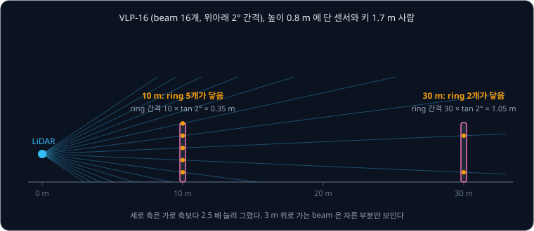
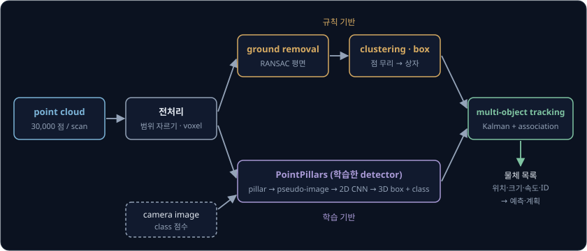
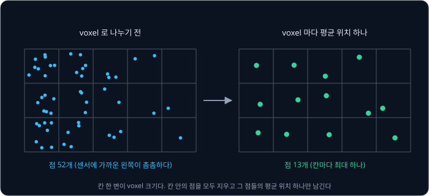
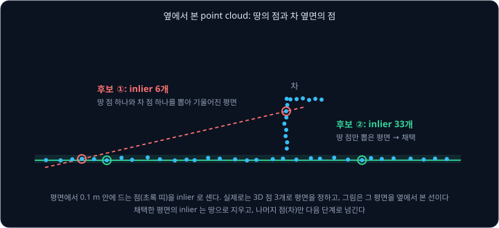
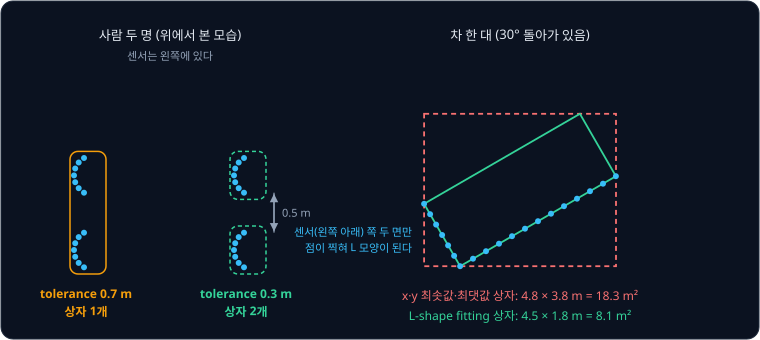
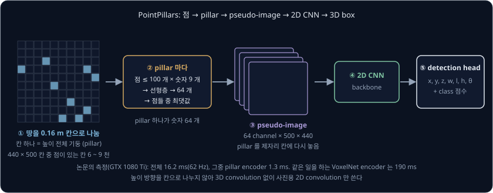
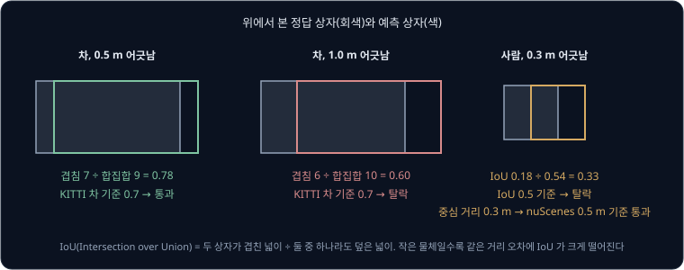
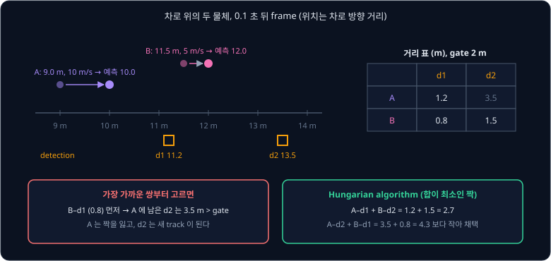
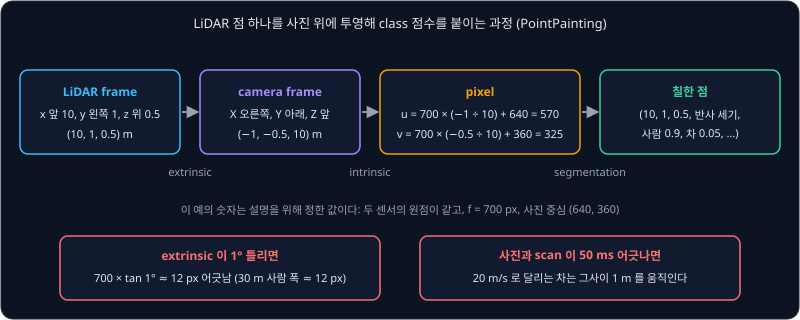

# LiDAR Perception

자율주행 차 지붕의 LiDAR 는 1초에 수십만 개가 넘는 점을 내는데, 점 하나에 담긴 것은 레이저가 맞고 돌아온 곳의 좌표와 반사 세기뿐이다. 어느
점이 차이고 어느 점이 사람인지 적혀 있지 않은 이 점 더미에서, 로봇은 어떻게 앞의 보행자를 찾아내고 그 사람이 어느 쪽으로 걷는지까지 알아낼까?

땅에 찍힌 점을 지운 뒤 남은 점을 가까운 것끼리 묶거나, 점들을 사진 같은 격자로 바꿔 CNN 에 넣으면 물체마다 상자를 씌울 수 있다. 이 상자를
frame 사이에서 Kalman filter 로 이으면 움직임까지 알 수 있다. 오픈소스 자율주행 소프트웨어 Autoware 도 땅을 지운 point cloud 에서
CenterPoint 같은 학습한 detector 로 물체를 찾고, `multi_object_tracker` 로 frame 사이의 물체를 잇는다.

## 학습 목표

- LiDAR point cloud 가 어떤 데이터이고, 거리가 멀어질수록 점이 얼마나 듬성해지는지 숫자로 설명할 수 있다
- voxel downsampling, RANSAC ground removal, Euclidean clustering 으로 점 더미를 물체 상자로 바꾸는 과정과 각 parameter 가 결과를 바꾸는 방식을
  설명할 수 있다
- PointPillars 가 point cloud 를 2D CNN 에 넣는 방법과, KITTI·nuScenes 의 AP·NDS 가 무엇을 재는지 설명할 수 있다
- Kalman filter 와 data association 으로 여러 물체를 추적하는 방법과, camera 와 LiDAR 를 합칠 때 calibration·시각 오차가 미치는 영향을 설명할 수
  있다

## point cloud

LiDAR(Light Detection and Ranging)는 레이저 펄스가 반사되어 돌아오기까지 걸린 시간으로 거리를 잰다. 거리는 왕복 시간에 빛의 속도(약
$3 \times 10^8$ m/s)를 곱해 2 로 나눈 값이라, 100 m 앞 벽이면 $2 \times 100 \div (3 \times 10^8) \approx 667$ ns 가 걸린다.
회전형 LiDAR 는 위아래 각도가 다른 레이저(beam, channel) 여러 개를 세로로 쌓아 통째로 돌린다. 한 바퀴 동안 모은 점 묶음을 scan 이라고 하고,
beam 하나가 한 바퀴 돌며 그린 점의 고리는 ring 이라고 한다. 이렇게 모은 3D 점의 집합이 **point cloud** 다.

Velodyne VLP-16 은 데이터시트를 보면 beam 16개가 위아래 −15° ~ +15° 에 2° 간격으로 놓여 있고, 5 ~ 20 Hz 로 돌며
1초에 약 30만 개의 점을 낸다(single return 기준). 10 Hz 로 돌리면 scan 하나에 $300{,}000 \div 10 = 30{,}000$ 개다. 점마다
x, y, z 와 반사 세기(intensity)를 4 byte 실수로 담으면 16 byte 라서, 이 센서 하나가 1초에 $300{,}000 \times 16 = 4.8$ MB 를 보낸다. ROS 2 는
scan 하나를 `sensor_msgs/PointCloud2` 메시지 하나에 담는다.

| 센서 | beam·시야 | 주기 | 1초당 점 수 | 출처 |
| --- | --- | --- | --- | --- |
| Velodyne VLP-16 | 16 | 5 ~ 20 Hz | 약 30만 | 데이터시트 |
| Livox Mid-360 | 시야 360° × 59° | 10 Hz | 20만 | 데이터시트 |
| Velodyne HDL-64E (KITTI) | 64 | 10 Hz | scan 당 약 10만 × 10 = 약 100만 | KITTI 센서 설명 |
| 32-beam LiDAR (nuScenes) | 32 | 20 Hz | 최대 140만 | nuScenes 논문 |

점이 많아 보여도 beam 사이 각도가 2° 로 정해져 있어서, ring 사이의 세로 간격은 거리에 비례해 벌어진다.

가로 간격도 거리에 비례한다. VLP-16 사용자 매뉴얼을 보면 레이저 16개를 한 번씩 쏘는 데 55.296 μs 가 걸리므로, 10 Hz 로 돌 때 한 번 쏘고 다음에
쏠 때까지 $360° \times 10 \times (55.296 \times 10^{-6}) \approx 0.2°$ 를 돈다. 그래서 30 m 에서는 가로로 $30 \times \tan 0.2° \approx 0.105$ m 마다
점이 하나씩 찍힌다. 폭 0.5 m, 키 1.7 m 인 사람(센서 높이 0.8 m)에 찍히는 점을 세면 아래와 같다.

| 거리 | ring 세로 간격 | 사람에 닿는 ring | ring 하나에 찍히는 점 | 사람 한 명의 점 |
| --- | --- | --- | --- | --- |
| 10 m | 0.35 m | 5 | $0.5 \div 0.035 \approx 14$ | 약 70 |
| 30 m | 1.05 m | 2 | $0.5 \div 0.105 \approx 5$ | 약 10 |
| 50 m | 1.75 m | 1 | $0.5 \div 0.175 \approx 3$ | 약 3 |

beam 이 두 배인 센서도 마찬가지라서, nuScenes 논문의 32-beam LiDAR 에서는 정답 상자 하나에 든 점이 3 m 거리에서 최대 1만 2천 개였지만 80 m
에서는 많아야 100 개였다.

회전형 LiDAR 는 한 scan 을 한 바퀴 도는 동안 나눠 찍는다. 10 Hz 로 돌면 첫 점과 마지막 점 사이에 0.1 초가 흐르고, 그동안 15 m/s 로 달리는 차는
1.5 m 를 움직인다. 그대로 쓰면 벽이 휘어 보이므로, Autoware 의 `distortion_corrector` 처럼 점마다 찍은 시각의 차량 위치로 점을 옮기는 전처리를 먼저
한다. 지도와 위치를 함께 구하는 [LiDAR SLAM](../lidar-slam/README.md) 과 달리, 이 강의에서는 지도에 없는 움직이는 물체를 찾는다.

## LiDAR perception pipeline

LiDAR perception 의 출력은 주변 물체 하나하나의 3D bounding box 목록이다. 상자 하나는 중심 위치 $(x, y, z)$, 크기(길이 $l$, 폭 $w$, 높이 $h$),
바라보는 방향 $\theta$(yaw) 의 숫자 7개와 class(차·사람·자전거)로 적고, tracking 을 거치면 속도와 물체 번호(ID)가 붙는다.

위 그림은 상자를 얻는 두 경로를 보여 준다. 규칙 기반 경로는 남은 점을 거리로 묶기만 하므로 학습 데이터 없이도 처음 보는 모양의 물체까지 상자로
잡지만, 그 상자가 차인지 사람인지는 모른다. 학습 기반 경로는 정답 상자가 붙은 dataset 으로 학습한 detector 가 class 까지 내지만, 학습에 없던
물체는 놓칠 수 있다. 어느 경로든 상자는 frame 마다 따로 나오므로, 마지막 tracking 단계가 frame 사이의 같은 물체를 이어 속도를
계산한다.

## voxel downsampling

**voxel** 은 공간을 같은 크기로 자른 작은 정육면체 칸으로, 이름은 volume 과 pixel 을 합친 말이다. voxel downsampling 은 point cloud 를 voxel 로
나누고, 칸마다 들어 있던 점들을 그 평균 위치의 점 하나로 바꾼다. 칸 한 변의 길이는 leaf size 라고 부른다.

점 수가 줄어 계산이 가벼워지고, 센서 가까이 몰린 점이 더 많이 지워져 밀도도 고르게 된다. VLP-16 의 ring 하나를 leaf size 0.2 m 로
자르면, 5 m 거리에서는 가로 간격이 $5 \times \tan 0.2° \approx 0.017$ m 라 한 칸에 점이 약 12 개 들어가고 30 m 거리에서는 간격이 0.105 m 라 약
2 개가 들어간다. 어느 쪽이든 칸마다 점 하나만 남으므로 점 수는 가까운 곳에서 12 분의 1 로 줄고 먼 곳에서 2 분의 1 로 준다. PCL(Point Cloud
Library) 튜토리얼은 예제 scan 하나를 leaf size 1 cm 로 줄여 점 460,400 개를 41,049 개로 만든다.

leaf size 는 남기고 싶은 가장 작은 물체보다 작아야 한다. 30 m 거리의 사람에게는 점이 10 개쯤 찍히는데, leaf size 를 0.5 m 로 키우면 ring 하나의
점 5 개가 한두 개로 합쳐져 뒤의 clustering 이 요구하는 최소 점 수를 못 채울 수 있다. Autoware 의 `voxel_grid_based_euclidean_cluster` 는 x·y 를
0.3 m 칸으로 나눈 voxel 의 중심점만으로 clustering 을 한다.

## RANSAC ground removal

scan 의 점 가운데 상당수는 땅에 찍힌다. 땅 점은 물체 사이를 끊김 없이 채우고 있어서, 땅 점을 남긴 채 가까운 점끼리 묶으면 차와 사람과 가로등이
땅을 타고 한 무리가 된다. 그래서 물체를 찾기 전에 땅 점부터 지운다.

땅이 평평하면 땅 점은 평면 하나 위에 놓이는데, 3D 에서 평면 하나는 점 3개로 정해진다. **RANSAC**(Random Sample Consensus)은 점 3개를 무작위로
뽑아 평면을 만들고, 그 평면에서 정한 거리(예: 0.1 m) 안에 드는 점(inlier)의 수를 센다. 이 일을 여러 번 되풀이해 inlier 가 가장 많은 평면을 땅으로
고르고, 그 평면의 inlier 를 지운다.

차에 찍힌 점이 하나라도 섞여 뽑히면 위 그림의 후보 ① 처럼 기울어진 평면이 나와 inlier 가 적고, 셋 다 땅 점일 때만 후보 ② 처럼 많아진다.
평균 제곱 오차가 가장 작은 평면을 구하는 least squares 는 차의 점까지 반영해 차 쪽으로 기울지만, RANSAC 은 inlier 만 세므로 땅이 아닌 점이
많아도 땅을 찾는다. Fischler 와 Bolles 는 크게 틀린 측정이 많이 섞인 데이터에도 모델을 맞추려고 1981 년에 이 방법을
제안했다.

몇 번 뽑아야 하는지는 땅 점의 비율 $w$ 에 달려 있다. 한 번 뽑은 3개가 모두 땅일 확률이 $w^3$ 이므로, 땅 점만 뽑는 경우가 적어도 한 번 나올
확률을 $p$ 로 맞추려면 반복 횟수 $k$ 가 아래만큼 필요하다.

$$
k = \frac{\log(1 - p)}{\log(1 - w^3)}
$$

| 땅 점 비율 $w$ | 3개가 모두 땅일 확률 $w^3$ | $p = 0.99$ 에 필요한 반복 $k$ |
| --- | --- | --- |
| 0.8 | 0.512 | 7 |
| 0.6 | 0.216 | 19 |
| 0.4 | 0.064 | 70 |
| 0.2 | 0.008 | 574 |

땅 점 비율이 절반 아래면 반복 횟수가 빠르게 늘어나서, 차 주변 몇 m 안, 높이 몇 m 아래처럼 땅이 있을 만한 영역만 먼저 잘라 $w$ 를 올려 두는
경우가 많다.

RANSAC 은 땅 전체가 평면 하나라고 가정한다. 10 m 앞에서 10% 오르막이 시작되면 30 m 지점의 길은 평면보다 $20 \times 0.1 = 2$ m 높아서 벽 같은
물체로 분류된다. Autoware 문서도 RANSAC 방식의 ground filter 는 경사를 다루지 못한다고 적는다. 기본으로 쓰는 `scan_ground_filter` 는 beam 방향을
따라 앞에서 땅으로 판정한 점과의 기울기를 보고 땅인지 가리는데, 기본값은 전체 기울기 10°, 이웃 점 사이 기울기 13° 까지를 땅으로 본다.

**확인 문제.** 잘라 낸 영역에서 땅 점이 절반($w = 0.5$)이다. 땅 점만 뽑는 경우가 99% 확률로 한 번은 나오려면 몇 번 반복해야 할까?

답 보기

3개가 모두 땅일 확률은 $0.5^3 = 0.125$ 이고, $k = \log(1 - 0.99) \div \log(1 - 0.125) = \log 0.01 \div \log 0.875 \approx (-4.61) \div (-0.134)
\approx 34.5$ 라서 35 번이다.

<b>심화: 반복 횟수 식의 유도</b>

한 번 뽑은 점 $n$ 개(평면은 $n = 3$)가 모두 inlier 일 확률을 $b = w^n$ 이라 하면, 한 번 뽑아서 실패할 확률은 $1 - b$ 이고 $k$ 번 모두 실패할
확률은 $(1 - b)^k$ 다. 적어도 한 번 성공할 확률이 $p$ 이상이려면 $(1 - b)^k \le 1 - p$ 여야 하고, 양변에 log 를 취하면
$k \ge \log(1 - p) \div \log(1 - b)$ 다. 원 논문은 $w = 0.5$, $n = 4$, $p = 0.9$ 일 때 $k = \log 0.1 \div \log(15/16) \approx 35.7$ 을 예로 든다.
$w$ 를 모르면 처음에는 작게 잡고, 지금까지 찾은 가장 좋은 평면의 inlier 비율로 $w$ 를 고쳐 가며 $k$ 를 줄이는 방식도 쓴다.

## Euclidean clustering

땅을 지우고 나면 점들이 물체마다 떨어진 무리로 나뉜다. **Euclidean clustering** 은 점 하나에서 시작해 거리 $d$ (tolerance) 안의 이웃을 같은
무리에 넣고, 새로 들어온 점에서 다시 $d$ 안의 이웃을 찾는 일을 무리가 더 커지지 않을 때까지 되풀이한다. 한 무리가 끝나면 아직 무리에 들지 않은
점에서 다음 무리를 시작한다. 이웃을 빨리 찾으려고 점들은 kd-tree 라는 공간 분할 구조에 미리 넣어 둔다.

결과는 tolerance 에 크게 좌우된다. Autoware `euclidean_cluster` 의 기본값은 tolerance 0.7 m, 무리 하나의 점 수 10 ~ 1000 개다. 위 그림에서
0.5 m 떨어져 걷는 두 사람은 0.7 m 에서 한 무리가 되고, 0.3 m 에서는 둘로 나뉜다. 반대로 점 간격이 tolerance 보다 넓은 물체는 여러
무리로 쪼개진다. VLP-16 의 ring 은 30 m 에서 1.05 m 간격이라, 높이까지 넣은 3D 거리로 묶으면 tolerance 0.7 m 로도 차 한 대가 ring 마다 다른
무리가 된다. 그래서 Autoware 는 기본으로 높이를 빼고 x·y 거리만으로 묶는다(`use_height: false`). 최소 점 수 10 개도 거리에 따라 문제가 되는데,
사람 한 명의 점은 앞의 표에서 30 m 에 약 10 개, 50 m 에 약 3 개라 50 m 의 사람은 버려진다.

상자를 점들의 x·y 최솟값과 최댓값으로 씌우면 비스듬히 선 차의 상자가 부푼다. 위 그림에서 30° 돌아간
4.5 × 1.8 m 차는 $4.5\cos 30° + 1.8\sin 30° \approx 4.8$ m, $4.5\sin 30° + 1.8\cos 30° \approx 3.8$ m 의 상자가 되어 넓이가 8.1 m² 에서 18.3
m² 로 두 배 넘게 커지고, 옆 차로를 막은 것처럼 보일 수 있다. LiDAR 는 차의 센서 쪽 두 면만 보므로 점들이 L 자 모양으로 찍힌다. L-shape fitting 은
상자 방향을 여러 개 시험해 이 L 에 가장 잘 맞는 직사각형을 고른다. Autoware 의 `shape_estimation` 은 차·트럭·버스에는 L-shape fitting 을 쓰고,
사람에게는 점을 감싸는 원기둥을 씌운다.

**확인 문제.** tolerance 0.7 m 로 clustering 했더니 0.6 m 떨어져 서 있는 사람 두 명이 상자 하나로 나왔다. tolerance 를 0.4 m 로 줄이면 무엇이
나아지고, 무엇이 나빠질 수 있을까?

답 보기

두 사람 사이 0.6 m 가 tolerance 0.4 m 보다 멀어서 상자 두 개로 나뉜다. 대신 한 물체 안의 점 간격이 0.4 m 를 넘는 곳, 예를 들어 먼 거리의 물체나
일부가 가려진 차는 여러 무리로 쪼개질 수 있다. tolerance 를 거리에 따라 다르게 두는 방법이 쓰이는 것도 이 때문이다.

## PointPillars

class 까지 알려면 학습한 detector 가 필요한데, 사진에서 쓰는 CNN 은 point cloud 에 바로 쓸 수 없다. 사진은 모든 칸에 값이 있는 격자지만, point cloud 는 순서 없는 점의 목록이고 공간 대부분이 비어 있다. 공간을 3D
voxel 로 나눠 3D convolution 을 쓰면 느려서, 그렇게 만든 VoxelNet 은 scan 하나에 225 ms(4.4 Hz)가 걸렸다.

**PointPillars**(Lang 등, 2019)는 point cloud 를 위에서 내려다본 격자(BEV, bird's-eye view)로 나누고 높이 방향은 나누지 않는다. 격자 한 칸 위의 기둥 전체가 **pillar** 하나다.

1. 논문의 차 detector 는 앞 0 ~ 70.4 m, 좌우 −40 ~ 40 m 를 0.16 m 칸으로 나눈다. $70.4 \div 0.16 = 440$, $80 \div 0.16 = 500$ 이라 칸은 22만
   개다. KITTI 의 HDL-64E scan 에서 점이 있는 칸은 6 ~ 9 천 개로 97% 가 비어 있어서, 점이 있는 pillar 만 최대 12,000 개 모은다. pillar 하나에는
   점을 최대 100 개 담고, 넘치면 무작위로 고르고 모자라면 0 으로 채운다
2. 점마다 숫자 9 개를 만든다. 원래의 x, y, z, 반사 세기에 pillar 안 점들의 평균 위치에서 떨어진 거리 3 개, pillar 중심에서 떨어진 x·y 거리 2 개를
   더한 것이다. 점마다 같은 선형층을 거쳐 숫자 64 개로 바꾼 뒤, 64 개 자리마다 pillar 안 점들의 최댓값을 골라 pillar 하나를 숫자 64 개로 줄인다
3. 숫자 64 개를 그 pillar 의 격자 자리에 다시 놓으면 64 channel × 500 × 440 크기의 사진 같은 배열이 되는데, 이것을 pseudo-image 라고 부른다
4. pseudo-image 를 [CNN](../cnn/README.md) 에서 본 2D convolution 층들에 넣는다
5. detection head 가 격자 칸마다 상자의 숫자 7 개와 class 점수를 낸다. class 마다 미리 정한 크기의 기준 상자(차는 1.6 × 3.9 × 1.5 m, 0° 와 90° 두
   방향)에서 얼마나 옮기고 늘릴지를 예측하고, 겹치는 상자는 IoU(뒤에서 설명) 0.5 기준으로 하나만 남긴다

2 단계의 최댓값은 점을 어떤 순서로 넣어도 같아서 순서 없는 point cloud 에 맞는다. 높이를 나누지 않았으니 남은 계산은 GPU 가 빨리 하는 2D
convolution 뿐이다. 논문의 측정(GTX 1080 Ti)에서 한 scan 의 전체 처리는 16.2 ms
(62 Hz)였고, 그중 pillar 를 숫자 64 개로 바꾸는 encoder 는 1.3 ms 로 VoxelNet encoder 의 190 ms 보다 100 배 넘게 빨랐다. KITTI test set 의 3D
차 검출 성능(Moderate AP)도 PointPillars 74.99, 같은 시기의 SECOND 73.66, VoxelNet 65.11 로 논문 표의 방법들 가운데 가장 높았다. 다만 KITTI 는
앞 카메라 시야 안의 점(전체의 약 10%)만 쓰므로, 논문도 360° 전체를 처리하면 시간이 더 든다고 적는다.

Autoware 의 `lidar_centerpoint` 도 PointPillars 방식의 encoder 를 쓴다. 기본값은 pillar 크기 0.32 × 0.32 m, 범위 ±76.8 m 라서 격자가
$153.6 \div 0.32 = 480$ 칸씩 480 × 480 이고, 출력 class 는 차·트럭·버스·자전거·사람 다섯 가지다. pillar 를 0.16 m 에서 0.32 m 로 키우면 칸 수가
4 분의 1 로 줄어 계산이 가벼워지는 대신, 작은 물체의 위치가 덜 정확해진다.

<b>심화: 기준 상자에서의 회귀 목표</b>

detection head 는 상자의 절대 좌표 대신 기준 상자(anchor, 위첨자 $a$)에서 정답(위첨자 $gt$)까지의 차이를 예측한다.

$$
\Delta x = \frac{x^{gt} - x^a}{d^a}, \quad \Delta z = \frac{z^{gt} - z^a}{h^a}, \quad \Delta l = \log\frac{l^{gt}}{l^a}, \quad \Delta\theta = \sin(\theta^{gt} - \theta^a)
$$

$d^a = \sqrt{(w^a)^2 + (l^a)^2}$ 는 기준 상자의 대각선 길이라서, 위치 차이를 상자 크기로 나눠 차와 사람의 숫자 범위를 비슷하게 맞춘다. $y$ 는
$x$ 와 같고 $w$, $h$ 는 $l$ 과 같은 꼴이다. 크기는 비율의 log 라서 두 배 큰 것과 절반인 것이 같은 크기의 오차가 된다. $\sin$ 은 앞뒤가 뒤집힌
상자(차이 180°)를 0 으로 보므로, 앞뒤 구분은 따로 방향 class 를 학습해 정한다. 위치·크기 오차에는 Smooth L1 loss 를 쓰고, class 에는 쉬운 배경
칸의 비중을 줄이는 focal loss 를 쓴다.

## detection benchmark

detector 성능은 정답 상자가 붙은 공개 dataset 으로 재는데, 먼저 예측 상자가 정답을 맞혔다고 볼 기준이 있어야 한다. **IoU**(Intersection over
Union)는 두 상자가 겹친 부피를 둘 중 하나라도 덮은 부피로 나눈 값으로, 완전히 같으면 1 이고 안 겹치면 0 이다.

높이와 바닥 높이가 같으면 3D IoU 는 위에서 본 넓이의 IoU 와 같다. 4 × 2 m 차 상자가 길이 방향으로 0.5 m 어긋나면 겹친 넓이는 $3.5 \times 2 = 7$,
합친 넓이는 $8 + 8 - 7 = 9$ 라서 IoU 는 0.78 이다. 같은 거리 오차라도 작은 물체에서는 IoU 가 크게 떨어져서, 0.6 × 0.6 m 사람 상자는 0.3 m 만
어긋나도 0.33 이다.

정답으로 인정된 예측은 TP(true positive), 정답이 없는 곳에 낸 예측은 FP(false positive)라고 부른다. 예측 가운데 TP 의 비율이 precision 이고,
정답 가운데 찾아낸 비율이 recall 이다. detector 는 상자마다 확신 점수를 내므로, 점수가 높은 상자부터 하나씩 받아들이며 두 값을 다시 계산한다. 정답 차가 4 대인 scan 의 예측 5 개로
계산하면 아래와 같다.

| 점수 순서 | 점수 | 판정 | 누적 TP | precision | recall |
| --- | --- | --- | --- | --- | --- |
| 1 | 0.95 | TP | 1 | 1/1 = 1.00 | 1/4 = 0.25 |
| 2 | 0.90 | TP | 2 | 2/2 = 1.00 | 2/4 = 0.50 |
| 3 | 0.80 | FP | 2 | 2/3 = 0.67 | 0.50 |
| 4 | 0.70 | TP | 3 | 3/4 = 0.75 | 0.75 |
| 5 | 0.50 | FP | 3 | 3/5 = 0.60 | 0.75 |

recall 을 가로축에, precision 을 세로축에 놓고 그린 곡선의 아래 넓이가 **AP**(Average Precision)다. 위 표에서 precision 은 recall 0 ~ 0.5 구간에서
1.00, 0.5 ~ 0.75 구간에서 0.75 이고, 놓친 차 한 대 때문에 recall 0.75 위로는 0 이다. 그래서 AP 는 $0.5 \times 1.00 + 0.25 \times 0.75 = 0.6875$,
약 69% 다. 여러 class 의 AP 를 평균한 값은 mAP 라고 부른다.

> **오해** AP 75% 는 물체의 75% 를 찾는다는 뜻이다.
>
> **사실** 위 예에서 recall 은 75% 지만 AP 는 69% 다. AP 는 recall 하나가 아니라, 점수 기준을 낮춰 가며 더 많이 찾을 때 잘못 찾은 상자가 얼마나 섞이는지까지 담은 값이다.

KITTI 3D detection benchmark 는 HDL-64E 와 카메라로 모은 scan·사진으로, 학습용 7,481 개와 시험용 7,518 개가 있다. 맞힌 것으로 치는 3D IoU 기준은
차가 0.7, 사람과 자전거가 0.5 다. 물체는 사진 속 크기와 가려진 정도에 따라 Easy(높이 40 px 이상, 다 보임), Moderate(25 px 이상, 일부 가려짐),
Hard(25 px 이상, 보기 어려움)로 나눠 AP 를 따로 내고, 순위는 Moderate 로 매긴다.

nuScenes 는 보스턴과 싱가포르에서 모은 20 초짜리 장면 1,000 개로, 32-beam LiDAR 와 카메라 6 대, radar 5 대가 360° 를 본다. IoU 는 앞의 사람
상자처럼 작은 물체에 너무 엄격해서, 위에서 본 중심 거리가 0.5, 1, 2, 4 m 안이면 맞힌 것으로 치는 네 기준의 AP 를 평균한다.
여기에 맞힌 상자의 위치 오차(m), 크기 오차, 방향 오차(rad), 속도 오차(m/s), 속성 오차 다섯 가지 TP 오차를 더해 **NDS**(nuScenes Detection
Score)를 만든다.

$$
\text{NDS} = \frac{1}{10}\left[5\,\text{mAP} + \sum_{5\text{ 가지 오차}} \big(1 - \min(1, \text{오차})\big)\right]
$$

NDS 는 절반이 물체를 찾았는지(mAP)로 정해지고, 나머지 절반이 찾은 상자가 얼마나 정확한지로 정해진다. nuScenes 논문의 PointPillars 는 mAP 30.5%
에 오차가 0.52 m, 0.29, 0.50 rad, 0.32 m/s, 0.37 이라 $(5 \times 0.305 + 0.48 + 0.71 + 0.50 + 0.68 + 0.63) \div 10 \approx 0.453$, NDS 45.3%
였다. 사진만 쓴 MonoDIS 는 mAP 가 30.4% 로 비슷했지만 속도 오차가 1.55 m/s 로 커서 NDS 는 38.4% 였다.

**확인 문제.** 4 × 2 m 차 상자가 길이 방향으로 0.8 m 어긋났다. KITTI 기준으로 맞힌 것일까?

답 보기

겹친 넓이는 $(4 - 0.8) \times 2 = 6.4$, 합친 넓이는 $8 + 8 - 6.4 = 9.6$ 이라 IoU 는 $6.4 \div 9.6 \approx 0.67$ 이다. 차의 기준 0.7 보다 작아서
FP 가 되고, 그 차는 놓친 것으로 센다.

## multi-object tracking

detector 는 scan 마다 상자를 따로 내므로 이번 상자가 지난 scan 의 어느 상자와 같은 물체인지 모른다. 그래서 번호도 속도도 없고, 한 scan 에서
놓친 물체는 그 순간 사라진다. **multi-object tracking**(MOT)은 물체마다 [Kalman Filter](../kalman-filter/README.md) 를 하나씩 두고,
scan 마다 예측 → 짝짓기 → 보정을 되풀이해 상자들을 이어 붙인다.

1. 예측: track(추적 중인 물체)마다 지난 위치와 속도로 지금 위치를 예측한다. 속도가 일정하다고 보면 0.1 초 뒤 위치는 $x + v \times 0.1$ 이다
2. 짝짓기(data association): 예측한 track 과 새 detection 사이의 거리(또는 IoU)를 모두 계산해 짝을 정하고, 거리가 문턱(gate)을 넘는 짝은
   버린다
3. 보정: 짝이 정해진 track 은 detection 을 측정으로 삼아 Kalman filter 로 위치를 고친다. detector 는 속도를 재지 않지만, 위치가 scan 마다 이어지므로
   filter 가 속도도 함께 추정한다
4. 짝이 없는 detection 은 새 물체 후보로, 짝이 없는 track 은 사라진 물체 후보로 둔다

짝짓기는 가장 가까운 쌍부터 고르면 틀리기 쉽다. 위 그림의 A(9.0 m, 10 m/s)와 B(11.5 m, 5 m/s)를 0.1 초 뒤로
예측하면 A 가 $9.0 + 10 \times 0.1 = 10.0$ m, B 가 $11.5 + 5 \times 0.1 = 12.0$ m 다. gate 는 이 예에서 2 m 로 정했다.
가장 가까운 쌍 B–d1(0.8 m)을 먼저 고르면 A 에는 3.5 m 떨어진 d2 만 남는데, 이 거리가 gate 를 넘으므로 A 는 사라진 물체가 되고 d2 는 새 물체가
된다. 짝 전체의 거리 합이 최소인 조합을 찾는 **Hungarian algorithm** 은 A–d1 + B–d2 = 2.7 m 와 A–d2 + B–d1 = 4.3 m 를 비교해 앞의 짝을
고르므로, 두 물체 모두 번호가 그대로 유지된다.

AB3DMOT(Weng 등, 2020)는 위치·크기·방향·속도 등 숫자 11 개를 상태로 둔 Kalman filter 와 Hungarian
algorithm 만으로 만든 LiDAR tracker 로, KITTI 설정에서는 새 물체가 3 frame 연속 짝지어져야 track 을 만들고 짝을 잃은 track 은 2 frame
동안 예측만으로 유지한 뒤 지운다. KITTI 는 10 Hz 라서 한 frame 에만 나온 잘못된 detection 은 track 이 되지 못하고, 0.2 초($2 \div 10$)까지 놓친 물체는
번호를 지킨다. 이 tracker 는 GPU 없이 1초에 207.4 frame 을 처리했다. Autoware 의 `multi_object_tracker` 는 class 마다 motion model 이 다른 EKF 를
쓰고, 짝짓기는 그래프의 최소 비용 흐름 문제(min-cost max-flow)로 푼다. gate 로는 상자 넓이, 불확실성으로 나눈 거리(Mahalanobis 거리), 최대 거리를
함께 본다.

**확인 문제.** 10 Hz LiDAR 에서 짝을 잃은 track 을 2 frame 까지 유지하는 tracker 가 있다. 보행자가 주차된 차 뒤를 0.5 초 동안 지나가면 어떻게
될까?

답 보기

0.5 초는 5 frame 이라 2 frame 을 넘긴 시점에 track 이 지워진다. 차 뒤에서 다시 나온 보행자는 새 번호로 시작하고, 속도도 0 에서 다시 추정해야
한다. 유지 frame 을 늘리면 번호는 지키지만, 실제로 사라진 물체의 track 이 그만큼 오래 남는다.

## camera-LiDAR fusion

LiDAR 는 거리를 cm 단위로 재지만 멀수록 점이 듬성하고 색이 없다. 카메라는 먼 물체도 pixel 이 빽빽하고 색과 글자까지 담지만, 사진 한 장으로는
거리를 모른다. 둘을 합치려면 LiDAR 점이 사진의 어느 pixel 에 찍히는지부터 구해야 한다.

점을 [Rigid Transforms](../transforms/README.md) 에서 본 homogeneous transform 으로 LiDAR frame 에서 camera frame 으로 옮기고(extrinsic), [Camera
Geometry](../camera-geometry/README.md) 에서 본 pinhole 투영으로 pixel 을 구한다(intrinsic). 위 그림의 예는 설명을 위해 두 센서의 원점이 같다고
두었고, intrinsic 인 focal length 700 px 와 사진 중심 (640, 360) 도 예로 정한 값이다. LiDAR 는 x 축이 앞, z 축이 위이고 카메라는 Z 축이 앞, Y 축이
아래라서, 앞 10 m·왼쪽 1 m·위 0.5 m 의 점은 camera frame 에서 $(-1, -0.5, 10)$ 이 된다. 이 점을 투영하면
$u = 700 \times (-1 \div 10) + 640 = 570$, $v = 700 \times (-0.5 \div 10) + 360 = 325$ 다.

**PointPainting**(Vora 등, 2020)은 사진마다 pixel 별 class 점수를 내는 segmentation network 를 먼저 적용하고, 투영된 pixel 의 점수(사람 0.9,
차 0.05, …)를 그 점의 숫자 뒤에 붙인다. 점수를 칠한 point cloud 는 숫자가 몇 개 늘었을 뿐이라 PointPillars 같은 LiDAR detector 에 그대로 넣을
수 있다. nuScenes test set 에서 설정을 개선한 PointPillars(PointPillars+)의 mAP 가 40.1% 에서 46.4% 로 올랐고, class 별로는 점이 적게 찍히는
자전거(14.0% → 24.1%)와 라바콘(45.6% → 62.4%)이 크게 올랐다. 지금 scan 에 직전 사진의 segmentation 결과를 쓰면 사진 처리를 기다릴 필요가 없어서,
늘어난 지연은 0.75 ms 였다. Autoware 에는 같은 방식의 `pointpainting_fusion` 과, 사진의 2D 검출 상자로 LiDAR 무리에 class 를 붙이는
`roi_cluster_fusion` 이 있다.

fusion 은 두 센서가 같은 곳을 같은 시각에 본다고 가정한다. 이 가정이 어긋날 때의 오차는 아래와 같다.

| 오차 | 계산 | 결과 |
| --- | --- | --- |
| extrinsic 회전 1° | $700 \times \tan 1° \approx 12$ px | 30 m 앞 폭 0.5 m 사람($700 \times 0.5 \div 30 \approx 12$ px)이 통째로 옆 pixel 로 밀림 |
| 시각 차이 50 ms | $20 \text{ m/s} \times 0.05 \text{ s} = 1$ m | 마주 오는 차의 점이 1 m 어긋난 자리의 pixel 점수를 받음 |

extrinsic 이 1° 만 틀려도 사람의 점이 배경의 점수를 받아 오히려 detector 를 헷갈리게 한다. 시각도 맞춰야 하는데, nuScenes 는 LiDAR 가 20 Hz,
카메라가 12 Hz 라 둘이 같은 순간에 찍히지 않는다. PointPainting 은 LiDAR 와 사진을 찍은 두 시각의 차량 위치로 점을 옮긴 뒤 투영한다. Autoware 의 fusion node 는 카메라마다 LiDAR 와의 시각 차이를 설정값으로 받고, 0.05 초 안에 들어온
메시지끼리 짝짓는다.

## 정리

- point cloud 는 좌표와 반사 세기만 담은 점의 목록이고, beam 사이 각도가 일정해서 VLP-16 에서 사람 한 명의 점은 10 m 에서 약 70 개, 50 m
  에서 약 3 개로 줄어든다
- 규칙 기반 경로는 voxel downsampling 으로 밀도를 고르고, RANSAC 으로 땅 평면을 지운 뒤 Euclidean clustering 과 L-shape fitting 으로 상자를
  만든다. 학습 기반 경로인 PointPillars 는 x·y 격자의 pillar 를 pseudo-image 로 펴서 2D CNN 으로 상자와 class 를 낸다
- detector 성능은 IoU(KITTI, 차 0.7)나 중심 거리(nuScenes)로 맞혔는지 가려 AP 로 잰다. tracking 은 Kalman filter 예측과 Hungarian algorithm
  짝짓기로 번호와 속도를 붙인다. camera fusion 은 투영한 pixel 정보를 점에 붙이므로 calibration 과 시각 동기가 정확해야 한다

물체 목록만으로는 차를 움직일 수 없고, 차의 위치를 아는 localization, 물체가 어디로 갈지 내다보는 prediction, 경로와 속도를 정하는 planning 과
control 이 함께 있어야 한다. 다음 강의에서는 이 모듈들을 한 차량 위에서 잇는 자율주행 stack 과 Autoware 의 구조를 다룬다.

## 참고 자료

- A. H. Lang 외, [PointPillars: Fast Encoders for Object Detection from Point Clouds](https://arxiv.org/abs/1812.05784) (CVPR 2019) — 2 장 pillar encoder, 6 장 처리 시간
- M. A. Fischler, R. C. Bolles, [Random Sample Consensus](https://www.sri.com/wp-content/uploads/2021/12/ransac-publication.pdf) (1981) —
  RANSAC 원 논문. 반복 횟수 식과 그 계산 예
- A. Geiger 외, [KITTI 3D object detection benchmark](https://www.cvlibs.net/datasets/kitti/eval_object.php?obj_benchmark=3d) — IoU 기준, 난이도 정의, 순위표
- H. Caesar 외, [nuScenes: A multimodal dataset for autonomous driving](https://arxiv.org/abs/1903.11027) (CVPR 2020) — 3.1 절 center distance AP 와 NDS,
  4 장 PointPillars·MonoDIS 비교
- X. Weng 외, [3D Multi-Object Tracking: A Baseline and New Evaluation Metrics](https://arxiv.org/abs/1907.03961) (IROS 2020) — 3 장 AB3DMOT 구조와
  birth·death 규칙
- S. Vora 외, [PointPainting: Sequential Fusion for 3D Object Detection](https://arxiv.org/abs/1911.10150) (CVPR 2020) — 2.2 절 투영과 시각 보정, 표 3
  class 별 향상
- PCL, [Euclidean Cluster Extraction](https://pcl.readthedocs.io/projects/tutorials/en/master/cluster_extraction.html) 와
  [VoxelGrid](https://pcl.readthedocs.io/projects/tutorials/en/master/voxel_grid.html) 튜토리얼 — RANSAC 평면 제거부터 clustering 까지의 예제와
  tolerance 고르는 요령
- Autoware, [perception 기준 구현](https://docs.autoware.org/main/design/autoware-architecture-v1/components/perception/reference_implementation/),
  [euclidean_cluster](https://autowarefoundation.github.io/autoware_universe/main/perception/autoware_euclidean_cluster/),
  [ground_segmentation](https://autowarefoundation.github.io/autoware_universe/main/perception/autoware_ground_segmentation/),
  [multi_object_tracker](https://autowarefoundation.github.io/autoware_universe/main/perception/autoware_multi_object_tracker/) 문서 — 두 경로의
  구성, node 의 동작과 parameter 기본값
- Velodyne, [VLP-16 데이터시트](https://data.ouster.io/downloads/datasheets/velodyne/Puck%20Datasheets.zip) 와
  [사용자 매뉴얼](https://data.ouster.io/downloads/velodyne/user-manual/vlp-16-user-manual-revf.pdf) — beam 배치, 회전 주기, 점 수, 발사 주기와
  가로 각도 해상도
