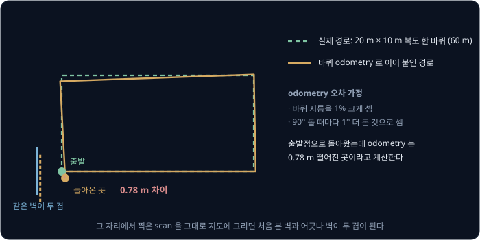
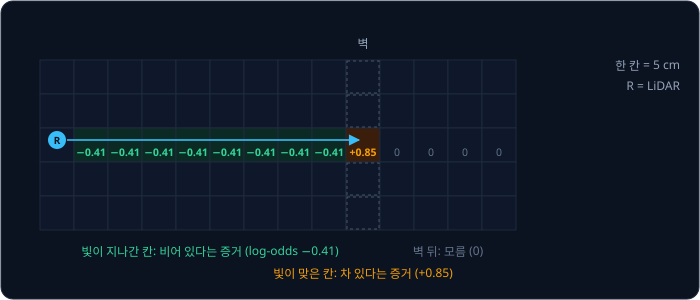
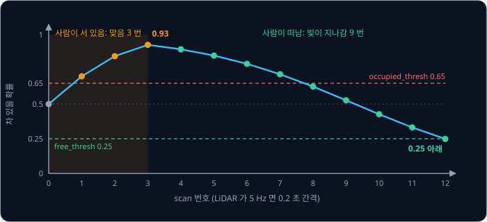
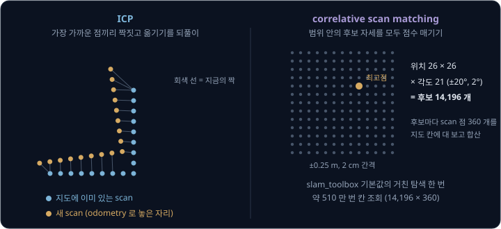
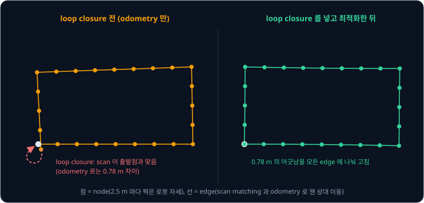
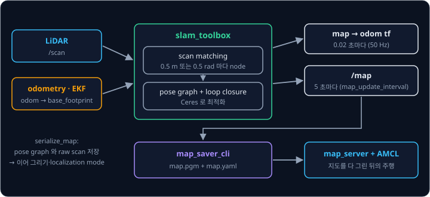

# LiDAR SLAM

로봇을 조종해 사무실 복도를 한 바퀴 돌면서 바퀴 odometry 로 구한 위치에 LiDAR scan 을 차례로 붙여 지도를 그리면, 출발점에 돌아왔을 때
처음 그린 벽과 마지막에 그린 벽이 맞지 않아 같은 벽이 두 겹으로 그려진다. 위치가 틀려서 지도가 틀렸으니 지도로 위치를 고치고 싶지만, 그
지도마저 틀린 위치로 그린 것이다. 지도도 위치도 없이 출발한 로봇은 어떻게 반듯한 지도를 얻을까?

SLAM(Simultaneous Localization and Mapping)은 지도와 위치를 함께 추정해 이 문제를 푼다. ROS 2 에서는 `slam_toolbox` 가 GMapping 을
대신하는 기본 SLAM package 가 되었고, 2021 년 논문에는 이 package 로 24,000 m² 넓이의 공간을 실시간으로 지도로 그린 사례가 실려 있다.

## 학습 목표

- 지도와 위치를 따로 구할 수 없는 이유와, odometry 만으로 지도를 그리면 오차가 거리에 따라 쌓이는 방식을 숫자로 설명할 수 있다
- occupancy grid 의 칸이 LiDAR 빛 한 줄마다 log-odds 덧셈으로 갱신되는 과정을 계산할 수 있다
- scan matching(ICP, correlative)이 odometry 를 고치는 방식과, pose graph 의 loop closure 가 쌓인 오차를 경로 전체에 나눠 고치는 방식을 설명할 수 있다
- `slam_toolbox` 로 지도를 그려 저장하고 AMCL 이 쓰게 넘기는 흐름과, 그때 정하는 해상도·parameter 의 뜻을 설명할 수 있다

## 지도와 위치의 순환

[Particle Filter](../particle-filter/README.md) 에서 본 AMCL 은 지도가 주어진 상태에서 LiDAR scan 이 지도와 얼마나 잘 맞는지로 위치를
찾는다. 반대로 scan 을 찍은 자리를 정확히 안다면 각 scan 을 그 자리에 놓고 빛이 맞은 곳을 벽으로 칠하면 지도가 된다. 처음 들어간
건물에서는 위치도 지도도 모르니 두 문제가 서로를 필요로 한다.

| 문제 | 아는 것 | 구하는 것 | ROS 2 의 예 |
| --- | --- | --- | --- |
| localization | 지도 | 지도 위의 위치 | AMCL |
| mapping | scan 마다 찍은 위치 | 지도 | 위치를 안다고 치고 scan 을 칠하는 일 |
| SLAM | 센서 값과 odometry 뿐 | 위치와 지도 둘 다 | `slam_toolbox`, Cartographer |

SLAM 은 이 순환을 두 부분으로 나눠 푼다. front-end 는 odometry 를 출발점 삼아 새 scan 을 바로 앞의 scan 이나 작은 지도 조각에 맞춰
위치를 고치고, 고친 위치로 지도를 늘려 간다. 그래도 오차가 조금씩 남기 때문에, 로봇이 예전에 지나간 곳에 돌아온 것을 알아차리면
back-end 가 그 정보로 지금까지의 경로 전체를 한꺼번에 다시 맞춘다.

SLAM 을 particle filter 로 풀 수도 있어서, ROS 1 에서 많이 쓰던 GMapping 은 particle 마다 지도를 하나씩 따로 두는 particle filter 다.
Cartographer 논문은 이 방식이 particle 마다 전체 상태를 저장해야 해서, 3 km 를 걸으며 22,000 m² 를 지도로 그리는 것처럼 큰 공간에서는
자원이 많이 든다고 지적했다. 지금 ROS 2 에서 쓰는 `slam_toolbox` 와 Cartographer 는 둘 다 뒤에서 볼 pose graph 방식이다.

## odometry 오차의 누적

바퀴 odometry 는 바퀴가 몇 바퀴 돌았는지로 이동 거리를 세고, 양쪽 바퀴가 돈 양의 차이로 회전을 센다. 바퀴 지름을 1% 크게 알고 있으면
거리도 1% 크게 세어서 60 m 를 달리면 0.6 m 가 어긋난다. 방향 오차는 이보다 크게 번진다. 회전을 한 번 1° 틀리게 세면 그 뒤로 달리는
거리가 모두 1° 틀어진 방향으로 쌓이므로, 옆으로 벗어나는 거리가 "달린 거리 × sin(방향 오차)" 로 커진다.

| 방향 오차 | 10 m 뒤 | 20 m 뒤 | 50 m 뒤 |
| --- | --- | --- | --- |
| 0.5° | 0.09 m | 0.17 m | 0.44 m |
| 1° | 0.17 m | 0.35 m | 0.87 m |
| 2° | 0.35 m | 0.70 m | 1.75 m |

아래 그림은 20 m × 10 m 복도를 한 바퀴(60 m) 도는 경우를 계산한 결과다. 바퀴 지름을 1% 크게 알고 있고 90° 를 돌 때마다 1° 를 더 돈
것으로 센다고 두면, 로봇은 실제로 출발점에 돌아왔지만 odometry 는 출발점에서 0.78 m 떨어진 곳이라고 계산한다.

방향 오차는 지도에도 바로 드러난다. LiDAR 는 로봇을 중심으로 사방에 빛을 쏴서 거리를 재므로, 로봇의 방향을 1° 틀리게 알면 3 m 앞의
벽 점은 $3 \times \sin 1° \approx 0.052$ m 옆에 찍힌다. 지도 칸 하나가 5 cm 이면 벽이 한 칸 밀려 그려지고, 멀리 있는 벽일수록 더 많이
밀린다. odometry 와 IMU 를 [Kalman Filter](../kalman-filter/README.md) 에서 본 `robot_localization` 으로 합치면 오차가 줄지만, 주변을
보지 않고 움직임만 쌓는 한 오차는 계속 커진다. SLAM 은 LiDAR 가 본 벽의 모양을 기준으로 삼아 이 오차를 고친다.

**확인 문제.** 회전을 2° 틀리게 센 뒤 30 m 를 곧게 달렸다. odometry 위치는 옆으로 얼마나 벗어나 있을까?

답 보기

옆으로 벗어나는 거리는 달린 거리 × sin(방향 오차)이므로 $30 \times \sin 2° = 30 \times 0.0349 \approx 1.05$ m 다. 거리를 정확히 셌어도 방향이
틀리면 이만큼 어긋난다.

## occupancy grid

LiDAR SLAM 이 그리는 2D 지도는 **occupancy grid** 라는 표다. 바닥을 같은 크기의 네모 칸으로 나누고, 칸마다 무언가로 차 있을 확률을
적는다. 1985 년 Moravec 과 Elfes 가 초음파 센서로 지도를 그릴 때 처음 썼고, 지금은 칸 하나를 5 cm 로 두는 경우가 많다(`slam_toolbox`
의 기본 `resolution` 이 0.05 m, Cartographer 논문의 지도도 5 cm). 10 m × 10 m 방을 5 cm 칸으로 나누면 $200 \times 200 = 40{,}000$ 칸이
된다.

칸의 확률은 처음에 모두 0.5 로 두고 LiDAR 빛이 들어올 때마다 고친다. 빛 한 줄을 보면 빛이 맞고 돌아온 끝점의 칸에는 무언가가 있고 빛이
지나온 칸들은 비어 있다는 것을 알 수 있지만, 끝점 너머의 칸은 빛이 가지 않았으니 여전히 모른다.

TurtleBot3 의 LiDAR 인 LDS-01 은 1초에 5 바퀴(300 rpm) 돌면서 1° 간격으로 거리 360 개를 재고, 잴 수 있는 거리는 0.12 ~ 3.5 m 다. 1초에
빛 $360 \times 5 = 1{,}800$ 줄이 들어오고 3.5 m 를 가는 빛 한 줄은 5 cm 칸을 70 개 지나므로, 칸 하나를 고치는 계산은 가벼워야 한다.

## log-odds 갱신

같은 칸에 빛이 여러 번 들어오면 증거를 합쳐야 하는데, [Probability & Gaussians](../probability/README.md) 에서 본 Bayes rule 을 확률에
그대로 쓰면 곱셈과 나눗셈이 섞인다. 확률을 **log-odds** $l = \ln \frac{p}{1 - p}$ 로 바꿔 두면 새 증거를 더하기만 하면 된다. 확률 0.5 는
log-odds 0 이고, 확률이 0.5 보다 크면 log-odds 는 양수이고 작으면 음수다.

빛이 맞은 칸이 차 있을 확률을 0.7 로, 빛이 지나간 칸이 차 있을 확률을 0.4 로 정해 두자. 이 두 값은 센서마다 사람이 정한다. log-odds
로는 맞을 때마다 $\ln(0.7/0.3) = +0.85$ 를, 지나갈 때마다 $\ln(0.4/0.6) = -0.41$ 을 더한다. 아래 표는 사람이 칸 하나에 서 있다가 떠나는
경우를 계산한 것이다.

| scan | 그 칸에서 일어난 일 | log-odds | 차 있을 확률 |
| --- | --- | --- | --- |
| 0 | 아직 모름 | 0 | 0.50 |
| 1 | 맞음 | 0.85 | 0.70 |
| 2 | 맞음 | 1.69 | 0.84 |
| 3 | 맞음 | 2.54 | 0.93 |
| 4 | 사람이 떠나 빛이 지나감 | 2.14 | 0.89 |
| 8 | 지나감 (5 번째) | 0.51 | 0.63 |
| 12 | 지나감 (9 번째) | −1.11 | 0.248 |

log-odds 는 $p = 1 / (1 + e^{-l})$ 로 확률로 되돌린다. 세 번 맞은 칸은 0.93 까지 올라가고, 사람이 떠난 뒤에는 빛이 아홉 번 지나가야
Nav2 map saver 가 비어 있다고 보는 0.25 아래로 내려가는데, LiDAR 가 1초에 5 바퀴 돌면 1.8 초가 걸린다.

맞음과 지나감에 주는 값의 크기에 따라 벽이 얼마나 쉽게 생기고 지워지는지가 달라진다. Cartographer 의 기본값은 맞음 0.55, 지나감 0.49 로
log-odds 로는 $+0.20$ 과 $-0.04$ 다. 맞음 한 번이 0.7 일 때보다 약해서 칸 하나가 map saver 의 기준인 0.65 를 넘으려면 연달아 네 번
맞아야 하므로($4 \times 0.20 = 0.80$, 확률 0.69), 가끔 튀는 측정 한두 번으로는 벽이 생기지 않는다. 반대로 맞음 한 번을 지우려면 지나감이
다섯 번 필요해서 한번 벽으로 칠한 칸은 잘 지워지지 않는다.

`slam_toolbox` 는 log-odds 대신 횟수를 센다. 칸마다 빛이 닿은 횟수(맞음 포함)와 맞은 횟수를 세어 두고, 닿은 횟수가
`min_pass_through`(기본 2)보다 많은 칸은 맞은 비율이 `occupancy_threshold`(기본 0.1)를 넘으면 차 있음으로, 넘지 않으면 비어 있음으로
칠한다. 앞의 사람 예에서 세 번 맞고 아홉 번 지나간 칸은 비율이 $3 / 12 = 0.25$ 라 아직 차 있음이고, 닿은 횟수가 30 이 되어 비율이
$3 / 30 = 0.1$ 로 떨어져야 비어 있음으로 바뀐다. 기준이 0.1 로 낮아서 열 번에 한 번보다 자주 맞는 칸은 벽으로 남는다.

> **오해** 확률 0.5 인 칸은 반쯤 차 있다.
>
> **사실** 0.5 는 처음 값 그대로라서 정보가 없다는 뜻이고, 빛이 한 번도 닿지 않은 칸이 이 값으로 남는다. ROS 의 `nav_msgs/OccupancyGrid` 는 이런 칸을 −1 로 적고 map saver 는 지도 그림에서 회색으로
> 칠하며, 경로를 계획할 때 이 칸을 빈 곳으로 다룰지 막힌 곳으로 다룰지는 따로 정해야 한다.

**확인 문제.** 빛이 맞으면 +0.85, 지나가면 −0.41 을 더한다. 처음 0.5 인 칸에 맞음, 맞음, 지나감이 차례로 들어오면 차 있을 확률은?

답 보기

log-odds 는 $0 + 0.85 + 0.85 - 0.41 = 1.29$ 이고, 확률로 되돌리면 $1 / (1 + e^{-1.29}) \approx 0.78$ 이다. 순서를 바꿔도 더하기라서 결과는 같다.

<b>심화: log-odds 갱신식 유도</b>

칸이 차 있는 사건을 $m$, 지금까지의 측정을 $z_{1:t}$ 라고 하자. 칸의 상태가 정해져 있으면 측정끼리는 서로 독립이라고 가정하고 Bayes rule 을
쓰면, 차 있음과 비어 있음의 확률 비는 아래처럼 측정 하나씩의 비를 곱한 꼴이 된다.

$$
\frac{p(m \mid z_{1:t})}{1 - p(m \mid z_{1:t})} = \frac{p(m \mid z_t)}{1 - p(m \mid z_t)} \cdot \frac{p(m \mid z_{1:t-1})}{1 - p(m \mid z_{1:t-1})} \cdot \frac{1 - p(m)}{p(m)}
$$

양변에 log 를 씌우면 곱이 덧셈이 된다.

$$
l_t = l_{t-1} + \ln \frac{p(m \mid z_t)}{1 - p(m \mid z_t)} - l_0
$$

$l_0$ 는 측정 전의 log-odds 인데, 처음 확률을 0.5 로 두면 $l_0 = 0$ 이라 마지막 항이 사라진다. 가운데 항 $p(m \mid z_t)$ 가 "빛이 맞으면 0.7,
지나가면 0.4" 처럼 센서 값 하나로 칸의 상태를 거꾸로 추정하는 inverse sensor model 이다. Cartographer 논문은 같은 계산을 odds
$p / (1 - p)$ 의 곱으로 적고, 확률이 0 이나 1 에 너무 가까워져 다시 바뀌지 않는 일을 막으려고 결과를 정해 둔 최솟값과 최댓값 사이로
자른다(clamp).

## scan matching

LDS-01 이 한 바퀴 도는 0.2 초 사이에 찍은 두 scan 은 거의 같은 벽을 보므로, 새 scan 을 얼마나 옮기고 돌려야 앞의 scan(또는 지금까지 그린
지도)과 겹치는지 찾으면 그 이동이 로봇이 실제로 움직인 양이다. 이 일을 **scan matching** 이라고 하고, 2D 에서 답은 $\Delta x$, $\Delta y$,
$\Delta\theta$ 세 숫자다. odometry 값은 탐색을 시작할 출발점으로 쓴다.

**ICP**(Iterative Closest Point)는 1992 년 Besl 과 McKay 가 3D 형상을 맞추려고 낸 방법이다. 새 scan 의 점마다 기준 scan 에서 가장 가까운
점을 짝으로 정하고, 짝끼리의 거리 제곱 합이 가장 작아지는 회전과 이동을 구해 새 scan 을 옮긴다. 옮기고 나면 짝이 바뀌므로 짝짓기와
옮기기를 변화가 작아질 때까지 되풀이한다. Besl 과 McKay 가 밝혔듯이 ICP 는 출발점에서 가장 가까운 local minimum 으로 수렴해서, odometry 가
크게 틀려 처음 짝이 엉뚱하게 지어지면 틀린 답에서 멈춘다.

**correlative scan matching** 은 출발점 둘레의 정해 둔 범위 안에서 후보 자세를 모두 시험해 점수가 가장 높은 것을 고른다. 후보 자세마다
scan 의 점을 지도 칸에 대 보고, 점이 놓인 칸이 차 있을수록 점수를 높게 준다. 범위 전체를 보므로 odometry 가 조금 틀려도 답을 놓치지
않지만 계산량이 많다. Olson 은 2009 년 논문에서 이런 확률 기반 방식이 계산을 더 쓰는 만큼 출발점이 부정확해도 더 robust 하다고
보였고, CPU 에서는 해상도를 바꿔 가며 찾아 실시간에 맞췄다. `slam_toolbox` 기본값으로 후보 수를 세면 아래와 같다.

| 단계 | 위치 | 각도 | 후보 수 |
| --- | --- | --- | --- |
| 거친 탐색 | ±0.25 m 를 2 cm 간격 → 26 × 26 | ±20° 를 2° 간격 → 21 개 | 14,196 |
| 고운 탐색 | 최고점 둘레 ±1 cm 를 1 cm 간격 → 3 × 3 | ±1° 를 0.2° 간격 → 11 개 | 99 |

거친 탐색에서 후보 14,196 개마다 LDS-01 의 점 360 개를 칸에 대 보면 칸 조회가 약 510 만 번이다. 위치 범위 0.5 m 는
`correlation_search_space_dimension` 으로 정하고, 각도 범위 ±20° 는 `coarse_search_angle_offset`(0.349 rad)으로 정한다. 범위를 넓히면
odometry 가 더 많이 틀려도 답을 찾지만 위치 후보 수가 범위의 제곱으로 늘어난다.

Cartographer 는 국소 최적화와 전체 탐색을 용도에 따라 나눠 쓴다. 매 scan 은 최근 scan 90 개로 만든 작은 지도 조각(submap)에 Ceres 로
맞추는데, 이 방식도 local minimum 을 찾기 때문에 좋은 출발점이 필요하다. 그래서 논문은 IMU 로 scan 사이의 회전을 미리 추정해 출발점으로
쓴다. 반대로 loop closure 를 찾을 때는 ±7 m, ±30° 의 넓은 범위를 correlative 방식으로 찾는다. 각도 간격은 가장 먼 점이 한 칸(5 cm) 넘게
움직이지 않을 만큼으로 정해서, 30 m 를 보는 LiDAR 면 $0.05 \div 30 \approx 0.0017$ rad(약 0.1°)다. 이 간격으로 ±7 m · ±30° 를 모두
시험하면 후보가 $281 \times 281 \times$ 약 630 으로 5 천만 개에 가깝다. 논문은 낮은 해상도의 지도에서 점수의 상한을 먼저 구해, 상한이
지금까지의 최고점보다 낮은 영역은 통째로 건너뛰는 branch-and-bound 로 이 계산을 실시간에 맞췄다.

scan matching 으로 원리적으로 풀 수 없는 곳도 있다. 양쪽 벽이 곧고 나란한 긴 복도에서는 scan 을 복도 방향으로 얼마나 밀어도 벽이 똑같이
겹쳐 점수가 같으므로, scan 으로는 복도 방향의 이동을 알 수 없다. 이 방향은 odometry 에 기댈 수밖에 없어서 긴 복도를 지나면 지도가
늘어나거나 줄어들기도 한다. scan matching 결과를 믿을 수 있는 정도가 이렇게 방향마다 다르기 때문에, `slam_toolbox` 의 scan matcher 는
답과 함께 방향별 불확실성(covariance)을 계산해 pose graph 의 edge 에 넣는다.

<b>심화: 짝이 정해졌을 때의 회전과 이동</b>

새 scan 의 점 $p_i$ 와 그 짝 $q_i$ 가 정해지면, 오차 $\sum_i \lVert R p_i + t - q_i \rVert^2$ 을 가장 작게 하는 회전 $R$ 과 이동 $t$ 는 되풀이
없이 바로 구할 수 있다.

1. 두 점 집합의 중심 $\bar p$, $\bar q$ 를 구하고 각 점에서 중심을 뺀다
2. $H = \sum_i (p_i - \bar p)(q_i - \bar q)^\top$ 을 SVD 로 $U \Sigma V^\top$ 로 나눈다
3. $R = V U^\top$, $t = \bar q - R \bar p$ 다

회전이 없다면 $t$ 는 짝끼리의 차이 $q_i - p_i$ 의 평균일 뿐이다. 다만 가장 가까운 점으로 정한 짝은 틀릴 수 있으므로, ICP 는 옮길 때마다
짝을 다시 지어 위 계산을 되풀이한다.

## pose graph 와 loop closure

scan matching 으로 고쳐도 scan 사이 이동마다 작은 오차가 남아 계속 쌓인다. 1997 년 Lu 와 Milios 는 scan 을 지도 하나에 차례로 합치지
말고, 모든 scan 과 scan matching 이나 odometry 로 구한 scan 사이의 상대 위치를 보관했다가 이 관계를 모두 제약으로 삼아 모든 scan 의 위치를
한꺼번에 구하자고 제안했다. 이 구조를 그래프로 그린 것이 **pose graph** 다.

- node 는 scan 을 찍은 순간의 로봇 자세 $(x, y, \theta)$ 다. `slam_toolbox` 는 로봇이 0.5 m 를 가거나 0.5 rad(약 29°)를 돌 때마다 node 를 하나
  만든다(`minimum_travel_distance`, `minimum_travel_heading`)
- edge 는 두 node 사이의 상대 이동을 잰 값과 그 불확실성이다. 이웃한 node 사이의 edge 는 scan matching 과 odometry 로 만든다
- **loop closure** 는 로봇이 예전에 지나간 곳에 돌아왔을 때 지금 scan 이 예전 scan 과 맞는 것을 찾아내, 멀리 떨어진 두 node 를 잇는 edge 를
  하나 더 넣는 일이다

loop closure edge 가 들어가면 출발점에 돌아왔다는 정보와 odometry 로는 0.78 m 떨어져 있다는 정보가 서로 어긋난다. 최적화는 모든 edge 를
가장 덜 어기는 node 위치를 찾으므로, 그 어긋남이 고리 위의 모든 edge 에 조금씩 나뉜다.

1차원으로 줄이면 손으로 계산할 수 있다. 로봇이 복도를 5 m 씩 두 번 갔다가 되돌아왔는데 odometry edge 는 $+5.0$, $+5.0$, $-4.8$, $-4.8$ m
로 쟀다고 하자. 이것만 이으면 마지막 위치가 $5.0 + 5.0 - 4.8 - 4.8 = 0.4$ m 인데, 마지막 scan 이 첫 scan 과 맞아서 출발점과 같은 자리라는
loop closure edge(0 m)가 들어왔다. 0.4 m 의 어긋남을 나누는 비율은 edge 마다의 분산으로 정한다.

| 가정 | 각 edge 가 떠안는 양 | 고친 위치 $x_0 \sim x_4$ |
| --- | --- | --- |
| 다섯 edge 의 분산이 모두 같다 | $0.4 \div 5 = 0.08$ m 씩 | 0, 4.92, 9.84, 4.96, 0.08 |
| loop closure 의 분산이 0 에 가깝다 | odometry edge 넷이 $0.4 \div 4 = 0.1$ m 씩 | 0, 4.9, 9.8, 4.9, 0 |

edge 하나가 떠안는 양은 전체 어긋남 × (그 edge 의 분산 ÷ 고리 위 모든 edge 의 분산의 합)이다. 분산이 큰 측정일수록 많이 고치는 것은
[Kalman Filter](../kalman-filter/README.md) 에서 본 Kalman gain 과 같은 원리다. 2D 에서는 각도가 섞여 손으로 풀 수 없어서 같은 식을
Gauss-Newton 이나 Levenberg-Marquardt 같은 비선형 최적화로 푼다. `slam_toolbox` 는 기본으로 Google 의 Ceres solver 를
Levenberg-Marquardt 설정으로 쓴다.

Cartographer 논문의 Deutsches Museum 실험에서는 1,913 초 동안 2,253 m 를 걸으며 모은 데이터로 pose graph 를 만들었는데, node 가 11,456
개, edge 가 35,300 개였다. 최적화는 node 가 몇 개 추가될 때마다 다시 했고, 한 번에 3 회 정도 반복하는 데 0.3 초쯤 걸렸다. 전체 처리에는
CPU 시간 1,018 초, 실제 시간 360 초가 걸려 데이터 길이(1,913 초)보다 5.3 배 빨리 끝났다.

`slam_toolbox` 는 지금 추정한 위치에서 3 m(`loop_search_maximum_distance`) 안에 있는 예전 node 만 loop closure 후보로 본다. 그 가운데
서로 이어진 scan 이 10 개(`loop_match_minimum_chain_size`) 이상인 묶음을 8 m 폭(`loop_search_space_dimension`)의 범위에서 지금 scan 과
맞춰 보고, 점수가 문턱(거친 단계 0.35, 고운 단계 0.45)을 넘을 때만 edge 를 넣는다. 그래서 지도를 그릴 때 출발점으로 돌아와 같은 곳을 한 번 더 지나가면 loop closure 를 찾을 기회가 늘어난다.

> **오해** loop closure 는 많이 넣을수록 지도가 좋아진다.
>
> **사실** 똑같이 생긴 두 복도처럼 서로 다른 장소를 같은 곳으로 잘못 이으면 최적화가 그 edge 를 지키려고 두 장소 사이의 모든 node 를 끌어당겨서, 잘못된 loop closure 하나가 지도 전체를 휘게 한다. 그래서 SLAM
> package 는 점수 문턱과 연속 일치 개수 같은 조건으로 loop closure 를 깐깐하게 고르고, 틀린 edge 의 영향을 줄이는 robust loss 를 쓰기도 한다.

**확인 문제.** odometry edge 가 $+3.0$, $+3.0$, $-2.9$, $-2.9$ m 이고, 마지막 node 가 첫 node 와 같은 자리라는 loop closure edge 의 분산이
0 에 가깝다. 고친 뒤 odometry edge 하나는 얼마가 될까?

답 보기

odometry 만 이은 끝 위치는 $3.0 + 3.0 - 2.9 - 2.9 = 0.2$ m 다. loop closure 는 거의 고치지 않으므로 odometry edge 넷이 $0.2 \div 4 = 0.05$ m 씩
떠안는다. 갈 때의 edge 는 $3.0 - 0.05 = 2.95$ m, 올 때의 edge 는 $-2.9 - 0.05 = -2.95$ m 가 되어 끝 위치가 0 이 된다.

<b>심화: pose graph 최적화 식</b>

node $i$ 의 자세를 $\mathbf{x}_i$, edge 가 잰 node $i$ 에서 $j$ 로의 상대 이동을 $\mathbf{z}_{ij}$, 그 불확실성을 공분산의 역행렬
$\Omega_{ij}$ (information matrix)로 적으면, 최적화는 아래 합을 가장 작게 하는 자세들을 찾는다.

$$
\mathbf{x}^* = \arg\min_{\mathbf{x}} \sum_{(i,j)} \mathbf{e}_{ij}^\top \Omega_{ij} \, \mathbf{e}_{ij}, \qquad \mathbf{e}_{ij} = \mathbf{z}_{ij} - (\mathbf{x}_j \ominus \mathbf{x}_i)
$$

$\mathbf{x}_j \ominus \mathbf{x}_i$ 는 지금 자세들로 계산한 $i$ 에서 본 $j$ 의 상대 자세다. 1차원에서는 $\ominus$ 가 뺄셈이고 $\Omega$ 가
$1 / \sigma^2$ 이라, 위 합은 $\sum (x_j - x_i - z_{ij})^2 / \sigma_{ij}^2$ 이 된다. 고리 하나에서 이 합을 가장 작게 하면 어긋남이 각 edge 의
$\sigma^2$ 에 비례해 나뉜다.

2D 에서는 $\ominus$ 에 회전이 들어가 비선형이므로 지금 추정 근처에서 선형화해 풀고 다시 선형화하기를 되풀이한다(Gauss-Newton). edge 가
대부분 이웃 node 끼리만 이어서 선형화한 행렬은 거의 0 으로 차 있는데, 이 sparse 한 구조 덕분에 Deutsches Museum 실험처럼 node 가 만 개를
넘어도 1 초 안에 풀린다. `slam_toolbox` 가 Ceres 에서 `SPARSE_NORMAL_CHOLESKY` 를 쓰는 것도 이 구조 때문이다. 자세한 유도는 Grisetti 등의
graph-based SLAM tutorial 에 있다.

## slam_toolbox 와 Cartographer

ROS 2 에서 쓸 수 있는 2D LiDAR SLAM package 로 `slam_toolbox` 와 Cartographer 가 있고, Nav2 문서는 SLAM 이 필요하면 `slam_toolbox` 를
쓰라고 권한다.

| 항목 | `slam_toolbox` | Cartographer |
| --- | --- | --- |
| 출발 | SRI 의 Open Karto 를 고쳐 만듦, 2021 년 논문 | Google 이 2016 년 논문과 함께 공개 |
| 매 scan 의 scan matching | correlative (거친 탐색 → 고운 탐색) | 최근 scan 90 개로 만든 submap 에 Ceres 로 맞춤 |
| loop closure 탐색 | correlative, 3 m 안의 예전 node | branch-and-bound, ±7 m · ±30° |
| 칸 갱신 | 맞음 비율이 0.1 을 넘으면 차 있음 | odds 곱 (맞음 0.55, 지나감 0.49) |
| 저장해서 이어 그리기 | pose graph 와 raw scan 을 통째로 저장 | 처리한 submap 을 저장 |
| 관리 상태 | Nav2 의 SLAM tutorial 이 쓰는 package | 원 저장소는 활발히 관리하지 않음, ROS fork 는 제한적으로 관리 |

`slam_toolbox` 는 `/scan` topic 의 LiDAR 값과 odometry 나 EKF 가 내는 `odom` → `base_footprint` tf 를 받아, 지도는 `/map` topic 으로 내고
자기가 고친 위치는 `map` → `odom` tf 로 낸다. [ROS 2 Basics](../ros2-basics/README.md) 에서 본 tf2 의 frame 사슬에서 odometry 가 내는
`odom` → `base_footprint` 는 끊김 없이 이어지지만 오차가 쌓이고, SLAM 이 내는 `map` → `odom` 이 그 쌓인 오차를 덜어 낸다. Nav2 의 SLAM
tutorial 은 AMCL 과 map server 를 빼고(`use_localization:=False`) Nav2 를 실행한 뒤 `online_async_launch.py` 로 `slam_toolbox` 를 실행한다.

기본 설정 파일(`mapper_params_online_async.yaml`)에서 자주 바꾸는 값은 아래와 같다.

| parameter | 기본값 | 뜻 |
| --- | --- | --- |
| `resolution` | 0.05 | 지도 칸 한 변의 길이(m) |
| `minimum_travel_distance` | 0.5 | 이만큼(m) 움직여야 새 scan 을 node 로 넣는다 |
| `minimum_travel_heading` | 0.5 | 이만큼(rad) 돌아야 새 scan 을 node 로 넣는다 |
| `map_update_interval` | 5.0 | `/map` 을 다시 그려 내는 주기(초) |
| `transform_publish_period` | 0.02 | `map` → `odom` tf 를 내는 주기(초), 50 Hz |
| `do_loop_closing` | true | loop closure 를 찾을지 여부 |
| `loop_search_maximum_distance` | 3.0 | loop closure 후보로 볼 예전 node 까지의 거리(m) |
| `max_laser_range` | 20.0 | 지도를 칠할 때 쓰는 LiDAR 거리의 상한(m) |

동작 방식은 synchronous 와 asynchronous 가 있다. synchronous mode 는 들어온 scan 을 버리지 않고 쌓아 두었다가 차례로 처리하므로, 지도
품질이 중요할 때나 녹화한 데이터를 처리할 때 알맞다. asynchronous mode 는 앞의 scan 처리가 끝난 시점에 들어와 있는 새 scan 만 처리해서
loop closure 계산이 오래 걸려도 실시간보다 뒤처지지 않지만, 일부 scan 이 지도에 빠질 수 있다. 로봇이 움직이며 위치를 바로 써야 하면
asynchronous 를 쓴다.

## 지도 해상도와 저장

칸 크기를 반으로 줄이면 가로와 세로의 칸 수가 각각 두 배라 칸 수는 네 배가 된다. `nav_msgs/OccupancyGrid` 는 칸 하나를 1 byte(int8)로
적으므로, `slam_toolbox` 논문에 나온 24,000 m² 공간의 지도 한 장은 아래 크기가 된다.

| 칸 크기 | 칸 수 | `/map` 메시지 하나 |
| --- | --- | --- |
| 10 cm | 240 만 | 약 2.4 MB |
| 5 cm | 960 만 | 약 9.6 MB |
| 2.5 cm | 3,840 만 | 약 38.4 MB |

`/map` 은 `map_update_interval` 마다 통째로 다시 보내므로 칸을 줄이면 보내는 데이터와 메모리가 그만큼 늘고, 같은 지도를 받는 AMCL 과 Nav2
의 costmap 도 메모리와 계산이 는다. 그런데 칸을 줄여도 벽이 센서보다 정확해지지는 않는다. ROBOTIS 사양의 LDS-01 거리 정확도는
0.5 ~ 3.5 m 에서 ±5% 라, 3 m 앞 벽까지의 거리는 $\pm 3 \times 0.05 = \pm 0.15$ m 까지 틀릴 수 있다. 이 30 cm 폭에 5 cm 칸은 6 개,
2.5 cm 칸은 12 개가 들어가므로 벽 점이 이 폭 안에서 흩어지면 2.5 cm 칸에서는 두 배 많은 칸에 번져 찍힌다. 1° 방향 오차로 밀리는
5.2 cm($3 \times \sin 1°$)도 2.5 cm 칸으로는 두 칸이 넘는다.

다 그린 지도는 Nav2 의 map saver 로 저장한다. Nav2 tutorial 의 명령 `ros2 run nav2_map_server map_saver_cli -f ~/map` 을 실행하면 지도
그림 `map.pgm` 과 설명 파일 `map.yaml` 이 생긴다. map saver 는 칸의 값(0 ~ 100)을 두 문턱으로 나눠 그림을 세 가지 색으로 칠한다.

| 칸의 값 | 저장 기준 | pgm 의 밝기 |
| --- | --- | --- |
| 25 이하 | `free_thresh_default` 0.25 | 254 (흰색, 비어 있음) |
| 65 이상 | `occupied_thresh_default` 0.65 | 0 (검은색, 차 있음) |
| 그 사이, 또는 −1 | | 205 (회색, 모름) |

`map.yaml` 에는 그림 파일 이름, 칸 크기 `resolution`, 그림 왼쪽 아래 칸의 지도 좌표 `origin` 과 함께 `occupied_thresh` 와 `free_thresh` 가
적힌다. 세 가지 색으로 저장하면 yaml 의 `free_thresh` 는 0.25 가 아니라 0.196 으로 적힌다. 이 값은 저장할 때 쓴 문턱이 아니고, 나중에
pgm 의 밝기(254, 205, 0)를 다시 세 가지로 나눠 읽을 때 쓰는 문턱이다. 이 파일을 Nav2 의 map server 에 `yaml_filename` 으로 넘기면 AMCL 이
그 지도 위에서 위치를 찾는다.

pgm 에는 칸의 색만 남고 pose graph 는 남지 않으므로, 나중에 지도를 이어 그리거나 고칠 계획이면 `slam_toolbox` 의 `serialize_map` service
로 pose graph 와 raw scan 을 함께 저장해 둔다. 이 파일을 다시 불러오면 지난번 지도에 이어 그릴 수 있고, AMCL 을 쓰지 않고 `slam_toolbox` 의
localization mode 로 위치를 찾을 수도 있다. 다만 `slam_toolbox` README 는 이 localization mode 가 로봇마다 tuning 이 많이 필요하고 좋은
odometry 를 요구한다며, 처음 쓰는 사람에게는 AMCL 을 권한다.

**확인 문제.** 50 m × 40 m 창고를 5 cm 칸으로 그리면 칸은 몇 개이고, 2.5 cm 로 줄이면 몇 배가 될까?

답 보기

5 cm 칸이면 가로 $50 \div 0.05 = 1{,}000$ 칸, 세로 $40 \div 0.05 = 800$ 칸이라 $1{,}000 \times 800 = 80$ 만 칸이다. 2.5 cm 로 줄이면 가로와
세로가 각각 두 배라 $2 \times 2 = 4$ 배인 320 만 칸이 된다.

## 정리

- 지도를 그리려면 위치가 필요하고 위치를 찾으려면 지도가 필요해서 SLAM 은 둘을 함께 추정한다. odometry 만 쌓으면 방향 오차가 달린 거리에
  비례해 옆으로 커져서, 바퀴 지름 1% 와 회전마다 1° 의 오차로도 60 m 고리 끝에서 0.78 m 가 어긋난다
- occupancy grid 는 칸마다 차 있을 확률을 log-odds 로 적어 두고, 빛이 맞으면 더하고 지나가면 뺀다. 0.5 는 빈 칸이 아니라 모르는 칸이다
- scan matching(ICP, correlative)은 벽의 모양으로 odometry 를 고치고, pose graph 의 loop closure 는 돌아온 곳을 알아차려 남은 어긋남을
  모든 edge 에 분산에 비례해 나눈다. ROS 2 에서는 `slam_toolbox` 로 그리고 `map_saver_cli` 로 pgm·yaml 을 저장해 AMCL 에 넘긴다

카메라만 단 로봇은 LiDAR 처럼 벽까지의 거리를 바로 잴 수 없어서 사진 여러 장에서 같은 점을 찾아 triangulation 으로 거리를 구하는데,
경로와 지도를 함께 최적화하는 방식은 LiDAR SLAM 과 같다. 다음 강의에서는 카메라로 하는 Visual SLAM 과 카메라에 IMU 를 더한 VIO 를 다룬다. 여기서 저장한 지도는 Nav2 가 길을 찾을 때 쓰는 costmap 의 바탕이 되고, 그 지도 위에서 경로를 계획하는
방법은 Path Planning 에서 다룬다.

## 참고 자료

- Steve Macenski, [slam_toolbox README](https://github.com/SteveMacenski/slam_toolbox) — mode 와 parameter 설명. 기본값은
  [`mapper_params_online_async.yaml`](https://github.com/SteveMacenski/slam_toolbox/blob/humble/config/mapper_params_online_async.yaml) 에 있다
- Nav2, [Navigating while Mapping (SLAM)](https://docs.nav2.org/rolling/tutorials/general_tutorials/navigation2_with_slam/navigation2_with_slam/) —
  Nav2 와 `slam_toolbox` 를 함께 실행하고 지도를 저장하는 공식 tutorial
- Nav2, [Map Saver](https://docs.nav2.org/rolling/configuration_and_development/configuration_guide/core_servers/map_server/configuring_map_saver/) —
  `free_thresh_default`·`occupied_thresh_default` 의 기본값과 뜻
- W. Hess 외, [Real-Time Loop Closure in 2D LIDAR SLAM](https://research.google/pubs/real-time-loop-closure-in-2d-lidar-slam/) (2016) —
  Cartographer 의 submap, odds 갱신, branch-and-bound, Deutsches Museum 실험
- S. Macenski, I. Jambrecic, [SLAM Toolbox: SLAM for the dynamic world](https://doi.org/10.21105/joss.02783) (2021) — 다른 SLAM package 와의
  비교와 synchronous·asynchronous·localization mode
- G. Grisetti 외, [A Tutorial on Graph-Based SLAM](http://www2.informatik.uni-freiburg.de/~stachnis/pdf/grisetti10titsmag.pdf) (2010) — error
  함수, 선형화, sparse 구조를 차례로 유도한 pose graph 최적화 tutorial
- E. Olson, [Real-Time Correlative Scan Matching](https://doi.org/10.1109/ROBOT.2009.5152375) (2009) — 확률 기반 correlative scan matching 과
  CPU 용 multi-resolution 구현, GPU 병렬 구현
- P. Besl, N. McKay, [A Method for Registration of 3-D Shapes](https://doi.org/10.1109/34.121791) (1992) — ICP 를 제안하고 가장 가까운 local
  minimum 으로 수렴한다고 밝힌 원 논문
- F. Lu, E. Milios, [Globally Consistent Range Scan Alignment for Environment Mapping](https://doi.org/10.1023/A:1008854305733) (1997) — scan
  사이의 상대 관계를 모두 제약으로 두고 한꺼번에 푸는 pose graph 방식의 출발점
- H. Moravec, A. Elfes, [High Resolution Maps from Wide Angle Sonar](https://frc.ri.cmu.edu/~hpm/project.archive/robot.papers/1985/al2.html)
  (1985) — occupancy grid 의 원 논문
- ROBOTIS, [LDS-01 사양](https://emanual.robotis.com/docs/en/platform/turtlebot3/appendix_lds_01/) — TurtleBot3 LiDAR 의 거리 범위, 회전 주기,
  각도 간격, 거리 정확도
- Cartographer, [trajectory_builder_2d.lua](https://github.com/cartographer-project/cartographer/blob/master/configuration_files/trajectory_builder_2d.lua)
  와 [pose_graph.lua](https://github.com/cartographer-project/cartographer/blob/master/configuration_files/pose_graph.lua) — submap 크기, 맞음·지나감
  확률, loop closure 탐색 범위의 기본값
