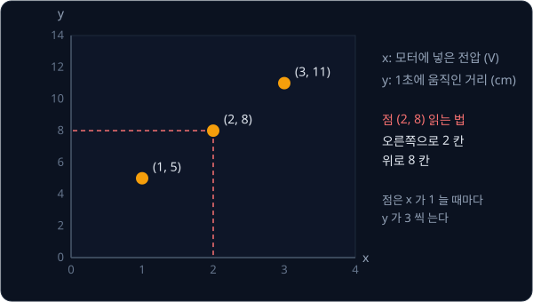
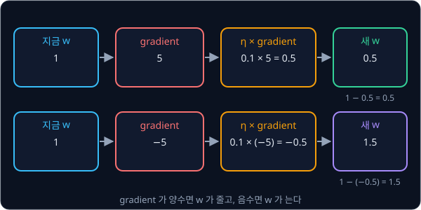
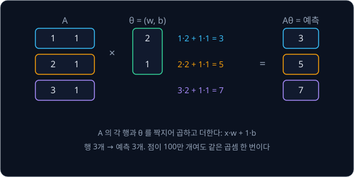

# Linear Regression

## 학습 목표

- 측정한 숫자 쌍들을 가장 잘 지나는 직선을 찾는 문제가 무엇이고, 로봇에서 왜 필요한지 설명할 수 있다
- 직선이 측정한 점들에서 얼마나 벗어났는지를 숫자 하나로 계산할 수 있다
- 직선을 정하는 숫자를 조금 바꿨을 때 그 "벗어난 정도" 가 얼마나 빨리 변하는지 계산할 수 있다
- 그 변하는 빠르기를 보고 직선을 조금씩 고쳐 가는 과정을 한 단계씩 따라가고, 한 번에 너무 크게 고치면 왜 값이 튀어 오르는지
  설명할 수 있다
- 오차를 평균할 때와 그냥 더할 때 한 번에 고치는 크기를 왜 다르게 잡아야 하는지 설명할 수 있다
- 숫자 여러 개를 묶어 한 번에 계산하는 방법이 무엇이고, 왜 쓰는지 설명할 수 있다

## 직선 맞추기 문제

### 로봇 청소기의 모터 데이터

로봇 청소기 바퀴 모터에 전압을 넣고 1초 동안 몇 cm 움직였는지 재 봤더니 아래와 같았다고 하자. 전압은 모터에 넣는 전기의 세기이고
단위는 V(볼트)다.

| 전압 (V) | 1초에 움직인 거리 (cm) |
| --- | --- |
| 1 | 5 |
| 2 | 8 |
| 3 | 11 |

로봇은 이 표에 없는 경우도 알아야 한다. 2.5 V 를 넣으면 몇 cm 움직일지, 10 cm 를 움직이려면 몇 V 를 넣어야 할지 알아야 원하는
자리에 멈출 수 있다. 표를 자세히 보면 전압이 1 V 늘 때마다 거리가 3 cm 씩 는다는 규칙이 보이고, 이 규칙을 알면 2.5 V 에서는
8 cm 에 1.5 cm 를 더한 9.5 cm 라고 예측할 수 있다.

이렇게 측정해서 모은 숫자들을 데이터라고 한다. 이 데이터는 "입력"(넣은 전압)과 "정답"(실제로 움직인 거리)이 짝을 이룬
세 쌍이다. 입력을 $x$, 정답을 $y$ 라고 부르면 데이터는 $(x, y)$ 꼴의 쌍 $(1, 5)$, $(2, 8)$, $(3, 11)$ 이다. 이 강의에서는
데이터로부터 이런 규칙을 컴퓨터가 스스로 찾아내는 방법을 다룬다.

**확인 문제.** 같은 규칙(1 V 늘 때마다 3 cm 씩 늘어남)을 따른다면 4 V 를 넣었을 때 몇 cm 움직일까?

답 보기

3 V 에서 11 cm 이고 1 V 늘면 3 cm 가 더 늘어나므로 $11 + 3 = 14$ cm 다.

### 좌표평면 위의 데이터

숫자 쌍은 그림으로 그리면 규칙이 훨씬 잘 보인다. 가로선과 세로선을 직각으로 그은 뒤 가로선에는 $x$ 값을, 세로선에는 $y$ 값을
눈금으로 적은 판을 좌표평면이라고 한다. 가로선을 $x$ 축, 세로선을 $y$ 축이라고 부른다.

숫자 쌍 $(2, 8)$ 은 좌표평면에서 "오른쪽으로 2 칸, 위로 8 칸" 인 곳에 점 하나로 찍는다. 앞의 숫자가 가로 위치, 뒤의 숫자가
세로 위치다.

위 그림은 세 점을 좌표평면에 찍은 모습이다. 빨간 점선은 점 $(2, 8)$ 이 $x$ 축의 2, $y$ 축의 8 과 이어진다는 것을 보여 준다.
세 점이 오른쪽 위로 일정하게 올라가며 한 줄로 늘어서 있다.

**확인 문제.** 점 $(0, 2)$ 는 좌표평면 어디에 찍힐까?

답 보기

오른쪽으로 0 칸, 위로 2 칸이므로 세로선($y$ 축) 바로 위, 높이 2 인 자리다.

### 직선과 기울기

세 점은 곧은 선 하나 위에 놓여 있다. 이 선 위의 모든 점은 "$y$ 는 $x$ 에 3 을 곱하고 2 를 더한 값" 이라는 규칙을 따르고, 이
규칙을 식으로 쓰면 $y = 3x + 2$ 다. 식에서 $3x$ 는 $3 \times x$ 를 줄여 쓴 것이다. 실제로 $x = 1$ 이면 $3 \times 1 + 2 = 5$,
$x = 2$ 이면 $3 \times 2 + 2 = 8$, $x = 3$ 이면 $3 \times 3 + 2 = 11$ 로 세 점이 모두 맞는다.

$y = 3x + 2$ 의 두 숫자 3 과 2 는 각각 직선의 모양을 정한다.

- **3: 기울기** — $x$ 가 1 늘 때 $y$ 가 얼마나 느는지를 나타낸다. $x$ 가 1 에서 2 로 1 늘면 $y$ 는 5 에서 8 로 3 늘어난다.
  기울기는 "늘어난 $y$ ÷ 늘어난 $x$" 로 계산하고, 여기서는 $3 \div 1 = 3$ 이다. 기울기가 클수록 직선이 가파르다
- **2: y 절편** — $x = 0$ 일 때의 $y$ 값이다. $3 \times 0 + 2 = 2$ 라서 직선은 $y$ 축의 높이 2 를 지난다

위 그림의 왼쪽은 직선 $y = 3x + 2$ 에서 오른쪽으로 1 칸 갈 때 위로 3 칸 올라가는 삼각형과, $x = 0$ 에서 높이 2 인 보라색 점을
보여 준다. 오른쪽은 두 숫자를 바꾼 직선들이다. $2x + 1$ 은 덜 가파르고 더 낮은 곳에서 시작하며, $3x + 0$ 은 기울기는 같지만
전체가 2 만큼 아래로 내려가 있다.

**확인 문제.** 직선 $y = 2x + 1$ 에서 $x$ 가 1 에서 4 로 늘면 $y$ 는 얼마나 늘까?

답 보기

$x = 1$ 이면 $y = 3$, $x = 4$ 이면 $y = 9$ 라서 $y$ 는 6 늘어난다. $x$ 가 3 늘었고 기울기가 2 이므로 $3 \times 2 = 6$ 으로도
계산할 수 있다.

### 모델과 parameter

컴퓨터는 처음에 규칙 $y = 3x + 2$ 를 모른다. 그래서 두 숫자를 비워 둔 직선 하나를 준비해 두고, 데이터를 보며 그 두 숫자를 채운다.

$$
\hat y = w x + b
$$

이 식은 "입력 $x$ 에 $w$ 를 곱하고 $b$ 를 더한 값을 예측으로 낸다" 는 뜻이다. 기호를 하나씩 읽으면 아래와 같다.

- $\hat y$ 는 "와이 햇(y hat)" 이라고 읽고, 이 직선이 내놓는 예측값이다. 실제로 잰 정답 $y$ 와 구별하려고 $y$ 위에 모자(hat)를
  씌웠다
- $w$ 는 직선의 기울기로, weight(가중치)의 첫 글자다
- $b$ 는 y 절편으로, bias 의 첫 글자다

입력을 받아 예측을 내는 이런 규칙을 모델이라고 한다. 그리고 모델 안의 $w$, $b$ 처럼 값이 정해져 있지 않아 데이터를 보고 채워야
하는 숫자를 parameter 라고 한다. 데이터 $(1, 5)$, $(2, 8)$, $(3, 11)$ 은 이미 측정이 끝나 바뀌지 않지만 parameter 는 더 맞는
값을 찾아 계속 바뀐다. 데이터에 가장 잘 맞는 parameter 를 찾는 과정을 학습이라고 하고, 직선 모델의 $w$ 와 $b$ 를 찾는 이
문제를 linear regression 이라고 부른다. linear 는 "직선의", regression 은 "연속된 숫자를 예측하는 문제" 를 뜻한다.

parameter 개수는 모델마다 다르다. 직선은 $w$, $b$ 두 개뿐이지만 사진을 보고 로봇 팔을 움직이는 큰 모델은 parameter 가 수억 개다.
그래도 데이터를 보고 parameter 를 고친다는 점은 똑같아서, 직선 하나를 맞추는 과정을 이해하면 큰 모델의 학습도 같은 틀로 읽을 수
있다.

실제 측정값은 매번 조금씩 흔들린다. 같은 2 V 를 넣어도 바닥이 미끄러우면 7.8 cm, 뻑뻑하면 8.3 cm 처럼 조금씩 다르게 나온다. 이렇게
측정마다 무작위로 끼어드는 작은 차이를 noise 라고 한다. noise 가 있으면 점들이 한 직선 위에 정확히 놓이지 않으므로, 학습은 모든
점을 정확히 지나는 직선이 아니라 점들 사이를 가장 잘 지나는 직선을 찾는 일이 된다.

**확인 문제.** 모델 $\hat y = 4x - 1$ 의 parameter $w$ 와 $b$ 는 각각 얼마일까?

답 보기

$x$ 에 곱한 숫자가 $w$, 더한 숫자가 $b$ 이므로 $w = 4$, $b = -1$ 이다. $-1$ 을 더하는 것은 1 을 빼는 것과 같다.

### 예측

parameter 를 아무 값으로나 정하면 모델은 바로 예측을 낼 수 있다. 컴퓨터가 첫 시도로 $w = 2$, $b = 1$ 을 골랐다고 하자.

| 입력 $x$ | 계산 $2 \times x + 1$ | 예측 $\hat y$ | 정답 $y$ |
| --- | --- | --- | --- |
| 1 | $2 \times 1 + 1$ | 3 | 5 |
| 2 | $2 \times 2 + 1$ | 5 | 8 |
| 3 | $2 \times 3 + 1$ | 7 | 11 |

예측이 정답보다 모두 작으니 이 직선은 점들보다 아래에 있다. parameter 를 $w = 3$, $b = 2$ 로 바꾸면 예측이 5, 8, 11 로 정답과
같아진다. 하지만 컴퓨터는 정답 parameter 를 모르고 시작하므로, 지금 직선이 얼마나 틀렸는지를 숫자로 재는 방법부터 있어야 한다.

**확인 문제.** $w = 3$, $b = 2$ 일 때 $x = 5$ 의 예측은?

답 보기

$\hat y = 3 \times 5 + 2 = 17$ 이다.

**요약**

- 데이터는 입력 $x$ 와 정답 $y$ 의 쌍이고, 좌표평면에 점으로 찍어 볼 수 있다
- 모델 $\hat y = wx + b$ 는 기울기 $w$ 와 y 절편 $b$ 로 정해지는 직선이고, $w$ 와 $b$ 가 parameter 다
- 학습은 데이터에 가장 잘 맞는 parameter 를 찾는 일이고, 직선 모델의 학습을 linear regression 이라고 부른다

## 오차와 loss

### 오차

점 하나에서 예측이 정답과 얼마나 다른지는 뺄셈으로 잰다. 예측에서 정답을 뺀 값 $\hat y - y$ 를 오차(residual)라고 한다.
$w = 2$, $b = 1$ 인 직선이면 세 점의 오차는 $3 - 5 = -2$, $5 - 8 = -3$, $7 - 11 = -4$ 다. 오차가 음수면 예측이 정답보다
작고, 양수면 예측이 정답보다 크다. 0 이면 딱 맞은 것이다.

**확인 문제.** 예측이 12 이고 정답이 10 이면 오차는?

답 보기

$12 - 10 = +2$ 다. 양수이므로 예측이 정답보다 2 만큼 크다.

### 오차를 제곱하는 이유

직선이 얼마나 틀렸는지를 숫자 하나로 나타내려면 점마다 나온 오차를 하나로 모아야 한다. 가장 먼저 떠오르는 방법은 오차를 모두
더하는 것인데, 여기에는 문제가 있다.

점 두 개 $(1, 4)$, $(2, 2)$ 에 높이가 3 인 수평선 $\hat y = 3$ 을 대 보자. 오차는 $3 - 4 = -1$ 과 $3 - 2 = +1$ 이고, 더하면
$-1 + 1 = 0$ 이다. 두 점 모두에서 1 씩 틀렸는데 합이 0 이라 "전혀 틀리지 않았다" 는 결론이 나온다. 위로 빗나간 오차와 아래로
빗나간 오차가 서로 지워졌기 때문이다.

오차를 제곱하면 이 문제가 사라진다. 제곱은 같은 수를 두 번 곱하는 것이고, 음수끼리 곱하면 양수가 되므로 $(-1)^2 = 1$,
$(+1)^2 = 1$ 이다. 제곱한 값을 더하면 $1 + 1 = 2$ 로, 틀린 만큼이 그대로 남는다.

제곱에는 큰 오차를 더 크게 벌하는 성질도 있다. 오차 1 은 제곱해도 1 이지만 오차 3 은 9 가 된다. 그래서 한 점에서 크게 틀린
직선이 여러 점에서 조금씩 틀린 직선보다 나쁜 점수를 받는다.

**확인 문제.** 오차가 $+2$ 와 $-2$ 일 때, 그냥 더한 값과 제곱해서 더한 값은 각각 얼마일까?

답 보기

그냥 더하면 $2 + (-2) = 0$ 이고, 제곱해서 더하면 $4 + 4 = 8$ 이다. 그냥 더하면 틀린 정도가 사라진다.

### 평균

제곱한 오차를 모두 더하기만 하면 점이 많을수록 값이 커진다. 점 3 개에서 조금씩 틀린 직선과 점 300 개에서 똑같이 조금씩 틀린
직선을 같은 기준으로 비교하려면 점 하나당 얼마나 틀렸는지를 봐야 한다. 그래서 평균을 쓴다.

평균은 숫자들을 모두 더한 뒤 개수로 나눈 값이다. 4, 9, 16 의 평균은 $(4 + 9 + 16) \div 3 = 29 \div 3 \approx 9.67$ 이다. 기호
$\approx$ 는 "약" 이라고 읽고, 딱 떨어지지 않아 반올림했다는 표시다. 숫자만 바꿔 25, 64, 121 의 평균을 구하면
$(25 + 64 + 121) \div 3 = 210 \div 3 = 70$ 이다.

같은 숫자를 두 번씩 넣어 4, 9, 16, 4, 9, 16 의 평균을 구하면 $58 \div 6 \approx 9.67$ 로 그대로다. 합은 58 로 두 배가 됐지만
평균은 변하지 않는다. 평균이 개수와 상관없이 "하나당 크기" 를 나타낸다는 이 성질은 뒤에서 오차를 평균할 때와 그냥 더할 때를 비교하며 다시 쓴다.

**확인 문제.** 2, 4, 9 의 평균은?

답 보기

$(2 + 4 + 9) \div 3 = 15 \div 3 = 5$ 다.

### Σ 기호

점이 3 개면 "첫째 + 둘째 + 셋째" 라고 적으면 되지만, 점이 1000 개면 그렇게 적을 수 없다. 그래서 수학에서는 "여러 개를 모두
더하라" 를 기호 하나로 쓴다.

먼저 몇 번째 점인지를 아래첨자로 적는다. $x_1$ 은 첫째 점의 $x$, $x_2$ 는 둘째 점의 $x$ 다. 우리 데이터에서는 $x_1 = 1$,
$x_2 = 2$, $x_3 = 3$ 이고 $y_1 = 5$, $y_2 = 8$, $y_3 = 11$ 이다. 몇 번째인지 정하지 않고 "어떤 한 점" 을 가리킬 때는 $x_i$ 처럼
$i$ 를 쓴다.

$$
\sum_{i=1}^{3} x_i = x_1 + x_2 + x_3 = 1 + 2 + 3 = 6
$$

$\Sigma$ 는 그리스 문자 sigma(시그마)이고 "합(sum)" 의 첫 글자 S 에 해당한다. 아래의 $i = 1$ 은 "1 번째부터", 위의 3 은 "3 번째
까지" 라는 뜻이라서, 이 식은 "$i$ 를 1, 2, 3 으로 바꿔 가며 $x_i$ 를 모두 더하라" 로 읽는다. 점의 개수를 $N$ 으로 적으면
$\sum_{i=1}^{N}$ 은 1 번째부터 $N$ 번째까지 모두 더하라는 뜻이다.

더할 것은 $x_i$ 하나가 아니어도 된다. $\sum_{i=1}^{3} x_i^2 = 1^2 + 2^2 + 3^2 = 1 + 4 + 9 = 14$ 처럼 각 점에서 계산한 값을
더할 수도 있다.

**확인 문제.** $x_1 = 2$, $x_2 = 4$, $x_3 = 6$ 일 때 $\sum_{i=1}^{3} x_i$ 와 $\sum_{i=1}^{3} x_i^2$ 는?

답 보기

$2 + 4 + 6 = 12$ 이고, $4 + 16 + 36 = 56$ 이다.

### mean squared error

오차를 제곱하고(squared), 그 평균(mean)을 낸 값을 mean squared error, 줄여서 MSE 라고 한다. 이렇게 모델이 얼마나 틀렸는지를
숫자 하나로 나타낸 값을 loss 라고 부르며, MSE 는 linear regression 에서 가장 흔히 쓰는 loss 다. loss 가 작을수록 직선이 데이터에
잘 맞고, 학습은 loss 를 줄이는 방향으로 parameter 를 고치는 일이 된다.

$w = 2$, $b = 1$ 일 때의 MSE 를 한 줄씩 계산한다.

| $x$ | 정답 $y$ | 예측 $\hat y$ | 오차 $\hat y - y$ | 오차의 제곱 |
| --- | --- | --- | --- | --- |
| 1 | 5 | 3 | $-2$ | 4 |
| 2 | 8 | 5 | $-3$ | 9 |
| 3 | 11 | 7 | $-4$ | 16 |

제곱의 합은 $4 + 9 + 16 = 29$, 점이 3 개라 평균은 $29 \div 3 \approx 9.67$ 이다.

위 그림은 정답 점(주황)과 같은 $x$ 에서의 예측(파랑)을 좌표평면에 그린 것이다. 둘을 잇는 빨간 점선의 길이가 오차의 크기이고,
오른쪽 표와 맨 아래 줄은 바로 위의 표와 같은 계산이다.

숫자만 바꿔 $w = 0$, $b = 0$ 으로 해 본다. 예측이 모두 0 이므로 오차는 $0 - 5 = -5$, $0 - 8 = -8$, $0 - 11 = -11$ 이고, 제곱은
25, 64, 121 이다. 합은 210, 평균은 $210 \div 3 = 70$ 이다. 직선이 점들에서 더 멀어지자 loss 가 9.67 에서 70 으로 커졌다.

두 계산을 기호로 쓰면 아래와 같다.

$$
L = \frac{1}{N}\sum_{i=1}^{N} (\hat y_i - y_i)^2
$$

이 식은 "점마다 오차 $\hat y_i - y_i$ 를 구해 제곱하고, 1 번째부터 $N$ 번째까지 모두 더한 뒤, $N$ 으로 나눈다" 로 읽는다.
$\frac{1}{N}$ 을 곱하는 것은 $N$ 으로 나누는 것과 같다. 기호를 첫 번째 표와 맞추면 $N$ 은 3, $\hat y_i - y_i$ 는 오차 열의
$-2, -3, -4$, $\sum$ 의 결과는 29, $L$ 은 9.67 이다. $L$ 은 loss 의 첫 글자다.

예측 $\hat y_i$ 는 $w x_i + b$ 이므로 loss 를 parameter 가 보이게 풀어 쓸 수도 있다.

$$
L = \frac{1}{N}\sum_{i=1}^{N} (w x_i + b - y_i)^2
$$

**확인 문제.** 데이터가 두 점 $(1, 3)$, $(2, 5)$ 이고 직선이 $\hat y = x + 1$ 일 때 MSE 는?

답 보기

| 점 | 예측 $x + 1$ | 오차(예측 − 실제) | 오차의 제곱 |
| --- | --- | --- | --- |
| $(1, 3)$ | $1 + 1 = 2$ | $2 - 3 = -1$ | 1 |
| $(2, 5)$ | $2 + 1 = 3$ | $3 - 5 = -2$ | 4 |

제곱의 합은 $1 + 4 = 5$ 이고 점이 2 개라 MSE 는 $5 \div 2 = 2.5$ 다.

### loss 를 parameter 의 함수로 보기

값 하나를 넣으면 값 하나가 정해져 나오는 규칙을 함수라고 한다. 모델 $\hat y = 3x + 2$ 도 $x$ 를 넣으면 $\hat y$ 가 하나 나오니
함수다.

loss 도 함수인데, 무엇을 넣는지가 중요하다. 데이터 $(1, 5)$, $(2, 8)$, $(3, 11)$ 은 고정돼 있으므로 loss 를 바꾸는 것은 $w$ 와
$b$ 뿐이다. 앞에서 $(w, b) = (2, 1)$ 을 넣으면 9.67, $(0, 0)$ 을 넣으면 70 이 나왔다. 그래서 loss 는 parameter 를 넣으면 숫자
하나가 나오는 함수이고, $L(w, b)$ 처럼 괄호 안에 parameter 를 적는다. $L(2, 1) \approx 9.67$ 은 "$w = 2$, $b = 1$ 일 때 loss 는
약 9.67" 이라는 뜻이다.

이 함수가 어떻게 생겼는지 보려고 $b = 2$ 로 고정하고 $w$ 만 0 부터 5 까지 바꿔 본다. $b = 2$ 이면 예측 $wx + 2$ 에서 정답
$3x + 2$ 를 빼므로 오차가 $(w - 3) \times x$ 로 간단해진다. 예를 들어 $w = 1$ 이면 오차는 $(1 - 3) \times x = -2x$ 라서
$-2, -4, -6$ 이다.

| $w$ | 오차 $(w - 3) \times x$ | 오차의 제곱 | loss $L(w, 2)$ |
| --- | --- | --- | --- |
| 0 | $-3, -6, -9$ | $9, 36, 81$ | $126 \div 3 = 42$ |
| 1 | $-2, -4, -6$ | $4, 16, 36$ | $56 \div 3 \approx 18.67$ |
| 2 | $-1, -2, -3$ | $1, 4, 9$ | $14 \div 3 \approx 4.67$ |
| 3 | $0, 0, 0$ | $0, 0, 0$ | $0$ |
| 4 | $1, 2, 3$ | $1, 4, 9$ | $14 \div 3 \approx 4.67$ |
| 5 | $2, 4, 6$ | $4, 16, 36$ | $56 \div 3 \approx 18.67$ |

함수에 넣은 값을 가로축, 나온 값을 세로축에 놓고 점을 찍어 이은 그림을 그래프라고 한다. 위 표를 그래프로 그리면 아래와 같다.

위 그림은 가로축이 $w$, 세로축이 loss 인 그래프다. 주황 점이 표의 여섯 줄이고, 파란 곡선은 그 사이의 $w$ 값들까지 계산해 이은
것이다. loss 는 $w = 3$ 에서 0 으로 가장 작고, 3 에서 멀어질수록 양쪽으로 커지는 U 자 모양이다. 이런 모양의 곡선을 포물선이라고
한다.

loss 가 가장 작아지는 parameter 를 찾는 방법은 1805년 Legendre 가 least squares(최소제곱법)라는 이름으로 정리했다. 오차의
제곱(squares)을 가장 작게(least) 만든다는 뜻이다. 이 세 점에서는 $w = 3$, $b = 2$ 에서 loss 가 0 이 된다.

**흔한 오해.** loss 를 "데이터가 얼마나 나쁜가" 로 읽기 쉽지만, 같은 데이터에서도 parameter 에 따라 loss 가 42 도 되고 0 도
된다. loss 는 지금 고른 parameter 가 얼마나 나쁜지를 재는 값이다.

**확인 문제.** $b = 2$ 로 고정하고 $w = 6$ 일 때 loss 는?

답 보기

오차는 $(6 - 3) \times x = 3x$ 라서 3, 6, 9 이고 제곱은 9, 36, 81 이다. 합 126 을 3 으로 나누면 42 로, $w = 0$ 일 때와 같다.
정답 3 에서 양쪽으로 똑같이 3 만큼 떨어져 있기 때문이다.

**요약**

- 오차는 예측 − 정답이고, 부호가 서로 지워지지 않도록 제곱한 뒤 평균한 값이 MSE loss 다
- 데이터는 고정돼 있으므로 loss 는 parameter 를 넣으면 숫자 하나가 나오는 함수 $L(w, b)$ 다
- $b = 2$ 로 고정한 loss 그래프는 $w = 3$ 에서 가장 낮은 U 자 모양이다

## gradient

gradient 는 parameter 를 조금 바꿨을 때 loss 가 변하는 비율이고, 숫자로 직접 잴 수도 있고 공식으로 구할 수도 있다.

### loss 가 변하는 비율

표를 다 채워 그래프를 그리면 가장 낮은 점이 보이지만, parameter 가 수억 개면 모든 조합을 계산해 볼 수 없다. 대신 지금 서 있는
자리에서 "parameter 를 어느 쪽으로 움직여야 loss 가 줄어드는가" 를 알면, 그쪽으로 조금씩 옮겨 가며 가장 낮은 점을 찾을 수 있다.
그 방향은 parameter 를 아주 조금 바꿔 보면 알 수 있다.

$w = 2$, $b = 1$ 에서 loss 는 앞의 MSE 표에서 $29 \div 3$ 으로 구한 $9.6667$ 이었다. $b$ 는 그대로 두고 $w$ 만 $0.01$ 늘려 $w = 2.01$ 로 바꾼다.

| $x$ | 정답 $y$ | 예측 $2.01 \times x + 1$ | 오차 | 오차의 제곱 |
| --- | --- | --- | --- | --- |
| 1 | 5 | 3.01 | $-1.99$ | 3.9601 |
| 2 | 8 | 5.02 | $-2.98$ | 8.8804 |
| 3 | 11 | 7.03 | $-3.97$ | 15.7609 |

제곱의 합은 $28.6014$ 이고 3 으로 나누면 $9.5338$ 이다. $w$ 를 0.01 늘렸더니 loss 가 $9.5338 - 9.6667 = -0.1329$ 만큼 변했다.

위 그림은 $w$ 를 바꾼 효과가 예측 → 오차 → loss 로 전해지는 과정을 보여 준다. 마지막 칸에서 loss 변화를 $w$ 를 늘린 양 0.01 로
나눴다. 직선의 기울기를 "늘어난 $y$ ÷ 늘어난 $x$" 로 구한 것과 같은 계산으로, 이번에는 "변한 loss ÷ 변한 $w$" 를 구한 것이다.

$$
\frac{\text{변한 loss}}{\text{변한 } w} = \frac{-0.1329}{0.01} \approx -13.29
$$

이 값은 "$w$ 를 1 만큼 늘리면 loss 가 대략 13.29 줄어든다" 는 뜻이다. 부호가 음수이므로 $w$ 를 키우면 loss 가 줄고, 크기가 13
정도이므로 loss 가 $w$ 에 꽤 민감하다.

**확인 문제.** 어떤 parameter 를 0.1 늘렸더니 loss 가 20 에서 20.5 가 되었다. 변하는 비율은 얼마이고, loss 를 줄이려면 이
parameter 를 키워야 할까, 줄여야 할까?

답 보기

비율은 $(20.5 - 20) \div 0.1 = 0.5 \div 0.1 = 5$ 다. 늘렸더니 loss 가 커졌으므로(비율이 양수) 줄여야 한다.

### derivative

앞의 비율은 늘린 양 0.01 을 바꾸면 조금씩 달라진다. 늘리는 양을 $h$ 라고 하고 0.1, 0.01, 0.001 로 줄여 가며 같은 계산을 한다.

| 늘린 양 $h$ | $w = 2 + h$ 일 때 loss | loss 변화 | 비율 (변화 ÷ $h$) |
| --- | --- | --- | --- |
| $0.1$ | $8.3800$ | $-1.2867$ | $-12.867$ |
| $0.01$ | $9.5338$ | $-0.1329$ | $-13.287$ |
| $0.001$ | $9.65334$ | $-0.01333$ | $-13.329$ |

$h$ 를 줄일수록 비율은 $-13.333\ldots$ 라는 한 값에 다가간다. 점 세 개는 소수점 아래로 3 이 끝없이 이어진다는 뜻이다. 늘리는 양을
0 에 한없이 가깝게 줄였을 때 비율이 다가가는 이 값을 derivative(미분값)라고 하고, derivative 를 구하는 일을 미분이라고 한다.

더 단순한 함수 $f(w) = w^2$ 로 같은 일을 해 본다. $f(w)$ 는 "$w$ 를 넣으면 $w^2$ 이 나오는 함수" 를 뜻하고 "에프 오브 더블유" 라고
읽는다. $w = 3$ 에서 $f(3) = 9$ 다.

| 늘린 양 $h$ | $f(3 + h) = (3 + h)^2$ | 변화 $f(3 + h) - 9$ | 비율 |
| --- | --- | --- | --- |
| $0.1$ | $9.61$ | $0.61$ | $6.1$ |
| $0.01$ | $9.0601$ | $0.0601$ | $6.01$ |
| $0.001$ | $9.006001$ | $0.006001$ | $6.001$ |

비율이 6 에 다가가므로 $w = 3$ 에서 $f$ 의 derivative 는 6 이고, $f'(3) = 6$ 이라고 쓴다. $f'$ 는 "에프 프라임" 이라고 읽는다.

이 과정을 기호로 적으면 아래와 같다.

$$
f'(w) = \lim_{h \to 0} \frac{f(w + h) - f(w)}{h}
$$

$\lim_{h \to 0}$ 은 "limit(리밋), $h$ 를 0 에 한없이 가깝게 할 때 다가가는 값" 이라고 읽는다. 분수 부분은 위 표의 마지막 열,
곧 "$h$ 만큼 늘렸을 때의 변화 ÷ $h$" 다.

**확인 문제.** $f(w) = w^2$ 의 $w = 2$ 에서 $h = 0.1$, $h = 0.01$ 일 때 비율을 구하고, derivative 가 얼마일지 짐작해 보자.

답 보기

| $h$ | $f(2 + h)$ | 변화 $f(2 + h) - 4$ | 비율(변화 ÷ $h$) |
| --- | --- | --- | --- |
| 0.1 | $2.1^2 = 4.41$ | $0.41$ | $0.41 \div 0.1 = 4.1$ |
| 0.01 | $2.01^2 = 4.0401$ | $0.0401$ | $0.0401 \div 0.01 = 4.01$ |

비율이 4 에 다가가므로 derivative 는 4 다.

### 곡선 위 한 점의 기울기

derivative 는 그래프에서 눈으로 볼 수 있다. 곡선의 한 점에 살짝 닿기만 하고 지나가는 직선을 그 점의 접선이라고 하는데,
derivative 가 바로 이 접선의 기울기다. 곡선은 자리마다 휘는 정도가 달라서 기울기도 자리마다 다르다.

위 그림은 $b = 2$ 로 고정한 loss 곡선에 세 점의 접선을 그린 것이다. 아래 표의 loss 열은 앞의 $L(w, 2)$ 표에서 구한 값이고, 각 점에서 $w$ 를 0.01 씩 늘려 보는 실험을 하면 아래 표의
기울기가 나온다.

| $w$ | loss | 그 점의 기울기 | loss 를 줄이려면 |
| --- | --- | --- | --- |
| 1 | 18.67 | $-18.67$ | $w$ 를 키운다 |
| 2 | 4.67 | $-9.33$ | $w$ 를 키운다 |
| 3 | 0 | $0$ | 이미 가장 낮다 |
| 4 | 4.67 | $+9.33$ | $w$ 를 줄인다 |
| 5 | 18.67 | $+18.67$ | $w$ 를 줄인다 |

표에서 두 가지 규칙이 보인다.

- **부호** — 기울기가 음수면 오른쪽이 내리막이라 $w$ 를 키워야 loss 가 줄고, 양수면 왼쪽이 내리막이라 $w$ 를 줄여야 한다.
  loss 를 줄이는 방향은 언제나 기울기 부호의 반대쪽이다
- **크기** — 가장 낮은 점에서 멀수록 기울기의 크기가 크고, 가장 낮은 점에서는 0 이다. 기울기의 크기로 가장 낮은 점까지 남은
  거리를 대략 알 수 있다

**흔한 오해.** "기울기" 라는 말이 두 곳에 나온다. $w$ 는 데이터 위에 그은 직선의 기울기이고, 여기서 말하는 것은 loss 곡선의
기울기다. $w = 1$ 일 때 직선의 기울기는 1 이지만 loss 곡선의 기울기는 $-18.67$ 로, 둘은 전혀 다른 값이다.

**확인 문제.** 어떤 자리에서 loss 곡선의 기울기가 $+6$ 이다. loss 를 줄이려면 $w$ 를 어느 쪽으로 움직여야 할까?

답 보기

기울기가 양수이면 $w$ 를 늘릴 때 loss 가 커지므로, $w$ 를 줄여야 한다.

### 미분 공식

매번 표를 만들어 비율이 어디로 다가가는지 보는 대신, 식을 정리해 derivative 를 한 번에 구할 수 있다. $f(w) = w^2$ 으로 해 본다.

1. $(w + h)^2$ 을 풀면 $(w + h) \times (w + h) = w^2 + wh + hw + h^2 = w^2 + 2wh + h^2$ 이다
2. 변화는 여기서 $w^2$ 을 뺀 $2wh + h^2$ 이다
3. 변화를 $h$ 로 나누면 $\frac{2wh + h^2}{h} = 2w + h$ 이다
4. $h$ 를 0 에 한없이 가깝게 하면 $2w + h$ 는 $2w$ 에 다가간다

그래서 $f(w) = w^2$ 의 derivative 는 $f'(w) = 2w$ 다. derivative 절에서 $f(3 + h)$ 로 구한 비율 6.1, 6.01, 6.001 은 정확히 $2 \times 3 + h$ 였다. 공식을 쓰면
$w = 3$ 에서 $2 \times 3 = 6$, $w = 5$ 에서 $2 \times 5 = 10$ 처럼 바로 계산된다.

**확인 문제.** $f(w) = w^2$ 의 $w = -4$ 에서 derivative 는?

답 보기

$f'(-4) = 2 \times (-4) = -8$ 이다. 음수이므로 $w$ 를 키우면(0 쪽으로 가면) $w^2$ 이 줄어든다.

### partial derivative

loss $L(w, b)$ 에는 parameter 가 두 개 들어간다. 둘을 한꺼번에 바꾸면 어느 쪽 때문에 loss 가 변했는지 알 수 없으므로, 하나만
바꾸고 나머지는 고정한 채 비율을 잰다. 앞의 실험에서도 $b = 1$ 은 그대로 두고 $w$ 만 바꿨다.

이렇게 다른 parameter 를 고정하고 하나만 바꿔 구한 derivative 를 partial derivative(편미분값)라고 한다. partial 은 "일부만" 이라는
뜻이다. 기호로는 $\frac{\partial L}{\partial w}$ 라고 쓰고 "파셜 L 파셜 w" 라고 읽으며, 뜻은 "$b$ 는 고정하고 $w$ 만 조금 바꿨을
때 $L$ 이 변하는 비율" 이다. 둥근 d 처럼 생긴 $\partial$ 은 "다른 parameter 는 고정했다" 는 표시다. 마찬가지로
$\frac{\partial L}{\partial b}$ 는 $w$ 를 고정하고 $b$ 만 바꿨을 때의 비율이다.

**확인 문제.** $\frac{\partial L}{\partial b}$ 를 숫자로 잴 때 어떤 값을 고정하고 어떤 값을 조금 바꿔야 할까?

답 보기

$w$ 는 그대로 고정하고 $b$ 만 조금 바꾼 뒤, loss 변화를 바꾼 양으로 나눈다.

### gradient

parameter 마다 하나씩 나온 partial derivative 를 한데 묶은 것을 gradient 라고 한다.

$$
\nabla L = \left(\frac{\partial L}{\partial w},\ \frac{\partial L}{\partial b}\right)
$$

$\nabla$ 는 nabla(나블라)라고 읽고, $\nabla L$ 은 "$L$ 의 gradient" 다. gradient 의 칸 하나하나는 그 parameter 에 대한 loss 곡선의
기울기이고, 앞의 "곡선 위 한 점의 기울기" 에서 본 것처럼 부호와 크기로 읽는다.

| 칸의 값 | 뜻 | loss 를 줄이려면 |
| --- | --- | --- |
| $+$ (양수) | 그 parameter 를 늘리면 loss 가 커진다 | 그 parameter 를 줄인다 |
| $-$ (음수) | 그 parameter 를 늘리면 loss 가 줄어든다 | 그 parameter 를 늘린다 |
| $0$ | 조금 바꿔도 loss 가 거의 변하지 않는다 | 그대로 둔다 |

값의 크기는 그 parameter 를 조금 바꿨을 때 loss 가 얼마나 크게 변하는지, 곧 기울기가 얼마나 가파른지를 나타낸다. 그래서 gradient
하나로 parameter 마다 어느 쪽으로 움직여야 loss 가 줄어드는지 한 번에 알 수 있다. parameter 가 수억 개인 모델의 gradient 는 이런
기울기 수억 개의 묶음이다.

**확인 문제.** $w = 2$, $b = 1$ 에서 $\frac{\partial L}{\partial w}$ 는 derivative 절의 표에서 $h$ 를 줄여 가며 다가간 $\approx -13.33$ 이고, $b$ 만 조금씩 바꿔 같은 방식으로 재면 $\frac{\partial L}{\partial b}$ 는 $-6$ 에 다가간다. gradient 를
적고, loss 를 줄이려면 $w$ 와 $b$ 를 각각 어느 쪽으로 움직여야 하는지 답해 보자.

답 보기

gradient 는 $\nabla L \approx (-13.33, -6)$ 이다. 두 값이 모두 음수이므로 $w$ 와 $b$ 를 모두 키워야 loss 가 줄어든다.

### 점 하나의 오차 제곱 미분

loss 는 점마다의 (오차)² 을 평균한 것이므로, 점 하나의 (오차)² 을 $w$ 로 미분하는 법만 알면 된다. 점 $(2, 8)$ 하나만 보고
$b = 1$ 로 둔다. 오차를 $e$ 라고 부르면 $e = w \times 2 + 1 - 8$ 이다.

$w$ 는 오차의 제곱을 직접 바꾸지 않는다. $w$ 가 오차 $e$ 를 바꾸고, 그 $e$ 가 다시 $e^2$ 을 바꾼다. 그래서 두 칸으로 나눠
본다. 첫째 칸은 $w$ → $e$, 둘째 칸은 $e$ → $e^2$ 이다.

**숫자로 잰 비율.** $w$ 를 2 에서 2.01 로 아주 조금 바꾸고, 칸마다 변화 전 값, 변화 후 값, 그 차이인 변화량을 적는다.

| 칸 | 변화 전 | 변화 후 | 변화량 |
| --- | --- | --- | --- |
| $w$ | 2 | 2.01 | $+0.01$ |
| $e$ | $2 \times 2 + 1 - 8 = -3$ | $2.01 \times 2 + 1 - 8 = -2.98$ | $+0.02$ |
| $e^2$ | $(-3)^2 = 9$ | $(-2.98)^2 = 8.8804$ | $-0.1196$ |

칸마다의 비율은 "뒤 칸의 변화량 ÷ 앞 칸의 변화량" 이다.

- 첫째 칸($w$ → $e$): $0.02 \div 0.01 = 2$
- 둘째 칸($e$ → $e^2$): $-0.1196 \div 0.02 = -5.98$
- 전체($w$ → $e^2$): $-0.1196 \div 0.01 = -11.96$

두 칸의 비율을 곱하면 $2 \times (-5.98) = -11.96$ 으로 전체 비율과 같다. $w$ 의 변화량 0.01 이 첫째 칸에서 2 배가 되어 0.02 가 되고,
그 0.02 가 둘째 칸에서 $-5.98$ 배가 되어 $-0.1196$ 이 되었기 때문이다. 이렇게 중간 값을 거칠 때 칸마다의 비율을 곱해 전체 비율을
구하는 규칙을 chain rule(연쇄 법칙)이라고 한다. chain 은 사슬이라는 뜻으로, 비율들이 사슬의 고리처럼 이어져 곱해진다는 데서 붙은
이름이다.

**공식으로 구한 비율.** 매번 $w$ 를 바꿔 변화량을 재는 것은 번거로워서, 칸마다 비율을 바로 주는 공식을 쓴다.

| 칸 | 공식 | 이 점의 값 | 숫자로 잰 값 |
| --- | --- | --- | --- |
| 첫째 칸($w$ → $e$) | $x$ | $2$ | $2$ |
| 둘째 칸($e$ → $e^2$) | $2e$ | $2 \times (-3) = -6$ | $-5.98$ |
| 전체($w$ → $e^2$) | 두 비율의 곱 | $2 \times (-6) = -12$ | $-11.96$ |

첫째 칸의 공식 $x$ 는 $e = w \times 2 + 1 - 8$ 에서 $w$ 에 곱해진 수이고, 둘째 칸의 공식 $2e$ 는 앞에서 배운 "$w^2$ 의 derivative
는 $2w$" 에서 글자만 $e$ 로 바꾼 것이다. 숫자로 잰 값이 공식의 값과 조금 다른 것은 $w$ 를 0.01 만큼 바꿨기 때문이고, 더 조금
바꿀수록 공식의 값에 다가간다.

**확인 문제.** 점 $(1, 5)$, $b = 1$, $w = 2$ 일 때 첫째 칸의 비율, 둘째 칸의 비율, 전체 비율은?

답 보기

| 칸 | 계산 | 비율 |
| --- | --- | --- |
| 첫째 칸($w$ → $e$) | 이 점의 $x$ | 1 |
| 둘째 칸($e$ → $e^2$) | 오차 $e = 2 \times 1 + 1 - 5 = -2$ 이므로 $2e = 2 \times (-2)$ | $-4$ |
| 전체 | 두 비율의 곱 $1 \times (-4)$ | $-4$ |

같은 계산을 어느 점에서나 쓸 수 있게 숫자 자리에 기호를 넣는다. $x_i$, $y_i$ 는 $i$ 번째 점의 $x$, $y$ 이고 이 예에서는 2 와
8 이다.

| 칸 | 이 예의 값 | 기호로 쓴 값 |
| --- | --- | --- |
| 오차 | $2 \times 2 + 1 - 8 = -3$ | $w x_i + b - y_i$ |
| 첫째 칸 비율($w$ → 오차) | $2$ | $x_i$ |
| 둘째 칸 비율(오차 → 오차의 제곱) | $2 \times (-3) = -6$ | $2\,(w x_i + b - y_i)$ |
| 전체 비율(두 비율의 곱) | $(-6) \times 2 = -12$ | $2\,(w x_i + b - y_i) \times x_i$ |

표의 마지막 줄을 식으로 적으면 점 하나의 공식이 된다. chain rule 로 한 단계씩 쓰면 다음과 같다.

1. 오차를 $e = w x_i + b - y_i$ 로 부른다. 구할 것은 "$e^2$ 을 $w$ 로 미분한 값" 이다
2. 첫째 칸: $e$ 를 $w$ 로 미분하면 $w$ 에 곱해진 수인 $x_i$ 다
3. 둘째 칸: $e^2$ 을 $e$ 로 미분하면 $2e$ 다
4. chain rule 로 두 비율을 곱하면 $2e \times x_i$ 이고, $e$ 자리에 원래 식 $w x_i + b - y_i$ 를 다시 넣으면 아래 공식이다

$$
\frac{\partial}{\partial w}(w x_i + b - y_i)^2 = 2\,(w x_i + b - y_i) \times x_i
$$

왼쪽의 $\frac{\partial}{\partial w}(\cdots)$ 는 "$b$ 는 고정하고 $w$ 만 1 늘렸을 때 괄호 안의 값이 변하는 비율" 이라는 뜻이다.
$\frac{\partial L}{\partial w}$ 에서 $L$ 자리를 비워 두고, 미분할 식을 바로 뒤에 붙여 쓴 모양이다. 오른쪽은 표의 마지막 줄, 곧
"오차의 2 배에 $x_i$ 를 곱한 값" 이다. 뒤의 [Backpropagation](../autograd/README.md) 강의에서는 직선 같은 단순한 계산을 여러 겹
쌓아 만든 큰 모델인 neural network 에 같은 chain rule 을 쓴다.

$b$ 로 미분할 때도 같은 방법이다. $b$ 가 1 늘면 오차도 1 늘므로 첫째 칸의 비율이 $x_i$ 대신 1 이 되어, 결과는
$2\,(w x_i + b - y_i)$ 다.

**확인 문제.** 점 $(3, 11)$ 에서 $w = 2$, $b = 1$ 일 때 오차의 제곱을 $w$ 로 미분한 값은?

답 보기

오차는 $2 \times 3 + 1 - 11 = -4$ 다. 공식에 넣으면 $2 \times (-4) \times 3 = -24$ 다.

### MSE 의 gradient 공식

MSE 는 점마다의 (오차)² 을 평균한 값이다. 점마다의 변화 비율을 평균하면 전체의 변화 비율이 되므로, 앞에서 구한 점 하나의
공식을 평균하면 MSE 의 gradient 가 나온다.

$$
\frac{\partial L}{\partial w} = \frac{2}{N}\sum_{i=1}^{N} (\hat y_i - y_i) \times x_i, \qquad
\frac{\partial L}{\partial b} = \frac{2}{N}\sum_{i=1}^{N} (\hat y_i - y_i)
$$

왼쪽 식은 "점마다 오차에 $x_i$ 를 곱해 모두 더하고, 2 를 곱하고 $N$ 으로 나눈다" 로 읽는다. 오른쪽 식은 $x_i$ 를 곱하지 않는다는
것만 다르다. $w$ 는 $x_i$ 에 곱해져 예측에 들어가고 $b$ 는 그냥 더해지기 때문이다.

$w = 2$, $b = 1$ 에서 공식대로 계산하는데, 오차 $e$ 는 앞의 MSE 표에서 구한 $-2, -3, -4$ 를 그대로 쓴다.

| $x$ | 오차 $e$ | $e \times x$ |
| --- | --- | --- |
| 1 | $-2$ | $-2$ |
| 2 | $-3$ | $-6$ |
| 3 | $-4$ | $-12$ |
| 합 | $-9$ | $-20$ |

$\frac{\partial L}{\partial w} = \frac{2}{3} \times (-20) \approx -13.33$ 이고, $\frac{\partial L}{\partial b} = \frac{2}{3} \times (-9) = -6$ 이다.
$w$ 를 0.01 늘려 보며 숫자로 잰 $-13.29$, 늘리는 양을 줄여 가며 다가간 $-13.333\ldots$ 와 같은 값이다.

숫자만 바꿔 $w = 0$, $b = 0$ 에서 해 본다. 예측이 모두 0 이라 오차는 mean squared error 절에서 구한 $-5, -8, -11$ 이다.

| 값 | 계산 | 결과 |
| --- | --- | --- |
| loss | $(25 + 64 + 121) \div 3$ | $70$ |
| $\partial L / \partial w$ | $\frac{2}{3} \times (-5 \times 1 - 8 \times 2 - 11 \times 3) = \frac{2}{3} \times (-54)$ | $-36$ |
| $\partial L / \partial b$ | $\frac{2}{3} \times (-5 - 8 - 11) = \frac{2}{3} \times (-24)$ | $-16$ |

두 값이 모두 음수이므로 $w$ 와 $b$ 를 모두 키워야 loss 가 줄어든다. 직선이 점들보다 한참 아래에 있으니 맞는 결론이다. 기호와
숫자를 맞춰 보면 $\hat y_i - y_i$ 는 $-5, -8, -11$, $x_i$ 는 1, 2, 3, 두 $\sum$ 의 결과는 $-54$ 와 $-24$, $\frac{2}{N}$ 은
$\frac{2}{3}$ 이다.

**확인 문제.** 데이터가 두 점 $(1, 3)$, $(2, 5)$ 이고 $w = 0$, $b = 0$ 일 때 $\frac{\partial L}{\partial w}$ 와
$\frac{\partial L}{\partial b}$ 는?

답 보기

| 점 | 예측 | 오차 $e$ | $e \times x$ |
| --- | --- | --- | --- |
| $(1, 3)$ | 0 | $0 - 3 = -3$ | $-3 \times 1 = -3$ |
| $(2, 5)$ | 0 | $0 - 5 = -5$ | $-5 \times 2 = -10$ |
| 합 | | $\sum e = -8$ | $\sum e \times x = -13$ |

점이 2 개라 $\frac{2}{N} = \frac{2}{2} = 1$ 이다.

- $\frac{\partial L}{\partial w} = 1 \times (-13) = -13$
- $\frac{\partial L}{\partial b} = 1 \times (-8) = -8$

### finite difference 검산

미분 공식은 손으로 정리하다 보면 2 를 빠뜨리거나 $x_i$ 를 잘못 곱하기 쉽다. 그래서 공식으로 구한 gradient 를 "조금 바꿔 보고
비율을 재는" 방법으로 다시 구해 비교한다. 이렇게 작은 차이로 비율을 재는 방법을 finite difference 라고 한다. finite 는 "0 이 아닌
유한한" 이라는 뜻으로, 늘리는 양 $h$ 를 0 까지 줄이지 않고 0.01 같은 작은 값으로 두고 계산한다는 의미다.

derivative 절의 표에서처럼 한쪽으로만 늘리면 $h = 0.01$ 에서 $-13.287$ 처럼 정답 $-13.333$ 과 조금 차이가 남는다. 그래서 보통 양쪽으로 $h$ 만큼
옮긴 두 loss 의 차이를 $2h$ 로 나누는 central difference 를 쓴다. central 은 "가운데" 라는 뜻으로, 지금 자리를 가운데 두고 양쪽을
본다는 의미다.

$$
\frac{\partial L}{\partial w} \approx \frac{L(w + h, b) - L(w - h, b)}{2h}
$$

이 식은 "$w$ 를 $h$ 만큼 늘린 loss 에서 $h$ 만큼 줄인 loss 를 빼고, 둘 사이의 거리 $2h$ 로 나눈다" 로 읽는다. $w = 2$, $b = 1$,
$h = 0.01$ 이면 $L(2.01, 1)$ 은 앞에서 $w$ 를 2.01 로 바꿔 구한 $9.5338$ 이고 $L(1.99, 1) = 9.800467$ 이라

$$
\frac{9.5338 - 9.800467}{0.02} = \frac{-0.266667}{0.02} \approx -13.3333
$$

으로 공식의 값과 같다. 한쪽으로만 늘렸을 때 생기던 차이가 양쪽에서 반대로 생겨 서로 지워지기 때문이다.

$h$ 를 무조건 작게 하면 좋은 것은 아니다. 컴퓨터는 숫자 하나를 앞에서부터 16 자리 정도까지만 기억한다. $h$ 를 0.000000000000001
처럼 너무 작게 잡으면 $L(w + h)$ 와 $L(w - h)$ 가 앞의 16 자리 안에서 거의 같아져, 둘의 차이에는 믿을 만한 자리가 거의 남지
않는다. 그래서 $h$ 는 0.00001 근처를 쓴다. $w = b = 0$ 에서 $h = 0.00001$ 로 재면 $-36.00000000005821$ 이 나와 MSE 의 gradient 공식 절에서 공식으로 구한 $-36$ 과
소수점 아래 10 자리까지 같다. 두 값이 이렇게 여러 자리까지 같으면 공식이 맞다고 본다.

**흔한 오해.** $h$ 를 작게 할수록 항상 정확해진다고 생각하기 쉽다. 수학에서는 맞지만 컴퓨터에서는 기억하는 자릿수가 한정되어
있어서, 너무 작은 $h$ 는 오히려 엉뚱한 값을 낸다.

**확인 문제.** $f(w) = w^2$ 의 $w = 3$ 에서 $h = 0.1$ 로 central difference 를 계산해 보자.

답 보기

1. $f(3.1) = 3.1^2 = 9.61$
2. $f(2.9) = 2.9^2 = 8.41$
3. 두 값의 차이를 두 점 사이 거리 0.2 로 나누면 $(9.61 - 8.41) \div 0.2 = 1.2 \div 0.2 = 6$

공식 $2 \times 3 = 6$ 과 정확히 같아서, 한쪽으로만 늘린 6.1 보다 정확하다.

**요약**

- gradient 는 parameter 하나씩을 조금 늘렸을 때 loss 가 변하는 비율(partial derivative)을 모은 것이다
- gradient 의 부호는 loss 가 커지는 쪽을, 크기는 가장 낮은 점까지의 대략적인 거리를 알려 준다
- MSE 의 gradient 는 $\frac{2}{N}\sum (\hat y_i - y_i)\,x_i$ 와 $\frac{2}{N}\sum (\hat y_i - y_i)$ 이고, central difference 로 검산한다

## gradient descent

gradient descent 는 gradient 를 보고 parameter 를 loss 가 줄어드는 쪽으로 조금씩 고치기를 되풀이하는 학습 방법이다.

### 내리막 방향으로 고치기

gradient 의 부호를 보면 loss 가 줄어드는 방향을, 크기를 보면 남은 거리를 대략 알 수 있으므로 parameter 를 gradient 의 반대 방향으로, gradient
크기에 비례해 조금 옮기면 loss 가 줄어든다. 이 일을 되풀이하는 방법이 gradient descent 다. descent 는 "내려가기" 라는 뜻이고,
1847년 Cauchy 가 처음 제안했다. 짙은 안개 속 산에서 발밑의 경사만 느끼며 내리막 쪽으로 한 발씩 내딛는 것과 같다.

숫자 하나로 해 본다. 지금 $w = 1$ 이고 그 자리의 gradient 가 $\frac{\partial L}{\partial w} = 5$ 라고 하자. gradient 에 0.1 을 곱한
만큼 움직이기로 하면

$$
w_{\text{새}} = 1 - 0.1 \times 5 = 1 - 0.5 = 0.5
$$

다. gradient 가 양수(오른쪽이 오르막)라서 $w$ 를 줄였다. gradient 가 $-5$ 였다면 $1 - 0.1 \times (-5) = 1 + 0.5 = 1.5$ 로 $w$ 를
키웠을 것이다. 식의 빼기 부호 하나가 "gradient 의 반대 방향" 을 만든다. 이렇게 parameter 를 한 번 고치는 것을 update 라고 한다.

위 그림은 이 계산을 상자로 나눈 것이다. 윗줄은 gradient 가 양수인 경우, 아랫줄은 음수인 경우다.

일반 식은 아래와 같다.

$$
w \leftarrow w - \eta \times \frac{\partial L}{\partial w}, \qquad b \leftarrow b - \eta \times \frac{\partial L}{\partial b}
$$

왼쪽 식은 "지금 $w$ 에서 '$\eta$ 곱하기 $w$ 쪽 gradient' 를 빼고, 그 결과를 새 $w$ 로 삼는다" 로 읽는다. 화살표 $\leftarrow$ 는
"오른쪽을 계산해 왼쪽에 새로 넣는다" 는 뜻이다. $\eta$ 는 eta(에타)라고 읽는 그리스 문자로, gradient 에 곱해 한 번에
움직일 크기를 정하는 양수다. 위 예와 맞추면 $w$ 는 1, $\frac{\partial L}{\partial w}$ 는 5, $\eta$ 는 0.1, 빼는 양은 0.5 다.

**확인 문제.** $w = 2$, gradient $= -4$, 곱하는 값 0.1 이면 새 $w$ 는?

답 보기

$2 - 0.1 \times (-4) = 2 - (-0.4) = 2.4$ 다. gradient 가 음수라 $w$ 가 커졌다.

### learning rate

update 식에서 gradient 에 곱한 $\eta$ 를 learning rate 라고 한다. learning rate 는 한 번에 얼마나 크게 움직일지를 정하는 양수로, 학습 속도(rate)를 정한다는 뜻에서 이런 이름이 붙었다.

같은 gradient 5 라도 learning rate 에 따라 움직이는 양이 다르다. $\eta = 0.1$ 이면 0.5, $\eta = 0.01$ 이면 0.05, $\eta = 0.5$ 이면
2.5 만큼 움직인다.

learning rate 는 학습이 스스로 찾지 않고 사람이 학습 전에 정해 주는 값이다. 이런 값을 parameter 와 구별해 hyperparameter 라고
부른다. hyper 는 "위의" 라는 뜻으로, parameter 를 고치는 방식을 정하는 한 단계 위의 설정이라는 의미다. 어떤 learning rate 가
좋은지는 뒤의 "learning rate 의 크기" 에서 숫자로 확인한다.

**확인 문제.** $b = 1$, $\frac{\partial L}{\partial b} = 6$, $\eta = 0.05$ 이면 새 $b$ 는?

답 보기

$1 - 0.05 \times 6 = 1 - 0.3 = 0.7$ 이다.

### step 별 계산표

세 점 $(1, 5)$, $(2, 8)$, $(3, 11)$ 에 $w = 0$, $b = 0$ 에서 시작해 $\eta = 0.01$ 로 gradient descent 를 돌린다. 예측 → loss →
gradient → update 를 한 번 거치는 것을 step 이라고 하고, 시작 상태를 step 0 이라고 부른다.

**step 0 → 1.** MSE 의 gradient 공식 절에서 계산했듯이 $w = b = 0$ 에서 gradient 는 $(-36, -16)$ 이다.

$$
w = 0 - 0.01 \times (-36) = 0.36, \qquad b = 0 - 0.01 \times (-16) = 0.16
$$

**step 1 → 2.** 새 parameter $w = 0.36$, $b = 0.16$ 으로 예측부터 다시 한다.

| $x$ | 정답 $y$ | 예측 $0.36x + 0.16$ | 오차 $e$ | $e \times x$ | $e^2$ |
| --- | --- | --- | --- | --- | --- |
| 1 | 5 | 0.52 | $-4.48$ | $-4.48$ | 20.0704 |
| 2 | 8 | 0.88 | $-7.12$ | $-14.24$ | 50.6944 |
| 3 | 11 | 1.24 | $-9.76$ | $-29.28$ | 95.2576 |
| 합 | | | $-21.36$ | $-48$ | 166.0224 |

loss 는 $166.0224 \div 3 = 55.3408$ 로, step 0 의 loss 70($w = b = 0$ 에서 $210 \div 3$)에서 줄었다. gradient 는 $\frac{2}{3} \times (-48) = -32$, $\frac{2}{3} \times (-21.36) = -14.24$
이고, update 하면 $w = 0.36 - 0.01 \times (-32) = 0.36 + 0.32 = 0.68$, $b = 0.16 - 0.01 \times (-14.24) = 0.16 + 0.1424 = 0.3024$ 다.

같은 계산을 이어 가면 아래 표가 된다. 각 줄은 그 step 의 parameter 와, 그 자리에서 계산한 loss 와 gradient 다.

| step | $w$ | $b$ | loss | $\partial L / \partial w$ | $\partial L / \partial b$ |
| --- | --- | --- | --- | --- | --- |
| 0 | 0 | 0 | 70 | $-36$ | $-16$ |
| 1 | 0.36 | 0.16 | 55.34 | $-32.00$ | $-14.24$ |
| 2 | 0.68 | 0.3024 | 43.75 | $-28.44$ | $-12.68$ |
| 3 | 0.9644 | 0.4292 | 34.59 | $-25.28$ | $-11.28$ |
| 4 | 1.2173 | 0.5420 | 27.35 | $-22.47$ | $-10.05$ |
| 5 | 1.4420 | 0.6425 | 21.63 | $-19.97$ | $-8.95$ |
| 10 | 2.2417 | 1.0023 | 6.71 | $-11.07$ | $-5.03$ |
| 20 | 2.9294 | 1.3206 | 0.68 | $-3.38$ | $-1.64$ |

위 그림은 같은 데이터 위에 step 0, 1, 5, 20 의 직선을 나란히 그린 것이다. step 0 에서 바닥에 누워 있던 직선이 step 이 지날수록
기울기를 세우며 올라가, step 20 에는 정답 직선(초록 점선)과 거의 겹친다.

**확인 문제.** 두 점 $(1, 3)$, $(2, 5)$ 에서 $w = b = 0$ 이면 gradient 가 $(-13, -8)$ 이었다(MSE 의 gradient 공식 절의 확인 문제). $\eta = 0.1$ 로 한 step 뒤의 $w$ 와
$b$ 는?

답 보기

$w = 0 - 0.1 \times (-13) = 1.3$, $b = 0 - 0.1 \times (-8) = 0.8$ 이다.

### 수렴

앞의 표를 더 길게 이어 가면 parameter 는 정답 $(3, 2)$ 에 점점 가까워진다.

| step | $w$ | $b$ | loss |
| --- | --- | --- | --- |
| 20 | 2.9294 | 1.3206 | 0.68 |
| 100 | 3.1971 | 1.5519 | 0.029 |
| 1000 | 3.0226 | 1.9486 | 0.0004 |
| 3000 | 3.0002 | 1.9996 | 0.0000 |

위 그림은 step 마다의 loss 를 이은 그래프로, 학습 기록에서 가장 먼저 보는 그림이다. 처음에는 빠르게 떨어지다가 점점 완만해진다.
이유는 update 식에 있다. 가장 낮은 점에 가까워질수록 gradient 가 작아지고, 같은 learning rate 를 곱해도 움직이는 양이 줄어든다.
처음에는 $w$ 가 step 마다 0.3 안팎으로 움직였지만 1000 step 무렵에는 한 step 에 0.0001 도 움직이지 않는다.

이렇게 반복할수록 한 값에 다가가 거의 움직이지 않게 되는 것을 수렴(convergence)이라고 한다. 이 데이터에서 $\eta = 0.01$ 의
gradient descent 는 정답 $(3, 2)$ 로 수렴한다.

**확인 문제.** $\eta = 0.01$ 이고 어떤 step 의 gradient 가 0.005 라면, 그 step 에 $w$ 는 얼마나 움직일까?

답 보기

$0.01 \times 0.005 = 0.00005$ 만큼 움직인다. gradient 가 작아지면 움직임도 작아진다.

### step 과 epoch

데이터 전체를 한 번씩 다 본 횟수를 epoch 라고 한다. 앞의 계산은 step 마다 세 점을 모두 써서 gradient 를 구했으므로 step 하나가
epoch 하나다.

데이터가 수백만 개면 step 마다 전부 계산하기에는 너무 오래 걸린다. 그래서 데이터를 작은 묶음으로 나눠 묶음 하나의 평균 gradient
로 update 하고, 이 묶음을 mini-batch 라고 부른다. 데이터가 100 개이고 mini-batch 가 10 개씩이면 한 epoch 에 step 이 10 번 있고,
5 epoch 를 돌면 step 은 50 번이다. 학습 기록에 "step 5000" 과 "epoch 50" 이 함께 나오면 둘을 구분해 읽어야 한다. 학습용 프로그램 도구인
PyTorch 로 mini-batch 학습을 하는 방법은 [PyTorch Training Loop](../pytorch-mlp/README.md) 강의에서 다룬다.

**확인 문제.** 데이터가 1000 개이고 mini-batch 가 50 개씩이면 한 epoch 에 step 이 몇 번일까? 3 epoch 를 돌면?

답 보기

$1000 \div 50 = 20$ 번이고, 3 epoch 면 $20 \times 3 = 60$ 번이다.

### 학습 loop

위 그림은 step 하나의 네 단계를 보여 준다. 현재 parameter 로 예측하고(1), 예측과 정답으로 loss 를 계산하고(2), loss 의 gradient
를 구하고(3), gradient 의 반대 방향으로 parameter 를 고친다(4). 이 순환을 loop(되풀이되는 고리)라고 부르고, loss 가 더 줄지 않을
때까지 돌린다. 모델이 직선에서 사진을 보는 큰 모델로, loss 가 MSE 에서 다른 것으로 바뀌어도 이 네 단계는 그대로다.

**확인 문제.** 학습 loop 의 네 단계를 순서대로 적어 보자.

답 보기

예측 → loss → gradient → update 다. update 로 바뀐 parameter 로 다시 예측부터 한다.

**요약**

- gradient descent 는 $w \leftarrow w - \eta \times \partial L / \partial w$ 로 parameter 를 gradient 반대 방향으로 조금씩 옮긴다
- learning rate $\eta$ 는 한 번에 움직이는 크기를 정하고, 사람이 미리 정하는 hyperparameter 다
- 가장 낮은 점에 가까워질수록 gradient 가 작아져 움직임도 줄고, parameter 는 한 값으로 수렴한다

## learning rate 의 크기

learning rate 를 얼마로 정하느냐에 따라 parameter 가 가장 낮은 점으로 다가가기도 하고, 거꾸로 점점 멀어지기도 한다.

### learning rate 에 따른 세 가지 움직임

learning rate 의 효과는 parameter 가 하나뿐인 가장 단순한 loss $L(w) = w^2$ 에서 잘 보인다. 가장 낮은 점은 $w = 0$ 이고, 앞에서
구한 공식대로 gradient 는 $2w$ 다. $w = 1$ 에서 시작해 learning rate 만 바꿔 가며 step 을 따라간다. update 는
$w \leftarrow w - \eta \times 2w$ 다.

**$\eta = 0.1$**

| step | $w$ | gradient $2w$ | $\eta \times$ gradient | 새 $w$ | loss $w^2$ |
| --- | --- | --- | --- | --- | --- |
| 0 | 1 | 2 | 0.2 | 0.8 | 1 |
| 1 | 0.8 | 1.6 | 0.16 | 0.64 | 0.64 |
| 2 | 0.64 | 1.28 | 0.128 | 0.512 | 0.4096 |
| 3 | 0.512 | 1.024 | 0.1024 | 0.4096 | 0.2621 |

$w$ 는 양수를 유지한 채 0 쪽으로 조금씩 다가간다.

**$\eta = 0.75$**

| step | $w$ | gradient $2w$ | $\eta \times$ gradient | 새 $w$ | loss $w^2$ |
| --- | --- | --- | --- | --- | --- |
| 0 | 1 | 2 | 1.5 | $-0.5$ | 1 |
| 1 | $-0.5$ | $-1$ | $-0.75$ | 0.25 | 0.25 |
| 2 | 0.25 | 0.5 | 0.375 | $-0.125$ | 0.0625 |
| 3 | $-0.125$ | $-0.25$ | $-0.1875$ | 0.0625 | 0.0156 |

한 걸음이 너무 커서 가장 낮은 점 0 을 지나 반대편으로 넘어간다. 그래서 $w$ 와 gradient 의 부호가 step 마다 바뀐다. 그래도 넘어갈
때마다 0 까지의 거리가 절반으로 줄어 결국 0 에 다가간다.

**$\eta = 1.5$**

| step | $w$ | gradient $2w$ | $\eta \times$ gradient | 새 $w$ | loss $w^2$ |
| --- | --- | --- | --- | --- | --- |
| 0 | 1 | 2 | 3 | $-2$ | 1 |
| 1 | $-2$ | $-4$ | $-6$ | 4 | 4 |
| 2 | 4 | 8 | 12 | $-8$ | 16 |
| 3 | $-8$ | $-16$ | $-24$ | 16 | 64 |
| 4 | 16 | 32 | 48 | $-32$ | 256 |

이번에는 0 을 넘어갈 때마다 더 멀리 간다. 멀어진 자리는 경사가 더 가팔라서 gradient 가 커지고, 커진 gradient 에 같은 learning rate
를 곱하니 다음 걸음은 더 커진다. $w$ 는 부호를 바꾸며 $1, -2, 4, -8, 16$ 으로 튀고 loss 는 step 마다 4 배가 된다.

위 그림은 세 표의 $w$ 를 수직선에 찍고 step 하나의 이동을 화살표로 이은 것이다. 초록은 한쪽에서 다가가고, 주황은 0 을 넘나들며
점점 작게 오가고, 빨강은 넘나들 때마다 더 멀리 튄다.

**흔한 오해.** "learning rate 가 크면 한 번에 많이 움직이니 빨리 배운다" 고 생각하기 쉽다. 위 표에서 $\eta = 0.75$ 는 $\eta = 0.1$
보다 빨리 0 에 다가가지만(세 step 뒤 $w$ 의 크기가 0.125 대 0.512), $\eta = 1.5$ 는 아예 멀어진다. learning rate 를 키우면 어느 선까지는
빨라지다가 그 선을 넘으면 학습이 망가진다.

**확인 문제.** $L(w) = w^2$, $w = 1$ 에서 $\eta = 0.25$ 로 두 step 을 가면 $w$ 는?

답 보기

| step | $w$ | gradient $2w$ | 새 $w$ = $w - \eta \times$ gradient |
| --- | --- | --- | --- |
| 0 | 1 | $2 \times 1 = 2$ | $1 - 0.25 \times 2 = 0.5$ |
| 1 | 0.5 | $2 \times 0.5 = 1$ | $0.5 - 0.25 \times 1 = 0.25$ |

두 step 뒤 $w = 0.25$ 다. $w$ 는 $1 \to 0.5 \to 0.25$ 로 매번 절반이 된다.

### update 마다 곱해지는 수

세 표를 다시 보면 step 마다 $w$ 에 같은 수가 곱해졌다. $\eta = 0.1$ 에서는 $1 \to 0.8 \to 0.64$ 로 매번 0.8 이, $\eta = 1.5$
에서는 $1 \to -2 \to 4$ 로 매번 $-2$ 가 곱해졌다. update 식을 한 단계씩 정리하면 이유가 보인다.

$$
w - \eta \times 2w = 1 \times w - 2\eta \times w = (1 - 2\eta) \times w
$$

첫 등호는 $w$ 를 $1 \times w$ 로 쓴 것이고, 둘째 등호는 $w$ 를 묶어 낸 것이다. 그래서 새 $w$ 는 지금 $w$ 에 $1 - 2\eta$ 를 곱한
값이다. $\eta = 0.1$ 이면 $1 - 0.2 = 0.8$, $\eta = 0.75$ 이면 $1 - 1.5 = -0.5$, $\eta = 1.5$ 이면 $1 - 3 = -2$ 다.

곱해지는 수가 무엇이냐에 따라 움직임이 갈린다.

| 곱해지는 수 $1 - 2\eta$ | $\eta$ 의 범위 | $w$ 의 움직임 |
| --- | --- | --- |
| 0 과 1 사이 | 0 보다 크고 0.5 보다 작다 | 부호를 지키며 0 으로 다가간다 |
| 정확히 0 | 0.5 | 한 step 만에 0 이 된다 |
| $-1$ 과 0 사이 | 0.5 보다 크고 1 보다 작다 | 부호를 바꾸며 0 으로 다가간다 |
| 정확히 $-1$ | 1 | $1, -1, 1, -1$ 을 끝없이 오간다 |
| $-1$ 보다 작다 | 1 보다 크다 | 부호를 바꾸며 멀어진다 |

곱해지는 수에서 부호를 뗀 크기가 1 보다 작으면 $w$ 가 0 으로 다가가고, 1 보다 크면 끝없이 커진다. $\eta$ 는 양수라서 곱해지는
수 $1 - 2\eta$ 는 1 보다 클 수 없으므로, 커지는 경우는 언제나 $-1$ 보다 작은 쪽, 곧 부호를 바꾸며 양쪽으로 튀는 모양이다.

loss 가 더 가파른 $L(w) = a \times w^2$ ($a$ 는 양수) 이면 gradient 가 $2a \times w$ 가 되어 곱해지는 수는 $1 - 2\eta a$ 다.
이 수가 $-1$ 보다 작아지는 조건을 풀면 $2\eta a > 2$, 곧 $\eta > 1 \div a$ 다. 예를 들어 $a = 2$ 이면 $\eta$ 가 0.5 를 넘을 때
멀어진다. loss 곡선이 가파를수록($a$ 가 클수록) 쓸 수 있는 learning rate 의 상한이 낮아진다.

**확인 문제.** $L(w) = 2w^2$ 이고 $\eta = 0.6$ 이면 곱해지는 수는 얼마이고, $w$ 는 어떻게 움직일까?

답 보기

$1 - 2 \times 0.6 \times 2 = 1 - 2.4 = -1.4$ 다. 크기가 1 보다 크고 음수이므로 부호를 바꾸며 점점 멀어진다. $w = 1$ 이면
$1 \to -1.4 \to 1.96$ 이다.

### 발산

$\eta = 1.5$ 처럼 반복할수록 값이 끝없이 커지는 것을 발산(divergence)이라고 한다. 수렴의 반대말이다. 컴퓨터에서 발산을 계속
돌리면 숫자가 컴퓨터가 담을 수 있는 가장 큰 수(자릿수가 309 자리쯤 되는 수)를 넘어 inf 가 된다. inf 는 infinity(무한대)의
줄임말이다. 그 뒤 inf 끼리 빼는 계산처럼 답이 정해지지 않는 계산이 나오면 nan 이 되는데, nan 은 "not a number(숫자가 아님)"
의 줄임말이다. 학습 기록에 inf 나 nan 이 보이면 learning rate 가 너무 크다는 신호인 경우가 가장 많다.

세 점 $(1, 5)$, $(2, 8)$, $(3, 11)$ 의 MSE 에서도 같은 일이 일어난다. 이 데이터에서 $\eta = 0.1$ 은 첫 step 에 $w = 0 - 0.1 \times (-36) = 3.6$ 으로
정답 3 을 조금 넘었다가 돌아오며 잘 수렴하고, $\eta = 0.17$ 은 크게 넘나들며 느리게 수렴하고, $\eta = 0.19$ 부터는 발산한다.
$\eta = 0.2$ 로 돌린 결과는 아래와 같다.

| step | $w$ | $b$ | loss | $\partial L / \partial w$ |
| --- | --- | --- | --- | --- |
| 0 | 0 | 0 | 70 | $-36$ |
| 1 | 7.2 | 3.2 | 103.92 | $+44$ |
| 2 | $-1.6$ | $-0.64$ | 154.29 | $-53.49$ |
| 3 | 9.10 | 4.10 | 229.10 | $+65.30$ |
| 4 | $-3.96$ | $-1.62$ | 340.18 | $-79.47$ |
| 5 | 11.93 | 5.40 | 505.13 | $+96.94$ |

첫 step 을 손으로 확인하면 $w = 0 - 0.2 \times (-36) = 7.2$, $b = 0 - 0.2 \times (-16) = 3.2$ 다. 이 자리에서 예측은
$7.2 + 3.2 = 10.4$, $14.4 + 3.2 = 17.6$, $21.6 + 3.2 = 24.8$ 이고 오차는 $5.4$, $9.6$, $13.8$ 이다. 제곱은 29.16, 92.16, 190.44
이므로 loss 는 $311.76 \div 3 = 103.92$ 로 오히려 커졌다. 그다음부터 $w$ 는 정답 3 의 양쪽을 오가며 점점 멀리 튀고, gradient 도
부호를 바꾸며 커진다. 계속 돌리면 1782 step 째에 loss 가 inf 가 된다.

위 그림은 같은 loss 곡선에서 learning rate 가 작을 때(왼쪽)와 클 때(오른쪽)를 비교한다. 오른쪽에서는 가장 낮은 점의 양쪽을
오가며 곡선을 따라 점점 위로 올라간다.

**확인 문제.** 학습 기록의 loss 가 70, 104, 154, 229, 340 으로 커지고 있다. 가장 먼저 무엇을 바꿔야 할까?

답 보기

loss 가 step 마다 커지며 발산하고 있으므로 learning rate 를 줄인다. 위 표의 $\eta = 0.2$ 가 바로 이 기록이고, $\eta = 0.1$ 로
줄이면 수렴한다.

### 입력의 크기와 learning rate

같은 정답 직선 $y = 3x + 2$ 라도 입력 $x$ 의 크기가 달라지면 알맞은 learning rate 가 달라진다. $b = 2$ 로 고정한 loss 를 다시 보면
오차가 [loss 를 parameter 의 함수로 보기](#loss-를-parameter-의-함수로-보기) 절에서 본 대로 $(w - 3) \times x_i$ 였으므로

$$
L(w) = \frac{1}{N}\sum_{i=1}^{N} \big((w - 3) \times x_i\big)^2 = \frac{x_1^2 + x_2^2 + \cdots + x_N^2}{N} \times (w - 3)^2
$$

이다. 등호 오른쪽은 모든 점에 공통인 $(w - 3)^2$ 을 앞으로 묶어 낸 것이고, 앞의 분수는 $x_i^2$ 들의 평균이다. 세 점에서는
$(1 + 4 + 9) \div 3 = 14 \div 3$ 이라 $L(w) = \frac{14}{3} \times (w - 3)^2$ 이고, 앞에서 본 $L(w) = a \times w^2$ 의 $a$ 가 $14 \div 3$ 인 경우다. 그래서
$b$ 를 고정하면 $\eta > 3 \div 14 \approx 0.21$ 에서 발산한다. $w$ 와 $b$ 를 함께 움직이면 두 parameter 가 서로 영향을 주어 이
경계가 약 0.18 로 조금 낮아지고, 앞 절에서 0.17 은 수렴하고 0.19 는 발산한 것이 이 때문이다.

이제 입력을 10 배인 10, 20, 30 으로 바꾸면 $x_i^2$ 은 100, 400, 900 이 되어 평균이 100 배가 된다. loss 곡선이 100 배 가팔라지니
learning rate 의 상한도 대략 100 분의 1 로 떨어진다. 실제로 계산하면 상한이 0.18 에서 약 0.002 로 내려가서, 원래 데이터에서 잘
수렴하던 $\eta = 0.01$ 이 첫 step 부터 $w = 28.8$ 로 튀며 발산한다.

입력의 크기가 learning rate 를 제한하므로, 학습 전에 입력을 비슷한 크기로 맞춰 두는 경우가 많다. 흔한 방법은 입력에서 평균을 빼
0 근처로 옮기고, 흩어진 정도로 나눠 대부분 $-1$ 과 $1$ 사이에 들게 하는 standardization 이다. 입력의 크기가 고르면 한 learning
rate 로 여러 parameter 를 함께 학습하기 쉬워진다.

**확인 문제.** 입력을 1, 2, 3 에서 2, 4, 6 으로 바꾸면 $x_i^2$ 의 평균은 몇 배가 되고, learning rate 상한은 대략 어떻게 될까?

답 보기

$x_i^2$ 은 4, 16, 36 이고 평균은 $56 \div 3$ 이라, 원래 $14 \div 3$ 의 4 배다. loss 곡선이 4 배 가팔라지므로 상한은 대략 4 분의 1 로
낮아진다.

### w 와 b 의 속도 차이

$\eta = 0.01$ 계산표에서 $w$ 는 20 step 만에 2.93 까지 왔지만 $b$ 는 1.32 에 머물렀다. 더 이어 가면 $w$ 는 100 step 무렵 3.2 까지
올라갔다가 1000 step 이 지나서야 3 근처로 내려온다. 같은 learning rate 를 쓰는데 두 parameter 의 속도가 다른 이유는 gradient
공식에 있다.

$\frac{\partial L}{\partial w}$ 에는 오차마다 $x_i$ (1, 2, 3) 가 곱해지고 $\frac{\partial L}{\partial b}$ 에는 곱해지지 않는다. 그래서
$w$ 쪽 gradient 가 더 크고, $w$ 가 먼저 빠르게 움직인다. $b$ 가 아직 작을 때 직선을 점들에 맞추려면 기울기를 더 세워야 하므로
$w$ 가 3 을 넘어간다. 그 뒤 $b$ 가 천천히 2 로 올라가는 동안 $w$ 도 3 으로 내려온다.

loss 그래프가 처음 20 step 에 빠르게 떨어진 뒤 오래 완만했던 것도 이 때문이다. 가파른 $w$ 쪽 때문에 learning rate 를 크게 할 수
없고, 그 작은 learning rate 로는 완만한 $b$ 쪽이 느리게 움직인다. 앞 절의 standardization 으로 입력의 평균을 0, 크기를 1 근처로
맞추면 두 parameter 의 gradient 크기가 비슷해져 이 차이가 줄어든다.

**확인 문제.** step 0 의 gradient 가 $(-36, -16)$ 이고 $\eta = 0.01$ 이다. 첫 step 에 $w$ 는 $b$ 보다 몇 배 더 움직일까?

답 보기

$w$ 는 0.36, $b$ 는 0.16 움직이므로 $0.36 \div 0.16 = 2.25$ 배다.

**요약**

- update 마다 parameter 에 곱해지는 수의 크기가 1 보다 작으면 수렴하고, 1 보다 크면 부호를 바꾸며 튀다가 발산한다
- loss 곡선이 가파를수록, 입력이 클수록 쓸 수 있는 learning rate 의 상한이 낮아진다
- 발산하면 loss 가 inf, nan 이 되고, 이때는 learning rate 를 줄인다

## mean 과 sum

mean 은 평균, sum 은 합을 뜻하는 영어로, loss 를 오차 제곱의 평균으로 정의하느냐 합으로 정의하느냐의 차이를 다룬다.

### 두 정의의 gradient 비교

loss 를 오차 제곱의 평균(mean)이 아니라 합(sum)으로 정의할 수도 있다. 합은 평균에 점의 개수 $N$ 을 곱한 값이라, 가장 작아지는
parameter 의 위치는 바뀌지 않는다. 하지만 gradient 도 $N$ 배가 되므로, 같은 learning rate 로 움직이는 거리가 달라진다.

sum 의 gradient 는 점 하나의 공식 $2 \times e_i \times x_i$ 를 평균하지 않고 더하기만 한 $2 \times \sum e_i \times x_i$ 다.
세 점에서 $w = b = 0$ 일 때 두 정의를 비교하는데, 오차 제곱의 합 210 과 $\sum e_i \times x_i = -54$ 는 MSE 의 gradient 공식 절의 표에서 구한 값이다.

| 정의 | loss | $\partial L / \partial w$ | $\eta = 0.01$ 로 한 step 뒤 $w$ |
| --- | --- | --- | --- |
| mean: $\frac{1}{N}\sum e_i^2$ | $210 \div 3 = 70$ | $\frac{2}{3} \times (-54) = -36$ | $0 - 0.01 \times (-36) = 0.36$ |
| sum: $\sum e_i^2$ | $210$ | $2 \times (-54) = -108$ | $0 - 0.01 \times (-108) = 1.08$ |

sum 의 gradient 는 mean 의 3 배($N = 3$)이고, 한 step 에 움직인 거리도 3 배다. 그래서 sum 으로 $\eta = 0.01$ 을 쓰는 것은 mean
으로 $\eta = 0.03$ 을 쓰는 것과 같다. 일반적으로 sum 의 learning rate $\eta$ 는 mean 의 learning rate $N \times \eta$ 와 같은 효과를
낸다.

숫자만 바꿔 $\eta = 0.1$ 로 해 본다. mean 이면 첫 step 에 $w = 0 - 0.1 \times (-36) = 3.6$ 이 되고 잘 수렴한다. sum 이면 mean 의 $\eta = 0.3$ 과 같아서
[입력의 크기와 learning rate](#입력의-크기와-learning-rate) 절에서 본 발산 경계 0.18 을 넘는다.

| step | mean, $\eta = 0.1$ 의 $w$ | sum, $\eta = 0.1$ 의 $w$ |
| --- | --- | --- |
| 0 | 0 | 0 |
| 1 | 3.6 | 10.8 |
| 2 | 3.2 | $-14.4$ |
| 3 | 3.24 | 44.21 |
| 4 | 3.23 | $-92.28$ |

**흔한 오해.** sum 으로 바꾸면 "정답 직선이 달라진다" 고 생각하기 쉽다. 가장 낮은 점은 그대로 $(3, 2)$ 이고, 달라지는 것은 그 점까지
가는 걸음의 크기뿐이다.

**확인 문제.** 점이 5 개인 데이터에서 sum 으로 정의한 loss 에 $\eta = 0.01$ 을 쓰면, mean 으로 정의한 loss 의 learning rate 몇을 쓴
것과 같을까?

답 보기

sum 의 gradient 가 mean 의 5 배이므로 $0.01 \times 5 = 0.05$ 와 같다.

### 데이터 수와 learning rate

데이터 수가 바뀌면 두 정의의 차이가 더 드러난다. 같은 세 점을 두 번씩 넣어 점을 6 개로 만들어 본다. mean 의 loss 와 gradient 는
70 과 $-36$ 으로 그대로다. 평균은 같은 값을 여러 번 넣어도 변하지 않기 때문이다. sum 의 loss 는 앞 표의 210 의 두 배인 420, gradient 는
$-108$ 의 두 배인 $-216$ 이 된다.

위 그림은 $w = b = 0$ 에서 $\eta = 0.01$ 로 한 step 움직인 거리를 비교한다. mean 은 데이터 수와 상관없이 0.36 이지만, sum 은 점이
늘어난 만큼 더 멀리 간다. 점이 100 개면 sum 의 gradient 는 mean 의 100 배라서, mean 으로 잘 돌던 $\eta = 0.01$ 을 sum 에 그대로
쓰면 mean 의 $\eta = 1.0$ 을 쓴 것과 같다. 이 강의의 데이터라면 발산 경계 0.18 보다 훨씬 커서 곧바로 발산한다.

loss 를 평균으로 정의하면 gradient 의 크기가 데이터 수와 거의 상관없어진다. 그래서 데이터를 늘리거나 mini-batch 의 크기를 바꿔도
같은 learning rate 를 쓸 수 있고, 대부분의 학습에서 loss 를 평균으로 계산한다.

**확인 문제.** 두 점 $(1, 3)$, $(2, 5)$ 에서 $w = b = 0$ 일 때 mean 의 $\frac{\partial L}{\partial w}$ 는 MSE 의 gradient 공식 절의 확인 문제에서 구한 $-13$ 이었다. sum 으로
정의하면 얼마일까?

답 보기

점이 2 개이므로 2 배인 $-26$ 이다. 직접 계산해도 $2 \times (-3 \times 1 - 5 \times 2) = 2 \times (-13) = -26$ 이다.

**요약**

- sum 으로 정의한 loss 의 gradient 는 mean 의 $N$ 배라서, sum 의 learning rate $\eta$ 는 mean 의 $N\eta$ 와 같다
- 가장 낮은 점의 위치는 두 정의에서 같고, 걸음의 크기만 다르다
- mean 을 쓰면 데이터 수가 바뀌어도 같은 learning rate 를 쓸 수 있다

## vector 와 행렬 곱

숫자 여러 개를 한 덩어리로 묶어 계산하면, 점이 3 개일 때의 식과 100 만 개일 때의 식이 같은 모양이 된다.

### vector

지금까지 표의 한 열에 담긴 숫자들, 예를 들어 입력 열의 1, 2, 3 을 하나씩 따로 계산했다. 이렇게 순서를 정해 늘어놓은 숫자 묶음을
vector 라고 하고, 보통 굵은 글씨로 적는다.

$$
\mathbf{x} = (1, 2, 3), \qquad \mathbf{y} = (5, 8, 11)
$$

$\mathbf{x}$ 는 "입력 세 개를 순서대로 묶은 것" 이고, 첫째 칸이 $x_1$, 둘째 칸이 $x_2$ 다.

vector 를 쓰면 점마다 같은 계산을 한 줄로 적을 수 있다. 숫자와 vector 를 곱하면 모든 칸에 그 숫자를 곱하고, 숫자를 더하면 모든
칸에 더한다. 길이가 같은 vector 끼리 더하거나 빼면 같은 자리의 칸끼리 계산한다.

$$
2\mathbf{x} + 1 = (2 \times 1 + 1,\ 2 \times 2 + 1,\ 2 \times 3 + 1) = (3, 5, 7)
$$

$$
\hat{\mathbf{y}} - \mathbf{y} = (3 - 5,\ 5 - 8,\ 7 - 11) = (-2, -3, -4)
$$

첫 식은 예측 세 개를, 둘째 식은 오차 세 개를 한 번에 구한 것이다. 앞의 예측표와 오차 열이 각각 식 한 줄이 되었다.

**확인 문제.** $\mathbf{x} = (1, 2)$ 일 때 $3\mathbf{x} + 1$ 은?

답 보기

칸마다 3 을 곱하고 1 을 더하면 $(3 \times 1 + 1,\ 3 \times 2 + 1) = (4, 7)$ 이다.

### 내적

gradient 공식의 $\sum_i (\hat y_i - y_i) \times x_i$ 는 두 vector 의 같은 자리 칸끼리 곱한 뒤 모두 더한 값이다. 이 계산을 dot
product(내적)라고 하고, 두 vector 사이에 점을 찍어 $\mathbf{a} \cdot \mathbf{b}$ 로 적는다. 여기서 가운뎃점 $\cdot$ 은 곱하기를
뜻한다.

예측이 모두 0 인 $w = b = 0$ 일 때의 오차 vector $\mathbf{e} = (0 - 5,\ 0 - 8,\ 0 - 11) = (-5, -8, -11)$ 과 $\mathbf{x} = (1, 2, 3)$ 의 내적은

$$
\mathbf{e} \cdot \mathbf{x} = (-5) \times 1 + (-8) \times 2 + (-11) \times 3 = -5 - 16 - 33 = -54
$$

이다. gradient 표에서 $\frac{2}{3}$ 을 곱하기 전의 $-54$ 가 바로 이 값이었다.

**확인 문제.** $(2, -1, 3) \cdot (1, 4, 2)$ 는?

답 보기

$2 \times 1 + (-1) \times 4 + 3 \times 2 = 2 - 4 + 6 = 4$ 다.

### 행렬과 행렬 곱

행렬은 숫자를 가로줄(행)과 세로줄(열)로 늘어놓은 직사각형 모양의 묶음이다. 각 점의 입력 $x_i$ 를 첫째 열에, 1 을 둘째 열에 놓은
행렬 $A$ 와, parameter 둘을 세로로 묶은 vector $\boldsymbol\theta$ 를 만든다. $\theta$ 는 그리스 문자 theta(세타)로, parameter 를
한데 묶어 부를 때 흔히 쓴다.

$$
A = \begin{bmatrix} 1 & 1 \\ 2 & 1 \\ 3 & 1 \end{bmatrix}, \qquad
\boldsymbol\theta = \begin{bmatrix} w \\ b \end{bmatrix}
$$

$A$ 는 행이 3 개, 열이 2 개라서 "3 × 2 행렬" 이라고 부른다. 행 하나가 점 하나에 해당한다.

행렬과 vector 의 곱 $A\boldsymbol\theta$ 는 $A$ 의 각 행과 $\boldsymbol\theta$ 의 내적을 차례로 계산해 세로로 쌓은 것이다.
$w = 2$, $b = 1$ 이면 아래와 같다.

| 행 | 행과 $\boldsymbol\theta$ 의 내적 | 결과 |
| --- | --- | --- |
| 첫째 $(1, 1)$ | $1 \times 2 + 1 \times 1$ | 3 |
| 둘째 $(2, 1)$ | $2 \times 2 + 1 \times 1$ | 5 |
| 셋째 $(3, 1)$ | $3 \times 2 + 1 \times 1$ | 7 |

위 그림은 $A$ 의 각 행이 $\boldsymbol\theta$ 와 짝지어 곱해지고 더해져 예측 하나씩이 되는 모습이다. 그림의 $1 \cdot 2$ 는
$1 \times 2$ 를 뜻한다. 결과 $(3, 5, 7)$ 은 예측 절의 표에서 $w = 2$, $b = 1$ 로 구한 예측과 같다. 행마다 $x_i \times w + 1 \times b$ 를 계산했기 때문이고,
둘째 열을 1 로 채운 것은 $b$ 를 모든 점에 똑같이 더하기 위해서다. 그래서 모든 점의 예측을

$$
\hat{\mathbf{y}} = A\boldsymbol\theta
$$

한 줄로 쓸 수 있다. 이 식은 "행렬 $A$ 에 parameter vector $\boldsymbol\theta$ 를 곱한 결과가 예측 vector 다" 로 읽는다. 행렬 곱은
앞 행렬의 열 수와 뒤 vector 의 칸 수가 같아야 계산되고, 3 × 2 행렬에 칸이 2 개인 vector 를 곱하면 칸이 3 개인 vector 가 나온다.

**확인 문제.** $A = \begin{bmatrix} 1 & 1 \\ 4 & 1 \end{bmatrix}$, $\boldsymbol\theta = (2, 3)$ 이면 $A\boldsymbol\theta$ 는?

답 보기

| 행 | 계산 | 값 |
| --- | --- | --- |
| 첫째 행 | $1 \times 2 + 1 \times 3$ | 5 |
| 둘째 행 | $4 \times 2 + 1 \times 3$ | 11 |

$A\boldsymbol\theta = (5, 11)$ 이고, $w = 2$, $b = 3$ 인 직선의 $x = 1$, $x = 4$ 에서의 예측이다.

### 행렬 곱으로 쓰는 gradient

gradient 도 행렬 곱 하나로 쓸 수 있다. 행렬의 행과 열을 맞바꾼 것을 transpose(전치)라고 하고, $A^\top$ 로 적어 "A transpose" 라고
읽는다. $A$ 의 첫째 열 $(1, 2, 3)$ 이 $A^\top$ 의 첫째 행이 된다.

$$
A^\top = \begin{bmatrix} 1 & 2 & 3 \\ 1 & 1 & 1 \end{bmatrix}
$$

$A^\top$ 에 오차 vector $\mathbf{e} = (-5, -8, -11)$ 을 곱하면, 첫째 행은 $\mathbf{x}$ 와 $\mathbf{e}$ 의 내적이고 둘째 행은
$(1, 1, 1)$ 과 $\mathbf{e}$ 의 내적, 곧 오차의 합이다.

$$
A^\top \mathbf{e} = \begin{bmatrix} 1 \times (-5) + 2 \times (-8) + 3 \times (-11) \\ 1 \times (-5) + 1 \times (-8) + 1 \times (-11) \end{bmatrix}
= \begin{bmatrix} -54 \\ -24 \end{bmatrix}
$$

여기에 $\frac{2}{N} = \frac{2}{3}$ 을 곱하면 $(-36, -16)$ 으로, MSE 의 gradient 공식 절에서 따로 계산한 두 partial derivative 와 같다. 오차 vector 는
$A\boldsymbol\theta - \mathbf{y}$ 이므로 MSE 의 gradient 는

$$
\nabla L = \frac{2}{N} \times A^\top (A\boldsymbol\theta - \mathbf{y})
$$

한 줄이다. "예측에서 정답을 뺀 오차 vector 에 $A^\top$ 을 곱하고 $\frac{2}{N}$ 을 곱한다" 로 읽는다. 점이 3 개든 100 만 개든,
parameter 가 2 개든 1000 개든 식의 모양은 그대로이고 $A$ 의 크기만 커진다. 입력이 여러 개(예를 들어 전압과 바닥 재질)인 linear
regression 은 $A$ 에 열을 더 붙이면 된다.

**확인 문제.** $A = \begin{bmatrix} 1 & 1 \\ 2 & 1 \end{bmatrix}$ 이고 오차 vector 가 $\mathbf{e} = (-3, -5)$ 일 때 $A^\top \mathbf{e}$ 는?

답 보기

$A^\top = \begin{bmatrix} 1 & 2 \\ 1 & 1 \end{bmatrix}$ 이다.

| 칸 | 계산 | 값 |
| --- | --- | --- |
| 첫째 칸 | $1 \times (-3) + 2 \times (-5)$ | $-13$ |
| 둘째 칸 | $1 \times (-3) + 1 \times (-5)$ | $-8$ |

점이 2 개라 $\frac{2}{N} = 1$ 이고, MSE 의 gradient 공식 절의 확인 문제에서 구한 gradient $(-13, -8)$ 과 같다.

### 배열 연산 도구와 vectorization

예측 100 만 개를 구하는 방법은 두 가지다. 하나는 점 하나의 계산을 100 만 번 차례로 되풀이하는 것(반복문)이고, 다른 하나는
$\hat{\mathbf{y}} = A\boldsymbol\theta$ 처럼 vector 와 행렬 연산으로 한 번에 적는 것이다. 이렇게 하나씩 되풀이하는 계산을 vector·행렬
연산으로 바꿔 쓰는 것을 vectorization 이라고 한다.

컴퓨터에서는 두 방법의 속도가 크게 다르다. 프로그래밍 언어 Python 으로 점 하나씩 되풀이하면 Python 이 숫자 하나를 처리할
때마다 그 값이 어떤 종류인지 확인하고 알맞은 계산을 고르는 일을 다시 한다. NumPy 같은 배열 연산 도구는 같은 종류의 숫자를
컴퓨터의 저장 공간에 나란히 담은 묶음(배열)으로 다루고, 미리 빠르게 만들어 둔 계산 프로그램이 이 묶음을 한 번에 훑는다. 점 100,000 개로 gradient 를 계산해
보면 배열 연산이 하나씩 되풀이하는 방법보다 수십 배 빠르고, 데이터가 클수록 차이가 커진다.

vectorization 의 이점은 속도만이 아니다. 계산이 $\hat{\mathbf{y}} = A\boldsymbol\theta$ 라는 수식과 그대로 맞아서 수식과 비교해
검토하기 쉽다. 또 GPU 는 같은 계산을 수천 개의 숫자에 동시에 하도록 만들어진 계산 장치인데, 행렬 곱으로 적은 계산은 GPU 에서
그대로 빠르게 돌릴 수 있다. 사진을 보고 로봇을 움직이는 큰 모델의 계산도 대부분 행렬 곱이다.

**확인 문제.** 점이 100 만 개일 때 예측을 $\hat{\mathbf{y}} = A\boldsymbol\theta$ 로 쓰면 행렬 $A$ 의 크기는?

답 보기

점 하나가 행 하나이고 열은 $x_i$ 와 1 두 개라서 1,000,000 × 2 행렬이다. 식의 모양은 점이 3 개일 때와 같다.

**요약**

- vector 는 숫자를 순서대로 묶은 것이고, 내적은 같은 자리끼리 곱해 모두 더한 값이다
- 예측은 $A\boldsymbol\theta$, gradient 는 $\frac{2}{N} A^\top(A\boldsymbol\theta - \mathbf{y})$ 처럼 행렬 곱으로 한 번에 쓸 수 있다
- vectorization 은 하나씩 되풀이하는 계산을 배열 연산으로 바꿔 수십 배 빠르게 하고, GPU 로 옮기기 쉽게 만든다

## normal equation 과 gradient descent

linear regression 은 gradient descent 처럼 조금씩 다가가지 않고, 식을 풀어 답을 한 번에 구할 수도 있다.

### gradient 가 0 인 점 직접 풀기

loss 가 가장 낮은 점에서는 gradient 가 0 이다. 그렇다면 gradient 공식을 0 으로 놓고 $w$, $b$ 를 바로 구할 수도 있다. 이렇게 식
여러 개를 동시에 만족하는 값을 찾는 문제를 연립방정식이라고 한다.

먼저 $\frac{\partial L}{\partial w} = 0$ 에서 식 하나를 만든다.

1. 공식을 0 으로 놓으면 $\frac{2}{N}\sum_{i=1}^{N} (w x_i + b - y_i) \times x_i = 0$ 이다
2. 0 에 무엇을 곱해도 0 이므로 양변에 $\frac{N}{2}$ 을 곱해 앞의 $\frac{2}{N}$ 을 없앤다: $\sum_{i=1}^{N} (w x_i + b - y_i) \times x_i = 0$
3. 괄호를 풀면 점마다 $w x_i^2 + b x_i - x_i y_i$ 이고, 이것을 모두 더하면
   $w \times \sum x_i^2 + b \times \sum x_i - \sum x_i y_i = 0$ 이다
4. 양변을 $N$ 으로 나누면 각 합이 평균이 된다: $w \times \overline{x^2} + b \times \bar x - \overline{xy} = 0$
5. $\overline{xy}$ 를 오른쪽으로 옮기면 $w \times \overline{x^2} + b \times \bar x = \overline{xy}$ 다

여기서 윗줄의 막대는 평균을 뜻한다. $\bar x$ 는 "x 바" 라고 읽고 $x_i$ 들의 평균, $\overline{x^2}$ 은 $x_i^2$ 들의 평균,
$\overline{xy}$ 는 $x_i \times y_i$ 들의 평균이다.

$\frac{\partial L}{\partial b} = 0$ 도 같은 순서로 정리한다. $\sum (w x_i + b - y_i) = 0$ 에서 괄호를 풀어 더하면
$w \times \sum x_i + N \times b - \sum y_i = 0$ 이다. $b$ 는 점마다 한 번씩 $N$ 번 더해지기 때문에 $N \times b$ 가 된다. 양변을 $N$
으로 나누고 $\bar y$ 를 옮기면 $w \times \bar x + b = \bar y$ 다. 두 식을 모으면 아래와 같다.

$$
w \times \overline{x^2} + b \times \bar x = \overline{xy}, \qquad w \times \bar x + b = \bar y
$$

세 점에서 각 평균을 구한다.

| 값 | 계산 | 결과 |
| --- | --- | --- |
| $\bar x$ | $(1 + 2 + 3) \div 3$ | 2 |
| $\overline{x^2}$ | $(1 + 4 + 9) \div 3$ | $14 \div 3$ |
| $\bar y$ | $(5 + 8 + 11) \div 3$ | 8 |
| $\overline{xy}$ | $(1 \times 5 + 2 \times 8 + 3 \times 11) \div 3 = (5 + 16 + 33) \div 3$ | 18 |

평균을 넣으면 두 식은 $\frac{14}{3} \times w + 2b = 18$ 과 $2w + b = 8$ 이 된다. 한 단계씩 푼다.

1. 둘째 식에서 $2w$ 를 오른쪽으로 옮기면 $b = 8 - 2w$ 다
2. 첫째 식의 $b$ 자리에 $8 - 2w$ 를 넣으면 $\frac{14}{3}w + 2 \times (8 - 2w) = 18$, 곧 $\frac{14}{3}w + 16 - 4w = 18$ 이다
3. $\frac{14}{3}w - 4w = \frac{14}{3}w - \frac{12}{3}w = \frac{2}{3}w$ 이므로 $\frac{2}{3}w + 16 = 18$ 이다
4. 양변에서 16 을 빼면 $\frac{2}{3}w = 2$, 양변에 $\frac{3}{2}$ 을 곱하면 $w = 3$ 이다
5. 1 단계 식에 넣으면 $b = 8 - 2 \times 3 = 2$ 다

gradient descent 가 수천 step 에 걸쳐 다가간 $(3, 2)$ 가 반복 없이 바로 나왔다. 이 연립방정식을 normal equation 이라고 부르고,
행렬로 쓰면 $A^\top A\,\boldsymbol\theta = A^\top \mathbf{y}$ 다. Legendre 의 least squares 가 바로 이 식을 푸는 방법이다.

**확인 문제.** 두 점 $(1, 3)$, $(2, 5)$ 에서 normal equation 을 풀어 $w$ 와 $b$ 를 구해 보자.

답 보기

| 평균 | 계산 | 값 |
| --- | --- | --- |
| $\bar x$ | $(1 + 2) \div 2$ | 1.5 |
| $\overline{x^2}$ | $(1 + 4) \div 2$ | 2.5 |
| $\bar y$ | $(3 + 5) \div 2$ | 4 |
| $\overline{xy}$ | $(1 \times 3 + 2 \times 5) \div 2$ | 6.5 |

식 두 개는 $2.5w + 1.5b = 6.5$ 와 $1.5w + b = 4$ 다.

1. 둘째 식에서 $b = 4 - 1.5w$
2. 첫째 식의 $b$ 자리에 넣으면 $2.5w + 1.5 \times (4 - 1.5w) = 6.5$
3. 괄호를 풀면 $2.5w + 6 - 2.25w = 6.5$, 정리하면 $0.25w = 0.5$
4. $w = 0.5 \div 0.25 = 2$, $b = 4 - 1.5 \times 2 = 1$

두 점은 직선 $y = 2x + 1$ 위에 있다.

### noise 가 있는 데이터

점에 noise 가 섞이면 어떤 직선도 모든 점을 지나지 못해서, loss 의 가장 낮은 값이 0 보다 크다. 입력 1, 2, 3, 4 에서 정답 직선
$3x + 2$ 의 값은 5, 8, 11, 14 인데, 여기에 noise $+0.5$, $-0.5$, $-0.5$, $+0.5$ 가 섞여 5.5, 7.5, 10.5, 14.5 로 측정됐다고 하자.

| 값 | 계산 | 결과 |
| --- | --- | --- |
| $\bar x$ | $(1 + 2 + 3 + 4) \div 4$ | 2.5 |
| $\overline{x^2}$ | $(1 + 4 + 9 + 16) \div 4$ | 7.5 |
| $\bar y$ | $(5.5 + 7.5 + 10.5 + 14.5) \div 4$ | 9.5 |
| $\overline{xy}$ | $(5.5 + 15 + 31.5 + 58) \div 4$ | 27.5 |

식은 $7.5w + 2.5b = 27.5$ 와 $2.5w + b = 9.5$ 다. 둘째 식에서 $b = 9.5 - 2.5w$ 이고, 이것을 첫째 식에 넣으면
$2.5b = 2.5 \times (9.5 - 2.5w) = 23.75 - 6.25w$ 라서 $7.5w + 23.75 - 6.25w = 27.5$ 가 된다. $7.5w - 6.25w = 1.25w$ 이고
양변에서 23.75 를 빼면 $1.25w = 3.75$, 양변을 1.25 로 나누면 $w = 3$ 이다. 그러면 $b = 9.5 - 2.5 \times 3 = 2$ 다.

이때 오차는 $-0.5$, $+0.5$, $+0.5$, $-0.5$ 이고 제곱의 평균인 loss 는 0.25 다. 0 이 아닌 이 값이 이 데이터에서 직선이 낼 수 있는
가장 작은 loss 다. 이 예에서는 noise 가 위아래로 고르게 섞여 답이 정답 직선과 정확히 같았지만, 보통은 noise 때문에 답이
$(3, 2)$ 근처에서 조금 벗어난다. 데이터가 많을수록 위아래 noise 가 서로 상쇄되어 답이 정답 직선에 가까워진다.

**확인 문제.** 위 데이터에서 직선 $y = 3x + 2$ 의 loss 가 0.25 인 것을 직접 확인해 보자.

답 보기

예측 5, 8, 11, 14 에서 측정값 5.5, 7.5, 10.5, 14.5 를 빼면 오차는 $-0.5$, $0.5$, $0.5$, $-0.5$ 다. 제곱은 모두 0.25 이고 평균도
0.25 다.

### gradient descent 를 쓰는 이유

linear regression 은 normal equation 으로 바로 풀리는데도 gradient descent 를 쓰는 이유가 있다.

- **식으로 풀리지 않는 모델** — normal equation 은 loss 가 parameter 의 제곱까지만 들어 있어서 gradient 공식이 parameter 의
  일차식(곱하고 더하기만 있는 식)이 될 때만 나온다. neural network 는 parameter 끼리 곱해지고 여러 단계를 거쳐서, gradient 를
  0 으로 놓은 식을 풀 방법이 없다. gradient 를 계산해 조금씩 내려가는 방법만 남는다
- **큰 문제의 비용** — parameter 가 $d$ 개면 normal equation 은 $d \times d$ 크기의 행렬 $A^\top A$ 를 만들어 풀어야 한다. 이
  행렬만으로 숫자가 $d \times d$ 개이고, 푸는 계산은 대략 $d \times d \times d$ 에 비례해 늘어난다. $d = 100{,}000$ 이면 행렬의
  숫자만 100 억 개다. gradient descent 는 step 마다 숫자 $d$ 개짜리 gradient 만 있으면 되고, mini-batch 로 데이터를 조금씩 읽을
  수도 있다

그래서 normal equation 은 gradient descent 가 제대로 수렴했는지 확인하는 정답지로 쓴다. 같은 데이터에서 두 방법의 답이 소수점
아래 여러 자리까지 같으면 gradient 공식, update, learning rate 가 모두 제대로 정해진 것이다.

**확인 문제.** parameter 가 $d = 1000$ 개면 normal equation 의 행렬 $A^\top A$ 에는 숫자가 몇 개 들어갈까?

답 보기

$1000 \times 1000 = 1{,}000{,}000$ 개, 곧 100 만 개다. gradient 는 숫자 1000 개면 된다.

**요약**

- gradient 를 0 으로 놓은 연립방정식이 normal equation 이고, linear regression 의 답을 반복 없이 준다
- noise 가 있으면 가장 낮은 loss 도 0 보다 크다
- neural network 처럼 식으로 풀리지 않는 모델과 parameter 가 많은 문제에는 gradient descent 를 쓰고, normal equation 은 정답
  확인에 쓴다

## 정리

- 데이터는 입력과 정답의 쌍이고, 모델 $\hat y = wx + b$ 의 parameter $w$, $b$ 를 데이터에 맞게 정하는 일이 학습이다
- loss 는 모델이 얼마나 틀렸는지를 숫자 하나로 나타낸다. MSE 는 오차를 제곱해 부호를 없앤 뒤 평균한 값이고, 데이터가 고정돼
  있으므로 parameter 의 함수다
- gradient 는 parameter 하나씩을 조금 늘렸을 때 loss 가 변하는 비율을 모은 것이다. $w$ 를 0.01 늘려 잰 $-13.29$ 와 미분 공식으로
  구한 $-13.33$ 이 같았고, 공식은 central difference 로 검산한다
- gradient descent 는 $w \leftarrow w - \eta \times \partial L / \partial w$ 를 되풀이한다. step 은 update 한 번이고 epoch 는
  데이터 전체를 한 번 본 횟수다
- update 마다 parameter 에 곱해지는 수의 크기가 1 보다 작으면 수렴하고, 1 보다 크면 부호를 바꾸며 튀다가 inf, nan 으로 발산한다.
  learning rate 가 클수록, 입력이 클수록 발산하기 쉽다
- loss 를 sum 으로 정의하면 gradient 가 $N$ 배가 되어 learning rate 를 $N$ 으로 나눠야 하고, mean 이면 데이터 수와 상관없이 같은
  learning rate 를 쓸 수 있다
- 예측과 gradient 는 행렬 곱으로 한 번에 쓸 수 있고, 이렇게 vectorization 한 계산은 하나씩 되풀이하는 계산보다 훨씬 빠르다

linear regression 은 연속된 숫자 하나를 직선으로 예측할 뿐이다. 입력을 "통과/불합격" 처럼 몇 가지 종류로 나누는 분류 문제나,
직선으로 나타낼 수 없는 휘어진 관계는 다루지 못한다. 출력이 일정 값을 넘는지로 두 종류를 가르는 첫 학습 기계는
[Perceptron](../perceptron/README.md) 에서 다룬다. 로봇의 위치와 방향을 숫자로 다루는 법은 [Rigid Transforms](../transforms/README.md),
목표와의 오차를 보고 모터 명령을 고치는 제어는 [PID Control](../pid-control/README.md), 정답 대신 잘했는지 못했는지를 알려 주는
점수(reward)로 배우는 학습은 [Bandits & MDPs](../bandit-mdp/README.md), 글자를 숫자로 바꾸는 언어 모델의 첫 단계는
[BPE Tokenizer](../tokenizer/README.md) 에서 다룬다.

## 참고 자료

- 3Blue1Brown, [The paradox of the derivative](https://www.youtube.com/watch?v=9vKqVkMQHKk) — derivative 를 "아주 조금 바꿨을
  때의 비율" 로 보는 관점을 그림으로 설명하는 영상. [derivative](#derivative) 절을 읽은 뒤 보면 좋다
- 3Blue1Brown, [Essence of calculus](https://www.youtube.com/playlist?list=PLZHQObOWTQDMsr9K-rj53DwVRMYO3t5Yr) — 미분을 처음부터
  그림으로 설명하는 재생목록. 위 영상은 이 목록의 2편이고, 3편까지 보면 미분 공식과 chain rule 이 정리된다
- 3Blue1Brown, [Gradient descent, how neural networks learn](https://www.youtube.com/watch?v=IHZwWFHWa-w) — gradient 가 loss
  곡면에서 가리키는 방향과 gradient descent 가 내려가는 모습을 보여 주는 영상
- Google Machine Learning Crash Course, [Linear regression: Gradient descent](https://developers.google.com/machine-learning/crash-course/linear-regression/gradient-descent)
  — loss 그래프를 읽는 법과 learning rate 에 따른 수렴·발산을 다루는 짧은 글
- Stanford CS231n, [Optimization: Stochastic Gradient Descent](https://cs231n.github.io/optimization-1/) — 숫자로 잰 gradient 와
  공식으로 구한 gradient 를 비교하는 검산과 central difference 를 쓰는 이유. "Computing the gradient" 절을 읽는다
- Stanford CS229, [Lecture Notes](https://cs229.stanford.edu/main_notes.pdf) — 1장에서 linear regression, gradient descent, normal
  equation 을 수식으로 유도한다. 이 강의를 마친 뒤 수식에 익숙해지고 싶을 때 읽는다
