# Linear Regression

로봇 청소기 바퀴 motor 에 전압을 넣고 1초 동안 굴러간 거리를 재면 1 V 에서 5.5 cm, 2 V 에서 7.5 cm, 3 V 에서 10.5 cm, 4 V 에서
14.5 cm 처럼 바닥 상태에 따라 조금씩 흔들린 값이 나와서, 네 점을 모두 지나는 직선은 그을 수 없다. 10 cm 를 가는 데 몇 V 가 필요한지
알려면 그래도 점들을 대표하는 직선 하나를 정해야 하는데, 컴퓨터는 수많은 직선 가운데 가장 잘 맞는 하나를 어떻게 고를까?

linear regression 은 직선이 점들에서 벗어난 정도를 loss 라는 숫자 하나로 재고, loss 가 줄어드는 쪽으로 직선의 기울기와 절편을 조금씩
고쳐 가며 그 직선을 찾는다. Hugging Face 의 로봇 학습 라이브러리 LeRobot 에 구현된 ACT policy 도 마지막 층에서는 숫자 512 개에
weight 를 곱해 더하는 같은 계산으로 관절 목표를 내고, 그 weight 를 loss 의 gradient 로 고친다.

## 학습 목표

- MSE loss 가 무엇을 재는지, 오차를 왜 제곱하는지, 크게 빗나간 점 하나가 직선을 어떻게 끌어당기는지 설명할 수 있다
- MSE 의 gradient 를 부호로 읽고, gradient descent 로 직선의 parameter 를 고치는 과정을 표로 따라갈 수 있다
- learning rate 와 입력의 크기에 따라 학습이 수렴하거나 발산하는 이유를 update 마다 곱해지는 수로 설명할 수 있다
- train loss 와 test loss 를 구분하고, sensor calibration·motor 의 torque constant·policy 의 action head 에서 linear regression 이 쓰이는
  방식을 설명할 수 있다

## 데이터와 모델

계산을 손으로 따라가기 쉽도록 noise 가 없는 세 점부터 시작하고, 서론의 흔들린 네 점은 [normal equation](#normal-equation) 절에서 다시
쓴다. 전압 $x$ 를 넣었을 때 1초에 움직인 거리 $y$ 를 잰 결과가 아래와 같다고 하자.

| 전압 $x$ (V) | 1 | 2 | 3 |
| --- | --- | --- | --- |
| 거리 $y$ (cm) | 5 | 8 | 11 |

전압이 1 V 늘 때마다 거리가 3 cm 씩 늘고 0 V 로 이어 보면 2 cm 라서, 세 점은 직선 $y = 3x + 2$ 위에 있다. 컴퓨터는 이 규칙을 모르는
채로 숫자 두 개를 비워 둔 직선을 준비하고, 데이터를 보며 그 두 숫자를 채운다.

$$
\hat y = w x + b
$$

$\hat y$("y hat")는 직선이 내놓는 예측으로, 실제로 잰 $y$ 와 구별하려고 모자를 씌웠다. $w$ 는 $x$ 가 1 늘 때 예측이 얼마나 느는지를 정하는
기울기(weight)이고, $b$ 는 $x = 0$ 일 때의 예측인 절편(bias)이다. 입력을 받아 예측을 내는 이런 규칙을 **모델**이라고 하고, 모델 안에서
데이터를 보고 정해야 하는 $w$, $b$ 같은 숫자를 **parameter** 라고 한다. 데이터에 가장 잘 맞는 parameter 를 찾는 일이 학습이고, 직선 모델로 연속된
숫자를 예측하는 이 문제를 **linear regression** 이라고 부른다.

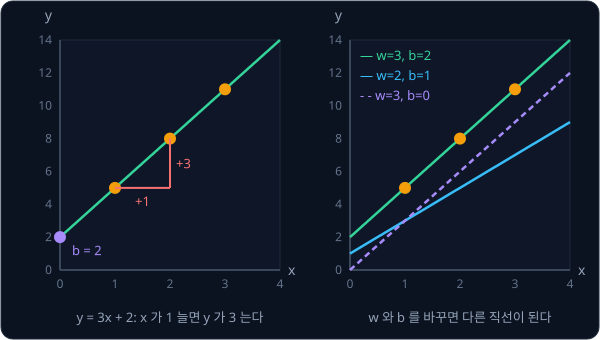

이 직선의 parameter 는 두 개뿐이고 사진을 보고 로봇 팔을 움직이는 policy 의 parameter 는 수천만 ~ 수십억 개지만, 데이터를 보고
parameter 를 고치는 방식은 같다.

## MSE loss

parameter 를 아무렇게나 $w = 2$, $b = 1$ 로 정하면 예측은 $2 \times 1 + 1 = 3$, $2 \times 2 + 1 = 5$, $2 \times 3 + 1 = 7$ 로 세 점 모두
정답보다 작다. 점 하나에서 예측이 정답과 얼마나 다른지는 예측에서 정답을 뺀 $\hat y - y$ 로 재고, 이 값을 **오차**(residual)라고 한다.
음수면 예측이 정답보다 작고 양수면 크다.

| $x$ | 정답 $y$ | 예측 $\hat y = 2x + 1$ | 오차 $\hat y - y$ | 오차의 제곱 |
| --- | --- | --- | --- | --- |
| 1 | 5 | 3 | $-2$ | 4 |
| 2 | 8 | 5 | $-3$ | 9 |
| 3 | 11 | 7 | $-4$ | 16 |

오차를 그냥 더하면 위로 빗나간 점의 오차와 아래로 빗나간 점의 오차가 서로 지워진다. 두 점 $(1, 4)$, $(2, 2)$ 에 수평선 $\hat y = 3$ 을
대면 오차가 $-1$ 과 $+1$ 이라 합이 0 인데, 실제로는 두 점 모두 1 씩 틀렸다. 그래서 오차를 제곱해 부호를 없앤 뒤 평균을 내는데, 평균을 쓰면
점이 3 개든 300 개든 점 하나당 얼마나 틀렸는지로 비교할 수 있다. 이렇게 오차를 제곱(squared)해 평균(mean)한 값을 **MSE**(mean squared
error)라고 한다.

$$
L = \frac{1}{N}\sum_{i=1}^{N} (\hat y_i - y_i)^2
$$

$N$ 은 점의 개수이고 $\hat y_i - y_i$ 는 $i$ 번째 점의 오차이며, $\sum_{i=1}^{N}$ 은 1 번째부터 $N$ 번째 점까지 모두 더하라는 기호다. 위 표에서는
제곱의 합이 $4 + 9 + 16 = 29$ 이고 점이 3 개라 $L = 29 \div 3 \approx 9.67$ 이다. 이렇게 모델이 얼마나 틀렸는지를 숫자 하나로 나타낸
값을 **loss** 라고 하고, 학습은 loss 를 줄이는 쪽으로 parameter 를 고치는 일이다.

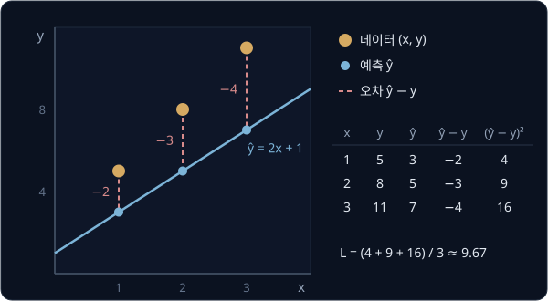

위 그림에서 정답 점(주황)과 같은 $x$ 의 예측(파랑)을 잇는 빨간 점선의 길이가 오차다. 직선을 바닥에 눕혀 $w = 0$, $b = 0$ 으로 하면
오차가 $-5, -8, -11$ 이고 제곱의 합이 $25 + 64 + 121 = 210$ 이라, loss 는 $210 \div 3 = 70$ 으로 커진다.

제곱하면 오차 1 은 그대로 1 이지만 오차 10 은 100 이 되어서, 크게 빗나간 점 하나가 직선을 자기 쪽으로 끌어당긴다. 1 ~ 4 V 에서 5, 8,
11, 14 cm 를 잰 깨끗한 데이터라면 loss 가 가장 작은 직선은 $y = 3x + 2$ 인데, 4 V 의 값이 센서 오류로 24 cm 로 찍히면 그 직선이
$y = 6x - 3$ 으로 바뀐다.

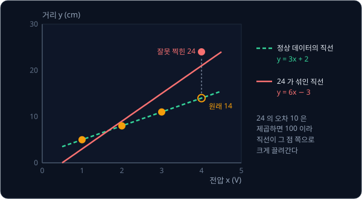

로봇 데이터에는 encoder 가 한 번 튄 값이나 사람이 조종하다 손이 미끄러진 순간처럼 크게 빗나간 점이 섞이기 쉽다. 오차의 크기를 제곱하지
않고 그대로 평균하는 L1 loss 는 이런 점에 덜 끌려간다. ACT 논문의 저자들은 관절 목표를 학습할 때 흔히 쓰는 L2 loss(MSE) 대신 L1 loss
를 썼는데, 그쪽이 action 을 더 정밀하게 학습했다고 보고했다.

**흔한 오해.** loss 를 "데이터가 얼마나 나쁜가" 로 읽기 쉽다. 같은 세 점이라도 $(w, b)$ 를 $(0, 0)$, $(2, 1)$, $(3, 2)$ 로 바꾸면 loss 가
70, 9.67, 0 으로 바뀐다. loss 는 지금 고른 parameter 가 이 데이터에 얼마나 안 맞는지를 잰다.

**확인 문제.** 데이터가 두 점 $(1, 3)$, $(2, 5)$ 이고 직선이 $\hat y = x + 1$ 일 때 MSE 는?

답 보기

| 점 | 예측 $x + 1$ | 오차 (예측 − 정답) | 오차의 제곱 |
| --- | --- | --- | --- |
| $(1, 3)$ | $1 + 1 = 2$ | $2 - 3 = -1$ | 1 |
| $(2, 5)$ | $2 + 1 = 3$ | $3 - 5 = -2$ | 4 |

제곱의 합은 $1 + 4 = 5$ 이고 점이 2 개라 MSE 는 $5 \div 2 = 2.5$ 다.

## parameter 에 따른 loss

데이터는 이미 재 놓아서 바뀌지 않으므로 loss 를 바꾸는 것은 $w$ 와 $b$ 뿐이다. 그래서 loss 는 parameter 를 넣으면 숫자 하나가 나오는
함수로 보고 $L(w, b)$ 로 적는다. 앞에서 구한 값은 $L(2, 1) \approx 9.67$ 과 $L(0, 0) = 70$ 이다.

이 함수의 모양을 보려고 $b = 2$ 로 고정하고 $w$ 만 바꿔 본다. $b = 2$ 이면 예측 $wx + 2$ 에서 정답 $3x + 2$ 를 빼므로 오차가 $(w - 3) \times x$ 가 된다.

| $w$ | 0 | 1 | 2 | 3 | 4 | 5 |
| --- | --- | --- | --- | --- | --- | --- |
| 오차 $(w - 3)x$ | $-3, -6, -9$ | $-2, -4, -6$ | $-1, -2, -3$ | $0, 0, 0$ | $1, 2, 3$ | $2, 4, 6$ |
| loss $L(w, 2)$ | $126 \div 3 = 42$ | $56 \div 3 \approx 18.67$ | $14 \div 3 \approx 4.67$ | 0 | 4.67 | 18.67 |

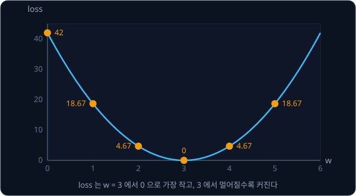

loss 곡선은 $w = 3$ 에서 0 으로 가장 낮은 U 자 모양이다. 직선 모델의 MSE 에는 parameter 가 제곱까지만 들어 있어서 loss 곡선이 늘 이렇게
아래로 볼록하다.

## MSE 의 gradient

parameter 가 수억 개면 표를 다 채워 바닥을 찾을 수 없지만, 지금 자리에서 parameter 를 어느 쪽으로 움직여야 loss 가 줄어드는지 알면 그쪽으로
조금씩 옮겨 갈 수 있다. [Derivatives & Gradients](../derivatives/README.md) 에서 본 것처럼 다른 값은 고정하고 하나만 조금 바꿨을 때의 변화율이
partial derivative 이고, parameter 마다 구한 partial derivative 를 묶은 것이 gradient 다.

$w = 2$, $b = 1$ 에서 $b$ 는 그대로 두고 $w$ 만 0.01 늘려 $w = 2.01$ 로 바꾸면 예측이 3.01, 5.02, 7.03 이 되고 loss 는 $9.6667$ 에서 $9.5338$ 로
$0.1329$ 줄어든다.

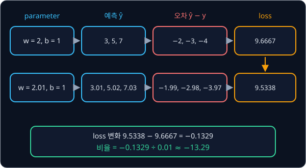

loss 의 변화를 $w$ 를 늘린 양으로 나누면 $-0.1329 \div 0.01 \approx -13.29$ 이고, 늘리는 양을 0.001, 0.0001 로 줄이면 이 비율은 $-13.33$ 에
다가간다. 그래서 이 자리의 $\frac{\partial L}{\partial w}$ 는 약 $-13.33$ 인데, $w$ 를 조금 늘리면 loss 가 늘린 양의 약 13.33 배만큼
줄어든다는 뜻이다.

gradient 는 parameter 마다 값이 하나씩 있고, 각 값은 부호로 읽는다.

| gradient 값 | 뜻 | loss 를 줄이려면 |
| --- | --- | --- |
| $+$ (양수) | 그 parameter 를 늘리면 loss 가 커진다 | 그 parameter 를 줄인다 |
| $-$ (음수) | 그 parameter 를 늘리면 loss 가 줄어든다 | 그 parameter 를 늘린다 |
| $0$ | 조금 바꿔도 loss 가 거의 변하지 않는다 | 그대로 둔다 |

값의 크기는 그 parameter 를 조금 바꿨을 때 loss 가 얼마나 크게 변하는지를 나타내는데, 앞의 U 자 곡선에서는 곡선 위 한 점의 기울기가 이
값이다.

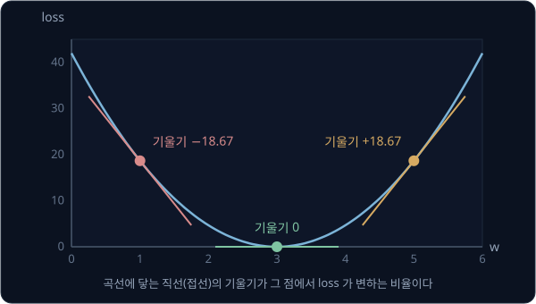

$w = 1$ 에서는 기울기가 $-18.67$ 이라 $w$ 를 늘려야 loss 가 줄고, $w = 5$ 에서는 $+18.67$ 이라 줄여야 한다. 바닥인 $w = 3$ 에서는 0 이고,
바닥에서 멀수록 기울기의 크기가 크다.

**흔한 오해.** "기울기" 라는 말이 두 곳에 나온다. $w$ 는 데이터 위에 그은 직선의 기울기이고, gradient 는 loss 곡선의 기울기다. $w = 1$ 일
때 직선의 기울기는 1 이지만 loss 곡선의 기울기는 $-18.67$ 이다.

gradient 는 매번 조금씩 바꿔 보지 않아도 공식으로 바로 구할 수 있다.

$$
\frac{\partial L}{\partial w} = \frac{2}{N}\sum_{i=1}^{N} (\hat y_i - y_i) \times x_i, \qquad
\frac{\partial L}{\partial b} = \frac{2}{N}\sum_{i=1}^{N} (\hat y_i - y_i)
$$

왼쪽 식은 점마다 오차에 그 점의 $x_i$ 를 곱해 모두 더한 뒤 $\frac{2}{N}$ 을 곱하고, 오른쪽 식은 오차를 그냥 더한다. $w$ 를 조금 늘리면
예측이 $x_i$ 배만큼 변하지만 $b$ 를 늘리면 모든 점에서 같은 양만큼 변하기 때문이다. $w = 2$, $b = 1$ 에서는 MSE 표에서 구한 오차
$-2, -3, -4$ 를 넣는다.

| $x$ | 오차 $e$ | $e \times x$ |
| --- | --- | --- |
| 1 | $-2$ | $-2$ |
| 2 | $-3$ | $-6$ |
| 3 | $-4$ | $-12$ |
| 합 | $-9$ | $-20$ |

$\frac{\partial L}{\partial w} = \frac{2}{3} \times (-20) \approx -13.33$ 으로 조금 바꿔 보며 잰 값과 같고, $\frac{\partial L}{\partial b} = \frac{2}{3}
\times (-9) = -6$ 이다. 둘 다 음수라서 $w$ 와 $b$ 를 모두 키워야 하고, 직선이 세 점보다 아래에 있으니 그래프로 봐도 맞는 방향이다.

<b>심화: gradient 공식의 유도와 검산</b>

loss 는 점마다 구한 오차 제곱의 평균이라, 점 하나의 오차 제곱을 $w$ 로 미분하는 법만 알면 된다. 점 $(2, 8)$ 에서 $b = 1$ 로 두면 오차는
$e = 2w + 1 - 8$ 이다. $w$ 는 $e$ 를 바꾸고, $e$ 가 다시 $e^2$ 을 바꾸므로 두 칸으로 나눠 $w$ 를 2 에서 2.01 로 바꿔 본다.

| 값 | 변화 전 | 변화 후 | 변화량 |
| --- | --- | --- | --- |
| $w$ | 2 | 2.01 | $+0.01$ |
| $e$ | $2 \times 2 + 1 - 8 = -3$ | $2.01 \times 2 + 1 - 8 = -2.98$ | $+0.02$ |
| $e^2$ | $(-3)^2 = 9$ | $(-2.98)^2 = 8.8804$ | $-0.1196$ |

$w \to e$ 의 비율은 $0.02 \div 0.01 = 2$ 이고 $e \to e^2$ 의 비율은 $-0.1196 \div 0.02 = -5.98$ 이라, 둘을 곱한 $-11.96$ 이 전체 비율
$-0.1196 \div 0.01$ 과 같다. 이렇게 단계별 변화율을 곱해 전체 변화율을 얻는 규칙이 chain rule 이다.

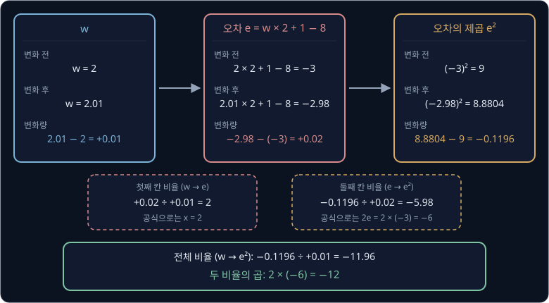

공식으로 쓰면 첫 칸의 비율은 $w$ 에 곱해진 수 $x_i$ 이고 둘째 칸의 비율은 $e^2$ 의 derivative $2e$ 다. 이 점에서는 $2 \times (-6) = -12$ 로 숫자로 잰
$-11.96$ 에 가깝고, 바꾸는 양을 줄일수록 $-12$ 에 다가간다. 기호로 쓰면 아래와 같고, 이것을 $N$ 개 점에서 평균한 것이 본문의 공식이다.
$b$ 로 미분하면 첫 칸의 비율이 $x_i$ 대신 1 이다.

$$
\frac{\partial}{\partial w}(w x_i + b - y_i)^2 = 2\,(w x_i + b - y_i) \times x_i
$$

손으로 정리한 공식은 2 를 빠뜨리거나 $x_i$ 를 잘못 곱하기 쉬워서, 조금 바꿔 본 값과 비교해 검산한다. 한쪽으로만 늘리면 $h = 0.01$ 에서
$-13.29$ 처럼 공식과 차이가 나므로, 양쪽으로 $h$ 만큼 옮긴 두 loss 의 차이를 $2h$ 로 나누는 central difference 를 쓴다.
$L(2.01, 1) = 9.5338$, $L(1.99, 1) = 9.800467$ 이라 $(9.5338 - 9.800467) \div 0.02 \approx -13.3333$ 으로 공식과 같다.

$h$ 는 너무 작아도 안 되어서 보통 0.00001 근처를 쓴다. 컴퓨터는 숫자를 앞에서부터 16 자리 정도만 기억해서, $h$ 를 $10^{-15}$ 처럼 너무 작게 잡으면 두 loss 가 그 자릿수
안에서 거의 같아져 차이에 믿을 만한 자리가 남지 않는다. $w = b = 0$ 에서 직접 계산하면 $h = 0.00001$ 일 때 $-36.00000000005821$ 로 공식의
$-36$ 과 소수점 아래 10 자리까지 같고, $h = 10^{-15}$ 일 때는 $-42.6$ 이 나온다.

**확인 문제.** 데이터가 두 점 $(1, 3)$, $(2, 5)$ 이고 $w = 0$, $b = 0$ 일 때 $\frac{\partial L}{\partial w}$ 와 $\frac{\partial L}{\partial b}$ 는?

답 보기

예측이 모두 0 이라 오차는 정답에 마이너스를 붙인 값이다.

| 점 | 오차 $e$ | $e \times x$ |
| --- | --- | --- |
| $(1, 3)$ | $0 - 3 = -3$ | $-3 \times 1 = -3$ |
| $(2, 5)$ | $0 - 5 = -5$ | $-5 \times 2 = -10$ |
| 합 | $-8$ | $-13$ |

점이 2 개라 $\frac{2}{N} = 1$ 이므로 $\frac{\partial L}{\partial w} = 1 \times (-13) = -13$, $\frac{\partial L}{\partial b} = 1 \times (-8) = -8$ 이다.

## gradient descent

gradient 의 부호를 보면 loss 가 커지는 쪽을 알 수 있으므로, parameter 를 gradient 의 반대쪽으로 조금 옮기면 loss 가 줄어든다. 이 일을 되풀이하는 학습
방법이 **gradient descent** 다.

$$
w \leftarrow w - \eta \times \frac{\partial L}{\partial w}, \qquad b \leftarrow b - \eta \times \frac{\partial L}{\partial b}
$$

화살표 $\leftarrow$ 는 오른쪽을 계산해 왼쪽에 새로 넣는다는 뜻이다. $\eta$(eta)는 gradient 에 곱해 한 번에 움직일 크기를 정하는 양수로,
**learning rate** 라고 한다. 지금 $w = 1$ 이고 gradient 가 $+5$ 라면 $\eta = 0.1$ 일 때 $1 - 0.1 \times 5 = 0.5$ 로 $w$ 가 줄고, gradient 가
$-5$ 라면 $1 - 0.1 \times (-5) = 1.5$ 로 $w$ 가 는다. 이렇게 gradient 의 반대 방향으로 움직이는 것은 식의 빼기 부호 때문이다. parameter
를 한 번 고치는 것을 update 라고 하고, 예측 → loss → gradient → update 를 한 번 거치는 것을 step 이라고 한다. learning rate 처럼 사람이
학습 전에 정해 두는 값은 parameter 와 구별해 hyperparameter 라고 부른다.

Cauchy 는 1847 년 천체 궤도의 모르는 값 여섯 개를 구하려고, 식들의 제곱합을 gradient 의 반대 방향으로 조금씩 줄여 가는 이 방법을 제안했다.

세 점 $(1, 5)$, $(2, 8)$, $(3, 11)$ 에 직선을 맞추되 $w = b = 0$ 에서 시작해 $\eta = 0.01$ 로 학습해 보자. step 0 에서는 오차가 $-5, -8, -11$ 이라
gradient 가 $\frac{2}{3} \times (-5 - 16 - 33) = -36$ 과 $\frac{2}{3} \times (-5 - 8 - 11) = -16$ 이고, 첫 update 는 $w = 0 - 0.01 \times (-36) = 0.36$, $b = 0 - 0.01 \times (-16) = 0.16$ 이다. 새 parameter 로 예측부터 다시 계산하는 일을 되풀이하면
아래 표와 같다.

| step | $w$ | $b$ | loss | $\partial L / \partial w$ | $\partial L / \partial b$ |
| --- | --- | --- | --- | --- | --- |
| 0 | 0 | 0 | 70 | $-36$ | $-16$ |
| 1 | 0.36 | 0.16 | 55.34 | $-32.00$ | $-14.24$ |
| 2 | 0.68 | 0.3024 | 43.75 | $-28.44$ | $-12.68$ |
| 5 | 1.4420 | 0.6425 | 21.63 | $-19.97$ | $-8.95$ |
| 20 | 2.9294 | 1.3206 | 0.68 | $-3.38$ | $-1.64$ |
| 100 | 3.1971 | 1.5519 | 0.029 | $+0.05$ | $-0.11$ |
| 1000 | 3.0226 | 1.9486 | 0.0004 | $+0.005$ | $-0.012$ |
| 3000 | 3.0002 | 1.9996 | 0.0000 | $0.0000$ | $-0.0001$ |

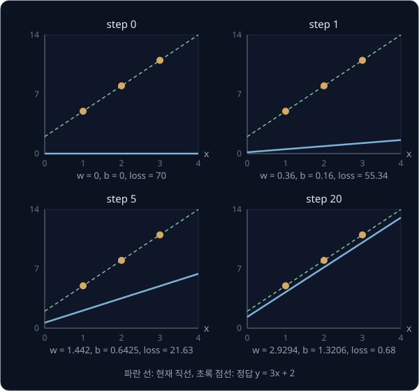

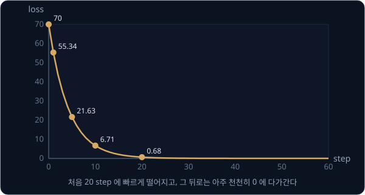

loss 는 처음 20 step 에 70 에서 0.68 까지 빠르게 떨어진 뒤 완만해지는데, 바닥에 가까울수록 gradient 가 작아져 같은 learning rate 를 곱해도
움직이는 양이 줄기 때문이다. 이렇게 반복할수록 parameter 가 한 값에 다가가 거의 움직이지 않게 되는 것을 **수렴**(convergence)이라고 한다.

표를 보면 $w$ 와 $b$ 는 움직이는 모습이 다르다. $w$ 는 20 step 만에 2.93 까지 오고 100 step 에는 3 을 넘어 3.2 가 되지만, $b$ 는 그때도
1.55 다. $\frac{\partial L}{\partial w}$ 에는 오차마다 $x_i$(1, 2, 3)가 곱해져 $w$ 쪽 gradient 가 더 크기 때문이다. $b$ 가 아직 작은 동안에는
기울기를 더 세워야 직선이 점들에 맞아서 $w$ 가 3 을 넘었다가, $b$ 가 천천히 2 로 올라가는 동안 $w$ 도 3 으로 내려온다. 처음 20 step 뒤로
loss 가 오래 완만했던 것도 $b$ 가 느리게 움직였기 때문이다.

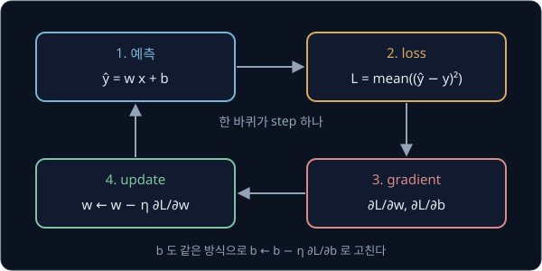

위 그림의 네 단계는 모델이 neural network 로 바뀌어도 그대로다. 데이터가 수백만 개면 step 마다 일부만 뽑은 작은 묶음(mini-batch)의 평균
gradient 로 update 하는데, 이 방법과 데이터 전체를 한 번 다 보는 단위인 epoch 는 [PyTorch Training Loop](../pytorch-mlp/README.md) 에서 다룬다.

**확인 문제.** 두 점 $(1, 3)$, $(2, 5)$ 에서 $w = b = 0$ 이면 gradient 가 $(-13, -8)$ 이다. $\eta = 0.1$ 로 한 step 뒤의 $w$ 와 $b$ 는?

답 보기

| parameter | 고치기 전 | $-\eta \times$ gradient | 고친 뒤 |
| --- | --- | --- | --- |
| $w$ | 0 | $-0.1 \times (-13) = +1.3$ | 1.3 |
| $b$ | 0 | $-0.1 \times (-8) = +0.8$ | 0.8 |

gradient 가 둘 다 음수라 두 parameter 가 모두 커졌다.

## learning rate 의 크기

learning rate 의 효과는 parameter 가 하나인 loss $L(w) = w^2$ 에서 잘 보인다. 바닥은 $w = 0$ 이고 gradient 는 $2w$ 라서, update 는
$w \leftarrow w - \eta \times 2w = (1 - 2\eta)\,w$ 이고 update 할 때마다 $w$ 에 같은 수 $1 - 2\eta$ 가 곱해진다. $w = 1$ 에서 시작해 $\eta$ 를
세 가지로 바꿔 보면 아래와 같다.

| $\eta$ | 곱해지는 수 $1 - 2\eta$ | step 0 ~ 4 의 $w$ | 움직임 |
| --- | --- | --- | --- |
| 0.1 | 0.8 | $1, 0.8, 0.64, 0.512, 0.41$ | 한쪽에서 0 으로 다가간다 |
| 0.75 | $-0.5$ | $1, -0.5, 0.25, -0.125, 0.0625$ | 0 을 넘나들며 다가간다 |
| 1.5 | $-2$ | $1, -2, 4, -8, 16$ | 넘나들 때마다 더 멀리 튄다 |

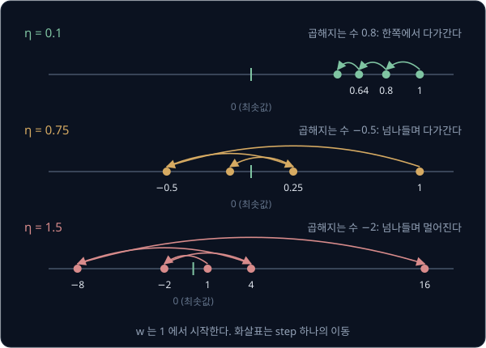

곱해지는 수에서 부호를 뗀 크기가 1 보다 작으면 $w$ 가 0 으로 다가가고, 1 보다 크면 $w$ 의 크기가 끝없이 커진다. $\eta = 1.5$ 에서는 멀어진
자리일수록 경사가 가팔라 gradient 가 커지고, 커진 gradient 에 같은 learning rate 를 곱하니 다음 update 에서 더 멀리 움직인다. 반복할수록 값이 끝없이 커지는 것을
**발산**(divergence)이라고 한다. $L = w^2$ 에서는 $\eta$ 가 1 을 넘어 곱해지는 수가 $-1$ 보다 작아질 때 발산한다.

loss 가 더 가파른 $L(w) = a w^2$ ($a$ 는 양수)이면 gradient 가 $2aw$ 라서 곱해지는 수는 $1 - 2a\eta$ 다. 이 수가 $-1$ 보다 작아지는 $\eta > 1 / a$ 에서
발산하므로, $a = 2$ 이면 상한이 0.5 이고 $a = 10$ 이면 0.1 이다. loss 곡선이 가파를수록 쓸 수 있는 learning rate 의 상한이 낮아진다.

세 점의 MSE 에서도 같은 일이 일어난다. 이 데이터에서 $\eta = 0.1$ 이면 첫 step 에 $w = 0 - 0.1 \times (-36) = 3.6$ 으로 정답 3 을 조금
넘었다가 돌아오며 수렴하고, 0.17 이면 크게 넘나들면서도 수렴한다. 약 0.18 을 넘으면 발산해서, $\eta = 0.2$ 에서는 loss 가 70, 103.92, 154.29,
229.10 으로 step 마다 커진다.

<b>심화: η = 0.2 로 발산하는 step</b>

| step | $w$ | $b$ | loss | $\partial L / \partial w$ |
| --- | --- | --- | --- | --- |
| 0 | 0 | 0 | 70 | $-36$ |
| 1 | 7.2 | 3.2 | 103.92 | $+44$ |
| 2 | $-1.6$ | $-0.64$ | 154.29 | $-53.49$ |
| 3 | 9.10 | 4.10 | 229.10 | $+65.30$ |
| 4 | $-3.96$ | $-1.62$ | 340.18 | $-79.47$ |

첫 step 에서 $w = 0 - 0.2 \times (-36) = 7.2$, $b = 0 - 0.2 \times (-16) = 3.2$ 가 되면 예측이 10.4, 17.6, 24.8 로 정답보다 5.4, 9.6, 13.8 크고
loss 는 $(29.16 + 92.16 + 190.44) \div 3 = 103.92$ 로 오히려 커진다. 그 뒤 $w$ 는 정답 3 의 양쪽을 오가며 점점 멀리 튀고 gradient 도 부호를 바꾸며
커진다.

$\eta = 0.2$ 로 계속 계산하면 1782 step 째에 loss 가 컴퓨터가 담을 수 있는 가장 큰 수(309 자리쯤 되는 수)를 넘어 inf(infinity)가 되고, 그 뒤 inf 끼리
빼는 계산이 나오면 nan(not a number)이 된다. 학습 기록에서 loss 가 step 마다 커지거나 inf, nan 이 보이면 learning rate 부터 줄여 본다.

**흔한 오해.** "learning rate 가 크면 한 번에 많이 움직이니 빨리 배운다." $L = w^2$ 에서 $\eta = 0.75$ 이면 세 step 뒤 $w$ 의 크기가 0.125 로
$\eta = 0.1$ 일 때의 0.512 보다 0 에 가깝지만, $\eta = 1.5$ 이면 $w$ 가 아예 멀어진다. learning rate 를 키우면 어느 선까지는 빨라지다가 그 선을 넘으면 발산한다.

**확인 문제.** $L(w) = 2w^2$ 이고 $\eta = 0.6$ 이면 update 마다 곱해지는 수는 얼마이고, $w$ 는 어떻게 움직일까?

답 보기

$a = 2$ 이므로 곱해지는 수는 $1 - 2 \times 2 \times 0.6 = 1 - 2.4 = -1.4$ 다. 크기가 1 보다 크고 음수라 부호를 바꾸며 멀어지는데, $w = 1$ 에서
시작하면 $1 \to -1.4 \to 1.96$ 이다. 상한 $1 / a = 0.5$ 보다 $\eta$ 가 크기 때문이다.

## 입력의 크기와 standardization

learning rate 의 상한은 데이터에 따라서도 달라진다. $b = 2$ 로 고정하고 직선의 MSE 를 $w$ 하나만의 함수로 보면 $a (w - 3)^2$ 꼴인데, 이
$a$ 가 입력의 제곱 $x_i^2$ 의 평균이라서 입력이 커질수록 loss 곡선이 가파르고 상한이 낮다. 세 점의 입력을 10 배인 10, 20, 30 으로 바꾸면
$x_i^2$ 의 평균이 100 배가 되어 상한이 약 0.18 에서 0.002 로 떨어진다. 그래서 원래 데이터에서 잘 수렴하던 $\eta = 0.01$ 로도 첫 step 에 loss 가
70 에서 약 4840 으로 커지며 발산한다.

<b>심화: 입력의 크기가 상한을 정하는 식</b>

$b = 2$ 로 고정하면 오차가 $(w - 3) \times x_i$ 이므로 모든 점에 공통인 $(w - 3)^2$ 을 앞으로 묶어 낼 수 있다.

$$
L(w) = \frac{1}{N}\sum_{i=1}^{N} \big((w - 3)\,x_i\big)^2 = \frac{x_1^2 + x_2^2 + \cdots + x_N^2}{N} \times (w - 3)^2
$$

세 점에서는 $a = (1 + 4 + 9) \div 3 = 14 / 3$ 이라 상한이 $1 / a = 3 / 14 \approx 0.21$ 이다. $w$ 와 $b$ 를 함께 움직이면 두 parameter 가 서로 영향을
주어 상한이 약 0.18 로 조금 낮아지는데, 이 값은 loss 가 가장 가파르게 휘는 방향의 $a$ 로 정해진다. 입력이 10 배면 $a$ 가
100 배라서 상한도 대략 100 분의 1 이 된다.

로봇 데이터에서는 이 차이가 훨씬 커진다. Dynamixel XM430-W350 의 encoder 는 한 바퀴를 4096 눈금으로 재므로, 관절 각도를 radian 대신 encoder
눈금 수로 넣으면 입력이 $4096 / (2\pi) \approx 652$ 배가 되고 $x_i^2$ 의 평균은 약 42 만 배가 된다. 같은 모델이라도 단위 하나 때문에 learning
rate 를 42 만 분의 1 로 줄여야 한다. 그래서 학습 전에 입력에서 평균을 빼고 흩어진 정도(표준편차)로 나눠 평균 0, 표준편차 1 로 맞추는데,
이것을 **standardization** 이라고 한다. LeRobot 의 ACT 도 기본 설정에서 카메라 영상, 관절 상태, action 을 모두 dataset 의 평균과 표준편차로 이렇게
바꾼 뒤 학습한다.

loss 를 평균이 아니라 합으로 정의해도 같은 문제가 생긴다. 오차 제곱의 합(sum)은 평균에 점의 개수 $N$ 을 곱한 값이라 바닥의 위치는 그대로지만
gradient 도 $N$ 배가 되어서, sum 에 learning rate $\eta$ 를 쓰는 것은 mean 에 $N\eta$ 를 쓰는 것과 같다. mean 을 쓰면 데이터 수나 mini-batch
크기를 바꿔도 같은 learning rate 를 쓸 수 있어서, PyTorch 의 `MSELoss` 도 기본값이 평균(`reduction='mean'`)이다.

<b>심화: mean 과 sum 의 step 비교</b>

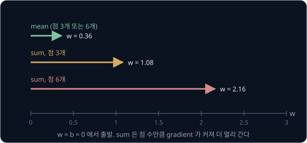

위 그림은 세 점에서 $w = b = 0$ 일 때 $\eta = 0.01$ 로 한 step 움직인 거리다. mean 의 gradient 는 $\frac{2}{3} \times (-54) = -36$ 이고 sum 의 gradient 는
$2 \times (-54) = -108$ 이라 sum 이 3 배 멀리 간다. 같은 세 점을 두 번씩 넣어 6 개로 만들면 mean 의 gradient 는 그대로인데 sum 의 gradient 는 두
배가 된다. $\eta = 0.1$ 을 쓰면 mean 은 $w$ 가 3.6, 3.2, 3.24 로 수렴하지만, sum 은 mean 의 $\eta = 0.3$ 과 같아서 상한 0.18 을 넘어 10.8,
$-14.4$, 44.2 로 발산한다.

**확인 문제.** 입력을 1, 2, 3 에서 2, 4, 6 으로 바꾸면 $x_i^2$ 의 평균은 몇 배가 되고, learning rate 상한은 대략 어떻게 될까?

답 보기

$x_i^2$ 은 4, 16, 36 이고 평균은 $56 / 3$ 이라 원래 $14 / 3$ 의 4 배다. loss 곡선이 4 배 가팔라지므로($a$ 가 4 배) 상한 $1 / a$ 는 대략 4 분의 1 로
낮아진다.

## normal equation

loss 의 바닥에서는 gradient 가 0 이므로, gradient 공식을 0 으로 놓고 $w$, $b$ 를 바로 풀 수도 있다. MSE 의 gradient 는 $w$, $b$ 의 일차식이라
0 으로 놓으면 연립방정식 두 개가 나오는데, 이 식들을 **normal equation** 이라고 한다. 세 점 $(1, 5)$, $(2, 8)$, $(3, 11)$ 에서는 두 식이
$\frac{14}{3} w + 2b = 18$ 과 $2w + b = 8$ 이 되고, 풀면 gradient descent 가 수천 step 에 걸쳐 다가간 $(3, 2)$ 가 한 번에 나온다.

오차 제곱의 합을 가장 작게 하는 parameter 를 고르는 이 방법을 least squares(최소제곱법)라고 한다. Legendre 는 1805 년 혜성 궤도 계산법을 다룬 책의
부록에서, 관측으로 얻은 식이 모르는 값보다 많아 모든 오차를 0 으로 만들 수 없을 때 이 방법을 쓰자고 처음 제안했다.

[Vectors & Matrices](../vectors-matrices/README.md) 에서 본 행렬로도 쓸 수 있다. 점마다 $x_i$ 와 1 을 한 행에 적은 행렬 $A$ 와 parameter vector
$\boldsymbol\theta = (w, b)$ 로 예측을 $A\boldsymbol\theta$ 로 쓰면 normal equation 은 아래와 같다.

$$
A^\top A\,\boldsymbol\theta = A^\top \mathbf{y}
$$

식이 모르는 값보다 많아 $A\boldsymbol\theta = \mathbf{y}$ 를 정확히 맞출 수 없을 때, 양변에 $A^\top$ 을 곱해 만든 이 식의 답이 오차 제곱의 합을 가장 작게
한다. 서론의 흔들린 네 점 $(1, 5.5)$, $(2, 7.5)$, $(3, 10.5)$, $(4, 14.5)$ 는 직선 $3x + 2$ 의 값 5, 8, 11, 14 에 noise $\pm 0.5$ 를 섞어
만든 예로, 풀면 $w = 3$, $b = 2$ 가 나온다. 이 직선에서도 오차가 $-0.5, +0.5, +0.5, -0.5$ 로 남아 가장 작은 loss 는 0.25 다. 이 예에서는 noise 가
위아래로 고르게 섞여 답이 원래 직선과 같았지만, 보통은 답이 원래 직선에서 조금 벗어나고 점이 많을수록 가까워진다.

식을 바로 풀 수 있는데도 학습에 gradient descent 를 쓰는 이유는 두 가지다.

- normal equation 은 gradient 가 parameter 의 일차식일 때만 나온다. neural network 는 parameter 끼리 곱해지는 단계를 여러 번 거쳐서 gradient 를
  0 으로 놓은 식을 풀 방법이 없다
- parameter 가 $d$ 개면 $A^\top A$ 는 $d \times d$ 행렬이고 이 식을 푸는 계산량은 대략 $d^3$ 에 비례한다. $d = 100{,}000$ 이면 행렬의 숫자만 100 억 개인데,
  gradient descent 는 step 마다 숫자 $d$ 개짜리 gradient 만 있으면 된다

직선처럼 작은 문제에서는 normal equation 의 답을 gradient descent 의 검산에도 쓴다. 같은 데이터에서 두 답이 여러 자리까지 같으면 gradient
공식, update 식, learning rate 가 모두 제대로 정해졌다고 볼 수 있다.

<b>심화: normal equation 의 유도와 풀이</b>

$\frac{\partial L}{\partial w} = \frac{2}{N}\sum (w x_i + b - y_i)\,x_i = 0$ 에서 양변에 $\frac{N}{2}$ 을 곱하고 괄호를 풀어 모두 더하면
$w \sum x_i^2 + b \sum x_i - \sum x_i y_i = 0$ 이다. $N$ 으로 나누면 각 합이 평균이 되어 $w\,\overline{x^2} + b\,\bar x = \overline{xy}$ 다. 기호
위의 막대는 평균이라는 뜻으로 $\bar x$ 는 $x_i$ 의 평균, $\overline{x^2}$ 은 $x_i^2$ 의 평균, $\overline{xy}$ 는 $x_i y_i$ 의 평균이다.
$\frac{\partial L}{\partial b} = 0$ 도 같은 순서로 정리하면 $b$ 가 점마다 한 번씩 $N$ 번 더해져 $w\,\bar x + b = \bar y$ 가 된다.

| 평균 | 세 점 | 흔들린 네 점 |
| --- | --- | --- |
| $\bar x$ | $(1 + 2 + 3) \div 3 = 2$ | $(1 + 2 + 3 + 4) \div 4 = 2.5$ |
| $\overline{x^2}$ | $(1 + 4 + 9) \div 3 = 14/3$ | $(1 + 4 + 9 + 16) \div 4 = 7.5$ |
| $\bar y$ | $(5 + 8 + 11) \div 3 = 8$ | $(5.5 + 7.5 + 10.5 + 14.5) \div 4 = 9.5$ |
| $\overline{xy}$ | $(5 + 16 + 33) \div 3 = 18$ | $(5.5 + 15 + 31.5 + 58) \div 4 = 27.5$ |

세 점의 식 $\frac{14}{3} w + 2b = 18$, $2w + b = 8$ 은 다음 순서로 푼다.

1. 둘째 식에서 $b = 8 - 2w$
2. 첫째 식에 넣으면 $\frac{14}{3} w + 16 - 4w = 18$ 이고, 정리하면 $\frac{2}{3} w = 2$ 라서 $w = 3$
3. $b = 8 - 2 \times 3 = 2$

흔들린 네 점의 식은 $7.5w + 2.5b = 27.5$, $2.5w + b = 9.5$ 다. 둘째 식에서 $b = 9.5 - 2.5w$ 를 첫째 식에 넣으면 $7.5w + 23.75 - 6.25w = 27.5$ 이고,
정리하면 $1.25w = 3.75$ 라서 $w = 3$, $b = 9.5 - 7.5 = 2$ 다.

행렬로는 세 점에서 아래와 같다.

$$
A = \begin{bmatrix} 1 & 1 \\ 2 & 1 \\ 3 & 1 \end{bmatrix}, \qquad
A^\top A = \begin{bmatrix} 14 & 6 \\ 6 & 3 \end{bmatrix}, \qquad
A^\top \mathbf{y} = \begin{bmatrix} 54 \\ 24 \end{bmatrix}
$$

$A^\top A\,\boldsymbol\theta = A^\top \mathbf{y}$ 의 두 줄 $14w + 6b = 54$, $6w + 3b = 24$ 는 위의 평균 식에 3 을 곱한 것과 같다. gradient 도 같은
행렬로 $\nabla L = \frac{2}{N} A^\top (A\boldsymbol\theta - \mathbf{y})$ 라서, $w = b = 0$ 이면 $\frac{2}{3} \times (-54, -24) = (-36, -16)$ 이다.
normal equation 은 이 gradient 를 0 으로 놓은 식이다.

**확인 문제.** 두 점 $(1, 3)$, $(2, 5)$ 에서 normal equation 을 풀어 $w$ 와 $b$ 를 구해 보자.

답 보기

평균은 $\bar x = 1.5$, $\overline{x^2} = (1 + 4) \div 2 = 2.5$, $\bar y = 4$, $\overline{xy} = (3 + 10) \div 2 = 6.5$ 라서 식은 $2.5w + 1.5b = 6.5$ 와
$1.5w + b = 4$ 다.

1. 둘째 식에서 $b = 4 - 1.5w$
2. 첫째 식에 넣으면 $2.5w + 6 - 2.25w = 6.5$ 이고, 정리하면 $0.25w = 0.5$ 라서 $w = 2$
3. $b = 4 - 1.5 \times 2 = 1$

두 점은 직선 $y = 2x + 1$ 위에 있다.

## train loss 와 test loss

loss 가 작다고 좋은 모델인 것은 아니다. 흔들린 네 점에 직선 $3x + 2$ 를 맞추면 loss 가 0.25 인데, 곡선 $\hat y = 0.5x^2 + 0.5x + 4.5$ 는 네 점을
모두 정확히 지나서 loss 가 0 이다($x = 2$ 이면 $2 + 1 + 4.5 = 7.5$). 그런데 5 V 에서 새로 잰 거리가 17.5 cm 였다고 하자(이 예에서 정한 값이다).

| 모델 | 네 점의 loss | 5 V 의 예측 | 5 V 의 오차 | 5 V 의 오차 제곱 |
| --- | --- | --- | --- | --- |
| 직선 $3x + 2$ | 0.25 | $15 + 2 = 17$ | $-0.5$ | 0.25 |
| 곡선 $0.5x^2 + 0.5x + 4.5$ | 0 | $12.5 + 2.5 + 4.5 = 19.5$ | $+2.0$ | 4 |

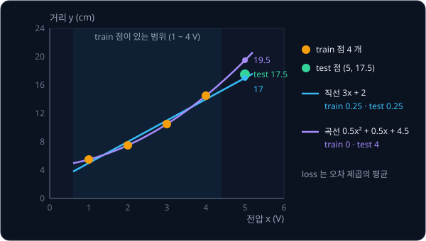

곡선은 데이터에 섞인 noise 까지 따라가도록 휘었는데, 같은 noise 가 새 측정에서 다시 나오지는 않으므로 그 휨이 오히려 오차가 된다. 학습에 쓴 데이터를
**train set** 이라고 하고, 학습에 쓰지 않고 성능을 재는 데만 쓰는 데이터를 **test set** 이라고 한다. train set 에는 아주 잘 맞지만 처음 보는
데이터에서 성능이 떨어지는 현상은 **overfitting** 이라고 하는데, 모델이 규칙을 배우지 못하고 학습 데이터를 외웠을 때 생긴다.

로봇에서는 이 차이가 데이터를 잰 범위 밖에서 드러나는데, 1 ~ 4 V 에서 맞춘 곡선은 그 안에서는 직선과 비슷해도 5 V 에서는 2 cm 어긋난다.
그래서 모델의 성능은 학습에 쓰지 않은 데이터, 그중에서도 로봇이 실제로 쓸 범위의 데이터로 잰다. 데이터를
train·validation·test 세 묶음으로 나누는 법과 학습이 길어지며 overfitting 이 생기는 모습은 [PyTorch Training Loop](../pytorch-mlp/README.md) 에서
다룬다.

**흔한 오해.** "train loss 가 0 이면 완벽한 모델이다." 휘어질 수 있는 모델은 noise 까지 따라가 train loss 를 0 으로 만들 수 있는데, 위 곡선도
train loss 는 0 이지만 5 V 에서의 오차 제곱이 직선의 16 배다.

**확인 문제.** 어떤 모델의 train loss 가 0.01, test loss 가 3.2 이고, 다른 모델은 train loss 0.3, test loss 0.35 다. 로봇에 올릴 모델은 어느 쪽이고,
첫째 모델에서 일어난 일은 무엇일까?

답 보기

처음 보는 데이터에서 덜 틀리는 둘째 모델을 쓴다. 첫째 모델은 train loss 가 test loss 보다 수백 배 작아서 학습 데이터의 noise 까지 외운
overfitting 으로 보이고, 둘째 모델은 두 loss 가 비슷해서 학습한 규칙이 새 데이터에도 통한다.

## 로봇에서의 linear regression

linear regression 은 센서와 motor 의 숫자를 실제 단위로 바꾸는 calibration 에 자주 쓰이고, 학습한 policy 의 마지막 층에도 들어 있다.

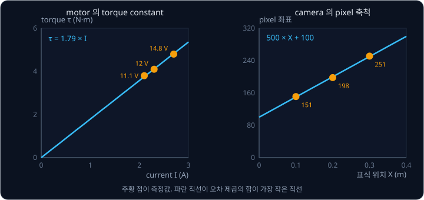

[Vectors & Matrices](../vectors-matrices/README.md) 의 표식 예를 이어서 camera 의 pixel 축척을 구해 보자. 그 강의에서는 표식 두 개로 식 두 개를
세워 pixel 좌표 $= sX + c$ 의 $s$ 와 $c$ 를 정확히 풀었다. 표식을 $X = 0.1, 0.2, 0.3$ m 세 곳에 두고 pixel 좌표를 151, 198, 251 로 읽었다면(이
예에서 정한 값이다) 모르는 값은 둘인데 식이 셋이라 세 식을 모두 맞추는 답이 없다. normal equation 으로 풀면 $s = 500$ pixel/m, $c = 100$ pixel
이고 세 표식의 오차는 $-1, +2, -1$ pixel 이다. 표식을 많이 둘수록 한 표식을 잘못 읽어도 답이 덜 흔들린다.

motor 의 torque constant 는 torque 를 전류로 나눈 비율이다. ROBOTIS 의 XM430-W350 사양에 따르면 motor 가 멈춘 채 낼 수 있는 가장 큰 torque
인 stall torque 는 11.1 V 에서 3.8 N·m(전류 2.1 A)이고, 12 V 에서 4.1 N·m(2.3 A)이며, 14.8 V 에서 4.8 N·m(2.7 A)이다. 전류 0 이면 torque 도 0 이라고 보고 parameter 하나짜리
모델 $\tau = k\,I$ 를 맞추면, loss $\frac{1}{N}\sum (k I_i - \tau_i)^2$ 의 gradient 를 0 으로 놓은 식에서 $k = \sum I_i \tau_i \div \sum I_i^2$ 이 나온다.

$$
k = \frac{2.1 \times 3.8 + 2.3 \times 4.1 + 2.7 \times 4.8}{2.1^2 + 2.3^2 + 2.7^2} = \frac{30.37}{16.99} \approx 1.79 \text{ N·m/A}
$$

이 servo 에서는 지금 흐르는 전류를 단위가 약 2.69 mA 인 정수로 읽을 수 있어서, 읽은 값이 300 이면 전류는 $300 \times 2.69 \approx 807$ mA
이고 torque 는 $1.79 \times 0.807 \approx 1.44$ N·m 로 어림할 수 있다. gripper 가 물체를 얼마나 세게 쥐었는지나 팔이 어딘가에 부딪혀 평소보다
큰 torque 를 내는지도 이렇게 전류로 짐작한다. 다만 사양의 세 점은 멈춘 상태의 값이라, 정확히 쓰려면 알려진 무게를 매달아 직접 잰 점들로 다시 맞춘다.

policy 의 마지막 층도 linear regression 과 같은 꼴이다. LeRobot 의 ACT 는 앞쪽 network 가 만든 숫자 512 개 $h_1, \ldots, h_{512}$ 를 받아 관절마다
$\hat a = w_1 h_1 + w_2 h_2 + \cdots + w_{512} h_{512} + b$ 를 계산하는 linear 층(action head)으로 관절 목표를 낸다. motor 가 6 개인 SO-101 팔이면 이런
식이 6 개다. 입력이 전압 하나에서 숫자 512 개로 늘었을 뿐 $wx + b$ 와 같은 계산이라, 학습도 시연 데이터의 관절 목표와의 오차로 loss 를 만들어
gradient 로 weight 를 고치는 방식이다. 다만 ACT 는 입력 $h$ 를 만드는 앞쪽 network 도 함께 학습하고, 앞에서 본 대로 loss 도 MSE 가 아니라 L1
loss 를 쓴다.

**확인 문제.** 어떤 servo 에서 (전류 1 A, torque 2 N·m), (전류 2 A, torque 3.6 N·m) 를 쟀다. 원점을 지나는 직선 $\tau = kI$ 로 맞춘 $k$ 는?

답 보기

$k = \sum I_i \tau_i \div \sum I_i^2$ 에 넣는다.

1. 분자: $1 \times 2 + 2 \times 3.6 = 2 + 7.2 = 9.2$
2. 분모: $1^2 + 2^2 = 5$
3. $k = 9.2 \div 5 = 1.84$ N·m/A

$k$ 는 두 점 각각의 비율 2 와 1.8 사이에 있고, 전류가 커서 오차 제곱에 더 크게 들어가는 둘째 점의 비율에 더 가깝다.

## 정리

- linear regression 은 직선 $\hat y = wx + b$ 의 parameter 를 MSE loss 가 가장 작아지게 고른다. 오차를 제곱해서 반대쪽 오차끼리 지워지지는
  않지만 큰 오차에 민감해, 4 V 의 값 하나가 24 cm 로 찍히면 직선이 $3x + 2$ 에서 $6x - 3$ 으로 끌려간다
- gradient 가 양수(+)면 parameter 를 늘릴 때 loss 가 커지고, 음수(−)면 줄어들고, 0 이면 거의 변하지 않는다. gradient descent 는
  $w \leftarrow w - \eta\,\partial L / \partial w$ 처럼 parameter 를 gradient 의 반대쪽으로 옮기기를 되풀이하는데, update 마다 곱해지는 수
  $1 - 2a\eta$ 의 크기가 1 을 넘으면 발산한다. 그래서 loss 가 가파르거나 입력이 클수록 learning rate 를 줄이고, 입력은 standardization 으로
  크기를 맞춘다
- 작은 문제는 gradient 를 0 으로 놓은 normal equation 으로 바로 푼다. 모델의 성능은 학습에 쓰지 않은 test 데이터로 잰다. sensor calibration,
  motor 의 torque constant, policy 의 action head 가 모두 이 계산을 쓴다

linear regression 은 연속된 숫자 하나를 직선으로 예측하는데, 물체를 잡았는지 놓쳤는지처럼 답이 둘 중 하나인 문제에서 출력이 문턱을 넘는지로
둘을 가르는 학습 규칙은 [Perceptron](../perceptron/README.md) 에서 다룬다. 사람이 조종한 시연을 정답으로 삼아 같은 loss 와 gradient 로 policy
를 학습하는 방법은 [Behavior Cloning](../behavior-cloning/README.md) 에서 다룬다.

## 참고 자료

- 3Blue1Brown, [Gradient descent, how neural networks learn](https://www.3blue1brown.com/lessons/gradient-descent) — loss 곡면 위에서
  gradient 가 가리키는 방향과 gradient descent 가 내려가는 모습을 그림으로 보여 주는 영상
- Google Machine Learning Crash Course, [Linear regression: Gradient descent](https://developers.google.com/machine-learning/crash-course/linear-regression/gradient-descent)
  — loss 곡선을 읽는 법을 다루는 짧은 글. 같은 과정의 [Hyperparameters](https://developers.google.com/machine-learning/crash-course/linear-regression/hyperparameters)
  는 learning rate 가 너무 작거나 클 때의 loss 곡선과 batch, epoch 을 다룬다
- Stanford CS231n, [Optimization: Stochastic Gradient Descent](https://cs231n.github.io/optimization-1/) — 숫자로 잰 gradient 와 공식으로
  구한 gradient 를 비교하는 검산과 central difference 를 쓰는 이유. "Computing the gradient" 절을 읽는다
- Legendre, [Sur la méthode des moindres quarrés (PDF)](https://www.york.ac.uk/depts/maths/histstat/legendre2.pdf) — least squares 를 처음
  발표한 1805 년 부록. 첫 쪽에서 식이 모르는 값보다 많을 때 오차 제곱의 합을 가장 작게 하자는 제안을 볼 수 있다
- Lemaréchal, [Cauchy and the Gradient Method (PDF)](https://www.maths.tcd.ie/EMIS/journals/DMJDMV/vol-ismp/40_lemarechal-claude.pdf) — Cauchy 가
  1847 년 노트에서 궤도 계산을 위해 제곱합을 gradient 의 반대 방향으로 줄여 간 방법을 원문과 함께 설명하는 4 쪽 글
- ROBOTIS, [Dynamixel XM430-W350 e-Manual](https://emanual.robotis.com/docs/en/dxl/x/xm430-w350/) — 이 강의에서 쓴 stall torque 와 전류,
  4096 pulse/rev 해상도, Present Current 의 단위(약 2.69 mA)가 적힌 사양과 control table
- LeRobot, [modeling_act.py](https://github.com/huggingface/lerobot/blob/main/src/lerobot/policies/act/modeling_act.py) — ACT 의 `action_head`
  (512 → action 차원의 linear 층)와 L1 loss 계산이 있는 구현. 같은 폴더의 `configuration_act.py` 에서 standardization 설정(`MEAN_STD`)을 볼 수 있다
- PyTorch, [MSELoss](https://docs.pytorch.org/docs/stable/generated/torch.nn.MSELoss.html) — `reduction` 의 기본값 `'mean'` 과 `'sum'` 의 차이
