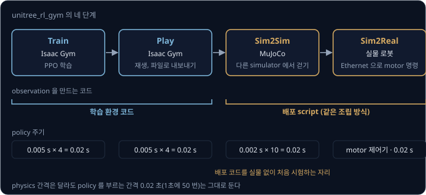
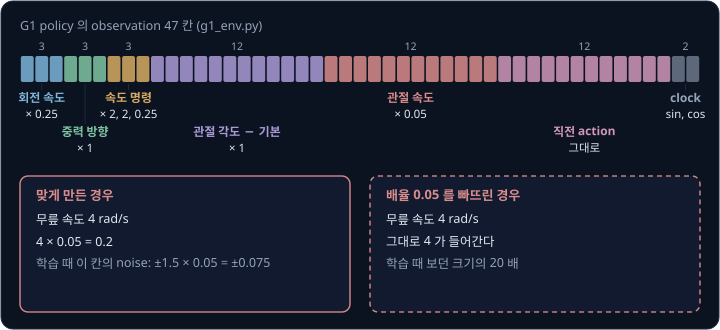
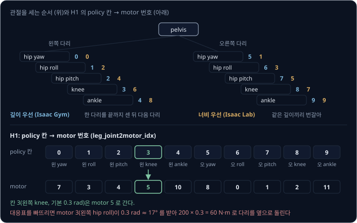
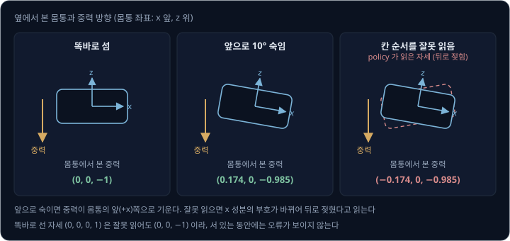
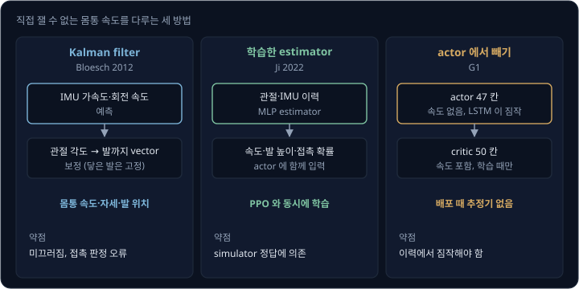
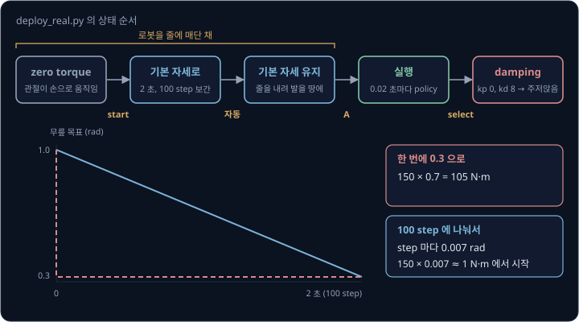
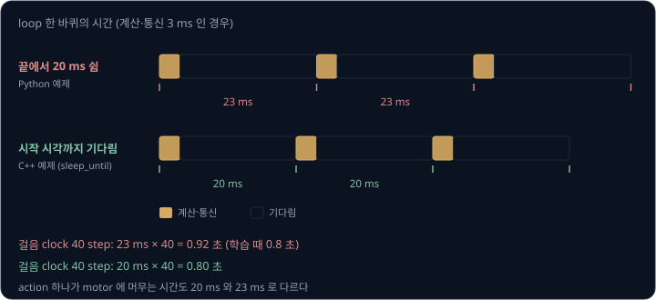

# Locomotion Deployment

[Sim-to-Real Locomotion](../sim2real-locomotion/README.md) 에서는 simulation 에서 학습한 보행 policy 가 실물과의 차이를 견디도록 학습하는
방법(actuator network, domain randomization, observation noise)을 보았다. 학습이 끝나면 손에 남는 것은 weight 를 담은 파일 하나다. 이 파일로
실물 로봇이 첫 발을 떼려면, 학습할 때 simulator 가 대신 해 주던 일을 배포 코드가 모두 다시 해야 한다. 센서 값을 학습 때와 같은 순서와 배율로
묶어 observation 을 만들고, policy 가 낸 목표 각도를 맞는 motor 로 보내고, 로봇이 쓰러지지 않게 켜고 끄며, 이 일을 학습 때와 같은 주기로
되풀이해야 한다. 하나만 어긋나도 simulation 에서 잘 걷던 policy 가 실물에서 바로 쓰러진다.

이 강의는 Unitree 가 공개한 [unitree_rl_gym](https://github.com/unitreerobotics/unitree_rl_gym) 의 학습 설정과 배포 코드를 따라가며 이 일을
하나씩 본다. 이 저장소에는 4족 로봇 Go2 와 휴머노이드 G1·H1·H1_2 의 보행 policy 를 Isaac Gym 에서 학습하고, MuJoCo 에서 다시 시험한 뒤
실물에 올리는 코드가 들어 있다. 강의의 숫자는 2025 년 7 월 커밋(276801e)에서 확인한 값이다. 직접 잴 수 없는 몸통 속도는 다리 kinematics 와
IMU 를 섞는 Kalman filter(Bloesch 등 2012)와 학습한 estimator(Ji 등 2022)로 살펴본다.

## 학습 목표

- Train → Play → Sim2Sim → Sim2Real 네 단계가 각각 무엇을 걸러 내는지 설명할 수 있다
- policy 파일 밖에 있는 숫자(observation 순서와 배율, 기본 자세, action 배율, PD gain, 제어 주기)를 나열하고, 하나가 어긋날 때 policy 가
  받는 값을 계산할 수 있다
- policy 의 관절 순서와 motor 번호의 대응표를 읽고, 학습 도구마다 관절 순서와 quaternion 의 칸 순서가 다를 수 있음을 설명할 수 있다
- IMU 의 quaternion 에서 몸통에서 본 중력 방향을 계산하고, quaternion 칸 순서를 잘못 읽을 때 생기는 부호 오류를 찾을 수 있다
- 직접 잴 수 없는 몸통 속도를 다루는 세 방법(Kalman filter, 학습한 estimator, actor 에서 빼기)을 비교할 수 있다
- motor 명령의 다섯 숫자로 torque 를 계산하고, zero torque · 기본 자세 · 실행 · damping 으로 이어지는 시작과 정지 순서의 이유를 설명할 수 있다
- 배포 loop 의 실제 주기를 재고, 주기가 늘어날 때 policy 가 겪는 차이를 계산할 수 있다

## 학습에서 실물까지 네 단계

unitree_rl_gym 의 README 는 강화학습으로 보행을 만드는 과정을 네 단계로 나눈다.

| 단계 | 하는 일 | observation 을 만드는 코드 | 걸러 내는 문제 |
| --- | --- | --- | --- |
| Train | Isaac Gym 에서 환경 수천 개를 함께 돌려 PPO 로 학습 | 학습 환경 | reward 가 원하는 걸음을 만드는가 |
| Play | 같은 simulator 에서 policy 를 재생하고 파일로 내보냄 | 학습 환경 | 걸음이 눈으로 봐도 괜찮은가 |
| Sim2Sim | MuJoCo 에서 같은 policy 로 다시 걷게 함 | 따로 쓴 배포 script | Isaac Gym 의 계산 방식에만 맞춘 걸음인가, 배포 script 가 observation 을 학습 때와 같게 만드는가 |
| Sim2Real | 실물 로봇에 올림 | 실물 배포 script | 센서·통신·motor 의 차이 |

Train 과 Play 에서는 학습 환경의 코드가 observation 을 만든다. Play 에서 잘 걸으면 policy 가 잘 학습됐다는 뜻이지, 배포 코드가 맞다는 뜻은
아니다. Sim2Sim 의 MuJoCo script 는 MuJoCo 의 관절 각도와 몸통 자세를 읽어 observation 을 처음부터 다시 조립하는데, 조립하는 방식이 실물 배포
script 와 거의 같다. 실물 없이 배포 코드를 처음 시험하는 자리가 Sim2Sim 이다. 서로 다른 simulator 에서 다시 걷게 하는 이유는
[Humanoid Locomotion 의 sim-to-sim 검증](../humanoid-locomotion/README.md#sim-to-sim-검증) 에서 다뤘다.

두 simulator 는 physics 를 계산하는 간격도 다르다. physics 를 몇 번 계산할 때마다 policy 를 한 번 부르는지를 **decimation** 이라고 한다.

| | physics 간격 | decimation | policy 주기 |
| --- | --- | --- | --- |
| 학습 (Isaac Gym) | 0.005 초 | 4 | $0.005 \times 4 = 0.02$ 초 |
| Sim2Sim (MuJoCo) | 0.002 초 | 10 | $0.002 \times 10 = 0.02$ 초 |
| 실물 | motor 안의 제어기가 계산 | | 0.02 초 |

physics 간격은 달라도 policy 는 세 곳 모두 0.02 초마다, 1초에 50 번 불린다. policy 는 0.02 초마다 목표를 한 번 바꾸는 리듬으로 학습했으므로,
배포할 때 바꾸면 안 되는 값은 physics 간격이 아니라 이 policy 주기다.

> **오해** Play 에서 잘 걸었으면 Sim2Sim 은 건너뛰어도 된다.
>
> **사실** Play 에서는 학습 환경의 코드가 observation 을 만들어서, 배포 때 쓸 조립 코드는 Sim2Sim 에서 처음 실행된다. 여기서 쓰러지면 policy 가 Isaac Gym 에만 맞춰졌거나 배포 코드가 틀린 것이고, 실물을 넘어뜨리지 않고 둘 가운데 무엇인지 가릴 수 있다.

**확인 문제.** MuJoCo 의 physics 간격을 0.001 초로 줄였다. policy 주기 0.02 초를 지키려면 decimation 은 얼마로 해야 할까?

답 보기

policy 주기를 physics 간격으로 나눈다: $0.02 \div 0.001 = 20$.

답: 20 이다. 10 으로 두면 policy 가 0.01 초마다 불려 학습 때보다 두 배 자주 목표를 바꾼다.

## policy 와 함께 옮기는 숫자

Play 단계는 policy 의 actor 를 TorchScript 파일로 내보낸다. TorchScript 는 PyTorch model 을 Python 없이도 불러 실행할 수 있게 저장하는
형식이다. MLP policy 는 `policy_1.pt`, LSTM policy 는 `policy_lstm_1.pt` 로 저장된다. 이 파일은 숫자 47 개를 받아 숫자 12 개를 내는 함수일
뿐이다. 47 개가 각각 무엇이고 몇 배로 줄였는지, 12 개를 어떻게 각도로 바꾸는지는 파일에 들어 있지 않다. 이 숫자들은 학습 설정 파일에 있고,
배포 쪽은 같은 값을 yaml 설정 파일에 다시 적어 둔다.

G1 policy 의 observation 은 아래와 같다(`g1_env.py` 의 `compute_observations`, 배포 yaml `g1.yaml`).

| 칸 | 개수 | 내용 | 배율 |
| --- | --- | --- | --- |
| 0–2 | 3 | 몸통 회전 속도 (rad/s) | × 0.25 |
| 3–5 | 3 | 몸통에서 본 중력 방향 | × 1 |
| 6–8 | 3 | 속도 명령: 앞, 옆, 회전 | × 2, × 2, × 0.25 |
| 9–20 | 12 | 관절 각도 − 기본 자세 | × 1 |
| 21–32 | 12 | 관절 속도 (rad/s) | × 0.05 |
| 33–44 | 12 | 직전 action | 그대로 |
| 45–46 | 2 | 걸음 clock 의 sin, cos (주기 0.8 초) | 그대로 |

배율은 칸마다 숫자의 크기를 비슷하게 맞추려고 곱한다. 무릎이 4 rad/s 로 돌면 관절 속도 칸에는 $4 \times 0.05 = 0.2$ 가 들어간다. 배포 코드가
0.05 를 빠뜨리면 policy 는 4 를 받는다. 학습할 때 이 칸에 더한 noise 는 $\pm 1.5 \times 0.05 = \pm 0.075$ 였으니, policy 는 학습 내내 0.2
근처의 숫자를 보다가 갑자기 20 배 큰 숫자를 받는다. 이런 입력에 policy 가 무엇을 낼지는 아무도 모른다.

action 쪽도 같다. 목표 각도는 기본 자세에 action 의 0.25 배를 더한 값이다. G1 무릎의 기본 각도는 0.3 rad 이므로 policy 가 0.4 를 내면 목표는
$0.3 + 0.25 \times 0.4 = 0.4$ rad 다. legged_gym 의 기본값인 배율 0.5 를 배포 yaml 에 잘못 적으면 목표는 $0.3 + 0.5 \times 0.4 = 0.5$ rad 가
되어, 기본 자세에서 벗어나는 양이 학습 때의 두 배가 된다.

G1 policy 는 LSTM 이다. LSTM 은 앞 step 들의 정보를 hidden state 라는 숫자 묶음에 담아 다음 step 으로 넘기는 network 다. 내보낸 파일은 이
hidden state 를 파일 안에 들고 있어서 부를 때마다 갱신하고, 처음 불러오면 0 에서 시작한다. 다시 처음 상태로 돌리려면 파일에 함께 들어 있는
`reset_memory` 를 부른다. 걷다가 멈추고 다시 시작할 때 앞의 기억이 남아 있다는 점을 알아 둔다.

> **오해** policy 파일만 있으면 어느 로봇 코드에서든 같은 걸음이 나온다.
>
> **사실** 파일에는 weight 만 있다. observation 의 순서와 배율, 기본 자세, action 배율, PD gain, 주기는 설정 파일에 따로 있고, 학습 쪽과 배포 쪽에 두 번 적혀 있다. 학습 설정을 바꾸면 배포 yaml 도 같이 바꿔야 한다.

**확인 문제.** G1 이 z 축으로 0.8 rad/s 돌고 있고, 앞으로 0.5 m/s 걸으라는 명령을 받았으며, 왼쪽 무릎이 −2 rad/s 로 움직인다. 회전 속도 z 칸,
앞 속도 명령 칸, 왼쪽 무릎 속도 칸에는 각각 무엇이 들어갈까?

답 보기

1. 회전 속도 z: $0.8 \times 0.25 = 0.2$
2. 앞 속도 명령: $0.5 \times 2 = 1.0$
3. 무릎 속도: $-2 \times 0.05 = -0.1$

답: 0.2, 1.0, −0.1 이다.

## 관절 순서

policy 의 출력 12 칸은 학습 때 simulator 가 정한 관절 순서를 따르고, 실물의 motor 는 제조사가 정한 번호로 불린다. 두 순서가 같다는 보장은 없다.
H1 배포 설정의 대응표 `leg_joint2motor_idx` 는 $[7, 3, 4, 5, 10, 8, 0, 1, 2, 11]$ 이다(H1 policy 는 다리 관절 10 개를 다룬다).

| policy 칸 | 관절 | 기본 각도 | motor 번호 |
| --- | --- | --- | --- |
| 0 | 왼쪽 hip yaw | 0 | 7 |
| 1 | 왼쪽 hip roll | 0 | 3 |
| 2 | 왼쪽 hip pitch | −0.1 | 4 |
| 3 | 왼쪽 knee | 0.3 | 5 |
| 4 | 왼쪽 ankle | −0.2 | 10 |
| 5 | 오른쪽 hip yaw | 0 | 8 |
| 6 | 오른쪽 hip roll | 0 | 0 |
| 7 | 오른쪽 hip pitch | −0.1 | 1 |
| 8 | 오른쪽 knee | 0.3 | 2 |
| 9 | 오른쪽 ankle | −0.2 | 11 |

대응표 없이 칸 번호를 그대로 motor 번호로 쓰면, policy 칸 3(왼쪽 무릎, 기본 0.3 rad, kp 200)의 목표가 motor 3(왼쪽 hip roll)으로 간다. 기본
각도가 0 이어야 할 hip roll 이 0.3 rad(약 17°)로 다리를 옆으로 돌리려 하고, 그 순간의 torque 는 $200 \times 0.3 = 60$ N·m 다. 같은 회사의
G1 은 대응표가 $[0, 1, \dots, 11]$ 로 칸과 motor 번호가 같다. 같은 제조사라도 모델마다 따로 확인해야 한다.

simulator 도 관절을 세는 방식이 다르다. Isaac Lab 문서에 따르면 Isaac Sim 과 Isaac Lab 은 관절 나무(kinematic tree)를 너비 우선(breadth-first)
으로, Isaac Gym 은 깊이 우선(depth-first)으로 센다. 깊이 우선은 한 가지를 끝까지 내려간 뒤 다음 가지로 넘어가고, 너비 우선은 몸통에서 같은
거리에 있는 관절끼리 먼저 센다. 두 다리가 몸통에 붙은 나무라면 아래처럼 된다.

| 세는 방식 | 앞 여섯 칸 |
| --- | --- |
| 깊이 우선 (Isaac Gym) | 왼 hip yaw, 왼 hip roll, 왼 hip pitch, 왼 knee, 왼 ankle, 오른 hip yaw |
| 너비 우선 (Isaac Lab) | 왼 hip yaw, 오른 hip yaw, 왼 hip roll, 오른 hip roll, 왼 hip pitch, 오른 hip pitch |

unitree_rl_gym 은 Isaac Gym 을 써서 다리마다 묶인 순서가 나온다. 같은 로봇을 Isaac Lab 으로 학습하면 policy 의 칸 순서가 바뀌므로 대응표를
새로 만들어야 한다. Isaac Lab 문서는 실제 순서를 `Articulation.data.joint_names` 로 확인하라고 안내한다. 같은 문서에 따르면 quaternion 의 칸
순서도 Isaac Lab 은 $(w, x, y, z)$, Isaac Gym 은 $(x, y, z, w)$ 로 다르다. 이 차이가 만드는 오류는 다음 절에서 본다.

순서가 맞아도 + 방향이 다를 수 있다. 배포 script 는 리모컨 왼쪽 스틱의 좌우 값 `lx` 에 −1 을 곱해 옆 속도 명령으로 쓴다. 스틱을 오른쪽으로 밀면
`lx` 는 + 인데, 로봇 좌표의 $+y$ 는 왼쪽이라 부호를 뒤집어야 오른쪽으로 걷는다. 회전 명령도 오른쪽 스틱 `rx` 에 −1 을 곱한다.

순서와 부호는 실물에서 한 번에 확인할 수 있다. 배포 안내서에 따르면 zero torque 상태에서는 관절을 손으로 움직일 수 있다. 이 상태에서
observation 을 화면에 찍어 두고 관절을 하나씩 손으로 굽히면, 어느 칸이 어느 부호로 바뀌는지로 대응표와 + 방향을 함께 확인할 수 있다.

> **오해** 학습 설정과 배포 설정에 같은 관절 이름이 적혀 있으면 순서도 같다.
>
> **사실** 이름은 관절을 가리킬 뿐이고, policy 의 칸 순서는 simulator 가 관절 나무를 세는 방식으로, motor 번호는 제조사가 정한다. H1 처럼 둘이 전혀 다른 로봇이 있고, 같은 로봇도 Isaac Gym 과 Isaac Lab 에서 칸 순서가 달라진다.

**확인 문제.** H1 의 policy 칸 8(오른쪽 무릎)의 목표는 어느 motor 로 가야 할까? 대응표를 빠뜨려 motor 8 로 보내면 어느 관절이 무릎의 목표를 받을까?

답 보기

1. 대응표에서 칸 8 은 motor 2 다
2. motor 8 은 대응표에서 칸 5, 곧 오른쪽 hip yaw 의 motor 다

답: motor 2 로 가야 하고, 빠뜨리면 오른쪽 hip yaw 가 무릎의 목표(기본 0.3 rad 근처)를 받아 다리를 비튼다.

## IMU 에서 중력 방향까지

policy 는 몸통의 기울기를 각도로 받지 않고, 몸통에 붙인 좌표에서 본 중력의 방향(길이 1 인 vector)으로 받는다. 몸통 좌표는 $x$ 가 앞, $y$ 가
왼쪽, $z$ 가 위다. 똑바로 서 있으면 중력은 아래인 $(0, 0, -1)$ 이다. 앞으로 10° 숙이면 $(0.174, 0, -0.985)$ 가 되어, 몸통에서 보면 중력이
조금 앞쪽을 향한다. 오른쪽으로 10° 기울면 $(0, -0.174, -0.985)$ 로 오른쪽($-y$)을 향한다.

roll-pitch-yaw 는 pitch 90° 근처에서 각도 하나를 잃지만([Rigid Transforms](../transforms/README.md#roll-pitch-yaw)), 중력 방향은 어느 자세에서나
매끄럽게 변한다. 또 yaw 와 상관없는 값이라, 로봇이 어느 쪽을 보고 서 있든 같은 기울기면 같은 숫자가 된다.

IMU 는 몸통의 자세를 quaternion 으로 준다([Rigid Transforms 의 quaternion](../transforms/README.md#quaternion)). 배포 script 는 칸 순서가
$(w, x, y, z)$ 인 quaternion 에서 중력 방향을 아래 식으로 계산한다.

| 성분 | 식 |
| --- | --- |
| $g_x$ | $2(wy - zx)$ |
| $g_y$ | $-2(zy + wx)$ |
| $g_z$ | $1 - 2(w^2 + z^2)$ |

앞으로 10° 숙인 자세는 $y$ 축(왼쪽)으로 10° 돈 것이라 quaternion 은 $(\cos 5°, 0, \sin 5°, 0) = (0.996, 0, 0.087, 0)$ 이다.
$g_x = 2 \times 0.996 \times 0.087 = 0.174$, $g_y = 0$, $g_z = 1 - 2 \times 0.996^2 = -0.985$ 로 위의 값이 나온다.

칸 순서를 잘못 읽으면 어떻게 될까. $(x, y, z, w)$ 로 저장된 $(0, 0.087, 0, 0.996)$ 을 $(w, x, y, z)$ 로 읽으면 $w = 0$, $x = 0.087$, $y = 0$,
$z = 0.996$ 이 된다. 이때 $g_x = 2(0 - 0.996 \times 0.087) = -0.174$ 라서, 앞으로 숙였는데 policy 는 뒤로 젖혔다고 읽는다. 그런데 똑바로 선
자세 $(0, 0, 0, 1)$ 을 같은 식으로 잘못 읽으면 $(0, 0, -1)$ 이 그대로 나온다. 서 있는 동안에는 오류가 보이지 않다가, 몸이 기우는 순간 반대로
바로잡으려 한다.

몸통 회전 속도는 IMU 의 gyroscope 값에 0.25 를 곱해 넣는다. 남은 문제는 IMU 가 어디 붙어 있느냐다. G1 은 IMU 가 골반(pelvis)에 있어서
policy 가 학습한 몸통과 같다. H1 의 IMU 는 허리 yaw 관절 위의 상체(torso)에 있어서, 허리가 돌면 IMU 의 자세가 골반과 달라진다. 배포
script 의 `transform_imu_data` 는 허리 관절 각도만큼 IMU 자세를 되돌리고, 회전 속도에서 허리가 도는 속도를 빼서 골반의 값으로 바꾼다. 허리가
0.2 rad/s 로 돌면 상체 IMU 의 z 축 회전 속도에는 그 0.2 가 더해져 있으므로 빼야 한다.

> **오해** IMU 가 주는 자세를 roll-pitch-yaw 로 바꿔 observation 에 넣어도 된다.
>
> **사실** 이 policy 는 중력 방향 3 칸으로 학습했다. 같은 자세라도 다른 표현은 다른 숫자라서, 학습 때 쓴 표현과 계산을 그대로 따라야 한다.

**확인 문제.** quaternion $(0.996, 0.087, 0, 0)$ 은 $x$ 축(앞)으로 10° 돈 자세다. 중력 방향을 계산하고, 로봇이 어느 쪽으로 기울었는지 말해 보자.

답 보기

1. $g_x = 2(0.996 \times 0 - 0 \times 0.087) = 0$
2. $g_y = -2(0 \times 0 + 0.996 \times 0.087) = -0.174$
3. $g_z = 1 - 2(0.996^2 + 0) = -0.985$

답: $(0, -0.174, -0.985)$ 로, 중력이 오른쪽($-y$)을 향하니 오른쪽으로 10° 기울었다.

## 몸통 속도라는 빈칸

legged_gym 의 기본 observation 48 개(unitree_rl_gym 의 Go2 설정이 그대로 쓴다)는 맨 앞 3 칸에 몸통의 선속도를 2 배 해서 넣는다. 속도 명령을
따라가려면 지금 속도를 알아야 하기 때문이다. 그런데 몸통 속도를 직접 재는 센서는 없다. IMU 의 가속도를 적분하면 될 것 같지만, 가속도 센서에
0.05 m/s² 의 오차가 계속 남아 있으면 10 초 뒤 속도 오차는 $0.05 \times 10 = 0.5$ m/s 가 된다. 걸으라는 명령 0.5 m/s 와 같은 크기다.

이 빈칸을 채우는 방법은 세 가지다.

**Kalman filter 로 추정하기.** Bloesch 등(2012)은 IMU 로 몸통의 움직임을 예측하고, 다리 kinematics 로 그 예측을 보정하는 EKF(곡선 모델용
[Kalman filter](../kalman-filter/README.md#직선이-아닌-움직임과-ekf))를 만들었다. 땅에 닿은 발은 움직이지 않는다고 보고, 발 위치를 몸통의
위치·속도·자세와 함께 state 에 넣는다. 관절 각도로 [forward kinematics](../forward-kinematics/README.md) 를 계산하면 몸통에서 발까지의 vector 를
아니까, 발이 고정이면 몸통이 얼마나 움직였는지가 나온다. 발이 땅에서 떨어지면 그 발 위치의 noise 를 아주 크게 잡아 놓아 주고, 다시 닿으면
새 위치를 잡는다. 저자들의 분석에 따르면 발 하나라도 닿아 있으면 속도와 roll·pitch 는 관측으로 바로잡히지만, 절대 위치와 yaw 는 바로잡을
관측이 없어 계속 조금씩 어긋난다. 4족 로봇 StarlETH 가 60 초 동안 약 1 m 걸은 실험에서 위치는 이동 거리의 10% 정도까지 어긋났고, 속도의
RMS 오차는 방향마다 0.011 ~ 0.015 m/s 였다. 저자들은 어긋남의 원인으로 다리 kinematics 의 부정확함과 틀리기 쉬운 접촉 판정을 꼽았다.

접촉 판정이 틀리면 얼마나 어긋날까. 미끄러지는 발을 고정으로 보면, 발이 0.02 초 동안 1 cm 미끄러질 때 그 사이 몸통 속도 추정은
$0.01 \div 0.02 = 0.5$ m/s 만큼 틀어진다.

**network 로 추정하기.** Ji 등(2022, KAIST)은 관절과 IMU 의 이력을 받아 몸통 선속도, 발 높이, 발의 접촉 확률을 내는 MLP estimator 를
만들었다. estimator 는 simulator 의 정답과의 오차(MSE)로 학습하고, policy 는 PPO 로 학습하는데, 둘을 같은 batch 로 함께 학습한다. 그래서
policy 는 estimator 의 추정값을 받으며 배우고, 미끄러져 추정이 흔들리는 상황에서는 조심스럽게 움직이는 법을 익힌다. policy 를 먼저 정답 속도로
학습하고 estimator 를 나중에 따로 학습한 경우는 함께 학습한 경우보다 조금 나빴다. Mini Cheetah 에서 이 policy 는 평지에서 3.75 m/s, 마찰
계수 0.22 의 미끄러운 판에서 3.54 m/s 로 달렸다. 저자들은 Mini Cheetah 에 들어 있는 접촉 추정기가 정해진 걸음 주기를 가정하는데, 학습한
policy 는 속도에 따라 걸음 모양을 바꾸므로 그 추정기를 그대로 쓸 수 없었다고 적었다. 계산도 빨라서 estimator 는 한 번에 7 µs, Mini Cheetah 의
linear Kalman filter 는 34 µs 가 걸렸다.

**actor 에서 빼기.** G1 policy 의 actor 가 받는 47 개에는 몸통 선속도가 없고, critic 이 받는 50 개에만 있다. critic 은 학습 중에만 쓰이고 실물에
올라가지 않으므로, simulator 만 아는 값을 critic 에만 주는 이 구성(asymmetric actor-critic)에서는 배포 때 속도를 추정할 필요가 없다. 대신 actor
의 LSTM 이 관절과 IMU 의 이력에서 필요한 만큼 스스로 짐작해야 한다.

| 방법 | 배포 때 필요한 것 | 약점 |
| --- | --- | --- |
| Kalman filter (Bloesch 2012) | 정확한 다리 kinematics, 접촉 판정 | 미끄러짐과 접촉 판정 오류에 약하다 |
| 학습한 estimator (Ji 2022) | estimator network | simulator 의 정답에 의존한다. 실물과 다른 부분은 domain randomization 으로 메운다 |
| actor 에서 빼기 (G1) | 없음 | policy 가 속도를 이력에서 짐작해야 한다 |

> **오해** IMU 가 가속도를 재니 적분하면 몸통 속도를 얻는다.
>
> **사실** 가속도의 작은 오차가 적분으로 계속 쌓인다. 0.05 m/s² 만 남아도 10 초 뒤 0.5 m/s 가 틀어진다. 그래서 다리 kinematics 처럼 속도를 직접 바로잡는 관측을 섞거나, 속도를 쓰지 않는 policy 를 학습한다.

**확인 문제.** Kalman filter 가 땅에 닿았다고 본 발이 실제로는 0.02 초 동안 2 cm 미끄러졌다. 그 사이 몸통 속도 추정은 얼마나 틀어질까?

답 보기

미끄러진 거리를 시간으로 나눈다: $0.02 \div 0.02 = 1$ m/s.

답: 1 m/s 다. 걷는 속도보다 큰 오차라서 접촉 판정이 속도 추정의 정확도를 좌우한다.

## motor 명령 한 줄

실물에서 배포 script 는 torque 를 직접 계산하지 않는다. 로봇과 Ethernet 으로 연결한 컴퓨터가 DDS(로봇 안팎의 프로그램이 이름 붙은 topic 으로
메시지를 주고받는 통신 방식)의 `rt/lowcmd` topic 에 motor 마다 다섯 숫자를 보내면, motor 쪽 제어기가 torque 를 만든다.

| 숫자 | 뜻 | 보행 policy 가 보내는 값 |
| --- | --- | --- |
| `q` | 목표 각도 | 기본 자세 + 0.25 × action |
| `dq` | 목표 각속도 | 0 |
| `kp` | 각도 차이에 곱하는 gain | 학습 때와 같은 값 |
| `kd` | 각속도 차이에 곱하는 gain | 학습 때와 같은 값 |
| `tau` | 더할 torque | 0 |

Sim2Sim 의 MuJoCo script 는 motor 의 이 계산을 $\tau = k_p (q_{\text{목표}} - q) + k_d (\dot q_{\text{목표}} - \dot q)$ 로 흉내 낸다. G1 왼쪽
무릎은 $k_p = 150$, $k_d = 4$ 다. 목표가 0.4 rad, 지금 각도가 0.35 rad, 각속도가 1 rad/s 이면 torque 는
$150 \times 0.05 + 4 \times (0 - 1) = 7.5 - 4 = 3.5$ N·m 다. 상태는 반대 방향 topic `rt/lowstate` 로 받는다. 보내는 메시지마다 통신 중에
깨진 메시지를 가려내는 검사값(CRC)을 계산해 붙이며, G1 과 H1 은 메시지 형식부터 다르다(G1 은 `hg`, H1 은 `go` 형식).

policy 가 다루지 않는 관절도 명령을 받는다. G1 학습 model `g1_12dof` 는 다리 12 관절만 움직이고 허리와 팔은 고정 관절로 묶었다. 실물에서는
허리와 팔의 motor 17 개에 목표 0 과 큰 gain(허리 $k_p = 300$, 팔 100 ~ 20)을 보내 학습 때처럼 굳혀 둔다.

배포 script 에는 특별한 명령이 둘 있다.

| 명령 | 숫자 | 결과 |
| --- | --- | --- |
| zero | 모두 0 | torque 0. 관절이 힘없이 움직인다 |
| damping | $k_p = 0$, $k_d = 8$, 나머지 0 | $\tau = -8 \times$ 각속도. 움직이는 만큼 반대로 버틴다 |

damping 에서 관절이 2 rad/s 로 접히면 $8 \times 2 = 16$ N·m 로 버틴다. 멈춰 있으면 torque 가 0 이라 자세를 지키지는 못하고, 로봇은 천천히
주저앉는다.

> **오해** 실물에서 kp 를 학습 때보다 크게 하면 policy 의 목표를 더 정확히 따라가니 좋다.
>
> **사실** policy 는 학습 때의 kp·kd 로 움직이는 관절을 상대로 action 을 배웠다. gain 을 바꾸면 같은 action 이 다른 torque 가 되어, 학습하지 않은 몸을 움직이는 셈이다. 배포 yaml 의 gain 은 학습 설정과 똑같이 맞춘다.

**확인 문제.** damping 명령을 받은 관절이 1.5 rad/s 로 움직이고 있다. motor 가 내는 torque 의 크기는?

답 보기

$k_p = 0$ 이라 각도 항은 없고, 각속도 항만 남는다: $8 \times 1.5 = 12$ N·m.

답: 12 N·m 이고, 움직이는 반대 방향으로 작용한다.

## 시작과 정지의 순서

실물 배포 script 는 정해진 순서로 상태를 옮긴다. 배포 안내서와 `deploy_real.py` 를 합치면 아래와 같다.

| 상태 | 로봇 | 다음으로 넘어가는 신호 |
| --- | --- | --- |
| 준비 | 로봇을 줄에 매단(hoist) 채 켜고 zero torque mode 를 기다린 뒤, 리모컨 L2+R2 로 debugging mode 에 넣는다. 관절은 damping 상태가 된다 | 프로그램 실행 |
| 연결 | `rt/lowstate` 의 첫 메시지를 기다린다 | 첫 메시지 |
| zero torque | 모든 motor 에 zero 명령. 관절을 손으로 움직일 수 있다 | start 버튼 |
| 기본 자세로 이동 | 2 초 동안 지금 각도에서 기본 각도로 조금씩 옮긴다 | 자동 |
| 기본 자세 유지 | 매단 줄을 천천히 내려 발을 땅에 닿게 한다 | A 버튼 |
| 실행 | 0.02 초마다 policy. 제자리걸음이 안정되면 줄을 더 내리고, 스틱으로 속도를 준다 | select 버튼 |
| 정지 | damping 명령을 보내고 프로그램을 끝낸다. 로봇은 주저앉는다 | |

기본 자세로 옮길 때는 2 초를 0.02 초씩 100 step 으로 나눠, step 마다 지금 각도와 기본 각도 사이를 1% 씩 더 기본 각도 쪽으로 옮긴 목표를 보낸다.
매달린 채 무릎이 1.0 rad 로 펴져 있었다면 기본 각도 0.3 rad 까지 0.7 rad 를 가야 한다. 목표를 한 번에 0.3 으로 주면 첫 순간 torque 는
$150 \times 0.7 = 105$ N·m 이고, 100 step 에 나누면 step 마다 목표가 0.007 rad 씩 움직여 torque 는 1 N·m 남짓에서 시작한다.

배포 안내서는 이 예제가 안정된 제어 프로그램이 아니라 시연용이라고 밝히고, 예상과 다르게 움직이면 바로 빠져나오라고 한다. 예제에 없는 장치를
더한다면 넘어짐 판정을 생각할 수 있다. 중력 방향의 $g_z$ 는 똑바로 설 때 −1 이고 60° 기울면 $-\cos 60° = -0.5$ 이므로, $g_z$ 가 −0.5 보다
커지면 damping 으로 넘어가게 하는 식이다.

> **오해** policy 가 잘 걷는다면 로봇을 땅에 세워 두고 바로 실행해도 된다.
>
> **사실** 첫 실행에서는 관절 순서, 부호, 배율 가운데 하나만 틀려도 바로 쓰러진다. 안내서의 순서는 로봇을 매단 채 기본 자세를 확인하고, 줄을 조금씩 내리며 제자리걸음부터 보는 것이다.

**확인 문제.** 매달린 상태에서 어떤 관절이 기본 각도와 0.5 rad 떨어져 있고 kp 는 100 이다. 목표를 한 번에 줄 때와 2 초(100 step)에 나눌 때
첫 step 의 torque 는 각각 얼마일까?

답 보기

1. 한 번에: $100 \times 0.5 = 50$ N·m
2. 나눠서: 첫 step 목표는 $0.5 \div 100 = 0.005$ rad 만 움직이므로 $100 \times 0.005 = 0.5$ N·m

답: 50 N·m 와 0.5 N·m 다.

## 제어 주기

Python 배포 script 의 실행 loop 는 observation 을 만들고, policy 를 계산하고, 명령을 보낸 다음 0.02 초를 쉰다. 그래서 실제 한 바퀴는 계산
시간에 0.02 초를 더한 시간이 된다. 계산과 통신에 3 ms 가 걸리면 한 바퀴는 23 ms 이고, policy 는 1초에 50 번이 아니라 약 43.5 번 불린다.

이 차이는 두 곳에서 드러난다. 걸음 clock 은 step 수 × 0.02 초로 계산하므로, policy 는 0.8 초 주기(40 step)로 걷는다고 믿지만 실제로는
$40 \times 0.023 = 0.92$ 초가 걸린다. 또 action 하나가 motor 에 머무는 시간이 학습 때의 0.02 초보다 15% 긴 0.023 초가 되어, 같은 action 이
관절을 더 멀리 움직인다.

같은 저장소의 C++ 배포 예제(`cpp_g1`)는 다음 loop 를 시작할 시각을 미리 정해 두고 그 시각까지만 기다린다(`sleep_until`). 계산 시간이 기다리는
시간에서 빠지므로, 계산이 0.02 초보다 짧은 한 주기는 그대로 0.02 초다. 이 예제는 motor 명령을 보내는 일도 2 ms 마다 도는 별도 thread 에
맡긴다. 어느 방법이든 policy 계산이 0.02 초를 넘으면 주기를 지킬 수 없으므로, 실행할 때 loop 의 시작 시각을 기록해 간격이 얼마나 흔들리는지
확인해 둔다.

Ji 등은 실물에서 기록 주기가 흔들려 관절 속도 값이 한 step 동안 갱신되지 않는 일이 생기고, 이것이 2 ms 지연에 해당한다고 적었다. 그래서
simulation 에서 관절 각도와 속도 측정값에 noise 를 더해 학습했다. 지연을 학습에 넣는 방법은
[Sim-to-Real Locomotion](../sim2real-locomotion/README.md#observation-noise-와-지연의-학습) 에서 다뤘다.

> **오해** loop 끝에서 0.02 초를 쉬면 policy 가 1초에 50 번 불린다.
>
> **사실** 쉬는 시간 앞에 계산 시간이 더해져 한 바퀴는 0.02 초보다 길다. 다음 시작 시각을 정해 두고 그때까지만 기다려야 주기가 지켜진다.

**확인 문제.** 계산과 통신에 5 ms 가 걸리는데 loop 끝에서 20 ms 를 쉰다. policy 는 1초에 몇 번 불리고, 0.8 초 주기로 학습한 걸음 clock 은
실제로 몇 초마다 한 바퀴 돌까?

답 보기

1. 한 바퀴: $5 + 20 = 25$ ms 이므로 $1 \div 0.025 = 40$ 번
2. clock: 40 step 이 한 바퀴이므로 $40 \times 0.025 = 1.0$ 초

답: 1초에 40 번, clock 은 1.0 초마다 한 바퀴 돈다.

## 첫 실물 시험 점검표

앞 절의 내용을 첫 실물 시험 전에 확인할 항목으로 모으면 아래와 같다.

| 확인할 것 | 확인 방법 | 틀렸을 때 보이는 모습 |
| --- | --- | --- |
| 관절 순서와 + 방향 | zero torque 에서 관절을 하나씩 손으로 굽히며 observation 의 어느 칸이 어느 부호로 바뀌는지 본다 | 기본 자세로 옮길 때 엉뚱한 관절이 움직인다 |
| quaternion 칸 순서 | 매단 로봇을 앞으로 기울여 중력 방향의 $x$ 칸이 + 가 되는지 본다 | 서 있을 때는 멀쩡하다가 기울면 반대로 바로잡는다 |
| observation 배율 | 같은 명령으로 Sim2Sim 과 실물의 칸별 범위를 비교한다 | 제자리에서 떨거나 튄다 |
| 기본 자세, action 배율, kp·kd | 학습 설정과 배포 yaml 을 한 줄씩 대조한다 | 자세가 낮거나 높고, 걸음이 굼뜨거나 떨린다 |
| IMU 위치 | 허리를 돌려도 골반 기준 중력 방향이 그대로인지 본다 | 허리를 돌리면 몸이 기운다고 읽는다 |
| 명령 축의 부호 | 스틱을 오른쪽으로 밀 때 옆 속도 명령이 − 인지 본다 | 반대쪽으로 걷는다 |
| 제어 주기 | loop 시작 시각을 기록해 간격의 분포를 본다 | 걸음 리듬이 학습 때보다 느리다 |
| 정지 | 매단 상태에서 정지 버튼으로 damping 에 들어가는지 본다 | |

관절 순서, 배율, 주기처럼 실물 없이 확인할 수 있는 항목은 Sim2Sim 에서 먼저 확인한다. 실물에서만 확인할 수 있는 항목은 IMU 의 위치와 칸 순서,
motor 번호와 + 방향, 통신과 계산의 실제 시간이다.

## 정리

- 학습이 끝난 policy 는 weight 파일일 뿐이고, observation 의 순서와 배율, 기본 자세, action 배율, PD gain, 주기는 설정 파일에 따로 있다
- Train 과 Play 는 학습 환경이 observation 을 만들고, 배포 코드는 Sim2Sim 에서 처음 실행된다. policy 주기 0.02 초는 physics 간격이 달라도 지킨다
- policy 의 칸 순서는 simulator 가 관절 나무를 세는 방식(Isaac Gym 깊이 우선, Isaac Lab 너비 우선)으로, motor 번호는 제조사가 정한다. H1 은
  대응표 $[7, 3, 4, 5, 10, 8, 0, 1, 2, 11]$ 가 필요하다
- 중력 방향은 quaternion 에서 계산한다. 칸 순서를 잘못 읽으면 똑바로 선 자세는 맞게 나오고 기울기만 반대로 나온다
- 몸통 속도는 직접 잴 수 없어서 Kalman filter(발 위치를 state 에 넣는 EKF), 학습한 estimator, 또는 actor 에서 빼는 방법으로 다룬다
- motor 명령은 `q`, `dq`, `kp`, `kd`, `tau` 다섯 숫자다. 매단 채 zero torque → 2 초 보간으로 기본 자세 → 실행 → damping 순서로 켜고 끈다
- loop 끝에서 쉬기만 하면 계산 시간만큼 주기가 늘어난다. 다음 시작 시각까지 기다리고, 실제 간격을 기록한다

다음 강의 [Perceptive Locomotion](../perceptive-locomotion/README.md) 에서는 지형을 보는 센서를 observation 에 더하고, 센서가 늦거나 틀릴 때
policy 가 버티는 방법을 본다. 휴머노이드는 [Humanoid Locomotion](../humanoid-locomotion/README.md) 에서 이어진다.

## 참고 자료

- [unitree_rl_gym](https://github.com/unitreerobotics/unitree_rl_gym) — 이 강의가 따라간 저장소. README 의 네 단계, `legged_gym/envs/g1/g1_config.py`
  와 `g1_env.py` 의 observation·gain, `deploy/deploy_mujoco/` 의 Sim2Sim script, `deploy/deploy_real/` 의 실물 배포 script·설정·안내서와
  C++ 예제 `cpp_g1`
- [unitree_sdk2_python](https://github.com/unitreerobotics/unitree_sdk2_python) — 배포 script 가 쓰는 DDS 통신 library. `LowCmd`·`LowState`
  메시지 정의
- Isaac Lab 문서, [From IsaacGymEnvs](https://isaac-sim.github.io/IsaacLab/v2.3.0/source/migration/migrating_from_isaacgymenvs.html) — Isaac Gym
  의 지원 종료, 관절 순서(너비 우선과 깊이 우선)와 quaternion 칸 순서의 차이
- Michael Bloesch 외, [State Estimation for Legged Robots - Consistent Fusion of Leg Kinematics and IMU](https://www.roboticsproceedings.org/rss08/p03.pdf)
  (RSS 2012) — 발 위치를 state 에 넣는 EKF, 관측 가능성 분석, StarlETH 실험(Fig. 3, 4)
- Gwanghyeon Ji 외, [Concurrent Training of a Control Policy and a State Estimator for Dynamic and Robust Legged Locomotion](https://arxiv.org/abs/2202.05481)
  (RA-L 2022) — estimator 와 policy 의 동시 학습, randomization 항목, Mini Cheetah 실험과 계산 시간
