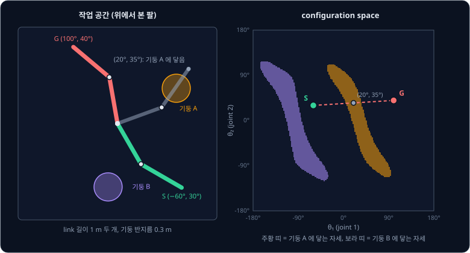
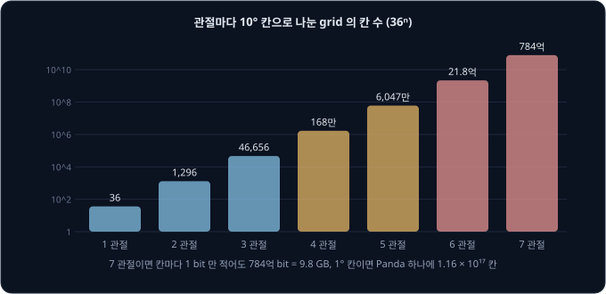
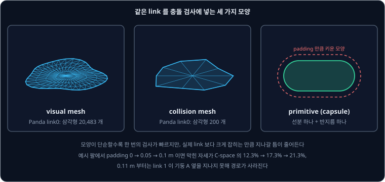
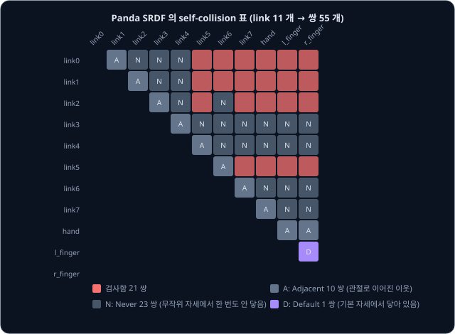
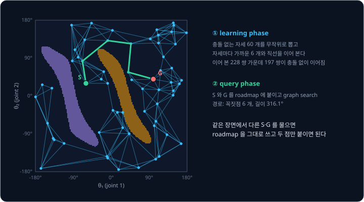
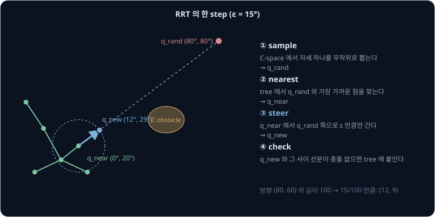
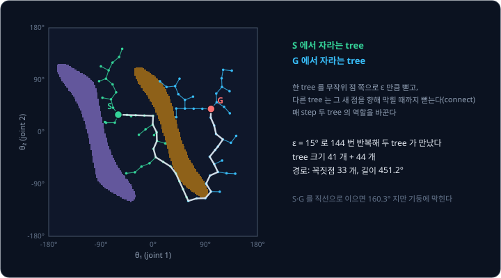
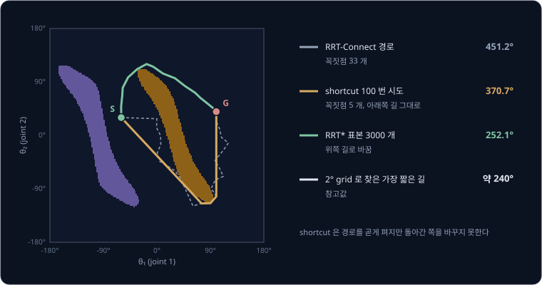
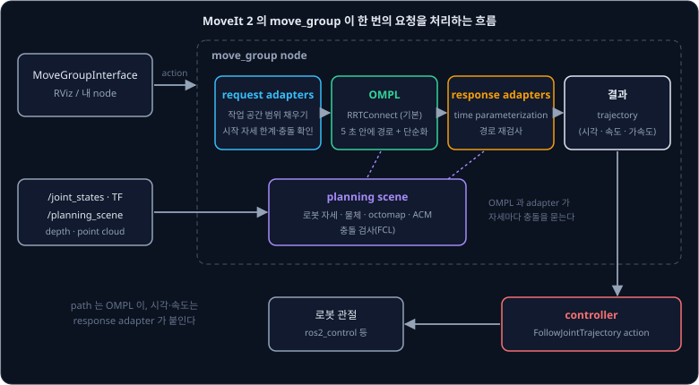

# Motion Planning

선반 안쪽의 컵을 집으려는 7 관절 팔에 [Inverse Kinematics](../inverse-kinematics/README.md) 로 구한 목표 각도를 주고 관절마다 그 각도까지
고르게 돌리면, 손은 컵 앞에 제대로 도착해도 가는 도중에 팔꿈치가 선반 모서리를 칠 수 있다. 관절 7 개의 각도 조합은 셀 수 없이 많은데, 그
가운데 손끝뿐 아니라 팔의 어느 부분도 선반에 닿지 않는 길을 어떻게 몇 초 안에 찾을까?

관절 각도의 공간에서 충돌 없는 길을 찾는 일을 **motion planning** 이라고 한다. 7 차원 공간은 칸으로 빠짐없이 나눌 수 없어서, 자세를 무작위로
뽑아 충돌만 검사하며 tree 나 graph 를 키우는 sampling-based planner 를 쓴다. Steven LaValle 이 1998 년 RRT 를 발표했고, 2000 년에는 James
Kuffner 와 함께 두 tree 를 마주 키우는 RRT-Connect 를 냈다. 지금 ROS 2 의 로봇팔 소프트웨어인 MoveIt 2 는 planner 를 따로 정하지 않으면 OMPL
라이브러리의 RRTConnect 로 경로를 찾는다.

## 학습 목표

- configuration space 와 C-obstacle 을 2 관절 팔 그림으로 설명하고, 6 ~ 7 관절 팔에서 grid search 가 불가능한 이유를 숫자로 설명할 수 있다
- collision checking 에서 mesh·primitive·padding·self-collision 표가 계산량과 안전 여유를 어떻게 바꾸는지 설명할 수 있다
- PRM, RRT, RRT-Connect 를 한 step 씩 따라가고, probabilistic completeness, 경로가 최적이 아닌 이유, RRT* 와 shortcutting 을 설명할 수 있다
- MoveIt 2 가 요청 하나를 planning scene, OMPL, time parameterization, controller 실행으로 처리하는 흐름과 Pilz·CHOMP·STOMP·cuRobo 의 차이를 설명할 수 있다

## configuration space

로봇팔의 모양은 관절 각도만 정하면 하나로 정해진다. 관절 각도를 모은 묶음 $q = (\theta_1, \theta_2, \dots)$ 를 **configuration**(자세)이라고 하고,
관절이 가질 수 있는 모든 자세의 공간을 **configuration space**(C-space)라고 한다. 관절이 둘이면 C-space 는 가로축 $\theta_1$, 세로축
$\theta_2$ 인 평면이고, 그 위의 점 하나가 팔의 자세 하나다. [Path Planning](../path-planning/README.md) 에서 본 원형 로봇의 C-space 는 장애물을
로봇 반지름만큼 부풀린 지도였지만, 팔의 C-space 는 축 자체가 관절 각도다.

[Forward Kinematics](../forward-kinematics/README.md) 에서 쓴 link 길이 1 m 짜리 2 관절 팔 옆에 반지름 0.3 m 기둥 두 개를 세운다. 팔이 기둥에
닿는 자세를 C-space 에 모두 칠하면 아래 그림 오른쪽이 된다. 칠한 영역은 **C-obstacle** 이라고 하고, 칠하지 않은 나머지 영역은 **C-free** 라고
한다.

둥근 기둥이 C-space 에서는 비스듬히 기운 긴 띠가 된다. link 1 을 기둥 A 쪽($\theta_1 = 31°$)으로 돌리면 $\theta_2$ 가 −49° ~ 49° 인 자세가 모두
기둥에 닿지만, $\theta_1 = 0°$ 이면 $\theta_2$ 가 46° ~ 97° 일 때만 닿고 $\theta_1 = 60°$ 이면 −96° ~ −42° 일 때만 닿는다. $\theta_1$ 이 바뀌면
link 2 가 기둥을 가리키게 되는 $\theta_2$ 도 함께 바뀌기 때문이다. 이 예시의 C-space 를 2° 간격으로 나눠 세어 보면 두 띠가 전체의 12.3% 를
차지한다.

출발 자세 S $(-60°, 30°)$ 에서 목표 자세 G $(100°, 40°)$ 로 두 관절을 같은 비율로 돌리면 C-space 에서는 길이
$\sqrt{160^2 + 10^2} = 160.3°$ 인 직선을 따라가는데, $\theta_1$ 이 5° ~ 35° 를 지나는 동안 주황 띠 안에 들어가서 팔이 기둥 A 를 친다. 손끝은
기둥에 닿지 않고 link 1 과 link 2 의 몸통이 닿는다. motion planning 은 C-space 에서 S 와 G 를 C-free 안으로만 잇는 선을 찾는 문제이고,
이 예시에서는 띠를 위나 아래로 돌아가야 한다.

**흔한 오해.** "손끝이 장애물을 피해 가면 팔도 안전하다." 위 예시에서 직선 경로의 손끝은 기둥에 닿지 않지만 link 몸통이 닿는다. 충돌은
link 하나하나의 모양 전체로 따져야 해서, 손끝의 위치만 보는 작업 공간이 아니라 자세 전체를 점 하나로 보는 C-space 에서 계획한다.

<b>심화: C-obstacle 을 계산하는 방법</b>

C-obstacle 은 식으로 미리 구하지 않고 자세마다 검사해서 얻는다. 위 그림을 그릴 때는 $\theta_1$, $\theta_2$ 를 2° 간격으로 나눈 180 × 180 =
32,400 칸마다 forward kinematics 로 팔꿈치와 손끝 위치를 구하고, link 를 반지름 0.05 m 인 capsule(선분을 일정 두께로 감싼 모양)로 보아 기둥
중심에서 두 선분까지의 거리를 쟀다. 그 거리가 (기둥 반지름 0.3 m + link 반지름 0.05 m) 보다 짧으면 그 칸을 칠했는데, 칠한 칸이 3,987 개라서
$3987 \div 32400 = 12.3\%$ 다. 관절이 늘면 C-obstacle 의 모양을 그림으로 볼 수 없을 뿐 아니라 칸을 전부 검사하는 일 자체가 불가능해진다. 그
이유는 다음 절에서 다룬다.

**확인 문제.** 3 관절 팔의 C-space 는 몇 차원이고, 그 안의 점 하나는 무엇을 뜻할까?

답 보기

관절 각도 세 개 $(\theta_1, \theta_2, \theta_3)$ 로 자세가 정해지므로 3 차원이고, 점 하나는 팔 전체의 자세 하나다. 손끝의 위치가 아니라 세
관절 각도를 모두 정한 팔의 모양이다.

## 관절 수와 grid 의 크기

2 관절이면 C-space 를 칸으로 나누고 [Path Planning](../path-planning/README.md) 에서 본 A* 처럼 칸을 이어 찾아도 된다. 관절마다 360° 를 10°
칸 36 개로 나누면 $36 \times 36 = 1296$ 칸이지만, 관절이 하나 늘 때마다 칸 수가 36 배가 된다.

| 관절 수 | 10° 칸 수 ($36^n$) | 칸마다 1 bit 만 적을 때 |
| --- | --- | --- |
| 2 | 1,296 | 162 byte |
| 3 | 46,656 | 5.8 KB |
| 6 | 약 21.8억 | 272 MB |
| 7 | 약 784억 | 9.8 GB |

7 관절이면 막혔는지 아닌지 1 bit 씩만 적어도 9.8 GB 이고, 칸마다 forward kinematics 와 충돌 검사를 한 번씩 해야 표를 채울 수 있다. 그렇다고
10° 칸이 충분히 촘촘한 것도 아니다. 팔꿈치에서 손끝까지 0.8 m 인 link 를 10° 돌리면 손끝이 $0.8 \times 0.1745 = 0.14$ m 움직여서, 칸
가운데에서만 검사하면 10 cm 짜리 물체를 놓칠 수 있다. Franka Panda 의 관절 7 개를 실제 관절 범위대로 1° 칸으로 나누면 칸이
$1.16 \times 10^{17}$ 개라서, 1 bit 씩만 적어도 14.5 PB 가 된다. 이 칸 수는 MoveIt 예제 URDF 에 적힌 관절 범위 340°, 210°, 340°, 185°, 340°,
224°, 340° 를 곱한 값이다.

그래서 6 ~ 7 관절 팔의 planner 는 C-space 전체를 표로 만들지 않고, 필요한 자세만 골라 "이 자세가 충돌하는가" 를 그때그때 묻는다. 이 질문에
답하는 부분이 collision checker 이고, 질문할 자세를 무작위로 고르는 방법이 이 강의에서 다룰 PRM 과 RRT 다.

**확인 문제.** 관절마다 20° 칸 18 개로 나누면 6 관절 팔의 칸 수는 10° 칸일 때의 몇 분의 1 일까?

답 보기

관절 하나에서 칸 수가 36 에서 18 로 절반이 되므로 6 관절이면 $2^6 = 64$ 분의 1 이다. 칸은 $18^6 = 3400$만 개로 줄지만, 한 칸을 건널 때마다
손끝이 0.28 m 씩 움직여서 장애물을 놓치기는 더 쉬워진다.

## collision checking

planner 가 자세 하나를 물으면 collision checker 는 forward kinematics 로 link 마다 위치와 방향을 구하고, 그 자리에 link 의 모양을 놓아 주변
물체나 다른 link 와 겹치는지 검사한다. sampling-based planner 는 이 검사를 아주 많이 부른다. 앞의 2 관절 예시에서 이 강의 뒤쪽에 나오는
RRT-Connect 와 PRM 을 직접 구현해 실행해 보니, RRT-Connect 는 경로 하나를 찾는 동안 충돌 검사를 943 번 불렀고 PRM 은 roadmap 하나를 만드는
데 5,773 번 불렀다. 그래서 planner 전체의 속도는 검사 한 번에 드는 비용에 달려 있다.

URDF 의 link 에는 화면에 그릴 visual 모양과 충돌 검사에 쓸 collision 모양을 따로 적는다. MoveIt 예제의 Panda 는 visual mesh 가 삼각형
134,924 개인데 collision mesh 는 2,364 개로 약 57 분의 1 이다. link0 하나만 보면 20,483 개와 200 개다. 더 단순하게 상자, 원기둥, 구, capsule
같은 **primitive** 로 근사하면 숫자 몇 개로 모양이 정해진다. MoveIt 2 의 기본 collision checker 인 FCL 은 primitive 일곱 가지(sphere, box,
cone, cylinder, capsule, convex mesh, plane)를 bounding volume 하나로 다루고, 일반 mesh 는 삼각형을 상자 계층으로 묶은 bounding volume
hierarchy 로 다뤄 멀리 떨어진 삼각형 쌍을 통째로 건너뛴다. cuRobo 같은 GPU planner 는 팔 전체를 구 여러 개로 근사한다.

단순한 모양은 빠른 대신 실제 link 보다 커서 좁은 틈을 막는다. 실제 로봇에는 calibration 오차와 추종 오차가 있어서 모양을 일부러 사방으로
조금 키우기도 하는데, 이것을 **padding** 이라고 한다. MoveIt 2 에서는 `default_robot_padding` 과 `default_object_padding` 의 기본값이 0.0
이라서 padding 을 직접 정해야 한다. 2 관절 예시의 link 에 padding 을 더하고 2° 칸으로 다시 세어 보면 막힌 자세가 아래처럼 늘어난다.

| padding | 막힌 자세의 비율 | S → G 경로 |
| --- | --- | --- |
| 0 m | 12.3% | 있음 |
| 0.05 m | 17.3% | 있음 |
| 0.1 m | 21.3% | 있음 |
| 0.11 m | 23.0% | 없음 |

기둥 A 의 중심은 원점에서 $\sqrt{1.25^2 + 0.75^2} = 1.458$ m 떨어져 있고, link 1(길이 1 m, 반지름 0.05 m)이 기둥 옆을 지날 때의 틈은
$1.458 - 0.3 - 0.05 - 1 = 0.108$ m 다. padding 이 이 틈보다 크면 link 1 이 기둥 A 쪽을 지나갈 수 없어 C-space 가 둘로 끊기고, planner 는
정해 둔 시간을 다 쓰고 실패를 돌려준다.

자세 하나가 아니라 두 자세를 잇는 선분(edge)이 안전한지도 검사해야 하는데, MoveIt 2 와 OMPL 은 선분 위의 자세를 일정 간격으로 뽑아 하나씩
검사한다. 간격은 `longest_valid_segment_fraction` 으로 정하고, OMPL 기본값 0.01 은 C-space 전체 크기의 1% 마다 한 번 검사한다는 뜻이다.
MoveIt 튜토리얼은 이 값을 너무 작게 하면 planning 이 느려지고, 너무 크게 하면 작거나 얇은 물체와의 충돌을 놓친다고 적는다.

**흔한 오해.** "padding 은 클수록 안전하다." padding 이 틈보다 크면 갈 수 있는 길이 사라지고, 현재 자세가 이미 padding 안에 들어가 있으면
시작 자세부터 충돌로 판정해 planning 을 시작하지도 못한다. padding 은 위치 오차만큼만 준다.

<b>심화: edge 검사 간격과 OMPL 의 기본값</b>

MoveIt 2 는 C-space 의 거리를 관절별 각도 차이를 모두 더한 값으로 재고, C-space 전체 크기도 관절 범위를 모두 더한 값으로 잡는다
(`JointModelGroup::getMaximumExtent`). Panda 의 관절 범위를 radian 으로 더하면 34.54 rad 이라서, 기본값 0.01 이면 OMPL 은 관절 각도 변화의
합이 $34.54 \times 0.01 = 0.345$ rad(약 19.8°) 일 때마다 한 번 검사한다. 관절 하나만 19.8° 도는 구간이라면 그 관절에서 0.8 m 떨어진 손끝이
검사와 검사 사이에 $0.8 \times 0.345 = 0.28$ m 움직이므로, 얇은 선반을 다루는 장면에서는 값을 줄이거나 `maximum_waypoint_distance` 로 절대 간격을 함께 정한다.
둘 다 정하면 더 촘촘한 쪽을 쓴다.

C-space 전체 크기는 RRT 의 한 step 길이를 정할 때도 쓴다. OMPL 은 `range` 를 0 으로 두면 C-space 크기의 0.2 배를 step 길이로 정하므로
(`SelfConfig`), Panda 에서는 $0.2 \times 34.54 = 6.9$ rad 이다. step 이 길어도 그 사이는 위 간격으로 검사하기 때문에, 충돌을 놓치는지는 step
길이가 아니라 검사 간격에 달려 있다.

**확인 문제.** link 길이 1 m, 반지름 0.05 m 인 link 가 원점에서 1.3 m 떨어진 반지름 0.15 m 기둥 옆을 지나간다. padding 이 몇 m 를 넘으면
지나갈 수 없을까?

답 보기

틈은 $1.3 - 0.15 - 0.05 - 1 = 0.1$ m 다. padding 이 0.1 m 를 넘으면 link 끝이 기둥의 부풀린 모양에 닿아 지나갈 수 없다.

## self-collision 과 allowed collision matrix

팔은 주변 물체뿐 아니라, 손이 어깨 link 에 닿거나 손가락이 손목에 닿는 것처럼 자기 몸과도 부딪힌다. link 가 $n$ 개면 서로 닿는지 검사할
쌍이 $n(n-1)/2$ 개인데, Panda 는 collision 모양이 있는 link 가 11 개라서 쌍이 $11 \times 10 \div 2 = 55$ 개다.

그런데 관절로 이어진 이웃 link 는 늘 맞닿아 있고, 어떤 쌍은 관절 범위 안에서 절대 닿을 수 없다. 이런 쌍을 검사에서 빼 두는 표가 **allowed
collision matrix**(ACM)이고, 관절 그룹이나 이름 붙인 자세처럼 URDF 에 없는 정보를 적는 SRDF 파일에 `disable_collisions` 로 적는다. MoveIt Setup Assistant 는 무작위 자세를
기본 10,000 개 만들어 쌍마다 닿는 비율을 세고, 늘 닿거나(95% 이상) 한 번도 안 닿거나, 기본 자세에서 닿아 있거나, 관절로 이어진 쌍을 끄라고
제안한다.

MoveIt 예제 Panda 의 SRDF 에서는 55 쌍 가운데 34 쌍(Adjacent 10, Never 23, Default 1)을 꺼 두어 21 쌍만 검사하므로, 자세마다 하는
self-collision 검사가 2.6 분의 1 로 줄어든다. Never 는 무작위 자세에서 한 번도 닿지 않았다는 뜻이지 절대 닿지 않는다는 증명이 아니어서,
표본이 적으면 드물게 닿는 쌍까지 꺼질 수 있다. 그래서 Setup Assistant 문서는 sampling density 를 최대로 올려 표를 만들라고 권한다. gripper 를
바꾸거나 link 를 더하면 이 표도 다시 만들어야 한다.

## PRM

grid 를 쓰지 않고 C-free 안의 점을 무작위로 뽑아 graph 를 만드는 방법이 **PRM**(probabilistic roadmap)이다. Kavraki 와 동료들이 1996 년에
발표했고, 다음 두 단계로 나뉜다.

- learning phase: 충돌 없는 자세를 무작위로 $N$ 개 뽑고, 자세마다 가까운 $k$ 개와 직선으로 이어 본다. 직선 위의 자세가 모두 충돌 없으면 그
  선을 graph 에 넣는다. 이렇게 만든 graph 를 roadmap 이라고 한다
- query phase: 출발 자세와 목표 자세를 roadmap 의 가까운 점에 이어 붙이고, graph search 로 두 점 사이의 가장 짧은 길을 찾는다

2 관절 예시에 PRM 을 한 번 실행해 본 결과, 자세 60 개를 뽑아 $k = 6$ 으로 이었을 때 228 쌍 가운데 197 쌍이 충돌 없이 이어졌다. S 와 G 를
붙여 Dijkstra 로 찾은 경로는 띠 위쪽으로 돌아가는 꼭짓점 6 개짜리 선이고 길이는 316.1° 다. 표본이 60 개뿐이라 꺾인 곳이 많고, 표본을 늘리면
경로가 짧아진다.

PRM 은 roadmap 을 한 번 만들어 두면 같은 장면에서 다른 출발·목표를 물을 때 두 점만 이어 붙이면 되어서 여러 질문(multi-query)에 유리하다.
Kavraki 의 논문에서는 관절이 많은 평면 팔의 roadmap 을 수십 초 동안 만든 뒤, 경로 하나를 찾는 데는 1초도 걸리지 않았다. 반대로 물체가
자주 바뀌는 탁자 위 작업에서는 물체가 움직일 때마다 roadmap 의 edge 를 쓸 수 없게 되므로, 질문 하나만 빨리 푸는 single-query 방법이 더
맞다. MoveIt 2 문서도 planner 가 요청마다 처음부터 시작하는 것이 기본이라고 적고, roadmap 을 저장해 다시 쓰는 설정은 장면이 거의 그대로일
때 이득이 있다고 설명한다. OMPL 의 PRM 에서 가까운 이웃 수의 기본값은 10 이다.

## RRT

**RRT**(rapidly-exploring random tree)는 출발 자세 하나에서 tree 를 키워 목표까지 닿게 하는 single-query 방법이다. tree 를 한 번 키우는
step 은 다음 순서로 진행한다.

1. C-space 에서 자세 $q_{rand}$ 를 무작위로 뽑는다
2. tree 에서 $q_{rand}$ 와 가장 가까운 점 $q_{near}$ 를 찾는다
3. $q_{near}$ 에서 $q_{rand}$ 쪽으로 정해 둔 step 길이 $\varepsilon$ 만큼만 가서 $q_{new}$ 를 만든다
4. $q_{new}$ 와 $q_{near}$ ~ $q_{new}$ 선분이 충돌 없으면 $q_{new}$ 를 tree 에 붙이고, 막히면 버린다

그림에서 $q_{near} = (0°, 20°)$, $q_{rand} = (80°, 80°)$ 이면 방향은 $(80, 60)$, 길이는 $\sqrt{80^2 + 60^2} = 100$ 이다. $\varepsilon = 15°$ 만큼만
가므로 $q_{new} = (0, 20) + (80, 60) \times 15 \div 100 = (12°, 29°)$ 다.

RRT 는 2 번 단계 덕분에 빈 곳으로 빠르게 퍼진다. 무작위 점은 C-space 어디에나 고르게 떨어지는데, tree 의 점 가운데 둘레에 빈 공간이 넓은
점일수록 무작위 점의 "가장 가까운 점" 으로 뽑힐 확률이 크다. Kuffner 와 LaValle 은 이 성질 때문에 tree 가 처음에는 아직 가 보지 않은 곳으로
빠르게 뻗고, 시간이 지나면 공간을 고르게 덮는다고 설명한다. 목표 쪽으로 가는 것을 돕기 위해 일정 확률로 $q_{rand}$ 자리에 목표 자세를 넣기도
하는데, 이 확률을 goal bias 라고 한다. OMPL 의 RRT 에서는 goal bias 기본값이 0.05 라서 20 번에 한 번꼴로 목표를 향해 뻗는다.

$\varepsilon$ 은 너무 작으면 tree 가 목표까지 가는 데 step 이 많이 필요하고, 너무 크면 장애물 근처에서 $q_{new}$ 가 자꾸 막혀 버려진다.

**확인 문제.** $q_{near} = (10°, 10°)$, $q_{rand} = (40°, 50°)$, $\varepsilon = 10°$ 이면 $q_{new}$ 는?

답 보기

방향은 $(30, 40)$ 이고 길이는 $\sqrt{30^2 + 40^2} = 50$ 이다. 10° 만큼만 가므로 $(30, 40) \times 10 \div 50 = (6, 8)$ 을 더해
$q_{new} = (16°, 18°)$ 다.

## RRT-Connect

**RRT-Connect** 는 출발과 목표에서 tree 를 하나씩 키우고 둘이 만나면 멈춘다. 한 반복에서는 먼저 tree A 를 무작위 점 쪽으로 $\varepsilon$
만큼 뻗는다. 그다음 tree B 를 A 에 방금 붙은 점을 향해 $\varepsilon$ 씩 막힐 때까지 계속 뻗는데, 이 단계를 connect 라고 한다. B 가 그 점에
닿으면 경로가 완성되고, 막히면 두 tree 의 역할을 바꿔 다음 반복을 한다. 새 영역을 넓히는 일은 RRT 와 같은 무작위 확장으로 하고, 두 tree 를
잇는 일은 막힐 때까지 한 방향으로 계속 뻗는 connect 로 한다.

2 관절 예시에 $\varepsilon = 15°$ 로 한 번 실행한 시뮬레이션에서는 144 번 반복한 끝에 두 tree 가 만났고, 그때 두 tree 의 점은 41 개와 44 개였다.
경로는 꼭짓점 33 개, 길이 451.2° 로 기둥 A 의 띠 아래쪽을 크게 돌아간다. S 와 G 를 직선으로 이으면 160.3° 지만 기둥에 막히므로, 이 경로는
충돌 없는 길이기는 해도 짧은 길은 아니다.

Kuffner 와 LaValle 은 이 방법을 원래 7 관절 사람 팔 animation 을 위해 만들었다. 논문에서는 삼각형 8,000 개가 넘는 장면에서 체스 말을 집어
옮기는 동작을 평균 2 초 안에 찾았다고 보고했다(270 MHz SGI O2 workstation 기준). 장애물 사이가 대체로 트여 있는 장면에서는 connect 가 몇 번
만에 두 tree 를 잇는다. MoveIt 2 가 planner 를 따로 정하지 않았을 때 쓰는 것도 이 방법이다.

## probabilistic completeness 와 RRT*

grid 를 빠짐없이 뒤지는 A* 는 길이 없으면 없다고 답할 수 있는데, 이런 성질을 complete 라고 한다. PRM 과 RRT 는 무작위 표본을 쓰므로 그렇게
말할 수 없고, 대신 길이 있다면 표본이 늘수록 길을 찾을 확률이 1 에 가까워진다는 것을 보일 수 있다. 이 성질을 **probabilistic completeness**
라고 하고, Kuffner 와 LaValle 의 논문도 RRT-Connect 에 이 성질이 있음을 증명했다. 다만 길이 없을 때는 planner 가 정해 둔 시간을 다 쓰고
실패를 돌려줄 뿐, 길이 없다는 것을 증명하지는 못한다. 좁은 틈(narrow passage)이 문제가 되는 것도 무작위 표본에 기대기 때문이다. 무작위 점이
틈 안에 떨어질 확률은 틈이 C-space 에서 차지하는 부피에 비례하므로, 틈이 좁고 관절이 많을수록 표본이 훨씬 많이 필요하다.

경로의 질도 보장하지 못한다. Karaman 과 Frazzoli 는 2011 년에 RRT 가 찾은 경로의 길이가 표본이 무한히 늘어도 최적값이 아닌 값으로 수렴한다는
것을 보이고, 최적값으로 수렴하는 **RRT\*** 를 제안했다. RRT* 는 새 점을 붙일 때 가장 가까운 점이 아니라, 둘레의 점 가운데 출발점부터의 비용이
가장 작아지는 점을 부모로 고른다. 이어서 둘레의 점들도 새 점을 거쳐 가는 쪽이 더 싸면 부모를 새 점으로 바꾸는데, 이 단계를 rewire 라고 한다.

같은 2 관절 예시에 RRT* 를 실행한 시뮬레이션에서는 표본 500 개일 때 347.1°, 1,500 개일 때 268.6°, 3,000 개일 때 252.1° 의 경로가 나왔다.
같은 장면을 2° grid 로 나눠 찾은 가장 짧은 길은 약 240° 다. 표본이 늘수록 최적에 다가가지만 그만큼 시간이 든다. OMPL 의 RRTstar 처럼
최적화하는 planner 는 첫 경로를 찾은 뒤에도 주어진 planning 시간을 모두 써서 경로를 다듬는다. MoveIt 튜토리얼에 따르면 `termination_condition`
을 `ExactSolution` 으로 두면 첫 경로를 찾을 때 멈추고, `CostConvergence` 로 두면 비용이 더 줄지 않을 때 멈춘다.

<b>심화: RRT* 의 rewire 반경</b>

rewire 할 둘레의 반경 $r$ 은 점이 늘수록 줄어들어야 한다. 반경이 고정이면 점이 많아질 때 둘레의 점 수가 끝없이 늘어 계산이 느려지고, 너무
빨리 줄면 최적값으로 수렴하지 않는다. Karaman 과 Frazzoli 는 $d$ 차원 C-space 에서 점이 $n$ 개일 때 $r \propto (\log n / n)^{1/d}$ 로 줄이면
최적으로 수렴하면서 계산량은 RRT 의 상수 배에 머문다는 것을 보였다. 위 예시는 $d = 2$ 라서 $r$ 을 $\min(1.5\varepsilon,\ 400\sqrt{\log n / n})$
으로 두었다. 점이 1,000 개면 $400 \times \sqrt{6.91 / 1000} = 33.2°$ 와 $1.5 \times 15 = 22.5°$ 가운데 작은 22.5° 다.

## shortcutting 과 smoothing

RRT 계열의 경로는 무작위 점을 이은 것이라 쓸데없이 꺾여서, planner 가 찾은 경로를 다시 펴는 후처리를 거친다. 그 가운데 가장 단순한 방법인
**shortcutting** 은 경로 위의 꼭짓점 두 개를 무작위로 골라 그 사이를 직선으로 이어 보고, 직선이 충돌 없으면 사이의 꼭짓점을 모두 지운다.

앞 절의 경로 품질 그림에서 주황 선은 시뮬레이션의 RRT-Connect 경로(451.2°)에 shortcut 을 100 번 시도한 결과다. 그 가운데 열 번 성공해서
꼭짓점은 33 개에서 5 개로 줄었고, 길이도 370.7° 로 짧아졌다. 하지만 경로는 여전히 띠 아래쪽으로 도는데, shortcut 은 경로를 그 근처에서 곧게
펼 뿐 띠를 넘어 위쪽 길로 옮기지 못하기 때문이다. 그래서 위쪽 길의 약 240° 에는 닿을 수 없고, 다른 쪽 길을 찾으려면 RRT* 처럼 C-space 를 더
넓게 다시 탐색해야 한다.

OMPL 의 `PathSimplifier` 는 꼭짓점 사이뿐 아니라 선분 중간끼리 잇는 partial shortcut, 꼭짓점 줄이기, 가까운 꼭짓점 합치기, B-spline smoothing
을 차례로 되풀이한다. MoveIt 2 에서는 `simplify_solutions` 의 기본값이 true 라서 경로를 찾고 남은 planning 시간을 이 단순화에 쓴다. 또
`num_planning_attempts` 를 2 이상으로 두면 같은 문제를 여러 번(동시에 최대 4 thread) 풀고, 여러 경로의 좋은 부분을 이어 붙이는
hybridization 으로 경로를 고른다. 무작위 planner 는 같은 요청에도 매번 다른 경로를 내기 때문에, MoveIt 튜토리얼은 시도 횟수가 경로 품질에도
영향을 준다고 적는다.

shortcut 과 smoothing 은 경로의 모양만 바꿀 뿐 시간 정보를 붙이지 않는다. 각 꼭짓점에 언제 도착하고 얼마나 빨리 움직일지는 그다음 단계인
time parameterization 단계가 [Trajectory Generation](../trajectory-generation/README.md) 에서 본 방법으로 정한다.

**확인 문제.** 경로의 꼭짓점이 $A, B, C, D, E$ 순서이고 $A$ 와 $D$ 를 잇는 직선이 충돌 없다. shortcut 뒤의 경로는?

답 보기

$A$ 와 $D$ 사이의 $B$, $C$ 를 지우고 $A, D, E$ 가 된다. 직선은 두 점 사이의 가장 짧은 길이라서 경로는 짧아지거나 그대로이고, 길어지지는 않는다.

## OMPL 과 MoveIt 2 의 planning pipeline

OMPL(Open Motion Planning Library)은 PRM, RRT, RRT-Connect, RRT* 같은 sampling-based planner 를 모은 라이브러리다. OMPL 에는 충돌 검사나
시각화 코드가 없고, 로봇이라는 개념도 없이 추상적인 공간만 다룬다. 자세가 유효한지는 밖에서 넘겨받은 함수에 물어서 정하므로 어떤 collision
checker 와도 함께 쓸 수 있다. MoveIt 2 가 그 함수 자리에 planning scene 의 충돌 검사를 넣어 준다. Panda 예제 설정에는 RRTConnect, RRTstar, PRM,
KPIECE 등 planner 설정이 20 개 넘게 들어 있다.

MoveIt 2 에서 planning 요청은 `move_group` node 가 처리한다. move_group 은 ROS 2 의 action 으로 목표를 받고, URDF·SRDF·설정 파일에서 로봇
모델을 읽고, `/joint_states` 와 TF 로 현재 자세를 안다. 목표를 [ROS 2 Basics](../ros2-basics/README.md) 에서 본 action 으로 받으므로, 계획과
실행에 몇 초가 걸리는 동안 중간 상태를 받아 보고 도중에 취소할 수 있다.

- planning scene: 로봇의 현재 자세, 사용자가 넣은 물체(상자·원기둥·mesh), 손에 든 물체, depth 카메라나 point cloud 로 만든 octomap(3D
  occupancy grid), 그리고 ACM 을 담는다. `/planning_scene` topic 으로 물체를 더하고, 충돌 검사는 FCL 로 한다
- request adapter: planner 에 넘기기 전에 요청을 확인한다. 작업 공간 범위가 비어 있으면 기본값으로 채운다. 시작 자세가 관절 범위를 벗어나면
  `CheckStartStateBounds` 가 `START_STATE_INVALID` 를 돌려주고, 이미 충돌 중이면 `CheckStartStateCollision` 이 `START_STATE_IN_COLLISION` 을
  돌려준다. 어느 쪽이든 planner 는 부르지 않는다
- planner: `planning_pipeline` 과 `planner_id` 로 고른다. OMPL pipeline 에서 그룹의 `default_planner_config` 를 정하지 않으면 RRTConnect 를
  쓴다. `MoveGroupInterface` 의 기본 planning 시간은 5 초이고, 시도 횟수는 1 이다
- response adapter: planner 가 낸 경로는 시간을 붙이는 time parameterization(기본 설정은 `AddTimeOptimalParameterization`), 결과 경로를
  planning scene 과 대조해 다시 검사하는 `ValidateSolution`, RViz 에 경로를 보내는 `DisplayMotionPath` 를 차례로 거친다
- 실행: 완성된 trajectory 를 `FollowJointTrajectory` action 으로 로봇의 controller 에 보낸다. 이 action 을 받는 server 는 move_group 이 아니라
  로봇 쪽에 있고, ros2_control 에서는 joint_trajectory_controller 가 맡는다

그래서 move_group 이 돌려주는 것은 관절 각도만 늘어놓은 path 가 아니라 꼭짓점마다 시각·속도·가속도가 붙은 trajectory 다. 경로가 나왔는데 팔이
움직이지 않으면 planner 보다 controller 이름이나 action 연결을 먼저 의심한다.

위 adapter 이름과 request·response 구분은 MoveIt 2 main 과 Jazzy 기준이다. Humble 에는 response adapter 가 따로 없어서 time
parameterization 도 request adapter 목록에 들어 있고, 결과 경로는 planning pipeline 이 직접 다시 검사한다. 또 Humble 의
`FixStartStateCollision` 은 시작 자세가 충돌 중이면 바로 거절하지 않고 근처에서 충돌 없는 자세를 찾아 시작점을 옮겨 본다. 그런 자세를 찾지
못할 때만 실패를 돌려준다.

**흔한 오해.** "planning 이 실패하면 planning 시간을 늘리면 된다." 시작 자세가 이미 충돌 중이거나 목표 자세가 padding 안에 있으면 시간을
아무리 늘려도 길이 없다. 실패 메시지에서 시작 상태 검사나 목표 자세의 충돌 여부를 먼저 확인한다.

**확인 문제.** OMPL pipeline 에서 `planner_id` 를 비워 두고, 그룹 설정에도 `default_planner_config` 가 없다. 어떤 planner 가 몇 초 안에 경로를
찾으려 할까? (`MoveGroupInterface` 기본값)

답 보기

RRTConnect 가 기본 planning 시간 5 초 안에 경로를 찾으려 한다. 시도 횟수는 1 이고, 경로를 찾고 남은 시간은 단순화에 쓴다.

## Pilz, CHOMP, STOMP

OMPL 의 무작위 planner 는 장애물을 잘 피하지만 경로 모양을 예측하기 어렵다. 같은 요청에도 매번 다른 길이 나오고, 손끝이 곧게 가야 하는
작업에도 맞지 않는다. 그래서 MoveIt 2 에는 경로를 만드는 방식이 다른 planner 도 함께 들어 있다.

| planner | 경로를 만드는 방식 | 장애물 | 쓰는 곳 |
| --- | --- | --- | --- |
| OMPL RRTConnect | 무작위 tree 두 개 | 돌아간다 | 일반적인 이동 |
| Pilz PTP·LIN·CIRC | 정해진 모양(관절 직선·손끝 직선·원호) | 돌아가지 않고, 닿으면 실패 | 손끝 직선이 필요한 삽입, 같은 동작 반복 |
| CHOMP | 초기 경로를 gradient 로 밀어냄 | 밀어내며 피한다 | 매끄러운 경로, OMPL 경로 다듬기 |
| STOMP | 초기 경로에 noise 를 더한 후보를 비교 | 후보 중 싼 쪽으로 | gradient 를 구하기 어려운 비용 |

Pilz industrial motion planner 는 산업용 로봇의 표준 동작인 PTP(관절 공간 직선, 모든 관절이 함께 출발해 함께 도착), LIN(손끝이
직선, 방향은 slerp), CIRC(손끝이 원호)를 만든다. 속도는 [Trajectory Generation](../trajectory-generation/README.md) 에서 본 사다리꼴 속도
profile 을 쓰고, PTP 는 가장 오래 걸리는 관절에 다른 관절을 맞춘다. 장애물을 돌아가는 길은 찾지 않아서, 결과 경로가 충돌하면 경로 재검사
단계(main·Jazzy 에서는 `ValidateSolution`)에서 실패로 돌아온다. 손끝이 옆으로 새면 안 되는 삽입 동작은 LIN 으로 하고, 자유 공간을 크게 이동할 때는 OMPL 을 쓰는 식으로 섞어 쓴다.

CHOMP 는 출발과 목표를 직선이나 spline 으로 이은 경로에서 시작해, 장애물까지의 거리로 만든 비용과 속도·가속도의 비용을 gradient 로 줄여
경로를 장애물 밖으로 밀어낸다. MoveIt 튜토리얼은 장애물이 많으면 기본 설정의 CHOMP 가 local minimum 에 갇히기 쉬우니 OMPL 경로를 초기값으로
쓰라고 권한다. STOMP 는 gradient 를 쓰지 않고, 초기 경로에 noise 를 더한 후보(rollout) 여러 개의 비용을 비교해 경로를 고친다. 튜토리얼의
예시 설정에서는 꼭짓점 60 개짜리 경로에 반복마다 후보 30 개를 만들고 최대 40 번 반복한다. gradient 가 없어도 되므로 관절 torque 처럼 미분하기 어려운 비용도
넣을 수 있다.

## GPU planner 와 cuRobo

지금까지의 planner 는 CPU 에서 표본을 하나씩 검사하는데, NVIDIA 의 cuRobo 는 이 계산을 GPU 로 옮겼다. 팔을 구 여러 개로 근사해 충돌 거리를
빠르게 구하고, 초기 경로 여러 개(대부분의 환경에서 12 개)를 동시에 최적화해 jerk 가 작은 trajectory 를 고른다. 논문에 따르면 MotionBenchMaker
와 MπNets 의 문제 2,600 개에서 cuRobo 는 RTX 4090 GPU desktop 기준 평균 50 ms 에 경로를 냈고, CPU 기반 Tesseract 는 평균 2.95 초가 걸렸다.
성공률은 cuRobo 가 99.8% 이고 Tesseract 가 98.53% 였다. 어려운 문제가 몰린 98번째 백분위에서는 cuRobo 가 260 ms 걸렸고 Tesseract 는 22 초가 걸렸다.

| | MoveIt 2 + OMPL 기본 | cuRobo |
| --- | --- | --- |
| 계산 | CPU, 표본을 하나씩 검사 | GPU, 경로 후보 여러 개를 동시에 최적화 |
| 로봇 모양 | collision mesh·primitive | 구 여러 개 |
| 결과 | path → time parameterization | jerk 를 줄인 trajectory |
| 시간 | 기본 한도 5 초 | 논문 벤치마크 평균 50 ms |

대신 GPU 가 필요하고, 로봇마다 구 근사를 만들어야 한다. NVIDIA 는 cuRobo 를 바탕으로 한 cuMotion 을 MoveIt 2 plugin 으로 내놓아서,
move_group 의 planner 로 바로 쓸 수 있다. 계획 시간이 수십 ms 로 줄면 물체가 움직이는 장면에서도 계획을 자주 다시 세울 수 있다.

## 정리

- C-space 는 관절 각도 묶음 하나를 점 하나로 보는 공간이고, 팔이 물체에 닿는 자세가 C-obstacle 이다. 2 관절 예시에서 둥근 기둥은 비스듬한
  띠가 되고 막힌 자세가 12.3% 다. 관절마다 10° 칸이어도 7 관절이면 784억 칸이라서 grid search 를 하지 않고 표본을 뽑는다
- collision checking 이 planner 의 계산을 좌우해서 collision mesh·primitive 로 모양을 단순하게 하고, ACM 으로 검사할 link 쌍을 줄인다(Panda 55 쌍 →
  21 쌍). padding 은 안전 여유지만 틈보다 크면 길이 사라진다
- PRM 은 roadmap 을 만들어 여러 질문에 다시 쓰고, RRT 는 가장 가까운 점에서 $\varepsilon$ 만큼 뻗는 tree 로 빈 곳을 빠르게 덮고, RRT-Connect 는
  두 tree 를 마주 키운다. 셋 다 probabilistically complete 하지만 경로가 최적이 아니라서 shortcut 과 smoothing 으로 다듬고, 최적이 필요하면 RRT* 를 쓴다
- MoveIt 2 는 planning scene 위에서 request adapter → OMPL(기본 RRTConnect, 5 초) → time parameterization → 경로 재검사를 거쳐 trajectory 를
  만들고, FollowJointTrajectory action 으로 controller 에 보낸다

**면접에서 "로봇팔의 motion planning 은 어떻게 동작하나요" 라고 물으면.** "관절 각도 묶음을 점 하나로 보는 configuration space 에서 충돌 없는
영역만 지나 시작 자세와 목표 자세를 잇는 문제입니다. 6 ~ 7 관절이면 C-space 를 grid 로 나눌 수 없어서 PRM 이나 RRT 같은 sampling-based
planner 가 자세를 무작위로 뽑고 collision checker 에 충돌 여부만 묻습니다. MoveIt 2 의 기본은 OMPL 의 RRT-Connect 로, 시작과 목표에서 tree 를
하나씩 키워 만나면 경로가 됩니다. 이 방법들은 probabilistically complete 하지만 경로가 최적이 아니라서 shortcutting 과 smoothing 으로 다듬고,
최적이 필요하면 RRT* 를 씁니다. 그 뒤 time parameterization 으로 속도·가속도 한계를 지키는 trajectory 를 만들어 FollowJointTrajectory 로
controller 에 보냅니다. 실무에서는 collision mesh 단순화, padding, self-collision matrix, edge 검사 간격이 성공률과 속도를 크게 좌우합니다."

planner 가 만든 trajectory 는 아직 숫자의 목록일 뿐이다. 이 목록이 FollowJointTrajectory action 을 거쳐 실제 motor 의 position·velocity·effort
명령이 되는 과정은 [ros2_control](../ros2-control/README.md) 에서 다루고, 목표 자세를 어디로 정할지, 물체를 어떤 자세로 잡을지는
[Grasp Planning](../grasping/README.md) 에서 다룬다.

## 참고 자료

- MoveIt 2 Documentation, [Motion Planning concepts](https://moveit.picknik.ai/main/doc/concepts/motion_planning.html) 와
  [move_group](https://moveit.picknik.ai/main/doc/concepts/move_group.html) — planning request adapter, planning scene, controller 연결 구조를 한
  번에 보는 개념 문서
- MoveIt 2 Documentation, [OMPL Planner](https://moveit.picknik.ai/main/doc/examples/ompl_interface/ompl_interface_tutorial.html) —
  `longest_valid_segment_fraction`, 최적화 planner 의 종료 조건, 후처리 smoothing 과 hybridization 설명
- MoveIt 2 Documentation, [Pilz Industrial Motion Planner](https://moveit.picknik.ai/main/doc/how_to_guides/pilz_industrial_motion_planner/pilz_industrial_motion_planner.html),
  [CHOMP](https://moveit.picknik.ai/main/doc/how_to_guides/chomp_planner/chomp_planner_tutorial.html),
  [STOMP](https://moveit.picknik.ai/main/doc/how_to_guides/stomp_planner/stomp_planner.html) — 세 planner 의 동작과 parameter, OMPL 과의 비교
- MoveIt 2 Documentation, [MoveIt Setup Assistant](https://moveit.picknik.ai/main/doc/examples/setup_assistant/setup_assistant_tutorial.html) —
  self-collision matrix 를 만드는 단계와 sampling density
- [moveit2 소스](https://github.com/moveit/moveit2) — `ompl_interface.cpp`(기본 RRTConnect), `move_group_interface.cpp`(planning 시간 5 초,
  시도 1 회), `planning_scene_monitor.cpp`(padding 기본값)를 직접 확인할 수 있다
- [OMPL](https://ompl.kavrakilab.org/) — 라이브러리 소개와 planner 목록. 소스의 `PathSimplifier.cpp` 에 shortcut·smoothing 순서가 있다
- Kavraki et al., [Probabilistic roadmaps for path planning in high-dimensional configuration spaces](https://kavrakilab.org/publications/kavraki-svestka1996probabilistic-roadmaps-for.html)
  (1996) — PRM 의 learning phase 와 query phase
- LaValle, [RRT 논문 목록](https://lavalle.pl/rrtpubs.html) — 1998 년 RRT technical report 와 후속 논문을 모은 페이지
- Kuffner & LaValle, [RRT-Connect](https://doi.org/10.1109/ROBOT.2000.844730) (2000) — EXTEND·CONNECT 의사 코드와 probabilistic completeness 증명
- Karaman & Frazzoli, [Sampling-based algorithms for optimal motion planning](https://arxiv.org/abs/1105.1186) (2011) — RRT 가 최적이 아닌
  이유와 RRT*·PRM* 의 정의
- Pan, Chitta & Manocha, [FCL](https://doi.org/10.1109/ICRA.2012.6225337) (2012) — primitive 와 bounding volume hierarchy 로 충돌을 검사하는
  구조
- Sundaralingam et al., [cuRobo](https://arxiv.org/abs/2310.17274) (2023) — GPU 병렬 충돌 검사와 trajectory 최적화, 벤치마크 결과
