# MuJoCo Simulation

MuJoCo 로 로봇 팔 예제를 처음 실행해 보면 실제로는 일어나지 않는 일을 자주 본다. 바닥에 내려놓은 상자는 바닥 속으로 0.1 mm 쯤 들어가
있고, timestep 을 조금 키웠을 뿐인데 물체가 하늘로 튀어 오르며, simulation 에서 잘 집히던 큐브가 실제 팔에서는 손가락 사이로 미끄러진다.
컴퓨터는 매 순간 무엇을 계산하길래 이런 일이 생길까?

physics engine 은 시간을 수 ms 단위로 잘라 구간마다 joint 들이 서로 얽힌 equation of motion 을 풀고, 물체끼리 닿은 곳의 힘은 약간 말랑한
용수철처럼 계산한다. 2012 년 Emanuel Todorov 등이 발표한 MuJoCo 가 이런 physics engine 이다. OpenAI 는 2018 년 Shadow 로봇 손이 손바닥 위의
블록을 원하는 방향으로 돌리는 policy 를 MuJoCo 안에서만 학습해 실제 손으로 옮겼다. 마찰과 질량 같은 숫자를 무작위로 바꾸며 쌓은 simulation
경험은 약 100 년치였는데, 실제로 걸린 학습 시간은 50 시간 정도였다.

## 학습 목표

- physics engine 이 한 step 에서 하는 계산과, joint 가 여럿인 팔의 equation of motion $M(q)\ddot q + c = \tau$ 를 숫자로 설명할 수 있다
- MJCF 모델 파일의 body·joint·geom·actuator 와 MuJoCo 의 soft contact·마찰 parameter 가 결과를 어떻게 바꾸는지 설명할 수 있다
- timestep 이 크면 발산하는 이유와 torque 제어·position 제어·gravity compensation 의 차이를 설명할 수 있다
- sim-to-real gap 의 원인과 system identification·domain randomization 으로 줄이는 방법을 예로 들 수 있다

## step 계산과 상태

physics engine 은 시간을 짧은 간격 $\Delta t$ 로 잘라 간격마다 힘 → 가속도 → 새 속도 → 새 위치를 계산한다. 한 간격의 계산이 step 이고,
속도를 먼저 고친 뒤 그 새 속도로 위치를 옮기는 이 순서를 semi-implicit Euler 라고 한다. 높이 1 m 에서 놓은 1 kg 상자는 gravity
$1 \times 9.81 = 9.81$ N 을 받아 가속도가 $-9.81$ m/s² 이고(음수는 아래쪽), $\Delta t = 0.1$ 초로 계산하면 아래와 같다.

| step | 시각 (초) | 높이 (m) | 속도 (m/s) | 새 속도 = 속도 − 9.81 × 0.1 | 새 높이 = 높이 + 새 속도 × 0.1 |
| --- | --- | --- | --- | --- | --- |
| 0 | 0 | 1 | 0 | −0.981 | 0.9019 |
| 1 | 0.1 | 0.9019 | −0.981 | −1.962 | 0.7057 |
| 2 | 0.2 | 0.7057 | −1.962 | −2.943 | 0.4114 |
| 3 | 0.3 | 0.4114 | −2.943 | −3.924 | 0.0190 |
| 4 | 0.4 | 0.0190 | −3.924 | −4.905 | −0.4715 |

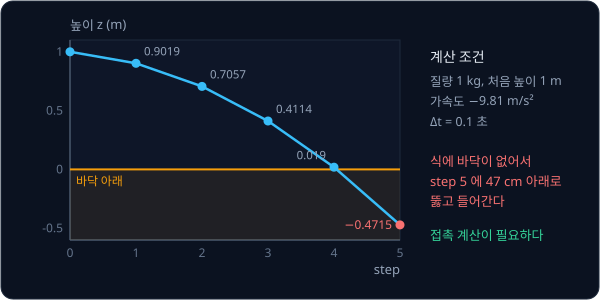

이 계산에는 바닥이 없어서 상자는 0.4 초에 바닥 바로 위 0.019 m 까지 내려온 뒤 다음 step 에서 바닥을 47 cm 뚫고 들어간다. 닿았는지 검사하고
미는 힘을 구하는 계산은 [접촉과 soft contact](#접촉과-soft-contact) 에서 다룬다.

MuJoCo 는 simulation 동안 바뀌지 않는 길이·질량·모양·motor 를 `mjModel` 에 두고, 매 step 바뀌는 상태(state)를 `mjData` 에 둔다. 상태는 위치와
속도인데, 위 표에서도 다음 step 을 계산하려면 지금 높이와 속도가 모두 필요했다.

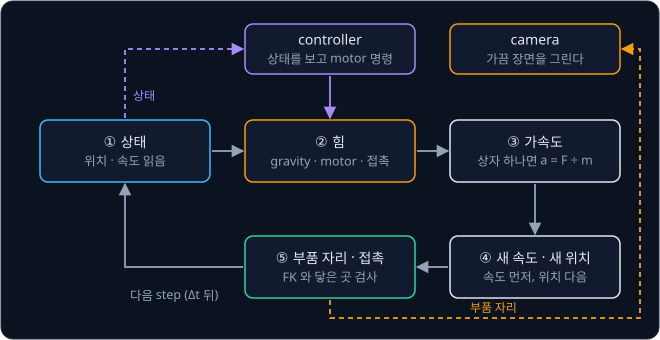

새 joint angle 에서 부품의 자리를 다시 구하는 계산은 [Forward Kinematics](../forward-kinematics/README.md) 이고, controller 가 정한 motor
명령은 힘을 모으는 단계에 들어간다.

MuJoCo Menagerie(Google DeepMind 의 로봇 모델 모음)의 SO-101 팔 모델을 MuJoCo 3.13 으로 노트북 CPU 한 코어에서 재 보면 step 하나에 약 3.2 µs
가 걸려서, timestep 이 5 ms 인 이 모델은 실제 시간보다 약 1560 배 빠르다. 실제 팔로 10 초 걸리는 시도를 100 만 번 하면 쉬지
않고 해도 $10 \times 10^6 \div 86400 \approx 116$ 일이 걸리지만, physics 계산은 2 시간이 안 걸린다.

**확인 문제.** 상자 두 개가 똑같이 높이 0.5 m 에 있는데 하나는 멈춰 있고 하나는 아래로 2 m/s 로 떨어지는 중이다. 가속도를 −10 m/s² 로
어림하고 $\Delta t = 0.1$ 초로 한 step 계산하면 두 상자의 새 높이는?

답 보기

| 상자 | 새 속도 = 속도 + (−10) × 0.1 | 새 높이 = 0.5 + 새 속도 × 0.1 |
| --- | --- | --- |
| 멈춘 상자 | 0 − 1 = −1 | 0.5 − 0.1 = 0.4 |
| 떨어지는 상자 | −2 − 1 = −3 | 0.5 − 0.3 = 0.2 |

답: 0.4 m 와 0.2 m 다. 위치가 같아도 속도가 다르면 다음 위치가 달라서 상태에는 속도가 꼭 들어가야 한다.

## 여러 joint 의 equation of motion

[PID Control](../pid-control/README.md) 의 pendulum(0.5 m 막대 끝에 1 kg 추)은 joint 가 하나라서 $I\alpha = \tau - b\,\omega - mgl\sin\theta$
한 줄로 움직임을 적었다. $I = ml^2 = 1 \times 0.5^2 = 0.25$ kg·m² 는 축을 돌리기 어려운 정도인 moment of inertia 이고, $\alpha$ 는
각가속도다. joint 가 둘 이상이면 한 joint 의 각도에 따라 다른 joint 가 받는 inertia 와 gravity 가 바뀌어서 이 식을 joint 마다 따로 쓸 수 없다.

### joint 두 개짜리 팔

어깨 joint 에 길이 0.5 m 인 위팔이 붙고, 위팔 끝의 팔꿈치 joint 에 길이 0.5 m 인 아래팔이 붙는다. 팔꿈치 자리와 손끝에 1 kg 추가 하나씩
달려 있고 막대 무게는 없다고 둔다. 어깨 각도는 $\theta_1$ 이고, 팔꿈치 각도 $\theta_2$ 는 위팔을 기준으로 재서 팔을 쭉 펴면 0° 다.

팔꿈치를 고정하고 어깨만 돌리면 팔 전체가 막대 하나처럼 돌고, inertia 는 추마다 질량 × (어깨까지 거리)² 를 더한 값이다. 팔을 펴면 손끝 추가
어깨에서 1 m 라 어깨 inertia 는 $1 \times 0.5^2 + 1 \times 1^2 = 1.25$ kg·m² 이고, 팔꿈치를 직각으로 굽히면 손끝 추까지 (거리)² 가
$0.5^2 + 0.5^2 = 0.5$ 라 $0.25 + 0.5 = 0.75$ kg·m² 다. 같은 1 N·m 에서 어깨의 각가속도는 $1 \div 1.25 = 0.8$ 과 $1 \div 0.75 \approx 1.33$
rad/s² 로 달라진다.

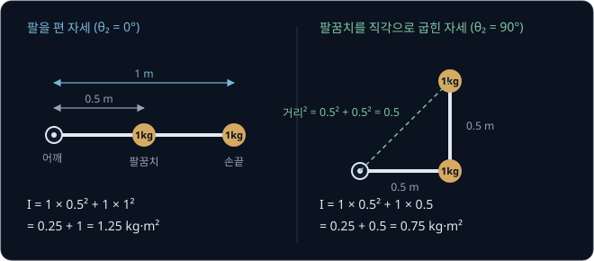

pendulum 의 $I$ 는 늘 0.25 였지만 팔의 inertia 는 팔꿈치 각도에 따라 바뀌어서, physics engine 은 이 값을 매 step 다시 계산한다.

### mass matrix

이번에는 팔꿈치도 풀어 두고, gravity 가 끼어들지 않게 팔을 책상 위에 눕혀 수평면에서만 움직이게 한다. 팔을 편 채 멈춘 상태에서 어깨에만
torque 1 N·m 를 준다.

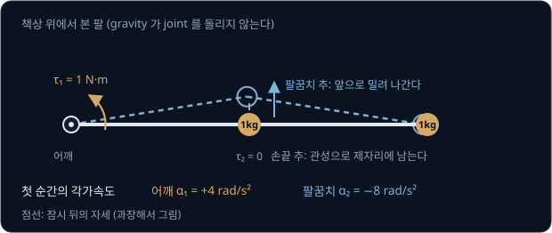

풀린 팔꿈치로는 아래팔이 손끝 추를 옆으로 밀어 주지 못해서, 손끝 추는 관성으로 제자리에 남고 팔꿈치가 $-8$ rad/s² 로 꺾인다. 어깨 torque 는
사실상 팔꿈치 추 하나만 돌리므로 어깨의 각가속도는 $1 \div 0.25 = 4$ 다. 두 joint 의 식으로 쓰면 아래와 같다.

$$
1.25\,\alpha_1 + 0.5\,\alpha_2 = \tau_1, \qquad 0.5\,\alpha_1 + 0.25\,\alpha_2 = \tau_2
$$

첫 식은 어깨의 torque 와 각가속도의 관계이고 둘째 식은 팔꿈치의 관계다. $\tau_1 = 1$, $\tau_2 = 0$ 을 넣어 풀면 $\alpha_1 = 4$,
$\alpha_2 = -8$ 이 나오는데, 식의 숫자 네 개를 행렬로 모은 것을 **mass matrix** $M$ 이라고 한다.

$$
M = \begin{bmatrix} 1.25 & 0.5 \\ 0.5 & 0.25 \end{bmatrix}
$$

왼쪽 위 1.25 는 팔꿈치를 고정했을 때의 어깨 inertia 이고, 오른쪽 아래 0.25 는 팔꿈치가 손끝 추 하나를 돌리는 inertia $1 \times 0.5^2$ 다.
대각선 밖의 0.5 는 한 joint 의 가속이 다른 joint 에 미치는 영향이라서, 이 값이 0 이었다면 어깨 torque 가 팔꿈치를 움직이지 않았을 것이다.
팔꿈치를 직각으로 굽히면 $M$ 의 대각선이 0.75 와 0.25 로 바뀌고 대각선 밖도 0.25 가 되어, 같은 $\tau = (1, 0)$ 에서 각가속도는 $(2, -2)$ 다.

<b>심화: 연립방정식 풀이와 M(θ₂) 의 일반 식</b>

편 자세에서 $\tau = (1, 0)$ 일 때의 풀이는 아래 순서다.

1. 둘째 식 $0.5\,\alpha_1 + 0.25\,\alpha_2 = 0$ 의 양변에 4 를 곱하면 $2\,\alpha_1 + \alpha_2 = 0$ 이라 $\alpha_2 = -2\,\alpha_1$ 이다
2. 첫 식에 넣으면 $1.25\,\alpha_1 - 1.0\,\alpha_1 = 0.25\,\alpha_1 = 1$ 이라 $\alpha_1 = 4$ 이고, 1 단계 식에서 $\alpha_2 = -8$ 이다
3. 검산: $1.25 \times 4 + 0.5 \times (-8) = 5 - 4 = 1$, $0.5 \times 4 + 0.25 \times (-8) = 2 - 2 = 0$

굽힌 자세는 둘째 식 $0.25\,\alpha_1 + 0.25\,\alpha_2 = 0$ 에서 $\alpha_2 = -\alpha_1$ 이고, 첫 식에 넣으면
$0.75\,\alpha_1 - 0.25\,\alpha_1 = 0.5\,\alpha_1 = 1$ 이라 $\alpha_1 = 2$, $\alpha_2 = -2$ 다.

이 팔의 mass matrix 는 팔꿈치 각도의 함수다.

$$
M(\theta_2) = \begin{bmatrix} 0.75 + 0.5\cos\theta_2 & 0.25 + 0.25\cos\theta_2 \\ 0.25 + 0.25\cos\theta_2 & 0.25 \end{bmatrix}
$$

$\cos 0° = 1$ 을 넣으면 1.25 와 0.5 가 나오고, $\cos 90° = 0$ 을 넣으면 0.75 와 0.25 가 나온다. 질량 $m_1$, $m_2$ 와 길이 $l_1$, $l_2$ 로 쓰면
왼쪽 위는 $m_1 l_1^2 + m_2(l_1^2 + l_2^2 + 2 l_1 l_2 \cos\theta_2)$ 이고, 대각선 밖은 $m_2(l_2^2 + l_1 l_2 \cos\theta_2)$, 오른쪽 아래는
$m_2 l_2^2$ 이다(Lynch & Park, Modern Robotics 8장).

### gravity torque 와 bias force

팔을 세우면 gravity 가 joint 를 돌린다. joint 마다 그보다 바깥에 있는 추의 무게(질량 × 9.81)에 수평 거리를 곱해 더하므로, 팔을 수평으로
펴면 어깨의 gravity torque 는 $9.81 \times 0.5 + 9.81 \times 1.0 = 14.715$ N·m 이고 팔꿈치는 $9.81 \times 0.5 = 4.905$ N·m 다. 아래팔을
늘어뜨리면 손끝 추가 팔꿈치 바로 아래로 와서 어깨는 9.81 N·m 로 줄고 팔꿈치는 0 이 된다.

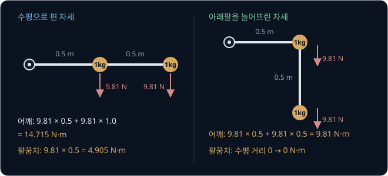

팔이 움직이는 동안에는 돌고 있는 추가 바깥으로 쏠리는 centrifugal 효과처럼 속도에서 생기는 torque 도 더해진다. 이 torque 와 gravity torque 를
joint 마다 합친 것이 **bias force** $c(q, \dot q)$ 로, motor 가 힘을 내지 않아도 팔을 움직이게 만드는 힘이다.

<b>심화: 속도에서 생기는 torque 의 크기</b>

팔꿈치를 직각으로 굽힌 채 어깨가 각속도 $\omega_1$ 로 돌면 손끝 추가 바깥으로 쏠리며 팔꿈치를 펴려고 한다. 이 팔에서 그 자세를 지키는 데 필요한
팔꿈치 torque 는 $m_2 l_1 l_2 \sin\theta_2\,\omega_1^2 = 0.25 \sin\theta_2\,\omega_1^2$ 다. $\theta_2 = 90°$, $\omega_1 = 2$ rad/s 면
$0.25 \times 1 \times 4 = 1$ N·m 이고, 4 rad/s 면 $0.25 \times 16 = 4$ N·m 로 각속도의 제곱에 비례해 커진다. 팔을 편 자세($\sin 0° = 0$)에서는 쏠리는
힘이 아래팔을 따라 곧게 당기기만 해서 팔꿈치를 돌리지 않는다.

### 전체 식

joint angle 들을 묶은 vector 를 $q$ 라 하고 각속도와 각가속도를 $\dot q$, $\ddot q$ 로 쓰면, joint 가 몇 개든 equation of motion 은 아래 꼴이다.

$$
M(q)\,\ddot q + c(q, \dot q) = \tau + \tau_{\text{접촉}}
$$

각가속도를 만드는 데 쓰인 torque 에 bias force 를 더한 값이 motor 와 접촉이 준 torque 의 합과 같다는 뜻이다. $M$ 은 pendulum 에서 0.25
하나였고, joint 가 6 개인 SO-101 에서는 $6 \times 6$ 행렬이다. MuJoCo 문서는 같은 식을 $M\dot v + c = \tau + J^\top f$($f$ 는 접촉 같은
constraint 의 힘)로 적고, 매 step 계산한 $c$ 를 `qfrc_bias` 에 담아 둔다.

> **오해** joint 마다 pendulum 식을 하나씩 따로 쓰면 된다.
>
> **사실** 어깨에만 torque 를 줘도 팔꿈치가 −8 rad/s² 로 꺾였듯 joint 들은 mass matrix 의 대각선 밖 숫자로 얽혀 있어서, 따로 계산하면 틀린 답이 나온다.

**확인 문제.** 팔을 편 채 멈춘 상태에서 이번에는 팔꿈치에만 torque 1 N·m 를 준다($\tau_1 = 0$, $\tau_2 = 1$, gravity 없음). 두 joint 의
각가속도는?

답 보기

편 자세의 식은 $1.25\,\alpha_1 + 0.5\,\alpha_2 = 0$, $0.5\,\alpha_1 + 0.25\,\alpha_2 = 1$ 이다.

1. 첫 식에서 $\alpha_1 = -0.5\,\alpha_2 \div 1.25 = -0.4\,\alpha_2$
2. 둘째 식에 넣으면 $0.5 \times (-0.4\,\alpha_2) + 0.25\,\alpha_2 = 0.05\,\alpha_2 = 1$ 이라 $\alpha_2 = 20$
3. $\alpha_1 = -0.4 \times 20 = -8$

답: 어깨는 −8 rad/s² 이고 팔꿈치는 20 rad/s² 다. 팔꿈치를 돌렸더니 어깨가 반대로 돈다.

## MJCF 모델 파일

physics engine 이 $M$ 과 $c$ 를 만들고 접촉을 계산하려면 URDF 에 적는 연결·joint 자리·축 말고도 질량과 inertia, 충돌용 모양과 마찰 계수,
actuator, timestep 이 더 필요하다. MuJoCo 의 모델 형식인 MJCF 는 이 정보를 `<body>` 같은 태그로 적는 XML 이다. MuJoCo 는 URDF 도 읽지만,
actuator 나 접촉 설정처럼 URDF 에 없는 정보는 MJCF 로 더 적어야 한다.

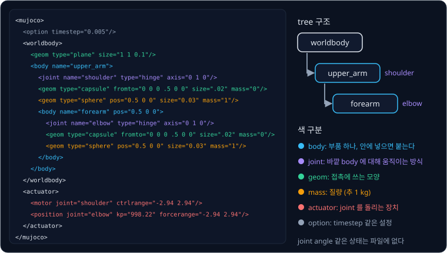

부품 하나가 **body** 이고, MuJoCo 는 body 를 휘지 않는 rigid body 로 계산한다. body 를 다른 body 안에 넣으면 바깥 body 에 붙어 있다는 뜻이라,
모델 전체는 맨 바깥의 `worldbody` 에서 시작하는 tree 가 된다. body 에 적은 joint 는 바깥 body 를 기준으로 움직이는 방식을 정하고, joint 가 없는
body 는 URDF 의 fixed joint 처럼 바깥 body 에 고정된다.

| MJCF joint | 움직임 | DOF | URDF 의 비슷한 것 |
| --- | --- | --- | --- |
| hinge | 축 하나를 중심으로 돈다 | 1 | revolute, continuous |
| slide | 축 방향으로 미끄러진다 | 1 | prismatic |
| ball | 한 점을 중심으로 어느 방향으로든 돈다 | 3 | 없음 |
| free | 공중에서 자유롭게 옮겨 가고 돈다 | 6 | 없음 |

DOF(degree of freedom)는 움직일 수 있는 방향의 수다. 로봇이 집을 상자처럼 어디에도 붙지 않은 물체에는 free joint 를 다는데, 방향을
quaternion(숫자 4 개)으로 적어서 위치는 자리 3 개와 방향 4 개로 7 개이고 속도는 옮겨 가는 속도 3 개와 각속도 3 개로 6 개다. MuJoCo 는 두
개수를 `nq` 와 `nv` 로 따로 센다.

| 장면 | 위치를 적는 숫자 `nq` | 속도를 적는 숫자 `nv` |
| --- | --- | --- |
| hinge 6 개짜리 SO-101 팔 | 6 | 6 |
| 상자 하나 (free joint) | $3 + 4 = 7$ | $3 + 3 = 6$ |
| SO-101 팔 + 상자 하나 | $6 + 7 = 13$ | $6 + 6 = 12$ |

### geom 과 질량

body 의 모양은 **geom** 으로 적는데, sphere·box·cylinder·capsule(양 끝이 반구인 원기둥) 같은 단순한 모양과 삼각형을 이어 붙인 mesh 가
있다. geom 은 접촉 계산에 쓰이고, 질량을 따로 적지 않으면 부피 × 밀도로 질량과 inertia 를 정하는 데도 쓰인다. 기본 밀도는 물과 같은
1000 kg/m³ 라서 한 변 0.1 m 인 상자 geom 은 $0.1^3 \times 1000 = 1$ kg 이다.

단순한 모양은 접촉 검사가 빠른데, 공 두 개라면 중심 거리가 반지름의 합(0.05 m + 0.03 m = 0.08 m)보다 작은지만 보면 된다. mesh 는 MuJoCo 가 그 mesh 를 감싸는 convex hull(안쪽으로 파인 곳이 없는 가장 작은 껍질)로
바꿔 접촉을 계산해서, 컵 안쪽이나 손가락 사이 홈처럼 오목한 곳은 메워진 것처럼 닿는다. 그래서 오목한 부품은 볼록한 조각 여러 개로 나눠 적는다.

같은 1 kg, 0.5 m 팔이라도 질량이 끝에 몰렸는지 고르게 퍼졌는지에 따라 inertia 가 0.25 와 0.083 kg·m² 로 세 배 차이 나므로, 모델의 질량
분포가 실물과 다르면 같은 torque 에서 움직임이 달라진다.

<b>심화: 질량 분포와 inertia</b>

| 모델 | 무게중심 (축에서) | inertia | torque 1 N·m 의 각가속도 | 수평 자세의 gravity torque |
| --- | --- | --- | --- | --- |
| 끝에 몰린 추 | 0.5 m | $1 \times 0.5^2 = 0.25$ | $1 \div 0.25 = 4$ | $9.81 \times 0.5 = 4.905$ |
| 고르게 퍼진 막대 | 0.25 m | $1 \times 0.5^2 \div 3 \approx 0.083$ | $1 \div 0.083 = 12$ | $9.81 \times 0.25 = 2.4525$ |

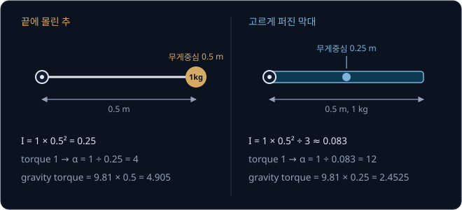

고르게 퍼진 막대는 질량의 많은 부분이 축 가까이에 있어 inertia 가 $ml^2 \div 3$ 으로 추의 3 분의 1 이고, 무게중심도 가운데라 gravity torque 가
절반이다.

### MuJoCo Menagerie 의 SO-101

Google DeepMind 는 2022 년부터 실제 로봇을 옮겨 적은 MJCF 모음인 MuJoCo Menagerie 를 공개하고 있다. SO-101 모델은 팔 joint 5 개와 집게
joint 1 개로 hinge 가 6 개이고 손목에 카메라가 달려 있는데, 원본 MJCF 에서 integrator 를 implicitfast 로 바꾸고 팔과 집게에 단순한 충돌용
geom 을 더했다. `<option>` 의 값을 MuJoCo 기본값과 비교하면 아래와 같다.

| `<option>` 항목 | 뜻 | MuJoCo 기본값 | Menagerie SO-101 |
| --- | --- | --- | --- |
| `timestep` | 한 step 의 시간 | 0.002 초 | 0.005 초 |
| `integrator` | 속도와 위치를 고치는 방법 | Euler | implicitfast |
| `solver` | 접촉 힘을 푸는 방법 | Newton | Newton (기본값 그대로) |
| `iterations` | solver 의 최대 반복 횟수 | 100 | 10 |
| `cone` | 마찰 한계의 모양 | pyramidal | elliptic |
| `impratio` | 마찰을 normal force 보다 얼마나 단단하게 할지 | 1 | 10 |

SO-101 의 URDF 와 MJCF 는 따로 만든 파일이라 숫자가 모두 같지는 않다. 모든 joint angle 이 0 인 자세에서 직접 계산해 보면 URDF 의
`gripper_frame_link` 와 MJCF 의 `gripperframe` site(모델에 이름 붙여 둔 점)가 19.9 mm 떨어져 있다. 그래서 URDF 로 [Inverse
Kinematics](../inverse-kinematics/README.md) 의 목표 joint angle 을 구하고 MJCF 로 도착한 자리를 재면 팔이 정확히 움직여도 2 cm 가까이 틀린
것처럼 보인다. 두 파일을 함께 쓸 때는 같은 점을 쓰는지부터 확인한다.

**확인 문제.** SO-101 팔 옆에 상자를 두 개 놓은 장면에서 `nq` 와 `nv` 는 각각 몇일까?

답 보기

hinge 하나는 위치 1 개와 속도 1 개이고, free joint 상자 하나는 위치 7 개와 속도 6 개다.

| | 팔 | 상자 1 | 상자 2 | 합 |
| --- | --- | --- | --- | --- |
| `nq` | 6 | 7 | 7 | 20 |
| `nv` | 6 | 6 | 6 | 18 |

답: `nq` = 20, `nv` = 18 이다.

## 접촉과 soft contact

physics engine 은 매 step 두 geom 이 겹쳤는지 검사하고, 겹쳤으면 접촉(contact)으로 보고 닿은 면에 수직으로 밀어내는 normal force 를 계산한다.
바닥에 가만히 놓인 1 kg 상자라면 바닥이 위로 9.81 N 을 밀어 gravity 와 균형을 이룬다. 그런데 step 단위로 끊어 계산하면 상자가 바닥에 조금
들어간 뒤에야 닿은 것을 알게 되므로, MuJoCo 는 조금 겹치는 것을 허용하고 겹친 깊이(penetration)에 따라 커지는 힘으로 밀어낸다. 이렇게 약간
말랑하게 계산하는 접촉을 **soft contact** 라고 한다.

바닥을 단단함(stiffness) $k = 10000$ N/m 인 용수철로 보면, 1 kg 상자가 멈춰 있으려면 $k \times (\text{침투}) = 9.81$ 이어야 해서 침투는
$9.81 \div 10000 \approx 0.001$ m, 약 1 mm 다. 속도에 맞서는 damping 도 함께 넣어 상자가 계속 튀지 않게 한다.

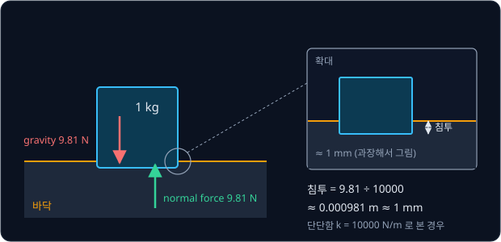

MuJoCo 는 이 단단함을 geom 의 `solref` 에 N/m 대신 시간으로 적는다. 기본값 `solref="0.02 1"` 의 첫 숫자 0.02 초는 겹침을 얼마나 빨리
되돌리려 하는지 나타내는 time constant 로, 클수록 무른 접촉이 된다. 둘째 숫자 1 은 damping ratio 로, 1 이면 튀지 않으면서 가장 빨리 가라앉는
critical damping 이다. 침투 깊이에 따라 단단함을 얼마나 키울지는 `solimp`(기본 `0.9 0.95 0.001 0.5 2`)가 정한다.

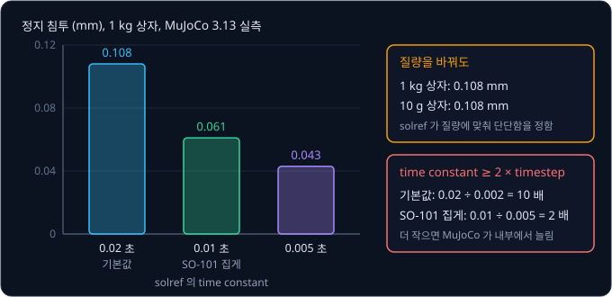

위 그림은 한 변 10 cm 상자를 바닥에 놓고 MuJoCo 3.13 으로 3 초 동안 simulation 한 뒤 잰 침투다. 질량을 1 kg 에서 10 g 으로 바꿔도 침투가
0.108 mm 로 같은데, `solref` 가 질량에 맞춰 단단함을 정해서 가볍든 무겁든 같은 시간 안에 겹침을 되돌리기 때문이다.

<b>심화: solref 와 정지 침투의 식</b>

MuJoCo 문서(Modeling 장의 Solver parameters)는 `solref` 의 time constant 와 damping ratio 로 constraint 의 단단함 $k$ 와 damping $b$ 를 아래처럼
정한다. $d$ 는 `solimp` 가 정하는 impedance(0 ~ 1)이고 $d_\mathrm{w}$ 는 `solimp` 의 둘째 값이다.

$$
b = \frac{2}{d_\mathrm{w}\,\text{timeconst}}, \qquad k = \frac{d(r)}{d_\mathrm{w}^2\,\text{timeconst}^2\,\text{dampratio}^2}
$$

impedance 가 일정하다고 두면 정지 침투는 $r = a_u\,(1 - d)\,\text{timeconst}^2\,\text{dampratio}^2$ 이다. $a_u$ 는 접촉이 없을 때의 가속도라서
바닥에 놓인 상자라면 gravity 가속도 9.81 이고, 식에 질량이 없으니 침투도 질량과 상관없다. 식대로라면 time constant 를 절반으로 줄일 때 침투가
4 분의 1 이 되어야 하지만, 실제로 잰 침투는 0.108 mm 에서 0.061 mm 로 줄었다. $d$ 가 침투 깊이에 따라 0.9 와 0.95 사이에서 바뀌고, 상자는
네 모서리가 닿기 때문이다. `solref` 에 음수 두 개를 적으면 단단함과 damping 을 직접 주는 형식이 되는데, 문서는 system identification 에는 이
형식을 권한다.

접촉 힘은 닿기 직전까지 0 이다가 닿는 순간 수 N 으로 뛰고, 상자의 네 모서리처럼 여러 곳이 동시에 닿으면 한 곳의 힘이 다른 곳의 힘을 바꾼다.
그래서 MuJoCo 는 한 step 안에서 모든 접촉점의 힘과 마찰을 constraint solver 로 함께 구한다. 기본 solver 인 Newton 은 최대 100 번 반복하다가
오차가 `tolerance`(기본 $10^{-8}$)보다 작아지면 멈춘다.

**확인 문제.** 접촉을 단단함 5000 N/m 인 용수철로 보면 바닥에 놓인 1 kg 상자는 대략 몇 mm 파묻힐까?

답 보기

정지하려면 $5000 \times (\text{침투}) = 9.81$ 이어야 하므로 침투는 $9.81 \div 5000 \approx 0.00196$ m, 약 2 mm 다. 단단함이 10000 N/m 의 절반이라
침투는 두 배다.

## 마찰과 grasp

바닥에 놓인 상자를 옆으로 밀면 마찰이 미끄러짐을 막는데, 마찰 힘의 크기에는 한계가 있다.

$$
\text{마찰 힘} \le \mu \times (\text{normal force})
$$

$\mu$(mu)는 두 면이 얼마나 미끄러지기 어려운지를 나타내는 friction coefficient 이고, 이 규칙을 Coulomb friction 이라고 한다. 1 kg 상자를
$\mu = 1$ 인 바닥에서 밀면 한계는 $1 \times 9.81 = 9.81$ N 이다.

| 미는 힘 | 마찰 힘의 한계 | 실제 마찰 힘 | 힘의 합 | 가속도 |
| --- | --- | --- | --- | --- |
| 5 N | 9.81 N | 5 N | 0 | 0 (움직이지 않음) |
| 9.81 N | 9.81 N | 9.81 N | 0 | 0 (미끄러지기 직전) |
| 12 N | 9.81 N | 9.81 N | $12 - 9.81 = 2.19$ N | 2.19 m/s² |

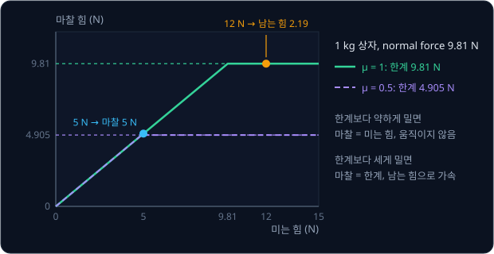

MuJoCo geom 의 마찰 기본값 `friction="1 0.005 0.0001"` 의 세 숫자는 차례로 미끄러짐(sliding)의 $\mu$, 접촉점을 축으로 비틀리는 회전
(torsional)을 막는 계수, 구르는 회전(rolling)을 막는 계수다. 기본 `condim="3"` 에서는 미끄러짐만 막고 `condim="6"` 이면 비틀림과 구름까지 막는다.
닿은 두 geom 의 값이 다르면 `priority` 가 높은 쪽의 값을 쓰고, priority 가 같으면 항목마다 큰 값을 쓴다.

> **오해** 마찰 힘은 늘 $\mu \times (\text{normal force})$ 다.
>
> **사실** 그 값은 한계일 뿐이고, 미끄러지지 않는 동안의 마찰 힘은 미는 힘만큼만 생긴다. 5 N 으로 민 상자가 9.81 N 의 마찰을 받는다면 상자가 거꾸로 밀려 와야 한다.

### 집게로 물체를 들 때

두 손가락이 0.1 kg 큐브(무게 $0.1 \times 9.81 = 0.981$ N)를 양옆에서 누르면 누르는 힘이 손가락 면의 normal force 가 되어, 손가락 하나가
위로 받쳐 줄 수 있는 마찰은 $\mu \times (\text{누르는 힘})$ 까지다. 큐브가 미끄러지지 않으려면 $2 \times \mu \times (\text{누르는 힘}) \ge 0.981$
이어야 한다.

| $\mu$ | 손가락마다 0.6 N 으로 누를 때 마찰의 한계 $2 \times \mu \times 0.6$ | 결과 | 필요한 최소 누르는 힘 $0.981 \div (2\mu)$ |
| --- | --- | --- | --- |
| 1 | 1.2 N | 들린다 | 0.49 N |
| 0.6 | 0.72 N | 미끄러진다 | 0.82 N |

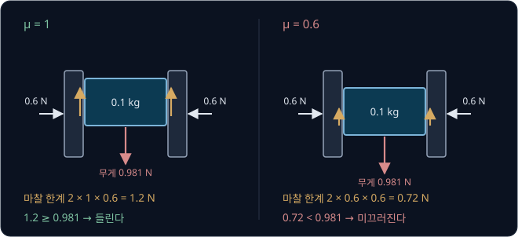

simulation 에서 $\mu = 1$ 로 학습한 집기 동작을 $\mu = 0.6$ 인 매끈한 실물 큐브에 쓰면 큐브가 손가락 사이로 빠진다. MuJoCo 문서도 미끄러짐을
고칠 때 먼저 집게의 최대 힘 × sliding friction 계수가 물체 무게보다 충분히 큰지 확인하라고 적는다.

마찰 한계 안쪽이어도 soft contact 는 속도가 정확히 0 인 상태를 보장하지 않아서, 오래 쥐고 있으면 물체가 천천히 미끄러질 수 있다(slow
slippage). 문서는 `cone` 을 elliptic 으로 바꾸고 `impratio` 를 1 보다 크게 해 마찰을 normal force 보다 단단하게 만들거나, `noslip_iterations` 를
1 ~ 3 으로 켜라고 권한다. Menagerie 의 SO-101 은 elliptic cone 에 `impratio="10"` 을 쓰고, 집게의 충돌용 geom 에 `condim="6"`,
`friction="1 5e-3 5e-4"`, `solref="0.01 1"`, `priority="1"` 을 준다.

**확인 문제.** $\mu = 0.5$ 인 손가락 두 개로 0.2 kg 물체를 집으려면 손가락마다 최소 몇 N 으로 눌러야 할까?

답 보기

1. 물체의 무게는 $0.2 \times 9.81 = 1.962$ N 이다
2. 미끄러지지 않으려면 $2 \times 0.5 \times (\text{누르는 힘}) \ge 1.962$ 이고, $2 \times 0.5 = 1$ 이라 누르는 힘이 1.962 N 이상이어야 한다

답: 손가락마다 1.962 N 이상이다.

## timestep 과 안정성

physics engine 의 $\Delta t$ 를 timestep 이라고 하고, MuJoCo 기본값은 0.002 초(1 초에 500 step)다. MuJoCo 문서는 timestep 을 속도와
정확도의 trade-off 를 정하는 가장 중요한 parameter 로 꼽는데, 작을수록 정확하고 안정하지만 step 수가 늘고 너무 크면 값이 끝없이 커지는 발산이
생긴다.

### 용수철로 본 timestep 의 한계

접촉을 용수철처럼 계산하므로 용수철 하나로 timestep 의 영향을 볼 수 있다. 단단함 $k = 100$ N/m 인 용수철에 1 cm 눌려 있던 1 kg 물체를 놓으면
용수철은 벗어난 거리 $x$ 의 반대쪽으로 $-kx$ 의 힘을 낸다. semi-implicit Euler 로 계산하면 $\Delta t = 0.1$ 초에서는 물체가 −0.01 m 와 0.01 m
사이를 오가지만, $\Delta t = 0.3$ 초에서는 −0.08, 0.55, −3.77, 25.84 m 로 부호를 바꾸며 점점 멀리 튄다.

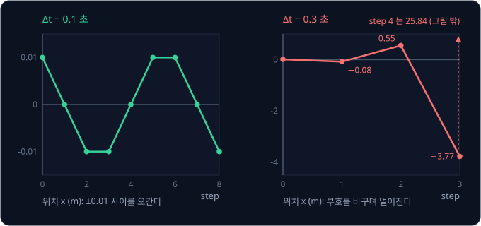

$\Delta t = 0.3$ 에서는 첫 step 의 힘 −1 N 이 0.3 초 동안 그대로 작용해 물체를 원래 자리 너머 −0.08 m 까지 보내고, 그 자리의 더 큰 힘이 다시
반대쪽으로 더 멀리 보낸다. 물체가 세 step 만에 25 m 밖으로 날아가는 것은 물리 법칙이 아니라 계산 방식 때문이고, 발산하지 않으려면 아래 조건을
지켜야 한다.

$$
\Delta t < 2\sqrt{\frac{m}{k}}
$$

$k = 100$, $m = 1$ 이면 $2\sqrt{1 \div 100} = 0.2$ 초가 경계라서 0.1 초는 안정하고 0.3 초는 발산한다. MuJoCo 문서는 같은 한계를
$h \lesssim 2/\omega_{\max}$ 로 적는데, $h$ 는 timestep 이고 $\omega_{\max}$ 는 모델에서 가장 빨리 진동하는 부분의 각진동수(용수철이라면
$\sqrt{k/m}$)다.

| 단단함 $k$ (N/m) | 질량 $m$ (kg) | 경계 $2\sqrt{m / k}$ (초) | 1 초에 필요한 최소 step 수 |
| --- | --- | --- | --- |
| 100 | 1 | 0.2 | 5 |
| 10000 | 1 | 0.02 | 50 |
| 1000000 | 1 | 0.002 | 500 |
| 10000 | 0.01 | 0.002 | 500 |

접촉이 단단하고 부품이 가벼울수록 timestep 이 작아야 해서, 같은 $k = 10000$ 바닥이라도 10 g 부품이 올라가면 경계가 0.002 초로 떨어진다.
MuJoCo 의 `solref` 는 단단함을 질량에 맞춰 정하므로 질량 대신 time constant 와 timestep 의 비율을 본다. 문서는 time constant 를 timestep 의
2 배 이상으로 두라고 하고, 기본으로 켜져 있는 `refsafe` flag 가 이를 강제한다. 기본값은 0.02 초 ÷ 0.002 초 = 10 배이고, SO-101 집게는
0.01 초 ÷ 0.005 초 = 2 배로 하한에 딱 맞다.

<b>심화: 두 timestep 의 step 표와 안정 조건</b>

$\Delta t = 0.1$ 초:

| step | 위치 $x$ | 속도 $v$ | 힘 $-100x$ | 새 속도 $v + \text{힘} \times 0.1$ | 새 위치 $x + \text{새 속도} \times 0.1$ |
| --- | --- | --- | --- | --- | --- |
| 0 | 0.01 | 0 | −1 | −0.1 | 0 |
| 1 | 0 | −0.1 | 0 | −0.1 | −0.01 |
| 2 | −0.01 | −0.1 | 1 | 0 | −0.01 |
| 3 | −0.01 | 0 | 1 | 0.1 | 0 |
| 4 | 0 | 0.1 | 0 | 0.1 | 0.01 |

$\Delta t = 0.3$ 초:

| step | 위치 $x$ | 속도 $v$ | 힘 $-100x$ | 새 속도 $v + \text{힘} \times 0.3$ | 새 위치 $x + \text{새 속도} \times 0.3$ |
| --- | --- | --- | --- | --- | --- |
| 0 | 0.01 | 0 | −1 | −0.3 | −0.08 |
| 1 | −0.08 | −0.3 | 8 | 2.1 | 0.55 |
| 2 | 0.55 | 2.1 | −55 | −14.4 | −3.77 |
| 3 | −3.77 | −14.4 | 377 | 98.7 | 25.84 |

조건 $\Delta t < 2\sqrt{m/k}$ 는 $k\,\Delta t^2 / m < 4$ 와 같다.

| $\Delta t$ | $k \Delta t^2 / m = 100 \times \Delta t^2$ | 4 보다 작은가 | 결과 |
| --- | --- | --- | --- |
| 0.1 | $100 \times 0.01 = 1$ | 예 | 오간다 |
| 0.19 | $100 \times 0.0361 = 3.61$ | 예 | 오간다 |
| 0.21 | $100 \times 0.0441 = 4.41$ | 아니오 | 발산한다 |
| 0.3 | $100 \times 0.09 = 9$ | 아니오 | 발산한다 |

PID 의 P 항도 오차에 비례하는 힘을 내므로 용수철과 같은 꼴이고, P 제어를 계산할 때도 $K_p \Delta t^2 / m$ 꼴의 같은 숫자가 안정성을 정한다.

### integrator 와 계산 시간

속도와 위치를 고치는 방법을 integrator 라고 한다. MuJoCo 의 기본값 Euler 는 semi-implicit Euler 에서 joint damping 만 다음 순간의 값으로
계산(implicit)한다. 문서는 계산량이 비슷하면서 더 안정한 implicitfast 를 대부분의 모델에 권하고, position actuator 에 속도 gain 을 쓸 때도
implicitfast 나 implicit 을 쓰라고 하는데, SO-101 도 implicitfast 를 쓴다.

<b>심화: MuJoCo 의 integrator</b>

`<option integrator>` 로 고르는 integrator 는 아래와 같다(MuJoCo 문서 Computation 장의 Numerical Integration).

| integrator | 계산 방법 | 쓰임 |
| --- | --- | --- |
| Euler (기본값) | semi-implicit Euler, joint damping 만 implicit | 예전 모델과의 호환 |
| implicit | 접촉 힘을 뺀 모든 힘의 속도 미분을 넣어 다음 순간 기준으로 계산 | 여러 link 진자처럼 회전이 서로 얽힌 계 |
| implicitfast | implicit 에서 Coriolis·centrifugal 힘의 미분을 빼서 더 빠름 | 문서가 대부분의 모델에 권하는 선택, Menagerie 의 SO-101 |
| RK4 | 한 step 안에서 계산을 네 번 하는 4차 Runge–Kutta | 에너지가 거의 보존되는 계 |

문서는 explicit Euler(위치를 먼저 옮기고 속도를 나중에 고치는 방법)를 지원하지 않는다고 적는데, semi-implicit Euler 가 계산량은 같으면서 더
안정하기 때문이다. 3.17 문서에는 접촉 계산과 implicit 계산을 한 번에 하는 discrete integrator 도 있다.

timestep 을 줄이면 계산 시간이 는다. 앞에서 잰 SO-101 의 step 당 약 3.2 µs 로 계산하면 아래와 같다.

| timestep | simulation 1 초의 step 수 | 계산 시간 | 실제 시간 대비 배속 |
| --- | --- | --- | --- |
| 5 ms | 200 | 0.64 ms | 약 1560 배 |
| 2 ms | 500 | 1.6 ms | 약 625 배 |
| 0.5 ms | 2000 | 6.4 ms | 약 156 배 |

실시간으로 simulation 하려면 timestep 이 step 하나의 계산 시간보다 커야 하고(RK4 는 4 배), 접촉이 많은 장면일수록 step 하나가 오래 걸린다.
학습처럼 빠를수록 좋은 경우에는 발산하지 않는 범위에서 timestep 을 최대한 크게 잡는다.

> **오해** simulation 이 튀면 모델의 물리가 틀린 것이다.
>
> **사실** 용수철에서 봤듯 같은 모델도 timestep 만 0.1 초에서 0.3 초로 바꾸면 발산하므로, 물체가 갑자기 날아가면 먼저 timestep 과 접촉의 단단함을 의심한다.

**확인 문제.** $k = 400$ N/m, $m = 1$ kg 인 용수철을 semi-implicit Euler 로 계산할 때 발산하지 않는 $\Delta t$ 의 경계는? $\Delta t = 0.12$
초로 계산하면 어떻게 될까?

답 보기

1. 경계는 $2\sqrt{1 \div 400} = 2 \times 0.05 = 0.1$ 초다
2. $\Delta t = 0.12$ 이면 $k\,\Delta t^2 / m = 400 \times 0.0144 = 5.76$ 으로 4 를 넘는다

답: 경계는 0.1 초이고, 0.12 초로 계산하면 발산한다.

## actuator 와 제어

모델 파일에서 joint 를 돌리는 장치를 **actuator** 라고 한다. actuator 는 controller 가 주는 숫자 하나(control input)를 받아 joint 에 torque 를
내는데, 그 숫자를 torque 로 바꾸는 규칙에 따라 종류가 나뉜다.

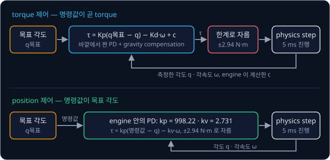

`<motor>` 는 명령값을 그대로 torque 로 내는 torque 제어라서, PD 같은 controller 를 바깥에서 짜서 $\tau = K_p\,(q_{\text{목표}} - q) - K_d\,\dot q$
를 계산해 넣는다. `<position>` 은 명령값으로 목표 각도를 받고 engine 안에서

$$
\tau = k_p\,(\text{명령값} - q) - k_v\,\dot q
$$

를 계산하는 position 제어다. 기본값은 $k_p = 1$, $k_v = 0$ 이고 `forcerange` 로 torque 의 한계를 정한다. 목표 각도를 받아 안에서 PID 로
motor 를 움직이는 SO-101 의 STS3215 servo 와 같은 방식이다.

Menagerie 의 SO-101 은 position actuator 에 $k_p = 998.22$ N·m/rad, $k_v = 2.731$ N·m·s/rad, `forcerange="-2.94 2.94"` 를 쓰는데, 모델 파일의
주석에 따르면 LeRobot 의 servo gain 을 그대로 옮기지 않고 servo 의 P gain 을 16 으로 가정해 계산한 값이다. 멈춘 joint 가 목표에서 0.1 rad
떨어져 있으면 계산한 torque 는 $998.22 \times 0.1 = 99.8$ N·m 지만 한계에 걸려 2.94 N·m 로 잘린다. 이렇게 잘리는 것을 saturation 이라고 하며,
한계에 닿기 시작하는 오차는 $2.94 \div 998.22 \approx 0.00295$ rad, 약 0.17° 다.

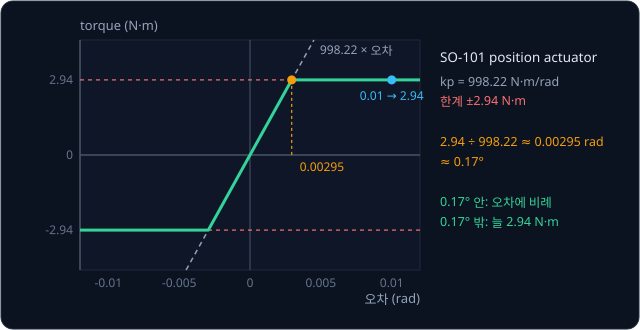

오차가 1° 든 30° 든 joint 는 늘 2.94 N·m 로 똑같이 밀리고, 멀수록 세게 미는 PD 처럼 동작하는 것은 목표에서 0.17° 안쪽뿐이다.

> **오해** position 제어에서는 명령값을 넣는 순간 joint 가 그 각도로 옮겨 간다.
>
> **사실** joint 는 engine 이 계산한 torque 를 받아 equation of motion 을 따라 가속하고 감속하며 다가가므로 시간이 걸리고, gravity 때문에 목표를 지나치거나 못 미칠 수도 있다.

### gravity compensation

PD 만으로 팔을 붙잡으면 멈춘 뒤에는 D 항이 0 이라 P 항 혼자 gravity 를 버텨야 해서, (gravity torque) ÷ P gain 만큼 처진 채 남는다. MuJoCo 3.13
으로 SO-101 의 모든 joint angle 을 0 으로 두고 계산한 bias force 의 크기는 `shoulder_lift` 가 0.573 N·m 이고, `elbow_flex` 는
0.483 N·m 이며 `wrist_flex` 는 0.130 N·m 다.

| 제어 | P gain | `shoulder_lift` 의 처짐 |
| --- | --- | --- |
| 바깥에서 짠 PD (torque 제어) | $K_p = 10$ | $0.573 \div 10 = 0.0573$ rad $\approx 3.3°$ |
| Menagerie 의 position actuator | $k_p = 998.22$ | $0.573 \div 998.22 \approx 0.00057$ rad $\approx 0.033°$ |
| PD + gravity compensation | $K_p = 10$ | 0 |

physics engine 은 매 step bias force $c(q, \dot q)$ 를 계산해 두므로 그 값을 torque 에 그대로 더할 수 있다.

$$
\tau = K_p\,(q_{\text{목표}} - q) - K_d\,\dot q + c(q, \dot q)
$$

더한 bias force 가 gravity 와 속도에 따른 torque 를 미리 상쇄하므로 PD 는 목표와의 차이만 고치면 되는데, 이 방법을 **gravity compensation**
이라고 한다. pendulum 하나의 $mgl\sin\theta$ 는 손으로 계산할 수 있지만 joint 가 여럿이면 engine 이 모델 파일로 계산한 값을 쓴다. 이 자세에서
`shoulder_lift` 는 gravity 를 버티는 데만 한계 2.94 N·m 의 약 20%($0.573 \div 2.94 \approx 0.19$)를 쓴다.

### physics step, 제어 주기, 카메라 frame

SO-101 의 physics 는 5 ms 마다(1 초에 200 번) 계산하므로, controller 가 20 ms 마다(1 초에 50 번) 명령값을 정하면 명령값 하나가 physics step
4 번 동안 그대로 쓰인다. 30 fps 카메라 영상은 $1000 \div 30 \approx 33.3$ ms 마다 한 장이면 되고 그림 한 장을 그리는 데는 physics step 보다 훨씬
오래 걸려서, simulation 시각이 frame 시각을 처음 넘는 step 에서만 그린다(33.3 ms 의 frame 은 35 ms step 에서).

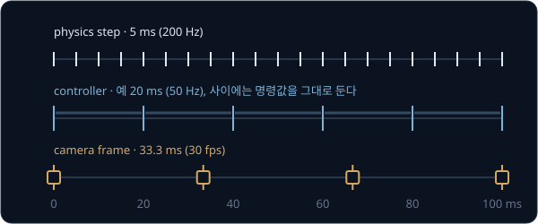

실제 로봇에서는 명령이 motor 에 닿기까지 시간이 걸리는데, MuJoCo 3.17 문서의 actuator 에는 정한 시간만큼 지난 명령값을 읽게 하는 `delay`
속성이 있다.

**확인 문제.** physics timestep 이 2 ms 이고 controller 가 100 Hz 로 계산한다. 명령값 하나가 physics step 몇 번 동안 쓰일까? `elbow_flex` 의
bias force 0.483 N·m 를 $K_p = 5$ 인 PD 만으로 버티면 대략 몇 rad 처질까?

답 보기

1. controller 는 $1000 \div 100 = 10$ ms 마다 계산하고, 그동안 physics step 은 $10 \div 2 = 5$ 번 진행된다
2. 처짐은 $0.483 \div 5 \approx 0.097$ rad, 약 5.5° 다

답: 5 번, 약 0.097 rad 다. gravity compensation 으로 0.483 N·m 를 미리 더하면 처짐은 0 이 된다.

## sim-to-real gap

simulation 에서 잘 되던 동작이 실제 로봇에서 잘 안 되는 차이를 **sim-to-real gap** 이라고 한다. 원인은 모델 파일의 숫자가 실물과 다른 경우와
실물의 현상이 모델에 아예 없는 경우로 나뉜다.

실제 SO-101 의 부품이 모델보다 20% 무거우면 `shoulder_lift` 가 버텨야 하는 torque 는 $0.573 \times 1.2 = 0.688$ N·m 인데 gravity compensation
은 0.573 N·m 만 더한다. 남는 $0.688 - 0.573 = 0.115$ N·m 를 $K_p = 10$ 인 PD 가 버티면 $0.115 \div 10 = 0.0115$ rad 처지고, `shoulder_lift` 축에서
집게 끝까지가 약 0.35 m 라서 집게 끝은 $0.35 \times 0.0115 \approx 0.004$ m, 약 4 mm 내려간다. 마찰 계수가 틀리면 앞의 집기 표처럼 큐브가
미끄러지고, convex hull 로 홈이 메워지면 simulation 과 다른 곳이 닿는다.

모델에 아예 없는 현상으로는 명령이 servo 에 반영되기까지의 지연, 기어 틈만큼 link 가 흔들리는 backlash, 각도 측정값의 noise, 온도와 전압에 따라
줄어드는 motor torque, 장면마다 조명과 반사가 다른 카메라 영상이 있다. joint 가 1 rad/s 로 움직이는 중에 명령이 20 ms 늦게 닿으면 그사이
$1 \times 0.02 = 0.02$ rad(약 1.1°)를 더 가 있는데, 지연 없이 학습한 controller 는 이런 어긋남을 겪어 본 적이 없다.

**system identification** 은 부품 무게를 달고 joint 를 흔들어 마찰과 damping 을 재는 식으로 실물을 측정해 모델 숫자를 고친다. **domain
randomization** 은 학습 중 episode(처음부터 끝까지 한 번의 시도)를 시작할 때마다 모델 숫자를 정한 범위 안에서 무작위로 다시 뽑아, 그 범위
어디에서도 통하는 policy 를 배우게 한다. 서론의 Shadow hand 연구는 실제 손의 움직임에 맞춰 MuJoCo 모델의 joint damping·마찰 손실·actuator gain
등을 먼저 고치고, 숫자 대부분을 그 보정값을 중심으로 아래 범위에서 episode 마다 뽑았다. 모델에 없는 기어 틈과 명령 지연·noise 도 simulation
에 일부러 넣었다.

| 무작위로 바꾼 숫자 (논문 Table 1) | 원래 값에 곱한 배율의 범위 |
| --- | --- |
| 물체 크기 | 0.95 ~ 1.05 |
| 물체와 로봇 link 의 질량 | 0.5 ~ 1.5 |
| 면의 마찰 계수 | 0.7 ~ 1.3 |
| joint damping | 0.3 ~ 3.0 (log 눈금에서 고르게) |
| actuator 의 P gain | 0.75 ~ 1.5 (log 눈금에서 고르게) |

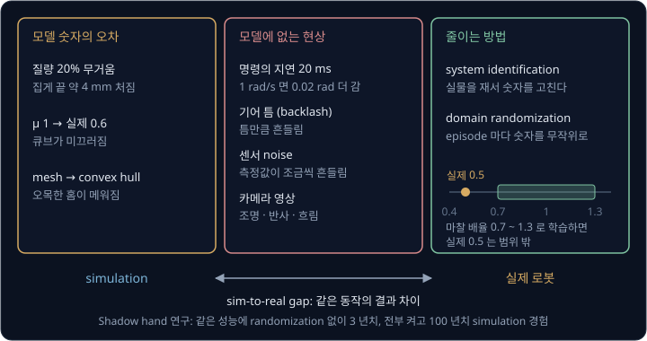

범위는 실제 값을 포함해야 효과가 있지만, 넓힐수록 학습에 드는 경험도 는다. 논문에서 물체 돌리기는 randomization 없이 약 3 년치 simulation
경험(실제 시간 약 1.5 시간)으로 배웠는데, 모든 randomization 을 켜고 같은 성능에 이르는 데는 서론의 100 년치가 들었다. 걷는 로봇에 쓰는 domain
randomization 은 [Sim-to-Real Locomotion](../sim2real-locomotion/README.md) 에서 다룬다.

> **오해** simulator 는 정확하지 않으니 쓸모없다.
>
> **사실** simulator 는 빠르고 부서지지 않으며 같은 장면을 정확히 되풀이할 수 있고, 실물에서는 잴 수 없는 접촉 힘도 읽을 수 있다. 그래서 simulation 에서 동작을 다듬어 실물에서 확인하고, 드러난 차이를 다시 모델에
> 반영한다.

**확인 문제.** domain randomization 으로 마찰 계수를 보정한 값의 0.7 ~ 1.3 배에서 뽑으며 집기를 학습했다. 보정한 값이 1 인데 실제 큐브의
마찰 계수가 0.5 라면 무엇이 문제일까?

답 보기

학습한 범위는 $1 \times 0.7 = 0.7$ 부터 $1 \times 1.3 = 1.3$ 까지라서 실제 값 0.5 는 범위 밖이다. policy 는 이렇게 미끄러운 큐브를 겪어 본 적이 없어
누르는 힘이 모자라 미끄러질 수 있다. 실제 마찰을 재서 보정값을 고치거나(system identification), 범위가 0.5 를 포함하도록 넓혀야 한다.

## 정리

- physics engine 은 timestep 마다 equation of motion $M(q)\ddot q + c(q, \dot q) = \tau + \tau_{\text{접촉}}$ 을 풀어 속도와 위치를 고친다.
  $M$ 은 자세마다 바뀌고 대각선 밖 숫자로 joint 들을 얽어서, 두 joint 팔의 어깨에만 1 N·m 를 줘도 팔꿈치가 −8 rad/s² 로 꺾인다
- MuJoCo 기본 `solref` 에서 1 kg 상자는 0.1 mm 쯤 파고든다. 마찰 힘은 $\mu \times$ normal force 까지만 생기고, 집게가 물체를 들 수 있는지도
  이 한계로 정해진다
- timestep 이 $2\sqrt{m/k}$ 를 넘으면 발산한다. SO-101 의 position actuator 는 목표에서 0.17° 만 벗어나도 한계 2.94 N·m 에 걸리고, 멈춘 팔의
  처짐은 bias force 를 더하는 gravity compensation 으로 없앤다
- 모델 숫자의 오차와 모델에 없는 현상이 sim-to-real gap 을 만드는데, system identification 은 숫자를 실물에 맞추고 domain randomization 은
  숫자를 범위 안에서 바꿔 가며 학습한다

팔을 원하는 곳으로 보내는 방법은 갖췄지만 무엇을 어디서 집을지는 아직 정하지 않았다. 카메라로 물체를 찾아 IK·경로·실행으로 집는 순서를 사람이
짠 파이프라인은 [Classical Pick & Place](../classical-pick/README.md) 에서 다룬다. 사람이 조종한 시연을 학습 데이터로 모으는 방법은 [Teleop
Dataset](../teleop-dataset/README.md) 에서 다루고, 손끝의 힘과 단단함을 정하는 제어는 [Force & Impedance Control](../impedance-control/README.md)
에서 다룬다.

## 참고 자료

- Todorov, Erez, Tassa, [MuJoCo: A physics engine for model-based control](https://doi.org/10.1109/IROS.2012.6386109) (2012) — MuJoCo 를 처음
  발표한 논문. generalized coordinate 로 쓴 여러 joint 의 dynamics 와 접촉 계산을 정리했다
- MuJoCo 문서 [Overview](https://mujoco.readthedocs.io/en/stable/overview.html) — body·joint·geom·actuator 와 `mjModel`·`mjData` 의 구분.
  [MJCF 모델 파일](#mjcf-모델-파일) 절과 함께 읽는다
- MuJoCo 문서 [Computation](https://mujoco.readthedocs.io/en/stable/computation/index.html) — $M\dot v + c = \tau + J^\top f$, constraint solver,
  integrator 의 정의와 고르는 기준. [timestep 과 안정성](#timestep-과-안정성) 절과 함께 읽는다
- MuJoCo 문서 [Modeling](https://mujoco.readthedocs.io/en/stable/modeling.html) — `solref`·`solimp` 의 식과 "Preventing slip" 의 미끄러짐 대처법
- [MJCF XML reference](https://mujoco.readthedocs.io/en/stable/XMLreference.html) — `timestep`·`integrator`·`cone`·`impratio`·`friction`·`kp`·`kv`
  같은 항목의 기본값과 뜻
- MuJoCo Menagerie [robotstudio_so101](https://github.com/google-deepmind/mujoco_menagerie/tree/main/robotstudio_so101) — 이 강의의 SO-101 모델.
  `so101.xml` 의 `<option>` 과 actuator 주석, README 의 변경 목록을 볼 수 있다
- OpenAI 외, [Learning Dexterous In-Hand Manipulation](https://arxiv.org/abs/1808.00177) (2018) — MuJoCo 에서 domain randomization 으로 학습해 실제
  Shadow hand 로 옮긴 연구. Table 1 의 randomization 범위와 부록의 MuJoCo 모델 보정 과정을 읽는다
- MuJoCo 공식 [tutorial notebook](https://colab.research.google.com/github/google-deepmind/mujoco/blob/main/python/tutorial.ipynb) — 브라우저에서
  상자 떨어뜨리기, 접촉, 마찰을 직접 실행해 보는 예제
- Lynch & Park, [Modern Robotics](https://hades.mech.northwestern.edu/index.php/Modern_Robotics) — 8장 dynamics 에서 mass matrix 와 여러 joint 의
  equation of motion 을 유도한다
