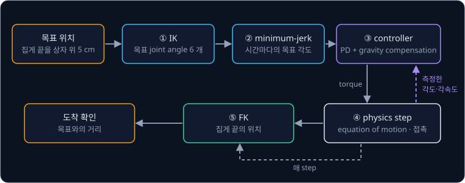

# MuJoCo Simulation

## 학습 목표

- 컴퓨터 속에서 로봇을 움직여 보는 계산이 짧은 시간 간격마다 "힘 → 가속도 → 속도 → 위치" 를 되풀이하는 과정을 표로
  따라갈 수 있다
- 관절이 여러 개인 팔에서는 자세에 따라 돌리기 어려운 정도와 중력이 관절을 돌리는 세기가 달라지고, 관절 하나를 돌리면 다른
  관절도 움직인다는 것을 숫자로 설명할 수 있다
- 로봇을 적은 파일에 부품의 연결, 움직이는 방식, 모양, 질량, motor 가 어떻게 들어 있고 그 숫자가 계산에 어떻게 쓰이는지 설명할
  수 있다
- 물체끼리 닿을 때 밀어내는 힘과 미끄러짐을 막는 힘을 계산하고, 집게로 물체를 잡을 때 미끄러짐을 막는 숫자가 왜 중요한지
  설명할 수 있다
- 계산 간격을 크게 잡으면 왜 결과가 튀어 오르고, 작게 잡으면 무엇을 잃는지 설명할 수 있다
- 관절에 돌리는 힘을 직접 주는 방식과 목표 각도를 주는 방식을 비교하고, 컴퓨터 속 결과가 실제 로봇과 왜 다른지 예를 들 수 있다

## simulator 가 하는 일

### simulation 이 필요한 이유

로봇 팔에게 컵 집기를 가르친다고 하자. 사람의 시연을 따라 하거나 시행착오로 배우는 학습 방법은 수천에서 수백만 번의 시도를
필요로 한다. 실제 팔로 한 번 시도하는 데 10 초가 걸리면 100 만 번은 1000 만 초, 쉬지 않고 돌려도 약 116 일이다. 그동안 motor 가
닳고, 팔이 책상에 부딪혀 부서지고, 사람이 매번 컵을 제자리에 돌려놔야 한다.

실제 장치를 움직이지 않고 계산으로 미리 해 보는 것을 simulation 이라고 하고, simulation 을 해 주는 프로그램을 simulator 라고
부른다. [PID Control](../pid-control/README.md) 에서 카트와 pendulum(진자)의 움직임을 표로 계산한 것이 simulation 이다. 컴퓨터
속 팔은 부서지지 않고, 실제 시간보다 빠르게 돌릴 수 있고, 같은 팔을 여러 개 동시에 돌릴 수도 있다. 실제보다 100 배 빠르게
돌리는 simulator 를 100 개 동시에 돌리면 10000 배가 되어, 116 일 걸릴 100 만 번의 시도가 1000 초, 곧 17 분 정도에 끝난다.

**확인 문제.** 한 번에 5 초 걸리는 시도를 1 만 번 하려고 한다. 실제 로봇으로는 몇 초가 걸리고, 실제보다 50 배 빠른 simulator
하나로는 몇 초가 걸릴까?

답 보기

실제 로봇은 $5 \times 10000 = 50000$ 초(약 14 시간)다. simulator 는 그 50 분의 1 인 $50000 \div 50 = 1000$ 초다.

### 떨어지는 상자의 step 계산

simulator 가 하는 계산은 PID Control 에서 손으로 한 것과 같다. 시간을 짧은 간격 $\Delta t$(delta t, 델타 티)로 자르고, 한
칸마다 "힘 → 가속도 → 새 속도 → 새 위치" 를 계산한다. 한 칸의 계산을 step 이라고 하고, 몇 번째 step 인지를 아래첨자 $k$ 로
적는다.

$$
v_{k+1} = v_k + a_k \, \Delta t
$$

$$
z_{k+1} = z_k + v_{k+1} \, \Delta t
$$

$z$ 는 높이(m), $v$ 는 속도(m/s), $a$ 는 가속도(m/s²)다. 첫 줄은 "다음 속도는 지금 속도에 가속도 × 한 칸의 시간을 더한 값",
둘째 줄은 "다음 높이는 지금 높이에 방금 고친 속도 × 한 칸의 시간을 더한 값" 이라고 읽는다. 속도를 먼저 고치고 그 새 속도로
위치를 옮기는 이 방법을 semi-implicit Euler 라고 부른다.

질량 1 kg 인 상자를 높이 1 m 에서 가만히 놓는다. 상자에는 gravity(중력)가 아래로 $1 \times 9.81 = 9.81$ N 의 힘을 준다. 힘을
질량으로 나눈 것이 가속도($a = F \div m$)이므로 가속도는 $-9.81$ m/s² 이고, 음수는 아래쪽이라는 뜻이다. $\Delta t = 0.1$ 초로
계산한다.

| step $k$ | 시각 $t$ (초) | 높이 $z_k$ | 속도 $v_k$ | 새 속도 $v_k - 9.81 \times 0.1$ | 새 높이 $z_k + (\text{새 속도}) \times 0.1$ |
| --- | --- | --- | --- | --- | --- |
| 0 | 0 | 1 | 0 | $-0.981$ | 0.9019 |
| 1 | 0.1 | 0.9019 | $-0.981$ | $-1.962$ | 0.7057 |
| 2 | 0.2 | 0.7057 | $-1.962$ | $-2.943$ | 0.4114 |
| 3 | 0.3 | 0.4114 | $-2.943$ | $-3.924$ | 0.0190 |
| 4 | 0.4 | 0.0190 | $-3.924$ | $-4.905$ | $-0.4715$ |

위 그림은 표의 높이를 step 마다 찍은 것이다. 상자는 점점 빨리 떨어져 0.4 초에 바닥 바로 위 0.019 m 에 이르고, 다음 step 에서는
높이가 $-0.4715$ m 가 된다. 바닥을 뚫고 47 cm 아래로 내려간 것인데, 위 두 줄의 식에는 바닥이라는 것이 없으니 당연한
결과다. 실제 상자는 바닥에 부딪혀 멈추므로, simulator 는 gravity 만이 아니라 "두 물체가 닿았는지" 와 "닿았다면 서로 얼마나
세게 미는지" 도 계산해야 한다. 이 계산은 뒤의 "접촉과 마찰" 에서 다룬다.

**확인 문제.** gravity 가 만드는 가속도를 어림해서 $-10$ m/s² 로 두고, 높이 2 m 에서 정지한 상자를 $\Delta t = 0.1$ 초로 두 step
계산하면 높이는?

답 보기

step 0: 새 속도 $0 - 10 \times 0.1 = -1$, 새 높이 $2 + (-1) \times 0.1 = 1.9$. step 1: 새 속도 $-1 - 1 = -2$, 새 높이
$1.9 + (-2) \times 0.1 = 1.7$. 두 step 뒤 높이는 1.7 m 다.

### physics engine 과 MuJoCo

상자 하나는 손으로도 계산할 수 있지만, 로봇 팔은 부품 여러 개가 관절로 이어져 있고 집게가 물체를 잡으면 부품과 물체가 서로
민다. 이런 계산을 대신해 주는 프로그램을 physics engine 이라고 한다. engine 은 "엔진" 으로, 다른 프로그램 안에 들어가 계산을
도맡는 핵심 부품이라는 뜻에서 붙은 이름이다. simulator 라는 말과 거의 같은 뜻으로 쓰인다.

MuJoCo 는 Emanuel Todorov, Tom Erez, Yuval Tassa 가 2012년에 발표한 physics engine 이다. 이름은 Multi-Joint dynamics with Contact
의 줄임말로, "관절이 여러 개인 물체의 움직임(dynamics)을 접촉(contact)까지 포함해 계산한다" 는 뜻이다. dynamics 는 힘을 받아
물체가 어떻게 움직이는지를 다루는 물리의 한 분야다. 관절이 많은 로봇과 접촉을 빠르고 안정적으로 계산해서 로봇 학습에서 가장
널리 쓰이는 simulator 가운데 하나가 되었고, 2021년 DeepMind 가 사들인 뒤로는 누구나 무료로 쓸 수 있게 공개되어 있다.

physics engine 이 기억하는 것은 크게 두 가지다.

- **모델** — 로봇과 주변 물체가 어떻게 생겼는지. 부품의 길이와 연결, 질량, 모양, motor 같은 정보로, simulation 동안 바뀌지
  않는다. 파일 하나에 적어 두고 시작할 때 읽는다
- **상태(state)** — 지금 이 순간의 위치와 속도. 매 step 바뀐다

상태가 위치와 속도 두 가지인 이유는 위 표에 있다. step 하나를 계산하려면 지금 높이 $z_k$ 와 지금 속도 $v_k$ 가 있어야 하고,
둘 중 하나만 알면 다음 칸을 계산할 수 없다. 높이 0.5 m 에 있는 상자라도 멈춰 있는지, 4 m/s 로 떨어지는 중인지에 따라 다음
위치가 다르다.

**확인 문제.** 상자 두 개가 똑같이 높이 0.5 m 에 있다. 하나는 멈춰 있고 하나는 아래로 $-2$ m/s 로 떨어지는 중이다. $\Delta t = 0.1$,
가속도 $-10$ 으로 한 step 계산하면 두 상자의 새 높이는?

답 보기

멈춘 상자는 새 속도 $-1$, 새 높이 $0.5 - 0.1 = 0.4$ 다. 떨어지는 상자는 새 속도 $-2 - 1 = -3$, 새 높이 $0.5 - 0.3 = 0.2$ 다.
위치가 같아도 속도가 다르면 다음 위치가 다르므로 상태에는 속도가 꼭 들어가야 한다.

### simulation loop

physics engine 은 step 마다 같은 순서의 계산을 되풀이한다. 이렇게 되풀이되는 계산의 고리를 loop 라고 부른다.

위 그림은 이 고리를 보여 준다.

1. 지금 상태(위치와 속도)를 읽는다
2. 이 상태에서 각 부품에 걸리는 힘을 모은다. gravity, motor 가 내는 힘, 물체끼리 닿아서 생기는 힘이다
3. 힘으로 가속도를 구한다. 상자 하나라면 $a = F \div m$ 이지만, 관절이 여러 개인 팔은 다음 절에서 볼 식을 풀어야 한다
4. 가속도로 속도를 먼저 고치고, 새 속도로 위치를 옮긴다
5. 새 위치에서 모든 부품이 공간의 어디에 있는지 다시 계산하고, 서로 닿은 곳을 찾는다

5 번의 "부품이 공간의 어디에 있는지" 는 [Forward Kinematics](../forward-kinematics/README.md) 에서 배운 계산이다. joint angle
(관절 각도)을 알면 각 부품과 손끝의 위치를 구할 수 있었는데, physics engine 은 이 forward kinematics(FK)를 매 step 계산한다.
그 결과로 부품끼리 닿았는지 검사하고, 화면에 로봇을 그린다.

loop 바깥에는 두 가지가 더 붙는다. controller 는 상태를 보고 motor 에 줄 명령을 정해 2 번에 넣고, 카메라는 가끔씩 지금 장면을
그림으로 그린다. 둘이 언제 끼어드는지는 "actuator 와 제어" 에서 다룬다.

**확인 문제.** 위 loop 에서 "새 위치에서 부품의 자리를 다시 계산" 하는 단계를 빼면 무엇을 할 수 없게 될까?

답 보기

부품이 공간의 어디에 있는지 모르므로 부품끼리, 또는 부품과 바닥이 닿았는지 검사할 수 없다. 화면에 로봇을 그릴 수도 없다.

**요약**

- simulator 는 시간을 $\Delta t$ 로 잘라 step 마다 힘 → 가속도 → 새 속도 → 새 위치를 계산한다. 접촉을 따로 계산하지 않으면 상자가
  바닥을 뚫고 지나간다
- physics engine 은 바뀌지 않는 모델과 매 step 바뀌는 상태(위치와 속도)를 갖고, 매 step FK 로 부품의 자리를 다시 계산한다

## 여러 joint 의 equation of motion

### pendulum 다시 보기

PID Control 의 pendulum 은 joint(관절)가 하나라서 움직임을 식 하나로 쓸 수 있었다. 길이 $l = 0.5$ m 막대 끝에 질량
$m = 1$ kg 추를 단 pendulum 의 식은 아래와 같았다.

$$
I \alpha = \tau - b\,\omega - m g l \sin\theta
$$

$\theta$(theta, 세타)는 아래로 늘어진 자세에서 잰 각도, $\omega$(omega, 오메가)는 각속도, $\alpha$(alpha, 알파)는 각가속도,
$\tau$(tau, 타우)는 motor 가 내는 torque(축을 돌리는 세기, 단위 N·m)다. $I = m l^2 = 0.25$ kg·m² 는 moment of inertia 로,
"돌리기 어려운 정도" 를 나타낸다. $b\,\omega$ 는 joint 의 마찰, $m g l \sin\theta$ 는 gravity 가 팔을 아래로 돌리는 torque 다.
이 식은 "돌리는 데 쓰이는 torque 는 motor 의 torque 에서 마찰과 gravity 의 torque 를 뺀 것" 이라고 읽고, 이처럼 움직임을 정하는
식을 equation of motion 이라고 한다.

joint 가 둘 이상이면 이 식을 그대로 쓸 수 없다. 한 joint 의 각도가 바뀌면 다른 joint 가 느끼는 무게와 돌리기 어려운 정도가
바뀌기 때문이다. 이 절에서는 joint 두 개짜리 팔로 그 차이를 숫자로 본다.

### joint 두 개짜리 팔

어깨 joint 에 길이 0.5 m 인 위팔이, 위팔 끝의 팔꿈치 joint 에 길이 0.5 m 인 아래팔이 붙어 있다. 위팔 끝(팔꿈치 자리)과 아래팔
끝(손끝)에 1 kg 추가 하나씩 달려 있고, 막대 자체의 무게는 없다고 하자. 어깨 각도를 $\theta_1$, 팔꿈치 각도를 $\theta_2$ 로 적는다.
Forward Kinematics 에서처럼 $\theta_2$ 는 위팔을 기준으로 잰 상대 각도라서, 팔을 쭉 펴면 $\theta_2 = 0°$, 팔꿈치를 직각으로
굽히면 $\theta_2 = 90°$ 다.

### 자세에 따라 달라지는 inertia

먼저 팔꿈치를 고정해 두고 어깨만 돌린다고 하자. 팔 전체가 막대 하나처럼 돈다. 추 하나의 moment of inertia 가 $m l^2$, 곧
질량 × (축까지 거리)² 이었으므로, 추가 둘이면 각 추의 값을 더한다.

- **팔을 편 자세($\theta_2 = 0°$)** — 팔꿈치 추는 어깨에서 0.5 m, 손끝 추는 1 m 떨어져 있다.
  $I = 1 \times 0.5^2 + 1 \times 1^2 = 0.25 + 1 = 1.25$ kg·m²
- **팔꿈치를 직각으로 굽힌 자세($\theta_2 = 90°$)** — 손끝 추는 어깨에서 가로 0.5 m, 세로 0.5 m 떨어져 있다. 직각삼각형의 빗변
  길이의 제곱은 두 변의 제곱을 더한 값이므로 (거리)² $= 0.5^2 + 0.5^2 = 0.5$ 다. $I = 0.25 + 1 \times 0.5 = 0.75$ kg·m²

같은 어깨 torque 1 N·m 를 주면 편 자세에서는 각가속도가 $1 \div 1.25 = 0.8$ rad/s², 굽힌 자세에서는 $1 \div 0.75 \approx 1.33$
rad/s² 다. 팔을 접으면 어깨를 돌리기가 훨씬 쉬워진다. 피겨 스케이팅 선수가 팔을 몸에 붙이면 빨리 도는 것과 같은 원리다.

pendulum 에서는 $I$ 가 늘 0.25 로 정해진 숫자였지만, 팔에서는 돌리기 어려운 정도가 팔꿈치 각도에 따라 바뀐다. 그래서 physics
engine 은 이 값을 상태가 바뀔 때마다, 곧 매 step 다시 계산한다.

**확인 문제.** 같은 팔에서 두 추가 각각 2 kg 이면, 팔을 편 자세의 어깨 inertia 는?

답 보기

$2 \times 0.5^2 + 2 \times 1^2 = 0.5 + 2 = 2.5$ kg·m² 다. 질량이 두 배라 1.25 의 두 배다.

### 한 joint 의 torque 가 다른 joint 를 움직이는 효과

이번에는 팔꿈치를 고정하지 않는다. gravity 가 끼어들지 않도록 팔을 책상 위에 눕혀 수평면에서만 움직인다고 하자. 팔을 편 채
멈춰 있는 상태에서 어깨에만 torque 1 N·m 를 주고 팔꿈치 motor 는 아무 힘도 내지 않는다.

첫 순간에 어깨는 $+4$ rad/s², 팔꿈치는 $-8$ rad/s² 의 각가속도를 얻는다. 팔꿈치 motor 는 아무 힘도 내지 않는데 팔꿈치가 꺾인다.
위 그림처럼 어깨가 돌기 시작하면 팔꿈치 추는 앞으로 밀려 나가지만, 팔꿈치가 자유로우니 아래팔은 손끝 추를 옆으로 밀어 주지
못한다. 멈춰 있던 물체는 그대로 멈춰 있으려 하는데, 이 성질을 관성이라고 한다. 손끝 추는 관성
때문에 제자리에 남고, 그래서 아래팔이 뒤로 처지며 팔꿈치가 꺾인다. 어깨 torque 가 사실상 팔꿈치 추 하나만 돌리므로 어깨의 각가속도는 $1 \div (1 \times 0.5^2) = 4$ 다.

이 관계를 두 joint 의 식으로 쓰면 아래와 같다. $\alpha_1$, $\alpha_2$ 는 어깨와 팔꿈치의 각가속도, $\tau_1$, $\tau_2$ 는 두
motor 의 torque 다.

$$
1.25\,\alpha_1 + 0.5\,\alpha_2 = \tau_1
$$

$$
0.5\,\alpha_1 + 0.25\,\alpha_2 = \tau_2
$$

첫 식은 어깨에서, 둘째 식은 팔꿈치에서 torque 가 각가속도를 만드는 관계다. $\tau_1 = 1$, $\tau_2 = 0$ 이면 한 단계씩 푼다.

1. 둘째 식에서 $0.5\,\alpha_1 + 0.25\,\alpha_2 = 0$ 이므로 양변에 4 를 곱하면 $2\,\alpha_1 + \alpha_2 = 0$, 곧 $\alpha_2 = -2\,\alpha_1$ 이다
2. 첫 식의 $\alpha_2$ 자리에 $-2\,\alpha_1$ 을 넣으면 $1.25\,\alpha_1 - 1.0\,\alpha_1 = 1$, 곧 $0.25\,\alpha_1 = 1$ 이다
3. 양변을 0.25 로 나누면 $\alpha_1 = 4$ 이고, 1 단계 식에 넣으면 $\alpha_2 = -8$ 이다

검산하면 첫 식은 $1.25 \times 4 + 0.5 \times (-8) = 5 - 4 = 1$, 둘째 식은 $0.5 \times 4 + 0.25 \times (-8) = 2 - 2 = 0$ 으로 맞는다.

식의 숫자 네 개는 각각 뜻이 있다. 1.25 는 앞 절의 "팔꿈치를 고정했을 때 어깨의 inertia" 이고, 0.25 는 팔꿈치가 손끝 추 하나를
돌리는 inertia $1 \times 0.5^2$ 이다. 두 식에 같이 들어간 0.5 는 한 joint 의 가속이 다른 joint 에 미치는 영향의 크기다. 이 0.5 가
0 이었다면 두 식이 서로 얽히지 않아 어깨 torque 가 팔꿈치를 움직이지 않았을 것이다.

이렇게 숫자를 가로·세로로 늘어놓은 묶음을 행렬이라고 한다([Linear Regression](../linear-regression/README.md) 에서 본 것과
같다). 위 숫자 네 개를 행렬로 모은 것을 mass matrix 라고 하고 $M$ 으로 적는다.

$$
M = \begin{bmatrix} 1.25 & 0.5 \\ 0.5 & 0.25 \end{bmatrix}
$$

첫째 가로줄이 어깨 식의 두 숫자, 둘째 가로줄이 팔꿈치 식의 두 숫자다. 왼쪽 위에서 오른쪽 아래로 비스듬히 놓인 칸(1.25 와
0.25)을 대각선이라고 하는데, 대각선 칸은 joint 하나가 자기 자신을 돌리는 inertia 이고 대각선 밖 칸(0.5)이 두 joint 사이의
영향이다. pendulum 의 $I$ 가 joint 하나의 "돌리기 어려운 정도"
였다면, mass matrix 는 joint 가 여럿일 때 그 값과 joint 사이의 영향을 한 표에 담은 것이다.

숫자만 바꿔 팔꿈치를 직각으로 굽힌 자세에서 같은 계산을 한다. 이 자세의 mass matrix 는 대각선이 0.75 와 0.25, 대각선 밖이
0.25 다.

| 자세 | 어깨 칸 (왼쪽 위) | 영향 칸 (대각선 밖) | 팔꿈치 칸 (오른쪽 아래) | $\tau = (1, 0)$ 일 때 $(\alpha_1, \alpha_2)$ |
| --- | --- | --- | --- | --- |
| 편 자세 $\theta_2 = 0°$ | 1.25 | 0.5 | 0.25 | $(4, -8)$ |
| 굽힌 자세 $\theta_2 = 90°$ | 0.75 | 0.25 | 0.25 | $(2, -2)$ |

굽힌 자세는 둘째 식 $0.25\,\alpha_1 + 0.25\,\alpha_2 = 0$ 에서 $\alpha_2 = -\alpha_1$ 이고, 첫 식에 넣으면
$0.75\,\alpha_1 - 0.25\,\alpha_1 = 0.5\,\alpha_1 = 1$ 이라 $\alpha_1 = 2$, $\alpha_2 = -2$ 다. 이 팔의 mass matrix 는 일반적으로
아래 꼴이고, $\cos$(코사인)은 Forward Kinematics 에서 본 대로 $\cos 0° = 1$, $\cos 90° = 0$ 이다.

$$
M(\theta_2) = \begin{bmatrix} 0.75 + 0.5\cos\theta_2 & 0.25 + 0.25\cos\theta_2 \\ 0.25 + 0.25\cos\theta_2 & 0.25 \end{bmatrix}
$$

$M(\theta_2)$ 는 "mass matrix 가 $\theta_2$ 에 따라 바뀐다" 는 뜻으로 괄호 안에 $\theta_2$ 를 적은 것이다. $\theta_2 = 0°$ 을 넣으면
$0.75 + 0.5 = 1.25$, $0.25 + 0.25 = 0.5$ 로 편 자세의 값이, $\theta_2 = 90°$ 을 넣으면 0.75 와 0.25 로 굽힌 자세의 값이 나온다.

**확인 문제.** 팔을 편 채 멈춘 상태에서 이번에는 팔꿈치에만 torque 1 N·m 를 준다($\tau_1 = 0$, $\tau_2 = 1$). 두 joint 의
각가속도는?

답 보기

첫 식 $1.25\,\alpha_1 + 0.5\,\alpha_2 = 0$ 에서 $\alpha_1 = -0.4\,\alpha_2$ 다. 둘째 식에 넣으면
$0.5 \times (-0.4\,\alpha_2) + 0.25\,\alpha_2 = -0.2\,\alpha_2 + 0.25\,\alpha_2 = 0.05\,\alpha_2 = 1$ 이라 $\alpha_2 = 20$,
$\alpha_1 = -0.4 \times 20 = -8$ 이다. 팔꿈치를 돌렸더니 어깨가 반대로 돈다.

### 자세에 따라 달라지는 gravity torque

이제 팔을 세워 gravity 가 작용하게 한다. gravity torque 는 추의 무게(질량 × 9.81)에 축과 추 사이의 수평 거리를 곱한 값이었다.
joint 가 둘이면 각 joint 마다 "그 joint 보다 바깥에 있는 추들" 의 torque 를 더한다.

| 자세 | 어깨 torque | 팔꿈치 torque |
| --- | --- | --- |
| 팔을 수평으로 편 자세 | $9.81 \times 0.5 + 9.81 \times 1.0 = 14.715$ | $9.81 \times 0.5 = 4.905$ |
| 위팔은 수평, 아래팔은 아래로 늘어뜨린 자세 | $9.81 \times 0.5 + 9.81 \times 0.5 = 9.81$ | $9.81 \times 0 = 0$ |

수평으로 편 자세에서 손끝 추는 어깨에서 수평으로 1 m, 팔꿈치에서 0.5 m 떨어져 있다. 아래팔을 늘어뜨리면 손끝 추가 팔꿈치 바로
아래로 오므로 팔꿈치에 대한 수평 거리가 0 이고, 어깨에 대한 수평 거리는 0.5 m 로 줄어든다. 어깨 motor 가 버텨야 하는 torque 는
팔꿈치 각도에 따라 14.715 에서 9.81 까지 바뀐다.

**확인 문제.** 위 팔에서 손끝 추만 2 kg 으로 바꾸고 수평으로 편 자세를 붙잡으려면 어깨와 팔꿈치에 각각 몇 N·m 가 필요할까?

답 보기

어깨는 $9.81 \times 0.5 + 2 \times 9.81 \times 1.0 = 4.905 + 19.62 = 24.525$ N·m, 팔꿈치는 $2 \times 9.81 \times 0.5 = 9.81$ N·m 다.

### 움직일 때 생기는 torque

팔이 움직이는 동안에는 torque 가 하나 더 생긴다. 돌고 있는 물체는 바깥쪽으로 쏠리는데, 놀이기구가 빠르게 돌면 몸이 바깥으로
밀리는 것과 같다. 이것을 centrifugal(원심) 효과라고 한다.

팔꿈치를 직각으로 굽힌 채 어깨가 각속도 2 rad/s 로 돌고 있다고 하자. 손끝 추는 바깥으로 쏠리면서 팔꿈치를 펴려고 하고, 이
자세를 유지하려면 팔꿈치 motor 가 1 N·m 를 내야 한다. 이 팔에서 그 크기는 $0.25 \times \sin\theta_2 \times \omega_1^2$ 이다.
$\sin$(사인)은 PID Control 의 pendulum 에서 본 것으로 $\sin 90° = 1$, $\sin 0° = 0$ 이고, $\omega_1^2$ 은 어깨 각속도의 제곱이다.
$\theta_2 = 90°$, $\omega_1 = 2$ 이면 $0.25 \times 1 \times 4 = 1$ N·m 다. 팔을 편 자세($\sin 0° = 0$)에서는 바깥쪽으로 쏠리는 힘이
아래팔을 따라 곧게 당기기만 해서 팔꿈치를 돌리지 않는다.

이처럼 속도에 따라 생기는 torque 와 gravity torque 를 합쳐 bias force 라고 부르고 $c$ 로 적는다. bias 는 "한쪽으로 치우치게
하는 것" 이라는 뜻으로, motor 가 아무것도 하지 않아도 팔을 어느 쪽으로 움직이게 만드는 힘이라는 의미다.

**확인 문제.** 같은 자세($\theta_2 = 90°$)에서 어깨가 4 rad/s 로 돌면 팔꿈치를 유지하는 데 필요한 torque 는?

답 보기

$0.25 \times 1 \times 4^2 = 0.25 \times 16 = 4$ N·m 다. 각속도가 두 배면 제곱 때문에 네 배가 된다.

### equation of motion 의 전체 모양

지금까지 본 것을 하나로 모으면 joint 가 여러 개인 로봇의 equation of motion 이 된다.

$$
M(q)\,\ddot q + c(q, \dot q) = \tau + \tau_{\text{접촉}}
$$

- $q$ 는 joint angle 을 순서대로 묶은 것이다. 두 joint 팔이면 $q = (\theta_1, \theta_2)$ 처럼 숫자 두 개이고, 이렇게 순서를 정해
  늘어놓은 숫자 묶음을 vector 라고 한다
- $\dot q$ 는 "q 닷(dot)" 이라고 읽고 각 joint 의 각속도를, $\ddot q$ 는 "q 더블 닷" 이라고 읽고 각 joint 의 각가속도를 묶은
  것이다. 글자 위의 점 하나는 "1초에 변하는 빠르기", 점 둘은 "그 빠르기가 1초에 변하는 빠르기" 라는 표시다
- $M(q)$ 는 자세에 따라 바뀌는 mass matrix 다
- $c(q, \dot q)$ 는 bias force 로, 자세에 따라 바뀌는 gravity torque 와 속도에 따라 생기는 torque 를 joint 마다 모은 것이다
- $\tau$ 는 각 joint 의 motor 가 내는 torque, $\tau_{\text{접촉}}$ 은 물체끼리 닿아서 생긴 힘이 각 joint 에 주는 torque 다

식은 "joint 마다, 각가속도를 만드는 데 쓰인 torque 에 치우치게 하는 torque 를 더한 것이 motor 와 접촉이 준 torque 와 같다" 고
읽는다. joint 의 마찰은 따로 계산해 오른쪽에 더한다.

pendulum 과 맞춰 보면 $M$ 은 $I = 0.25$ 하나, $c$ 는 $m g l \sin\theta$ 하나였고, 마찰 $-b\,\omega$ 는 오른쪽에 들어간다.
joint 두 개짜리 팔에서는 $M$ 이 $2 \times 2$ 행렬, $c$ 는 숫자 두 개가 된다. SO-101 처럼 joint 가 6 개면 $M$ 은 $6 \times 6$,
곧 숫자 36 개짜리 행렬이다.

physics engine 은 매 step 지금의 $q$ 와 $\dot q$ 로 $M$ 과 $c$ 를 계산하고, 위 식을 $\ddot q$ 에 대해 풀어 각가속도를 구한 뒤
semi-implicit Euler 로 각속도와 각도를 고친다. 앞의 두 joint 팔에서 연립방정식(식 여러 개를 동시에 만족하는 값을 찾는 문제)을 푼 것과 같은 일을 joint 수만큼 큰 표로 하는
것이다. 손으로 쓰면 한 step 에 수십 줄이 필요한 계산을, SO-101 처럼 joint 가 몇 개인 팔이라면 engine 은 보통 1 ms(1000 분의 1 초)도
안 되는 시간에 끝낸다.

**흔한 오해.** "joint 마다 pendulum 식을 하나씩 따로 쓰면 된다" 고 생각하기 쉽다. 위에서 어깨에만 torque 를 줘도 팔꿈치가
$-8$ rad/s² 로 꺾였듯, joint 들은 mass matrix 의 대각선 밖 숫자로 서로 얽혀 있어서 따로 계산하면 틀린 답이 나온다.

**확인 문제.** joint 가 3 개인 팔의 mass matrix 에는 숫자가 몇 개 들어 있을까? 그중 joint 사이의 영향을 나타내는 대각선 밖
숫자는 몇 개일까?

답 보기

$3 \times 3 = 9$ 개이고, 대각선의 3 개를 빼면 6 개가 대각선 밖이다.

**요약**

- joint 가 여러 개면 돌리기 어려운 정도가 자세에 따라 바뀌는 mass matrix $M(q)$ 가 되고, 대각선 밖 숫자 때문에 한 joint 의 torque
  가 다른 joint 도 움직인다
- gravity torque 와 속도에 따라 생기는 torque 를 합친 bias force $c(q, \dot q)$ 도 자세와 속도에 따라 바뀐다
- physics engine 은 매 step $M(q)\,\ddot q + c = \tau + \tau_{\text{접촉}}$ 을 풀어 각가속도를 구한다

## 모델 파일

### MJCF 와 URDF

physics engine 이 $M$ 과 $c$ 를 계산하려면 부품의 길이와 질량을 알아야 하고, 접촉을 계산하려면 부품의 모양을 알아야 한다. 이
정보를 적은 파일이 모델 파일이다.

Forward Kinematics 에서 본 URDF(Unified Robot Description Format)도 로봇을 적은 파일이었다. URDF 에는 link(부품)와 joint, joint
의 자리(origin), 도는 축(axis), joint 종류(type)가 적혀 있고, FK 는 그중 연결과 자리와 축만 읽었다. physics engine 은 그보다
많은 것을 읽는다.

| 정보 | FK 에 필요 | physics 에 필요 | 쓰이는 곳 |
| --- | --- | --- | --- |
| 부품의 연결, joint 자리와 축 | 예 | 예 | 부품 위치, $M$ 과 $c$ |
| 질량, 무게중심, inertia | 아니오 | 예 | $M$ 과 $c$ |
| 충돌용 모양 | 아니오 | 예 | 접촉 |
| 마찰 계수 | 아니오 | 예 | 접촉 |
| motor(actuator) | 아니오 | 예 | $\tau$ |
| timestep, gravity 크기 | 아니오 | 예 | step 계산 |

MuJoCo 는 자기 형식인 MJCF 로 모델을 적는다. MJCF 는 MuJoCo 가 쓰는 모델 형식의 이름이고, URDF 처럼 XML 로 쓴다.
XML 은 `<body>` 처럼 꺾쇠 괄호로 감싼 이름(태그)으로 정보의 종류를 표시하는 글자 형식이다. MuJoCo 는 URDF 를 읽을 수도 있지만,
actuator 나 접촉 설정처럼 URDF 에 없는 정보는 MJCF 로 더 적어 줘야 한다.

여기서 "모델" 이라는 말의 뜻을 구분해 둔다. PID Control 에서 필요한 힘을 미리 계산해 더하는 feedforward 를 배울 때, model 은
"이 장치를 움직이려면 어떤 힘이 필요한가" 를 계산하는 식이었다. 모델 파일은 그 식을 만드는 데 필요한 숫자를 적은 파일이고,
physics engine 은 모델 파일을 읽어 앞 절의 equation of motion 을 스스로 만든다. 사진을 보고 행동을 내도록 데이터로 숫자를 맞춘
neural network(단순한 계산을 여러 겹 쌓은 큰 계산 덩어리)를 "학습한 모델" 이라고 부를 때의 모델과는 다른 것이다.

**확인 문제.** URDF 에서 joint 의 자리와 축만 읽어서 할 수 있는 계산과, 질량까지 읽어야 할 수 있는 계산을 하나씩 들어 보자.

답 보기

자리와 축만으로는 joint angle 에서 손끝 위치를 구하는 FK 를 할 수 있다. 팔을 수평으로 붙잡는 데 필요한 gravity torque 처럼 힘을
계산하려면 질량이 있어야 한다.

### body 와 joint

MJCF 에서 부품 하나를 body 라고 부른다. URDF 의 link 에 해당하고, 힘을 받아도 휘거나 찌그러지지 않는 단단한 물체(rigid body)로
계산한다. body 는 다른 body 안에 들어가 tree(나무 모양 구조)를 이루며, 맨 바깥은 세상 전체를 뜻하는 worldbody 다. 위팔 body
안에 아래팔 body 를 넣으면 "아래팔은 위팔에 붙어 있다" 는 뜻이 된다.

위 그림은 앞의 두 joint 팔을 MJCF 로 적은 구조다. body 마다 joint 를 적어 "이 body 가 바깥 body 에 대해 어떻게 움직이는가" 를
정한다. 움직일 수 있는 방향의 수를 DOF(degree of freedom, 자유도)라고 하는데, joint 종류마다 DOF 가 다르다.

| MJCF joint | 움직임 | DOF | URDF 의 비슷한 것 |
| --- | --- | --- | --- |
| hinge | 축 하나를 중심으로 돈다 | 1 | revolute, continuous |
| slide | 축 방향으로 미끄러진다 | 1 | prismatic |
| ball | 한 점을 중심으로 어느 방향으로든 돈다 | 3 | 없음 |
| free | 공중에서 자유롭게 옮겨 가고 돈다 | 6 | 없음 |

body 에 joint 를 적지 않으면 바깥 body 에 붙어 움직이지 않는데, URDF 의 fixed joint 와 같다. hinge 라는 이름은 문의
경첩(hinge)에서 왔다.

**확인 문제.** 어깨 hinge 하나, 팔꿈치 hinge 하나, 손목 ball 하나로 이루어진 팔의 DOF 는 모두 몇일까?

답 보기

$1 + 1 + 3 = 5$ 다.

### geom

body 의 모양은 geom 으로 적는다. geom 은 geometry(기하, 모양)의 줄임말로, 공(sphere), 상자(box), 원기둥(cylinder), 양 끝이 반구인
원기둥(capsule), 그리고 여러 삼각형을 이어 붙인 자유로운 모양(mesh)이 있다. geom 은 두 가지 일에 쓰인다.

- **접촉 검사** — 매 step 두 geom 이 겹쳤는지 검사해 닿은 곳을 찾는다
- **질량 계산** — 질량을 따로 적지 않으면 geom 의 부피에 밀도를 곱해 질량을 정한다

간단한 모양을 쓰는 이유는 접촉 검사가 빠르기 때문이다. 공 두 개는 중심 사이 거리가 두 반지름의 합보다 작으면 겹친 것이다.
반지름 0.05 m 와 0.03 m 인 공의 중심이 0.07 m 떨어져 있으면 $0.07 < 0.05 + 0.03 = 0.08$ 이라 겹쳤고, 겹친 깊이는
$0.08 - 0.07 = 0.01$ m 다. mesh 처럼 삼각형이 수천 개인 모양은 이런 검사가 훨씬 오래 걸린다.

MuJoCo 는 mesh 로 접촉을 계산할 때 그 mesh 를 감싸는 가장 작은 볼록한 껍질(convex hull)로 바꿔서 계산한다. 볼록하다는 것은 안쪽으로
움푹 들어간 곳이 없다는 뜻이다. 그래서 컵 안쪽이나 집게 손가락 사이의 오목한 홈처럼 파인 곳은 접촉 계산에서 메워진 것처럼 다뤄진다.
오목한 부품은 볼록한 조각 여러 개로 나눠 적어야 실제 모양대로 닿는다.

**확인 문제.** 반지름 0.02 m 와 0.03 m 인 공의 중심이 0.06 m 떨어져 있다. 두 공은 닿았을까?

답 보기

반지름의 합은 $0.02 + 0.03 = 0.05$ m 이고 중심 거리 0.06 m 가 더 크므로 닿지 않았다. 0.01 m 떨어져 있다.

### 질량과 inertia

body 마다 질량, 무게중심(질량이 한 점에 모였다고 볼 수 있는 자리), inertia 가 있어야 equation of motion 을 만들 수 있다. 모델
파일에 직접 적을 수도 있고, 적지 않으면 MuJoCo 가 geom 의 모양과 밀도로 계산한다. MuJoCo 의 기본 밀도는 물과 같은 1000 kg/m³
라서, 한 변이 0.1 m 인 상자 geom 은 부피 $0.1 \times 0.1 \times 0.1 = 0.001$ m³ 에 1000 을 곱한 1 kg 이 된다.

같은 질량이라도 그 질량이 어떻게 퍼져 있느냐에 따라 계산 결과가 달라진다. 길이 0.5 m, 질량 1 kg 인 팔을 두 가지로 적어 본다.

| 모델 | 무게중심 (축에서) | inertia $I$ | torque 1 N·m 의 각가속도 | 수평 자세의 gravity torque |
| --- | --- | --- | --- | --- |
| 끝에 몰린 추 | 0.5 m | $1 \times 0.5^2 = 0.25$ | $1 \div 0.25 = 4$ | $9.81 \times 0.5 = 4.905$ |
| 고르게 퍼진 막대 | 0.25 m | $1 \times 0.5^2 \div 3 \approx 0.083$ | $1 \div 0.083 = 12$ | $9.81 \times 0.25 = 2.4525$ |

고르게 퍼진 막대는 질량의 많은 부분이 축 가까이에 있어서, 계산하면 inertia 가 $m l^2 \div 3$ 으로 추의 3 분의 1 이다. 무게중심도
막대 한가운데라 gravity torque 가 절반이다. 같은 1 kg, 같은 0.5 m 인데 모델 파일에 무엇을 적느냐에 따라 같은 torque 에서
각가속도가 세 배 차이 난다. 모델 파일의 질량과 inertia 가 실물과 다르면 simulation 의 움직임도 실물과 달라진다.

**확인 문제.** 0.5 m 막대 끝에 2 kg 추를 단 팔에 torque 1 N·m 를 주면 각가속도는? (막대 무게는 없다)

답 보기

$I = 2 \times 0.5^2 = 0.5$ 이므로 $1 \div 0.5 = 2$ rad/s² 다.

### 떠 있는 물체와 상태를 적는 숫자

로봇이 집을 상자처럼 어디에도 붙어 있지 않은 물체에는 free joint 를 단다. 공중의 물체는 앞뒤·좌우·위아래로 옮겨 갈 수 있고(3 개),
세 축을 중심으로 돌 수 있어서(3 개) DOF 가 6 이다.

상태를 적는 숫자는 위치 쪽과 속도 쪽의 개수가 다를 수 있다. 속도는 옮겨 가는 빠르기 3 개와 도는 빠르기 3 개로 6 개면 된다. 그런데
방향은 MuJoCo 가 quaternion(쿼터니언)으로 적는다. quaternion 은 [Rigid Transforms](../transforms/README.md) 에서 본 "숫자 네 개로
회전을 적는 방법" 으로, 세 각도로 적을 때 생기는 계산 문제를 피하려고 쓴다. 그래서 위치는 자리 3 개와 방향 4 개로 7 개가 된다.

| 장면 | 위치를 적는 숫자 | 속도를 적는 숫자 |
| --- | --- | --- |
| hinge 6 개짜리 SO-101 팔 | 6 | 6 |
| 상자 하나 (free joint) | $3 + 4 = 7$ | $3 + 3 = 6$ |
| SO-101 팔 + 상자 하나 | $6 + 7 = 13$ | $6 + 6 = 12$ |

hinge 하나는 위치(각도) 1 개, 속도(각속도) 1 개라 두 개수가 같지만, free joint 가 끼면 위치 쪽이 하나 많아진다.

**확인 문제.** SO-101 팔 옆에 상자를 두 개 놓은 장면에서 위치와 속도를 적는 숫자는 각각 몇 개일까?

답 보기

위치는 $6 + 7 + 7 = 20$ 개, 속도는 $6 + 6 + 6 = 18$ 개다.

### MuJoCo Menagerie 의 SO-101 모델

로봇마다 모델 파일을 처음부터 쓰기는 어렵다. MuJoCo Menagerie 는 Google DeepMind 가 2022년부터 공개하고 있는, 실제 로봇을 잘
옮겨 적은 MJCF 모델 모음이다. menagerie 는 "여러 동물을 모아 기르는 곳" 이라는 뜻이다. 이 커리큘럼에서 쓰는 SO-101 팔도 들어
있다.

Menagerie 의 SO-101 모델은 팔 joint 5 개와 집게 joint 1 개, 모두 hinge 6 개로 이루어져 있다. joint 마다 actuator(joint 를 돌리는
장치, 다음 절에서 설명한다)가 하나씩 있고, 그 숫자는 SO-101 이 쓰는 STS3215 servo motor(목표 각도를 받아 스스로 그 각도로 가는 motor)에
맞췄다. timestep(한 step 의 시간
$\Delta t$)은 5 ms 이고, 손목에 카메라가 달려 있다.

같은 SO-101 이라도 URDF 와 MJCF 는 서로 다른 사람이 따로 만든 파일이라 모든 숫자가 같지는 않다. 예를 들어 집게 끝점을 나타내는
점이 URDF 의 `gripper_frame_link` 와 MJCF 의 집게 끝점 사이에 2 cm 쯤 차이가 난다. URDF 로 손끝 목표를 계산하고 MJCF 로 도착한
자리를 재면, 팔이 완벽하게 움직여도 2 cm 가 틀린 것처럼 보인다. 두 파일을 함께 쓸 때는 같은 점을 쓰는지부터 확인해야 한다.

**요약**

- 모델 파일은 부품(body)의 tree, joint 의 종류, 모양(geom), 질량과 inertia, actuator, timestep 을 담고, physics engine 은 이것으로
  equation of motion 을 만든다
- geom 은 접촉 검사와 질량 계산에 쓰이고, 같은 질량이라도 퍼진 모양에 따라 inertia 와 움직임이 달라진다
- free joint 물체는 위치를 숫자 7 개(자리 3, quaternion 4), 속도를 6 개로 적는다

## 접촉과 마찰

### 바닥과 상자의 접촉

떨어지는 상자로 돌아간다. physics engine 은 매 step 바닥 geom 과 상자 geom 이 겹쳤는지 검사하고, 겹쳤으면 둘 사이에 접촉
(contact)이 생겼다고 보고 서로 밀어내는 힘을 계산한다. 이 힘은 닿은 면에 수직으로 작용하므로 normal force 라고 부른다. normal
은 "면에 수직인" 이라는 뜻이다.

바닥에 가만히 놓인 1 kg 상자를 보자. 상자에는 gravity 가 아래로 9.81 N 을 주는데 상자가 움직이지 않으니 힘의 합이 0 이어야
하고, 그러려면 바닥이 위로 9.81 N 을 밀어 줘야 한다. 상자가 2 kg 이면 normal force 는 19.62 N 이다.

### 침투와 soft contact

실제 물체는 서로 뚫고 들어가지 않는다. 하지만 step 마다 끊어서 계산하는 simulator 는 표에서 본 것처럼 상자가 한 step 사이에
바닥 아래로 들어간 뒤에야 닿았다는 것을 안다. MuJoCo 는 아주 조금 겹치는 것을 허용하고, 겹친 깊이에 따라 커지는
힘으로 밀어낸다. 겹친 깊이를 penetration(침투)이라고 하고, 이렇게 접촉을 약간 말랑하게 계산하는 방식을
soft contact 라고 부른다.

단단한 용수철로 생각하면 이해하기 쉽다. 용수철은 늘어나거나 눌린 길이에 비례하는 힘을 내고, 그 비례 계수를 stiffness(단단함)
$k$ 라고 한다. 바닥이 $k = 10000$ N/m 인 용수철처럼 민다고 하면, 1 kg 상자가 정지하려면 $k \times (\text{침투}) = 9.81$ 이어야
하므로

$$
\text{침투} = \frac{9.81}{10000} = 0.000981 \text{ m} \approx 1 \text{ mm}
$$

다. 상자는 바닥에 약 1 mm 파묻힌 채로 멈춰 있다. MuJoCo 는 여기에 속도에 맞서는 힘(PID Control 의 D 항과 같은 damping)도
함께 넣어 상자가 바닥 위에서 계속 튀지 않게 한다.

$k$ 를 키우면 침투가 줄어 실물에 가까워지지만, 뒤의 "timestep 과 안정성" 에서 보듯 단단한 용수철일수록 작은 $\Delta t$ 가 필요하다.
모델 파일에는 접촉을 얼마나 단단하고 얼마나 빨리 가라앉게 할지 정하는 숫자가 있어서 이 균형을 조절한다.

**확인 문제.** 접촉의 단단함이 5000 N/m 이면 바닥에 놓인 1 kg 상자는 대략 몇 mm 파묻힐까?

답 보기

$9.81 \div 5000 \approx 0.00196$ m, 곧 약 2 mm 다. 단단함이 절반이라 침투가 두 배다.

### 마찰 힘의 한계

바닥에 놓인 상자를 옆으로 밀면 마찰이 미끄러짐을 막는다. 마찰 힘은 미끄러지려는 방향의 반대로 작용하는데, 그 크기에는 한계가
있다.

$$
\text{마찰 힘} \le \mu \times (\text{normal force})
$$

$\mu$ 는 mu(뮤)라고 읽는 friction coefficient(마찰 계수)로, 두 면이 얼마나 미끄러지기 어려운지를 나타낸다. 고무와 콘크리트처럼
잘 붙는 면은 0.6~1 정도, 얼음처럼 미끄러운 면은 0.1 보다 작다. 이 규칙은 Coulomb 이 정리해 Coulomb friction 이라고 부르고, MuJoCo 의
기본 $\mu$ 는 1 이다. $\le$ 는 "작거나 같다" 는 기호다.

1 kg 상자($\mu = 1$, normal force 9.81 N)를 옆으로 미는 힘을 바꿔 본다.

| 미는 힘 | 마찰 힘의 한계 $\mu \times 9.81$ | 실제 마찰 힘 | 힘의 합 | 가속도 |
| --- | --- | --- | --- | --- |
| 5 N | 9.81 N | 5 N | 0 | 0 (움직이지 않음) |
| 9.81 N | 9.81 N | 9.81 N | 0 | 0 (미끄러지기 직전) |
| 12 N | 9.81 N | 9.81 N | $12 - 9.81 = 2.19$ | 2.19 m/s² |

위 그림처럼 미는 힘이 한계보다 작으면 마찰 힘은 미는 힘과 정확히 같아져 상자가 움직이지 않고, 한계를 넘으면 마찰 힘은 한계에
머물고 남는 힘이 상자를 가속한다. 바닥이 미끄러워 $\mu = 0.5$ 이면 한계가 4.905 N 이라, 5 N 으로 밀어도 남는 0.095 N 만큼
움직인다.

**흔한 오해.** 마찰 힘이 늘 $\mu \times (\text{normal force})$ 라고 생각하기 쉽다. 그 값은 한계이고, 미끄러지지 않는 동안의 마찰
힘은 미는 힘만큼만 생긴다. 5 N 으로 민 상자가 9.81 N 의 마찰을 받는다면 상자가 거꾸로 밀려 와야 하는데 그런 일은 없다.

**확인 문제.** 2 kg 상자가 $\mu = 0.5$ 인 바닥에 있다. 마찰 힘의 한계는 얼마이고, 15 N 으로 밀면 가속도는?

답 보기

normal force 는 $2 \times 9.81 = 19.62$ N, 한계는 $0.5 \times 19.62 = 9.81$ N 이다. 남는 힘은 $15 - 9.81 = 5.19$ N 이고 가속도는
$5.19 \div 2 = 2.595$ m/s² 다.

### gripper 로 물체를 집을 때의 마찰

로봇이 물체를 들어 올릴 수 있는 것은 마찰 덕분이다. gripper(집게)의 두 손가락이 0.1 kg 큐브를 양옆에서 누른다고 하자. 큐브의
무게는 $0.1 \times 9.81 = 0.981$ N 이고, 손가락이 큐브를 누르는 힘이 각 손가락 면의 normal force 다. 손가락 하나가 위로 받쳐 줄
수 있는 마찰은 $\mu \times (\text{누르는 힘})$ 까지이고, 손가락이 둘이라 두 배다. 큐브가 미끄러져 떨어지지 않으려면

$$
2 \times \mu \times (\text{누르는 힘}) \ge 0.981
$$

이어야 한다. $\ge$ 는 "크거나 같다" 는 기호다. 손가락마다 0.6 N 으로 누를 때 $\mu$ 에 따라 결과가 갈린다.

| $\mu$ | 마찰의 한계 $2 \times \mu \times 0.6$ | 큐브의 무게 | 결과 | 필요한 최소 누르는 힘 $0.981 \div (2\mu)$ |
| --- | --- | --- | --- | --- |
| 1 | 1.2 N | 0.981 N | 들린다 | 0.49 N |
| 0.6 | 0.72 N | 0.981 N | 미끄러진다 | 0.82 N |

같은 동작이 마찰 계수 하나에 따라 성공하기도 하고 실패하기도 한다. simulation 에서 $\mu = 1$ 로 학습한 집기 동작을 실제로는
$\mu = 0.6$ 인 매끈한 큐브에 쓰면 큐브가 손가락 사이로 빠진다. 모델 파일의 마찰 계수가 실물과 얼마나 맞는지가 집기의 성공을
좌우한다.

**확인 문제.** $\mu = 0.5$ 인 손가락으로 0.2 kg 물체를 집으려면 손가락마다 최소 몇 N 으로 눌러야 할까?

답 보기

무게는 $0.2 \times 9.81 = 1.962$ N 이고, $2 \times 0.5 \times (\text{누르는 힘}) \ge 1.962$ 이므로 누르는 힘은 1.962 N 이상이어야
한다.

### 접촉 계산이 어려운 이유

접촉은 physics engine 이 하는 계산 가운데 가장 까다롭다.

- **갑작스러운 변화** — 닿기 직전까지 0 이던 힘이 닿는 순간 수 N 으로 뛴다. 힘이 매끄럽게 변한다는 가정 위에 선 step 계산에는
  불리하다
- **여러 접촉점** — 바닥에 놓인 상자는 네 모서리가 동시에 닿고, 큐브를 쥔 집게는 손가락 면 여러 곳이 닿는다. 한 곳의 힘이 다른
  곳의 힘을 바꾸므로 따로 계산할 수 없다
- **마찰의 한계** — 각 접촉점이 미끄러지는지 아닌지에 따라 계산이 바뀐다

MuJoCo 는 한 step 안에서 모든 접촉점의 힘을 함께, 위의 마찰 한계를 지키도록 계산한다. 접촉을 조금 말랑하게 다루는 soft contact
도 이 계산을 안정적으로 하려는 선택이다.

**요약**

- 두 geom 이 겹치면 접촉이 생기고, 면에 수직인 normal force 가 서로 밀어낸다. MuJoCo 는 약간의 침투를 허용하는 soft contact 로
  계산한다
- 마찰 힘은 $\mu \times (\text{normal force})$ 까지만 생기고, gripper 가 물체를 들 수 있는지도 이 한계로 정해진다

## timestep 과 안정성

### timestep

physics engine 이 쓰는 $\Delta t$ 를 timestep 이라고 부른다. MuJoCo 의 기본 timestep 은 2 ms(0.002 초)라 1 초를 계산하는 데
500 step 이 들고, Menagerie 의 SO-101 모델은 5 ms 라 200 step 이 든다. PID Control 에서 본 것처럼 $\Delta t$ 가 작을수록 정확하지만
step 이 많아지고, $\Delta t$ 가 너무 크면 값이 끝없이 커지는 발산이 생긴다. 접촉이 있는 simulation 에서는 이 문제가 더 심해진다.

### 용수철로 본 timestep 의 한계

접촉을 용수철로 봤으므로 용수철 하나로 실험한다. 질량 1 kg 인 물체가 단단함 $k = 100$ N/m 인 용수철에 0.01 m(1 cm) 눌린 채 멈춰
있다가 풀려난다. 용수철의 힘은 $-k \times x$ 이고, $x$ 는 원래 자리에서 벗어난 거리다. 음수 부호는 벗어난 반대쪽으로 민다는
뜻이다. semi-implicit Euler 로 $\Delta t = 0.1$ 초와 0.3 초를 비교한다.

**$\Delta t = 0.1$**

| step | 위치 $x$ | 속도 $v$ | 힘 $-100x$ | 새 속도 $v + (\text{힘}) \times 0.1$ | 새 위치 $x + (\text{새 속도}) \times 0.1$ |
| --- | --- | --- | --- | --- | --- |
| 0 | 0.01 | 0 | $-1$ | $-0.1$ | 0 |
| 1 | 0 | $-0.1$ | 0 | $-0.1$ | $-0.01$ |
| 2 | $-0.01$ | $-0.1$ | 1 | 0 | $-0.01$ |
| 3 | $-0.01$ | 0 | 1 | 0.1 | 0 |
| 4 | 0 | 0.1 | 0 | 0.1 | 0.01 |

**$\Delta t = 0.3$**

| step | 위치 $x$ | 속도 $v$ | 힘 $-100x$ | 새 속도 $v + (\text{힘}) \times 0.3$ | 새 위치 $x + (\text{새 속도}) \times 0.3$ |
| --- | --- | --- | --- | --- | --- |
| 0 | 0.01 | 0 | $-1$ | $-0.3$ | $-0.08$ |
| 1 | $-0.08$ | $-0.3$ | 8 | 2.1 | 0.55 |
| 2 | 0.55 | 2.1 | $-55$ | $-14.4$ | $-3.77$ |
| 3 | $-3.77$ | $-14.4$ | 377 | 98.7 | 25.84 |

$\Delta t = 0.1$ 에서는 물체가 $-0.01$ 과 $0.01$ 사이를 오가며 실제 용수철처럼 진동한다. $\Delta t = 0.3$ 에서는 첫 step 부터 원래
자리를 훌쩍 넘어 $-0.08$ 로 가고, 그다음은 0.55, $-3.77$, 25.84 로 부호를 바꾸며 점점 멀리 튄다. 한 step 동안 힘을 그대로 둔 채
너무 오래 밀어서, 원래 자리로 되돌리려던 힘이 반대쪽으로 더 멀리 보내 버린 것이다. 1 cm 눌린 물체가 세 step 만에 25 m 밖으로
날아가는 결과는 물리 법칙이 아니라 계산이 만든 것이다. simulation 에서 물체가 갑자기 하늘로 튀어 오르는 장면은 대개 이렇게
생긴다.

### 발산하지 않는 timestep 의 조건

semi-implicit Euler 로 용수철을 계산할 때 발산하지 않으려면 아래 조건이 필요하다.

$$
\frac{k \times \Delta t^2}{m} < 4 \qquad \text{곧} \qquad \Delta t < 2\sqrt{\frac{m}{k}}
$$

왼쪽 식은 "단단함에 $\Delta t$ 의 제곱을 곱하고 질량으로 나눈 값이 4 보다 작아야 한다" 고 읽는다. 오른쪽은 같은 조건을 $\Delta t$
에 대해 정리한 것이다. $\sqrt{\ }$ 는 제곱근으로, 제곱해서 그 수가 되는 양수다. 위의 두 표에 넣으면 아래와 같다.

| $\Delta t$ | $k \Delta t^2 / m = 100 \times \Delta t^2$ | 4 보다 작은가 | 결과 |
| --- | --- | --- | --- |
| 0.1 | $100 \times 0.01 = 1$ | 예 | 오간다 |
| 0.19 | $100 \times 0.0361 = 3.61$ | 예 | 오간다 |
| 0.21 | $100 \times 0.0441 = 4.41$ | 아니오 | 발산한다 |
| 0.3 | $100 \times 0.09 = 9$ | 아니오 | 발산한다 |

$k = 100$, $m = 1$ 이면 $2\sqrt{1 / 100} = 2 \times 0.1 = 0.2$ 초가 경계다. PID Control 에서 P 제어를 explicit Euler(위치를 먼저 옮기고 속도를 나중에 고치는 방법)로 계산할 때
energy 가 step 마다 $1 + K_p \Delta t^2 / m$ 배가 되었던 것과 같은 꼴의 숫자 $K_p \Delta t^2 / m$ 가 여기서도 나온다. P 항의 $K_p$
도 오차에 비례해 미는 용수철과 같기 때문이다.

**확인 문제.** $k = 400$ N/m, $m = 1$ kg 이면 발산하지 않는 $\Delta t$ 의 경계는? $\Delta t = 0.12$ 초로 계산하면 어떻게 될까?

답 보기

$2\sqrt{1 / 400} = 2 \times 0.05 = 0.1$ 초다. $\Delta t = 0.12$ 이면 $400 \times 0.0144 = 5.76$ 으로 4 를 넘으므로 발산한다.

### 단단할수록 작아지는 timestep

경계 $2\sqrt{m / k}$ 를 보면 $k$ 가 클수록, $m$ 이 작을수록 경계가 작아진다. 접촉이 단단할수록, 부품이 가벼울수록 더 작은
timestep 이 필요하다는 뜻이다.

| 단단함 $k$ (N/m) | 질량 $m$ (kg) | 경계 $2\sqrt{m / k}$ (초) | 1 초를 계산하는 최소 step 수 |
| --- | --- | --- | --- |
| 100 | 1 | 0.2 | 5 |
| 10000 | 1 | 0.02 | 50 |
| 1000000 | 1 | 0.002 | 500 |
| 10000 | 0.01 | 0.002 | 500 |

앞에서 바닥을 $k = 10000$ 으로 봤으므로 1 kg 상자의 경계는 0.02 초다. 처음의 떨어지는 상자를 $\Delta t = 0.1$ 로 계산했다면
접촉 계산이 곧바로 발산했을 것이다. 같은 바닥이라도 10 g 짜리 작은 부품이 올라가면 경계가 0.002 초로 떨어진다. 한 장면에서
가장 단단한 접촉과 가장 가벼운 부품이 쓸 수 있는 timestep 을 정한다.

### 계산 시간과의 trade-off

timestep 을 작게 잡으면 안정적이고 정확하지만 계산이 늘어난다. 10 초를 simulation 한다고 하고, step 하나를 계산하는 데 컴퓨터가
0.1 ms 를 쓴다고 하자.

| timestep | 10 초의 step 수 | 계산 시간 | 실제 시간보다 몇 배 빠른가 |
| --- | --- | --- | --- |
| 5 ms | 2000 | 0.2 초 | 50 배 |
| 2 ms | 5000 | 0.5 초 | 20 배 |
| 0.5 ms | 20000 | 2 초 | 5 배 |

timestep 을 절반으로 줄이면 step 수가 두 배가 되어 계산 시간도 두 배가 된다. 이처럼 하나를 얻으면 다른 하나를 잃는 관계를
trade-off 라고 한다. 처음에 본 "100 만 번의 시도를 17 분에" 같은 속도는 timestep 을 안정성이 허락하는 만큼 크게 잡아야 나온다.

timestep 외에 계산 방법을 바꾸는 길도 있다. MuJoCo 의 기본 계산 방법은 PID Control 에서 본 semi-implicit Euler 이고, 한 step 에
계산을 네 번 하는 RK4 나, 단단한 damping 이 있어도 큰 timestep 에서 발산하지 않도록 다음 순간의 힘을 미리 반영하는 implicit
방식도 고를 수 있다. 어느 쪽이든 step 하나의 계산이 늘어나는 대신 더 큰 timestep 을 쓸 수 있게 해 주는 trade-off 다.

**흔한 오해.** simulation 결과가 튀면 모델의 물리가 틀렸다고 생각하기 쉽다. 용수철 표에서 본 것처럼 같은 모델이라도 timestep 만
0.1 초에서 0.3 초로 바꾸면 멀쩡하던 진동이 발산한다. 물체가 갑자기 날아가면 먼저 timestep 과 접촉의 단단함을 의심한다.

**확인 문제.** timestep 을 2 ms 에서 1 ms 로 줄이면 같은 10 초를 계산하는 step 수와 계산 시간은 어떻게 될까? (step 하나에 0.1 ms)

답 보기

step 수는 5000 에서 10000 으로 두 배가 되고, 계산 시간도 0.5 초에서 1 초로 두 배가 된다.

**요약**

- semi-implicit Euler 로 단단함 $k$, 질량 $m$ 인 용수철을 계산하면 $\Delta t < 2\sqrt{m / k}$ 일 때만 발산하지 않는다
- 접촉이 단단할수록, 부품이 가벼울수록 timestep 이 작아야 하고, timestep 을 줄인 만큼 계산 시간이 늘어난다

## actuator 와 제어

### actuator

모델 파일에서 joint 를 돌리는 장치를 actuator 라고 한다. actuate 는 "작동시키다" 라는 뜻이다. actuator 는 controller 가 주는
숫자 하나를 받아 joint 에 torque 를 낸다. 이 숫자를 control input(명령값)이라고 하고, 그 숫자를 torque 로 바꾸는 규칙이 actuator
의 종류다. 실제 로봇의 motor 는 하나지만, MuJoCo 에서는 같은 motor 를 어떤 명령으로 움직일지에 따라 actuator 를 다르게 적는다.

### torque 제어

가장 단순한 actuator 는 명령값을 그대로 torque 로 내는 것이다. MuJoCo 는 이 종류를 motor 라고 부르고, 명령값 1.5 를 주면 joint
에 1.5 N·m 가 걸린다. 이렇게 torque 를 직접 정해 주는 방식을 torque 제어라고 한다.

torque 제어에서는 PID Control 의 controller 를 바깥에서 직접 짠다. joint 마다 목표 각도 $q_{\text{목표}}$ 와 지금 각도 $q$ 의 차이로

$$
\tau = K_p\,(q_{\text{목표}} - q) - K_d\,\dot q
$$

를 계산해 명령값으로 넣는다. controller 의 세기를 정하는 곱셈 계수를 gain 이라고 했는데, $K_p$ 는 오차 1 rad 당 몇 N·m 를 낼지
정하는 P gain, $K_d$ 는 각속도에 맞서는 D gain 이다. 이 식은 "목표와의 차이에 비례해 목표 쪽으로 돌리고, 돌고 있는 빠르기에
비례해 반대로 브레이크를 건다" 고 읽고, P 항과 D 항으로 이루어져 PD 제어라고 부른다. 아래 그림에서는 PID
Control 에서처럼 각속도 $\dot q$ 를 $\omega$ 로 적었다. 그림 위쪽 식의 마지막 항 $c$ 는 gravity 를 버틸 torque 를 engine 이
계산한 값으로 미리 더하는 gravity compensation 이고, 이 절의 "gravity compensation" 에서 숫자로 다룬다.

### position 제어

다른 방식은 명령값으로 목표 각도를 주는 것이다. MuJoCo 는 이 종류를 position actuator 라고 부르고, engine 안에서 아래 torque 를
계산한다.

$$
\tau = k_p\,(\text{명령값} - q) - k_v\,\dot q
$$

$k_p$ 와 $k_v$ 는 모델 파일에 적어 둔 gain 이고, $k_v$ 의 v 는 velocity(속도)다. 바깥에서 짜던 PD 를 engine 이 대신 돌리는 것이라
식의 모양이 torque 제어의 PD 와 같다. 사람이 목표 각도만 넣으면 되므로 편하고, 실제 SO-101 의 STS3215 servo 가 목표 각도를 받아
안에서 PID 를 돌리는 것과도 맞는다.

Menagerie 의 SO-101 모델은 position actuator 를 쓰고, 그 gain 은 $k_p = 998.22$ N·m/rad, $k_v = 2.731$ N·m·s/rad 다. 멈춰 있는
joint 가 목표에서 0.1 rad(약 5.7°) 떨어져 있으면 계산한 torque 는 $998.22 \times 0.1 = 99.822$ N·m 다.

**흔한 오해.** position 제어라고 하면 명령값을 넣는 순간 joint 가 그 각도로 옮겨 간다고 생각하기 쉽다. 명령값은 목표일 뿐이고,
joint 는 engine 이 계산한 torque 로 equation of motion 을 따라 가속하고 감속하며 다가간다. 무게와 gravity 가 있으니 시간이 걸리고,
지나치거나 못 미칠 수도 있다.

**확인 문제.** SO-101 의 position actuator 에서 joint 가 목표에서 0.002 rad 떨어진 채 멈춰 있다. 계산한 torque 는?

답 보기

$998.22 \times 0.002 = 1.99644$ N·m, 약 2 N·m 다. 멈춰 있으니 $k_v$ 항은 0 이다.

### torque 한계와 포화

실제 motor 가 낼 수 있는 torque 에는 한계가 있다. STS3215 에 맞춘 SO-101 모델은 각 actuator 의 torque 를 $\pm 2.94$ N·m 로
자른다. 앞에서 계산한 99.822 N·m 는 실제로는 2.94 N·m 로 잘린다. 계산한 값이 한계에 걸려 잘리는 것을 saturation(포화)이라고
한다.

한계에 걸리기 시작하는 오차는 $k_p \times (\text{오차}) = 2.94$ 에서 구한다.

$$
\text{오차} = \frac{2.94}{998.22} \approx 0.00295 \text{ rad} \approx 0.17°
$$

목표에서 0.17° 보다 멀리 있으면 오차가 1° 든 30° 든 늘 2.94 N·m 로 똑같이 민다. PD 처럼 "멀수록 세게" 미는 것은 목표 바로 근처
0.17° 안에서만이고, 그 바깥에서는 최대 torque 로 목표 쪽으로 밀기만 한다. $k_p$ 가 크면 목표 근처에서 처짐이 작아지는
대신, 거의 모든 움직임이 한계에 걸린 채 진행된다.

**확인 문제.** 같은 actuator 에서 오차가 0.01 rad 이면 실제로 걸리는 torque 는?

답 보기

계산하면 $998.22 \times 0.01 = 9.98$ N·m 인데 한계 2.94 N·m 를 넘으므로 2.94 N·m 로 잘린다.

### gravity compensation

PID Control 에서 PD 만으로 팔을 붙잡으면 멈춘 뒤에는 D 항이 0 이라 P 항 혼자 gravity 를 버텨야 해서, $e \approx (\text{gravity torque})
\div K_p$ 만큼 처진 채 남았다. 이렇게 움직임이 가라앉은 뒤에도 남는 오차를 steady-state error 라고 했다. SO-101 도
마찬가지인데, 모든 joint angle 이 0 인 자세에서 engine 이 계산한 bias force 는 `shoulder_lift` 가 0.573 N·m, `elbow_flex` 가 0.483 N·m, `wrist_flex` 가 0.130 N·m 크기다.

| 제어 | P gain | `shoulder_lift` 의 처짐 |
| --- | --- | --- |
| 바깥에서 짠 PD (torque 제어) | $K_p = 10$ | $0.573 \div 10 = 0.0573$ rad $\approx 3.3°$ |
| Menagerie 의 position actuator | $k_p = 998.22$ | $0.573 \div 998.22 \approx 0.00057$ rad $\approx 0.033°$ |
| PD + gravity compensation | $K_p = 10$ | 0 |

$K_p = 10$ 인 PD 는 어깨가 3.3° 처지고, $k_p$ 가 100 배쯤 큰 position actuator 는 처짐도 100 분의 1 이다. 처짐을 0 으로 만드는
다른 방법은 PID Control 의 gravity feedforward 처럼 버텨야 할 torque 를 미리 더하는 것이다. physics engine 은 매 step bias force
$c(q, \dot q)$ 를 계산해 두므로 그 값을 그대로 더하면 된다.

$$
\tau = K_p\,(q_{\text{목표}} - q) - K_d\,\dot q + c(q, \dot q)
$$

bias force 가 gravity 와 속도에 따른 torque 를 상쇄하므로 PD 는 목표와의 차이만 고치면 된다. 이것을 gravity compensation 이라고
부른다. compensation 은 "보상, 메워 줌" 이라는 뜻이다. PID Control 에서는 pendulum 하나의 $m g l \sin\theta$ 를 손으로 계산했지만,
여기서는 joint 가 몇 개든 engine 이 모델 파일로 계산해 준다.

어깨 하나를 붙잡는 데 0.573 N·m 가 든다는 것은 한계 2.94 N·m 의 약 20% 를 gravity 를 버티는 데만 쓴다는 뜻이기도 하다. 나머지
80% 로 팔을 가속해야 한다.

**확인 문제.** `elbow_flex` 의 bias force 0.483 N·m 를 $K_p = 5$ 인 PD 만으로 버티면 대략 몇 rad 처질까? gravity compensation 을
더하면?

답 보기

$0.483 \div 5 \approx 0.097$ rad(약 5.5°) 처진다. gravity compensation 을 더하면 0.483 N·m 를 미리 내 주므로 처짐이 0 이 된다.

### physics step, 제어 주기, 카메라 frame

physics 는 timestep 마다 한 step 씩 진행하지만 controller 가 그때마다 torque 를 새로 정할 필요는 없다. 1 초에 몇 번 계산하는지를
Hz(헤르츠)로 적고, 30 Hz 는 1 초에 30 번이다. SO-101 의 physics 는 5 ms 마다, 곧 200 Hz 로 돈다. controller 가 20 ms 마다(50 Hz)
명령값을 정한다면, 명령값 하나가 physics step 4 번 동안 그대로 쓰인다.

카메라 영상도 따로 돈다. 30 fps(frame per second, 1 초에 그림 30 장) 영상은 $1000 \div 30 \approx 33.3$ ms 마다 한 장이 필요하다.
그림 한 장을 그리는 것은 physics step 하나보다 훨씬 오래 걸리고, 영상에는 1 초에 30 장만 있으면 되므로 200 번을 다 그릴 필요가
없다. 그래서 simulation 시간이 다음 frame 시각을 지나는 첫 step 에서만 그린다.

| frame 번호 | frame 시각 (ms) | 그 시각을 지나는 첫 physics step (ms) |
| --- | --- | --- |
| 0 | 0 | 0 |
| 1 | 33.3 | 35 |
| 2 | 66.7 | 70 |
| 3 | 100 | 100 |

PID Control 에서 본 것처럼 학습한 policy(지금 보이는 것을 받아 다음 행동을 정하는 규칙)는 보통 10~50 Hz 로 다음 목표 각도를 내고,
그 아래의 저수준 controller 가 더 빠르게 돈다. simulation 에서는 이 세 주기(policy·controller, physics, 카메라)를 하나의 시계에
맞춰 돌린다.

**확인 문제.** physics timestep 이 2 ms 이고 controller 가 100 Hz 로 돈다. 명령값 하나가 physics step 몇 번 동안 쓰일까?

답 보기

controller 는 $1000 \div 100 = 10$ ms 마다 돌고, 그동안 physics step 은 $10 \div 2 = 5$ 번 진행된다.

**요약**

- torque 제어는 명령값이 곧 torque 이고 PD 를 바깥에서 짠다. position 제어는 명령값이 목표 각도이고 engine 안의 PD 가 torque 를
  계산한다
- SO-101 의 position actuator 는 $k_p = 998.22$, 한계 $\pm 2.94$ N·m 라 목표에서 0.17° 만 벗어나도 최대 torque 로 민다
- engine 이 계산한 bias force 를 더하는 gravity compensation 은 PD 의 처짐을 없앤다. physics, controller, 카메라는 서로 다른 주기로 돈다

## 목표 위치까지 팔을 보내는 흐름

지금까지의 조각을 이으면 simulator 위에서 팔을 원하는 곳으로 보낼 수 있다. "집게 끝을 상자 위 5 cm 로 보내라" 는 목표가 주어졌다고
하자.

1. **목표 joint angle** — [Inverse Kinematics](../inverse-kinematics/README.md) 는 원하는 손끝 위치에서 거꾸로 joint angle 을
   찾는 계산이다. 이것으로 집게 끝이 목표에 닿는 joint angle 6 개를 구한다
2. **목표 경로** — 지금 각도에서 목표 각도로 한 번에 바꾸면 torque 가 한계에 걸리므로, PID Control 의 minimum-jerk trajectory
   (출발과 도착에서 속도와 가속도가 0 인 부드러운 경로)로 시간마다의 목표 각도를 만든다
3. **torque 계산** — controller 가 매 주기 그 시각의 목표 각도로 PD + gravity compensation torque 를 계산한다. position actuator 를
   쓰면 목표 각도만 넣는다
4. **physics step** — engine 이 equation of motion 과 접촉을 계산해 팔을 움직인다
5. **도착 확인** — engine 이 매 step FK 로 계산해 둔 집게 끝 위치와 목표 사이의 거리를 잰다

5 단계의 거리를 재는 점과 1 단계에서 IK 가 맞춘 점이 같아야 한다는 것을 앞의 "MuJoCo Menagerie 의 SO-101 모델" 에서 봤다.
URDF 와 MJCF 의 집게 끝점이 2 cm 다르면 1 단계와 5 단계가 서로 다른 점을 보게 된다.

**확인 문제.** 위 흐름에서 2 단계를 빼고 목표 각도를 처음부터 IK 의 답으로 고정하면 어떤 일이 생길까?

답 보기

시작하는 순간 모든 joint 의 오차가 커서 계산한 torque 가 한계 2.94 N·m 에 걸리고, 팔이 갑자기 최대 torque 로 출발했다가 목표를
지나치기 쉽다. minimum-jerk trajectory 는 오차를 처음부터 작게 유지해 이것을 막는다.

**요약**

- IK 로 목표 joint angle 을 구하고, minimum-jerk trajectory 로 경로를 만들고, PD + gravity compensation 으로 따라가며, engine 의 FK
  로 도착을 확인한다
- IK 에 쓴 모델 파일과 도착을 재는 모델 파일이 같은 점을 가리켜야 오차를 바르게 잴 수 있다

## simulation 과 현실의 차이

### sim-to-real gap

simulation 에서 잘 되던 동작이 실제 로봇에서는 잘 안 되는 일이 흔하다. 예를 들어 simulation 에서 집기 성공률이 95% 였던 policy 가
실제 팔에서 60% 로 떨어질 수 있다. simulation(sim)과 현실(real)의 이런 차이를 sim-to-real gap 이라고 부른다. gap 은 "틈, 차이"
라는 뜻이다. 원인은 모델 파일의 숫자가 실물과 다른 경우와, 실물에 있는 현상이 모델에 아예 없는 경우로 나뉜다.

### 모델 숫자의 오차

**질량.** 실제 SO-101 의 팔 부품이 모델보다 20% 무겁다고 하자. engine 이 계산한 `shoulder_lift` 의 bias force 는 0.573 N·m 인데
실제로 버텨야 하는 torque 는 $0.573 \times 1.2 = 0.6876$ N·m 다. gravity compensation 이 0.573 만 내 주므로 남는
$0.6876 - 0.573 = 0.1146$ N·m 를 PD 가 버텨야 하고, $K_p = 10$ 이면 $0.1146 \div 10 = 0.01146$ rad(약 0.66°) 처진다.
Forward Kinematics 의 표로 계산하면 `shoulder_lift` 축에서 집게 끝까지는 약 0.34 m 이므로, 집게 끝은
$0.34 \times 0.01146 \approx 0.0039$ m, 곧 약 4 mm 아래로 내려간다. simulation 에서는 0 이던 처짐이 실물에서는 4 mm 가 된다.

**마찰.** 앞의 집기 표에서 본 대로 $\mu = 1$ 로 들리던 큐브가 실제 $\mu = 0.6$ 이면 미끄러진다.

**접촉 모양.** mesh 를 볼록한 껍질로 바꾸면서 오목한 홈이 메워지면, simulation 에서는 홈에 걸려 잘 잡히던 물체가 실물에서는
다른 곳에 닿는다.

**확인 문제.** 실제 부품이 모델보다 10% 가볍다면 gravity compensation 0.573 N·m 를 더한 `shoulder_lift` 는 어느 쪽으로 얼마나 벗어날까?
($K_p = 10$)

답 보기

실제로 필요한 torque 는 $0.573 \times 0.9 = 0.5157$ N·m 라 gravity compensation 이 0.0573 N·m 를 더 낸다. PD 가 $-0.0573$ N·m 를 내야 하므로
$0.0573 \div 10 = 0.00573$ rad(약 0.33°)만큼 목표보다 위로 올라간 자리에서 멈춘다.

### 모델에 없는 현상

| 현상 | 실제 로봇에서 일어나는 일 | 흔한 모델 |
| --- | --- | --- |
| 명령의 지연 | 명령이 servo 에 닿기까지 수 ms~수십 ms 가 걸린다 | 명령이 그 step 에 바로 적용된다 |
| 기어의 헐거움 | 기어 틈만큼 link 가 흔들린다 | joint 는 틈 없이 정확히 돈다 |
| 센서 noise | 각도 측정값이 조금씩 흔들린다 | 각도를 정확히 안다 |
| motor 의 변화 | 온도가 오르거나 전압이 떨어지면 torque 가 줄어든다 | 한계 2.94 N·m 가 늘 같다 |
| 카메라 영상 | 조명, 반사, 흐림, 그림자가 장면마다 다르다 | 깨끗하게 그린 그림 |

noise 는 측정할 때마다 무작위로 끼어드는 작은 차이다. 명령의 지연을 숫자로 보면, joint 가 1 rad/s 로 움직이는 중에 명령이 20 ms
늦게 닿으면 그사이 joint 는 $1 \times 0.02 = 0.02$ rad(약 1.1°) 더 가 있다. simulation 에서 지연 없이 학습한 controller 는 이
어긋남을 겪어 본 적이 없다.

### gap 을 줄이는 방법

- **system identification** — 실제 로봇을 재서 모델 숫자를 고친다. 부품의 무게를 달고, joint 를 흔들어 마찰과 damping 을
  재고, servo 에 명령을 넣어 반응 시간을 잰다. identification 은 "알아내기" 라는 뜻으로, 실제 장치(system)의 숫자를 측정으로
  알아낸다는 이름이다
- **domain randomization** — 학습할 때 simulation 을 시작할 때마다 모델 숫자를 정해 둔 범위 안에서 무작위로 다시 뽑는다.
  domain 은 "학습하는 환경", randomization 은 "무작위로 바꾸기" 다. 질량을 0.8~1.2 배, $\mu$ 를 0.5~1.5 사이에서 뽑으며 학습하면,
  policy 는 그 범위 어디에서도 통하는 동작을 배우고, 실제 값이 범위 안에 있으면 실물에서도 통할 가능성이 높아진다
- **모델에 현상 더하기** — 명령의 지연과 센서 noise 를 simulation 에 일부러 넣어, 실물에서 겪을 일을 학습 중에 미리 겪게 한다

domain randomization 의 범위는 실제 값을 포함해야 한다. $\mu$ 를 0.8~1.2 에서만 뽑으며 학습하면 실제 $\mu = 0.6$ 인 큐브는 그
범위 밖이라 여전히 미끄러진다. 반대로 범위를 너무 넓히면 모든 경우에 통하려다 동작이 조심스럽고 느려진다. 이 방법으로 걷는
로봇의 policy 를 학습해 실물로 옮기는 과정은 [Sim-to-Real Locomotion](../sim2real-locomotion/README.md) 에서 다룬다.

**흔한 오해.** "simulator 가 정확하지 않으니 쓸모없다" 고 생각하기 쉽다. simulator 는 위에서 본 차이가 있어도 빠르고, 부서지지
않고, 같은 장면을 정확히 되풀이할 수 있고, 실물에서는 잴 수 없는 접촉 힘까지 알려 준다. 그래서 동작을 simulation 에서 충분히
다듬은 뒤 실제 로봇에서 확인하고, 실물에서 드러난 차이를 다시 모델에 반영하는 순서로 쓴다.

**확인 문제.** domain randomization 으로 $\mu$ 를 0.7~1.3 에서 뽑으며 집기를 학습했다. 실제 큐브의 $\mu$ 가 0.5 라면 무엇이
문제일까?

답 보기

실제 값 0.5 가 학습한 범위 0.7~1.3 밖에 있다. policy 는 $\mu = 0.5$ 처럼 미끄러운 큐브를 겪어 본 적이 없어서 누르는 힘이 모자라
미끄러질 수 있다. 범위를 실제 값이 들어가도록 넓히거나, 실제 $\mu$ 를 재서 모델에 반영해야 한다.

**요약**

- sim-to-real gap 은 모델 숫자의 오차(질량, 마찰, 모양)와 모델에 없는 현상(지연, 기어 틈, noise, 영상 차이)에서 생긴다
- system identification 은 실물을 재서 모델을 고치고, domain randomization 은 숫자를 범위 안에서 무작위로 바꿔 어느 값에서나
  통하는 policy 를 학습한다

## 정리

- simulator 는 시간을 timestep $\Delta t$ 로 잘라 step 마다 "힘 → 가속도 → 새 속도 → 새 위치" 를 계산한다. 상태는 위치와 속도이고,
  physics engine 은 매 step FK 로 부품의 자리를 다시 계산해 접촉을 찾는다
- joint 가 여러 개면 equation of motion 이 $M(q)\,\ddot q + c(q, \dot q) = \tau + \tau_{\text{접촉}}$ 이 된다. 두 joint 팔의 어깨
  inertia 는 편 자세 1.25, 굽힌 자세 0.75 로 자세마다 다르고, 어깨에만 torque 를 줘도 팔꿈치가 꺾인다
- 모델 파일(MJCF)은 body tree, joint 종류, geom, 질량과 inertia, actuator, timestep 을 담는다. 같은 1 kg 팔도 질량이 끝에 몰렸는지
  고르게 퍼졌는지에 따라 각가속도가 4 와 12 로 다르다
- 접촉은 겹친 깊이에 따라 밀어내는 soft contact 로 계산하고, 마찰 힘은 $\mu \times (\text{normal force})$ 까지만 생긴다. 집게가 물체를
  들 수 있는지도 이 한계가 정한다
- semi-implicit Euler 는 $\Delta t < 2\sqrt{m / k}$ 일 때만 발산하지 않아서, 단단한 접촉과 가벼운 부품이 timestep 을 작게 만들고
  계산 시간과 trade-off 를 이룬다
- torque 제어는 명령값이 torque, position 제어는 명령값이 목표 각도다. SO-101 의 position actuator 는 $k_p = 998.22$, 한계 $\pm 2.94$
  N·m 라 대부분 포화된 채 움직이고, engine 의 bias force 를 더하는 gravity compensation 이 PD 의 처짐을 없앤다
- 모델 숫자의 오차와 모델에 없는 현상이 sim-to-real gap 을 만들고, system identification 과 domain randomization 으로 줄인다

simulator 위에서 팔을 원하는 곳으로 보낼 수 있게 되었지만, 무엇을 어디서 집을지는 아직 정하지 못한다. 카메라 영상으로 물체를 찾아
집는 순서를 사람이 짠 파이프라인은 [Classical Pick & Place](../classical-pick/README.md), 사람이 직접 조종한 시연을 기록해 학습
데이터로 모으는 방법은 [Teleop Dataset](../teleop-dataset/README.md), simulator 에서 걷는 policy 를 학습해 실제 로봇으로 옮기는
방법은 [Sim-to-Real Locomotion](../sim2real-locomotion/README.md) 에서 다룬다.

## 참고 자료

- Todorov, Erez, Tassa, [MuJoCo: A physics engine for model-based control](https://doi.org/10.1109/IROS.2012.6386109) (2012) —
  MuJoCo 를 처음 발표한 논문. 관절이 여러 개인 물체와 접촉을 함께 계산하는 방법의 출발점이다
- MuJoCo 문서 [Overview](https://mujoco.readthedocs.io/en/stable/overview.html) — body·joint·geom·actuator 같은 모델 구성 요소와
  모델·상태의 구분. [모델 파일](#모델-파일) 절과 함께 읽으면 좋다
- MuJoCo 문서 [Computation](https://mujoco.readthedocs.io/en/stable/computation/index.html) — mass matrix 와 bias force 로 쓴
  equation of motion, soft contact, 마찰, 계산 방법(integrator)의 정의. "여러 joint 의 equation of motion" 과 "접촉과 마찰" 을 수식으로
  더 깊이 볼 때 읽는다
- [MJCF XML reference](https://mujoco.readthedocs.io/en/stable/XMLreference.html) — joint 종류, geom 모양, actuator 의 gain 과 한계,
  timestep 같은 모델 파일 항목의 정확한 뜻
- MuJoCo Menagerie [robotstudio_so101](https://github.com/google-deepmind/mujoco_menagerie/tree/main/robotstudio_so101) — 이 강의에서
  본 SO-101 모델. README 에 원본 모델에서 바꾼 점이 적혀 있다
- MuJoCo 공식 [tutorial notebook](https://colab.research.google.com/github/google-deepmind/mujoco/blob/main/python/tutorial.ipynb) —
  브라우저에서 바로 열어 상자 떨어뜨리기, 접촉, 마찰을 직접 돌려 보는 예제
- Lynch & Park, [Modern Robotics](https://hades.mech.northwestern.edu/index.php/Modern_Robotics) — 8장 dynamics 에서 mass matrix 와
  여러 joint 의 equation of motion 을 유도한다
- Lilian Weng, [Domain Randomization for Sim2Real Transfer](https://lilianweng.github.io/posts/2019-05-05-domain-randomization/) —
  sim-to-real gap 을 줄이는 domain randomization 의 여러 방식을 정리한 글
