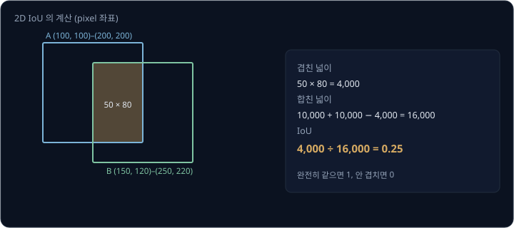
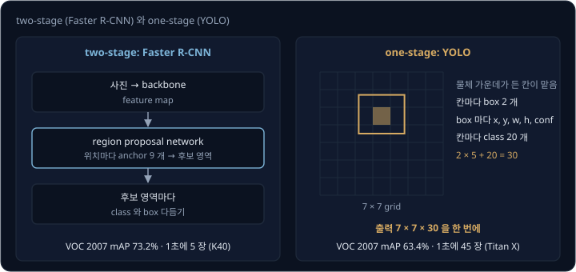
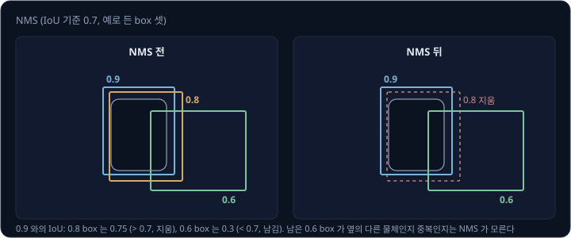
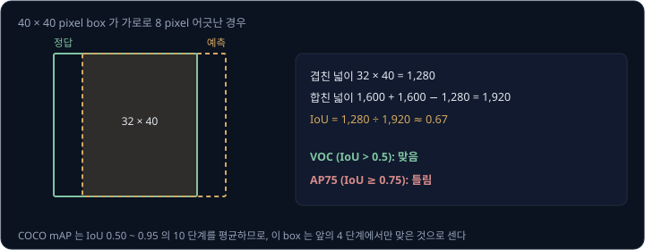
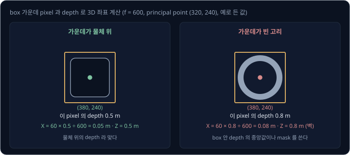
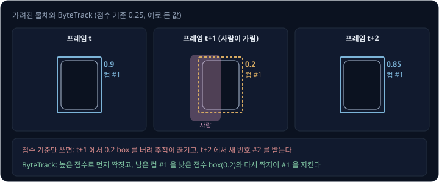

# Object Detection

책상 위의 빨간 상자를 집으라는 명령을 받은 로봇은 먼저 카메라 사진에서 상자가 어디 있는지 알아야 한다. [ResNet](../resnet/README.md) 같은
image classifier 는 사진 한 장에 "상자" 라는 이름 하나만 내므로, 그 출력으로는 상자가 사진의 어느 자리에 있는지, 컵과 상자가 함께 있으면 각각
어디 있는지 알 수 없다. 로봇에게는 물체마다 그 물체를 둘러싼 직사각형(**bounding box**), 물체의 종류(class), 맞을 가능성(점수)이 필요하다.
사진 속 물체의 개수는 미리 알 수 없는데, network 는 어떻게 개수가 정해지지 않은 box 들을 낼까? 그리고 그 box 로 로봇 팔이 갈 3D 좌표는 어떻게
얻을까?

이 문제를 푸는 일을 **object detection** 이라고 한다. Redmon 등(2016)의 YOLO(You Only Look Once)는 사진 한 장을 network 에 한 번만 통과시켜 box 를
모두 내고, Titan X GPU 에서 1초에 사진 45 장을 처리했다. 이 강의는 YOLO 와, 그보다 앞서 나온 two-stage detector(물체가 있을 만한 영역을 먼저 고르는
방식)를 비교한다. 이어서 같은 물체에 겹친 box 를 지우는 NMS, 물체 80 종류의 사진 dataset 인 COCO 에서 성능을 재는 mAP, 내 물체로 학습하는 방법,
box 에서 robot frame 의 3D 좌표를 얻는 계산, 프레임 사이에서 같은 물체를 이어 주는 추적, 이름으로 물체를 찾는 detector 를 차례로 본다.

## 학습 목표

- detector 가 내는 box·class·점수와 IoU 를 설명하고, two-stage 와 one-stage detector 의 차이를 설명할 수 있다
- NMS 가 겹친 box 를 지우는 과정을 숫자로 따라가고, NMS 기준과 점수 기준이 바뀔 때 생기는 일을 설명할 수 있다
- COCO 의 mAP(IoU 0.50 ~ 0.95 의 여러 기준에서 잰 정확도의 평균)와 PASCAL VOC 의 AP(IoU 0.5 기준에서 잰 정확도)의 차이와, 로봇 작업에서
  어느 쪽을 봐야 하는지 설명할 수 있다
- box 가운데와 depth 로 물체의 3D 좌표를 계산하고, 추적과 이름으로 물체를 찾는 open-vocabulary detector 가 로봇에서 하는 일을 설명할 수 있다

## 분류에서 탐지로

image classifier 는 사진 한 장에 class 마다 확률을 하나씩 내지만, detector 는 물체 하나마다 아래 세 가지를 낸다.

| 출력 | 뜻 | 예 |
| --- | --- | --- |
| bounding box | 물체를 둘러싼 직사각형. 왼쪽 위와 오른쪽 아래 꼭짓점의 pixel 좌표 $(x_1, y_1, x_2, y_2)$ 로 적는다 | (200, 220)–(240, 260) |
| class | 물체의 종류 | cup |
| 점수 | 이 box 가 그 class 의 물체일 가능성(0 ~ 1) | 0.91 |

box 가 물체를 잘 둘렀는지는 정답 box 와 얼마나 겹치는지로 잰다. 두 box 가 겹친 넓이를 둘 중 하나라도 덮은 넓이로 나눈 값을 **IoU**(Intersection over
Union)라고 한다. 두 box 가 완전히 같으면 IoU 는 1 이고, 겹치지 않으면 0 이다. 예를 들어 box A 가 (100, 100)–(200, 200) 이고 box B 가
(150, 120)–(250, 220) 이면, 겹친 부분은 가로 $200 - 150 = 50$, 세로 $200 - 120 = 80$ 이라 넓이 4,000 이다. 두 box 의 넓이는 각각 10,000 이므로 합친 넓이는
$10{,}000 + 10{,}000 - 4{,}000 = 16{,}000$ 이고, IoU 는 $4{,}000 \div 16{,}000 = 0.25$ 다. 3D box 로 IoU 를 계산하는 예는
[LiDAR Perception 의 detection benchmark](../lidar-perception/README.md#detection-benchmark) 에도 있다.

detector 를 만들 때는 출력의 개수가 걸림돌이 된다. 사진에 물체가 하나일 수도 있고 열 개일 수도 있지만, network 의 출력 크기는 정해져 있어야 한다.
two-stage detector 와 one-stage detector 는 이 문제를 서로 다르게 푼다.

**확인 문제.** box A (0, 0)–(100, 100) 과 box B (50, 0)–(150, 100) 의 IoU 는 얼마일까?

답 보기

1. 겹친 부분은 가로 $100 - 50 = 50$, 세로 100 이라 넓이 5,000 이다
2. 두 box 의 넓이는 각각 10,000 이라 합친 넓이는 $10{,}000 + 10{,}000 - 5{,}000 = 15{,}000$ 이다
3. IoU 는 $5{,}000 \div 15{,}000 \approx 0.33$ 이다

답: 약 0.33 이다. 가로로 절반이 어긋나면 IoU 는 0.5 가 아니라 0.33 이다.

## two-stage 와 one-stage

**two-stage** detector 는 물체가 있을 만한 영역을 먼저 고르고, 고른 영역마다 class 와 box 를 다시 계산한다. Ren 등(2015)의 Faster R-CNN(R-CNN 은
Region-based CNN 의 줄임말)은 첫 단계도 network 로 계산하게 바꿨다. 첫 module 인 region proposal network 는 feature map(network 가 사진에서 뽑은
특징의 격자)의 위치마다 모양을 정해 둔 box 9 개를 기준으로 물체가 있을 만한 영역을 낸다. box 9 개는 넓이 128², 256², 512² 세 가지와 가로세로 비
1:1, 1:2, 2:1 세 가지를 짝지은 조합이다. 둘째 module 은 그 영역을 분류하고 box 를 다듬는다. 저자들은 VGG-16 이라는 CNN 을 backbone(사진에서 특징을
뽑는 앞부분 network)으로 써서 K40 GPU 에서 1초에 5 장을 처리했다. class 20 개짜리 detection dataset 인 PASCAL VOC 2007 의 시험 데이터에서는
mAP(class 마다 잰 detection 정확도를 평균한 점수로, 100% 에 가까울수록 좋다) 73.2% 를 얻었다고 보고했다.

**one-stage** detector 는 영역을 고르는 단계 없이 network 를 한 번 통과시켜 box 를 모두 낸다. YOLO 는 사진을 $S \times S$ 칸의 grid 로 나누고, 물체의
가운데가 들어 있는 칸이 그 물체를 맡는다. 칸마다 box $B$ 개를 내고, box 마다 위치 4 개(가운데 $x, y$ 와 폭 $w$, 높이 $h$)와 confidence 하나를 내며, 칸마다 class 확률
$C$ 개를 낸다. 저자들은 confidence 를 물체가 있을 확률에 예측 box 와 정답 box 의 IoU 를 곱한 값으로 정의했다.

| 값 | YOLO 의 PASCAL VOC 설정 |
| --- | --- |
| grid $S$ | 7 |
| 칸마다 box $B$ | 2 |
| class $C$ | 20 |
| 칸마다 출력 $B \times 5 + C$ | $2 \times 5 + 20 = 30$ |
| 전체 출력 | $7 \times 7 \times 30$ |

출력의 크기가 정해져 있으므로 개수 문제가 사라진다. 물체가 없는 칸은 confidence 를 0 근처로 내고, 나중에 점수가 낮은 box 를 버린다. 저자들은
YOLO 가 Titan X 에서 1초에 45 장을 처리하고 VOC 2007 에서 mAP 63.4% 를 얻었으며, 작은 판인 Fast YOLO 는 1초에 155 장을 처리했다고 보고했다. 저자들은
한계도 적었다. 칸마다 box 가 둘이고 class 는 하나라서, 새 떼처럼 작은 물체가 모여 있으면 잘 찾지 못한다.

<b>심화: YOLO 의 class 점수</b>

YOLO 는 box 마다 confidence $\Pr(\text{Object}) \cdot \text{IoU}^{\text{truth}}_{\text{pred}}$ 를 내고, 칸마다 물체가 있을 때 각 class 일 조건부 확률
$\Pr(\text{Class}_i \mid \text{Object})$ 를 낸다. 시험할 때는 둘을 곱해 box 마다 class 별 점수를 만든다.

$$
\Pr(\text{Class}_i \mid \text{Object}) \cdot \Pr(\text{Object}) \cdot \text{IoU}^{\text{truth}}_{\text{pred}} = \Pr(\text{Class}_i) \cdot \text{IoU}^{\text{truth}}_{\text{pred}}
$$

저자들은 이 점수가 그 class 가 box 안에 나타날 확률과 box 가 물체에 얼마나 잘 맞는지를 함께 담는다고 적었다(논문의 식 1). 예를 들어 칸의 class
확률이 cup 0.8, bottle 0.2 이고 box 의 confidence 가 0.9 이면, 그 box 의 cup 점수는 $0.8 \times 0.9 = 0.72$ 이고 bottle 점수는 $0.2 \times 0.9 = 0.18$ 이다.
점수가 0.25 보다 낮은 box 를 버리면 cup box 만 남는다.

한 칸이 class 확률을 하나만 내므로, 가운데가 같은 칸에 든 서로 다른 class 의 두 물체는 둘 중 하나만 제대로 낼 수 있다. 그래서 저자들은 작은 물체가
모여 있을 때를 한계로 꼽았다.

| | Faster R-CNN (VGG-16) | YOLO |
| --- | --- | --- |
| 방식 | 영역 후보 → 영역마다 분류 | 한 번에 grid 의 모든 box |
| VOC 2007 mAP | 73.2% | 63.4% |
| 1초에 처리한 사진 | 5 장 (K40) | 45 장 (Titan X) |

1초에 처리한 사진 수는 서로 다른 GPU 에서 잰 값이라 그대로 견주지 않는다. 그래도 한 번에 내는 방식이 몇 배 빠르고, 정확도는 mAP 로 $73.2 - 63.4 = 9.8$ 점
낮았다는 경향은 읽을 수 있다. 카메라 영상을 1초에 수십 번 처리해야 하는 로봇에서는 이 속도와 정확도를 함께 따져 model 을 고른다.

## anchor 와 anchor-free

Faster R-CNN 의 box 9 개처럼 위치마다 미리 정해 둔 box 모양을 **anchor** 라고 한다. anchor 방식에서 network 는 box 좌표를 처음부터 맞힐 필요
없이, 가장 비슷한 anchor 에서 얼마나 옮기고 늘릴지만 낸다. 길쭉한 물체는 1:2 anchor 에서 출발하고 넓적한 물체는 2:1 anchor 에서 출발하면 고칠
양이 적어서 학습이 쉽다. 대신 anchor 의 크기와 비율을 dataset 에 맞게 골라야 하고, anchor 와 너무 다른 모양의 물체는 잘 맞히지 못한다.

**anchor-free** detector 는 정해 둔 모양 없이 위치마다 box 를 바로 낸다. YOLO 계열 model 을 만드는 회사인 Ultralytics 의 문서에 따르면
YOLOv8(2023)은 anchor-free split head 를 쓴다. head 는 network 끝에서 box 와 class 를 내는 부분인데, 소스 코드를 보면 YOLOv8 의 head 는 box 를 내는
갈래와 class 를 내는 갈래로 나뉘어 있어 위치를 맞히는 일과 종류를 맞히는 일을 따로 계산한다. anchor-free 방식은 anchor 의 크기를 고를 필요가
없어서 새 dataset 에 옮기기 쉽다.

| | anchor 방식 | anchor-free 방식 |
| --- | --- | --- |
| network 가 내는 것 | anchor 에서의 이동과 크기 변화 | 위치마다 낸 box |
| 사람이 정할 것 | anchor 의 크기와 비율 | 없음 |
| 예 | Faster R-CNN (위치마다 9 개) | YOLOv8 |

> **오해** anchor-free detector 는 미리 정한 것이 없으니 어떤 크기의 물체든 똑같이 잘 찾는다.
>
> **사실** anchor-free 방식에서는 anchor 를 고를 필요만 없어지고, 작은 물체를 찾기 어려운 문제는 남는다. 그래서 COCO 평가는 작은 물체(넓이 32² pixel 미만)의 AP(detection 정확도 점수)를 따로 낸다.

## NMS

detector 는 한 물체 근처의 여러 위치에서 비슷한 box 를 함께 낸다. 이 box 들을 그대로 두면 컵 하나를 세 개로 센다. **NMS**(non-maximum suppression)는
점수가 가장 높은 box 를 남기고, 그 box 와 IoU 가 기준보다 큰 box 를 지우는 일을 되풀이한다. PyTorch 의 영상 library 인 torchvision 의 `nms` 문서도 점수가 더 높은 box 와의
IoU 가 기준보다 큰 낮은 점수의 box 를 차례로 지운다고 설명한다.

예를 들어 한 컵 근처에 box 셋이 나왔고 점수가 0.9, 0.8, 0.6 이라고 하자. 점수 0.9 인 box 와의 IoU 는 0.8 box 가 0.75 이고 0.6 box 가 0.3 이다.
Ultralytics 가 예측할 때 쓰는 기본 NMS 기준 0.7 을 쓰면 아래와 같다.

| box | 점수 | 0.9 box 와의 IoU | 결과 |
| --- | --- | --- | --- |
| 1 | 0.9 | | 가장 높아서 남김 |
| 2 | 0.8 | 0.75 | 0.7 보다 커서 지움 |
| 3 | 0.6 | 0.3 | 0.7 보다 작아서 남김 |

box 3 은 남는다. 이 box 가 옆에 놓인 다른 컵이라면 맞게 남긴 것이고, 같은 컵을 크게 어긋나게 잡은 box 라면 지웠어야 할 중복이다. NMS 는 IoU 만 보고
판단하므로 두 경우를 구별하지 못한다.

NMS 기준을 바꾸면 중복을 남기는 실수와 붙은 물체를 지우는 실수 가운데 어느 쪽이 잦아지는지가 바뀐다. 기준을 낮추면 중복은 줄지만 바짝 붙은 두
물체 가운데 하나를 지우고, 기준을 높이면 붙은 물체를 지키지만 중복이 남는다. 예를 들어 나란히 붙은 두 컵의 box 가 IoU 0.5 로 겹치면, 기준 0.7 에서는 둘 다 남고 기준 0.45 에서는 하나가 지워진다. 컵을 하나씩
집어 옮기는 로봇에게는 컵 하나가 사라지는 것이 더 큰 문제일 수 있다. 중복을 남겨도 손해가 있어서, PASCAL VOC 의 평가 규칙은 같은 물체에 낸 box 가
여럿이면 하나만 맞은 것으로 치고 나머지는 틀린 것으로 센다(Everingham 등 2010).

최근 Ultralytics 의 YOLO26(2026)은 NMS 없이 box 를 바로 내는 end-to-end 출력도 지원하지만, 문서에 따르면 정확도를 위해 기본 경로는 NMS 를 쓴다.

> **오해** NMS 기준을 낮출수록 중복이 줄어 결과가 늘 좋아진다.
>
> **사실** 기준을 낮추면 바짝 붙은 두 물체도 같은 물체로 보고 하나를 지운다. IoU 0.5 로 겹친 두 컵은 기준 0.7 에서는 둘 다 남지만 기준 0.45 에서는 하나가 사라진다.

**확인 문제.** 점수 0.95, 0.85, 0.7 인 box 셋이 있고, 0.95 box 와의 IoU 는 0.85 box 가 0.6 이고 0.7 box 가 0.8 이다. NMS 기준이 0.7 이면 몇 개가 남을까? 기준이 0.5 면?

답 보기

1. 기준 0.7: 0.85 box 의 IoU 0.6 은 0.7 보다 작아 남고, 0.7 box 의 IoU 0.8 은 커서 지운다. 0.7 box 는 이미 지웠으므로 0.85 box 와 비교할 필요가 없다
2. 기준 0.5: 0.85 box 의 IoU 0.6 과 0.7 box 의 IoU 0.8 이 모두 0.5 보다 커서 둘 다 지운다

답: 기준 0.7 에서는 2 개, 기준 0.5 에서는 1 개가 남는다.

## 점수 기준과 mAP

NMS 를 하기 전에 점수가 정해 둔 값(점수 기준)보다 낮은 box 를 먼저 버린다. Ultralytics 가 예측할 때 쓰는 점수 기준의 기본값은 0.25 다. 기준을
올리면 잘못 찾은 box(false positive)가 줄지만 놓치는 물체가 늘고, 기준을 내리면 반대가 된다. 그래서 detector 의 성능은 점수 기준을 높은 데서 낮은
데로 옮겨 가며 precision(낸 box 가운데 맞은 비율)과 recall(정답 가운데 찾은 비율)이 어떻게 바뀌는지로 잰다. recall 을 가로축에, precision 을
세로축에 놓은 이 곡선 아래 넓이를 AP(average precision)라 하고, class 마다 구한 AP 를 평균한 값을 mAP(mean AP)라 한다. AP 를 계산하는 예는
[LiDAR Perception](../lidar-perception/README.md#detection-benchmark) 에 있다. Ultralytics 는 이 곡선 전체를 그리려고 평가할 때는 점수 기준을
0.001 로 낮춘다.

맞은 box 로 치는 IoU 기준은 benchmark(성능을 견주는 공통 시험 dataset 과 채점 규칙)마다 다르다.

| benchmark | 맞은 box 의 기준 | AP 의 계산 |
| --- | --- | --- |
| PASCAL VOC 2007 | IoU 0.5 초과 | recall 0, 0.1, …, 1 의 11 점에서 precision 의 평균 |
| COCO | IoU 0.50, 0.55, …, 0.95 의 10 단계 | 단계마다 AP 를 내서 평균. class 80 개에 대해 평균한 값으로 공식 순위를 매김 |

Everingham 등은 정답 box 자체가 부정확할 수 있어 VOC 의 기준 0.5 를 일부러 낮게 잡았다고 적었다. COCO 는 IoU 0.5 하나에서만 재던 관행을 깨고 10 단계의
평균을 공식 지표로 삼았으므로, COCO 의 mAP 는 box 를 정확히 맞혀야 높게 나온다. COCO 평가는 IoU 0.5 에서 잰 AP(AP50)와 IoU 0.75 에서 잰
AP(AP75), 물체 넓이가 32² pixel 미만인 작은 물체와 96² pixel 초과인 큰 물체의 AP 도 따로 내고, 사진 한 장에 box 를 100 개까지만 센다.

로봇에서는 box 가 얼마나 정확해야 하는지가 작업마다 다르다. 예를 들어 사진에서 40 × 40 pixel 인 컵의 box 가 가로로 8 pixel 어긋나면, 겹친 넓이는
$32 \times 40 = 1{,}280$, 합친 넓이는 $1{,}600 + 1{,}600 - 1{,}280 = 1{,}920$ 이라 IoU 는 0.67 이다. VOC 의 0.5 기준으로는 맞지만 AP75 의 0.75 기준으로는
틀린다. 컵이 있는지만 알면 되는 작업에는 AP50 이 맞는 지표이고, gripper 를 컵 가운데로 보내는 작업에는 AP75 나 COCO mAP 가 더 가까운 지표다.

<b>심화: COCO 의 AP 계산</b>

COCO 의 공식 평가 코드(pycocotools)는 class 와 IoU 기준마다 다음 순서로 AP 를 계산한다.

1. 사진마다 점수가 높은 box 100 개까지만 남기고, 점수 순서로 늘어놓는다
2. 점수가 높은 box 부터 정답과 짝지어, 같은 정답에 이미 짝지어진 box 가 있으면 틀린 것으로 센다
3. 누적한 precision 과 recall 을 계산하고, recall 이 큰 쪽에서 작은 쪽으로 훑으며 각 점의 precision 을 그보다 recall 이 큰 점들의 최댓값으로 올려 곡선이 내려가기만 하게 만든다
4. recall 0, 0.01, …, 1 의 101 점에서 precision 을 읽어 평균한다

이 AP 를 IoU 기준 10 단계와 class 80 개에 대해 평균한 값이 COCO mAP 다. COCO 는 AP 와 mAP 라는 말을 구분하지 않고 둘 다 이 평균을 가리키는 데 쓴다.
VOC 2007 은 마지막 단계에서 101 점 대신 11 점만 읽었다. 그래서 같은 detector 라도 어느 규칙으로 계산했는지 밝혀야 숫자를 견줄 수 있다.

Ultralytics 문서의 YOLOv8 표(사진 크기 640, COCO 의 검증용 사진 묶음 val2017)에서 크기별 숫자는 아래와 같다. 속도는 A100 GPU 에서 NVIDIA 의
추론 가속 library 인 TensorRT 로 잰 사진 한 장의 처리 시간이다.

| model | COCO mAP (0.50 ~ 0.95) | A100 TensorRT | parameter |
| --- | --- | --- | --- |
| YOLOv8n | 37.3 | 0.99 ms | 3.2 M |
| YOLOv8s | 44.9 | 1.20 ms | 11.2 M |
| YOLOv8m | 50.2 | 1.83 ms | 25.9 M |
| YOLOv8x | 53.9 | 3.53 ms | 68.2 M |

model 이 커지면 mAP 가 오르지만 계산이 늘어난다. 로봇의 onboard 컴퓨터는 A100 보다 훨씬 느리므로, model 은 같은 표의 CPU 시간(YOLOv8n 80.4 ms, YOLOv8x
479.1 ms)이나 실제 장비에서 잰 시간으로 고른다. 더 최근의 YOLO11 과 YOLO26 의 표는 T4 GPU 에서 잰 값이라 YOLOv8 의 A100 숫자와 속도를 직접 견주지
않는다.

> **오해** COCO mAP 50 인 detector 는 물체의 절반을 찾는다.
>
> **사실** COCO mAP 는 IoU 0.50 ~ 0.95 의 10 단계에서 각각 precision·recall 곡선 아래 넓이를 구해 평균한 값이다. box 를 조금만 덜 정확하게 맞혀도 높은 IoU 단계에서 틀린 것으로 세므로, 물체를 찾는 비율보다 낮게 나온다.

## 내 물체로 학습하기

COCO 의 class 는 80 개라서, 로봇이 다룰 부품이나 공구는 그 안에 없는 경우가 많다. 이때는 COCO 로 학습한 model 에서 출발해 내 물체의 사진으로 다시
학습(fine-tuning)한다. network 의 앞쪽 층이 이미 모서리와 질감 같은 일반적인 특징을 배워 두었으므로, 처음부터 학습할 때보다 적은 사진으로도
학습할 수 있다.

Ultralytics 의 detection dataset 형식에서는 사진마다 같은 이름의 txt 파일을 하나 두고, 물체 하나를 한 줄에 `class x_center y_center width height`
로 적는다. 좌표는 사진의 가로 길이와 세로 길이로 나눠 0 ~ 1 사이 값으로 적고, class 번호는 0 부터 센다. 물체가 없는 사진에는 txt 파일이 없어도 된다.

예를 들어 640 × 480 사진에서 box (200, 220)–(240, 260) 인 class 0 물체는 아래처럼 바꾼다.

| 값 | 계산 | 결과 |
| --- | --- | --- |
| x_center | $(200 + 240) \div 2 \div 640 = 220 \div 640$ | 0.34375 |
| y_center | $(220 + 260) \div 2 \div 480 = 240 \div 480$ | 0.5 |
| width | $(240 - 200) \div 640$ | 0.0625 |
| height | $(260 - 220) \div 480$ | 0.0833 |

한 줄은 `0 0.34375 0.5 0.0625 0.0833` 이 된다. 좌표를 pixel 단위로 적으면 1 보다 큰 값이 나와서, Ultralytics 는 그 사진을 잘못된 label 로 보고 경고를 낸 뒤 학습에서 뺀다. 더
조심할 것은 꼭짓점 좌표 $(x_1, y_1, x_2, y_2)$ 를 0 ~ 1 로 나눠 적은 경우다. 값이 모두 0 ~ 1 이라 검사를 통과해 학습은 오류 없이 진행되지만, model 은
엉뚱한 자리의 box 를 배운다. 학습 전에 label 을 사진 위에 다시 그려 보면 이런 실수를 빨리 찾을 수 있다.

같은 물체라도 로봇이 보는 높이·각도·조명은 인터넷 사진과 달라서, 로봇의 카메라로 실제 작업 장면을 찍은 사진을 학습과 평가에 함께 쓴다.

**확인 문제.** 1280 × 720 사진에서 box (640, 300)–(740, 420) 인 class 2 물체를 Ultralytics 형식의 한 줄로 쓰면 무엇일까?

답 보기

1. x_center: $(640 + 740) \div 2 = 690$, $690 \div 1280 \approx 0.539$
2. y_center: $(300 + 420) \div 2 = 360$, $360 \div 720 = 0.5$
3. width: $(740 - 640) \div 1280 = 100 \div 1280 \approx 0.078$
4. height: $(420 - 300) \div 720 = 120 \div 720 \approx 0.167$

답: `2 0.539 0.5 0.078 0.167` 이다.

## box 에서 3D 좌표로

box 는 사진 속 위치일 뿐이라, 로봇 팔이나 이동 로봇이 갈 곳으로 쓰려면 3D 좌표로 바꿔야 한다. box 가운데 pixel 과 그 자리의 depth(카메라에서 앞쪽으로 잰 거리)를
알면 pixel 을 3D 점으로 되돌리는 [Camera Geometry 의 back-projection](../camera-geometry/README.md#depth-를-아는-경우의-back-projection) 으로 camera frame 의 3D 점을 얻고, 카메라와
로봇 사이의 변환(extrinsics)을 곱해 robot frame 으로 옮긴다.

예를 들어 카메라의 가로·세로 방향 초점 거리가 $f_x = f_y = 600$ pixel 이고, 사진 가운데(principal point)가 $(320, 240)$ 이라고 하자. box 가운데는
$(380, 240)$ 이고, 그 자리의 depth 는 0.5 m 다.

| 값 | 계산 | 결과 |
| --- | --- | --- |
| $X$ (오른쪽) | $(380 - 320) \times 0.5 \div 600$ | 0.05 m |
| $Y$ (아래) | $(240 - 240) \times 0.5 \div 600$ | 0 m |
| $Z$ (앞) | depth | 0.5 m |

물체는 카메라 앞 0.5 m, 오른쪽 5 cm 에 있다. 이 점에 카메라에서 robot base(로봇 팔이 고정된 바닥 부분)로 가는 변환을 곱하면 팔이 갈 좌표가
된다. 손목 카메라라면 그 변환은
[Hand-Eye Calibration](../hand-eye-calibration/README.md) 으로 구한다.

box 가운데가 물체 위에 있지 않으면 이 계산이 틀린다. 고리 모양의 테이프나 손잡이 달린 컵처럼 가운데가 비어 있으면, 가운데 pixel 에서는 물체
뒤의 책상이나 벽까지의 depth 가 나온다. 앞의 예에서 그 pixel 의 depth 가 물체의 0.5 m 대신 뒤쪽 벽의 0.8 m 로 나오면, $X$ 는
$(380 - 320) \times 0.8 \div 600 = 0.08$ m 가 된다. 옆으로는 $0.08 - 0.05 = 0.03$ m(3 cm) 틀리고, 앞으로는 $0.8 - 0.5 = 0.3$ m(30 cm) 틀린다.
그래서 box 안의 depth 를 여러 개 모아 중앙값을 쓰거나, 물체의 pixel 만 고르는 mask 를 함께 내는 segmentation model 을 쓴다. 같은 계산을 색 mask
로 하는 예는 [Classical Pick & Place 의 depth 와 3D 위치](../classical-pick/README.md#depth-와-3d-위치) 에 있다.

> **오해** box 가운데 pixel 의 depth 는 물체까지의 거리다.
>
> **사실** box 는 물체를 둘러싼 직사각형이라 가운데가 물체 위에 있다는 보장이 없다. 고리 모양 물체는 가운데 pixel 에서 뒤쪽 벽의 depth 가 나와, 0.5 m 에 있는 물체를 0.8 m 로 읽는다. 그래서 box 안 depth 의 중앙값이나 segmentation mask 를 쓴다.

**확인 문제.** 가로 방향 초점 거리 $f_x$ 는 500 pixel 이고, principal point 의 가로 pixel 좌표 $u$ 는 320 이다. box 가운데의 $u$ 는 220 이고, 그
자리의 depth 는 1.0 m 다. 물체는 카메라에서 옆으로 얼마나 떨어져 있을까?

답 보기

1. principal point 에서의 차이는 $220 - 320 = -100$ pixel 이다
2. 본문의 표처럼 pixel 차이에 depth 를 곱하고 $f_x$ 로 나누면 $X = -100 \times 1.0 \div 500 = -0.2$ m 이다

답: 왼쪽으로 0.2 m 다($X$ 가 음수면 왼쪽).

## 2D 추적

detector 는 프레임마다 box 를 따로 내므로, detector 의 출력만으로는 이번 프레임의 컵이 지난 프레임의 어느 컵인지 알 수 없다. 사람을 따라가거나
움직이는 물체를 집으려면 물체마다 번호를 붙여 프레임 사이에서 이어야 한다. 이 일을 multi-object tracking 이라고 한다. multi-object tracking 에서
물체마다 움직임을 예측해 새 box 와 짝짓는 방법은 [LiDAR Perception 의 multi-object tracking](../lidar-perception/README.md#multi-object-tracking)
에서 3D 로 다뤘다.

카메라 추적에서는 가려짐이 자주 문제가 된다. 사람이 컵 앞을 지나가면 컵의 점수가 점수 기준 0.25 아래로 떨어져 컵의 box 가 버려지고, 추적이
끊긴 컵은 다시 나타날 때 새 번호를 받는다. Zhang 등(2022)의 ByteTrack 은 점수가 높은 box 로 먼저 짝을 지은 뒤, 짝을 찾지 못한 기존 물체를 점수가 낮은 box 와 한 번 더 짝짓는다.
이 두 번째 짝짓기로 가려지거나 흐려져 점수가 낮아진 진짜 물체를 되살리고, 기존 물체와 이어지지 않는 낮은 점수의 box 는 배경으로 버린다. 저자들은
사람 추적 benchmark 인 MOT17 의 시험 데이터에서 MOTA 80.3, IDF1 77.3 을 얻었고, V100 GPU 에서 1초에 30 프레임을 처리했다고 보고했다. MOTA 는
놓침·잘못 찾음·번호 바뀜을 함께 반영한 정확도이고, IDF1 은 같은 물체에 같은 번호를 얼마나 일관되게 붙였는지를 잰 값이다.

Ultralytics 의 추적 기능에는 여러 tracker 가 들어 있는데, 기본 tracker 는 판마다 바뀌었다. 2024 년 판(v8.3)의 기본 tracker 는 BoT-SORT 였고,
2026 년 6 월에 TrackTrack 으로 바뀌었다. 예전 글을 따라 할 때는 쓰는 판의 기본값을 확인한다.

## 이름으로 찾는 detector

COCO 로 학습한 detector 처럼 class 목록이 정해진 detector 는 목록 밖의 물체를 찾지 못한다. "창가에 있는 빨간 상자" 처럼 말로 받은 명령을 처리하려면,
글로 준 이름에 맞는 물체를 찾는 **open-vocabulary detector** 가 필요하다. open-vocabulary 는 찾을 수 있는 이름의 목록(vocabulary)이 정해져 있지
않다는 뜻이다. open-vocabulary detector 는 사진과 글을 함께 학습한 [CLIP](../clip/README.md) 같은 model 의 표현을 detection 에 옮겨 쓴다. Minderer
등(2022)의 OWL-ViT 는 사진과 글로 pretraining 한 Vision Transformer 를 detection 으로 fine-tuning 하는 방법을 정리했다.

Liu 등(2023)의 Grounding DINO 는 class 이름이나 "왼쪽 컵" 같은 설명을 받아 그에 맞는 물체를 찾는다. 저자들은 COCO 의 학습 데이터 없이 학습한
model 을 COCO 로 평가해(zero-shot) AP 52.5 를 얻었다고 보고했다. 다만 이 숫자는 가장 큰 Swin-L backbone 을 Objects365 같은 큰 dataset 으로
pretraining 한 결과인데, Objects365 의 class 는 COCO 와 많이 겹친다. 작은 Swin-T backbone 을 쓴 model 의 AP 는 46.7 ~ 48.4 였다.

로봇에서는 LLM(large language model)이 명령을 단위 동작으로 나눌 때, "빨간 상자를 찾아라" 의 "빨간 상자" 를 그대로 이런 detector 에 넘길 수 있다. 다만 open-vocabulary
detector 는 YOLO 보다 계산이 무거운 경우가 많아서, 처음 찾을 때만 쓰고 그 뒤로는 빠른 detector 나 tracker 로 따라가는 구성을 쓰기도 한다. 이름으로
찾는 YOLO 계열인 YOLO-World 의 숫자는 [Classical Pick & Place](../classical-pick/README.md#색과-이름으로-찾는-물체) 에 있다.

> **오해** open-vocabulary detector 는 어떤 이름이든 COCO detector 만큼 정확하게 찾는다.
>
> **사실** Grounding DINO 의 COCO AP 52.5 는 가장 큰 model 이 COCO 와 class 가 많이 겹치는 데이터로 사전학습한 결과다. 작은 model 의 AP 는 46.7 ~ 48.4 였고, 학습 데이터에 드문 물체나 긴 설명에서는 더 낮아질 수 있다.

## 정리

- detector 는 물체마다 box·class·점수를 낸다. box A (100, 100)–(200, 200) 과 B (150, 120)–(250, 220) 의 IoU 는 4,000 ÷ 16,000 = 0.25 다
- one-stage 인 YOLO 는 사진을 7 × 7 칸으로 나눠 7 × 7 × 30 의 출력을 한 번에 낸다. VOC 2007 mAP 는 63.4% 로 Faster R-CNN 의 73.2% 보다 낮았지만 1초에 45 장을 처리했다
- NMS 는 점수가 가장 높은 box 를 남기고, 그 box 와의 IoU 가 기준을 넘는 box 를 지운다. 기준 0.7 에서 IoU 0.75 인 box 는 지우고 0.3 인 box 는 남긴다
- COCO mAP 는 IoU 0.50 ~ 0.95 의 평균이라 box 가 정확해야 높다. 40 × 40 pixel box 가 8 pixel 어긋나면 IoU 가 0.67 이라 AP50 에서는 맞고 AP75 에서는 틀린다
- box 가운데와 depth 로 3D 좌표를 얻는다. 가운데가 비어 있는 물체는 뒤쪽 벽을 재서 0.5 m 를 0.8 m 로 읽을 수 있으므로 depth 중앙값이나 mask 를 쓴다
- ByteTrack 은 낮은 점수의 box 로 한 번 더 짝지어 가려진 물체를 잇는다. Grounding DINO 같은 open-vocabulary detector 는 글로 준 이름으로 물체를 찾는다

이 강의는 사진에서 물체를 찾는 데까지 다뤘다. 찾은 물체를 어떤 자세로 집을지는 [Grasp Planning](../grasping/README.md) 에서 다루고, 물체의 3D
자세를 정확히 구하는 방법은 [6D Object Pose](../object-pose/README.md) 에서 다룬다.

## 참고 자료

- Joseph Redmon 외, [You Only Look Once](https://arxiv.org/abs/1506.02640) (CVPR 2016) — 2 절의 grid 와 출력 tensor, 2.4 절의 한계, Table 1 의 속도와
  mAP
- Shaoqing Ren 외, [Faster R-CNN](https://arxiv.org/abs/1506.01497) (NeurIPS 2015) — 3 절의 두 module, 3.1.1 절의 anchor, Table 5 의 처리 시간
- Mark Everingham 외, [The PASCAL Visual Object Classes (VOC) Challenge](http://host.robots.ox.ac.uk/pascal/VOC/pubs/everingham10.pdf) (IJCV 2010) —
  4.2 절의 precision·recall 과 11 점 AP, IoU 0.5 기준과 그 이유
- Tsung-Yi Lin 외, [Microsoft COCO](https://arxiv.org/abs/1405.0312) (2014) 와 [COCO detection 평가 설명](https://cocodataset.org/#detection-eval) —
  80 개 class, IoU 0.50 ~ 0.95 평균, 크기별 AP 와 100 개 제한
- Ultralytics 문서, [YOLOv8](https://docs.ultralytics.com/models/yolov8/), [Predict](https://docs.ultralytics.com/modes/predict/),
  [Detection dataset 형식](https://docs.ultralytics.com/datasets/detect/), [Track](https://docs.ultralytics.com/modes/track/) — 크기별 mAP 와 처리 시간,
  점수·NMS 기본값, label 형식, tracker 기본값
- PyTorch 문서, [torchvision.ops.nms](https://docs.pytorch.org/vision/stable/generated/torchvision.ops.nms.html) — NMS 의 정의
- Yifu Zhang 외, [ByteTrack](https://arxiv.org/abs/2110.06864) (ECCV 2022) — 3 절의 두 번 짝짓기와 MOT17 결과
- Shilong Liu 외, [Grounding DINO](https://arxiv.org/abs/2303.05499) (2023) 와 Matthias Minderer 외, [OWL-ViT](https://arxiv.org/abs/2205.06230) (ECCV 2022) —
  글로 준 이름으로 찾는 detector 와 zero-shot COCO 결과(Grounding DINO 의 Table 2)
