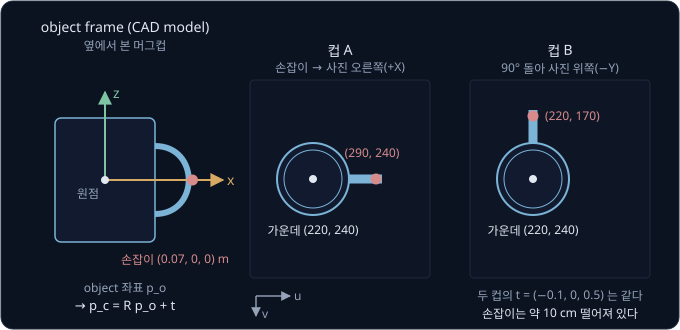
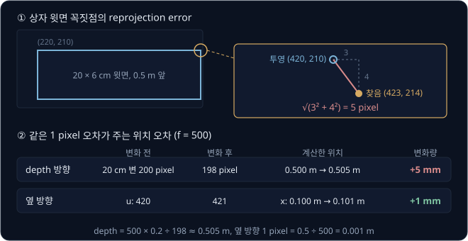
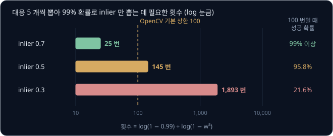
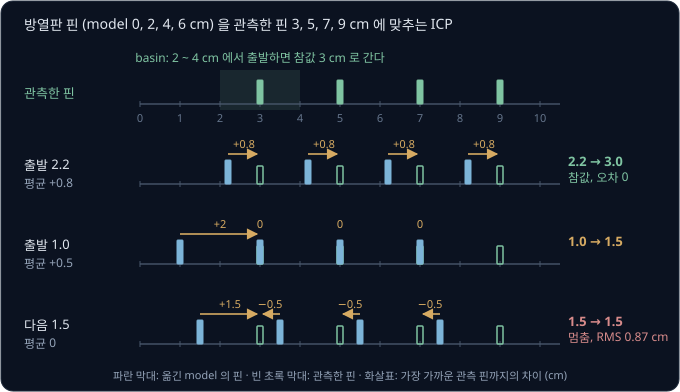
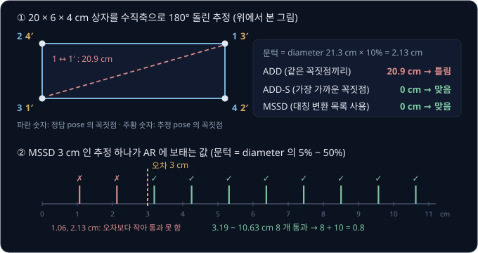
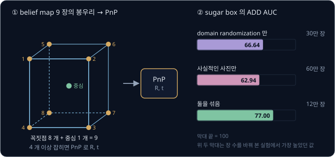
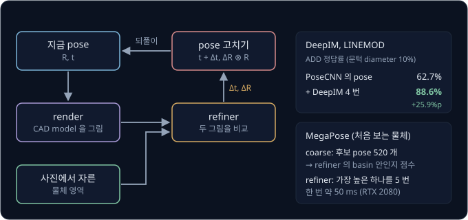
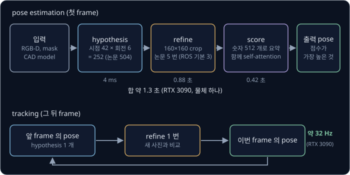
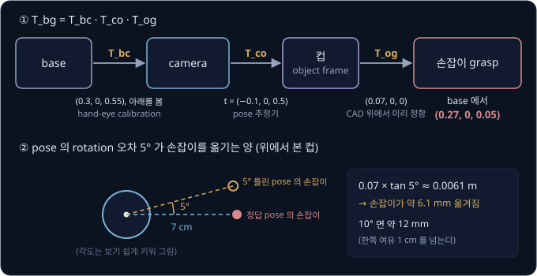

# 6D Object Pose

로봇 팔이 책상 위 머그컵을 손잡이로 집으려 한다. 물체 detector 는 컵을 둘러싼 bounding box 를 주고, depth camera 를 쓰면
[Classical Pick & Place](../classical-pick/README.md) 처럼 컵 가운데의 3D 위치도 구할 수 있다. 그런데 같은 자리에 선 컵이라도 손잡이는 오른쪽을
향할 수도 있고 뒤쪽을 향할 수도 있어서, 가운데 점 하나로는 손가락을 어디로 보낼지 정해지지 않는다. 카메라 사진에서 컵이 어디에 있는지에 더해 어느
쪽으로 얼마나 돌아가 있는지까지 어떻게 구할 수 있을까?

이 물음에 답하는 계산이 6D object pose estimation 이다. 물체에 붙인 좌표축이 카메라 기준으로 어디에 어떤 방향으로 놓였는지를 rotation 숫자 3 개와
translation 숫자 3 개로 구하면, 3D model 위에 미리 정해 둔 손잡이 grasp 를 로봇 좌표로 옮길 수 있다. NVIDIA 의 FoundationPose(CVPR 2024)는 학습 때
보지 못한 물체도 CAD model 이나 사진 16 장 정도만 받아 다시 학습하지 않고 pose 를 구한다. ROS 2 package 인 Isaac ROS FoundationPose 로 로봇에 붙일 수
있다.

## 학습 목표

- 6D pose 가 물체 frame 의 rotation 과 translation 이라는 것과, bounding box 나 3D 점 하나만으로는 grasp 를 정할 수 없는 이유를 숫자로 설명할 수 있다
- 사진의 점과 3D model 의 점을 짝지어 pose 를 푸는 PnP, 틀린 짝을 거르는 RANSAC, depth 의 점을 model 에 맞추는 ICP 가 각각 언제 실패하는지 설명할 수 있다
- 오차 지표가 물체의 대칭을 고려해야 하는 이유와 BOP benchmark 의 AR 점수를 설명할 수 있다
- 합성 데이터로 학습한 PoseCNN·DOPE 와 render-and-compare 를 쓰는 DeepIM·MegaPose·FoundationPose 를 비교하고, 추정한 pose 를 hand-eye transform 과
  이어 grasp 로 바꾸는 과정을 설명할 수 있다

## 6D pose

pose 계산에는 [Camera Geometry](../camera-geometry/README.md) 에서 본 camera optical frame($X$ 사진 오른쪽, $Y$ 사진 아래쪽, $Z$ 카메라 앞쪽)과
물체에 붙인 **object frame** 이 필요하다. 물체의 모양을 점과 삼각형 면으로 적은 파일을 **CAD model**(또는 mesh)이라고 한다. object frame 은 이 파일을
만들 때 정한 원점과 축이다. 예시 머그컵은 몸통 가운데가 원점이고, 컵이 서 있을 때의 위쪽이 $z$ 축이고, 손잡이 쪽이 $x$ 축이다. 손가락을 댈 손잡이의
점은 $(0.07, 0, 0)$ m 다.

object frame 이 camera frame 에서 돌아간 방향이 rotation $R$ 이고, object frame 의 원점이 놓인 camera 좌표가 translation $t$ 다. rotation 은
[Rigid Transforms](../transforms/README.md) 에서 본 것처럼 숫자 3 개로 적을 수 있어서 둘을 합치면 숫자 6 개다. 그래서 이 pose 를 **6D pose**(또는 6-DoF
pose)라고 하고, camera 에서 본 object 라는 뜻으로 $T_{co}$ 라고 적는다.

rotation matrix 의 열은 object frame 의 $x$·$y$·$z$ 축을 camera frame 에서 잰 방향이다. 예시 카메라는 Classical Pick & Place 의 카메라와 같아서
base frame 의 $(0.3, 0, 0.55)$ 에서 수직 아래를 본다. $f = 500$ 이고 principal point 는 $(320, 240)$ 이다. 높이 10 cm 인 컵이 가운데가 base frame 의
$(0.20, 0, 0.05)$ 에 오도록 서 있으면 컵 가운데는 camera frame 의 $t = (-0.1, 0, 0.5)$ 이고 pixel $(220, 240)$ 에 찍힌다. 컵 A 는 손잡이가 로봇 앞쪽(사진
오른쪽, $+X$)을 향하고, 컵 B 는 제자리에서 90° 돌아 손잡이가 로봇 왼쪽(사진 위쪽, $-Y$)을 향한다.

| | 컵 A | 컵 B |
| --- | --- | --- |
| object 의 $x$ 축 (camera frame) | $(1, 0, 0)$ | $(0, -1, 0)$ |
| 가운데 $t$ | $(-0.1, 0, 0.5)$ | $(-0.1, 0, 0.5)$ |
| 손잡이 $= 0.07 \times x$ 축 $+\ t$ | $(-0.03, 0, 0.5)$ | $(-0.1, -0.07, 0.5)$ |
| 손잡이의 pixel | $(290, 240)$ | $(220, 170)$ |

두 컵은 가운데가 같아서 3D 점 하나만 내는 인식으로는 구별되지 않지만, 손잡이는 $\sqrt{0.07^2 + 0.07^2} \approx 0.099$ m, 약 10 cm 떨어져 있다. 표의
계산을 기호로 바꾸면 아래와 같다.

| 이 예의 값 | 기호로 쓴 값 |
| --- | --- |
| 손잡이의 object 좌표 $(0.07, 0, 0)$ | $p_o$ |
| $0.07 \times$ ($x$ 축의 camera 방향) | $R\,p_o$ |
| 컵 가운데 $(-0.1, 0, 0.5)$ | $t$ |
| 손잡이의 camera 좌표 | $p_c = R\,p_o + t$ |

인식이 내는 출력에 따라 grasp 를 정하는 데 모자라는 정보가 다르다.

| 인식의 출력 | 숫자 수 | 모르는 것 |
| --- | --- | --- |
| 2D bounding box | 4 (두 꼭짓점의 pixel) | 거리, 방향 |
| 3D 점 | 3 | 방향 |
| 3D 점과 yaw | 4 | 기울거나 누운 자세 |
| 6D pose | 6 | 없음 |

Classical Pick & Place 에서는 cube 가 책상 위에 바로 놓인다고 가정해 수직축을 도는 yaw 만 구했지만, 통 안에 쌓인 물체나 옆으로 누운 컵은 roll 과 pitch 도
0 이 아니라서 rotation 숫자 3 개가 모두 필요하다.

**확인 문제.** 컵이 제자리에서 180° 돌아 손잡이가 로봇 쪽(사진 왼쪽, $-X$)을 향한다. 손잡이의 camera 좌표와 pixel 은?

답 보기

1. object 의 $x$ 축은 camera frame 의 $(-1, 0, 0)$ 이다
2. 손잡이: $0.07 \times (-1, 0, 0) + (-0.1, 0, 0.5) = (-0.17, 0, 0.5)$
3. pixel: $u = 500 \times (-0.17 \div 0.5) + 320 = 150$, $v = 240$ 이라서 $(150, 240)$

<b>심화: 4×4 transform 으로 쓴 pose</b>

컵 B 의 rotation matrix 는 세 축의 camera 방향 $(0, -1, 0)$, $(-1, 0, 0)$, $(0, 0, -1)$ 을 차례로 열에 놓은 행렬이다.

$$
R_B = \begin{bmatrix} 0 & -1 & 0 \\ -1 & 0 & 0 \\ 0 & 0 & -1 \end{bmatrix}, \qquad
T_{co} = \begin{bmatrix} R_B & t \\ 0\ 0\ 0 & 1 \end{bmatrix}
$$

$T_{co}$ 를 끝에 1 을 붙인 object 좌표에 곱하면 $R\,p_o + t$ 가 한 번에 나온다. 손잡이 위쪽 끝 $(0.07, 0, 0.03)$ 이면 $R_B\,p_o = (0, -0.07, -0.03)$
이다. $t$ 를 더하면 $(-0.1, -0.07, 0.47)$ 이라서 depth 가 0.47 m 다. 위로 3 cm 올라간 점이 카메라에 3 cm 가까워졌다.

rotation matrix 는 숫자가 9 개지만 세 열의 길이가 1 이고 서로 직각이어야 한다는 조건 6 개가 붙어서 독립인 숫자는 3 개다. network 가 숫자 9 개를
따로 내면 조건을 어긴 값이 나올 수 있다. 그래서 PoseCNN 은 rotation 을 quaternion 으로 내고 FoundationPose 는 고칠 양을 axis-angle 로 낸다.

## 2D–3D 대응과 PnP

pose 를 구하는 고전적인 방법은 object frame 에서 위치를 아는 점(3D)과 그 점이 사진에 찍힌 pixel(2D)의 짝을 여러 개 모으는 것이다. 이 짝을 **2D–3D
대응**(correspondence)이라고 한다. Camera Geometry 에서 ArUco marker 의 네 꼭짓점으로 pose 를 구한 PnP(Perspective-n-Point)를 marker 대신 물체 자체의
점에 쓰면 물체의 pose 가 나온다. 대응은 사진의 특징점을 textured model 의 특징점과 짝지어 만들거나, network 가 미리 정한 keypoint 의 pixel 을 찾게
학습해 만든다. PoseCNN 논문에 따르면 앞의 방법은 무늬가 없는 물체에서 특징점이 나오지 않는다.

20 × 6 × 4 cm 상자가 카메라 아래에 누워 있고 윗면이 0.5 m 앞에 있다고 하자. 지금 추측한 pose 로 윗면 꼭짓점 하나를 옮기면 camera frame 의
$(0.10, -0.03, 0.50)$ 이고, 투영하면 pixel $(500 \times 0.10 \div 0.50 + 320,\ 500 \times (-0.03) \div 0.50 + 240) = (420, 210)$ 이다. keypoint
detector 는 이 꼭짓점을 $(423, 214)$ 에서 찾았으므로 reprojection error 는 $\sqrt{3^2 + 4^2} = 5$ pixel 이다. PnP 는 모든 대응의 reprojection error
제곱 합이 가장 작아지는 $R$ 과 $t$ 를 찾는다(OpenCV 문서).

사진만 쓰는 PnP 는 카메라 앞쪽(depth) 방향에 약하다. 0.5 m 앞의 20 cm 변은 $500 \times 0.2 \div 0.5 = 200$ pixel 로 찍히는데, 양 끝 꼭짓점이 1 pixel
씩 안쪽으로 잡혀 198 pixel 이 되면 depth 는 $500 \times 0.2 \div 198 \approx 0.505$ m 로 5 mm 틀린다. 같은 1 pixel 이 옆으로 틀리면 위치 오차는
$0.5 \div 500 = 0.001$ m, 1 mm 다. Joyce 등(2025)이 RGB 사진만 쓰는 pose 추정기 다섯 개의 결과를 grasp simulation 에 넣어 보니, translation 오차의
80% 이상이 카메라의 시선 방향에서 나왔다.

**확인 문제.** 같은 상자가 1.0 m 앞에 있다. 20 cm 변은 몇 pixel 로 찍히고, 양 끝이 1 pixel 씩 안쪽으로 잡히면 depth 는 얼마나 틀릴까?

답 보기

1. 찍히는 길이: $500 \times 0.2 \div 1.0 = 100$ pixel
2. 98 pixel 로 잡히면 depth 는 $500 \times 0.2 \div 98 \approx 1.020$ m 라서 약 2 cm 틀린다
3. 옆으로 1 pixel 은 $1.0 \div 500 = 0.002$ m, 2 mm 다

거리가 2 배가 되자 depth 오차는 5 mm 에서 2 cm 로 4 배가 되었다.

<b>심화: PnP 가 줄이는 값과 필요한 점 수</b>

object frame 의 점 $P_i$ 와 그 점이 찍힌 pixel $x_i$ 가 $n$ 쌍 있을 때, PnP 는 아래 합을 가장 작게 하는 $R$, $t$ 를 찾는다.

$$
\sum_{i=1}^{n} \big\lVert\, \pi\big(K (R P_i + t)\big) - x_i \,\big\rVert^2
$$

$K$ 는 intrinsics 이고, $\pi$ 는 셋째 숫자(depth)로 나눠 pixel 을 꺼내는 계산이다. 대응 하나는 $u$ 와 $v$ 의 식 두 개를 주므로 점
3 개면 식이 모르는 숫자와 같은 6 개다. 하지만 OpenCV 문서에 따르면 점 3 개의 답은 최대 4 개라서 하나를 고르려면 넷째 점이 필요하다. OpenCV 의 `solvePnP` 는 답을 axis-angle 의
rotation vector(`rvec`)와 `tvec` 으로 돌려주는데, 이 둘은 model 좌표계의 점을 camera 좌표계로 옮기므로 $T_{co}$ 와 방향이 같다. 기본 방법
`SOLVEPNP_ITERATIVE` 는 위 합을 Levenberg-Marquardt 로 반복해 줄이고, `SOLVEPNP_EPNP` 는 반복 없이 식으로 푼다.

## RANSAC

대응에는 틀린 짝이 섞인다. 모양이 같은 두 꼭짓점을 바꿔 찾거나, 가려진 꼭짓점을 엉뚱한 자리에 찍거나, 배경의 무늬를 물체의 무늬와 짝짓는 경우다.
크게 틀린 대응은 **outlier** 이고 맞는 대응은 **inlier** 다. PnP 는 오차를 제곱해 더하므로 140 pixel 틀린 outlier 하나($140^2 = 19{,}600$)가
5 pixel 틀린 inlier($5^2 = 25$) 수백 개보다 큰 몫을 차지해 pose 를 끌고 간다.

**RANSAC**(Random Sample Consensus)은 대응 몇 개만 무작위로 뽑아 pose 를 구한다. 그 pose 로 모든 3D 점을 투영해 reprojection error 가 문턱 안인 대응의
수를 센다. 이를 되풀이해 inlier 가 가장 많은 pose 를 고른 뒤, 그 inlier 로만 PnP 를 다시 푼다. LiDAR 점에서 땅 평면을 찾을 때도 같은 방법을 쓴다
([LiDAR Perception](../lidar-perception/README.md)). OpenCV 의 `solvePnPRansac` 은 한 번에 대응 5 개를 뽑아 반복 없이 식으로 푸는 EPnP 로 pose 를 구한다. 문턱 `reprojectionError` 의
기본값은 8 pixel 인데, 예시 카메라에서 8 pixel 은 0.5 m 앞의 옆 방향 $8 \times 0.5 \div 500 = 0.008$ m 에 해당한다.

몇 번 뽑아야 하는지는 inlier 비율 $w$ 에 달렸다. 5 개가 모두 inlier 일 확률은 $w^5$ 이고, 그런 뽑기가 적어도 한 번 나올 확률을 99% 로 맞추는 횟수는
아래와 같다(식은 심화).

| inlier 비율 $w$ | $w^5$ | 99% 에 필요한 횟수 | 100 번 뽑을 때 성공 확률 |
| --- | --- | --- | --- |
| 0.7 | 0.168 | 25 | 99% 이상 |
| 0.5 | 0.031 | 145 | 95.8% |
| 0.3 | 0.0024 | 1,893 | 21.6% |

`solvePnPRansac` 의 `iterationsCount` 기본값 100 은 상한이라서, OpenCV 는 필요한 횟수를 다시 계산해 줄일 수는 있어도 100 을 넘기지는 않는다. inlier 가
30% 뿐이면 상한을 올리거나, 물체 pixel 만 칠한 segmentation mask 안의 대응만 써서 $w$ 를 먼저 올린다.

**확인 문제.** inlier 비율이 0.6 이다. 대응 5 개를 뽑는 RANSAC 이 99% 확률로 inlier 만 뽑으려면 몇 번 뽑아야 하고, OpenCV 기본 상한으로 충분할까?

답 보기

1. 한 번에 모두 inlier 일 확률: $0.6^5 \approx 0.078$
2. 필요한 횟수: $\log(0.01) \div \log(1 - 0.078) = -4.605 \div -0.081 \approx 57$ 번
3. 57 이 상한 100 보다 작으므로 기본값으로 충분하다

<b>심화: 뽑기 횟수의 식</b>

한 번 뽑은 $s$ 개가 모두 inlier 일 확률은 $w^s$ 이고, $k$ 번 모두 outlier 가 섞일 확률은 $(1 - w^s)^k$ 다. 이 값을 $1 - p$ 아래로 내리는 $k$ 는 양변에 log 를
취해 구한다.

$$
k = \frac{\log(1 - p)}{\log(1 - w^s)}
$$

$w = 0.5$, $s = 5$, $p = 0.99$ 면 $\log 0.01 \div \log 0.96875 = -4.605 \div -0.0317 \approx 145$ 다. 거꾸로 $k = 100$ 이면 실패 확률이
$0.96875^{100} \approx 0.042$ 라서 성공 확률은 95.8% 다. OpenCV 의 `RANSACUpdateNumIters` 가 이 식을 계산한다. 대응이 정확히 4 개면 OpenCV 는 P3P 로 4 개를
쓰는데, $s = 4$ 면 $w = 0.5$ 에서 필요한 횟수가 71 번으로 준다.

## depth 와 ICP

depth camera 가 있으면 물체 표면의 점을 pixel 마다 3D 로 얻는다. CAD model 의 점을 지금 추측한 pose 로 옮겨 이 point cloud 에 겹치면 pose 가
맞다. **ICP**(Iterative Closest Point)는 두 단계를 되풀이해 겹치게 만든다.

1. 짝짓기: 지금 pose 로 옮긴 model 점마다 관측한 point cloud 에서 가장 가까운 점을 짝으로 정한다
2. 옮기기: 짝끼리의 거리 제곱 합이 가장 작아지는 rotation 과 translation 으로 model 을 옮긴다

ICP 가 어디서 멈추는지는 출발점에 달렸다. 핀 네 개가 2 cm 간격으로 선 방열판을 옆에서 본 1차원 예에서, model 의 핀은 0, 2, 4, 6 cm 에 있고 실제
물체가 3 cm 옮겨져 있어서 관측한 핀은 3, 5, 7, 9 cm 다. rotation 이 없으면 옮길 양은 짝끼리 차이의 평균이다.

| 출발점 | 옮긴 model 의 핀 | 가장 가까운 관측 핀 | 차이 | 평균 | 다음 출발점 |
| --- | --- | --- | --- | --- | --- |
| 2.2 | 2.2, 4.2, 6.2, 8.2 | 3, 5, 7, 9 | +0.8 씩 | +0.8 | 3.0 (참값, 멈춤) |
| 1.0 | 1, 3, 5, 7 | 3, 3, 5, 7 | +2, 0, 0, 0 | +0.5 | 1.5 |
| 1.5 | 1.5, 3.5, 5.5, 7.5 | 3, 3, 5, 7 | +1.5, −0.5, −0.5, −0.5 | 0 | 1.5 (멈춤) |

1.0 에서 출발하면 1.5 cm 에서 멈추고 남은 오차의 RMS 는 $\sqrt{(1.5^2 + 3 \times 0.5^2) \div 4} \approx 0.87$ cm 다. 이 자리는 둘레보다 오차가 작지만
가장 작은 곳(참값, 오차 0)은 아닌데, 이런 자리를 **local minimum** 이라고 한다. 이 예에서는 참값에서 핀 간격의 절반인 1 cm 안쪽(2 ~ 4 cm)에서 출발해야
참값에 닿는다. 반복 계산이 참값에 닿는 출발점의 범위를 **basin of attraction** 이라고 한다.

DeepIM 논문은 ICP 가 첫 pose 에 민감해 출발점이 멀면 local minimum 에 수렴한다고 정리한다. 그래서 PoseCNN 은 network 가 낸 pose 를 조금씩 흔든 여러
출발점에서 ICP 를 실행해 가장 잘 맞은 결과를 고른다. Open3D 튜토리얼도 첫 pose 는 보통 전역 정합(global registration)으로 따로 구한다고 적는다.

**확인 문제.** 같은 방열판에서 출발점이 4.4 cm 면 ICP 는 어디서 멈출까?

답 보기

1. 옮긴 핀 4.4, 6.4, 8.4, 10.4 의 짝은 5, 7, 9, 9 라서 차이는 +0.6, +0.6, +0.6, −1.4 다. 평균 $0.4 \div 4 = 0.1$ 만큼 옮겨 4.5 가 된다
2. 4.5 에서는 짝이 그대로라 차이가 +0.5, +0.5, +0.5, −1.5 이고 평균이 0 이다

4.4 는 참값 3 에서 1.4 cm 떨어져 basin 밖이라서 4.5 cm 에서 멈춘다.

<b>심화: 짝이 정해졌을 때의 정렬과 point-to-plane ICP</b>

짝 $(p_i, q_i)$ 가 정해지면 $\sum_i \lVert R p_i + t - q_i \rVert^2$ 을 가장 작게 하는 $R$, $t$ 는 반복 없이 구한다. 두 점 집합의 중심 $\bar p$, $\bar q$ 를
빼고 $H = \sum_i (p_i - \bar p)(q_i - \bar q)^\top$ 을 SVD(행렬을 회전·늘이기·회전의 곱으로 나누는 계산)로 $U \Sigma V^\top$ 로 나누면 $R = V U^\top$ 이고 $t = \bar q - R \bar p$ 다. rotation 이
없으면 $t$ 는 위 표처럼 차이 $q_i - p_i$ 의 평균이다.

PoseCNN 의 ICP 는 짝을 가장 가까운 점 대신 같은 pixel 로 정한다. 추정한 pose 로 model 을 사진처럼 그려(render) pixel 마다 3D 점과 표면의 normal(표면에 수직인 방향)을
얻는다. 관측한 점에서 렌더한 점을 지나는 평면까지의 거리를 오차로 쓰고, 오차가 문턱보다 큰 점은 버린다. 이 point-to-plane 오차는 표면을 따라 미끄러지는 방향의
차이를 벌하지 않는데, Open3D 튜토리얼의 예에서는 point-to-point 가 2,000 번 반복해 얻은 정렬에 point-to-plane 은 30 번 안에 닿았다.

## 대칭 물체와 오차 지표

추정한 pose 가 얼마나 맞는지 숫자로 재야 방법끼리 비교하고 로봇에 쓸지 정할 수 있다. 오래 쓰인 지표 **ADD**(average distance)는 CAD model 의 점을
정답 pose 와 추정 pose 로 각각 옮긴 뒤 같은 점끼리의 거리를 평균한다. PoseCNN 의 평가에 쓴 Occluded-LINEMOD 에서는 ADD 가 물체 diameter(model 위 두 점
사이의 가장 먼 거리)의 10% 보다 작으면 맞았다고 본다.

무늬 없는 20 × 6 × 4 cm 상자를 수직축으로 180° 돌린 pose 는 사진으로 정답과 구별되지 않는다. 그런데 꼭짓점 $(10, 3, 2)$ cm 는 $(-10, -3, 2)$ cm 로
옮겨져 $2 \times \sqrt{10^2 + 3^2} \approx 20.9$ cm 떨어진다. 여덟 꼭짓점이 모두 그만큼 떨어져 ADD 는 20.9 cm 다. diameter 는
$\sqrt{20^2 + 6^2 + 4^2} \approx 21.3$ cm 라서 문턱 2.13 cm 를 넘어 틀렸다고 판정된다. **ADD-S** 는 같은 점 대신 가장 가까운 점까지의 거리를 평균하는데,
돌린 상자의 꼭짓점 집합은 정답과 똑같아서 ADD-S 는 0 이다.

AUC 는 맞음의 문턱을 0 에서 10 cm 까지 바꿔 가며 맞은 비율을 그린 곡선 아래 넓이다. PoseCNN 의 YCB-Video 결과에서 축 둘레로 대칭인
그릇(bowl)은 사진만 쓸 때 ADD 의 AUC 가 6.5 였지만 ADD-S 의 AUC 는 69.7 이었다. 물체 21 개의 평균 ADD AUC 는 사진만 쓸 때 53.7 이었고 앞 절의 ICP 를
더하자 79.3 이었다. PoseCNN 저자들은 학습에도 가장 가까운 점까지의 거리를 쓰는 ShapeMatch-Loss 를 써서 대칭인 물체의 똑같아 보이는 pose 를 벌하지 않게 했다.

> **오해** ADD-S 가 작으면 grasp 에 쓸 만한 pose 다.
>
> **사실** ADD-S 는 가장 가까운 점과만 비교해서 구별할 수 있는 잘못도 작게 잰다(BOP 2020 보고서). 예를 들어 model 점 100 개 가운데 손잡이 점 5 개만 몸통 표면에서 3 cm 떨어지는 컵이면, 손잡이가 반대쪽인 pose 도 ADD-S 가 $5 \times 3 \div 100 = 0.15$ cm 다.

BOP(Benchmark for 6D Object Pose Estimation)는 그래서 세 지표를 쓴다. **MSSD** 는 model 의 대칭 변환 목록을 미리 정해 두고, 정답에 가장 잘 맞는 변환을
골라 model 점 사이 거리의 최댓값을 잰다. 무늬 없는 상자는 180° 회전이 목록에 있어 MSSD 가 0 이다. 손잡이 달린 컵은 목록이 비어서 손잡이가 반대쪽인
pose 의 MSSD 가 손잡이 점이 옮겨진 14 cm 다. BOP 2020 보고서에 따르면 MSSD 는 3D 공간의 오차를 재고, 표면의 가장 큰 어긋남이
grasp 성공 가능성을 잘 가르므로 robotic grasping 에 맞는다. **MSPD** 는 같은 최댓값을 pixel 로 투영해 재고, **VSD** 는 사진에 보이는 표면의 depth 만 비교한다.

BOP 는 문턱 하나 대신 여러 문턱에서 맞은 비율(recall)을 평균한 **AR**(Average Recall)을 쓴다. MSSD 의 문턱은 diameter 의 5% 에서 50% 까지 5% 간격으로
10 개다. 21.3 cm 상자의 추정이 MSSD 3 cm 면 문턱 1.06, 2.13, 3.19, …, 10.63 cm 가운데 3.19 cm(15%)부터 8 개를 통과해 0.8 을 얻는다. dataset 의
점수는 VSD·MSSD·MSPD 의 AR 평균이고, 대표 dataset 7 개의 점수를 다시 평균한 것이 BOP 의 대표 점수다.

학습한 물체의 최고 AR 은 2017 년 56.9 에서 2023 년 85.6 으로 올랐다. 3D model 만 받아 GPU 한 대로 5 분 안에 새 물체를 준비하는 처음 보는 물체 부문의
최고 AR 은 2023 년 67.4 에서 2024 년 82.1(FreeZeV2.1)로 올랐지만, 이미지 한 장에 24.9 초가 걸린다.

**확인 문제.** 같은 21.3 cm 상자의 추정 하나가 MSSD 5 cm 다. AR 에 얼마를 보탤까?

답 보기

1. 문턱: diameter 의 5% 간격이라 1.06, 2.13, 3.19, 4.25, 5.32, …, 10.63 cm
2. 5 cm 보다 큰 문턱은 25%(5.32 cm)부터 50% 까지 6 개다
3. $6 \div 10 = 0.6$ 을 보탠다

<b>심화: ADD, ADD-S, MSSD, VSD 의 식</b>

model 점의 집합 $\mathcal M$, 그 개수 $m$, 정답 pose $(R, t)$, 추정 $(\hat R, \hat t)$ 로 쓰면 아래와 같다.

$$
\text{ADD} = \frac{1}{m} \sum_{x \in \mathcal M} \lVert (R x + t) - (\hat R x + \hat t) \rVert, \qquad
\text{ADD-S} = \frac{1}{m} \sum_{x_1 \in \mathcal M} \min_{x_2 \in \mathcal M} \lVert (R x_1 + t) - (\hat R x_2 + \hat t) \rVert
$$

BOP 는 pose 를 4×4 행렬 $\hat P$, $\bar P$ 로 쓰고, MSSD 를 대칭 변환의 집합 $S_M$ 과 model 꼭짓점 $V_M$ 으로 정의한다.

$$
e_{\text{MSSD}} = \min_{S \in S_M} \max_{x \in V_M} \lVert \hat P x - \bar P S x \rVert_2
$$

MSPD 는 같은 식의 거리를 pixel 로 투영한 점 사이에서 잰다. 대칭 후보는 변환한 꼭짓점 집합과 원래 집합의 Hausdorff 거리(한 집합의 점에서 다른 집합의 가장
가까운 점까지 거리의 최댓값)가 $\max(15\text{ mm}, 0.1d)$ 보다 작은 변환이고($d$ 는 diameter), 그 가운데 무늬로 구별되는 것은 주최 측이 뺀다. VSD 는 두
pose 로 그린 depth 를 사진에 보이는 pixel 에서 비교해,
차이가 허용치 $\tau$ 보다 큰 pixel 의 비율을 오차로 쓴다. MSPD 의 문턱은 $5r$ ~ $50r$ pixel($r$ 은 사진 폭 ÷ 640)이다. VSD 는 diameter 의
5% ~ 50% 인 $\tau$ 와 0.05 ~ 0.5 인 문턱을 바꿔 가며 recall 을 평균한다.

## 학습한 pose 추정과 합성 데이터

특징점과 ICP 는 무늬 없는 물체, 가림, 나쁜 출발점에서 막혀서, network 가 사진에서 pose 를 내도록 학습하는 방법이 나왔다.

PoseCNN(RSS 2018)은 rotation 과 translation 을 나눠 맞힌다. pixel 마다 어느 물체인지 분류하고, 그 pixel 에서 물체 중심을 향하는 방향을 낸다. 같은
물체의 pixel 들이 가리키는 곳을 투표로 찾으면 가려진 중심의 pixel 도 나온다. 중심까지의 거리도 내므로 Camera Geometry 의 back-projection 으로
translation 을 구한다. 중심이 pixel $(220, 240)$ 이고 거리가 0.5 m 면 $t = (-0.1, 0, 0.5)$ 다. rotation 은 물체 영역의 feature 에서 quaternion 을 바로
맞힌다(regression). 저자들은 YCB 물체 21 개를 92 개 영상, 133,827 frame 으로 찍은 YCB-Video dataset 도 만들었다.

DOPE(CoRL 2018)는 2D–3D 대응을 network 에 맡긴다. network 는 물체를 감싼 직육면체(cuboid)의 꼭짓점 8 개와 중심 1 개가 각각 어느 pixel 에 있을
법한지를 칠한 지도(belief map) 9 장을 낸다. 지도의 봉우리 pixel 로 PnP 를 푼다. 가려져도 꼭짓점이 4 개 이상 잡히면 pose 가 나온다.

실제 사진에 pose 정답을 사람이 다는 일은 거의 불가능하지만(DOPE 논문), simulation 에서는 물체를 놓은 pose 를 알고 있어 정답이 함께 나온다. 다만
simulation 사진으로 학습한 network 는 실제 사진에서 성능이 떨어지는데, 이 차이를 reality gap 이라고 한다. **domain randomization** 은 학습 사진의 무늬,
조명, 배경, 방해 물체를 일부러 비현실적으로 바꿔서 실제 사진이 network 에게 또 하나의 변형으로 보이게 한다. Tobin 등(2017)은 무작위 무늬의 simulation
사진만으로 학습한 detector 가 실제 물체 위치를 1.5 cm 안으로 맞힌다고 보였다.

DOPE 는 domain randomization 사진 약 6만 장과, 3D 장면에 물체를 물리 simulation 으로 떨어뜨려 찍은 사실적인(photorealistic) 사진 약 6만 장을 섞어 실제
사진 없이 학습했다. sugar box 로 데이터 양을 바꿔 본 실험에서 domain randomization 만 쓰면 30만 장에서 AUC 66.64 가 최고였고, 사실적인 사진만 쓰면
60만 장에서 62.94 가 최고였다. 하지만 둘을 섞은 12만 장은 77.00 이었다. 이 pose 로 Baxter 로봇이 물체 5 개를 12 번씩 위에서 집어 60 번 가운데 49 번
성공했다.

PoseCNN 과 DOPE 는 학습한 물체만 다루는 instance-level 방법이라 새 물체를 집으려면 그 물체로 다시 학습해야 한다. MegaPose 논문은 이 준비에 물체마다
몇 시간에서 며칠이 걸린다고 적는다.

**확인 문제.** DOPE 가 상자의 keypoint 9 개 가운데 가려진 것을 빼고 5 개만 찾았다. PnP 로 pose 를 구할 수 있을까?

답 보기

keypoint 하나가 $u$, $v$ 식 두 개를 주므로 5 개면 식이 10 개라서 모르는 숫자 6 개보다 많다. DOPE 는 찾은 꼭짓점이 4 개 이상이면 모두 PnP 에 넣으므로
pose 를 구할 수 있다.

## render-and-compare

DeepIM 논문은 사진에서 pose 를 바로 맞히는 regression 은 정확도에 한계가 있고, 렌더한 그림을 사진과 맞춰 보면 정확해진다고 정리한다. 지금 추측한
pose 로 CAD model 을 카메라 intrinsics 에 맞춰 그리는 일을 **render** 라고 한다. render-and-compare 는 렌더한 그림과 사진에서 자른 물체 영역을 함께
network 에 넣어 pose 를 고칠 양(Δt, ΔR)을 내고, 고친 pose 로 다시 렌더하기를 몇 번 되풀이한다. 이렇게 pose 를 고치는 network 를 **refiner** 라고 한다.
투명한 그림을 사진 위에 겹쳐 놓고 어긋난 만큼 밀어 맞추는 것과 같다.

DeepIM(2018)은 PoseCNN 이 낸 pose 를 출발점으로 4 번 고쳐, 사진만 써서 LINEMOD dataset 의 ADD 정답률(문턱 diameter 의 10%)을 62.7% 에서 88.6% 로
올렸다. 2 번만 고치면 GTX 1080 Ti 에서 물체 하나당 1초에 12 번 계산했다. 되풀이하는 효과를 얻으려고 학습할 때도 고친 pose 를 다음 입력으로 다시 넣었다.

refiner 에도 ICP 처럼 basin of attraction 이 있다. 정답 pose 에 일정 범위의 noise 를 더한 pose 를 고치도록 학습하므로, 그 범위 밖에서 출발하면 고치지
못한다. FoundationPose 의 refiner 는 $X$·$Y$ 방향 0.02 m, $Z$ 방향 0.05 m, rotation 20° 크기의 noise 로 학습했는데, $Z$ 가 큰 것은 depth 방향의 첫
추정이 더 크게 틀리기 때문이다.

MegaPose(CoRL 2022)는 이 방식을 처음 보는 물체로 넓혔다. 이전 refiner 는 물체의 모양과 좌표축을 학습 중에 network weight 에 담아서 새 물체에는 맞지
않았다. MegaPose 의 refiner 는 지금 pose 의 그림에 같은 원점을 다른 방향에서 본 그림 3 개를 더 받아 모양과 좌표축을 입력에서 읽는다. 첫 pose 는
coarse 단계가 정한다. 무작위 방향 하나와 그 둘레의 시점으로 후보 pose 104 개씩을 5 번 만들어 hypothesis $5 \times 104 = 520$ 개를
얻는다. network 가 hypothesis 마다 refiner 의 basin 안인지를 점수로 매기고 가장 높은 하나를 refiner 로 5 번 고친다. 맞는 hypothesis 가 여럿이어도 되므로 대칭을 미리 알려
줄 필요도 없다.

MegaPose 는 model 2만 개 이상을 렌더한 합성 사진 200만 장으로 학습했다. RTX 2080 에서 refiner 한 번은 약 50 ms 이고, hypothesis 520 개의 렌더와
점수에는 약 2.5 초가 걸린다. 저자들이 꼽은 가장 흔한 실패는 coarse 단계의 pose 가 refiner 의 basin 밖인 경우였다.

**확인 문제.** MegaPose 의 refiner 한 번이 50 ms 다. 첫 frame 에서 5 번 고치면 몇 ms 이고, 그 뒤 frame 마다 한 번만 고쳐 물체를 따라가면 1초에 몇 번
pose 를 낼 수 있을까?

답 보기

1. 5 번: $5 \times 50 = 250$ ms
2. 한 번씩: $1000 \div 50 = 20$ 번이다. MegaPose 논문도 coarse 단계는 첫 frame 에서만 쓰고 그 뒤는 refiner 로 20 Hz tracking 을 한다고 적는다

<b>심화: MegaPose 의 hypothesis depth</b>

hypothesis 의 depth 는 Camera Geometry 의 "거리 = $f$ × 실제 크기 ÷ 사진 속 크기" 로 정한다. 먼저 물체를 1 m 앞에 둔다고 보고 model 을 투영한다. 그
크기를 detector 의 box 와 비교한 뒤, 크기의 비만큼 depth 를 고친다. 1 m 에서 투영한 model 이 50 pixel 인데 box 가 100 pixel 이면 depth 는
$1 \times 50 \div 100 = 0.5$ m 다. box 의 가로와 세로에서 구한 두 비를 평균하고, 이 depth 로 box 의 가운데 pixel 을 back-projection 해 원점의
$X$, $Y$ 를 정한다.

## FoundationPose

FoundationPose(CVPR 2024)는 처음 보는 물체의 pose 추정과 tracking 을 한 구조로 한다. 무늬까지 칠한 CAD model 이 있으면(model-based) 그 model 을 렌더한다.
model 없이 여러 방향에서 찍은 RGB-D 사진(실험에서는 16 장)만 있으면(model-free) 물체마다 작은 network 를 몇 초 학습해 mesh 를 만든 뒤 렌더한다. pose
추정은 아래 순서다.

1. 물체 찾기: Mask R-CNN 이나 CNOS 같은 detector 가 box 나 mask 를 낸다
2. hypothesis: translation 은 box 안 depth 의 중앙값에 있는 3D 점으로 둔다. rotation 은 물체를 둘러싼 구 위의 시점 42 개마다 카메라 축 둘레로 돌려
   만든다. 논문에서는 12 단계로 돌려 $42 \times 12 = 504$ 개를 쓰고 공개 code 와 Isaac ROS 는 60° 간격 6 단계로 $42 \times 6 = 252$ 개를 쓴다
3. refine: hypothesis 마다 투영한 원점을 가운데로 물체보다 조금 넓게 잘라 160×160 으로 줄인다. 그 pose 로 렌더한 RGB-D 와 함께
   refiner 에 넣어 camera frame 의 Δt 와 axis-angle 의 ΔR 을 얻는다. 논문에서는 5 번 되풀이한다
4. score: 고친 hypothesis 마다 렌더와 사진의 일치도를 숫자 512 개짜리 vector 로 요약한다. 모든 hypothesis 의 vector 를 함께 self-attention 에 넣어
   점수를 매기고 가장 높은 pose 를 낸다

refiner 와 score network 는 [ViT](../vit/README.md) 처럼 feature map 을 patch 로 잘라 token 으로 만들고 position embedding 을 더해 Transformer
encoder 에 넣는다. 다만 hypothesis 하나가 token 하나인 score 의 둘째 비교에는 position embedding 을 넣지 않는다.
hypothesis 의 순서에는 뜻이 없고, 위치 정보가 없으면 token 순서를 바꿔도 출력이 같기 때문이다. 저자들은 함께 비교하면 절대 점수 대신 상대 비교만 하면
되어 학습이 쉽다고 설명한다. 이 비교를 빼자 YCB-Video 의 ADD AUC 가 91.52 에서 89.05 로 떨어졌다.

학습에는 3D model 모음인 Objaverse 와 Google Scanned Objects 의 물체를 NVIDIA Isaac Sim 에서 장면마다 70 ~ 90 개씩 떨어뜨리고 조명·배경·카메라 거리를
무작위로 바꿔 렌더한 합성 사진 120만 장만 썼다.

| 결과 | 숫자 |
| --- | --- |
| BOP 의 LM-O·T-LESS·YCB-V 평균 AR, 처음 보는 물체로 평가 | 83.3 (MegaPose RGB-D 58.6) |
| 같은 dataset 에서 그 물체로 학습한 SurfEmb + ICP | 79.7 |
| RTX 3090 에서 물체 하나의 추정 | 약 1.3 초 (hypothesis 4 ms, refine 0.88 초, score 0.42 초) |
| tracking | 약 32 Hz |

tracking 은 앞 frame 의 pose 하나만 refiner 에 넣어 빠르다. 추정 1.3 초는 30 Hz 카메라의 약 39 frame 이라서, 논문은 첫 frame 에서만 추정하고 그 뒤는
tracking 으로 넘기라고 권한다. BOP 2024 의 처음 보는 물체 부문 2위(FRTPose.v1)는 FoundationPose 를 refiner 로 썼고, 1위(FreeZeV2.1)는 ViT 강의의
DINOv2 feature 로 3D 대응을 만든 뒤 RANSAC 과 ICP 로 pose 를 구했다.

ROS 2 의 Isaac ROS FoundationPose 는 이 구조를 NVIDIA GPU 용 추론 library 인 TensorRT 로 실행한다. RGB, depth, mask, `camera_info` 와 물체의 `.obj` mesh
를 받아 `vision_msgs/Detection3DArray` 와 tf frame `fp_object` 로 pose 를 낸다. 문서와 source code 의 기본값은 아래와 같다.

| parameter | 기본값 | 하는 일 |
| --- | --- | --- |
| `refine_iterations` | 3 | refiner 를 되풀이하는 횟수. 늘리면 정확해지지만 느려진다 |
| `symmetry_axes` | 없음 | `z_180` 처럼 대칭을 주면 대칭으로 겹치는 hypothesis 를 30° 기준으로 합친다 |
| `min_pointcloud_support` (tracking) | 50 | 추정한 중심 근처(mesh diameter 의 절반 안)의 depth 점이 이보다 적으면 다시 추정한다 |

문서는 GPU memory 가 최대 약 7 GB 라서 8 GB 이상의 GPU 를 권하고, tracking 이 로봇용 보드 Jetson Thor 에서 1초에 120 번을 넘는다고 적는다.

**확인 문제.** 시점 42 개마다 카메라 축 둘레를 45° 간격으로 돌리면 hypothesis 는 몇 개일까?

답 보기

$360 \div 45 = 8$ 단계라서 $42 \times 8 = 336$ 개다. 252 개의 $336 \div 252 \approx 1.33$ 배라서 refine 시간도 그만큼 는다.

<b>심화: FoundationPose 의 update 와 score 학습</b>

refiner 가 낸 $\Delta t$ 와 $\Delta R$ 은 둘 다 camera frame 에서 잰 값이고, 아래처럼 따로 적용한다.

$$
t^{+} = t + \Delta t, \qquad R^{+} = \Delta R \otimes R
$$

translation 을 rotation 과 따로 더하므로, rotation 을 고쳐도 translation 을 고치는 방향이 바뀌지 않는다.

score network 는 triplet loss $\max(S(i^-) - S(i^+) + \alpha, 0)$ 으로 학습한다. $i^+$ 는 정답에 더 가까운(ADD 가 작은) hypothesis 이고 $i^-$ 는 먼
hypothesis 이며, margin $\alpha$ 는 0.1 이다. 둘 다 정답에서 멀면 어느 쪽이 나은지 가리는 일이 뜻이 없어서, $i^+$ 는 정답 rotation 과의 각도 차이가
10° 안인 것만 쓴다. 두 rotation 의 각도 차이(geodesic distance)는 $\arccos\big((\operatorname{tr}(R_1 R_2^\top) - 1) / 2\big)$ 이고, Isaac ROS 의
hypothesis 를 합치는 code 도 같은 식을 쓴다.

## pose 에서 grasp 까지

grasp 는 실행할 때마다 계산할 필요 없이 CAD model 위에서 한 번 정해 둔다. object frame 에서 본 gripper 의 pose $T_{og}$ 를 저장해 두면, 물체가 어떻게 놓이든
아래 사슬로 base frame 의 grasp pose 가 나온다.

$$
T_{bg} = T_{bc}\, T_{co}\, T_{og}
$$

$T_{bc}$ 는 base 에서 본 카메라의 pose 이고 [Hand-Eye Calibration](../hand-eye-calibration/README.md) 으로 구한다(손목 카메라면 FK 의
gripper pose 와 이어 붙인다). $T_{co}$ 는 pose 추정기가 낸다. NVIDIA 의 Isaac ROS pick-and-place 예제도 Isaac Sim 의 grasp editor 로 만든 grasp 를 YAML 로 받는데, grasp
마다 물체 frame 에서 잰 gripper 의 위치와 방향이 적혀 있다.

카메라가 아래를 보므로 [6D pose](#6d-pose) 절의 두 컵에서 손잡이의 camera 좌표를 base 로 옮길 때는 축을 $(X, -Y, -Z)$ 로 바꾸고 카메라 자리
$(0.3, 0, 0.55)$ 를 더한다.

| 컵 | 손잡이 (camera) | 축 맞추기 | base frame |
| --- | --- | --- | --- |
| A | $(-0.03, 0, 0.5)$ | $(-0.03, 0, -0.5)$ | $(0.27, 0, 0.05)$ |
| B | $(-0.1, -0.07, 0.5)$ | $(-0.1, 0.07, -0.5)$ | $(0.20, 0.07, 0.05)$ |

pose 의 rotation 오차는 물체 원점에서 grasp 점까지의 거리를 곱한 만큼 위치 오차가 된다. 원점에서 7 cm 떨어진 손잡이는 rotation 이 5° 틀리면
$0.07 \times \tan 5° \approx 0.0061$ m, 약 6.1 mm 옮겨진다. Hand-Eye Calibration 의 lever arm 과 같은 계산이다. translation 오차는 그대로 더해지므로, [Classical Pick & Place](../classical-pick/README.md)
의 error budget 처럼 calibration·pose·실행 오차의 합이 gripper 의 여유 안에 들어야 한다. Joyce 등(2025)의 simulation 에서도 대부분의 물체에서 grasp
실패를 가른 것은 translation 오차였고, rotation 오차는 실패를 가장 덜 예측했다.

대칭인 물체는 grasp 도 대칭에 맞춰 여러 개 저장해 두면 어느 pose 가 나와도 쓸 수 있다. 손잡이가 몸통 뒤에 가려진 컵은 사진에 대칭인 원기둥만 보여
손잡이 방향을 믿을 수 없으므로, 몸통을 쥐거나 카메라를 옮겨 다시 본다.

**확인 문제.** [6D pose](#6d-pose) 절 확인 문제의 컵(손잡이 camera 좌표 $(-0.17, 0, 0.5)$)의 손잡이는 base frame 의 어디일까?

답 보기

1. 축 맞추기: $(X, -Y, -Z) = (-0.17, 0, -0.5)$
2. 카메라 자리 더하기: $(-0.17 + 0.3,\ 0,\ -0.5 + 0.55) = (0.13, 0, 0.05)$

컵 가운데 $(0.20, 0, 0.05)$ 보다 로봇 쪽으로 7 cm 가까운 자리다.

<b>심화: 4×4 행렬로 이은 사슬</b>

예시 카메라의 $T_{bc}$ 는 camera 축의 base 방향 $(1, 0, 0)$, $(0, -1, 0)$, $(0, 0, -1)$ 을 열로 두고 위치 $(0.3, 0, 0.55)$ 를 넷째 열에 둔 행렬이다. 컵 A 의
$T_{co}$ 는 rotation $\operatorname{diag}(1, -1, -1)$ 과 $t = (-0.1, 0, 0.5)$ 다. 두 rotation 은 같은 행렬이고 곱하면 $I$ 라서, $T_{bo} = T_{bc} T_{co}$ 의
rotation 은 $I$ 다. 컵의 축이 base 의 축과 나란하다는 뜻이다. translation 은 $R_{bc}\,t + (0.3, 0, 0.55) = (-0.1, 0, -0.5) + (0.3, 0, 0.55) = (0.2, 0, 0.05)$
다. 여기에 $T_{og}$ 의 위치 $(0.07, 0, 0)$ 을 더하면 base 의 $(0.27, 0, 0.05)$ 다. $T_{og}$ 의 rotation 은 gripper 가 손잡이를 어느 방향으로 쥘지를
정한다.

각도가 작으면 rotation 오차의 영향을 거리 × radian 으로 어림해도 된다. $5° = 0.0873$ rad 이라 $0.07 \times 0.0873 \approx 0.0061$ m 다. 10° 면 약
12 mm 라서 Classical Pick & Place 의 한쪽 여유 1 cm 를 넘는다.

## 정리

- 6D pose $T_{co}$ 는 object frame 의 rotation 3 개와 translation 3 개이고, model 위의 점은 $p_c = R\,p_o + t$ 로 옮겨진다. 가운데가 같은 두 컵도 손잡이는
  10 cm 떨어질 수 있어서 3D 점이나 yaw 만으로는 grasp 를 정할 수 없다
- 고전 pipeline 은 2D–3D 대응을 PnP 로 풀고(사진만 쓰면 depth 방향 오차가 크다), RANSAC 으로 outlier 를 거르고(inlier 0.5 면 99% 에 145 번), depth 로
  ICP 를 한다. ICP 와 refiner 는 basin of attraction 안에서 출발해야 참값에 닿는다
- 대칭 물체에는 ADD 가 실제보다 크게 나오므로(180° 돈 상자 20.9 cm) ADD-S 나 BOP 의 MSSD·MSPD·VSD 를 쓴다. BOP 는 여러 문턱의 recall 을 평균한 AR 로 비교한다
- PoseCNN·DOPE 는 합성 데이터로 학습한 instance-level 방법이고, DeepIM·MegaPose·FoundationPose 는 렌더와 사진을 비교해 pose 를 고친다. FoundationPose 는
  처음 보는 물체의 pose 를 약 1.3 초에 내고 약 32 Hz 로 tracking 한다
- grasp 는 object frame 에서 정해 두고 $T_{bg} = T_{bc}\,T_{co}\,T_{og}$ 로 옮긴다. rotation 오차는 grasp 점까지의 거리를 곱해(7 cm, 5° 면 6.1 mm) 위치
  오차가 된다

grasp pose 가 정해지면 다른 물체를 피해 그 자세까지 팔을 옮기는 경로가 필요한데, 그 방법은 [Motion Planning](../motion-planning/README.md) 에서 다룬다.
물체 pose 를 구하지 않고 사진에서 바로 로봇 action 을 내는 policy 는 [Behavior Cloning](../behavior-cloning/README.md) 에서 다룬다.

## 참고 자료

- Y. Xiang 외, [PoseCNN](https://arxiv.org/abs/1711.00199) (RSS 2018) — 중심 투표, IV-B 절의 ADD·ADD-S, Table II 의 물체별 AUC
- J. Tremblay 외, [DOPE](https://arxiv.org/abs/1809.10790) (CoRL 2018) — belief map, 2.3 절의 합성 데이터, 3.5 ~ 3.6 절의 데이터 양과 grasp 실험
- Y. Li 외, [DeepIM](https://arxiv.org/abs/1804.00175) (2018) — render-and-compare refiner, 2.2 절의 ICP 한계, 3.5 절의 반복 학습
- Y. Labbé 외, [MegaPose](https://arxiv.org/abs/2212.06870) (CoRL 2022) — 3 절의 coarse·refiner, 부록의 hypothesis 520 개, 4.4 절의 한계
- B. Wen 외, [FoundationPose](https://arxiv.org/abs/2312.08344) (CVPR 2024) — 3.3 ~ 3.4 절, 부록의 구현 세부, 4.5 절의 실행 시간.
  code 는 [NVlabs/FoundationPose](https://github.com/NVlabs/FoundationPose)
- T. Hodaň 외, [BOP Challenge 2020](https://arxiv.org/abs/2009.07378) — 2 절의 VSD·MSSD·MSPD 와 AR, 부록의 지표 비교
- V. N. Nguyen 외, [BOP Challenge 2024](https://arxiv.org/abs/2504.02812) — 처음 보는 물체 부문의 Table 2. 2023 년은 [BOP Challenge 2023](https://arxiv.org/abs/2403.09799)
- J. Tobin 외, [Domain Randomization](https://arxiv.org/abs/1703.06907) (2017) — 무작위 무늬의 합성 사진만으로 실제 물체를 찾은 실험
- E. C. Joyce 외, [Is Image-based Object Pose Estimation Ready to Support Grasping?](https://arxiv.org/abs/2512.01856) (2025) — 4 절의 pose 오차와 grasp 실패
- NVIDIA, [isaac_ros_foundationpose 문서](https://nvidia-isaac-ros.github.io/repositories_and_packages/isaac_ros_pose_estimation/isaac_ros_foundationpose/index.html)
  와 [source code](https://github.com/NVIDIA-ISAAC-ROS/isaac_ros_pose_estimation) — parameter, topic, `pose_sampler.cpp` 의 hypothesis 생성
- NVIDIA, [Isaac Sim grasp editor API](https://docs.isaacsim.omniverse.nvidia.com/6.0.0/py/source/extensions/isaacsim.robot_setup.grasp_editor/docs/api.html)
  — 물체 frame 에서 잰 gripper pose 를 담는 grasp YAML
- OpenCV, [calib3d.hpp](https://github.com/opencv/opencv/blob/4.x/modules/calib3d/include/opencv2/calib3d.hpp) 와
  [ptsetreg.cpp](https://github.com/opencv/opencv/blob/4.x/modules/calib3d/src/ptsetreg.cpp) — `solvePnPRansac` 의 기본값과 반복 횟수 식
- Open3D, [ICP registration 튜토리얼](https://www.open3d.org/docs/release/tutorial/pipelines/icp_registration.html) — point-to-point·point-to-plane ICP
