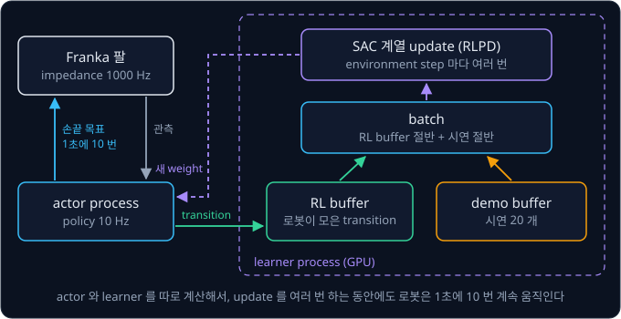

# DQN → SAC

CleanRL 의 SAC 예제는 simulator 환경 하나를 배우는 데 기본으로 100 만 step 을 쓴다. SERL 이 Franka 팔에 쓴 policy 처럼 1초에 10 번 행동을
정하는 실물 로봇이 100 만 step 을 겪으려면 $1{,}000{,}000 \div 10 = 100{,}000$ 초, 쉬지 않고 28 시간 가까이 움직여야 한다. 그동안 모터가
닳고, 물건이 떨어질 때마다 사람이 제자리에 놓아 줘야 한다. 한 번 겪은 경험과 사람이 보여 준 시연을 버리지 않고 학습에 몇 번이고 다시 쓸 수
있다면, 실물 로봇도 몇 시간 안에 배울 수 있지 않을까?

**off-policy** reinforcement learning 은 겪은 경험을 replay buffer 에 쌓아 두고 무작위로 꺼내 다시 학습한다. 2015 년 DeepMind 의 DQN 이 이
방식으로 Atari 게임 49 개를 화면만 보고 배웠고, SAC 를 바탕으로 만든 SERL 은 시연 20 개와 실물 학습 20 분만으로 Franka 팔이 PCB 에 부품을
꽂는 작업을 100 번 모두 성공하게 했다.

## 학습 목표

- 표 대신 neural network 로 $Q$ 를 계산하면 target 이 따라 움직여 학습이 흔들리는 이유와, DQN 의 target network·replay buffer 가 그 흔들림을
  막는 방식을 숫자로 설명할 수 있다
- 가장 큰 추정값을 고르면 $Q$ 가 실제보다 커지는 이유와, Double DQN·clipped double Q 가 그 쏠림을 줄이는 방식을 설명할 수 있다
- 연속 action 에서 actor 와 critic 을 함께 학습하는 구조와, SAC 의 entropy bonus·temperature $\alpha$·twin critic 이 하는 일을 설명할 수 있다
- off-policy 가 on-policy 보다 sample efficiency 가 높은 이유와, SERL 이 실물 로봇에서 시연과 RL 데이터를 섞어 학습하는 방식을 설명할 수 있다

## 표에서 neural network 로

### Q-learning 의 표

[Bandits & MDPs](../bandit-mdp/README.md) 에서 본 Q-learning 은 $Q(s, a)$ 를 표에 적어 둔다. $Q(s, a)$ 는 state $s$ 에서 action $a$ 를
먼저 하고 그 뒤로 가장 좋게 행동할 때 받을 reward 를, 늦게 받을수록 discount factor $\gamma$(이 강의에서는 0.9)만큼 깎아 더한 값의 기댓값이다.
경험 $(s, a, r, s')$ 하나를 겪으면 표의 칸 하나의 값을 target 쪽으로 옮긴다. 여기서 $r$ 은 받은 reward 이고 $s'$ 은 도착한 다음 state 다.

$$
Q(s,a) \leftarrow Q(s,a) + \alpha\big[\,\underbrace{r + \gamma \max_{a'} Q(s',a')}_{\text{target}} - Q(s,a)\,\big]
$$

target 과 지금 값의 차이를 TD error 라고 하고, 그 차이의 몇 분의 일만큼 옮길지 정하는 숫자 $\alpha$ 를 learning rate 라고 한다. 예를 들어
$Q(s, a) = 0.5$, $r = 0$, 도착한 칸의 가장 큰 $Q$ 가 1.0, $\alpha = 0.1$ 이면 target 은 $0 + 0.9 \times 1.0 = 0.9$ 이고, 새 $Q$ 는
$0.5 + 0.1 \times (0.9 - 0.5) = 0.54$ 다. 이 update 로 바뀌는 칸은 $Q(s, a)$ 하나뿐이라 target 에 쓴 다음 칸의 값은 그대로다.

### 연속된 숫자로 된 state

로봇의 state 는 칸 번호처럼 셀 수 있는 값이 아니다. 강화학습 환경 모음 Gymnasium 의 `CartPole-v1` 은 레일 위 수레를 왼쪽이나 오른쪽으로
밀어 수레에 세운 막대가 쓰러지지 않게 하는 simulator 환경인데, state 가 수레 위치·수레 속도·막대 각도·막대 각속도 네 숫자다. 한 step 은
0.02 초이고 막대가 서 있는 step 마다 reward 1 을 받는다. 막대가 쓰러지면 episode(시작부터 끝까지의 step 묶음)가 끝나고, 500 step 을 버티면
시간 제한으로 끊긴다.

막대 각도는 1.5° 일 수도 있고 1.51° 일 수도 있어서 state 마다 칸을 만들 수 없고, 칸을 만든다 해도 1.5° 칸에서 배운 값은 거의 같은 상황인
1.51° 칸에 전혀 반영되지 않는다. 숫자마다 구간을 잘라 칸을 만들면 칸 수가 곱으로 불어나서, CartPole 의 네 숫자를 10 칸씩 자르면
$10^4 = 10{,}000$ 칸이 되고 100 칸씩 자르면 $100^4 = 1$ 억 칸이 된다. 칸이 1 억 개면 대부분의 칸은 학습이 끝날 때까지 한 번도 채워지지 않는다.

### function approximation 과 generalization

표 대신 state 의 숫자를 넣으면 $Q$ 를 계산해 내는 식을 두고, 그 식 안의 weight 만 학습할 수도 있다. 정확히 같지는 않아도 weight 몇 개로
값을 비슷하게 계산하는 이 방식을 **function approximation** 이라고 하고, 식으로는 보통 neural network 를 쓴다. network 의 weight 전체를
$\theta$(theta) 하나로 묶어 부르고, 그 network 가 계산한 $Q$ 를 $Q_\theta(s, a)$ 로 쓴다.

위 그림의 왼쪽은 [Bandits & MDPs](../bandit-mdp/README.md) 의 격자에서 구한 $Q$ 표 일부다. 오른쪽 network 는 state 숫자 네 개를 받아
action 마다 $Q$ 를 하나씩 내고, 예로 든 출력 4.2 와 5.0 가운데 큰 쪽인 오른쪽으로 수레를 민다. DQN 도 이렇게 action 마다 출력을 하나씩 두어
한 번에 계산한다.

이 강의의 계산 예는 손으로 풀 수 있도록 network 대신 복도 위 로봇의 위치 $x$ 에 weight 하나를 곱하는 $Q_w(x) = w \times x$ 를 쓴다. weight
가 하나뿐이어도 모든 state 가 같은 weight 를 함께 쓴다는 network 의 성질은 그대로다. $w$ 는 target 을 정답으로 두고 오차의 제곱을 줄이는
gradient descent 로 고치는데, 예를 들어 $x = 2$ 의 target 이 0.9 일 때 $w = 0.2$ 에서 learning rate 0.1 로 한 번 고치면 $w$ 는 0.4 가 된다(계산은
심화).

위 그림처럼 $x = 2$ 만 배웠는데 $Q(1)$ 과 $Q(3)$ 도 두 배가 됐다. 한 state 에서 배운 것이 다른 state 의
값에도 번지는 이 성질을 **generalization** 이라고 한다. 막대 각도 1.5° 를 배우면 1.51° 의 $Q$ 도 비슷하게 바뀌니 표가 못 하던 일을 할 수
있지만, 원하지 않은 곳까지 바뀌기도 한다. 이 복도에서 받을 수 있는 reward 는 최대 1 이라 $Q$ 가 1 을 넘을 수 없는데도 $Q(3)$ 은 1.2 가 됐고,
$x = 3$ 을 배운 적이 없으니 이 값을 바로잡을 정보도 없다.

<b>심화: target 을 정답으로 쓰는 regression</b>

target $y$ 를 정답으로 두고 $Q_w(x)$ 를 예측으로 두어, 오차의 제곱을 loss 로 삼는다.

$$
L(w) = (w x - y)^2, \qquad \frac{\partial L}{\partial w} = 2\,(w x - y) \times x, \qquad w \leftarrow w - \eta \times \frac{\partial L}{\partial w}
$$

가운데 식은 $w$ 를 조금 늘렸을 때 loss 가 변하는 비율(gradient)이 오차의 2 배에 $x$ 를 곱한 값이라는 뜻이고, 오른쪽 식은 그 반대쪽으로
learning rate $\eta$(eta)만큼 옮긴다는 뜻이다. Q-learning 표의 $\alpha$ 가 하던 일을 여기서는 $\eta$ 가 한다. 본문의 예($x = 2$, $y = 0.9$,
$w = 0.2$, $\eta = 0.1$)를 단계별로 계산하면 아래와 같다.

| 단계 | 계산 | 값 |
| --- | --- | --- |
| 예측 $Q_w(2)$ | $0.2 \times 2$ | 0.4 |
| 오차 $Q - y$ | $0.4 - 0.9$ | $-0.5$ |
| gradient | $2 \times (-0.5) \times 2$ | $-2$ |
| 새 $w$ | $0.2 - 0.1 \times (-2)$ | 0.4 |

gradient 가 음수이니 $w$ 를 늘리는 쪽이 loss 를 줄이는 쪽이다. target $y$ 도 사실은 $Q$ 로 계산한 값이지만, gradient 를 구할 때는 $y$ 를
고정된 숫자로 보고 $y$ 를 계산한 식은 따지지 않는다. 다음 절의 문제가 이 약속에서 나온다.

## 따라 움직이는 target

generalization 은 target 을 계산할 때 문제를 일으킨다. 복도에서 로봇이 겪는 transition(한 state 에서 action 을 해 다음 state 로 옮겨 가는 일)
두 개로 이 문제를 본다. 이 절부터 action 은 "오른쪽" 하나뿐이라 $Q(x)$ 로 줄여 쓴다.

| 이름 | 출발 위치 | 도착 위치 | reward | episode |
| --- | --- | --- | --- | --- |
| A | $x = 1$ | $x = 2$ | 0 | 계속된다 |
| B | $x = 2$ | 충전기 | 1 | 끝난다 |

$x = 2$ 에서는 바로 1 을 받고 끝나니 진짜 값은 $Q(2) = 1$ 이고, $x = 1$ 에서는 한 step 뒤에 그 1 을 받으니 $Q(1) = 0 + 0.9 \times 1 = 0.9$ 다.

먼저 A 만 되풀이해 배운다. A 의 target 은 reward 0 에 도착한 $x = 2$ 의 $Q$ 를 0.9 로 깎아 더한 값인데, $Q(2)$ 도 같은 $w$ 로 계산하므로
target 은 $0.9 \times Q_w(2) = 0.9 \times 2w = 1.8\,w$ 가 된다. $w = 1$ 에서 출발해 update 마다 $w$ 를 "target − $Q(1)$" 의 절반만큼 옮긴다.

| update | $w$ | $Q(1) = w$ | target $1.8\,w$ | 차이 | 새 $w$ |
| --- | --- | --- | --- | --- | --- |
| 0 | 1 | 1 | 1.8 | 0.8 | $1 + 0.5 \times 0.8 = 1.4$ |
| 1 | 1.4 | 1.4 | 2.52 | 1.12 | $1.4 + 0.5 \times 1.12 = 1.96$ |
| 2 | 1.96 | 1.96 | 3.528 | 1.568 | $1.96 + 0.5 \times 1.568 = 2.744$ |

update 0 에서 $Q(1)$ 은 target 쪽으로 0.4 다가갔지만, 같은 $w$ 로 계산하는 target 은 1.8 에서 2.52 로 0.72 달아났다. 차이는 0.8 에서 1.12 로
오히려 커졌고, 그 뒤로도 $w$ 는 update 마다 1.4 배씩 커진다. 진짜 $Q(1)$ 은 0.9 인데 값이 멈추지 않고 커지는 것을 발산이라고 한다.

위 그림의 왼쪽이 이 표다(오른쪽은 다음 절에서 다룬다). 표였다면 $Q(1)$ 칸을 고쳐도 target 에 쓰는 $Q(2)$ 칸은 그대로라서 $Q(1)$ 은 target
에 다가가 멈췄을 것이다. network 는 학습하는 값과 target 을 같은 weight 로 계산하기 때문에 학습할 때마다 target 도 함께 움직이는데, 이 문제를
**moving target** 이라고 부른다. 그림자를 밟으려고 다가가면 그림자도 같이 물러나는 것과 같다.

겪는 대로 바로 배울 때도 문제가 생긴다. CartPole 에서 연달아 들어오는 transition 들은 거의 같은 상황이라(수레는 step 마다 약 0.002 m 움직이고
막대는 약 0.04° 움직인다), 들어오는 순서대로 배우면 network 는 한동안 비슷한 상황만 되풀이해 배운다. 그러면 복도의 A 만 배울 때처럼 weight 가
그 상황 쪽으로 쏠린다. 또 transition 하나를 한 번만 쓰고 버리는데, 실물 로봇에서는 transition 하나를 얻는 데 실제 시간이 든다.

<b>심화: target 을 따라잡을 수 있는 조건</b>

같은 A 를 $\gamma = 0.4$ 로 배우면 target 은 $0.4 \times Q_w(2) = 0.4 \times 2w = 0.8\,w$ 다.

| 시점 | $w$ | $Q(1)$ | target $0.8\,w$ | 차이 |
| --- | --- | --- | --- | --- |
| 처음 | 1 | 1 | 0.8 | $0.8 - 1 = -0.2$ |
| 첫 update 뒤 | $1 + 0.5 \times (-0.2) = 0.9$ | 0.9 | 0.72 | $0.72 - 0.9 = -0.18$ |

차이가 −0.2 에서 −0.18 로 줄어든다. $Q(1)$ 이 1 만큼 움직일 때 target 은 $\gamma \times 2$ 만큼 움직이는데, $\gamma = 0.4$ 면 0.8 이라
따라잡을 수 있고 $\gamma = 0.9$ 면 1.8 이라 target 이 더 빨리 달아난다. 이 복도에서 같은 weight 로 계산한 target 을 따라잡으려면
$2\gamma < 1$ 이어야 하는데, 실제 문제의 $\gamma$ 는 0.99 처럼 1 에 가까워서 이런 조건을 기대할 수 없다.

## DQN

2013 년 DeepMind 의 Volodymyr Mnih 등이 발표한 agent 는 Atari 게임기 화면의 pixel 만 보고 게임 7 개를 배워 그 가운데 3 개에서 사람
전문가보다 높은 점수를 냈다. 저자들은 2015 년 Nature 논문에서 같은 방법으로 게임 49 개를 학습했고, 그 가운데 29 개에서 전문 게임 테스터
점수의 75% 이상을 냈다. layer 를 여러 겹 쌓은 deep neural network 로 $Q$ 를 계산해서 DQN(Deep Q-Network)이라고 부르는 이 방법은 앞 절의 두
문제를 장치 두 개로 줄였다.

### target network

target 을 학습 중인 weight 로 계산해서 moving target 이 생겼으므로, weight 의 복사본을 하나 더 두고 target 은 복사본으로만 계산한다. 이 복사본을
**target network** 라 하고, 학습하는 쪽을 online network 라고 부른다. 복도 예에서 복사본 weight 는 $\bar w$ 로 쓰는데, 위의 줄(bar)은
복사본이라는 표시이고 $\bar w$ 는 gradient descent 로 고치지 않는다. $\bar w = 1$ 로 복사해 두고 A 를 다시 배우면 target 이
$0.9 \times 2\bar w = 1.8$ 에 멈춰 있어서, 앞 그림의 오른쪽처럼 차이가 0.8, 0.4, 0.2 로 update 마다 절반이 되고 $w$ 는 1.8 에 다가간다.
복사본을 고정한 동안에는 정답이 정해진 보통의 regression 이 된다. network 에서는 weight 전체 $\theta$ 의 복사본을 $\bar\theta$ 로 쓴다.

복사본을 영영 그대로 두면 target 이 처음의 틀린 $Q$ 에 묶이므로 가끔 online weight 를 옮겨 와야 한다. 정해진 주기마다 $\bar\theta \leftarrow
\theta$ 로 통째로 복사하는 것을 hard update 라고 한다. DQN 논문에서는 parameter update 10,000 번마다 복사했고, 알고리즘 하나를 파일 하나에
구현한 공개 코드 모음 CleanRL 의 `dqn.py` 는 기본으로 500 step 마다 복사한다. 매 step 조금씩 옮기는 soft update 도 있다.

$$
\bar\theta \leftarrow \tau\, \theta + (1 - \tau)\, \bar\theta
$$

$\tau$(tau)는 한 번에 얼마나 옮길지 정하는 0 과 1 사이의 숫자라서, 1 이면 통째로 복사하는 것과 같고 뒤에서 다룰 SAC 가 쓰는 0.005 면 매
step 남은 거리의 0.5% 만 옮긴다.

A 만 배우면서 $w$ 가 1.8 에 다가갈 때마다 복사하면 $\bar w$ 는 1, 1.8, 3.24, 5.83 으로 복사할 때마다 1.8 배가 되어, target network 를 써도
발산이 느려졌을 뿐 멈추지 않는다. A 의 target 은 $Q(2)$ 로 계산하는데, $Q(2)$ 의 진짜 값이 1 이라는 정보를 담은 B 는 한 번도 배우지 않았다.

### replay buffer

**replay buffer** 는 겪은 transition 을 바로 버리지 않고 쌓아 두는 저장소다. transition 은 $(s, a, r, s', d)$ 다섯 값으로 적는데, $d$ 는
done 의 첫 글자로 그 transition 에서 episode 가 끝났으면 1, 아니면 0 이다. 담을 수 있는 최대 개수를 capacity 라고 하고, 꽉 차면 가장 오래된
transition 자리에 새 transition 을 덮어쓴다.

학습할 때는 buffer 에서 transition 몇 개를 무작위로 뽑아 한 번의 update 에 함께 쓰는데, 이 묶음을 batch 라고 한다. 무작위로 뽑으면 연달아
들어온 비슷한 transition 들이 흩어져 한 batch 에 서로 다른 시점의 transition 이 섞이고, 복도라면 A 와 B 가 한 batch 에 함께 들어온다.
transition 하나가 buffer 에 머무는 동안 여러 번 뽑히기도 해서, DQN 논문의 설정으로 계산하면 transition 하나를 평균 8 번 학습에 쓴다(계산은
심화).

buffer 에서 A 와 B 를 섞어 배우면 복도의 발산이 멈춘다. 복사본을 고정한 구간마다 $w$ 는 두 transition 의 오차 제곱 평균이 가장 작은 곳으로
가고, 그 값을 다시 복사하기를 되풀이하면 아래 그림처럼 $\bar w$ 가 0.625 에 다가간다. B 의 target 1 이
$Q(2)$ 를 계속 1 쪽으로 당기므로 $Q(2)$ 가 커지지 못하고, $Q(2)$ 로 계산하는 A 의 target 도 함께 묶인다.

수렴한 $w = 0.625$ 에서는 $Q(1) = 0.625$, $Q(2) = 1.25$ 라서 진짜 값 0.9 와 1 과 조금 다르다. $Q = w x$ 꼴로 두 값을 정확히 맞추려면 $w$
가 0.9 이면서 동시에 0.5 여야 해서 불가능하고, 0.625 는 그 사이의 타협이다. weight 가 많은 실제 network 는 훨씬 가깝게 맞춘다.

<b>심화: A 와 B 를 섞은 학습의 수렴값과 재사용 횟수</b>

batch 에 A 와 B 가 함께 뽑히면 loss 는 두 오차 제곱의 평균이다. A 의 target 은 $y_A = 0 + 0.9 \times 2\bar w = 1.8\,\bar w$ 이고, B 의 target 은
episode 가 끝나 reward 만 남은 $y_B = 1$ 이다.

$$
L(w) = \frac{1}{2}\Big[(w - y_A)^2 + (2w - y_B)^2\Big]
$$

$\bar w$ 를 고정한 구간 동안 충분히 학습하면 $w$ 는 gradient 가 0 인 곳에 다다른다. 점 하나의 gradient $2(wx - y)x$ 를 두 transition 에
쓴다.

1. A 항($x = 1$): $2(w - y_A)$
2. B 항($x = 2$): $2(2w - y_B) \times 2 = 4(2w - y_B)$
3. 평균: $(w - y_A) + 2(2w - y_B) = 5w - y_A - 2y_B$
4. 0 이 되는 곳: $w = (y_A + 2y_B) \div 5$

| 복사 횟수 | $\bar w$ | $y_A = 1.8\,\bar w$ | 그 구간의 $w = (y_A + 2) \div 5$ |
| --- | --- | --- | --- |
| 0 | 1 | 1.8 | 0.76 |
| 1 | 0.76 | 1.368 | 0.6736 |
| 2 | 0.6736 | 1.2125 | 0.6425 |
| 3 | 0.6425 | 1.1565 | 0.6313 |

수렴하면 $\bar w = w$ 라서 $w = (1.8\,w + 2) \div 5$ 이고, 이를 풀면 $3.2\,w = 2$ 에서 $w = 0.625$ 다.

재사용 횟수는 DQN 논문의 설정(buffer 에 최근 경험 1,000,000 개, action 4 번마다 update 한 번, batch 32)으로 계산한다. 새 transition 은
1,000,000 step 동안 buffer 에 머물고, 그동안 update 는 $1{,}000{,}000 \div 4 = 250{,}000$ 번이다. update 마다 1,000,000 개 가운데 32 개를
뽑으므로 한 transition 이 뽑히는 횟수의 기댓값은 $250{,}000 \times \frac{32}{1{,}000{,}000} = 8$ 번이다. capacity 와 상관없이 batch 크기를
update 사이의 step 수로 나눈 값이 된다.

### DQN 의 loss

두 장치를 합친 DQN 의 loss 는 아래와 같다.

$$
\mathcal L(\theta) = \mathbb E_{(s,a,r,s',d)\sim\mathcal D}\Big[\big(\underbrace{r + \gamma(1-d)\max_{a'} Q_{\bar\theta}(s',a')}_{\text{target } y} - Q_\theta(s,a)\big)^2\Big]
$$

$\mathcal D$ 는 replay buffer 이고 $\sim \mathcal D$ 는 buffer 에서 무작위로 뽑았다는 뜻이며, 기댓값 $\mathbb E[\cdot]$ 는 실제로는 뽑은 batch
의 평균으로 계산한다.

episode 가 끝난 뒤에는 받을 reward 가 없으므로 $(1 - d)$ 는 끝난 transition 에서 미래 항을 지운다. 다만 막대가 쓰러져 진짜로 끝난
경우(terminated)와 500 step 시간 제한에 걸려 끊긴 경우(truncated)는 다르다. 시간 제한으로 끊긴 순간에도 막대는 서 있고 그 뒤의 미래가 남아
있으므로, 이때는 $d = 0$ 으로 두어 미래 항을 지우지 않는다. Gymnasium 은 두 경우를 `terminated` 와 `truncated` 로 나눠 알려 준다.

위 그림은 DQN 의 데이터 흐름을 보여 준다. online network 가 [Bandits & MDPs](../bandit-mdp/README.md) 에서 본 ε-greedy 로 고른 action 으로
environment 를 움직여 transition 을 buffer 에 쌓는다(DQN 논문에서는 ε 를 처음 1,000,000 frame 동안 1.0 에서 0.1 로 줄였다). target 은 target network
로 계산하므로 loss 의 gradient 는 online network 로만 흐른다.

### 두 장치의 효과

DQN 논문의 저자들은 batch 32, discount factor 0.99 로 게임마다 50,000,000 frame(게임
시간으로 약 38 일)을 학습했다. 두 장치를 하나씩 끈 비교 실험도 했는데, 게임 5 개를 10,000,000 frame 씩 학습한 최고 점수는 아래와 같다.

| 게임 | replay ○, target ○ | replay ○, target ✕ | replay ✕, target ○ | replay ✕, target ✕ |
| --- | --- | --- | --- | --- |
| Breakout | 316.8 | 240.7 | 10.2 | 3.2 |
| Enduro | 1006.3 | 831.4 | 141.9 | 29.1 |
| River Raid | 7446.6 | 4102.8 | 2867.7 | 1453.0 |
| Seaquest | 2894.4 | 822.6 | 1003.0 | 275.8 |
| Space Invaders | 1088.9 | 826.3 | 373.2 | 302.0 |

다섯 게임 모두 두 장치를 함께 쓸 때 점수가 가장 높았고, 둘 다 끄면 Breakout 은 316.8 에서 3.2 로 떨어졌다. Seaquest 를 뺀 네 게임에서는 replay
buffer 를 끌 때가 target network 를 끌 때보다 점수가 더 많이 떨어졌다.

**확인 문제.** CartPole 에서 $r = 1$, $\gamma = 0.9$ 이고, 다음 state 에서 target network 의 $Q$ 가 (6, 8) 이다. 막대가 서 있는 채로 계속되는
경우, 500 step 시간 제한으로 끊긴 경우, 막대가 쓰러진 경우의 target 은 각각 얼마일까?

답 보기

다음 state 의 가장 큰 $Q$ 는 $\max(6, 8) = 8$ 이다.

| 경우 | $d$ | target |
| --- | --- | --- |
| 계속된다 | 0 | $1 + 0.9 \times 1 \times 8 = 8.2$ |
| 시간 제한으로 끊겼다(truncated) | 0 | $1 + 0.9 \times 1 \times 8 = 8.2$ |
| 막대가 쓰러졌다(terminated) | 1 | $1 + 0.9 \times 0 \times 8 = 1$ |

시간 제한으로 끊긴 순간에도 미래가 남아 있으므로 $d = 0$ 으로 둔다.

## overestimation 과 double Q

### max 가 고르는 잡음

network 의 $Q$ 는 추정값이라 잡음이 섞이는데, target 의 $\max$ 는 늘 가장 큰 추정값을 고르므로 마침 잡음이 위로 튄 값을 고르는 경향이 있다.
예를 들어 진짜 $Q$ 가 둘 다 1 인 action 두 개에서, 추정값마다 같은 확률로 0.3 높거나 0.3 낮게 나온다고 하자. 그러면 아래 네 경우가 같은 확률로 나온다.

| 경우 | 추정값 1 | 추정값 2 | 큰 값 | 작은 값 |
| --- | --- | --- | --- | --- |
| 1 | 1.3 | 1.3 | 1.3 | 1.3 |
| 2 | 1.3 | 0.7 | 1.3 | 0.7 |
| 3 | 0.7 | 1.3 | 1.3 | 0.7 |
| 4 | 0.7 | 0.7 | 0.7 | 0.7 |
| 평균 | 1 | 1 | 1.15 | 0.85 |

추정값 하나하나의 평균은 진짜와 같은 1 인데, 큰 값을 고르면 평균이 1.15 로 진짜보다 크다. 이렇게 실제보다 크게 잡는 것을
**overestimation** 이라고 한다. 그 값이 target 에 들어가면 앞 state 의 $Q$ 도 커지고, 그 $Q$ 가 다시 더 앞 state 의 target 이 되면서 쏠림이
쌓인다. action 이 많을수록 잡음이 위로 튄 action 이 하나쯤 있을 가능성이 커서 쏠림도 크다.

### Double DQN

DQN 의 target 은 가장 좋은 action 을 고르는 일과 그 action 의 값을 읽는 일을 target network 하나로 함께 해서, 잡음이 위로 튄 action 을
고르고 그 튄 값을 그대로 쓴다. 2015 년 van Hasselt 등의 **Double DQN** 은 action 을 online network 로 고르고, 값은 target network 로 읽는다.

$$
y = r + \gamma(1-d)\, Q_{\bar\theta}\big(s',\ \arg\max_{a'} Q_\theta(s', a')\big)
$$

$\arg\max_{a'}$ 는 값이 가장 큰 action 자체를 고른다는 뜻이다. 예를 들어 다음 state 에서 target network 의 $Q$ 가 (5.2, 4.6) 이고 online network
의 $Q$ 가 (4.4, 5.0) 이라고 하자. DQN 의 target 은 target network 가 가장 크게 본 5.2 를 쓰고, Double DQN 은 online network 가 고른 두 번째
action 의 값을 target network 에서 읽어 4.6 을 쓴다. 두 network 는 잡음이 서로 다르게 섞이므로, 한쪽에서 위로 튀어 고른 action 이 다른
쪽에서도 튀어 있을 가능성은 작다. 저자들은 DQN 과 같은 설정으로 게임 49 개를 학습해, 사람 점수에 견준 점수의 중앙값이 DQN 의 93.5% 에서
114.7% 로 올랐다고 보고했다.

### clipped double Q

연속 action 을 다루는 actor-critic 에서는 $Q$ 를 계산하는 network(다음 절에서 다룰 critic)를 두 개 따로 학습하고, target 에는 두 값 가운데
작은 쪽을 쓴다. 이 방법을 **clipped double Q** 라고 하는데, 2018 년 Fujimoto 등의 TD3 가 썼고 SAC 도 그대로 쓴다. 두 critic 은 처음 weight 가
달라 잡음이 서로 다르게 섞이는데, 위 표를 critic 두 개가 같은 action 에 낸 추정값으로 읽으면 작은 값의 평균은 0.85 로 진짜보다 조금 작다.
값을 작게 잡은 action 은 policy 가 일부러 찾아가지 않아서 오차가 쌓이지 않으므로, 작게 잡는 쪽이 크게 잡는 쪽보다 덜 위험하다.

## 연속 action 과 actor-critic

### 연속 action 의 max

CartPole 의 action 은 둘뿐이라 $\max_{a'}$ 를 두 값 비교로 구했지만, 로봇 관절에 주는 명령은 대개 연속된 숫자다. Gymnasium 의 `Pendulum-v1`
은 아래로 늘어진 진자를 돌려 세운 뒤 위에서 버티게 하는 환경으로, action 이 −2 ~ 2 사이의 torque 하나다. reward 는 똑바로 선 자세에서
벗어난 각도가 클수록, 각속도와 torque 가 클수록 작아지는 음수라서 위에서 힘을 거의 안 쓰고 버티면 0 에 가깝다.

action 이 연속된 숫자면 target 의 $\max_{a'} Q(s', a')$ 를 구하기 어렵다. 예를 들어 어떤 state 에서 $Q(s, a) = 1 - (a - 0.5)^2$ 이라면 action
−2, −1, 0, 1, 2 를 넣어 본 값은 −5.25, −1.25, 0.75, 0.75, −1.25 다.

넣어 본 값 가운데 가장 큰 것은 0.75 지만 실제로 가장 큰 값은 그 사이의 $a = 0.5$ 에서 1 이다. 더 잘게 넣어 보면 되지만 target 하나를
계산할 때마다 network 를 그만큼 여러 번 계산해야 하고, 관절 6 개인 팔은 관절마다 값 5 개만 넣어 봐도 조합이 $5^6 = 15{,}625$ 개다.

### actor 와 critic

그래서 $\max$ 를 매번 찾지 않고, $Q$ 를 크게 만드는 action 을 바로 내는 network 를 따로 학습한다. state 를 받아 action 을 내는 network 를
**actor** 라 하고, state 와 action 을 함께 받아 그 action 의 $Q$ 하나를 내는 network 를 **critic** 이라 하며, 둘을 함께 학습하는 구조를
actor-critic 이라고 부른다. actor 는 배우라는 뜻이고 critic 은 평론가라는 뜻인데, 배우가 연기하면 평론가가 점수를 매긴다는 데서 온 이름이다.

actor 는 critic 의 점수가 커지는 쪽으로 action 을 옮기는데, 이때 action 을 조금 늘렸을 때 $Q$ 가 변하는 비율 $\partial Q / \partial a$ 를 쓴다.
loss 를 줄일 때와 달리 $Q$ 를 키워야 하므로 비율과 같은 쪽으로 간다. 위의 $Q = 1 - (a - 0.5)^2$ 에서 비율은 $-2(a - 0.5)$ 라서 $a = 0$ 에서는
1 이고, 걸음 크기 0.25 로 옮기면 $a = 0 + 0.25 \times 1 = 0.25$ 가 된다. 앞 그림의 빨간 점처럼 이를 되풀이하면 $a$ 는 0.25, 0.375, 0.4375 로
꼭대기 0.5 에 다가가고, 꼭대기에 가까울수록 비율이 작아 걸음도 작아진다. 실제 actor 에서 $a$ 는 actor 의 weight $\phi$(phi)로 계산되므로, 이
비율을 chain rule 로 $\phi$ 까지 전해 weight 를 고친다. actor 는 policy 라서 $\pi_\phi$ 로 쓴다.

critic 은 DQN 처럼 target 쪽으로 regression 하는데, target 의 $\max_{a'} Q(s', a')$ 자리에는 actor 가 다음 state $s'$ 에서 낸 action 의 $Q$ 를
쓴다. actor 가 $Q$ 를 가장 크게 만드는 action 을 내도록 배우고 있으니 그 action 의 $Q$ 가 $\max$ 를 대신한다.

### DDPG 와 TD3

action 하나를 정해서 내는 actor 와 critic 으로 연속 action 을 푼 방법이 2015 년 Lillicrap 등의 DDPG 다. 정해진 action 만 내면 탐색을 못 하므로
actor 의 action 에 noise 를 더해 움직였다. 2018 년 Fujimoto 등의 TD3 는 DDPG 의 critic 이 $Q$ 를 크게 잡는 문제를 아래 세 가지로 고쳤다.

- clipped double Q: critic 을 둘 두고 작은 값을 쓴다
- target policy smoothing: target 에 쓰는 다음 action 에 작은 noise 를 더해, critic 이 action 하나에서만 뾰족하게 높은 값을 배우지 못하게 한다
- delayed policy update: critic 을 두 번 고칠 때 actor 를 한 번만 고친다

<b>심화: DDPG 와 TD3 의 설정</b>

| 항목 | DDPG | TD3 |
| --- | --- | --- |
| critic | 하나 | 둘, target 에는 작은 값 |
| 탐색 noise | Ornstein-Uhlenbeck noise($\theta = 0.15$, $\sigma = 0.2$) | Gaussian noise(표준편차 0.1) |
| target 의 다음 action | target actor 의 action 그대로 | 표준편차 0.2 인 noise 를 ±0.5 로 잘라 더한 action |
| actor update | critic 과 매번 함께 | critic 을 2 번 고칠 때 한 번 |
| target network soft update | $\tau = 0.001$ | $\tau = 0.005$ |

Ornstein-Uhlenbeck noise 는 앞 step 의 noise 를 이어받아 천천히 변하는 noise 라서, 관성이 있는 물체를 한쪽으로 꾸준히 밀어 보는 탐색이 된다.
TD3 저자들이 actor update 를 늦춘 것은 critic 이 어느 정도 맞아진 뒤에 actor 를 옮기기 위해서다.

## SAC

### entropy

SAC(Soft Actor-Critic)는 2018 년 Haarnoja 등이 발표한 off-policy actor-critic 으로, action 을
확률로 고르는 policy 가 action 을 얼마나 골고루 섞는지를 숫자로 재서 reward 에 더한다. $\pi(a \mid s)$ 를 state $s$ 에서 action $a$ 를 고를
확률이라고 하면, 그 숫자 **entropy** 는 아래와 같다.

$$
\mathcal H\big(\pi(\cdot \mid s)\big) = -\sum_a \pi(a \mid s) \log \pi(a \mid s)
$$

$\log$ 는 자연로그 $\ln$ 이다. 확률 $p$ 의 $-\ln p$ 는 그 결과가 나왔을 때 얼마나 놀라운지로 읽을 수 있는데, 반드시 나오는 결과($p = 1$)는
0 이고 드문 결과($p = 0.1$)는 2.303 이다. entropy 는 action 마다 확률과 놀라움을 곱해 더한 값이라서 놀라움의 기댓값이 된다.

| policy (왼쪽, 오른쪽) | 왼쪽: $p \times (-\ln p)$ | 오른쪽: $p \times (-\ln p)$ | entropy |
| --- | --- | --- | --- |
| 0.5, 0.5 | $0.5 \times 0.693 = 0.347$ | $0.5 \times 0.693 = 0.347$ | 0.693 |
| 0.9, 0.1 | $0.9 \times 0.105 = 0.095$ | $0.1 \times 2.303 = 0.230$ | 0.325 |
| 1, 0 | 0 | 0 | 0 |

반반 섞으면 entropy 가 가장 크고, 한쪽으로 쏠릴수록 작아져 한 action 만 고르면 0 이다. entropy 는 원래 열역학에서 무질서한 정도를 나타내던
말인데, 1948 년 Claude Shannon 이 정보이론에서 같은 이름을 붙여 쓰면서 확률이 퍼진 정도를 재는 값이 됐다.

<b>심화: 자연로그의 값</b>

$\ln t$ 는 $e \approx 2.718$ 을 몇 번 곱해야 $t$ 가 되는지를 나타낸다. 0 과 1 사이의 수는 $e$ 로 나눠야 나오므로 로그가 음수이고, 작을수록 더
큰 음수다.

| 확률 $p$ | 1 | 0.9 | 0.5 | 0.25 | 0.1 |
| --- | --- | --- | --- | --- | --- |
| $\ln p$ | 0 | −0.105 | −0.693 | −1.386 | −2.303 |

로그는 곱셈을 덧셈으로 바꾼다. $0.25 = 0.5 \times 0.5$ 이므로 $\ln 0.25 = \ln 0.5 + \ln 0.5 = -1.386$ 이다. action 이 네 개이고 모두 0.25 면
entropy 는 $4 \times 0.25 \times 1.386 = 1.386$ 으로, 고를 것이 많을수록 고르게 섞은 entropy 도 크다.

### entropy bonus 와 temperature α

SAC 는 reward 의 합에 policy 의 entropy 를 더한 값을 키우도록 목표를 바꾼다.

$$
J(\pi) = \sum_t \mathbb E\Big[\, r_t + \alpha\, \mathcal H\big(\pi(\cdot \mid s_t)\big) \,\Big]
$$

$r_t$ 와 $s_t$ 는 step $t$ 의 reward 와 state 이고, 식은 step 마다 reward 에 그 state 의 entropy 를 $\alpha$ 배 해 더한 값의 기댓값을 모두
더한다는 뜻이다. 이런 목표를 maximum entropy objective 라 하고, reward 에 덧붙는 $\alpha \times$ entropy 를 **entropy bonus** 라고 한다.
$\alpha$ 는 entropy 를 얼마나 쳐줄지 정하는 숫자로 **temperature** 라고 부르는데, 물리학에서 온도가 높을수록 입자가 무작위로 움직이는 것처럼
$\alpha$ 가 클수록 policy 가 무작위에 가까워진다.

> **오해** Q-learning 의 $\alpha$ 와 SAC 의 $\alpha$ 는 같은 것이다.
>
> **사실** Q-learning 에서 $\alpha$ 는 learning rate 였지만 SAC 에서 $\alpha$ 는 temperature 다.

예를 들어 $Q(s, \text{왼쪽}) = 1.0$, $Q(s, \text{오른쪽}) = 0.9$ 로 비슷한 state 에서, 왼쪽을 고를 확률 $p$ 마다 "Q 의 기댓값 + $\alpha$ ×
entropy" 를 $\alpha = 0.1$ 로 계산하면 아래와 같다. Q 의 기댓값은 $p \times 1.0 + (1 - p) \times 0.9$ 다.

| $p$ | Q 의 기댓값 | entropy | $0.1 \times$ entropy | 합 |
| --- | --- | --- | --- | --- |
| 1 | 1.0 | 0 | 0 | 1.0 |
| 0.9 | 0.99 | 0.325 | 0.0325 | 1.0225 |
| 0.731 | 0.9731 | 0.582 | 0.0582 | 1.0313 |
| 0.5 | 0.95 | 0.693 | 0.0693 | 1.0193 |

$Q$ 만 보면 왼쪽만 고르는 $p = 1$ 이 가장 좋지만, entropy 를 더하면 $p = 0.731$ 에서 1.0313 으로 가장 커서 거의 같은 오른쪽도 네 번에 한
번꼴로 섞는 policy 가 가장 좋은 policy 가 된다. 같은 $Q$ 에서 $\alpha = 1$ 로 키우면 가장 좋은 $p$ 는 0.525 로 거의 반반이 되고, $Q$ 가
1.0 과 0.0 으로 크게 다르면 policy 는 거의 한 action 에 몰린다. $\alpha$ 는 entropy 1 을 reward 몇 점으로 칠지 정한다.

ε-greedy 의 무작위 선택은 거의 좋은 action 과 아주 나쁜 action 을 똑같은 확률로 고르지만, entropy bonus 를 더한 policy 는 $Q$ 가 비슷한
action 은 자주 고르고 확실히 나쁜 action 은 드물게 고른다. 별도 규칙 없이 policy 가 탐색을 맡고, 좋은 길이 두 개면 policy 가 둘 다
쓰도록 배워서 한쪽이 막혀도 다른 쪽으로 갈 수 있다.

<b>심화: 가장 좋은 p 의 계산</b>

"Q 의 기댓값 + $\alpha$ × entropy" 를 가장 크게 만드는 policy 는 $Q$ 를 $\alpha$ 로 나눈 값의 softmax 다.

$$
\pi(a \mid s) = \frac{e^{Q(s,a)/\alpha}}{\sum_b e^{Q(s,b)/\alpha}}
$$

$Q$ 가 1.0, 0.9 이고 $\alpha = 0.1$ 이면 $p = \dfrac{e^{10}}{e^{10} + e^{9}} = \dfrac{1}{1 + e^{-1}} = 0.731$ 이고, $\alpha = 1$ 이면
$p = \dfrac{1}{1 + e^{-0.1}} = 0.525$ 다. 그때의 합은 $\alpha \ln \sum_b e^{Q(s,b)/\alpha}$ 로, $\alpha = 0.1$ 이면
$0.1 \times \ln(e^{10} + e^{9}) = 1 + 0.1 \times \ln(1 + e^{-1}) = 1.0313$ 이다. $\alpha$ 가 0 에 가까워지면 이 값이 $\max_a Q$ 에 가까워지는데,
SAC 의 soft 라는 이름은 $\max$ 처럼 action 하나만 고르지 않고 부드럽게 섞는다는 뜻이다.

### twin critic 과 soft target

목표에 entropy 가 들어갔으니 critic 이 배우는 $Q$ 에도 앞으로 받을 entropy bonus 가 들어가야 한다. SAC 의 critic target 은 아래와 같다.

$$
y = r + \gamma(1-d)\Big(\min_{i=1,2} Q_{\bar\theta_i}(s',a') - \alpha\log\pi_\phi(a'\mid s')\Big),\qquad a'\sim\pi_\phi(\cdot\mid s')
$$

- $a' \sim \pi_\phi(\cdot \mid s')$ 는 다음 state $s'$ 에서 지금 actor 로 action $a'$ 을 하나 뽑는다는 뜻이다. DQN 의 $\max_{a'}$ 자리에 actor
  가 뽑은 action 을 쓴다
- $\min_{i=1,2} Q_{\bar\theta_i}(s', a')$ 는 target critic 두 개가 낸 값 가운데 작은 쪽이다. critic 을 둘 두는 것을 twin critic 이라고 부르고,
  작은 값을 쓰는 것은 앞에서 본 clipped double Q 다
- $-\alpha \log \pi_\phi(a' \mid s')$ 는 뽑은 action 의 놀라움에 $\alpha$ 를 곱한 값이다. action 을 여러 번 뽑아 평균하면 $\alpha$ × entropy
  가 된다

예를 들어 $r = 0$, $\gamma = 0.9$, $d = 0$, $\alpha = 0.1$ 이고, actor 가 뽑은 $a'$ 의 확률이 0.5 이고 두 target critic 의 값이 1.0 과 0.9 라고 하자.
작은 critic 값은 0.9 이고 entropy bonus 는 $-0.1 \times \ln 0.5 = 0.069$ 라서 다음 state 의 값은 $0.9 + 0.069 = 0.969$ 다. target 은
$0 + 0.9 \times 0.969 = 0.872$ 다.

두 critic $Q_{\theta_1}$, $Q_{\theta_2}$ 는 이 같은 target $y$ 쪽으로 각자 regression 한다.

### Gaussian actor 와 tanh

action 이 torque 처럼 연속된 숫자면 action 별 확률을 표로 적을 수 없어서, SAC 의 actor 는 종 모양의 확률분포인 Gaussian 으로 action 을
고른다. actor 는 Gaussian 의 가운데 위치인 평균 $\mu$(mu)와 퍼진 정도인 표준편차 $\sigma$(sigma)를 내고, 평균 0, 표준편차 1 인 Gaussian
에서 따로 뽑은 값 $\varepsilon$ 으로 $u = \mu + \sigma \times \varepsilon$ 을 만든다. 예를 들어 actor 가 $\mu = 0.2$, $\sigma = 0.5$ 를 내고
$\varepsilon = 0.6$ 을 뽑으면 $u = 0.2 + 0.5 \times 0.6 = 0.5$ 다.

$\sigma$ 가 클수록 뽑히는 값이 넓게 흩어지므로 entropy 도 크다(Gaussian 의 entropy 는 $\ln \sigma + 1.42$ 다). 무작위성이 $\varepsilon$ 에만
있으니 $u$ 는 $\mu$ 와 $\sigma$ 의 식이 되어, $\varepsilon = 0.6$ 을 그대로 두고 $\mu$ 를 0.2 에서 0.3 으로 바꾸면 $u$ 는 0.5 에서 0.6 으로
정확히 0.1 움직인다. 그래서 critic 에서 구한 비율 $\partial Q / \partial a$ 를 $\mu$ 와 $\sigma$ 를 거쳐 actor 의
weight 까지 전할 수 있다. [VAE](../vae/README.md#reparameterization-trick) 에서 본 reparameterization trick 을 action 에 쓴 것이다.

Gaussian 에서 뽑은 $u$ 는 드물지만 얼마든지 크게 나올 수 있는데, Pendulum 의 torque 는 −2 ~ 2 라서 범위를 묶어야 한다. 어떤 수를 넣어도 −1 과
1 사이의 값을 내는 $\tanh$ 로 묶고 범위에 맞게 늘린다. $\tanh$ 는 0 근처에서는 거의 입력 그대로이고($\tanh 0.5 = 0.462$) 입력이 커질수록 1 에
가까워진다($\tanh 2 = 0.964$).

위 그림처럼 $\tanh$ 로 묶은 값에 2 를 곱해 torque 로 내는 actor 를 tanh-squashed Gaussian actor 라고 한다.

<b>심화: 확률 밀도와 tanh 보정</b>

연속된 숫자의 분포에서 $\pi(a \mid s)$ 는 확률이 아니라 확률이 얼마나 빽빽하게 몰렸는지를 나타내는 밀도(density)라서 1 보다 클 수 있다. 밀도가
1 보다 크면 $\log \pi$ 가 양수가 되어 entropy 가 음수로 내려간다. 예를 들어 $\sigma = 0.1$ 이면 entropy 는 $\ln 0.1 + 1.42 = -0.88$ 이다.
연속 action 에서는 entropy 의 부호에는 뜻이 없고, 더 넓게 퍼질수록 크다는 비교만 뜻이 있다. Gaussian 의 entropy 식 $\ln\sigma + \frac12\ln(2\pi e)$
에서 뒤의 항이 1.42 라서, $\sigma$ 가 두 배가 될 때마다 entropy 는 $\ln 2 = 0.693$ 씩 는다.

$\tanh$ 는 구간의 폭도 바꾼다. $u = 2$ 근처에서 $\tanh$ 의 기울기는 $1 - \tanh^2 2 = 1 - 0.964^2 \approx 0.071$ 이라, 폭 0.1 인 구간이 폭
0.007 정도로 좁아지고 같은 확률이 좁은 구간에 몰리니 밀도는 그만큼 커진다. 그래서 묶은 action 의 $\log \pi$ 는 Gaussian 의 log 밀도에서 기울기의
log 를 빼서 보정한다.

$$
\log \pi(a \mid s) = \log \mathcal N(u;\, \mu, \sigma^2) - \log\big(1 - \tanh^2 u\big), \qquad a = \tanh u
$$

$u = 2$ 이면 $-\log 0.071 \approx 2.65$ 가 더해진다. action 이 숫자 여러 개면 숫자마다 이 보정을 더한다(SAC 논문 부록 C).

### temperature 자동 조정

reward 가 0 ~ 1 인 환경과 0 ~ 1000 인 환경에서는 같은 $\alpha$ 라도 entropy 를 쳐주는 비중이 전혀 달라서, $\alpha$ 를 손으로 정하면 환경마다
다시 맞춰야 한다. 그래서 후속 논문 *Soft Actor-Critic Algorithms and Applications*(2018)에서는 원하는 entropy 를 목표값 $\bar{\mathcal H}$ 로
정해 두고 $\alpha$ 도 학습한다. 목표로는 $-\dim\mathcal A$ 를 쓰는데, $\dim\mathcal A$ 는 action 을 이루는 숫자의 개수다. Pendulum 은 torque 하나라
목표가 −1 이고, MuJoCo 의 HalfCheetah(관절 6 개인 두 다리 로봇)는 −6 이다.

$\alpha$ 는 $\alpha \leftarrow \alpha - \eta\,(\mathcal H - \bar{\mathcal H})$ 로 고친다. 예를 들어 목표 −1, $\alpha = 0.2$, $\eta = 0.1$ 에서
지금 entropy 가 −1.5 로 한 action 에 너무 몰려 있으면 $\alpha$ 는 $0.2 - 0.1 \times (-1.5 + 1) = 0.25$ 로 커져 entropy 를 더 쳐주고, −0.5 로
너무 퍼져 있으면 $0.2 - 0.1 \times (-0.5 + 1) = 0.15$ 로 작아진다. 실제 구현은 $\alpha$ 가 음수가 되지 않도록 $\log \alpha$ 를 같은 방식으로
고친다.

CleanRL 의 SAC 는 이 자동 조정을 기본으로 켜고 목표를 $-\dim\mathcal A$ 로 두며, RLPD 는 목표를 $-\dim\mathcal A / 2$ 로 둔다. LeRobot 의 HIL-SERL
문서에 따르면 $\alpha$ 의 시작값은 0.01 이 알맞고, 너무 크게 잡으면 사람이 개입해 바로잡아도 policy 에 잘 반영되지 않고 학습이 느려진다.

<b>심화: temperature 의 loss</b>

후속 논문에서는 아래 loss 를 줄이도록 $\alpha$ 를 고친다.

$$
J(\alpha) = \mathbb E_{a\sim\pi_\phi(\cdot\mid s)}\big[-\alpha\,\big(\log\pi_\phi(a\mid s) + \bar{\mathcal H}\big)\big]
$$

$\log \pi$ 의 평균은 $-\mathcal H$ 라서 이 loss 를 $\alpha$ 로 미분하면 $-(-\mathcal H + \bar{\mathcal H}) = \mathcal H - \bar{\mathcal H}$ 이고,
gradient descent 가 본문의 $\alpha \leftarrow \alpha - \eta(\mathcal H - \bar{\mathcal H})$ 가 된다. $\alpha$ 가 커지면 다음 actor update 에서
entropy 가 늘고, 작아지면 줄어서 entropy 가 목표 근처로 모인다.

### SAC update 의 순서

SAC 는 replay buffer 에서 뽑은 batch 하나로 아래 네 가지를 차례로 고친다. 학습을 시작하기 전에는 무작위 action 으로 buffer 를 먼저 채우는데,
CleanRL 의 SAC 는 처음 5,000 step 을 이렇게 쓴다.

1. critic: 위의 target $y$ 를 계산하고 두 critic 을 각자 $y$ 쪽으로 regression 한다
2. actor: batch 의 state $s$ 마다 지금 actor 로 action $\tilde a$ 를 reparameterization 으로 새로 뽑고,
   $\alpha \log \pi_\phi(\tilde a \mid s) - \min_i Q_{\theta_i}(s, \tilde a)$ 를 줄이도록 $\phi$ 를 고친다. 이 값을 줄이는 것은 $Q$ 와 놀라움의
   $\alpha$ 배를 함께 키우는 것과 같다. $\tilde a$ 위의 물결은 buffer 에 적힌 $a$ 와 구별하는 표시다
3. temperature: entropy 가 목표에 가까워지도록 $\alpha$ 를 고친다
4. soft target: 두 target critic 을 $\bar\theta_i \leftarrow \tau\theta_i + (1 - \tau)\bar\theta_i$ 로 조금씩 옮긴다

네 단계 모두 buffer 의 transition 만으로 계산하므로 SAC 는 off-policy 다. SAC 논문의 MuJoCo 실험 설정은 learning rate $3 \times 10^{-4}$,
$\gamma = 0.99$, replay buffer capacity $10^6$, batch 256, 모든 network 에 256 칸짜리 hidden layer 2 개, $\tau = 0.005$ 이고, environment step
하나마다 gradient step 을 한 번 한다.

**확인 문제.** 위 target 예에서 actor 가 뽑은 $a'$ 의 확률만 0.25 로 바꾸면 target 은 얼마일까? ($\ln 0.25 = -1.386$)

답 보기

| 단계 | 계산 | 값 |
| --- | --- | --- |
| 작은 critic 값 | $\min(1.0, 0.9)$ | 0.9 |
| entropy bonus | $-0.1 \times (-1.386)$ | 0.1386 |
| 다음 state 의 값 | $0.9 + 0.1386$ | 1.0386 |
| target | $0 + 0.9 \times 1.0386$ | 0.935 |

답: 약 0.935 로, 확률이 0.5 일 때의 0.872 보다 크다. 드문 action 을 뽑을수록 놀라움 $-\ln p$ 가 커서 bonus 도 크다.

## off-policy 의 sample efficiency 와 실물 로봇

### on-policy 와 off-policy

데이터를 모을 때 실제로 움직인 policy 를 behavior policy 라고 하는데, behavior policy 와 배우는 policy 가 달라도 되는 방법이 off-policy 다.
transition 은 이 state 에서 이 action 을 했더니 이런 reward 와 다음 state 가 나왔다는 environment 의 기록이라, 누가 action 을 골랐든 내용은
그대로다. DQN 과 SAC 의 target 도 다음 state 의 action 을 지금 network 로 다시 정하므로 transition 을 모은 policy 와 상관없이 계산할 수 있다.

반면 behavior policy 와 배우는 policy 가 같아야 하는 on-policy 방법([Policy Gradient](../policy-gradient/README.md), [PPO](../ppo/README.md))은
지금 policy 로 움직여 얻은 return 으로 지금 policy 를 평가하기 때문에, policy 를 고칠 때마다 예전 데이터를 버리고 새로 모은다. return 은 앞으로
받을 reward 를 늦을수록 깎아 더한 값이다.

| 항목 | on-policy | off-policy |
| --- | --- | --- |
| 학습에 쓰는 데이터 | 지금 policy 로 모은 것만 | 어느 policy 로 모은 것이든 |
| policy 를 고친 뒤 예전 데이터 | 버린다 | buffer 에 남겨 다시 쓴다 |
| 사람 시연 데이터 | 그대로 섞기 어렵다 | buffer 에 넣어 함께 쓴다 |
| 학습의 안정성 | 비교적 안정적이다 | target network·twin critic 같은 장치가 필요하다 |
| 대표 방법 | Policy Gradient, PPO | Q-learning, DQN, TD3, SAC |

같은 성능에 이르는 데 environment step 이 얼마나 적게 드는지를 **sample efficiency** 라고 하는데, off-policy 는 transition 하나를 여러 번 쓰므로
sample efficiency 가 높다. simulator 에서는 한 컴퓨터로 환경 수천 개를 실제 시간보다 빨리 계산해 step 을 쉽게 얻으므로 on-policy 인 PPO 를
많이 쓰지만, 실물에서는 step 하나마다 실제 시간이 들어서 데이터를 버리지 않는 off-policy 가 유리하다.

### 실물 로봇의 SAC

SAC 후속 논문의 저자들은 simulator 없이 실물에서 바로 학습했다. 다리 4 개에 actuator 8 개가 달린 Minitaur 는 160,000 step, 최대 500 step 짜리
episode 약 400 번 만에 걷는 법을 배웠고, 이는 실제 시간으로 약 2 시간이다. 평평한 바닥에서만 학습했는데도 Minitaur 는 그 걸음으로 경사를
오르내리고 계단도 내려갔다. Dynamixel servo 9 개로 움직이는 손가락 세 개짜리 손으로 수도꼭지 모양의 밸브를 돌리는 작업에서는, PPO 로 배운 이전
연구(Zhu 등, 2018)가 7.4 시간 걸린 데 비해 밸브 각도를 입력으로 받은 SAC 는 3 시간 만에 배웠다. 카메라 영상만 보고 배우면 300,000 step, 약 20 시간이
걸렸다.

### SERL 과 HIL-SERL

SERL(Luo 등, 2024)과 HIL-SERL(Luo 등, 2024)의 학습 알고리즘은 SAC 를 고친 RLPD(Ball 등, 2023)다. RLPD 는 SAC 에서 세 가지를 바꿨다.

- batch 를 절반은 사람 시연처럼 미리 모은 데이터로, 절반은 로봇이 학습하며 모은 데이터로 채운다(기본 설정은 128 개씩 batch 256)
- environment step 하나마다 gradient update 를 여러 번 한다. step 당 update 횟수를 UTD(update-to-data) ratio 라고 하고, 기본값은 20 이다
- update 를 많이 하면 critic 의 값이 크게 튀기 쉬워서, critic 에 layer normalization 을 넣고 critic 10 개 가운데 무작위로 고른 2 개 중
  작은 값을 target 에 쓴다

위 그림처럼 SERL 은 로봇을 움직이는 actor process 와 학습하는 learner process 를 나눠 따로 계산해서, update 를 많이 하는 동안에도 로봇이 정해진
주기로 계속 움직인다. policy 가 낸 손끝 목표를 impedance controller 가 따라가는 구조는 [Force & Impedance Control](../impedance-control/README.md)
에서 다룬다. 저자들이 Franka 팔로 낸 결과는 아래와 같다.

| 작업 | 시연 수 | 실물 학습 시간 | 성공 |
| --- | --- | --- | --- |
| PCB 에 부품 꽂기 | 20 | 20 분 | 100/100 |
| cable routing | 20 | 31 분 | 100/100 |
| 물건 옮기기(옮기는 policy 와 되돌리는 policy 두 개) | 20 | 105 분 | 100/100 |

학습 시간에는 계산, 물건을 처음 자리로 되돌리는 시간, 일부러 멈춘 시간이 모두 들어 있다. 시연 100 개로 학습한 behavior cloning 은 PCB 작업에서
SERL 보다 성공률이 10 배 낮았다. SERL policy 는 사람 시연보다 최대 3 배 빨리 작업을 마쳤다.

HIL-SERL 은 학습하는 동안 사람이 SpaceMouse 로 로봇을 넘겨받아 잘못된 동작을 바로잡게 하고 그 수정도 buffer 에 넣으며, 시연은 작업마다
20 ~ 30 개를 쓴다. 저자들은 RAM 꽂기, 자동차 dashboard 조립, Jenga 블록 빼기 같은 작업과 그 세부 단계 13 개 모두에서 성공률 100% 를
냈고(IKEA 가구 전체 조립은 10 번 중 10 번), 작업 대부분을 1 ~ 2.5 시간 학습했다(timing belt 조립만 6 시간). 비교한 imitation learning
방법(HG-DAgger)의 평균 성공률은 49.7% 였다. 시연과 개입을 모두 빼고 처음부터 학습하면 RAM 꽂기,
dashboard 조립, 물건 뒤집기 세 작업 모두 성공률이 0% 였다. 저자들은 처음부터 배우기 어려운 작업일수록 사람의 수정이 꼭 필요했다고 적었다.

Hugging Face 의 로봇 학습 library LeRobot 도 HIL-SERL 을 구현해 두었는데, SO-100·SO-101 같은 저가 팔에서 1초에 10 번 행동을 내는 SAC 의
actor 와 learner 를 두 process 로 띄우고 사람은 gamepad 나 leader arm 으로 개입한다.

**확인 문제.** 1초에 10 번 행동을 내는 로봇이 20 분 학습했다. 겪은 transition 은 몇 개이고, UTD ratio 가 20 이면 gradient update 는 몇 번일까?
SAC 논문의 MuJoCo 설정처럼 step 마다 한 번 update 할 때와 비교하자.

답 보기

1. 20 분은 $20 \times 60 = 1{,}200$ 초다
2. transition 수는 $1{,}200 \times 10 = 12{,}000$ 개다
3. UTD ratio 20 이면 update 는 $12{,}000 \times 20 = 240{,}000$ 번이다
4. step 마다 한 번이면 12,000 번이다

답: transition 12,000 개, update 240,000 번으로 step 마다 한 번일 때의 20 배다. 같은 데이터로 critic 과 actor 를 20 배 더 고치는 만큼, critic
이 튀지 않게 하는 장치가 필요하다.

## 정리

- 표 대신 neural network 로 $Q$ 를 계산하면 비슷한 state 로 학습이 번지지만, target 도 같은 weight 로 계산해서 따라 움직인다. DQN 은 target 을
  복사본으로 계산하는 target network 와, transition 을 쌓아 무작위 batch 로 섞어 쓰는 replay buffer 로 이 흔들림을 막았다. Breakout 에서 두 장치를
  모두 끄면 점수가 316.8 에서 3.2 로 떨어진다
- 가장 큰 추정값을 고르면 잡음 때문에 $Q$ 가 실제보다 커진다. Double DQN 은 action 고르기와 값 읽기를 다른 network 로 나누고, TD3 와 SAC 는
  critic 두 개 가운데 작은 값을 target 에 쓴다
- SAC 는 tanh 로 묶은 Gaussian actor 와 twin critic 을 쓰고, reward 에 $\alpha$ × entropy 를 더해 탐색을 policy 안에 넣는다. $\alpha$ 는
  entropy 가 목표 $-\dim\mathcal A$ 에 가까워지도록 함께 학습한다
- buffer 에 사람 시연을 섞은 SAC 계열의 SERL 은 PCB 꽂기를 실물 학습 20 분 만에 100/100 으로 해냈다

이 강의의 방법은 value 를 배우고 그 value 로 행동을 고른다. value 를 거치지 않고 policy 를 직접 reward 가 커지는 쪽으로 고치는 on-policy 방법은
[Policy Gradient](../policy-gradient/README.md) 와 [PPO](../ppo/README.md) 에서 다루고, 사진과 글 지시를 받아 로봇 action 을 내는 큰 모델(VLA)을
RL 로 다시 다듬는 방법은 [VLA + RL](../vla-rl/README.md) 에서 다룬다.

## 참고 자료

- Volodymyr Mnih 외, [Playing Atari with Deep Reinforcement Learning](https://arxiv.org/abs/1312.5602) (2013)·[Human-level control
  through deep reinforcement learning](https://www.nature.com/articles/nature14236) (2015) — DQN. 2015 년 판의 Extended Data Table 1 에 설정값,
  Table 3 에 두 장치를 끈 비교가 있다
- Hado van Hasselt 외, [Deep Reinforcement Learning with Double Q-learning](https://arxiv.org/abs/1509.06461) (2015) — Double DQN. 그림 3 이 DQN
  의 추정값과 실제 return 의 차이를 보여 준다
- Timothy P. Lillicrap 외, [Continuous control with deep reinforcement learning](https://arxiv.org/abs/1509.02971) (2015) — DDPG. 부록의 실험 설정에
  $\tau$ 와 noise 값이 있다
- Scott Fujimoto 외, [Addressing Function Approximation Error in Actor-Critic Methods](https://arxiv.org/abs/1802.09477) (2018) — TD3. 4 절이
  actor-critic 의 overestimation 과 clipped double Q 를, 5 절이 delayed update 와 target policy smoothing 을 설명한다
- Tuomas Haarnoja 외, [Soft Actor-Critic](https://arxiv.org/abs/1801.01290) (2018)·[Soft Actor-Critic Algorithms and Applications](https://arxiv.org/abs/1812.05905)
  (2018) — maximum entropy objective 와 tanh 보정(앞 논문 부록 C), temperature 자동 조정(뒤 논문 5 절), Minitaur·밸브 실물 실험(뒤 논문 7 절)
- Philip J. Ball 외, [Efficient Online Reinforcement Learning with Offline Data](https://arxiv.org/abs/2302.02948) (2023) — RLPD. 설계 선택을 하나씩
  끈 실험과 부록 B.2 의 설정값 표
- Jianlan Luo 외, [SERL](https://arxiv.org/abs/2401.16013) (2024)·[HIL-SERL](https://arxiv.org/abs/2410.21845) (2024) — actor 와 learner 를 나눈
  실물 RL 시스템. 작업별 학습 시간과 성공률은 SERL 의 표 2, HIL-SERL 의 표 1 에 있다
- CleanRL [DQN 문서](https://docs.cleanrl.dev/rl-algorithms/dqn/)·[SAC 문서](https://docs.cleanrl.dev/rl-algorithms/sac/) — 파일 하나짜리 구현의
  기본값과 환경별 학습 곡선
- LeRobot, [HIL-SERL guide](https://huggingface.co/docs/lerobot/hilserl) — SO-100·SO-101 에서 시연 수집, reward classifier, actor·learner 실행,
  개입 요령을 설명하는 문서
